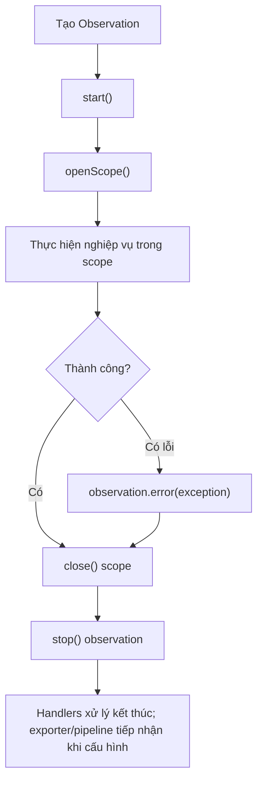

# Mở scope trong vòng đời Micrometer Observation

Một request HTTP đi vào ứng dụng Spring Boot. Ứng dụng tạo observation cho bước `checkout.payment.authorize`, sau đó gọi payment gateway và ghi log khi có lỗi. Tại sao các thao tác phát sinh trong cùng một thread có thể biết chúng thuộc observation nào? Và vì sao đôi khi log bị mất `traceId`, hoặc một observation con không liên kết đúng với observation cha?

Câu trả lời nằm một phần ở thao tác **mở scope**: `Observation.openScope()`. Scope làm cho một observation trở thành **observation hiện hành (current observation)** trong một phạm vi thực thi cụ thể. Đây là cơ chế nối ngữ cảnh giữa việc quan sát một thao tác và code chạy bên trong thao tác đó.

Bài học thuộc chương **Vòng đời observation** của module **SPRING_BOOT_OBSERVABILITY**. Module sử dụng Micrometer Observation, metrics, logs và distributed tracing để điều tra lỗi và độ trễ thực tế; vì vậy mở scope cần được hiểu cùng với context propagation, tracing handlers, tag/cardinality, exporter và sampling.

## Mục tiêu học tập

Sau bài này, bạn có thể:

1. Giải thích chính xác **scope là gì**, **mở scope có tác dụng gì** và nó khác `start()`/`stop()` ra sao.
2. Sử dụng `openScope()` với `try-with-resources` để bảo đảm đóng scope khi thành công hoặc ném ngoại lệ.
3. Đọc được **current observation** và hiểu cách các scope lồng nhau khôi phục ngữ cảnh cha.
4. Nhận diện các lỗi do scope không được đóng, mở sai chỗ hoặc giả định scope tự lan qua thread, executor, message queue và Reactor.
5. Liên hệ việc mở scope với metrics, log correlation, span hiện hành, sampling và cách kiểm tra tín hiệu trong một ứng dụng Spring Boot.

## 1. Scope là gì?

Trong Micrometer Observation, một **observation** biểu diễn một hoạt động được quan sát, ví dụ: xử lý HTTP request, thực hiện một bước thanh toán, gọi HTTP downstream hoặc xử lý một message. Observation có tên, context, key-value và các callback vòng đời.

Một **scope** là một phạm vi động trong khi thực thi code. Khi mở scope cho observation, observation đó được đăng ký làm **current observation** đối với ngữ cảnh thực thi mà Micrometer đang quản lý (thường gắn với thread hiện tại). Code chạy trong phạm vi này có thể truy cập observation hiện hành mà không cần truyền trực tiếp biến observation qua mọi phương thức.

Có thể hình dung:

```text
Observation: "checkout.payment.authorize"
    ├── start()      -> bắt đầu vòng đời được đo
    ├── openScope()  -> làm nó thành current observation tại đây
    │   ├── gọi gateway
    │   ├── ghi log
    │   └── tạo observation con
    ├── close scope  -> khôi phục observation hiện hành trước đó
    └── stop()       -> kết thúc vòng đời được đo
```

**Điểm phân biệt quan trọng:** scope **không phải** chính observation và **không phải** một span độc lập. Scope chỉ xác định observation nào là hiện hành trong đoạn code đang chạy. Tùy instrumentation và các `ObservationHandler` được đăng ký, nó có thể kích hoạt việc đặt/khôi phục span hiện hành hoặc thông tin correlation trong logging context.

### Ba thao tác dễ nhầm

| Thao tác | Vai trò chính | Điều không nên giả định |
|---|---|---|
| `observation.start()` | Bắt đầu vòng đời observation; gọi các handler tương ứng | Tự làm observation thành current trong mọi đoạn code |
| `observation.openScope()` | Tạo phạm vi current observation; thông báo handler khi scope mở/đóng | Tự kết thúc observation hay tự truyền context sang mọi thread |
| `scope.close()` | Đóng phạm vi; thường khôi phục observation trước đó | Thay thế `observation.stop()` |
| `observation.stop()` | Kết thúc hoạt động được đo; gọi các handler hoàn tất | Tự đóng tất cả scope đang mở một cách an toàn |

Một observation có thể đi qua nhiều lần mở/đóng scope trong vòng đời của nó; không có quy tắc “mỗi observation chỉ mở scope đúng một lần”. Dù vậy, **mỗi scope được mở phải được đóng đúng cách**.

## 2. Vị trí của mở scope trong vòng đời observation

Luồng cơ bản của một thao tác đồng bộ:



Sơ đồ mô tả một cách triển khai thủ công. Trong thực tế, một số API tiện ích có thể quản lý tự động các bước trên.

Các mốc cần phân biệt:

- **Tạo observation:** khai báo tên thao tác, context và metadata phù hợp; một observation chưa bắt đầu thì chưa đại diện cho toàn bộ một hoạt động đã được đo.
- **Bắt đầu:** `start()` kích hoạt vòng đời và thông báo các handler quan sát đã bắt đầu.
- **Mở scope:** `openScope()` làm observation thành ngữ cảnh hiện hành trong đoạn xử lý đang chạy.
- **Ghi nhận sự kiện/lỗi:** có thể bổ sung `event()`, `error()`, low-cardinality hoặc high-cardinality key values theo nhu cầu.
- **Đóng scope:** kết thúc quyền sở hữu ngữ cảnh hiện hành của đoạn code, đồng thời khôi phục ngữ cảnh trước đó khi lồng scope.
- **Dừng observation:** `stop()` hoàn tất vòng đời; metric timer và span có thể được cập nhật/kết thúc qua các handler được cấu hình.

Nếu chỉ mở rồi đóng scope nhưng không `start()`/`stop()` đầy đủ, bạn không nên kỳ vọng thời lượng được đo đúng. Nếu `start()`/`stop()` nhưng bỏ qua scope, các handler vẫn có thể ghi thời lượng, song code lồng bên trong có thể không nhìn thấy observation hiện hành và mất mối liên hệ với log/span con.

## 3. Mẫu code chuẩn: `openScope()` và `try-with-resources`

Ví dụ sau minh họa một thao tác đồng bộ trong service Spring Boot. `PaymentGateway`, `PaymentRequest` và `PaymentResult` là các kiểu nghiệp vụ giả định của ứng dụng.

```java
import io.micrometer.observation.Observation;
import io.micrometer.observation.ObservationRegistry;
import org.springframework.stereotype.Service;

@Service
class CheckoutService {
    private final ObservationRegistry observationRegistry;
    private final PaymentGateway paymentGateway;

    CheckoutService(ObservationRegistry observationRegistry,
                    PaymentGateway paymentGateway) {
        this.observationRegistry = observationRegistry;
        this.paymentGateway = paymentGateway;
    }

    PaymentResult authorize(PaymentRequest request) {
        Observation observation = Observation.createNotStarted(
                        "checkout.payment.authorize", observationRegistry)
                .contextualName("authorize payment")
                .lowCardinalityKeyValue("operation", "authorize")
                .start();

        try (Observation.Scope scope = observation.openScope()) {
            try {
                return paymentGateway.authorize(request);
            } catch (RuntimeException exception) {
                observation.error(exception);
                throw exception;
            }
        } finally {
            observation.stop();
        }
    }
}
```

### Đọc code theo đúng ngữ nghĩa

1. `Observation.createNotStarted(...)` tạo observation cho thao tác `checkout.payment.authorize`.
2. `lowCardinalityKeyValue("operation", "authorize")` thêm tag với số giá trị ít và ổn định, thích hợp cho việc tổng hợp metrics.
3. `start()` bắt đầu khoảng quan sát.
4. `openScope()` đặt observation vào ngữ cảnh hiện hành trong thread đang chạy. Các call nằm trong khối `try` có cơ hội truy cập context tương ứng.
5. Nếu `paymentGateway.authorize(...)` ném `RuntimeException`, `observation.error(exception)` ghi nhận ngoại lệ cho các handler quan tâm; sau đó code ném lại lỗi để không che giấu thất bại nghiệp vụ.
6. `try-with-resources` tự gọi `scope.close()` kể cả khi có `return` hoặc ngoại lệ.
7. `finally` gọi `observation.stop()` để đóng vòng đời observation.

Mẫu này chỉ minh họa ngoại lệ kiểu `RuntimeException`. Nếu API nghiệp vụ khai báo **checked exception**, cần xử lý và ghi nhận ngoại lệ đó tương ứng với chữ ký phương thức.

**Không gọi `stop()` thay cho `close()`.** Hai hành động có mục tiêu riêng. Việc đóng scope nên thực hiện trước khi dừng observation; `try-with-resources` giúp duy trì thứ tự đó khi code thoát khỏi khối.

### Cách ngắn hơn cho thao tác đồng bộ

Với một thao tác chỉ cần mở observation quanh một đoạn code đồng bộ, API tiện ích `observe(...)` giúp tránh quên những bước quản lý thông thường:

```java
PaymentResult authorize(PaymentRequest request) {
    return Observation.createNotStarted(
                    "checkout.payment.authorize", observationRegistry)
            .contextualName("authorize payment")
            .lowCardinalityKeyValue("operation", "authorize")
            .observe(() -> paymentGateway.authorize(request));
}
```

Ở đây `observe(...)` thực hiện việc bắt đầu, quản lý scope khi chạy callback và dừng observation theo vòng đời đồng bộ, bao gồm ghi nhận lỗi khi callback ném ngoại lệ mà API hỗ trợ xử lý. **Không cần** bọc tiếp đoạn này trong một scope thủ công chỉ để lặp lại cùng thao tác. Khi cần điều khiển chính xác thời điểm mở/đóng scope hoặc vòng đời phức tạp, sử dụng mẫu thủ công rõ ràng ở trên.

## 4. Current observation hoạt động như thế nào?

Hãy xem current observation như một **ngăn xếp ngữ cảnh** gắn với đoạn thực thi. Khi không có scope nào đang mở, current observation có thể là `null`. Mở scope mới thì ngữ cảnh mới trở thành hiện hành; đóng nó thường đưa current observation về ngữ cảnh trước đó.

Đọc observation hiện hành thông qua `ObservationRegistry`:

```java
Observation current = observationRegistry.getCurrentObservation();

if (current != null) {
    // Một observation đang hiện hành trong ngữ cảnh thực thi này.
    // Không nên tự tạo metric tag với ID riêng của request ở đây.
}
```

`getCurrentObservation()` cho biết **observation hiện hành** được registry quản lý, không phải danh sách mọi observation còn đang chạy trong ứng dụng. Kết quả có thể rỗng nếu code ở ngoài scope hoặc không có context được khôi phục ở thread hiện tại. Ngoài ra, một observation hiện hành không nhất thiết đồng nghĩa với việc backend đang nhận được span của nó: tracing handler, sampling và exporter có thể khác nhau giữa các môi trường.

### Ví dụ: quan sát lồng nhau

```java
Observation outer = Observation.createNotStarted(
        "checkout.process", observationRegistry).start();

try (Observation.Scope outerScope = outer.openScope()) {
    // Current observation là outer.
    Observation inner = Observation.createNotStarted(
            "checkout.payment.authorize", observationRegistry).start();

    try (Observation.Scope innerScope = inner.openScope()) {
        // Current observation là inner.
        callPaymentProvider();
    } finally {
        inner.stop();
    }

    // Đã đóng innerScope: current observation quay về outer.
} finally {
    outer.stop();
}
// Đã đóng outerScope: khôi phục ngữ cảnh có trước outer.
```

`callPaymentProvider()` là phương thức nghiệp vụ minh họa. Trong trường hợp phổ biến, instrumentation có khả năng dùng ngữ cảnh hiện hành để thiết lập quan hệ cha–con cho observation/span tiếp theo. Tuy nhiên, **quan hệ chính xác giữa các span phụ thuộc vào tracing bridge, handler và cách tạo span**, không chỉ vào việc tên observation được lồng trong source code.

Minh họa diễn biến:

```text
Thời điểm          Current observation
--------------------------------------------------
Trước outer        (none hoặc observation cha khác)
Mở outerScope      checkout.process
Mở innerScope      checkout.payment.authorize
Đóng innerScope    checkout.process
Đóng outerScope    (trạng thái trước outer)
```

**Quy tắc quan trọng:** lồng scope theo cấu trúc và đóng theo **thứ tự ngược với lúc mở (LIFO)**. `try-with-resources` là cách tự nhiên để thực hiện điều này.

## 5. Mở scope ảnh hưởng đến metrics, logs và traces ra sao?

Mở scope thường không tạo ra ba tín hiệu một cách trực tiếp. Nó làm cho **ngữ cảnh của observation đang chạy có thể được các thành phần tích hợp sử dụng**.

| Tín hiệu | Vai trò của scope | Điều kiện cần để có kết quả |
|---|---|---|
| **Metrics** | Giúp kết nối observation với phạm vi thực thi; metric handler thường dùng sự kiện start/stop và key values để đo | Đã đăng ký metric handler/registry, meter phù hợp và pipeline metrics |
| **Logs** | Tracing integration có thể cập nhật current trace/span trong logging context (ví dụ MDC), cho phép log trong scope mang ID tương quan | Tracing bridge, cấu hình log pattern/structured logging và context propagation phù hợp |
| **Traces** | Tracing handler có thể thiết lập span hiện hành khi scope mở, khôi phục span trước đó khi scope đóng | Tracing handler, instrumentation, sampler và exporter/collector/backend hoạt động |

### Metrics: mở scope không phải là ghi metric

Ví dụ, gọi `openScope()` **không tự tăng** một counter “số lần thanh toán” hoặc tự ghi kết quả nghiệp vụ thành công/thất bại. Metric được tạo khi có instrumentation và handler tương ứng; thao tác đo thời lượng thường liên quan toàn bộ khoảng `start()` đến `stop()`.

Bổ sung các key-value thích hợp:

- **Low-cardinality tag:** `operation=authorize`, `outcome=success|failure` (nếu dùng các giá trị chuẩn hóa và đăng ký đúng thời điểm).
- **Không đặt** `orderId`, `userId`, `traceId` hoặc URL chứa ID động thành metric label; chúng có thể tạo số lượng time series rất lớn.

Mở một observation với tên có ý nghĩa và tag ổn định giúp các metric có thể dùng cho dashboard/SLO, nhưng **số lượng metric và cách xuất còn phụ thuộc cấu hình của ứng dụng**.

### Logs: scope giúp correlation nhưng không tự sinh log

Giả sử trong phạm vi thanh toán có:

```java
log.warn("Payment gateway timed out");
```

Nếu Micrometer Tracing và logging được tích hợp đúng, một log trong scope có thể được bổ sung `traceId` và `spanId` qua MDC hoặc định dạng log được cấu hình. Nhờ đó, kỹ sư tìm được trace liên quan tới lỗi.

Tuy nhiên:

- `openScope()` không tự tạo dòng log và không tự ghi stack trace.
- Không phải logger hoặc format nào cũng tự in `traceId`/`spanId`; phải cấu hình tương ứng.
- Một trace không được giữ do sampling vẫn có thể có log với trace ID; ID trong log **không bảo đảm** tìm được trace trong backend.
- Nếu code chạy trên thread khác mà context không được truyền/khôi phục, log ở thread đó có thể thiếu ID hoặc có context khác.

Không đưa token, thông tin thanh toán, dữ liệu cá nhân hay nội dung nhạy cảm vào tag, log hoặc tracing baggage chỉ để dễ truy vết.

### Traces: current observation và current span có liên quan, nhưng khác nhau

Khi có Micrometer Tracing, các observation handler có thể tạo span và đặt span hiện hành theo scope. Các client HTTP đã được instrument sau đó có thể tạo span con và truyền trace context qua các header phù hợp, chẳng hạn W3C `traceparent`.

Một số điểm cần nhớ:

- Scope của **Observation** là khái niệm từ Micrometer Observation; scope của **span** được cung cấp bởi tracing integration. Chúng có thể được nối với nhau qua handler nhưng không đồng nhất về API.
- Việc tạo trace/span có thể phụ thuộc chính sách **sampling**; application code không nên lấy sự tồn tại của một trace đã export làm dấu hiệu duy nhất rằng nghiệp vụ có chạy.
- Nếu span con được tạo nhưng trace context không truyền sang downstream, bạn có thể thấy hai trace riêng biệt dù giao dịch nghiệp vụ là một luồng.
- Thời lượng span và số lượng span phụ thuộc mức độ instrument; mở scope không tự phân tách toàn bộ logic bên trong thành các span con.

## 6. Scope và thread: ngữ cảnh không tự lan qua ranh giới bất đồng bộ

Lỗi phổ biến nhất là nghĩ rằng mở scope một lần ở thread tiếp nhận request thì mọi công việc gửi qua executor, `@Async`, message queue hoặc Reactive pipeline sẽ tự mang ngữ cảnh đó.

Trong mô hình thông thường, current observation dựa trên **ThreadLocal** hoặc cơ chế ngữ cảnh tương đương. Một thread khác không tự thừa hưởng đúng scope đang mở của thread gọi.

### Ví dụ sai: mở scope rồi chuyển việc sang executor

```java
Observation observation = Observation.createNotStarted(
        "checkout.send-receipt", observationRegistry).start();

try (Observation.Scope scope = observation.openScope()) {
    executor.execute(() -> sendReceiptEmail());
} finally {
    observation.stop();
}
```

Đoạn này có ít nhất hai vấn đề:

1. `sendReceiptEmail()` chạy trong thread khác; observation đang current ở thread gửi việc **không mặc nhiên** là current ở thread thực thi.
2. `observation.stop()` có thể chạy ngay sau khi `executor.execute(...)` trả về, **trước khi** gửi email hoàn tất. Metric/trace đo khoảng thời gian gửi tác vụ, không phải thời gian thực thi thực tế.

### Cách suy nghĩ đúng

Với công việc bất đồng bộ, cần xác định rõ:

- **Quan sát đoạn nào?** Nếu chỉ đo thời gian đưa nhiệm vụ vào queue, observation kết thúc khi enqueue xong là hợp lý. Nếu muốn đo thời gian gửi email, observation phải bao quanh việc gửi email ở thread xử lý.
- **Ai sở hữu scope?** Scope nên được mở và đóng đúng tại nơi callback thực thi, không để một thread mở và thread khác tùy ý đóng.
- **Ngữ cảnh cha cần được truyền thế nào?** Sử dụng instrumentation của framework hoặc cơ chế **Micrometer Context Propagation** phù hợp để capture/restore context khi chuyển thread, tránh tự giữ reference rồi mặc định nó trở thành current.
- **Công việc có cùng vòng đời với request không?** Message tồn tại lâu sau khi request kết thúc có thể phù hợp với một observation/trace mới có quan hệ liên kết, tùy ngữ nghĩa xử lý và tracing conventions.

Ví dụ ở mức cấu trúc (mã giả, không phải API có thể copy chạy nguyên xi):

```text
Thread nhận request:
    mở scope của observation cho checkout
    capture ngữ cảnh theo cơ chế propagation được cấu hình
    submit task + ngữ cảnh
    đóng scope checkout khi hết phạm vi request

Thread thực thi task:
    restore ngữ cảnh trước khi thực thi callback
    tạo observation cho sendReceiptEmail
    mở scope của sendReceiptEmail
    thực thi nghiệp vụ, ghi lỗi nếu có
    đóng scope và dừng observation của task
    khôi phục ngữ cảnh cũ của thread
```

Trong ứng dụng Spring Boot có thể dùng integration của thư viện, task decorator hoặc Micrometer Context Propagation, tùy version và stack. **Không nên coi raw `ExecutorService`, `CompletableFuture`, `@Async` và Reactor là tương đương về propagation.** Cần xác minh hành vi của cấu hình thực tế.

### Reactor và reactive processing

Pipeline Reactor có thể chuyển execution qua nhiều thread và chỉ bắt đầu chạy sau khi subscriber đăng ký. `try (scope = observation.openScope())` bao quanh **thời điểm xây dựng** `Mono`/`Flux` thường chỉ phủ phần tạo pipeline, không bảo đảm scope bao quanh lúc tín hiệu được xử lý.

Reactive code nên sử dụng cơ chế **Reactor Context** cùng khả năng context propagation/instrumentation tương ứng của phiên bản Spring Boot, Micrometer và Reactor đang chạy. Khi theo dõi thao tác asynchronous, phải gắn thời điểm kết thúc observation với tín hiệu hoàn thành/lỗi/hủy thực tế, thay vì dừng ngay sau khi trả về publisher.

## 7. Scope và propagation qua HTTP/messaging không giống nhau

Mở scope làm current observation có thể được truy cập trong phạm vi thực thi cục bộ. **Context propagation** là việc mang thông tin cần thiết qua ranh giới khác, có thể giữa thread, process hoặc service.

Hai việc liên quan nhưng không thay thế nhau:

| Phạm vi | Cơ chế thường dùng | Điểm phải kiểm tra |
|---|---|---|
| Cùng thread, code lồng nhau | `Observation.openScope()` / `Scope.close()` | Đóng scope đúng thứ tự, current observation phù hợp |
| Thread pool / executor | Context capture/restore hoặc integration hỗ trợ | Ngữ cảnh được khôi phục khi callback thực sự chạy; không rò rỉ sang task kế tiếp |
| HTTP giữa service | Instrumented client/server và trace context headers | Header được inject/extract; gateway/proxy không làm mất context |
| Message broker / consumer | Header propagation và message instrumentation | Xác định quan hệ parent/span link đúng với xử lý bất đồng bộ |
| Reactive publisher | Reactor Context và context propagation tương ứng | Ngữ cảnh theo **thời điểm subscribe/signal**, không chỉ lúc assemble pipeline |

Một request có thể có scope hoàn chỉnh ở checkout-service nhưng trace vẫn bị đứt tại payment-service nếu HTTP client không inject context. Ngược lại, việc có `traceparent` trong request downstream không bảo đảm ứng dụng tạo đúng observation/span nếu instrumentation nhận context chưa được cấu hình.

## 8. Scope lồng nhau, lỗi rò rỉ và cách chẩn đoán

### Lỗi 1 — Quên đóng scope

```java
Observation.Scope scope = observation.openScope();
callExternalService();
// Không close() khi một nhánh return sớm hoặc ném ngoại lệ.
```

Nếu thread được tái sử dụng bởi thread pool, ngữ cảnh có thể còn lưu và ảnh hưởng request tiếp theo. Hậu quả có thể là current observation sai, quan hệ trace cha–con nhầm, hoặc log mang thông tin tương quan không phù hợp. **Giải pháp:** sử dụng `try-with-resources` và tránh giữ scope trong field hoặc cache lâu dài.

### Lỗi 2 — Dừng observation khi scope vẫn đang mở

```java
Observation observation = Observation.createNotStarted(
        "checkout.process", observationRegistry).start();

Observation.Scope scope = observation.openScope();
observation.stop();  // Sai thứ tự quản lý tài nguyên.
scope.close();
```

Cách này khiến một phần code/handler có thể vẫn thấy observation như đang hiện hành dù vòng đời đã kết thúc. **Giải pháp:** đóng scope trước, dừng observation sau; tổ chức bằng `try/finally`.

### Lỗi 3 — Đóng các scope lồng nhau sai thứ tự

Nếu mở A → B mà lại đóng A trước B, ngữ cảnh được khôi phục có thể không còn nhất quán với kỳ vọng. Khi các scope được lồng trong `try-with-resources`, ngôn ngữ Java bảo đảm tài nguyên đóng theo thứ tự ngược.

### Lỗi 4 — Gọi `openScope()` trên observation rồi tin rằng downstream HTTP đã liên kết

Scope cục bộ không tự tạo HTTP header. Phải kiểm tra instrumented client, propagation format, server extraction và sampling/export. Đặc biệt với client tự xây dựng hoặc giao thức custom, có thể phải tích hợp propagation riêng.

### Lỗi 5 — Dùng scope để thay thế lỗi nghiệp vụ hoặc đo đạc

Mở scope không biến mọi exception thành status lỗi, cũng không bảo đảm metric nghiệp vụ được tăng. Gọi `observation.error(exception)` khi phù hợp; nếu cần đếm kết quả thanh toán, thiết kế meter/observation và định nghĩa outcome theo nghiệp vụ. Scope không thay thế retry, timeout hay cơ chế xử lý lỗi.

## 9. Thực hành kiểm chứng trong một ứng dụng Spring Boot

Giả sử service checkout có endpoint tạo đơn và gọi payment gateway. Sau khi thêm observation thủ công, hãy thử một request thành công, một request lỗi và một request chuyển sang thread khác.

### Kiểm tra ngay trong code

Trong phạm vi scope:

```java
Observation observation = Observation.createNotStarted(
        "checkout.payment.authorize", observationRegistry).start();

try (Observation.Scope scope = observation.openScope()) {
    Observation current = observationRegistry.getCurrentObservation();
    boolean correctScope = (current == observation);

    if (!correctScope) {
        throw new IllegalStateException("Observation scope is not current");
    }

    // Thực hiện một thao tác nghiệp vụ đồng bộ tại đây.
} finally {
    observation.stop();
}
```

Bài kiểm tra này minh họa ý tưởng đối chiếu current observation bằng registry. Với registry/handler no-op hoặc cấu hình instrumentation khác nhau, kết quả và khả năng hiển thị telemetry có thể khác; cần xác minh trên stack thực tế thay vì xem biểu thức kiểm tra là đặc tả chung cho mọi cấu hình.

### Kiểm tra tín hiệu vận hành

1. **Metrics:** có metric phù hợp cho thao tác đã instrument không? Tên/tag có ổn định không? Timer có phản ánh thời lượng phù hợp với vòng đời start/stop không?
2. **Logs:** log bên trong scope có `traceId`/`spanId` khi tracing được bật không? Sau khi thoát scope, log ở request khác có bị gắn sai ID không?
3. **Traces:** span của thao tác có quan hệ phù hợp với HTTP server span không? Có trace nào bị đứt khi qua HTTP client hoặc executor không?
4. **Errors:** request lỗi có được ghi đúng vào log, observation error và các phép đo kết quả cần thiết không? Không suy ra tỷ lệ lỗi từ một vài trace mẫu.
5. **Pipeline:** nếu không tìm thấy trace, kiểm tra sampler, exporter, collector, retention và khả năng truy vấn; đừng đồng nhất “không lưu trace” với “không mở scope”.

Một lỗi có thể được ghi vào metric nhưng không có trace lưu lại do sampling. Một trace có thể hiển thị nhưng log mất correlation vì MDC/log pattern chưa tích hợp. Các tình huống đó giúp xác định rõ **điểm đứt của tín hiệu**.

## 10. Những câu hỏi tự đánh giá

**Câu 1.** `observation.start()` đã được gọi. Phương thức con ở cùng thread có mặc nhiên tìm được observation đó qua `getCurrentObservation()` không?

**Gợi ý:** Không nên giả định. `start()` bắt đầu vòng đời; cần một scope hiện hành hoặc cơ chế propagation phù hợp để code con nhìn thấy đúng current observation.

**Câu 2.** Tại sao phải dùng `try (Observation.Scope scope = observation.openScope())` thay vì chỉ gọi `openScope()`?

**Gợi ý:** Vì scope phải được đóng cả khi có `return` và ngoại lệ. Đóng scope giúp khôi phục ngữ cảnh trước đó và tránh rò rỉ context sang công việc khác trên cùng thread.

**Câu 3.** Sau khi đóng scope con, observation nào phải trở lại hiện hành?

**Gợi ý:** Observation của scope cha trước đó, nếu còn đang mở; nếu không có cha, current observation trở về trạng thái trước khi mở.

**Câu 4.** Một callback được gửi qua executor trong scope nhưng log trong callback không có `traceId`. Có chắc callback chạy ngoài hoạt động nghiệp vụ không?

**Gợi ý:** Không. Scope cục bộ không tự lan qua thread. Cần kiểm tra context capture/restore, tracing integration, log formatting và sampler.

**Câu 5.** Một đoạn code mở scope, thực hiện công việc rất nhanh, đóng scope nhưng quên `stop()`. Việc mở và đóng scope đã đủ để bảo đảm timer/span kết thúc chưa?

**Gợi ý:** Chưa. `close()` giải phóng phạm vi current observation; `stop()` mới hoàn tất vòng đời observation. API `observe(...)` có thể quản lý cả hai cho thao tác đồng bộ.

## Kết luận

Trong Micrometer Observation, **mở scope là bước làm observation trở thành ngữ cảnh hiện hành trong một phạm vi thực thi cụ thể**. Nó giúp các thao tác lồng nhau và integrations như tracing/log correlation tìm được context phù hợp. Scope không thay cho `start()`/`stop()`, không tự ghi đủ metrics/logs/traces và không tự propagate qua thread hay service. Với Spring Boot, sử dụng `try-with-resources`, đóng scope đúng thứ tự, lựa chọn instrumentation phù hợp và kiểm tra đường đi telemetry sẽ giúp dữ liệu quan sát phản ánh đúng hành vi ứng dụng khi điều tra lỗi và độ trễ.
