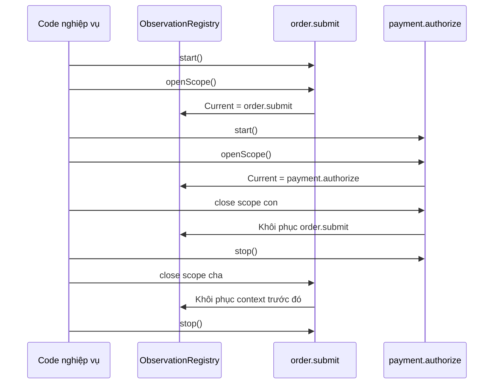

# Đóng scope trong vòng đời Micrometer Observation

Một request đi qua `OrderController`, gọi `PaymentService` và ghi log trong lúc xử lý. Nếu mỗi thao tác được theo dõi bằng Micrometer Observation, log và các span có thể liên kết cùng một trace. Tuy nhiên, khi `PaymentService` kết thúc, **observation hiện hành phải trở về thao tác của `OrderController`**. Nếu scope bị bỏ quên, một thread được tái sử dụng có thể giữ nhầm ngữ cảnh của request trước, làm log hoặc quan hệ span sai lệch.

Trong chương **Vòng đời observation** của module `SPRING_BOOT_OBSERVABILITY`, bài học này giải thích chính xác **đóng scope** là gì, đóng khi nào và vì sao thao tác ấy quan trọng khi thiết lập observability cho Spring Boot bằng Micrometer Observation, metrics, logs và distributed tracing. Các ví dụ cũng kết nối scope với context propagation, cardinality, exporter và sampling để phục vụ điều tra lỗi và độ trễ trên môi trường thực.

## 1. Scope là gì?

Trong Micrometer Observation, `Observation` đại diện cho **một công việc đang được quan sát**, chẳng hạn `order.submit` hoặc `payment.authorize`. `Observation.Scope` là **phạm vi mà một observation được đặt làm observation hiện tại** trong ngữ cảnh thực thi tương ứng.

Khi gọi:

```java
Observation observation =
    Observation.createNotStarted("order.submit", observationRegistry).start();

try (Observation.Scope scope = observation.openScope()) {
    // Observation "order.submit" là observation hiện tại trong scope.
    handleOrder();
} finally {
    observation.stop();
}
```

`openScope()` kích hoạt observation dưới dạng **current observation** cho đoạn mã được bao quanh; còn `scope.close()`, được `try-with-resources` tự động gọi, **thoát khỏi phạm vi đó và khôi phục observation trước đó (nếu có)**.

Scope có các đặc điểm cần phân biệt:

- Nó biểu diễn **ngữ cảnh hiện hành**, thường được quản lý trên thread thực thi đồng bộ bằng cơ chế scope của registry và những handler liên quan.
- Nó **không phải** đối tượng chứa toàn bộ metric, log hoặc trace; những dữ liệu này được các thành phần tương ứng tạo và xuất.
- Một Observation có thể có vòng đời bắt đầu–kết thúc, còn scope chỉ là khoảng thời gian mà Observation ấy được đặt làm hiện tại.
- Khi đóng scope, ta thường khôi phục ngữ cảnh hiện tại trước đó; **không có nghĩa Observation đã kết thúc**.

Trong Spring Boot 3.x, `ObservationRegistry` thường được framework cấu hình khi có `spring-boot-starter-actuator`. Dùng bean registry được inject để nhất quán với handler, filter và chính sách observation của ứng dụng.

## 2. Đóng scope khác gì `Observation.stop()`?

Hai hành động dễ bị nhầm:

| Hành động | Thực hiện trên | Tác dụng chính | Có kết thúc phép đo Observation? |
| --- | --- | --- | --- |
| `observation.start()` | `Observation` | Bắt đầu vòng đời thao tác và thông báo handler tương ứng | Chưa |
| `observation.openScope()` | `Observation` | Đặt observation làm hiện tại trong scope mới | Chưa |
| `scope.close()` | `Observation.Scope` | Thoát scope và khôi phục ngữ cảnh trước đó | **Không** |
| `observation.error(ex)` | `Observation` | Ghi nhận lỗi trong context và báo handler phù hợp | Không |
| `observation.stop()` | `Observation` | Kết thúc vòng đời, báo handler để hoàn tất dữ liệu | **Có** |

Để dễ hình dung, xem hai đồng hồ khái niệm:

```text
Thời gian            t0            t1            t2            t3
                     |-------------|-------------|-------------|
Observation          start -----------------------------------> stop
Scope                              openScope ---> close
Current observation  như trước      Observation X  như trước
```

Ở `t2`, scope kết thúc và current observation được khôi phục; bản thân Observation X vẫn tồn tại cho tới `t3`. Đo thời lượng của một Observation thông thường theo vòng đời `start`–`stop`, không đơn thuần theo thời gian scope đang mở.

**Hệ quả:** gọi `scope.close()` mà quên `observation.stop()` có thể khiến handler metrics/tracing không nhận được sự kiện hoàn thành. Ngược lại, chỉ `stop()` mà vẫn giữ scope mở không phải cách chuẩn để dọn ngữ cảnh hiện tại. Hãy quản lý hai trách nhiệm riêng biệt.

## 3. Vì sao phải đóng scope đúng lúc?

Một server thường tái sử dụng thread để xử lý nhiều request. Nếu scope của request A vẫn hiện hành sau khi request A đã kết thúc, request B chạy trên cùng thread có thể nhìn thấy context cũ. Tùy instrumentation được cài đặt, tác động có thể bao gồm:

- Log của request B gắn nhầm `traceId` hoặc `spanId` từ A.
- Span con của B bị gắn nhầm vào trace của A.
- Một đoạn code gọi `observationRegistry.getCurrentObservation()` nhận sai thao tác, khiến tag hoặc event được ghi vào sai context.
- Các handler theo dõi phạm vi gọi không được thông báo đúng thời điểm đóng scope.

Đóng scope đúng giúp trả lại **ngữ cảnh trước khi vào phạm vi** và giữ quan hệ lồng nhau giữa các thao tác. Trong ứng dụng có tracing bridge và hỗ trợ log correlation, việc khôi phục ngữ cảnh cũng quan trọng để MDC/logging context tương ứng không giữ sai span hiện tại.

Nguy cơ cụ thể phụ thuộc phiên bản thư viện, loại handler và cách context được cấu hình. Không phải mọi ứng dụng đều sử dụng cùng một cơ chế ThreadLocal; khi dùng Reactor hoặc propagation bất đồng bộ, phải xét đến context theo mô hình thực thi đó.

## 4. Cách chuẩn: `try-with-resources`

`Observation.Scope` triển khai `AutoCloseable`, vì vậy cấu trúc Java `try-with-resources` là lựa chọn ưu tiên cho code đồng bộ:

```java
import io.micrometer.observation.Observation;
import io.micrometer.observation.ObservationRegistry;
import org.springframework.stereotype.Service;

@Service
public class InventoryService {
    private final ObservationRegistry observationRegistry;

    public InventoryService(ObservationRegistry observationRegistry) {
        this.observationRegistry = observationRegistry;
    }

    public void reserve(String warehouseType) {
        Observation observation =
            Observation.createNotStarted("inventory.reserve", observationRegistry)
                .lowCardinalityKeyValue("warehouse.type", normalize(warehouseType))
                .start();

        try (Observation.Scope scope = observation.openScope()) {
            reserveInDatabase();
        } catch (RuntimeException ex) {
            observation.error(ex);
            throw ex;
        } finally {
            observation.stop();
        }
    }

    private String normalize(String raw) {
        return "regional".equals(raw) ? "regional" : "central";
    }

    private void reserveInDatabase() {
        // Thao tác dự trữ hàng thực tế.
    }
}
```

Ở đây:

1. `start()` bắt đầu Observation.
2. `openScope()` đặt `inventory.reserve` làm ngữ cảnh hiện tại.
3. Khi thoát khỏi khối `try` bằng đường đi thông thường hoặc exception, Java tự gọi `scope.close()`.
4. `catch` ghi nhận lỗi rồi ném tiếp để tầng nghiệp vụ vẫn xử lý đúng.
5. `finally` gọi `observation.stop()`, kể cả khi thao tác thất bại.

Đoạn mã này giới hạn `warehouse.type` vào tập hai giá trị, phù hợp cho **low-cardinality tag**. Không thêm trực tiếp `warehouseId`, `orderId` hoặc dữ liệu người dùng có số giá trị lớn vào nhãn metric chỉ để dễ tra cứu. Những dữ liệu đó, nếu được phép thu thập, nên đi qua cơ chế high-cardinality của trace/log có chính sách riêng.

### Không dùng `close()` thủ công khi không cần

Mẫu dễ gặp lỗi:

```java
Observation.Scope scope = observation.openScope();
doWork();             // Nếu ném exception, dòng tiếp theo không chạy.
scope.close();        // Scope có thể không bao giờ được đóng.
observation.stop();
```

Khắc phục bằng `try-with-resources` và `finally`, hoặc dùng API tiện ích `Observation.observe(...)` khi không cần chủ động kiểm soát scope.

### Khi nào chỉ cần `observe(...)`?

Nếu toàn bộ nghiệp vụ nằm trong một lambda đồng bộ, có thể để Micrometer quản lý start, scope, error và stop:

```java
return Observation.createNotStarted("payment.authorize", observationRegistry)
    .lowCardinalityKeyValue("payment.channel", "card")
    .observe(() -> paymentClient.authorize());
```

Ví dụ giả định `paymentClient.authorize()` trả về kiểu phù hợp với phương thức bao quanh. Đây là lựa chọn gọn cho thao tác đồng bộ. **Nếu lambda chỉ trả về một `CompletableFuture` chưa hoàn thành**, `observe(...)` đo thời gian tạo hoặc lên lịch future; nó không tự chờ toàn bộ công việc async kết thúc. Khi cần đo công việc bất đồng bộ, phải thiết kế vòng đời Observation tương ứng với thời điểm hoàn tất thực tế.

## 5. Scope lồng nhau: đóng scope con để trở về scope cha

Giả sử `order.submit` là thao tác cha, `payment.authorize` là thao tác con. Khi mở scope con trong lúc scope cha đang hiện hành, registry có thể lưu ngữ cảnh trước đó để khôi phục khi scope con đóng.



### Ví dụ có thể đọc theo từng bước

```java
import io.micrometer.observation.Observation;
import io.micrometer.observation.ObservationRegistry;

public void submitOrder(ObservationRegistry registry) {
    Observation parent =
        Observation.createNotStarted("order.submit", registry).start();

    try (Observation.Scope parentScope = parent.openScope()) {
        // Current observation: parent
        System.out.println(registry.getCurrentObservation() == parent);

        Observation child =
            Observation.createNotStarted("payment.authorize", registry).start();

        try (Observation.Scope childScope = child.openScope()) {
            // Current observation: child
            System.out.println(registry.getCurrentObservation() == child);
            authorizePayment();
        } catch (RuntimeException ex) {
            child.error(ex);
            throw ex;
        } finally {
            child.stop();
        }

        // Đóng childScope xong: current observation trở lại parent.
        System.out.println(registry.getCurrentObservation() == parent);
    } catch (RuntimeException ex) {
        parent.error(ex);
        throw ex;
    } finally {
        parent.stop();
    }
}

private void authorizePayment() {
    // Thao tác giả lập, đặt trong cùng class ở ví dụ thực tế.
}
```

Ba lần `println` phía trên được kỳ vọng in `true` với registry hoạt động và việc sử dụng scope đồng bộ bình thường. Nếu trước khi mở `parentScope` đã có một scope khác, sau khi đóng `parentScope` ngữ cảnh đó mới được khôi phục; không nên mặc định current observation luôn trở về `null`.

**Thứ tự đóng:** với các scope lồng nhau, đóng theo thứ tự ngược lại với lúc mở (*last in, first out*): scope con trước, scope cha sau. Java `try-with-resources` lồng nhau giúp bảo đảm thứ tự này. Không tùy tiện đóng scope cha trong khi scope con còn mở, hoặc tái sử dụng một `Scope` đã đóng.

## 6. Điều gì thực sự diễn ra khi đóng scope?

Ở mức khái niệm, đóng một `Observation.Scope` dẫn tới hai nhóm hành vi:

1. **Khôi phục current observation:** sau khi rời scope, code chạy tiếp không còn nhìn thấy observation vừa thoát là current; thay vào đó là observation/context trước đó, nếu có.
2. **Thông báo cho hệ thống observation:** registry và các handler phù hợp có cơ hội phản ứng với việc scope đóng, chẳng hạn cập nhật ngữ cảnh tracing hiện hành hoặc phục hồi trạng thái liên quan.

Sự kiện đóng scope **không tự**:

- gọi `observation.stop()` thay bạn;
- bảo đảm một metric đã được ghi thành time series hoặc Prometheus đã scrape;
- ép trace được chọn bởi sampling hay đã xuất thành công lên collector;
- kết thúc một request HTTP, commit transaction hoặc hoàn tất một tác vụ async;
- vận chuyển log đến hệ thống tập trung.

Đây là các trách nhiệm khác nhau của instrumentation, handler, exporter và nền tảng vận hành.

### Scope, trace context và log correlation

Khi dùng Micrometer Tracing bridge với instrumentation tương thích, mở scope có thể kích hoạt span/context tương ứng. Log được ghi trong scope, nếu hệ thống logging được cấu hình để đưa MDC vào mẫu log, có thể mang `traceId` và `spanId`. Sau khi đóng scope con, mã chạy tiếp trong scope cha sẽ có cơ hội sử dụng lại context/span của cha.

Đừng giả định MDC luôn có traceId chỉ vì có `ObservationRegistry`: cần tracing bridge, handler, cơ chế current context và cấu hình logging phù hợp. Không nên tự ghi `traceId` giả, hoặc đưa ID nhạy cảm vào tag chỉ để nhận diện log.

## 7. Đóng scope khi có exception, return và luồng điều khiển khác

`try-with-resources` đóng scope trong các đường đi thông thường:

| Đường thoát khỏi khối `try` | Scope có được tự đóng? | Việc người viết code vẫn phải chú ý |
| --- | --- | --- |
| Chạy hết khối | Có | Gọi `stop()` cho Observation nếu đang tự quản lý |
| `return` từ trong khối | Có | Giữ `stop()` trong `finally` |
| Ném `RuntimeException` | Có | Ghi `observation.error(ex)` nếu cần và ném tiếp hoặc xử lý có chủ đích |
| `break` / `continue` | Có | Đảm bảo chính sách vòng đời vẫn đúng |
| Tiến trình bị hủy đột ngột | Không được bảo đảm | Không thể dựa vào Java cleanup để bảo toàn telemetry sau mất tiến trình |

Khi ghi nhận lỗi, tránh chặn lỗi nghiệp vụ chỉ vì muốn thu thập telemetry. `observation.error(ex)` là thao tác ghi nhận; quyết định trả mã HTTP, retry hoặc bù trừ giao dịch thuộc về tầng nghiệp vụ.

Một điểm cần lưu ý: nếu code **bắt exception ngay bên trong scope và không ném tiếp**, API quan sát sẽ không thể tự suy ra kết quả nghiệp vụ đã thất bại. Khi lỗi đó cần được ghi nhận, phải báo lỗi hoặc kết quả một cách chủ động theo convention của ứng dụng.

## 8. Phạm vi scope phải khớp với ngữ cảnh thực thi

### 8.1. Đồng bộ trên cùng thread

Trong lời gọi Java đồng bộ, khối `try (Observation.Scope scope = observation.openScope())` là ranh giới rõ ràng. Một hàm được gọi bên trong thường có thể truy cập `observationRegistry.getCurrentObservation()` cho tới khi thoát scope.

### 8.2. Chuyển sang `@Async`, executor hoặc `CompletableFuture`

Đừng chia sẻ trực tiếp cùng một đối tượng `Observation.Scope` giữa các thread rồi đóng nó ở thread khác. Scope gắn với ngữ cảnh thực thi khi được mở; mang scope đang mở qua thread có thể phá tính nhất quán của current context.

Nếu tạo tác vụ trên executor:

```java
try (Observation.Scope scope = observation.openScope()) {
    executor.execute(() -> processInWorker());
}
// Scope của thread gọi đã đóng tại đây.
// processInWorker() có thể chạy sau đó trên thread khác.
```

Đoạn code trên **không bảo đảm** `processInWorker()` nhận được observation/span context. Để giữ đúng trace, cần capture context ở nơi gửi và restore ở nơi nhận bằng cơ chế được framework hỗ trợ, chẳng hạn Micrometer Context Propagation và `ContextPropagatingTaskDecorator` với `TaskExecutor` tương thích trong các phiên bản Spring Framework hỗ trợ.

Về nguyên tắc:

1. Capture ngữ cảnh hiện tại trước khi chuyển công việc.
2. Ở thread thực thi mới, restore ngữ cảnh trong một scope **của thread đó**.
3. Chạy tác vụ cần instrument.
4. Đóng scope được restore khi kết thúc tác vụ, trả lại context trước đó của worker thread.

Nếu cần một Observation đo **toàn bộ thời gian xử lý async**, không được gọi `stop()` ngay sau khi chỉ lên lịch công việc; phải kết thúc ở thời điểm future/callback hoàn thành hoặc thất bại, với chiến lược propagation và đồng bộ hóa phù hợp.

### 8.3. Reactor / WebFlux

Trong mô hình reactive, một luồng xử lý có thể đi qua nhiều thread hoặc scheduler. `ThreadLocal` đơn thuần không biểu diễn đầy đủ ngữ cảnh của subscriber. Hãy dùng tích hợp Reactor Context và Micrometer Context Propagation phù hợp với phiên bản Spring Boot/Reactor, đồng thời kiểm tra thời điểm subscription, cancellation và termination.

Mở scope trong một callback và đóng khi callback hoàn tất là một nhu cầu khác với vòng đời của toàn bộ reactive pipeline. Đừng giữ một scope Java ở ngoài rồi giả định nó bao phủ tất cả tín hiệu chạy bất đồng bộ.

### 8.4. HTTP và messaging

Đóng scope trong một JVM không truyền trace context qua mạng. Khi request ra ngoài process, client instrumentation phải inject trace context vào header/metadata; phía nhận phải extract và khởi tạo context tương ứng. Các định dạng như W3C Trace Context (`traceparent`) thường được sử dụng, nhưng cần cấu hình propagation tương thích cả hai phía.

## 9. Đóng scope ảnh hưởng các tín hiệu observability như thế nào?

| Tín hiệu | Mối liên hệ với scope | Điều kiện bổ sung để thực sự nhìn thấy dữ liệu |
| --- | --- | --- |
| Metrics | Scope giúp code xác định observation hiện hành; metric timer thường hoàn tất theo lifecycle Observation | Handler metrics, `MeterRegistry`, cách xuất/scrape và backend |
| Distributed traces | Scope giúp thiết lập/khôi phục span context và quan hệ cha–con | Tracing bridge, instrumentation, exporter, context propagation, backend |
| Logs | Scope có thể ảnh hưởng log correlation bằng traceId/spanId | MDC/log pattern, tracing integration, log collector |
| Dashboard/alert | Dữ liệu có thể được liên kết sau khi các tín hiệu thu thập đúng | Storage, query, retention và cảnh báo |

**Scope đóng đúng không đồng nghĩa tín hiệu sẽ có đầy đủ.** Ví dụ trace không xuất hiện vì sampling chỉ giữ 10% request hoặc exporter không gửi được dữ liệu. Ngược lại, dù sampling bỏ một trace, metric đo độ trễ vẫn có thể được ghi nếu handler metrics đã được cấu hình và Observation không bị loại từ đầu.

Cardinality cũng là một trách nhiệm riêng. Nên gắn các nhãn ổn định như `operation=reserve` hoặc `channel=card`; dữ liệu có số lượng giá trị lớn như `orderId` phải được xử lý theo chính sách telemetry phù hợp. Thêm tag đúng cách giúp điều tra các chuỗi metric mà không làm tăng chi phí giám sát quá mức.

## 10. Bài thực hành: kiểm tra ngữ cảnh trước và sau khi đóng

Ví dụ Java thuần dưới đây tập trung vào khả năng khôi phục observation hiện tại. Nó không cần chạy server hoặc exporter để minh họa phạm vi scope:

```java
import io.micrometer.observation.Observation;
import io.micrometer.observation.ObservationRegistry;

public class ScopeCloseDemo {
    public static void main(String[] args) {
        ObservationRegistry registry = ObservationRegistry.create();

        // Không có scope nào mở trên thread hiện tại.
        System.out.println(registry.getCurrentObservation() == null); // true

        Observation outer =
            Observation.createNotStarted("order.submit", registry).start();

        try (Observation.Scope outerScope = outer.openScope()) {
            System.out.println(registry.getCurrentObservation() == outer); // true

            Observation inner =
                Observation.createNotStarted("payment.authorize", registry).start();

            try (Observation.Scope innerScope = inner.openScope()) {
                System.out.println(registry.getCurrentObservation() == inner); // true
            } finally {
                inner.stop();
            }

            System.out.println(registry.getCurrentObservation() == outer); // true
        } finally {
            outer.stop();
        }

        System.out.println(registry.getCurrentObservation() == null); // true
    }
}
```

Khi chạy với Micrometer Observation tương thích và không có scope nào tồn tại trước đó trên thread, kết quả kỳ vọng:

```text
true
true
true
true
true
```

**Giải thích:** inner scope tạm thời thay outer làm current. Đóng inner scope khôi phục outer; đóng outer scope trả lại `null` trong ví dụ không có ngữ cảnh trước đó. Gọi `inner.stop()` và `outer.stop()` là bước riêng để hoàn tất từng Observation.

### Thử nghiệm với Spring Boot

Trong Spring Boot 3.x, có thể thêm Actuator:

```xml
<dependency>
    <groupId>org.springframework.boot</groupId>
    <artifactId>spring-boot-starter-actuator</artifactId>
</dependency>
```

Đưa phép đo custom qua một service đã inject `ObservationRegistry`. Khi cần xem metrics qua HTTP, có thể cấu hình web exposure cho `health`, `metrics`, và thêm registry Prometheus nếu muốn `prometheus`. Các endpoint vận hành phải được bảo vệ phù hợp; exposure **không thay thế xác thực và phân quyền**.

Để đánh giá việc đóng scope với distributed tracing, cần bổ sung tracer bridge và exporter/backend tương thích. Ghi log trước, trong và sau inner scope; quan sát `traceId`/`spanId` khi đã cấu hình log correlation. Kết quả cần cho thấy ngữ cảnh con chỉ hiện hành trong phạm vi của nó, sau đó quay về ngữ cảnh cha. Nếu trace không hiện trên backend, kiểm tra sampling, exporter và propagation trước khi quy kết lỗi cho `close()`.

### Câu hỏi tự kiểm tra

1. Nếu đã gọi `scope.close()`, liệu `Observation` có tự được `stop()` không? Vì sao?
2. Trong hai scope lồng nhau A rồi B, việc đóng B phải làm `getCurrentObservation()` trả về gì?
3. Vì sao `try-with-resources` an toàn hơn gọi `close()` sau `doWork()`?
4. Một future được tạo bên trong scope, nhưng chạy trên thread khác sau khi scope đóng: những điều kiện nào cần để trace context được tiếp tục?
5. Nếu scope được đóng chuẩn mà backend thiếu trace, nên kiểm tra tracing bridge, sampling hay exporter như thế nào?

## 11. Checklist khi code và review

- Mở scope ngay trước phần code cần current observation, đóng ngay khi ra khỏi phần đó.
- Dùng `try-with-resources` cho scope đồng bộ; bảo đảm `stop()` ở `finally` khi tự quản lý Observation.
- Đóng scope lồng nhau theo thứ tự ngược thứ tự mở, trả ngữ cảnh về scope cha.
- Ghi nhận exception phù hợp nhưng không thay đổi hành vi lỗi của nghiệp vụ chỉ để phục vụ telemetry.
- Không giữ scope mở qua ranh giới thread, future hoặc reactive pipeline mà không có chiến lược propagation rõ ràng.
- Không đóng scope của framework nếu code ứng dụng không sở hữu nó; với HTTP instrumentation, framework thường quản lý vòng đời và context.
- Kiểm tra trace/log correlation trong cả luồng thành công lẫn luồng lỗi, bao gồm cách thread được tái sử dụng.
- Xác minh việc đóng scope độc lập với metrics export, trace sampling và chính sách backend.

## Kết luận

**Đóng scope** trong Micrometer Observation là thao tác thoát khỏi phạm vi ngữ cảnh hiện tại để khôi phục observation trước đó. `scope.close()` và `observation.stop()` phục vụ hai trách nhiệm khác nhau: một bên dọn và khôi phục context, bên kia hoàn tất vòng đời đo lường. Dùng `try-with-resources`, giữ đúng thứ tự đóng khi lồng nhau, và áp dụng context propagation khi đổi execution context sẽ giúp Spring Boot liên kết metrics, logs và distributed traces chính xác hơn khi điều tra lỗi, độ trễ và hành vi ứng dụng thực tế.
