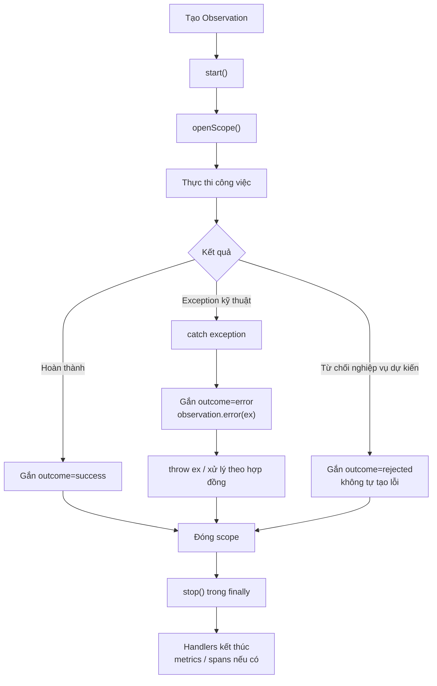
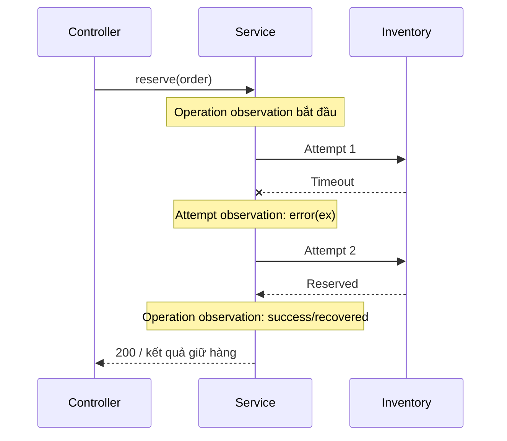
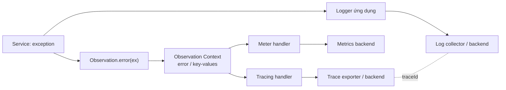

# Ghi nhận exception trong vòng đời Micrometer Observation

Trong ứng dụng Spring Boot, một phương thức có thể ném exception rồi kết thúc sớm: gọi HTTP đến dịch vụ khác bị timeout, truy vấn cơ sở dữ liệu thất bại, hay dữ liệu đầu vào vi phạm quy tắc nghiệp vụ. Nếu hệ thống chỉ biết thao tác bắt đầu và kết thúc, người vận hành sẽ thấy **thời lượng**, nhưng có thể không biết **tại sao nó thất bại**. Micrometer Observation cung cấp API `error(Throwable)` để đưa thông tin lỗi vào vòng đời của công việc đang quan sát.

Bài **Ghi nhận exception** thuộc chương **Vòng đời observation** của module **SPRING_BOOT_OBSERVABILITY**. Module hướng đến thiết lập observability bằng Micrometer Observation, metrics, logs và distributed tracing; tìm hiểu propagation ngữ cảnh, tag/cardinality, exporter, sampling và liên kết các tín hiệu để điều tra lỗi, độ trễ và hành vi ứng dụng trên môi trường thực. Ở đây, trọng tâm là **khi nào, ở đâu và bằng cách nào ghi nhận exception** để các tín hiệu phản ánh đúng sự cố.

## 1. Kết quả học tập

Sau bài này, bạn có thể:

- Giải thích sự khác nhau giữa **exception được ném**, **exception được ghi nhận trong observation** và **exception được ghi log**.
- Dùng `observation.error(ex)` đúng thời điểm, giữ nguyên luồng exception và luôn kết thúc observation.
- Phân biệt exception do lỗi kỹ thuật với trường hợp nghiệp vụ dự kiến; xử lý retry, fallback và exception được bắt rồi phục hồi.
- Hiểu cách `ObservationHandler`, metrics, distributed tracing và MDC/logging sử dụng ngữ cảnh lỗi.
- Tránh ghi lỗi trùng lặp, tạo metric label có cardinality cao hoặc làm rò rỉ dữ liệu nhạy cảm.
- Kiểm chứng cả đường đi thành công, thất bại, trả về sớm và xử lý bất đồng bộ.

## 2. Exception và Observation là hai cơ chế khác nhau

**Exception** là cơ chế điều khiển luồng của Java: mã nguồn ném `throw ex`, rồi một tầng khác bắt hoặc cho phép exception lan lên. **Observation** là ngữ cảnh đo một công việc có điểm bắt đầu, điểm kết thúc và dữ kiện quan sát.

Ba thao tác thường xuất hiện cùng nhau nhưng **không thay thế nhau**:

| Thao tác | Tác dụng | Điều không tự xảy ra |
| --- | --- | --- |
| `throw ex` | Lan truyền exception tới caller/framework | Không tự bảo đảm một observation tự viết được đánh dấu lỗi |
| `observation.error(ex)` | Ghi nhận `Throwable` trong context và thông báo lỗi tới handler của observation | Không tự ném lại exception, không tự viết log ứng dụng |
| `log.error("...", ex)` | Ghi bản ghi log với thông điệp và stack trace (tùy cấu hình logger) | Không tự đánh dấu observation/span hoặc cập nhật kết quả nghiệp vụ |
| `observation.stop()` | Kết thúc công việc đang quan sát và cho handler hoàn tất việc đo | Không có nghĩa là công việc đã thành công |

Một thao tác có thể chạy hết mà **không ném exception**, nhưng vẫn có kết quả nghiệp vụ không mong muốn. Ngược lại, một exception ở lần thử đầu có thể được retry thành công. Vì vậy, trước khi gọi `error(ex)`, cần trả lời: **observation này đại diện cho lần thử bị lỗi hay đại diện cho toàn bộ thao tác đã được phục hồi?**

### “Lỗi được ghi nhận” nghĩa là gì?

Trong Micrometer Observation, `Observation.error(Throwable)` lưu thông tin lỗi vào context và kích hoạt callback lỗi của các `ObservationHandler` quan tâm. Tùy handler và cấu hình, hệ thống có thể phản ánh lỗi lên tracing span, dùng thông tin lỗi trong metrics hoặc phục vụ xử lý tùy chỉnh.

Việc ghi nhận **không bảo đảm** ngay lập tức có dòng log, metric có nhãn `error=true` hay một span màu đỏ trong dashboard. Chúng còn phụ thuộc vào handler đã đăng ký, cách ánh xạ trường dữ liệu, exporter, backend và sampling. Cách xác minh đúng là quan sát tín hiệu thực tế trong pipeline của ứng dụng.

## 3. Vị trí của `error(ex)` trong vòng đời Observation



Trình tự quan trọng:

1. **`start()`** đánh dấu bắt đầu công việc; có thể gắn key-value trước hoặc trong khi observation chạy.
2. **`openScope()`** thiết lập observation hiện hành trong phạm vi đồng bộ; các tích hợp có thể dùng ngữ cảnh này để nối span và MDC.
3. **`error(ex)`** được gọi khi exception thuộc phạm vi của observation này và theo quy ước cần được phản ánh là lỗi. Gọi **trước** khi stop.
4. **`throw ex`** hoặc xử lý ngoại lệ theo hợp đồng ứng dụng. Việc gọi `error(ex)` không quyết định chính sách retry, mapping HTTP status hay trả fallback.
5. **`stop()`** luôn chạy, kể cả khi catch ném lại exception. Đóng scope và stop là hai việc khác nhau.

Nếu `observation.error(ex)` bị bỏ qua trong một observation quản lý **thủ công**, việc ném exception rồi gọi `stop()` có thể chỉ ghi thời lượng mà thiếu tín hiệu lỗi cho handler. Ngược lại, nếu dùng API tiện ích `observe(...)`, Micrometer đã có cơ chế quản lý exception và vòng đời: không cần bổ sung một lớp ghi lỗi trùng cho cùng observation.

## 4. Ví dụ Spring Boot: ghi nhận exception bằng tay

Giả sử service xử lý đặt hàng cần gọi `InventoryGateway`. Với mỗi thao tác giữ hàng, chúng ta muốn đo thời gian, nhận biết lỗi kỹ thuật và giữ nguyên exception để tầng xử lý HTTP quyết định mã phản hồi.

Ví dụ sử dụng `ObservationRegistry` được Spring cung cấp khi tích hợp Micrometer Observation; `InventoryGateway` và `Reservation` là kiểu dữ liệu giả định do ứng dụng định nghĩa.

```java
import io.micrometer.observation.Observation;
import io.micrometer.observation.ObservationRegistry;
import org.springframework.stereotype.Service;

@Service
public class ReservationService {
    private final InventoryGateway gateway;
    private final ObservationRegistry registry;

    public ReservationService(InventoryGateway gateway,
                              ObservationRegistry registry) {
        this.gateway = gateway;
        this.registry = registry;
    }

    public Reservation reserve(String orderId, String sku, int quantity) {
        Observation observation = Observation
            .createNotStarted("inventory.reserve", registry)
            .contextualName("reserve inventory")
            .lowCardinalityKeyValue("operation", "reserve")
            .start();

        try (Observation.Scope ignored = observation.openScope()) {
            try {
                Reservation result = gateway.reserve(orderId, sku, quantity);
                observation.lowCardinalityKeyValue("outcome", "success");
                return result;
            } catch (RuntimeException ex) {
                observation.lowCardinalityKeyValue("outcome", "error");
                observation.error(ex);
                throw ex;
            }
        } finally {
            observation.stop();
        }
    }
}

interface InventoryGateway {
    Reservation reserve(String orderId, String sku, int quantity);
}

record Reservation(String reservationId) {}
```

**Đọc ví dụ theo đường đi:**

- Nếu gateway thành công, observation nhận `outcome=success`, scope đóng và `stop()` vẫn chạy dù phương thức `return` bên trong `try`.
- Nếu gateway ném `RuntimeException`, nhánh `catch` gắn `outcome=error`, gọi `observation.error(ex)` rồi **ném lại chính exception**. `finally` vẫn dừng observation.
- `orderId` và `sku` không được đưa vào low-cardinality key-value; chúng có rất nhiều giá trị khác nhau. Có thể bổ sung các ID được phép vào log hoặc ngữ cảnh trace có kiểm soát nếu cần điều tra theo giao dịch.
- Nếu gateway có checked exception, khai báo và bắt loại exception đó theo hợp đồng Java, gọi `error(ex)` trước khi ném tiếp hoặc chuyển đổi lỗi có chủ đích.

Ở ví dụ này, `RuntimeException` biểu diễn **lỗi kỹ thuật không được phục hồi trong phạm vi thao tác**. Nếu gateway còn ném exception để biểu diễn “không đủ hàng” như một điều kiện nghiệp vụ bình thường, nên tách loại đó ra và quyết định outcome riêng. Không nên áp dụng một quy tắc “mọi exception đều là lỗi hệ thống” cho mọi nghiệp vụ.

### Ghi nhận loại lỗi có kiểm soát

Có thể gắn một nhãn hữu hạn để dashboard dễ phân biệt timeout với các lỗi phụ thuộc khác:

```java
catch (InventoryTimeoutException ex) {
    observation.lowCardinalityKeyValue("outcome", "error");
    observation.lowCardinalityKeyValue("error.category", "timeout");
    observation.error(ex);
    throw ex;
} catch (RuntimeException ex) {
    observation.lowCardinalityKeyValue("outcome", "error");
    observation.lowCardinalityKeyValue("error.category", "dependency");
    observation.error(ex);
    throw ex;
}
```

Đây là **đoạn thay thế** nhánh `catch` trong ví dụ trước; `InventoryTimeoutException` là exception giả định do dự án định nghĩa. Không nên dán nối thêm cả hai cách bắt lỗi. Nhãn `error.category=timeout|dependency` có tập giá trị giới hạn; khác với `ex.getMessage()`, URL hoặc order ID không phù hợp làm metric label.

Nếu dùng exception wrapping như `throw new OrderProcessingException("...", ex)`, cần quy định rõ observation sẽ ghi lỗi gốc (`ex`) hay lỗi đã ánh xạ, và bảo toàn `cause` để điều tra. Không ghi cả hai nhiều lần chỉ vì exception đi qua nhiều tầng.

## 5. Giảm mã thủ công với `Observation.observe(...)`

Khi toàn bộ công việc chỉ gồm một lambda đồng bộ, API tiện ích `observe(...)` quản lý bắt đầu/kết thúc, scope và lỗi phát sinh trong lambda. Ví dụ:

```java
public Reservation reserveSimple(String orderId, String sku, int quantity) {
    return Observation.createNotStarted("inventory.reserve", registry)
        .lowCardinalityKeyValue("operation", "reserve")
        .observe(() -> gateway.reserve(orderId, sku, quantity));
}
```

Ở đây, exception runtime từ `gateway.reserve` vẫn lan lên caller, và observation được xử lý theo vòng đời của `observe`. Tránh bọc thêm `catch` ở ngoài chỉ để gọi `error(ex)` lần nữa cho **chính** observation được quản lý bởi `observe`.

Chọn cách phù hợp với ý nghĩa công việc:

| Tình huống | Gợi ý |
| --- | --- |
| Chỉ cần đo một khối code đồng bộ, để exception lan lên | Dùng `observe(...)` |
| Cần gắn `outcome` tại nhiều nhánh và quy định riêng loại lỗi | Quản lý thủ công với `start`, `openScope`, `error`, `stop` |
| Một tầng framework đã tạo observation (HTTP server, HTTP client, database...) | Kiểm tra instrumentation hiện có trước khi thêm observation |
| Công việc reactive/async kết thúc sau khi trả về publisher/future | Dùng instrumentation thích hợp để vòng đời khớp với **kết quả bất đồng bộ** |

Một observation tự viết bao quanh HTTP request đã có server observation có thể vẫn có giá trị nếu nó đo **nghiệp vụ riêng**. Nhưng nếu cả hai cùng đo đúng một ranh giới với cùng mục đích, ta sẽ tạo span/timer dư thừa và làm biểu đồ khó hiểu.

## 6. Exception được bắt nhưng không làm toàn bộ thao tác thất bại

Hệ thống thực thường có **retry**, **fallback** hoặc **từ chối nghiệp vụ hợp lệ**. Cần xác định kết quả của observation theo **ranh giới**:

| Tình huống | Observation cấp attempt | Observation cấp thao tác |
| --- | --- | --- |
| Lần 1 timeout, lần 2 thành công | Attempt 1 báo lỗi; attempt 2 thành công | Thành công hoặc phục hồi, tùy định nghĩa |
| Mọi lần thử đều timeout | Các attempts thất bại | Thất bại cuối cùng |
| Payment bị từ chối theo hợp đồng | Có thể là kết quả `declined`, không lỗi kỹ thuật | `outcome=rejected` hoặc kết quả phù hợp |
| Dùng dữ liệu cache khi nguồn chính lỗi | Lỗi ở nhánh gọi nguồn chính | `outcome=degraded` nếu trả kết quả suy giảm |

### Ví dụ: retry ở hai cấp



Nếu observation cấp ngoài có nhiệm vụ đo **kết quả cuối của người dùng**, không nhất thiết gọi `error(ex)` trên observation đó cho exception đã được retry xử lý hoàn toàn. Nhưng ở observation cấp attempt, lỗi timeout là sự kiện thất bại có thật cần được ghi lại. Nếu không có observation cấp attempt, có thể dùng event có tên ổn định, counter retry hoặc log ở ranh giới thích hợp.

Hãy tránh đếm lỗi của **attempts** như lỗi của **requests**: một request có ba attempts sẽ có ba bản ghi đo attempt nhưng chỉ một kết quả cuối. Khi dashboard tính error rate, nêu rõ nó đo cấp độ nào.

### Exception nghiệp vụ có nên gọi `error(ex)`?

Không có một quy tắc chung cho mọi hệ thống. Ví dụ, `PaymentDeclinedException` có thể là điều kiện dự kiến theo hợp đồng, còn `PaymentGatewayUnavailableException` là lỗi kỹ thuật. Một lựa chọn thiết kế là:

- Dùng kết quả có kiểu rõ ràng (ví dụ `APPROVED`/`DECLINED`) cho điều kiện dự kiến; gắn `outcome=rejected` mà không gọi `error(ex)`.
- Với lỗi kỹ thuật không thể phục hồi, gắn `outcome=error` và gọi `error(ex)`.
- Nếu framework vẫn nhận một exception nghiệp vụ đã ném ra khỏi boundary HTTP, observation của **HTTP request** có thể phân loại khác với observation của **nghiệp vụ**. Cần kiểm tra cả hai thay vì giả định có một nhãn lỗi chung.

Các quy tắc này phải được thống nhất trong service để tỷ lệ lỗi và alert có ý nghĩa ổn định.

## 7. Tín hiệu lỗi đi vào metrics, tracing và logs như thế nào?

`ObservationRegistry` có thể được cấu hình với nhiều `ObservationHandler`. Chúng xử lý lifecycle event và dữ liệu trong `Observation.Context`:



**Metrics.** Timer của observation thường cho phép đếm lần thực thi và đo thời lượng. Nhãn kết quả `outcome=error`, nếu được ghi như low-cardinality key-value và được handler chấp nhận, giúp tách số thao tác lỗi khỏi thành công. Việc một exception tự động tạo nhãn nào còn tùy convention và cấu hình. Cấu hình histogram/percentile là bước riêng; không mặc định mọi timer đã có p95.

**Distributed tracing.** Tracing handler có thể chuyển exception được báo cáo thành thuộc tính/sự kiện lỗi hoặc trạng thái lỗi trên span. Span được xuất hay không còn phụ thuộc tracer/exporter và sampling; vì thế log có `traceId` nhưng backend tracing có thể không lưu trace tương ứng.

**Logs.** `observation.error(ex)` tự nó không bảo đảm có log. Nếu cần chẩn đoán, ghi log chủ đích ở nơi có đủ ngữ cảnh:

```java
catch (RuntimeException ex) {
    observation.lowCardinalityKeyValue("outcome", "error");
    observation.error(ex);
    log.error("event=inventory_reservation_failed cause=DEPENDENCY_ERROR", ex);
    throw ex;
}
```

Đoạn này minh họa cách **bổ sung** ghi log vào nhánh catch của service đã có logger SLF4J; không phải lớp tự động ghi log của Micrometer. Logger nên được định nghĩa trong class và chỉ ghi exception đầy đủ tại ranh giới thích hợp. Nếu nhiều tầng cùng log `ERROR` rồi ném lên trên, cùng một sự cố có thể xuất hiện thành nhiều log lỗi khó phân biệt.

**Tương quan tín hiệu.** Khi Micrometer Tracing và cấu hình logging đưa `traceId`/`spanId` vào MDC đúng cách, có thể tìm log theo trace rồi mở các span liên quan. Việc này phụ thuộc **context propagation** giữa thread, HTTP hoặc message. Chỉ gọi `observation.error(ex)` không tạo ra propagation xuyên dịch vụ; cần instrumentation ở các ranh giới mạng/luồng.

## 8. Cardinality, an toàn thông tin và dấu vết điều tra

Để tìm hiểu nguyên nhân, người viết code thường muốn đưa exception message và mọi input vào observation. Đây là cách dễ làm nhiễu dữ liệu và tăng chi phí.

| Thông tin | Nên đặt ở đâu | Lưu ý |
| --- | --- | --- |
| `operation=reserve` | Low-cardinality key-value | Giá trị hữu hạn, phù hợp metrics |
| `outcome=success|rejected|error` | Low-cardinality key-value | Nhất quán giữa mọi nhánh |
| `error.category=timeout|dependency|validation` | Low-cardinality key-value nếu cần | Nên chuẩn hóa về tập hữu hạn |
| `traceId` | Trace/log correlation | Không dùng làm metric label |
| `orderId`/`sku` | Log hoặc context riêng khi được phép | Tránh label cardinality cao, cân nhắc chính sách dữ liệu |
| `exception.message` | Thường chỉ đưa vào log đã kiểm soát hoặc thông tin chẩn đoán giới hạn | Có thể chứa SQL, PII, endpoint, token hoặc dữ liệu do user nhập |
| Full exception stack trace | Log tại ranh giới xử lý phù hợp | Có thể dài, tốn chi phí, lặp nếu nhiều tầng đều ghi |

Tên class exception có thể hữu ích cho chẩn đoán, nhưng tránh cho phép exception message động trở thành nhãn metric. Khi backend tự gắn thuộc tính lỗi, hãy kiểm tra những thông tin thực tế được xuất và áp dụng chính sách masking, retention, quyền truy cập.

### Ba nguyên tắc chẩn đoán

1. **Ghi sự kiện lỗi một lần cho cùng một observation.** Nhiều lần gọi `error(ex)` không làm một sự cố thành nhiều sự cố; chúng có thể phát nhiều callback hoặc làm dữ liệu handler khó diễn giải.
2. **Không bỏ mất exception gốc.** Nếu cần đổi sang loại lỗi nghiệp vụ, giữ `cause`. Tránh chỉ ghi `ex.getMessage()` và vứt stack trace trong trường hợp kỹ thuật cần điều tra.
3. **Không đánh đổi dữ liệu bí mật để có log chi tiết.** Đừng đưa token, mật khẩu, cookie, payload nhạy cảm hoặc thông tin cá nhân vào message và các tag.

## 9. Những tình huống dễ sai

### 9.1. Chỉ dùng `try/finally` rồi quên ghi lỗi

```java
Observation observation =
    Observation.start("inventory.reserve", registry);
try {
    return gateway.reserve(orderId, sku, quantity);
} finally {
    observation.stop();
}
```

Đoạn code trên **kết thúc observation** nhưng nếu gateway ném exception thì không có lệnh `error(ex)` trong phần do ứng dụng quản lý. Cách sửa là có `catch` để báo lỗi rồi ném tiếp, hoặc dùng `observe(...)` để tự quản lý phần này.

### 9.2. Gọi `stop()` ở cuối thân hàm

```java
Observation observation =
    Observation.start("inventory.reserve", registry);
Reservation result = gateway.reserve(orderId, sku, quantity);
observation.stop(); // Không chạy nếu dòng trên ném exception!
return result;
```

Đặt `stop()` trong `finally` (hoặc dùng `observe`) để observation kết thúc cả ở đường đi lỗi lẫn return sớm.

### 9.3. Ghi nhận lỗi ở observation không đúng ranh giới

Lỗi HTTP 503 từ dependency có thể được tầng service xử lý bằng fallback thành công. Nếu observation cấp ngoài đo **kết quả cuối**, gắn lỗi timeout trực tiếp lên span ngoài có thể gây hiểu nhầm, dù span của lần gọi dependency bị lỗi là thông tin chính xác. Hãy xác định ranh giới từng observation trước khi quyết định.

### 9.4. Dùng `@Async` hoặc Reactor nhưng kết thúc observation quá sớm

Nếu phương thức trả về `CompletableFuture` hoặc `Mono` mà `stop()` được gọi ngay sau khi **tạo** future/publisher, timer sẽ đo thời gian khởi tạo, không đo công việc thực tế. Exception xuất hiện về sau có thể không được ghi vào observation cũ. Cần gắn vòng đời quan sát với thời điểm hoàn thành thật, bao gồm lỗi và cancellation theo mô hình xử lý. Với Reactor, ưu tiên tích hợp observation/context propagation phù hợp thay vì giữ `Scope` xuyên nhiều thread.

### 9.5. Tự nhân đôi instrumentation

Spring Boot đã có thể tạo observation cho HTTP server/client và các thành phần được instrument. Bọc thêm cùng một HTTP call bằng observation có cùng mục đích khiến số span và timer tăng khó giải thích. Chỉ thêm observation thủ công cho **ranh giới nghiệp vụ mới**, với tên và tài liệu rõ ràng.

## 10. Quy trình thực hành: gây lỗi và xác minh

Tạo một service thử nghiệm gồm `ReservationService` ở ví dụ trên, với `InventoryGateway` có thể trả kết quả hoặc ném runtime exception. Nếu dùng Spring Boot Actuator, Micrometer meter registry, tracing bridge và exporter, hãy bảo đảm dependency tương thích với phiên bản Spring Boot của dự án. Cần có đường thu thập metrics/traces/logs thực sự hoạt động để đánh giá tín hiệu backend.

### Các ca chạy nên kiểm tra

| Ca | Dữ liệu mô phỏng | Kết quả mong đợi |
| --- | --- | --- |
| Thành công | Gateway trả `Reservation` | `outcome=success`; observation stop; không có error đã báo |
| Timeout | Gateway ném `InventoryTimeoutException` | `error(ex)` được gọi; `outcome=error`; exception được ném lại; observation stop |
| Lỗi khác | Gateway ném `IllegalStateException` | Có ghi nhận lỗi và vẫn stop |
| Trả về sớm | Một nhánh return trong `try` | `finally` vẫn stop |
| Retry thành công | Attempt 1 timeout, attempt 2 thành công | Attempt 1 ghi lỗi; kết quả cuối đúng theo hợp đồng |
| Chạy async | Future hoàn thành lỗi sau khi phương thức trả về | Observation bao trùm thời gian thực thi thực, context không lẫn giữa requests |

### Cách tự xác minh

1. **Tầng ứng dụng:** lỗi có còn lan lên caller theo hợp đồng? Không có exception nào bị nuốt chỉ vì đã gọi `error(ex)`?
2. **Vòng đời:** mỗi observation được start và stop tương ứng, kể cả khi ném lỗi. Không có scope hoặc MDC bị rò sang request tiếp theo.
3. **Metrics:** số lần thành công/lỗi có đúng? Timer có ghi nhận thời lượng lỗi? Phân biệt số attempts với số requests.
4. **Tracing:** nếu được xuất, span có phản ánh lỗi không và có liên hệ với span cha không? Nếu không tìm thấy trace, kiểm tra sampling, exporter, collector và propagation trước khi kết luận `error(ex)` hỏng.
5. **Logging:** log được phép chứa sự kiện lỗi và trace ID để tra cứu, không chứa bí mật hoặc tag động nguy hiểm.

### Tình huống điều tra production

Người dùng báo một phần thao tác đặt hàng treo khoảng 3 giây rồi thất bại. Metrics cho thấy latency và tỷ lệ lỗi của `inventory.reserve` tăng. Tìm log `event=inventory_reservation_failed` trong cùng khoảng thời gian, lọc theo trace ID nếu có; sau đó xem trace để xác định span gọi inventory kéo dài hay lỗi phát sinh tại bước khác. Nếu exception đã được ghi trong observation nhưng không xuất hiện ở backend, hãy kiểm tra handler, sampling, exporter và đường thu thập trước khi sửa business logic.

### Câu hỏi tự đánh giá

1. Vì sao `throw ex` và `observation.error(ex)` đều có thể cần thiết trong một nhánh catch?
2. Khi nào không nên đánh dấu observation cấp ngoài là lỗi, dù một attempt bên trong đã ném exception?
3. Vì sao `stop()` không chứng minh thành công?
4. Điều gì xảy ra khi exception được ném ra ngoài `try` nhưng không được gửi cho `ObservationHandler`?
5. Vì sao chỉ số lỗi có thể đúng trong metrics nhưng không tìm thấy trace tương ứng?
6. Vì sao không dùng exception message hoặc order ID làm low-cardinality key-value?

## 11. Ghi nhớ

**Ghi nhận exception** trong Micrometer Observation là thông báo sự kiện lỗi cho cơ chế observability, còn **ném exception** là hành vi điều khiển luồng Java và **ghi log** là phát một bản ghi chẩn đoán. Với observation quản lý thủ công, khi một exception kỹ thuật làm thao tác thất bại, hãy gọi `observation.error(ex)` trước khi ném lại, và luôn `stop()` trong `finally`. Với `observe(...)` hoặc instrumentation tự động, hiểu rõ cơ chế quản lý lỗi sẵn có để không báo trùng.

Trên hệ thống thực, cần đặt ranh giới observation rõ ràng: phân biệt lỗi của từng attempt với kết quả cuối, lỗi kỹ thuật với từ chối nghiệp vụ, và lỗi chưa phục hồi với fallback thành công. Kết hợp key-value có cardinality thấp, tracing, logs an toàn và cơ chế propagation phù hợp giúp dữ liệu lỗi có thể dùng được khi điều tra sự cố thay vì chỉ tạo thêm nhiều bản ghi.
