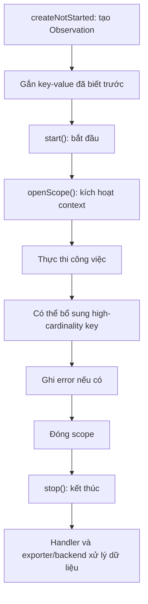
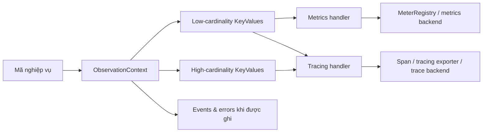

# Ghi high-cardinality key value trong vòng đời Observation

Trong một ứng dụng Spring Boot, cùng một thao tác có thể được gọi hàng nghìn lần nhưng mỗi lần lại gắn với một định danh riêng: mã đơn hàng, mã giao dịch, định danh tác vụ hoặc mã tương quan nội bộ. Khi điều tra vì sao **một yêu cầu cụ thể** bị lỗi hay chậm, thông tin này có thể rất hữu ích. Tuy nhiên, nếu đưa các định danh có nhiều giá trị khác nhau vào nhãn metric, hệ thống monitoring có nguy cơ tạo quá nhiều chuỗi thời gian và trở nên tốn kém.

**Micrometer Observation** phân biệt *low-cardinality key value* và *high-cardinality key value*. Bài này, thuộc chương **Vòng đời observation** trong module **SPRING_BOOT_OBSERVABILITY**, tập trung vào cách **ghi high-cardinality key value** đúng thời điểm, cách nó được sử dụng trong tracing và mối quan hệ với metrics, logs, distributed tracing, context propagation, exporter và sampling trong thực tế.

## 1. High cardinality có nghĩa là gì?

**Cardinality** là số lượng giá trị hoặc tổ hợp giá trị khác nhau của một tập thuộc tính. Một thuộc tính được coi là có *high cardinality* khi số giá trị có thể xuất hiện rất lớn hoặc khó giới hạn theo thời gian.

Ví dụ trong dịch vụ xử lý đơn hàng:

| Thuộc tính | Giá trị minh họa | Cardinality điển hình | Cách dùng nên ưu tiên |
| --- | --- | --- | --- |
| `http.method` | `GET`, `POST`, `PUT` | Thấp | Nhãn metric; thuộc tính trace |
| `http.route` | `/orders/{id}` | Thấp nếu dùng route template | Nhãn metric; thuộc tính trace |
| `payment.method` | `card`, `wallet`, `bank_transfer` | Thấp nếu chuẩn hóa | Nhãn metric; thuộc tính trace |
| `http.status_code` | `200`, `400`, `503` | Hữu hạn | Nhãn metric; thuộc tính trace |
| `order.id` | Một mã khác nhau cho từng đơn | Cao | Thuộc tính chi tiết có kiểm soát của trace/log |
| `payment.operation_ref` | Một mã riêng cho mỗi lần xử lý | Cao | Thuộc tính trace nếu thật sự cần |
| `traceId` | Một định danh cho mỗi trace | Rất cao | Correlation riêng; **không** dùng làm metric label |
| URL đầy đủ chứa `?search=...` | Tùy đầu vào người dùng | Khó dự đoán | Tránh thu thập nguyên bản; chuẩn hóa hoặc loại bỏ |

**Metric** thường lưu một chuỗi thời gian riêng cho mỗi tổ hợp giá trị nhãn. Ví dụ, nếu `order.id` có giá trị mới trên gần như mọi yêu cầu và bị đưa thành metric label, số chuỗi có thể tăng theo số đơn hàng. Trong khi đó, một trace lưu thông tin của *một lần thực thi*, nên việc gắn thuộc tính riêng cho lần thực thi ấy có thể phù hợp hơn, miễn là kiểm soát quyền truy cập, dữ liệu nhạy cảm và chi phí lưu trữ/index.

Micrometer Observation đưa sự phân biệt này vào API:

```java
observation.lowCardinalityKeyValue("payment.method", "card");
observation.highCardinalityKeyValue("payment.operation_ref", "op-7c91");
```

Cả hai đều là **key–value** gắn với Observation. Sự khác nhau nằm ở mục đích sử dụng và cách các `ObservationHandler` xử lý chúng, không phải hai kiểu dữ liệu Java khác nhau.

## 2. API ghi high-cardinality key value

API cơ bản của Micrometer Observation:

```java
Observation observation = Observation.createNotStarted(
        "payment.authorize", observationRegistry);

observation.highCardinalityKeyValue(
        "payment.operation_ref", "op-7c91");
```

Trong đó:

- `"payment.authorize"` là tên Observation, nên ổn định giữa các lần thực thi.
- `"payment.operation_ref"` là **tên khóa**, cũng nên được quy ước ổn định.
- `"op-7c91"` là giá trị của một lần thực thi; giá trị này có thể thay đổi theo yêu cầu.
- `observationRegistry` là registry nhận Observation và điều phối các handler có liên quan.

Lời gọi `highCardinalityKeyValue(String key, String value)` gắn dữ liệu vào **ngữ cảnh Observation**. Việc dữ liệu có xuất hiện thành span attribute trong trace backend hay không phụ thuộc handler tracing, trạng thái Observation, sampling, exporter và cấu hình pipeline. **Thêm một high-cardinality key không tự tạo trace, không tự ghi log và không tự tạo metric.**

Micrometer cũng hỗ trợ biểu diễn key–value theo kiểu `KeyValue` (tùy API/phiên bản), nhưng với trường hợp một cặp đơn giản, cách gọi trực tiếp bằng chuỗi dễ đọc:

```java
observation.highCardinalityKeyValue("order.reference", reference);
```

### Phân biệt tên Observation, key và value

Một lỗi thiết kế phổ biến là đưa giá trị biến thiên vào **tên Observation**:

```java
// Sai hướng: mỗi request tạo một tên Observation khác nhau.
Observation.createNotStarted("order.lookup." + orderId, registry);
```

Tên này có thể trở thành tên meter hoặc span và làm số nhóm dữ liệu phình ra. Cách đúng là tách tên hoạt động ổn định khỏi giá trị chi tiết:

```java
Observation.createNotStarted("order.lookup", registry)
        .lowCardinalityKeyValue("operation", "lookup")
        .highCardinalityKeyValue("order.reference", safeReference);
```

Ở đây, `safeReference` chỉ được dùng nếu đó là định danh đã được cho phép thu thập cho mục đích điều tra và không chứa thông tin bí mật hoặc dữ liệu cá nhân không phù hợp.

## 3. Ghi high-cardinality key trong vòng đời Observation

Một Observation có các giai đoạn cơ bản: được tạo, bắt đầu, được đưa vào scope, có thể nhận key–value/event/error trong lúc chạy, sau đó được kết thúc.



Sơ đồ là cách nhìn logic. Thứ tự **đóng scope rồi gọi `stop()`** là một mẫu sử dụng hợp lệ khi quản lý thủ công. Khi dùng `observe(...)`, thư viện giúp quản lý vòng đời xung quanh callback.

### Trường hợp A — Biết giá trị trước khi thao tác bắt đầu

Nếu mã tham chiếu đã được xác định ở đầu phương thức, có thể gắn ngay khi tạo Observation:

```java
import io.micrometer.observation.Observation;
import io.micrometer.observation.ObservationRegistry;
import org.springframework.stereotype.Service;

import java.util.function.Supplier;

@Service
public class PaymentActionService {
    private final ObservationRegistry registry;

    public PaymentActionService(ObservationRegistry registry) {
        this.registry = registry;
    }

    public String authorize(String safeOperationReference,
                            Supplier<String> callGateway) {
        return Observation.createNotStarted("payment.authorize", registry)
                .lowCardinalityKeyValue("payment.action", "authorize")
                .highCardinalityKeyValue(
                        "payment.operation_ref", safeOperationReference)
                .observe(callGateway::get);
    }
}
```

`PaymentActionService` ở đây là ví dụ độc lập. Khi tích hợp thật, cần thêm bước xác thực rằng `safeOperationReference` là giá trị được phép đưa vào telemetry; `callGateway` được truyền từ tầng gọi. Không truyền raw HTTP body, token, số thẻ, email hoặc thông tin bí mật vào API này.

**Lợi ích của gắn trước `start()`:** handler có thể đọc được key–value ngay từ thời điểm bắt đầu nếu handler đó xử lý dữ liệu trong `onStart`. Đây thường là lựa chọn dễ dự đoán hơn khi giá trị đã biết.

### Trường hợp B — Chỉ biết giá trị sau khi công việc đã bắt đầu

Ví dụ mã thao tác từ cổng thanh toán chỉ xuất hiện sau lệnh gọi tạo giao dịch. Khi đó, có thể giữ tham chiếu đến Observation và thêm thuộc tính sau khi nhận kết quả:

```java
import io.micrometer.observation.Observation;
import io.micrometer.observation.ObservationRegistry;

public final class GatewayWorkflow {
    private final ObservationRegistry registry;

    public GatewayWorkflow(ObservationRegistry registry) {
        this.registry = registry;
    }

    public String run(GatewayClient gateway) {
        Observation observation = Observation.createNotStarted(
                        "payment.gateway.operation", registry)
                .lowCardinalityKeyValue("payment.gateway", "primary");

        observation.start();
        try (Observation.Scope scope = observation.openScope()) {
            String reference = gateway.createOperation();

            // Chỉ ghi nếu reference đã được phép dùng trong telemetry.
            observation.highCardinalityKeyValue(
                    "payment.operation_ref", reference);

            gateway.completeOperation(reference);
            return reference;
        } catch (RuntimeException ex) {
            observation.error(ex);
            throw ex;
        } finally {
            observation.stop();
        }
    }

    public interface GatewayClient {
        String createOperation();
        void completeOperation(String reference);
    }
}
```

Trong trường hợp này:

1. `createNotStarted(...)` tạo Observation với tên cố định và low-cardinality key.
2. `start()` thông báo bắt đầu cho các handler phù hợp.
3. `openScope()` đưa Observation vào phạm vi ngữ cảnh hiện hành; công việc bên trong có thể kế thừa trace context khi tích hợp tracing.
4. `highCardinalityKeyValue(...)` bổ sung giá trị chỉ được biết sau khi gateway tạo operation.
5. `error(ex)` ghi nhận exception cho Observation; `throw ex` vẫn truyền lỗi cho caller.
6. `stop()` chạy trong `finally`, kể cả khi gateway ném lỗi.

**Lưu ý quan trọng về thời điểm:** các handler có thể đọc key–value ở các callback khác nhau (`onStart`, `onStop`, ...). Thuộc tính thêm sau khi bắt đầu thường còn nằm trong Observation context, nhưng **không nên mặc định mọi handler/exporter sẽ phản ánh thay đổi muộn giống nhau**. Với thuộc tính bắt buộc phải có trong span, cần xác minh hành vi của tracing handler và phiên bản thực tế.

## 4. High-cardinality key value nằm ở đâu trong Micrometer?

Micrometer Observation phân chia dữ liệu của một lần quan sát theo cách hỗ trợ nhiều backend:



Sơ đồ mô tả **cách dùng thường gặp**; mỗi `ObservationHandler` có quyền quyết định dữ liệu nào sẽ chuyển thành metric, span tag, event hoặc hành vi khác. Không phải mọi handler đều hỗ trợ tất cả trường.

### Metrics: chỉ nên sử dụng nhãn có cardinality thấp

Handler metrics tiêu chuẩn thường tạo timer hoặc meter từ tên Observation và **low-cardinality key values**. High-cardinality key values không được thiết kế để làm nhãn metrics theo cách này.

Ví dụ:

```java
Observation.createNotStarted("payment.authorize", registry)
        .lowCardinalityKeyValue("payment.method", "card")
        .highCardinalityKeyValue("payment.operation_ref", "op-7c91")
        .observe(() -> invokePaymentGateway());
```

Khi có metrics handler thích hợp, một chuỗi metric có thể được nhóm theo `payment.method=card`. **Không nên mong** xuất hiện một series tách riêng theo `payment.operation_ref=op-7c91`.

Tuy nhiên, đây không phải cơ chế bảo vệ tuyệt đối: một **custom handler**, filter, convention hoặc cấu hình backend vẫn có thể cố tình đưa thuộc tính high cardinality vào metric label. Vì vậy, đội phát triển phải xem lại nhãn thực tế được xuất và không dùng `highCardinalityKeyValue` như giấy phép ghi dữ liệu tùy ý.

### Tracing: thuộc tính của từng span

Khi Observation được kết nối với một tracing handler tương thích, high-cardinality key values có thể trở thành thuộc tính của **span** đang mô tả thao tác. Điều này hữu ích để lọc các trace theo mã tham chiếu, điều tra một giao dịch chậm hoặc nối dữ liệu với sự kiện nghiệp vụ đã được phép lưu.

Ví dụ một span được minh họa như sau:

```text
Trace: 4bf92f3577b34da6a3ce929d0e0e4736
  Span: payment.authorize
    payment.method = card
    payment.operation_ref = op-7c91
    duration = 145 ms
    status = OK
```

Đây là hình thức minh họa, không phải cam kết tên span, status, hay thuộc tính mà một exporter cụ thể sẽ lưu. Với sampling hoặc pipeline bị lỗi, span này có thể không xuất hiện trong trace backend.

### Logs: không tự động có mọi thuộc tính

Việc gọi:

```java
observation.highCardinalityKeyValue(
        "payment.operation_ref", reference);
```

**không có nghĩa** các dòng `log.info(...)` tiếp theo tự động có trường `payment.operation_ref`. Spring Boot có thể đưa `traceId`/`spanId` vào MDC khi tracing được cấu hình, nhưng các high-cardinality key của Observation không tự biến thành trường log MDC thông thường.

Nếu cần tương quan với log, ưu tiên dùng `traceId` hiện có để tìm log của trace và mở span chứa `payment.operation_ref`. Khi nghiệp vụ cần ghi thêm mã tham chiếu trong log, phải có quy tắc log riêng về che dữ liệu, quyền truy cập và thời hạn lưu.

### Context propagation: không đồng nghĩa baggage

High-cardinality key value là dữ liệu của **Observation hiện tại**. Nó **không tự động** trở thành header HTTP, W3C `baggage` hay metadata được truyền sang service khác. Propagation của distributed tracing xử lý trace context (ví dụ `traceparent`), còn việc chuyển một giá trị nghiệp vụ tùy chọn qua các ranh giới là cơ chế riêng và cần chính sách dữ liệu phù hợp.

Nếu cần tra cứu xuyên nhiều service, trace ID và span relation thường là phương tiện tương quan mặc định. Chỉ truyền giá trị high-cardinality xuyên dịch vụ khi thực sự có yêu cầu rõ ràng, được cho phép và có kiểm soát.

## 5. Chọn key nào có ý nghĩa thực tế?

Không phải tất cả giá trị nhiều biến thể đều hữu ích cho điều tra. Một high-cardinality key tốt trả lời một câu hỏi vận hành cụ thể.

Ví dụ hệ thống thanh toán:

| Câu hỏi khi điều tra | Key có thể cân nhắc | Vì sao hữu ích | Điều cần kiểm soát |
| --- | --- | --- | --- |
| Giao dịch nào bị gateway từ chối? | `payment.operation_ref` | Tra đúng span của lần gọi gateway | Chỉ dùng mã tham chiếu đã được phép lưu |
| Lần xử lý nền nào retry nhiều? | `job.execution_ref` | Phân biệt các lần chạy job | Không dùng làm nhãn metric |
| Tài nguyên kỹ thuật nào bị timeout? | `storage.object_ref` | Khoanh vùng đối tượng phụ thuộc | Tránh tiết lộ đường dẫn/bucket nhạy cảm |
| Lệnh gọi nào thất bại trong batch? | `batch.item_ref` | Khoanh vùng một item | Cân nhắc số lượng thuộc tính và thời hạn lưu |
| Endpoint HTTP nào chậm nhất? | `http.route` | Nhóm request theo route | Đây thường là **low** cardinality, không cần high |
| Yêu cầu nào có trace? | `traceId` | Tương quan giữa các span và log | Tracing SDK đã quản lý; thường không cần nhân bản vào tag |

### Quy tắc chọn tên và giá trị

- **Tên key ổn định:** dùng tên rõ nghĩa như `payment.operation_ref` hoặc `job.execution_ref`, không ghép giá trị vào tên key.
- **Giá trị có ý nghĩa:** chỉ thu thập thứ thật sự cần để tra cứu hay chẩn đoán.
- **Dữ liệu được phép:** loại trừ mật khẩu, API key, access token, số thẻ, raw request body và dữ liệu cá nhân không được cho phép.
- **Tránh dữ liệu dư thừa:** nếu đã có `traceId` để nối log–trace, cân nhắc có thực sự cần thêm `request.id` hay không.
- **Giới hạn kích thước:** giá trị quá dài vẫn tăng chi phí thu thập, truyền, lưu trữ và index trong trace backend.
- **Đồng nhất ngữ nghĩa:** cùng một key nên mô tả cùng một loại định danh ở các nơi sử dụng.

Đối với giá trị nhạy cảm nhưng cần tương quan, cân nhắc ánh xạ sang một mã nội bộ không trực tiếp nhận diện người dùng. Hashing cũng không tự bảo đảm riêng tư: nếu giá trị gốc dễ đoán hoặc không có chính sách phù hợp, hash vẫn có thể bị suy ngược hay liên kết trái phép.

## 6. Kết hợp high- và low-cardinality key trong một thao tác

Trong một service Spring Boot, hai loại key thường cùng xuất hiện:

```java
import io.micrometer.observation.Observation;
import io.micrometer.observation.ObservationRegistry;

public final class InventoryReservation {
    private final ObservationRegistry registry;

    public InventoryReservation(ObservationRegistry registry) {
        this.registry = registry;
    }

    public void reserve(String safeReservationRef, Runnable action) {
        Observation.createNotStarted("inventory.reserve", registry)
                .lowCardinalityKeyValue("inventory.action", "reserve")
                .lowCardinalityKeyValue("inventory.channel", "online")
                .highCardinalityKeyValue(
                        "inventory.reservation_ref", safeReservationRef)
                .observe(action);
    }
}
```

Một lượt gọi có thể phát sinh ba góc nhìn:

| Tín hiệu | Điều mong đợi nếu đã instrument/configure đúng |
| --- | --- |
| **Metrics** | Thời gian/số lần `inventory.reserve` tổng hợp theo `inventory.action`, `inventory.channel`; không tăng số series theo reservation ID |
| **Tracing** | Một span cho lượt gọi, có thể chứa `inventory.reservation_ref` làm thuộc tính để điều tra |
| **Logs** | Dòng log của code; có thể tương quan bằng `traceId`/`spanId` nếu tracing và MDC được cấu hình, còn reservation ref cần chính sách log riêng |

Điều quan trọng là **đối chiếu cấu hình thực tế**: một registry chỉ có metrics handler sẽ đo metrics nhưng không tạo span; registry chỉ có tracing handler có thể tạo span mà không tạo custom timer; registry không có handler có thể không phát sinh cả hai tín hiệu. `ObservationRegistry.NOOP` cũng không tạo metric/span từ các lời gọi đó.

### Tương tác với sampling

Traces thường được sampling để giảm chi phí. Khi một span bị loại khỏi việc xuất/lưu, high-cardinality key value gắn trên Observation **không thể được dùng để tìm span đó** trong backend.

Trong khi đó, metric aggregate của thao tác vẫn có thể được ghi qua handler metrics, bất kể trace có được lưu hay không, nếu hệ thống được cấu hình theo cách thông thường. Vì vậy:

- Không suy tỷ lệ lỗi toàn hệ thống bằng cách đếm riêng các span có key `payment.operation_ref`.
- Không mặc định tìm được mọi mã giao dịch qua trace khi sampling chỉ giữ một phần.
- Nếu cần khả năng tra cứu **mọi** thao tác vì yêu cầu nghiệp vụ/kiểm toán, hãy thiết kế nguồn dữ liệu nghiệp vụ đáng tin cậy riêng thay vì xem sampled tracing là kho lưu trữ đầy đủ.

## 7. Điều gì thay đổi khi gắn key trước hoặc sau `start()`?

Thời điểm ghi key ảnh hưởng đến khả năng các handler nhìn thấy nó ở những mốc xử lý khác nhau:

| Thời điểm | Trường hợp sử dụng | Cần lưu ý |
| --- | --- | --- |
| Trước `start()` | Mã tham chiếu đã có từ đầu request hoặc message | Thường dễ dự đoán nhất vì handler xử lý lúc start có thể đọc được |
| Sau `start()`, trước `stop()` | Chỉ biết mã sau khi gọi dependency hoặc tạo tài nguyên | Kiểm tra handler/tracer có cập nhật span attribute ở thời điểm này không |
| Sau `stop()` | Mã được biết khi công việc đã kết thúc | Không nên kỳ vọng cập nhật telemetry đã hoàn tất hoặc được xuất |
| Trong callback `observe(...)` | Gắn thuộc tính trong khi callback thực thi | Cần có cách truy cập Observation tương ứng nếu phải bổ sung key động |

Đối với giá trị đã biết sẵn, dùng chuỗi phương thức trước `observe(...)` là cách rõ ràng:

```java
return Observation.createNotStarted("shipment.create", registry)
        .highCardinalityKeyValue("shipment.operation_ref", safeRef)
        .observe(this::createShipment);
```

Nếu giá trị được tạo trong callback, giữ biến `observation` và quản lý vòng đời tường minh như ví dụ `GatewayWorkflow` ở mục 3.

**Không nên thử sửa Observation sau `stop()` rồi cho rằng span đã được cập nhật**. Tại thời điểm đó, handler có thể đã hoàn tất span hoặc exporter đã nhận một bản ghi không còn cập nhật được.

## 8. Xử lý lỗi, retry và tác vụ bất đồng bộ

### Exception không bị thay thế bởi Observation

Khi dùng `observe(...)`, hành vi nghiệp vụ vẫn là nguồn quyết định giá trị trả về hoặc exception. Khi quản lý thủ công, gọi `observation.error(ex)` để handler được thông báo về lỗi, rồi tiếp tục truyền lỗi theo hợp đồng của ứng dụng.

Nếu dùng mã tham chiếu của thao tác để điều tra lỗi, gắn nó trước khi phát sinh lỗi nếu có thể. Một exception xảy ra trước khi nhận được reference từ gateway sẽ không thể tự cung cấp một giá trị chưa từng tồn tại.

### Một Observation hay nhiều Observation khi retry?

Giả sử request tạo một operation với ba lần thử gọi gateway:

- Có thể dùng **một Observation tổng** cho tác vụ nghiệp vụ, chứa thông tin chung như phương thức thanh toán và mã giao dịch được phép lưu.
- Nếu cần phân tích từng lần gọi, instrument **các attempt** thành Observation/span con; giữ tên ổn định, dùng một thuộc tính attempt được chuẩn hóa hoặc chỉ số attempt nhỏ có số giá trị hữu hạn phù hợp.
- Tránh nối attempt number, order ID hoặc exception message vào **tên** Observation.
- Đừng giả định giá trị `payment.operation_ref` duy nhất mô tả cả ba lần thử nếu gateway trả mã khác nhau cho từng attempt.

Tracing có thể thể hiện các span con và duration của từng lần retry khi instrumentation tạo chúng. Metrics aggregate nên phản ánh số lần thử, tỷ lệ lỗi và latency bằng nhãn có cardinality thấp.

### Async và propagation

Observation scope thường liên quan đến context thực thi hiện tại. Nếu code chuyển sang executor, `CompletableFuture`, message consumer hoặc reactive pipeline, context propagation cần được thiết lập theo cơ chế phù hợp của Spring/Micrometer.

Gắn high-cardinality key vào Observation ở thread đầu **không đồng nghĩa** context đã tự đi theo đến thread hay service mới. Khi thấy span con bị tách trace hoặc log thiếu `traceId`, trước hết kiểm tra propagation, không vội kết luận high-cardinality key đã “mất”.

Việc chia sẻ/sửa ngữ cảnh Observation đồng thời từ nhiều luồng cũng cần thiết kế có kiểm soát; tránh coi Observation context như một kho lưu trữ mutable dùng chung không đồng bộ.

## 9. Điều tra một giao dịch chậm bằng high-cardinality key

Tình huống: người dùng phản ánh thanh toán số `op-7c91` mất khoảng 4 giây. Hệ thống đã có metrics, logs và distributed tracing.

**Bước 1 — Metric định vị thời điểm và quy mô.** Xem latency, error rate, throughput của `payment.authorize` theo `payment.method=card` và thời điểm tương ứng. Không lọc Prometheus bằng `payment.operation_ref=op-7c91` vì key này không được thiết kế làm metric label.

**Bước 2 — Trace xác định một lượt thực thi.** Nếu trace backend hỗ trợ tìm theo span attribute và trace đó được thu, tìm `payment.operation_ref=op-7c91`. Xem cấu trúc span để xác định thời gian nằm ở gateway, DB hay retry. Backend có thể không index mọi span attribute, nên chức năng tìm kiếm phụ thuộc cấu hình.

**Bước 3 — Log giải thích chi tiết.** Từ trace, lấy `traceId` rồi tìm log cùng trace ID và service/timestamp. Kiểm tra exception, response code, retry và fallback. Đừng giả định high-cardinality key tự động có trong log.

**Bước 4 — Quay lại metric để kiểm chứng.** Nếu trace cho thấy timeout tại gateway, kiểm tra metric tổng hợp của gateway có tăng lỗi/độ trễ cùng thời điểm không. Một trace đơn lẻ không chứng minh mọi request đều bị ảnh hưởng.

Nếu không tìm thấy giao dịch trong trace backend, lần lượt kiểm tra:

1. Observation có thực sự được tạo và ghi `highCardinalityKeyValue` đúng thời điểm?
2. Registry có tracing handler và span đã được sinh chưa?
3. Sampling có giữ trace tương ứng không?
4. Exporter/collector và backend có nhận trace không?
5. Backend có hỗ trợ index và truy vấn trên thuộc tính này không?
6. Có filter, chính sách dữ liệu hoặc quy trình loại bỏ thuộc tính nhạy cảm ở exporter/collector không?

Đôi khi hệ thống có log nghiệp vụ hợp lệ và metric tổng hợp nhưng không có trace vì sampling; đây là hành vi có thể chấp nhận theo thiết kế, không nhất thiết là lỗi instrumentation.

## 10. Các lỗi thường gặp

| Lỗi | Tác động | Cách sửa |
| --- | --- | --- |
| Gắn `order.id` bằng `lowCardinalityKeyValue` | Metric handler có thể tạo series theo từng đơn | Dùng high-cardinality cho trace nếu được phép; không dùng ID làm metric label |
| Đưa ID vào tên `Observation` | Tên meter/span biến thiên, khó tổng hợp | Đặt tên hoạt động cố định; chuyển ID vào thuộc tính riêng |
| Nghĩ high-cardinality key tự xuất trong log | Không thấy ID ở log, dễ kết luận sai | Dùng trace ID để nối log–trace; nếu cần log field riêng, cấu hình tường minh |
| Nghĩ high-cardinality key tự propagate sang service khác | Service nhận không có thuộc tính | Phân biệt span attributes với trace context và baggage |
| Ghi raw token, email, request body | Rò rỉ bí mật, dữ liệu cá nhân, tăng chi phí lưu trữ | Chỉ lưu dữ liệu đã được phép, tối thiểu và có chính sách bảo vệ |
| Ghi thuộc tính khi `stop()` đã gọi | Handler có thể không nhận hoặc không xuất cập nhật | Gắn trước `start()` nếu biết, hoặc trong vòng đời đang mở |
| Có registry nhưng không thấy span | Thiếu tracing handler, sampling hoặc pipeline | Kiểm tra từng tầng registry → handler → exporter → backend |
| Dùng sampled traces làm cơ sở đếm toàn bộ giao dịch | Thiếu mẫu hoặc lệch tỷ lệ | Dùng metrics hoặc nguồn dữ liệu nghiệp vụ phù hợp |
| Gắn quá nhiều thuộc tính dài vào mọi span | Chi phí lưu/index tăng, truy vấn chậm | Thiết lập ngân sách tag, chuẩn hóa tên, giới hạn số lượng/kích thước |

## 11. Bài tập thực hành có hướng dẫn

Giả sử ứng dụng Spring Boot đã cấu hình Micrometer Observation, metrics và tracing. Hãy xây dựng một Observation `invoice.issue` có:

- Low-cardinality key `invoice.channel` với giá trị hữu hạn: `web` hoặc `batch`.
- High-cardinality key `invoice.operation_ref` chứa một mã nội bộ giả lập được phép lưu.
- Mã xử lý phát sinh kết quả thành công hoặc lỗi tùy input.

Ví dụ khung:

```java
import io.micrometer.observation.Observation;
import io.micrometer.observation.ObservationRegistry;

public class InvoiceIssuer {
    private final ObservationRegistry registry;

    public InvoiceIssuer(ObservationRegistry registry) {
        this.registry = registry;
    }

    public String issue(String safeOperationRef, boolean fail) {
        return Observation.createNotStarted("invoice.issue", registry)
                .lowCardinalityKeyValue("invoice.channel", "web")
                .highCardinalityKeyValue(
                        "invoice.operation_ref", safeOperationRef)
                .observe(() -> {
                    if (fail) {
                        throw new IllegalStateException("Issue failed");
                    }
                    return "ISSUED";
                });
    }
}
```

Kiểm tra theo ba trường hợp:

1. **Registry thật có metrics và tracing handler:** quan sát metric theo `invoice.channel`; tìm trace có `invoice.operation_ref` nếu sampler giữ trace và exporter/backend hỗ trợ.
2. **Registry thật chỉ có metrics handler:** thao tác vẫn có thể được đo thành metric, nhưng không kỳ vọng có span mang operation ref.
3. **`ObservationRegistry.NOOP`:** mã `issue(...)` vẫn trả `"ISSUED"` hoặc ném `IllegalStateException` theo input, nhưng không tạo telemetry từ Observation đó.

Thử thay `invoice.operation_ref` giữa hai lượt gọi. Kiểm tra rằng tổng số **chuỗi metric** không tăng chỉ vì giá trị reference thay đổi. Nếu tăng, xem lại instrumentations và handlers thực tế vì có khả năng ID đã được đưa vào metric label ngoài ý muốn.

### Tự đánh giá

1. Vì sao `http.route=/invoices/{id}` thường nên là low-cardinality, còn một mã hóa đơn cụ thể có thể là high-cardinality?
2. Khi nào nên gọi `highCardinalityKeyValue(...)` trước `start()`, và khi nào buộc phải gọi trong lúc Observation đang chạy?
3. Thêm high-cardinality key vào Observation có đồng nghĩa tất cả log cùng trace chứa key đó không?
4. Vì sao không tìm thấy một reference trong tracing backend chưa chứng minh Observation không ghi reference?
5. Nếu custom handler đưa high-cardinality key sang metric label, điều gì có thể xảy ra?
6. High-cardinality span attribute có tự động đi theo HTTP `traceparent` hoặc W3C baggage không?
7. Dữ liệu nào tuyệt đối không nên đưa vào span attribute dù có thể giúp tìm lỗi?

## Kết luận

**`highCardinalityKeyValue(...)` dùng để gắn thuộc tính chi tiết của một lần thực thi vào ngữ cảnh Observation**, thường phục vụ tracing và điều tra một yêu cầu cụ thể. Hãy dùng tên Observation và low-cardinality key ổn định cho metric, gắn high-cardinality key tại thời điểm thích hợp trong vòng đời, và xác minh handler/exporter thực sự chuyển thuộc tính đến backend. High cardinality vẫn có chi phí và rủi ro dữ liệu: chỉ thu thập giá trị được phép, cần thiết và có thể quản trị. Khi liên kết với metrics, logs và distributed tracing trong Spring Boot, thuộc tính chi tiết giúp khoanh vùng sự cố, còn metric tổng hợp giúp kiểm chứng ảnh hưởng trên toàn hệ thống.

