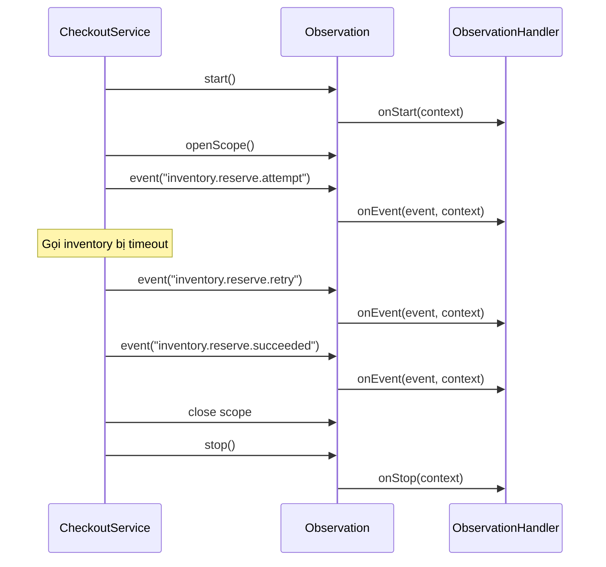
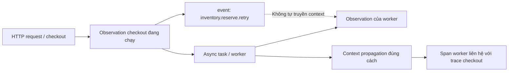

# Observation event: sự kiện trong vòng đời Observation

Khi theo dõi một thao tác Spring Boot, chúng ta thường biết **thao tác bắt đầu lúc nào**, **kết thúc lúc nào** và **mất bao lâu**. Nhưng giữa hai mốc đó có thể có nhiều diễn biến quan trọng: bắt đầu gọi dịch vụ kho, thử lại do timeout, chuyển sang phương án dự phòng hoặc hoàn tất bước xác thực. Những diễn biến này không nhất thiết là một thao tác kéo dài đủ lâu để tạo một observation riêng. **Observation event** là cách Micrometer Observation đánh dấu một **sự kiện tại một thời điểm** bên trong hoạt động đang được quan sát.

Trong module **SPRING_BOOT_OBSERVABILITY**, bài học thuộc chương **Vòng đời observation**. Mục tiêu là hiểu event trong Micrometer Observation, cách phát event và nhận event bằng handler, cũng như quan hệ của event với metrics, logs, distributed traces, context propagation, sampling và việc điều tra sự cố trong môi trường thực.

## 1. Observation event là gì?

Trong Micrometer Observation, một `Observation` mô tả hoạt động có vòng đời `start → stop`. Trong khoảng thời gian đó, ứng dụng có thể gọi:

```java
observation.event(Observation.Event.of("inventory.reserve.retry"));
```

Lời gọi trên thông báo rằng **một sự kiện có tên `inventory.reserve.retry` đã xảy ra** trong ngữ cảnh của observation. Khi có `ObservationHandler` phù hợp, handler được gọi tại điểm phát event và có thể chuyển thông tin đó sang một tín hiệu quan sát, chẳng hạn một event trên span tracing.

**Observation event không đồng nghĩa với:**

- **Observation mới:** event không tự tạo thêm cặp start/stop hoặc thời lượng độc lập.
- **Metric counter:** một event được phát ra không mặc nhiên làm tăng một counter trong `MeterRegistry`.
- **Log:** gọi `observation.event(...)` không tự ghi một dòng log nghiệp vụ.
- **Exception/error:** event mô tả một diễn biến; `observation.error(ex)` báo lỗi thông qua nhánh callback khác.
- **Thông điệp trong message broker:** ở đây “event” là sự kiện quan sát nội bộ, không phải Kafka message hoặc domain event bắt buộc phải được gửi ra ngoài.

Một handler hoặc pipeline cụ thể có thể tạo log, metric hay span event từ observation event, nhưng đó là **hành vi của thành phần được cấu hình**, không phải lời hứa cố định của API.

## 2. Phân biệt event với các thành phần của vòng đời

| Khái niệm | Ý nghĩa | API/điểm xử lý thường gặp | Câu hỏi chính |
| --- | --- | --- | --- |
| Observation **start** | Bắt đầu quan sát một hoạt động | `start()` / handler `onStart` | Hoạt động bắt đầu khi nào? |
| Observation **scope** | Đặt observation vào ngữ cảnh hiện tại | `openScope()`, `Scope.close()` | Hoạt động nào đang là ngữ cảnh hiện hành? |
| Observation **event** | Ghi dấu diễn biến tại một thời điểm | `event(Observation.Event.of(...))` / handler `onEvent` | Điều gì đã xảy ra bên trong? |
| Observation **error** | Thông báo một lỗi cụ thể | `error(Throwable)` / handler `onError` | Lỗi gì phát sinh? |
| Observation **key-value** | Cung cấp thuộc tính về hoạt động | `lowCardinalityKeyValue(...)`, `highCardinalityKeyValue(...)` | Nên nhóm/lọc hoạt động theo thuộc tính nào? |
| Observation **stop** | Kết thúc hoạt động và chốt thời lượng | `stop()` / handler `onStop` | Hoạt động mất bao lâu? |

Event và key-value khác nhau về ý nghĩa: `outcome=retry` có thể được hiểu như trạng thái/kết quả được gắn trên observation, trong khi `inventory.reserve.retry` xác định **thời điểm một lần thử lại xảy ra**. Nếu cần biết cả số lần retry **và phân bố retry theo lưu lượng**, có thể cần thêm metric chuyên biệt.

### Một trục thời gian minh họa



Sơ đồ là **một ví dụ thành công sau retry**. Nếu retry cũng thất bại, application có thể báo `error(ex)` trước khi `stop()`. Thứ tự thực tế phụ thuộc cách ứng dụng sắp xếp code; không phải mọi thao tác đều mở scope hay phát nhiều event. Event được phát trong vòng đời observation, nhưng **khả năng thấy nó ở backend** phụ thuộc handlers, exporter, sampling và giới hạn thu thập.

## 3. Tạo và phát Observation.Event trong Spring Boot

Giả sử `CheckoutService` phải giữ hàng cho một lần thanh toán. Ta muốn đánh dấu những thời điểm có ý nghĩa mà vẫn đo được tổng thời gian thực hiện. Đoạn mã sau dùng `ObservationRegistry` do ứng dụng Spring Boot cung cấp:

```java
import io.micrometer.observation.Observation;
import io.micrometer.observation.ObservationRegistry;
import org.springframework.stereotype.Service;

interface InventoryGateway {
    boolean reserve(String sku, int quantity);
}

@Service
public class CheckoutService {
    private final InventoryGateway inventoryGateway;
    private final ObservationRegistry observationRegistry;

    public CheckoutService(InventoryGateway inventoryGateway,
                           ObservationRegistry observationRegistry) {
        this.inventoryGateway = inventoryGateway;
        this.observationRegistry = observationRegistry;
    }

    public boolean reserveForCheckout(String sku, int quantity) {
        Observation observation = Observation.createNotStarted(
                "checkout.inventory.reserve", observationRegistry)
            .lowCardinalityKeyValue("operation", "reserve")
            .start();

        try (Observation.Scope ignored = observation.openScope()) {
            observation.event(
                Observation.Event.of("inventory.reserve.attempt"));

            boolean accepted = inventoryGateway.reserve(sku, quantity);

            if (accepted) {
                observation.lowCardinalityKeyValue("outcome", "accepted");
                observation.event(
                    Observation.Event.of("inventory.reserve.accepted"));
            } else {
                observation.lowCardinalityKeyValue("outcome", "rejected");
                observation.event(
                    Observation.Event.of("inventory.reserve.rejected"));
            }
            return accepted;
        } catch (RuntimeException exception) {
            observation.lowCardinalityKeyValue("outcome", "error");
            observation.error(exception);
            observation.event(
                Observation.Event.of("inventory.reserve.failed"));
            throw exception;
        } finally {
            observation.stop();
        }
    }
}
```

**Lưu ý khi đọc ví dụ:**

1. `Observation.createNotStarted(...)` tạo đối tượng chưa chạy; `start()` xác định điểm bắt đầu. `stop()` trong `finally` bảo đảm quan sát được đóng khi thoát khỏi phương thức, dù thành công hay ném exception.
2. `openScope()` mở ngữ cảnh hiện hành cho đoạn xử lý đồng bộ. `try-with-resources` đóng scope trước khi khối `finally` gọi `stop()`.
3. `Observation.Event.of("...")` tạo một event có **tên ổn định**. `observation.event(...)` đưa nó vào observation tại thời điểm xảy ra.
4. `accepted` và `rejected` là kết quả nghiệp vụ; `error` dành cho exception kỹ thuật. Không tự động xem mọi `rejected` là lỗi hệ thống.
5. `lowCardinalityKeyValue("outcome", ...)` giúp tổng hợp theo ba kết quả hữu hạn. Event riêng đánh dấu diễn biến, không thay thế metric tổng hợp.
6. `InventoryGateway` chỉ là interface mô phỏng lời gọi kho, cần có implementation thực tế để chạy trong dự án.

Ở ví dụ này có hai hướng xử lý: kết quả boolean hoặc exception. **Không có retry thật** vì retry cần chiến lược, giới hạn số lần và quy tắc idempotency riêng. Đặt tên một event là `retry` sẽ không làm ứng dụng tự retry.

## 4. Event và retry: ví dụ có nhiều diễn biến trong một observation

Để mô tả retry rõ hơn, có thể dùng một vòng lặp giới hạn lượt thử. Ví dụ dưới đây là **mã giả Java minh họa vị trí phát event**, chưa đầy đủ cho môi trường production:

```java
// Giả định observation đã start và đang ở trong scope.
for (int attempt = 1; attempt <= maxAttempts; attempt++) {
    observation.event(Observation.Event.of("inventory.call.started"));
    try {
        callInventory();
        observation.event(Observation.Event.of("inventory.call.succeeded"));
        break;
    } catch (TemporaryInventoryFailure ex) {
        if (attempt == maxAttempts) {
            observation.error(ex);
            observation.event(Observation.Event.of("inventory.call.exhausted"));
            throw ex;
        }
        observation.event(Observation.Event.of("inventory.call.retry"));
        applyBackoff(attempt);
    }
}
```

Mỗi lần đi qua `event(...)` có thể sinh một callback `onEvent` mới. Tên event **không thay đổi** theo lần thử; nếu cần theo dõi lượt thử, lựa chọn nơi lưu số `attempt` phải cân nhắc mục đích và giới hạn API/handler. Không dùng tên như `inventory.call.retry.1`, `retry.2` rồi thêm request ID vào tên event để tạo vô số biến thể.

Trong production, việc retry request có thể tạo tác dụng phụ nếu downstream không idempotent; cần thiết kế timeout, backoff, tối đa số lần, circuit breaker và kiểm tra trường hợp lỗi trước khi retry. Observation chỉ **ghi nhận diễn biến**, không định nghĩa chính sách retry.

## 5. ObservationHandler nhận event như thế nào?

Điểm mở rộng quan trọng của Observation là **`ObservationHandler`**. Handler có thể phản ứng ở các thời điểm trong vòng đời, bao gồm `onEvent(...)`. Handler giúp tách **nơi nghiệp vụ phát event** khỏi **nơi quyết định ghi nhận hay xuất event**.

Ví dụ một handler xử lý event của hoạt động checkout và ghi log để minh họa callback:

```java
import io.micrometer.observation.Observation;
import io.micrometer.observation.ObservationHandler;
import org.slf4j.Logger;
import org.slf4j.LoggerFactory;

public final class CheckoutEventHandler
        implements ObservationHandler<Observation.Context> {

    private static final Logger log =
        LoggerFactory.getLogger(CheckoutEventHandler.class);

    @Override
    public boolean supportsContext(Observation.Context context) {
        return context.getName() != null
            && context.getName().startsWith("checkout.");
    }

    @Override
    public void onEvent(Observation.Event event,
                        Observation.Context context) {
        log.info("observation={} event={}",
                 context.getName(), event.getName());
    }
}
```

**Điều cần hiểu:** handler minh họa ở trên **chủ động ghi log** trong `onEvent`. Nếu handler này không được đăng ký, mã `observation.event(...)` trong service **không tự sinh các dòng log này**. Tương tự, một tracing handler có thể chuyển event sang span event; một custom handler khác có thể thực hiện xử lý riêng, tùy hỗ trợ của nó.

Handler phải được đăng ký với `ObservationRegistry` trước khi observation được sử dụng. Ví dụ đăng ký trực tiếp khi khởi tạo registry:

```java
registry.observationConfig()
    .observationHandler(new CheckoutEventHandler());
```

Đây là **đoạn minh họa thao tác cấu hình registry**, không đặt trực tiếp trong từng request và không thay thế cấu hình tự động của Spring Boot. Trong ứng dụng thật, hãy tích hợp handler vào quá trình khởi tạo registry theo phiên bản Spring Boot đang dùng, đồng thời kiểm tra các handler metrics/tracing đã được cấu hình. Các implementation hoặc composite handler có thể quyết định handler nào thực sự được gọi.

Nếu mục đích chỉ là ghi một dòng log nghiệp vụ, nhiều trường hợp dùng logger trực tiếp sẽ đơn giản hơn tạo handler riêng. Custom handler hữu ích khi cần **một chính sách xử lý sự kiện quan sát thống nhất** trên nhiều service.

## 6. Event được ánh xạ ra metrics, logs và traces ra sao?

Không nên hiểu “đã phát Observation event” là “đã lưu đủ ba trụ cột”. Bảng sau tách trách nhiệm của mỗi thành phần:

| Tín hiệu | Observation event mang lại điều gì? | Những gì cần thêm |
| --- | --- | --- |
| **Metrics** | Có thể là điểm để handler tùy biến cập nhật một meter khi event xuất hiện | Một `MeterRegistry` và logic tăng counter/record measurement phù hợp; event không tự động là counter |
| **Logs** | Có thể giúp handler quyết định ghi một log có tên sự kiện, ngữ cảnh | Logger, định dạng log, correlation và pipeline thu thập |
| **Traces** | Có thể được tracing handler ánh xạ thành **span event** nằm trên span ứng với observation | Tracing bridge, span được ghi nhận, exporter, collector/backend và sampling phù hợp |

**Span event** (ví dụ trong hệ sinh thái OpenTelemetry) là một mốc có tên và timestamp bên trong span, hữu ích khi cần biết các giai đoạn như retry hay fallback đã diễn ra ở đâu. `Observation.Event` là kiểu abstraction của Micrometer; việc ánh xạ sang span event và những thuộc tính nào được giữ phụ thuộc implementation của tracing handler và backend.

Giả sử một request mất 1,8 giây:

```text
Span/Observation: checkout.inventory.reserve   1.800 ms
  0 ms       event: inventory.reserve.attempt
  900 ms     event: inventory.reserve.retry
  1.760 ms   event: inventory.reserve.accepted
  1.800 ms   stop
```

Các mốc là dữ liệu giả định. Nếu chỉ đọc **duration = 1,8 giây**, chúng ta chưa biết request đã retry. Nếu truy vấn trace có đủ span events, ta thấy điểm diễn biến quan trọng. Nếu chỉ xem một trace, vẫn không thể kết luận bao nhiêu phần trăm request phải retry; nên sử dụng metric riêng khi cần định lượng tỷ lệ này.

## 7. Event, error và status: ba khái niệm không giống nhau

Hãy xét ba tình huống:

| Tình huống | Thao tác quan sát gợi ý | Ý nghĩa |
| --- | --- | --- |
| Inventory trả lời hết hàng hợp lệ | `event("inventory.reserve.rejected")` và `outcome=rejected` | Kết quả nghiệp vụ dự kiến, có thể không phải lỗi kỹ thuật |
| HTTP call timeout, sau đó retry thành công | `event("inventory.reserve.retry")` và theo dõi kết quả cuối | Có diễn biến bất thường nhưng request tổng thể có thể thành công |
| Retry hết lần, exception được ném ra | `error(ex)`, `event("inventory.reserve.failed")`, `outcome=error` | Có cả lỗi kỹ thuật và mốc sự kiện cuối |

`observation.error(ex)` là tín hiệu lỗi theo vòng đời Observation và có thể kích hoạt `onError` của handler. Gọi `event("...failed")` chỉ phát một **sự kiện tên “failed”**; nó không đồng nghĩa với khai báo exception hoặc đổi trạng thái span thành lỗi. Ngược lại, gọi `error(ex)` không bảo đảm xuất hiện một event có tên `failed` trong trace.

Việc một exception được gắn thuộc tính nào, handler có ghi error status hay không, hoặc có sinh counter lỗi hay không phụ thuộc implementation. Hãy kiểm tra dữ liệu sau export thay vì suy từ tên event.

## 8. Đặt tên Observation event để có thể điều tra lâu dài

Tên event nên thể hiện **một diễn biến cụ thể, có nghĩa ổn định**, không nhúng dữ liệu biến động theo từng request.

| Tên | Đánh giá | Lý do |
| --- | --- | --- |
| `inventory.reserve.attempt` | Tốt | Mô tả sự kiện có ý nghĩa, dùng lại được |
| `inventory.reserve.retry` | Tốt | Chỉ rõ thời điểm ứng dụng bắt đầu retry |
| `inventory.reserve.fallback` | Tốt nếu thực sự có fallback | Phân biệt đường xử lý thay thế |
| `error` | Quá chung | Thiếu thông tin hoạt động và diễn biến |
| `retry-order-728193` | Không phù hợp | Chèn ID làm tên không ổn định và có rủi ro lộ dữ liệu |
| `some-problem-happened` | Không phù hợp | Không mô tả sự kiện hữu ích cho tra cứu |

Một số quy ước hữu ích:

- Dùng tên ngắn, dễ hiểu, nhất quán kiểu `component.action.phase` hoặc `component.action.result`.
- Phân biệt **attempt**, **retry**, **fallback**, **success**, **rejected**, **failed** theo đúng logic.
- Không tạo event cho mọi dòng code; chỉ phát tại **mốc giúp trả lời câu hỏi vận hành**.
- Không nhét email, tài khoản, token, URL chứa ID hay payload nghiệp vụ vào tên event.
- Đừng dùng event để thay thế nhãn kết quả ít cardinality như `outcome=success/error` hoặc một metric đếm retry cần tính tỷ lệ.

API cơ bản `Observation.Event.of(name)` tập trung vào tên của sự kiện. Nếu cần cấu trúc thuộc tính **riêng cho từng span event** vượt ngoài thông tin observation/handler có thể thể hiện, hãy cân nhắc tracing API phù hợp và giữ phần chuyên biệt trong lớp instrumentation thay vì rải vào toàn bộ service.

## 9. Cardinality và chi phí khi phát quá nhiều event

Event không giống metric label, nhưng **chi phí vẫn tồn tại**. Mỗi lần phát event có thể tạo callback, đối tượng dữ liệu, công việc trên handler và khi tracing hoạt động có thể tạo thêm span events được lưu hoặc xuất. Khi lưu lượng lớn, mỗi span chứa hàng trăm hoặc hàng nghìn sự kiện có thể làm tăng dung lượng trace, giới hạn sự kiện, tải collector và chi phí backend.

Ví dụ giả định: 1.000 request/giây, mỗi request thêm 20 events, sẽ tạo tối đa 20.000 lời gọi phát event/giây ở tầng instrumentation, trước khi xét sampling và handler. Không phải toàn bộ đều được export; số thực tế phụ thuộc tracing pipeline.

**Cardinality** chủ yếu quan trọng với key-values dùng làm nhãn metrics. Số lượng giá trị khác nhau của `orderId`, `customerId` hoặc raw URL có thể tạo bùng nổ time series nếu đưa vào low-cardinality tags. Vì thế:

- Low-cardinality tags nên chứa tập giá trị hữu hạn như `operation=reserve`, `outcome=accepted/rejected/error`.
- High-cardinality key-values có thể hữu ích cho trace theo từng request, nhưng cũng phải hạn chế dung lượng và dữ liệu nhạy cảm.
- Event names nên ổn định, không đưa request ID hoặc thông tin riêng tư vào tên.
- Chỉ ghi event khi nó giúp điều tra mà start/stop, error hoặc các span hiện có chưa diễn tả đủ.

Khi cần đo **tần suất** của retry ở mọi request, hãy dùng metric như counter có nhãn hữu hạn. Khi cần biết **retry xuất hiện ở thời điểm nào trong một request**, span event là một lựa chọn tốt nếu trace được thu thập.

## 10. Sampling và context propagation ảnh hưởng event thế nào?

Một event được phát ở thời gian chạy **không bảo đảm xuất hiện trên trace đã lưu**:

1. Observation có thể chạy nhưng chưa có tracing handler được cấu hình.
2. Tracing bridge có thể không tạo hoặc không record span cho observation tương ứng.
3. Sampling có thể loại trace khỏi quá trình lưu trữ; ví dụ lấy mẫu 10% không bảo đảm giữ được trace của một request bất kỳ.
4. Exporter, collector hoặc backend có thể gặp lỗi, giới hạn dung lượng hoặc giới hạn số events trên span.
5. Event có thể được phát ngoài vòng đời hoặc không ở đúng ngữ cảnh tracing mà ứng dụng mong đợi.

Trong Spring Boot dùng Micrometer Tracing, `Observation.Scope` quản lý ngữ cảnh hiện tại ở phạm vi phù hợp, nhưng **không tự bảo đảm context propagation** qua thread tùy tạo, executor, HTTP client chưa instrument hay message broker. Với HTTP/messaging, cần instrumentation để inject/extract trace context (thường dựa trên chuẩn W3C `traceparent`). Với xử lý bất đồng bộ, cần cơ chế capture/restore context thích hợp với framework và thư viện.

Hình dung checkout phát `inventory.reserve.retry`, rồi enqueue tác vụ chạy ở thread khác:



Sơ đồ nhấn mạnh ranh giới: event xảy ra trong observation của checkout; phần xử lý async cần **context propagation** để trace downstream liên hệ đúng với tác vụ ban đầu. Không nên gửi nguyên đối tượng `Observation` qua mạng hay coi `traceId` trong log là bằng chứng trace chắc chắn đã được lưu.

## 11. Điều tra sự cố bằng Observation event

**Tình huống giả định:** Sau khi thay đổi cấu hình timeout, p95 latency của `POST /checkout` tăng từ 300 ms lên 1,8 giây, nhưng phần lớn request vẫn nhận HTTP 200.

**Bước 1 — Dùng metrics xác định mức ảnh hưởng.** Xem rate, p95/p99 latency và tỷ lệ outcome của checkout trên cùng cửa sổ thời gian. Nếu p95 tăng trong khi lỗi ít, có thể có retry hoặc fallback đang che giấu lỗi downstream.

**Bước 2 — Mở một trace chậm đã được sample và export.** Span `checkout.inventory.reserve` có tổng thời lượng khoảng 1,7 giây, với các span events:

```text
00:00.000   inventory.reserve.attempt
00:00.700   inventory.reserve.retry
00:01.420   inventory.reserve.accepted
00:01.700   checkout.inventory.reserve completed
```

Mốc thời gian trên là ví dụ minh họa, không phải dữ liệu đo từ hệ thống. Event `retry` cho thấy có ít nhất một lần thử lại trong trường hợp này; chưa cho biết retry do network, timeout, throttling hay quy tắc nghiệp vụ.

**Bước 3 — Tìm log cùng trace ID.** Nếu hệ thống đã cấu hình correlation, log có thể cho thấy exception `SocketTimeoutException`, tên dịch vụ downstream hoặc số lần thử. Log do ứng dụng hoặc handler ghi, không được tạo chỉ bởi event.

**Bước 4 — Kiểm chứng bằng metrics và thêm request.** So sánh tỷ lệ retry của nhiều request, metric timeout/downstream và độ trễ theo phiên bản triển khai. Một trace có retry không chứng minh toàn bộ lưu lượng bị ảnh hưởng.

**Bước 5 — Đánh giá sau khắc phục.** Theo dõi p95/p99, rate, error ratio và số retry. Việc event `retry` xuất hiện ít hơn trong vài trace là tín hiệu hỗ trợ, nhưng cần metric định lượng để xác nhận xu hướng chung.

Quy trình này liên kết ba trụ cột: **metrics định lượng**, **traces ghi đường đi và mốc event**, **logs mô tả chi tiết nguyên nhân dự kiến**. Việc trùng thời gian giữa các tín hiệu là manh mối, chưa tự chứng minh nguyên nhân gốc.

## 12. Những lỗi triển khai thường gặp

| Hiện tượng | Nguyên nhân có thể | Hướng xử lý |
| --- | --- | --- |
| Đã gọi `event(...)` nhưng không thấy span event | Chưa có tracing handler/bridge, trace không sample hoặc exporter lỗi | Kiểm tra registry, bridge, sampling và trace backend |
| Muốn đếm retry bằng dashboard nhưng chỉ phát event | Event không tự sinh counter | Thêm metric retry có nhãn hữu hạn; dùng trace để xem thời điểm retry |
| Không tìm thấy log của event | Không có logger/handler ghi log tương ứng | Tạo log có cấu trúc khi cần; không giả định event tự ghi log |
| Event name chứa ID từng đơn | Tên không ổn định, dễ lộ dữ liệu và khó phân nhóm | Dùng tên event cố định; dữ liệu nhận dạng cần xử lý riêng |
| Span có nhiều event không cần thiết | Phát ở mọi bước nhỏ; chi phí lưu trữ cao | Giữ các mốc quyết định vận hành |
| Event trong async không gắn đúng trace | Context không được chuyển qua executor/queue | Instrument và propagate context tại ranh giới |
| Event tên `failed` nhưng span vẫn không báo lỗi | Event là mốc, không thay `error(ex)` | Gọi `error(ex)` khi có lỗi, kiểm tra handler biểu diễn trạng thái |
| Gọi `stop()` quá sớm rồi mới phát event | Sai ranh giới của thao tác | Đặt event ở trong thời gian hoạt động và quản lý scope/`finally` rõ ràng |
| Custom handler được viết nhưng không được gọi | Chưa đăng ký handler hoặc `supportsContext` không khớp | Kiểm tra cấu hình registry và tên observation |

Không nên “sửa” tình trạng thiếu trace bằng cách bắt buộc sampling 100% trên mọi hệ thống. Cần xét mức tải, mục tiêu điều tra, khả năng lưu trữ, chính sách sampling và giải pháp thu thập lỗi hiếm phù hợp.

## 13. Bài tập tự kiểm tra

**Bài 1.** Một API có ba trạng thái: `validated`, `payment.authorized` và `completed`. Bạn nên tạo ba observations riêng hay ba events?

*Gợi ý:* Nếu mục tiêu chỉ đánh dấu mốc trong cùng một hoạt động, events có thể phù hợp. Nếu từng bước cần đo thời lượng độc lập, có thể tạo observations/spans con. Chọn theo câu hỏi điều tra, không theo số lượng dòng code.

**Bài 2.** Một lập trình viên gọi `observation.event(Observation.Event.of("retry"))`, rồi kỳ vọng `retry_total` trong Prometheus tăng. Điều gì chưa đúng?

*Gợi ý:* Observation event chỉ kích hoạt các handler tương ứng. Counter cần instrumentation hoặc custom handler chuyên cập nhật meter; event không tự tạo counter.

**Bài 3.** Hệ thống phát event `inventory.reserve.failed` nhưng không gọi `observation.error(ex)`. Có thể xem span chắc chắn ở trạng thái lỗi không?

*Gợi ý:* Không. Event name là mô tả diễn biến, không tự quyết định error status. Tùy tracing handler và ngữ cảnh, cần báo lỗi qua API phù hợp và xác minh sau export.

**Bài 4.** Log có `traceId` và event `retry` nhưng không tìm thấy span event tương ứng. Nêu ít nhất ba nguyên nhân hợp lý.

*Gợi ý:* Sampling, thiếu handler/tracing bridge, exporter/collector lỗi, giới hạn số span events, đứt context propagation hoặc log và event phát từ các observation khác nhau.

**Bài 5.** Một service phát 200 events trên mỗi request để “ghi lại mọi bước”. Đội vận hành nên xem xét những gì?

*Gợi ý:* Ý nghĩa mỗi event, chi phí CPU và lưu trữ trace, giới hạn backend, sampling và câu hỏi điều tra thực sự. Giữ mốc đáng chú ý, cân nhắc logs hoặc metrics cho những thông tin cần tổng hợp.

## 14. Ghi nhớ

- **Observation event** là một mốc diễn biến trong vòng đời observation; phát bằng `observation.event(Observation.Event.of("ten.su.kien"))`.
- **`onEvent` của `ObservationHandler`** quyết định cách phản ứng với event. API không tự bảo đảm có log, counter hay span event ở backend.
- **Event**, **error**, **key-value** và **start/stop** phục vụ các mục đích khác nhau: dấu mốc, lỗi, thuộc tính và thời lượng.
- Chọn **tên event ổn định**, bảo vệ dữ liệu nhạy cảm, giới hạn số events và giữ **low-cardinality tags** cho metrics.
- Event trở nên hữu ích nhất khi được liên kết với metrics để đo mức độ, logs để đọc ngữ cảnh và traces để thấy diễn biến của một request; cần kiểm tra handlers, sampling, exporter và context propagation.
