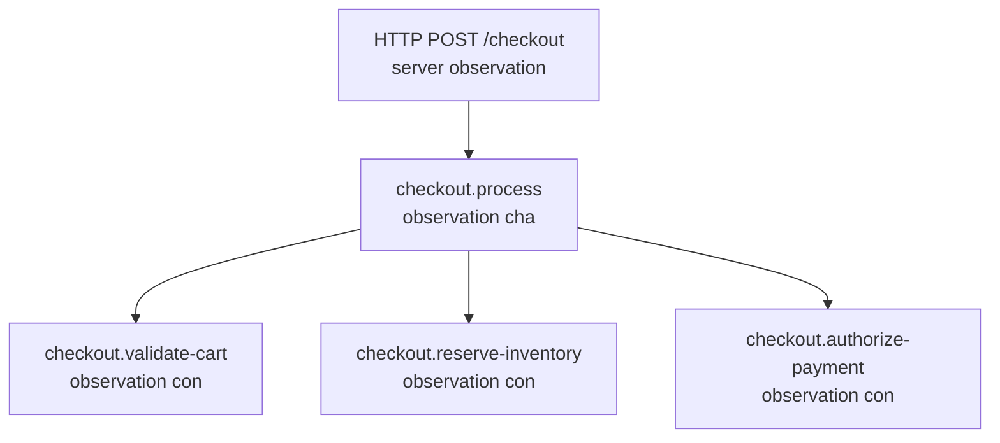

# Nested observation

Trong chương **Vòng đời observation** của mô-đun **SPRING_BOOT_OBSERVABILITY**, **nested observation** là cách tạo các observation con bên trong một observation cha để mô tả một thao tác lớn gồm nhiều bước nhỏ. Ví dụ, request thanh toán có thể gồm xác thực giỏ hàng, giữ tồn kho, ủy quyền thanh toán và ghi đơn hàng. Mỗi bước có thời gian và khả năng lỗi riêng; quan hệ cha–con cho phép nhìn được bức tranh tổng thể và khoanh vùng nơi cần điều tra.

Mô-đun này thiết lập observability cho Spring Boot qua **Micrometer Observation, metrics, logs và distributed tracing**, đồng thời xem xét propagation ngữ cảnh, tag/cardinality, exporter và sampling. Nested observation là điểm giao giữa các chủ đề đó: code tạo một cây hoạt động logic, còn handlers và pipeline quan sát quyết định các hoạt động đó hiển thị như thế nào dưới dạng metrics, spans và logs.

## 1. Kết quả cần đạt

Sau bài học, bạn có thể:

1. Phân biệt **observation cha**, **observation con**, **scope hiện hành** và **span cha–con** khi tracing được bật.
2. Tạo hai hoặc nhiều observation lồng nhau bằng `ObservationRegistry` và `Observation.createNotStarted(...)`.
3. Giải thích tại sao một observation con cần được bắt đầu khi ngữ cảnh cha đang active để hệ thống tracing liên kết chúng.
4. Quản lý đúng vòng đời `start()`, `openScope()`, `error(...)` và `stop()`, kể cả khi có exception.
5. Đọc thời lượng của parent/child đúng cách; tránh cộng sai các khoảng thời gian trùng lặp.
6. Nhận diện lỗi mất context khi xử lý bất đồng bộ hoặc qua HTTP/messaging và giới hạn của sampling.
7. Chọn tên observation và tag ít cardinality, để metrics vẫn hữu dụng và không làm tăng chi phí vô kiểm soát.

## 2. Nested observation là gì?

Một observation mô tả **một loại hoạt động**. Nested observation xảy ra khi một hoạt động được quan sát sinh ra những hoạt động khác được quan sát **trong ngữ cảnh của nó**.

Ví dụ:

```text
checkout.process                   (parent: quy trình thanh toán)
├── checkout.validate-cart         (child: kiểm tra giỏ hàng)
├── checkout.reserve-inventory     (child: giữ tồn kho)
└── checkout.authorize-payment     (child: ủy quyền thanh toán)
```

Trong quy trình thực thi tuần tự, ba observation con thường lần lượt nằm bên trong thời gian của observation cha. Nếu có tracing handler hoạt động và scope được quản lý đúng, những hoạt động này có thể xuất hiện thành các span cha–con trong cùng một trace.

Một cách hình dung:



Sơ đồ là **cấu trúc logic**. Các bước con có thể chạy tuần tự, song song hoặc nằm trong luồng khác, và sự hiện diện của mỗi span trên trace backend còn phụ thuộc instrumentation, context propagation và sampling.

### Ba khái niệm rất dễ nhầm

| Khái niệm | Ý nghĩa | Có tự tạo quan hệ cha–con trên trace không? |
| --- | --- | --- |
| **Lồng hàm Java** | Hàm A gọi hàm B. | Không. Nếu B không được instrument thì chỉ có lời gọi hàm thông thường. |
| **Nested observation** | Một observation con được tạo/bắt đầu dưới ngữ cảnh observation cha. | Có thể, khi handler tracing nhận được quan hệ ngữ cảnh. |
| **Distributed trace** | Các span liên kết bằng trace context, có thể trải qua nhiều service. | Chỉ đầy đủ khi context được truyền qua các ranh giới và spans được thu nhận. |

Vì thế, hai lời gọi `Observation.createNotStarted(...)` đặt gần nhau trong code chưa đủ chứng minh chúng là cha–con. **Ngữ cảnh hiện hành tại thời điểm xử lý vòng đời observation mới là điểm quyết định quan hệ.**

## 3. Cơ chế nền tảng: registry và current scope

`ObservationRegistry` giữ thông tin cấu hình và các `ObservationHandler`. Với xử lý đồng bộ thông thường, một scope đang mở làm observation đó trở thành **observation hiện hành** của luồng thực thi. Khi tạo và bắt đầu một observation khác bên trong scope phù hợp, các handler có thể dùng ngữ cảnh này để tạo quan hệ cha–con.

Một ví dụ tối thiểu:

```java
Observation parent = Observation.createNotStarted(
        "checkout.process", registry);

parent.start();
try (Observation.Scope parentScope = parent.openScope()) {

    Observation child = Observation.createNotStarted(
            "checkout.validate-cart", registry);

    child.start();
    try (Observation.Scope childScope = child.openScope()) {
        validateCart();
    } catch (RuntimeException exception) {
        child.error(exception);
        throw exception;
    } finally {
        child.stop();
    }

} catch (RuntimeException exception) {
    parent.error(exception);
    throw exception;
} finally {
    parent.stop();
}
```

Ở đây `validateCart()` là hàm nghiệp vụ minh họa. Trình tự quan trọng:

1. `parent.start()` bắt đầu vòng đời cha.
2. `parent.openScope()` đưa cha vào ngữ cảnh hiện hành.
3. Trong scope của cha, `child.start()` bắt đầu vòng đời con; handler tracing có thể nhận cha hiện hành.
4. `child.openScope()` làm con thành context hiện hành cho lời gọi bên trong.
5. Khi scope của con đóng, scope cha tiếp tục là ngữ cảnh hiện hành.
6. `child.stop()` kết thúc con; cuối cùng `parent.stop()` kết thúc cha.

**`start()` khác `openScope()`.** `start()` điều khiển thời gian đo và callback vòng đời. `openScope()` điều khiển ngữ cảnh hiện hành để liên kết các hoạt động con và log khi integration hỗ trợ. Bắt đầu observation cha nhưng quên mở scope có thể làm observation con không nhận được parent mong đợi.

**`close()` của `Observation.Scope` cũng khác `stop()`.** Scope đóng để khôi phục ngữ cảnh trước đó; observation cần `stop()` để hoàn thành vòng đời. Dùng `try-with-resources` cho scope và `finally` cho `stop()` để tránh thất thoát khi exception xảy ra.

## 4. Cách ngắn gọn: lồng các khối `observe(...)`

Với một công việc đồng bộ, `observe(...)` giúp bắt đầu, mở scope, ghi nhận lỗi và dừng observation quanh lambda; có thể lồng nhiều khối mà không phải tự gọi từng bước vòng đời.

```java
return Observation.createNotStarted("checkout.process", registry)
        .lowCardinalityKeyValue("operation", "checkout")
        .observe(() -> {

            Cart cart = Observation.createNotStarted(
                    "checkout.validate-cart", registry)
                    .observe(() -> validateCart(command));

            Reservation reservation = Observation.createNotStarted(
                    "checkout.reserve-inventory", registry)
                    .lowCardinalityKeyValue("dependency", "inventory")
                    .observe(() -> reserveInventory(cart));

            return Observation.createNotStarted(
                    "checkout.authorize-payment", registry)
                    .lowCardinalityKeyValue("dependency", "payment")
                    .observe(() -> authorizePayment(reservation));
        });
```

Đoạn trên minh họa quan hệ lồng; các kiểu `Cart`, `Reservation` và hàm nghiệp vụ cần có trong ứng dụng thật. Khi lambda cha đang chạy, scope cha active; lambda của mỗi observation con chạy trong scope con và được trả về scope cha sau khi kết thúc.

Đặc điểm của cách viết này:

- Quan hệ lồng thể hiện rõ qua cấu trúc mã.
- `observe(...)` bao luôn vòng đời của công việc đồng bộ.
- Exception từ thao tác con được chuyển ra ngoài, giúp observation cha cũng có cơ hội ghi nhận thất bại tổng thể.
- Các child là **anh em** cùng một parent, không phải chuỗi parent–child–grandchild chỉ vì chúng chạy nối tiếp.

Trong chương này, “nested” nói đến **quan hệ ngữ cảnh**, không đơn thuần là số cấp thụt lề trong code.

## 5. Ví dụ Spring Boot hoàn chỉnh: quy trình checkout

Giả sử `CheckoutService` nhận yêu cầu giữ hàng rồi thanh toán. Hai phụ thuộc `InventoryGateway` và `PaymentGateway` là interface của ứng dụng, có thể triển khai bằng HTTP client hoặc một thành phần khác.

Ví dụ Java 17+, Spring Boot 3.x:

```java
import io.micrometer.observation.Observation;
import io.micrometer.observation.ObservationRegistry;
import org.springframework.stereotype.Service;

@Service
public class CheckoutService {
    private final ObservationRegistry registry;
    private final InventoryGateway inventory;
    private final PaymentGateway payment;

    public CheckoutService(ObservationRegistry registry,
                           InventoryGateway inventory,
                           PaymentGateway payment) {
        this.registry = registry;
        this.inventory = inventory;
        this.payment = payment;
    }

    public CheckoutResult checkout(CheckoutRequest request) {
        return Observation.createNotStarted("checkout.process", registry)
                .contextualName("process checkout")
                .lowCardinalityKeyValue("workflow", "checkout")
                .observe(() -> {
                    String reservationId = Observation.createNotStarted(
                            "checkout.reserve-inventory", registry)
                            .lowCardinalityKeyValue("dependency", "inventory")
                            .observe(() -> inventory.reserve(
                                    request.sku(), request.quantity()));

                    String authorizationId = Observation.createNotStarted(
                            "checkout.authorize-payment", registry)
                            .lowCardinalityKeyValue("dependency", "payment")
                            .observe(() -> payment.authorize(reservationId));

                    return new CheckoutResult(reservationId, authorizationId);
                });
    }

    public record CheckoutRequest(String sku, int quantity) {}
    public record CheckoutResult(String reservationId, String authorizationId) {}

    public interface InventoryGateway {
        String reserve(String sku, int quantity);
    }

    public interface PaymentGateway {
        String authorize(String reservationId);
    }
}
```

Đây là ví dụ instrumentation của service; ứng dụng thật cần triển khai hai gateway, validation và chính sách rollback/bù trừ phù hợp. Việc giữ hàng thành công nhưng thanh toán thất bại là một tình huống nghiệp vụ cần xử lý riêng: **observability chỉ ghi nhận diễn tiến, không tự khôi phục giao dịch**.

Khi method `checkout(...)` được gọi trong một request HTTP có observation/tracing context active, cây hoạt động có thể được nối dưới server span:

```text
POST /checkout                  HTTP server span
└── checkout.process            custom parent span
    ├── checkout.reserve-inventory
    │   └── HTTP client: inventory-service /reservations
    └── checkout.authorize-payment
        └── HTTP client: payment-service /authorizations
```

Các HTTP client span chỉ xuất hiện nếu client được instrument phù hợp. Nếu implementation gọi một thư viện không được instrument, trace có thể chỉ có span custom `checkout.reserve-inventory`, không có span HTTP con. Một span custom đo bước nghiệp vụ vẫn hữu ích, nhưng không thay thế instrumentation của dependency.

### Tên và key-value dùng như thế nào?

Ví dụ trên dùng ba tên observation ổn định: `checkout.process`, `checkout.reserve-inventory` và `checkout.authorize-payment`. Tập tên không tăng theo số đơn hàng.

`workflow=checkout` và `dependency=inventory/payment` là **low-cardinality key-value**, phù hợp để nhóm metrics. Ngược lại:

```java
// Tránh dùng làm low-cardinality key-value.
observation.lowCardinalityKeyValue("checkout.id", checkoutId);
observation.lowCardinalityKeyValue("customer.email", customerEmail);
```

Hai giá trị này có thể tạo cực nhiều time series và có nguy cơ lộ dữ liệu riêng tư. Nếu cần gắn thuộc tính giàu chi tiết cho traces, hãy cân nhắc `highCardinalityKeyValue(...)` theo chính sách an toàn dữ liệu và giới hạn thu thập; đừng đưa ID người dùng, token hoặc payload nhạy cảm vào telemetry một cách tùy tiện.

Các observation con không mặc nhiên có mọi **metric tag** của cha. Chia sẻ trace context **không đồng nghĩa** thừa kế toàn bộ low-cardinality key-value. Nếu backend cần lọc child metrics theo environment, service hoặc workflow, cấu hình common tags/convention một cách có chủ đích.

## 6. Timeline: độ trễ của cha và con có thể khác nhau

Xem một request giả định:

```text
Mốc thời gian (ms)
0         50        150       250       350       450
|---------|---------|---------|---------|---------|
checkout.process        [======================================] 430 ms
  validate-cart          [===]                                    30 ms
  reserve-inventory          [================]                   180 ms
  authorize-payment                            [=============]    140 ms
  phần còn lại           (parse/map/logic/ghi kết quả)             80 ms
```

Dòng timeline chỉ minh họa tỷ lệ thời gian. Duration của **parent** đo toàn bộ công việc giữa start và stop, kể cả thời gian chưa có child observation. Các child chỉ đại diện những phần được instrument.

Trong trường hợp tuần tự của ví dụ, có thể suy ra khoảng `80 ms còn lại chưa được mô tả bởi hai bước dependency và bước validation; nhưng cần kiểm tra timeline thực tế để loại trừ khoảng chờ, overhead và các child không được xuất.

Trong hệ thống có xử lý song song hoặc retry:

- Hai child có thể **chồng lấp thời gian**, nên tổng duration child có thể lớn hơn thời gian thực tế đã trôi qua.
- Một child có thể gồm nhiều grandchild, nên cộng toàn bộ duration của cây sẽ **đếm lặp** thời gian.
- Parent có thể kéo dài hơn tổng các child khi có công việc không instrument hoặc chờ kết quả.
- Một child dài chỉ chỉ ra **vị trí tiêu tốn thời gian**; để xác định nguyên nhân cần thêm dependency metrics, logs, database timing và chứng cứ khác.

Vì vậy không suy ra “parent = tổng tất cả child spans”. Khi đọc waterfall trace, quan sát **khoảng thời gian nằm trên critical path**, quan hệ cha–con và phần tự xử lý của mỗi span. Với lỗi latency, so sánh một request chậm với một request bình thường thường hữu ích hơn việc nhìn một waterfall đơn lẻ.

## 7. Scope hiện hành và lỗi tạo “anh em” ngoài ý muốn

Một lỗi dễ gặp:

```java
Observation parent = Observation.createNotStarted(
        "checkout.process", registry).start();

// Chưa mở parent scope:
Observation child = Observation.createNotStarted(
        "checkout.reserve-inventory", registry).start();

try (Observation.Scope childScope = child.openScope()) {
    reserveInventory();
} finally {
    child.stop();
    parent.stop();
}
```

Trong ví dụ này, parent đã chạy nhưng **không được đặt làm observation hiện hành** khi child bắt đầu. Handler tracing có thể chọn một context khác làm cha, chẳng hạn HTTP server context đang active, hoặc tạo span không có quan hệ parent mong đợi. Quan hệ Java giữa hai biến `parent` và `child` không tự bảo đảm quan hệ tracing.

Cách đúng cho xử lý đồng bộ:

```java
Observation parent = Observation.createNotStarted(
        "checkout.process", registry).start();

try (Observation.Scope parentScope = parent.openScope()) {
    Observation child = Observation.createNotStarted(
            "checkout.reserve-inventory", registry).start();

    try (Observation.Scope childScope = child.openScope()) {
        reserveInventory();
    } catch (RuntimeException exception) {
        child.error(exception);
        throw exception;
    } finally {
        child.stop();
    }
} catch (RuntimeException exception) {
    parent.error(exception);
    throw exception;
} finally {
    parent.stop();
}
```

`ObservationRegistry.getCurrentObservation()` có thể giúp kiểm tra observation hiện hành trong đường thực thi đồng bộ khi cần gỡ lỗi. Khi đang ở child scope, current observation là child; khi child scope đóng, parent scope được khôi phục. Nhưng **đừng xem việc một biến `Observation` còn tồn tại là bằng chứng context vẫn được giữ trong thread**.

## 8. Nested observation, exception và kết quả của cả quy trình

Giả sử bước giữ hàng thành công, nhưng payment gateway trả timeout. Cây trace mô phỏng:

```text
checkout.process                     ERROR    1,500 ms
├── checkout.reserve-inventory       OK         110 ms
└── checkout.authorize-payment       ERROR    1,350 ms
```

Với các lambda `observe(...)` ở ví dụ checkout, nếu timeout được ném ra dưới dạng exception, observation của bước payment kết thúc trong nhánh lỗi; exception tiếp tục truyền ra ngoài observation cha, để quy trình checkout cũng được ghi nhận lỗi. Điều này giúp phân biệt **bước lỗi trực tiếp** với **quy trình bị ảnh hưởng**.

Tuy nhiên, “có lỗi” ở tracing/observation và “thất bại nghiệp vụ” không phải lúc nào cũng trùng nhau:

- Một gateway trả kết quả từ chối thanh toán hợp lệ có thể là **kết quả nghiệp vụ**, không nhất thiết là exception kỹ thuật.
- Một HTTP 4xx do validation khác với 5xx do lỗi server; cần quy tắc đánh dấu trạng thái nhất quán.
- Nếu catch exception rồi trả fallback thành công, parent có thể kết thúc bình thường dù child đã báo lỗi; hãy quyết định cách mô tả **outcome** theo SLO và ngữ nghĩa nghiệp vụ.
- Nếu tự quản lý vòng đời, hãy gọi `error(exception)` ở observation phù hợp, sau đó `stop()` trong `finally`. Đừng để logic instrument thay đổi hành vi trả lỗi của dịch vụ.

Ví dụ xử lý fallback có chọn lọc:

```java
return Observation.createNotStarted("checkout.process", registry)
        .observe(() -> {
            try {
                return Observation.createNotStarted(
                        "checkout.authorize-payment", registry)
                        .observe(() -> paymentGateway.authorize());
            } catch (PaymentTemporarilyUnavailable exception) {
                // Ghi nhận fallback nghiệp vụ theo chính sách ứng dụng.
                return Authorization.pendingReview();
            }
        });
```

Các kiểu `PaymentTemporarilyUnavailable` và `Authorization` chỉ là khái niệm minh họa. Observation con đã thấy exception trong lambda; observation cha thấy kết quả fallback, vì exception được bắt bên trong lambda cha. Điều này có thể **chính xác** nếu chính sách nghiệp vụ cho phép `pendingReview`, nhưng dashboard cần phân biệt checkout hoàn tất, đang chờ và thất bại bằng chỉ số nghiệp vụ riêng.

## 9. Giới hạn lồng qua thread và xử lý bất đồng bộ

### 9.1 Thread pool và `CompletableFuture`

Current scope trong xử lý đồng bộ thường gắn với execution context của thread. Khi chạy child ở một thread khác, không được giả định context cha tự động chuyển sang thread mới:

```java
return Observation.createNotStarted("checkout.process", registry)
        .observe(() -> CompletableFuture.supplyAsync(() -> {
            // Ở thread khác: current observation của cha có thể không có.
            return reserveInventory();
        }));
```

Đoạn code này còn có một vấn đề nữa: lambda `observe(...)` chỉ đợi đến khi **tạo ra `CompletableFuture`**, rồi trả về ngay. Parent observation có thể kết thúc trong khi công việc bất đồng bộ chưa chạy xong. Duration đo thời gian lập lịch, không phải toàn bộ giao dịch.

Khi cần tracing qua thread, hãy sử dụng cơ chế context propagation được hỗ trợ bởi stack đang dùng, chẳng hạn tích hợp Micrometer Context Propagation cùng executor đã instrument. Cần tạo/đóng observation tại đúng nơi công việc thực sự chạy và quản lý vòng đời cho tới khi bước bất đồng bộ hoàn tất. **Không truyền cùng một đối tượng `Observation.Scope` sang thread khác để dùng chung**: việc đóng/mở scope sai execution context có thể làm hỏng parentage và MDC.

### 9.2 Reactor và luồng reactive

Trong Reactor, execution có thể chuyển thread và toán tử được thực thi khi **subscribe**, không nhất thiết khi dựng `Mono` hoặc `Flux`. Ví dụ sau thường **không đo** thời gian xử lý thật:

```java
Mono<Receipt> result = Observation.createNotStarted(
        "checkout.process", registry)
        .observe(() -> checkoutReactive()); // Chỉ tạo ra Mono.
```

Nếu `checkoutReactive()` trả về một `Mono` chưa được subscribe, scope có thể đã đóng trước khi publisher thực thi. Để instrument luồng reactive, dùng cơ chế observation/reactor context và context propagation phù hợp với phiên bản Spring Boot, Micrometer và Reactor; kết thúc observation theo terminal signal (thành công, lỗi hoặc hủy) của subscription.

Điểm cần nhớ là **nested trong cấu trúc Java không bảo đảm nested theo thời gian thực thi bất đồng bộ**.

### 9.3 Qua HTTP và messaging

Hai Spring Boot service không chia sẻ một đối tượng `Observation` hay `Observation.Scope` Java. Quan hệ distributed trace qua service chỉ được nối nếu client inject context và server extract context từ carrier, chẳng hạn header W3C `traceparent`:

```http
POST /authorizations HTTP/1.1
Host: payment-service
traceparent: 00-4b2fe50af9d44c37ab610ebecc803e92-84f191c76aeadc11-01
```

Khi header được propagator xử lý đúng, service nhận có thể tạo server span thuộc cùng trace, rồi tạo nested observations bên trong service của nó. Với message broker, cũng cần chuyển context trong message headers theo cơ chế instrumentation tương ứng.

Nếu trace hiển thị bị tách thành hai cây ở ranh giới dịch vụ, hãy kiểm tra client/server instrumentation, headers, propagator, async context và sampling trước khi suy ra request chưa đến đích.

## 10. Nested observation tác động thế nào đến ba trụ cột?

Nested observation không tự bảo đảm cả ba tín hiệu đều xuất hiện trong một dashboard. **ObservationRegistry** và handlers cung cấp điểm nối; việc xuất và liên kết tín hiệu phụ thuộc cấu hình ứng dụng, exporter, collector và backend.

| Tín hiệu | Parent/child giúp được gì? | Điều cần kiểm tra |
| --- | --- | --- |
| **Metrics** | Đo riêng độ trễ và tần suất của toàn checkout cùng từng bước phụ thuộc. | Metrics handler, registry, tên metric thực tế, tags và histogram/percentile. |
| **Traces** | Hiển thị span cha/con, lỗi, dependency và critical path. | Tracing bridge, context propagation, exporter, sampling, backend. |
| **Logs** | Gắn sự kiện của từng bước với `traceId` và `spanId` khi context active. | Logging MDC/pattern, mức log, phân quyền và tránh dữ liệu nhạy cảm. |

Ví dụ cấu hình triển khai thử với Spring Boot 3.x, Prometheus registry và Micrometer Tracing bridge cho OpenTelemetry:

```groovy
dependencies {
    implementation 'org.springframework.boot:spring-boot-starter-actuator'
    implementation 'io.micrometer:micrometer-registry-prometheus'
    implementation 'io.micrometer:micrometer-tracing-bridge-otel'
    implementation 'io.opentelemetry:opentelemetry-exporter-otlp'
}
```

```yaml
spring:
  application:
    name: checkout-api

management:
  endpoints:
    web:
      exposure:
        include: health,info,metrics,prometheus
  tracing:
    sampling:
      probability: 1.0
  otlp:
    tracing:
      endpoint: http://otel-collector:4318/v1/traces
```

Cấu hình giả định collector có endpoint OTLP HTTP ở cổng 4318. `sampling.probability: 1.0` phù hợp với môi trường thử nghiệm ít traffic để dễ quan sát; môi trường production cần cân nhắc chi phí traces và sampling strategy. Đường `actuator/prometheus` phải được hạn chế truy cập theo chính sách vận hành.

Sau khi gọi checkout vài lần, kiểm tra `actuator/metrics` hoặc `actuator/prometheus` để xác nhận observation timings đã được ghi bởi metrics registry. Tên metric và tập nhãn thực tế cần đọc từ exporter/endpoint, vì chúng phụ thuộc conventions và version. Sau đó tra cứu `checkout.process` trong trace backend để kiểm tra cây span và đối chiếu duration, error attributes và logs.

Một số hệ thống hỗ trợ **exemplars** để đi từ điểm dữ liệu trên metrics tới trace tiêu biểu; điều này cần cấu hình và backend hỗ trợ riêng. Không nên coi mọi metric của observation là có sẵn nút mở trace.

### Sampling ảnh hưởng cách kết luận

Khi trace sampling chỉ giữ một tỷ lệ request, có thể có metrics đầy đủ cho checkout nhưng không tìm được trace của một lần lỗi cụ thể. Điều đó **không chứng minh** metric sai hay nested observation không hoạt động. Cần phân biệt lỗi tạo span, lỗi propagation, sampling và sự cố exporter/collector. Cũng không dùng một trace chậm đơn lẻ để kết luận phần lớn request đều chậm: tỷ lệ ảnh hưởng phải được xác nhận bằng metrics tổng hợp.

## 11. Những lỗi thực tế và cách xử lý

| Hiện tượng | Giả thuyết thường gặp | Kiểm tra |
| --- | --- | --- |
| Parent span có, child span thiếu | Child không được instrument, tracing handler/registry chưa phù hợp, trace bị sampling hoặc export lỗi. | Kiểm tra code chạy tới child, vòng đời, cấu hình tracing và collector. |
| Parent và child thành hai root span | Parent scope không active lúc child bắt đầu, hoặc context bị mất qua thread/service. | Kiểm tra scope đang mở, execution context và propagation. |
| Child bị gắn dưới HTTP span, không dưới checkout span | Parent checkout đã `start()` nhưng chưa `openScope()` khi bắt đầu child. | Dùng `observe(...)` lồng nhau hoặc mở parent scope đúng thời điểm. |
| Duration parent nhỏ hơn công việc async | Parent kết thúc khi `CompletableFuture` hoặc `Mono` mới được tạo. | Đo vòng đời thực thi đến completion, hỗ trợ context propagation. |
| Cộng child duration ra số lớn hơn parent | Các child chạy song song hoặc có grandchild bị cộng lặp. | Xem waterfall và critical path; không cộng mù quáng các duration. |
| Trace có cấu trúc đúng nhưng metric quá nhiều time series | `orderId`/`userId`/URL thô được đưa vào low-cardinality tags. | Chuyển sang route/template, operation, dependency và outcome hữu hạn. |
| Lỗi xảy ra trong child nhưng parent không bị đánh dấu lỗi | Exception đã được xử lý thành fallback hoặc parent không ghi nhận outcome nghiệp vụ. | Định nghĩa rõ success, fallback, partial success và fail; có business metrics. |
| Logs của child không có trace ID | MDC hoặc tracing context không active khi ghi log. | Kiểm tra scope, logging integration và ranh giới async. |

## 12. Quy trình điều tra sự cố với nested observations

Giả sử cảnh báo cho thấy P95 của `POST /checkout` tăng từ 300 ms lên 2 giây sau khi thay đổi dịch vụ thanh toán. Một quy trình thực tế:

1. **Từ metrics**, khoanh mốc giờ, route, instance, error rate và P95/P99 của parent `checkout.process`.
2. So sánh metrics của từng child: `checkout.reserve-inventory` có tăng độ trễ không? Hay chỉ `checkout.authorize-payment`?
3. **Từ logs**, tìm timeout, retry và error của payment gateway trong cùng cửa sổ thời gian; lấy `traceId` nếu sẵn có.
4. **Từ tracing**, mở một số request chậm và một số request bình thường. Xem parent checkout, child authorize-payment và HTTP client/server spans tương ứng.
5. Nếu parent checkout dài nhưng child spans đều ngắn, tìm khoảng không được instrument, chờ lock/queue hoặc xử lý async sai; chưa vội quy lỗi cho payment.
6. Nếu payment child dài, đối chiếu network, timeout, retry, saturation của payment service, client pool và các dependency bên trong payment.
7. Sau khi khắc phục, trở lại **metrics** để xác nhận P95 và tỉ lệ lỗi cải thiện ở nhiều request, đồng thời dùng trace mới để thấy critical path đã đổi như dự đoán.

Điểm mạnh của nested observation ở đây là cùng một checkout được chia thành các bước có tên ổn định, giúp điều tra nhanh hơn mà không phải đoán từ một span HTTP dài duy nhất.

## 13. Bài tập tự kiểm tra

### Bài tập 1: Quan hệ giữa các observation

Xem mã:

```java
Observation a = Observation.createNotStarted("a", registry).start();
Observation b = Observation.createNotStarted("b", registry).start();

try (Observation.Scope scope = b.openScope()) {
    runBusinessLogic();
} finally {
    b.stop();
    a.stop();
}
```

**Câu hỏi:** Có thể khẳng định `b` là child của `a` không?

**Đáp án:** Không. `a` đã bắt đầu nhưng không có scope active lúc `b` bắt đầu. Trong môi trường tracing, `b` có thể có parent khác hoặc trở thành root tùy context/handler. Cách đơn giản là dùng `a.observe(() -> b.observe(...))`, hoặc mở `a` scope trước khi bắt đầu `b`.

### Bài tập 2: Đọc duration

Một trace có parent `checkout.process` 500 ms, hai child cùng chạy song song, mỗi child 350 ms. Có thể kết luận dữ liệu sai vì tổng child 700 ms lớn hơn parent 500 ms không?

**Đáp án:** Không. Các child chồng lấp thời gian. Parent duration là thời gian thực đã trôi qua; tổng duration child không phải phép cộng hợp lệ để tính duration parent. Hãy đọc timeline và critical path.

### Bài tập 3: Đo Mono chưa được subscribe

```java
Mono<String> result = Observation.createNotStarted(
        "payment.authorize", registry)
        .observe(() -> paymentClient.authorizeReactive());
```

**Câu hỏi:** Khi `authorizeReactive()` trả về một `Mono` lazy, observation đã đo toàn bộ giao dịch chưa?

**Đáp án:** Chưa chắc, và thông thường đoạn mã chỉ đo thời gian tạo `Mono`. Công việc thực hiện lúc subscribe; cần instrumentation gắn với execution lifecycle và Reactor context để đo đến terminal signal.

### Bài tập 4: Tìm nguyên nhân mất span con

Metrics cho thấy `checkout.authorize-payment` có độ trễ tăng, nhưng trace chỉ hiện HTTP server span và `checkout.process`. Nêu ít nhất ba khả năng.

**Gợi ý:** Scope hoặc vòng đời của child không đúng, hoặc nhánh code không chạy trong trace được xem; context bị mất qua thread/service; tracing instrumentation hoặc handler thiếu; sampling và pipeline xuất traces làm mất dữ liệu. Kiểm tra một request có thể tái hiện trong môi trường thử nghiệm trước khi kết luận.

## 14. Checklist khi thiết kế nested observations

- Tên parent và child mô tả **loại công việc**; không chứa ID request hay tên người dùng.
- Child được tạo và bắt đầu khi parent context phù hợp đang active.
- Dùng `observe(...)` cho khối đồng bộ đơn giản; nếu điều khiển thủ công, phải đóng scope và `stop()` trong mọi nhánh.
- Chỉ tạo child ở ranh giới nghiệp vụ có ý nghĩa vận hành; tránh tạo span cho từng dòng code.
- Phân biệt kết quả nghiệp vụ, exception kỹ thuật và fallback khi thiết kế cách ghi nhận lỗi.
- Với async, Reactor và messaging, quản lý vòng đời theo **thời điểm thực thi** và propagation thực sự.
- Chọn low-cardinality tags hữu hạn; bảo vệ mọi dữ liệu xuất sang logs/traces.
- Xác nhận từng tầng: metrics đã có, spans có quan hệ đúng, logs có correlation khi cần, exporter/backend hoạt động.
- Khi điều tra, xem parent/child waterfall cùng metrics tổng thể; không cộng duration lồng nhau để suy ra end-to-end latency.

**Ghi nhớ:** Nested observation giúp biến một hoạt động phức tạp thành **cây công việc có thể quan sát**, nhưng quan hệ đó chỉ đáng tin khi vòng đời và scope được quản lý đúng. Trong Spring Boot, Micrometer Observation cung cấp mô hình để đo các bước nghiệp vụ; tracing, logs, metrics, propagation, sampling và exporter quyết định bạn nhìn thấy cây đó đầy đủ tới mức nào khi sự cố xảy ra.
