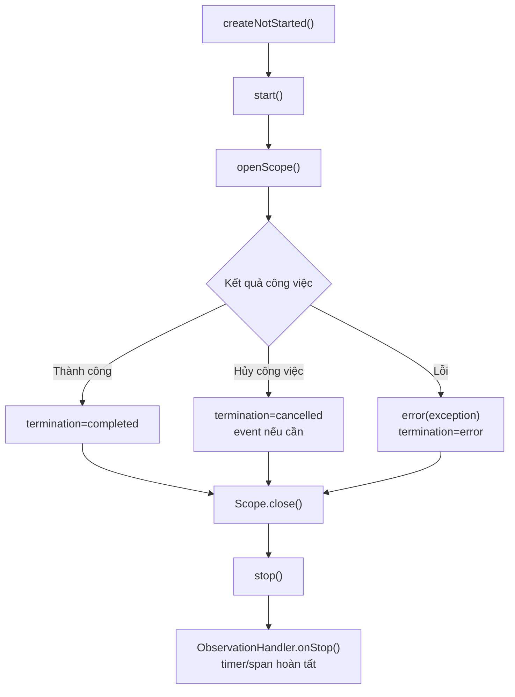

# Observation bị hủy

Một người dùng bắt đầu tải báo cáo trên ứng dụng Spring Boot, nhưng đóng trình duyệt sau ba giây. Hoặc một tác vụ nhập dữ liệu đang chạy bị hủy vì hệ thống shutdown. Công việc có thể chưa hoàn tất, trong khi bộ đếm thời gian, trace và ngữ cảnh logging của nó vẫn phải được xử lý đúng. Nếu bỏ qua trường hợp này, dashboard có thể không ghi nhận các yêu cầu bị hủy, còn span bị treo hoặc thread giữ ngữ cảnh của yêu cầu cũ.

Trong chương **Vòng đời observation** của module **SPRING_BOOT_OBSERVABILITY**, bài **Observation bị hủy** giải thích cách thiết kế và xử lý việc hủy công việc khi sử dụng **Micrometer Observation** trong Spring Boot. Đây là một phần của mục tiêu thiết lập observability với metrics, logs và distributed tracing: hiểu propagation ngữ cảnh, tag/cardinality, exporter, sampling và liên kết tín hiệu để điều tra lỗi, độ trễ và hành vi ứng dụng trong môi trường thực.

> **Điểm mấu chốt:** Micrometer Observation có các thao tác vòng đời như `start()`, `openScope()`, `error()`, `event()` và `stop()`. API Observation thông dụng **không có `cancel()` như một bước vòng đời riêng**. “Observation bị hủy” trong bài này chủ yếu là **công việc được quan sát bị hủy hoặc kết thúc sớm**, và ứng dụng phải quyết định ghi nhận trạng thái ấy như thế nào. Đóng scope rồi gọi `stop()` vẫn là quy trình đúng để hoàn tất phép đo đã bắt đầu.

## 1. Mục tiêu học tập

Sau bài này, bạn có thể:

1. Phân biệt việc **hủy công việc**, **hủy subscription Reactor**, **đánh dấu lỗi**, **dừng observation** và **vô hiệu hóa observation**.
2. Giải thích các callback lifecycle tương ứng trong `ObservationHandler` và hậu quả khi thiếu `stop()` hoặc không đóng `Scope`.
3. Instrument một tác vụ Java có thể bị interrupt để đo `completed / cancelled / error` một cách nhất quán.
4. Quan sát tín hiệu `SignalType.CANCEL` của Reactor và hiểu vì sao vị trí đặt operator đo đạc ảnh hưởng kết quả.
5. Truy tìm yêu cầu bị hủy qua metrics, logs và distributed traces, kể cả khi trace bị sampling.
6. Kiểm soát tag cardinality, tránh gán sai cancellation thành lỗi và kiểm chứng không rò rỉ ngữ cảnh.

## 2. “Bị hủy” có thể chỉ những điều rất khác nhau

| Tình huống | Ví dụ | Ngữ nghĩa chính | Ảnh hưởng lên observation |
|---|---|---|---|
| **Công việc bị yêu cầu hủy** | Người dùng bấm Cancel; `Future.cancel(true)`; shutdown | Bên ngoài yêu cầu ngừng thực thi; công việc có thể hoặc chưa thực sự dừng | Khi mã xử lý nhận biết và kết thúc, ghi `termination=cancelled` nếu phù hợp, rồi `stop()`. |
| **Reactive subscription bị hủy** | WebFlux client disconnect; `take(1)`; `timeout` hủy upstream | Reactor phát tín hiệu `CANCEL` đến subscription | Operator `doFinally` hoặc Micrometer Reactor instrumentation có thể ghi nhận trạng thái hủy. |
| **Công việc thất bại** | Database lỗi, exception không xử lý | Thực thi kết thúc do lỗi | Ghi `Observation#error(exception)`; kết thúc scope và observation. |
| **Công việc hoàn tất bình thường** | Đã tạo báo cáo và gửi kết quả | Hoạt động hoàn thành theo hợp đồng nghiệp vụ | Ghi `termination=completed` nếu có convention kết quả, rồi `stop()`. |
| **Observation được bỏ qua ngay từ đầu** | `ObservationPredicate` loại bỏ một loại observation | Hệ thống quyết định không instrument hoạt động ấy | Có thể nhận một `no-op Observation`; không sinh timer/span thông qua các handler thông thường. |
| **Chỉ đóng Scope** | Ra khỏi block `try-with-resources` | Gỡ observation/span hiện tại khỏi ngữ cảnh thực thi | **Không thay thế `stop()`**; việc đo thời lượng vẫn cần hoàn tất. |

Từ “cancel” thường bị dùng lẫn cho hai yêu cầu khác nhau:

- **Hủy hoạt động nghiệp vụ** nhưng vẫn muốn đo thời gian đã tiêu tốn, biết ai bị ảnh hưởng và tại sao nó bị hủy.
- **Bỏ luôn dữ liệu telemetry của hoạt động đã bắt đầu** để nó không tạo metric/span. Đây không phải ý nghĩa của `stop()`; không nên giả định Micrometer có một `Observation.cancel()` để xóa kết quả đã ghi.

Chẳng hạn, khi một người dùng ngắt tải báo cáo, việc ghi thời lượng trước lúc ngắt có thể rất hữu ích. Nếu coi yêu cầu đó “chưa bao giờ xảy ra”, p95 và tỷ lệ ngắt giữa chừng sẽ không phản ánh trải nghiệm thực tế.

## 3. Nhắc lại vòng đời chính xác của Micrometer Observation

Observation được tạo từ `ObservationRegistry`, sau đó bắt đầu và kết thúc. Scope là cơ chế để đưa observation vào ngữ cảnh hiện hành, phục vụ quan hệ parent/child và correlation logging.



`ObservationHandler` nhận những callback được định nghĩa bởi API: `onStart`, `onScopeOpened`, `onScopeClosed`, `onError`, `onEvent`, `onStop`... Tùy handler, chúng có thể ghi timer, span và các dữ liệu khác. Micrometer **không định nghĩa callback chuẩn `onCancel`** cho `ObservationHandler`; việc hủy là thông tin do framework hoặc mã nghiệp vụ mang vào context, event hoặc tag.

### 3.1 Các thao tác cần hiểu đúng

| Thao tác | Ý nghĩa | Khi hủy công việc |
|---|---|---|
| `Observation.start()` | Bắt đầu vòng đời của measurement; kích hoạt handler `onStart`. | Observation phải được bắt đầu nếu bạn muốn đo khoảng thời gian thực thi. |
| `Observation.openScope()` | Đặt observation/span vào ngữ cảnh hiện hành để instrumentation con và logger tiếp cận. | Giữ scope trong phần xử lý cần correlation. |
| `Observation.event(...)` | Báo một sự kiện có tên; handler có thể ghi sự kiện vào span/counter. | Có thể thêm `job.cancelled` như một thông tin diễn biến; không thay cho outcome metric. |
| `Observation.error(Throwable)` | Ghi nhận một lỗi theo quy ước của instrumentation. | Chỉ gọi khi chính sách coi tình huống đó là lỗi; **không mặc nhiên coi mọi hủy là lỗi**. |
| `Observation.Scope.close()` | Phục hồi/gỡ ngữ cảnh hiện tại và báo callback scope closed. | Phải chạy kể cả khi bị hủy hoặc exception. |
| `Observation.stop()` | Kết thúc observation; các handler hoàn tất phép đo và span. | Phải gọi khi observation đã bắt đầu và công việc đã thực sự kết thúc. |

Hai điều dễ nhầm:

1. **`close()` không phải `stop()`**. Một observation có thể mở nhiều scope; việc thoát một scope không khép vòng đời của nó.
2. **`stop()` không phải lệnh hủy công việc**. Gọi `stop()` không dừng thread, hủy HTTP request, rollback transaction hay kết thúc tác vụ bất đồng bộ. Nó chỉ báo rằng phép quan sát đã kết thúc.

Các thao tác `error()` và `event()` có thể diễn ra trước `stop()`, nhưng không tạo ra bước chuyển sang một trạng thái “Cancelled” tích hợp sẵn.

### 3.2 Điều gì xảy ra nếu thiếu dọn dẹp?

- Quên `stop()`: timer thông thường sẽ không có bản ghi hoàn chỉnh cho lần đó; span có thể chưa hoàn tất và không được xuất đúng. Nếu hệ thống có theo dõi active observation, dữ liệu active có thể bị giữ lại sai.
- Quên `Scope.close()`: `ThreadLocal`/MDC có thể còn trace ID hoặc observation hiện hành khi thread được tái sử dụng, gây liên kết log/traces sai.
- Gọi `stop()` quá sớm: thời lượng không còn bao phủ phần công việc thực tế; span cha có thể kết thúc trước các lời gọi con vẫn đang chạy.
- Gọi `error()` rồi bắt exception và trả kết quả “thành công” mà không có quy ước rõ ràng: metric và trace có thể biểu thị lỗi không phù hợp với trải nghiệm người dùng.
- Bỏ qua yêu cầu hủy trong tác vụ: phép đo có thể kéo dài dù phía gọi không còn cần kết quả.

**Nguyên tắc thiết kế:** mỗi đơn vị công việc có một chủ thể sở hữu trách nhiệm kết thúc observation; đóng scope đúng nơi và chỉ gọi `stop()` khi hoạt động mà observation đại diện thực sự kết thúc.

## 4. Xác định cancellation có phải error hay không

“Bị hủy” mô tả cách công việc kết thúc, còn “lỗi” mô tả đánh giá về kết quả. Chúng có thể liên quan nhưng **không đồng nhất**.

| Trường hợp | Đề xuất `termination` | Có nên `observation.error(...)`? | Lý do |
|---|---|---|---|
| Người dùng chủ động hủy export | `cancelled` | Thường không | Hành vi mong muốn, không nhất thiết là sự cố hệ thống. |
| `Future.cancel(true)` do shutdown có kiểm soát | `cancelled` | Thường không | Tác vụ được yêu cầu dừng; ghi reason và kiểm tra cleanup. |
| Request mất kết nối phía client | `cancelled` nếu framework nhận được tín hiệu | Theo convention HTTP/framework | Có thể là thoát trang bình thường hoặc mạng lỗi; không tự gán HTTP 500. |
| Hết deadline nội bộ và công việc bị cắt | `timeout` hoặc `cancelled`, tùy hợp đồng | Có thể | Nếu timeout là vi phạm SLO, cần phản ánh trạng thái lỗi tương ứng. |
| Exception từ DB | `error` | Có | Đây là lỗi thực thi cần điều tra. |
| Reactor `take(1)` hủy upstream sau một phần tử | `cancelled` ở upstream; `completed` ở downstream | Thường không | Cancellation do flow control và xử lý thành công theo yêu cầu. |

Hãy chuẩn hóa **outcome/termination** trước khi viết dashboard. Có thể dùng tập hữu hạn `completed`, `cancelled`, `error`, `timeout`; nếu cần lý do hủy, dùng một key riêng như `cancel.reason` với tập giá trị đã định nghĩa, chẳng hạn `client_disconnect`, `operator`, `deadline`, `shutdown`.

Không đưa `userId`, `orderId`, token hoặc URL chứa ID thực vào **low-cardinality tags**. Cardinality tăng quá cao có thể làm số series Prometheus bùng nổ. Nếu cần tra cứu request cụ thể, dùng trace ID trong log/trace theo chính sách bảo mật thay vì đưa vào metrics.

### 4.1 `observe(...)` và exception khi hủy

Hàm tiện ích:

```java
Observation.createNotStarted("my.operation", registry)
        .observe(() -> doWork());
```

sẽ tự bắt đầu observation, mở scope, gọi callback, tự báo `error(...)` nếu callback **ném exception**, đóng scope và `stop()`. Nó rất phù hợp với đoạn công việc đồng bộ đơn giản.

Tuy nhiên, nếu ứng dụng ném `CancellationException` từ callback, `observe(...)` cũng sẽ tự báo exception đó là một **error**. Điều này có thể trái với quy ước “hủy có chủ đích không phải lỗi” của hệ thống. Khi cần phân biệt ba kết quả một cách chính xác, dùng vòng đời tường minh và lựa chọn khi nào gọi `error()`.

## 5. Ví dụ Java: tác vụ bị interrupt và observation vẫn hoàn tất

Giả sử Spring Boot có một dịch vụ tạo báo cáo. Tác vụ có thể bị ngắt khi hệ thống yêu cầu hủy; chúng ta cần biết số lần thành công, hủy, lỗi và thời lượng trước khi kết thúc.

Ví dụ dưới đây dùng `ObservationRegistry` do Spring Boot Actuator cung cấp. Java hỗ trợ `Thread.sleep`; khi thread bị interrupt trong lúc ngủ, hàm ném `InterruptedException` và xóa cờ interrupt. Mã phải khôi phục cờ sau khi ghi nhận cancellation.

```java
import io.micrometer.observation.Observation;
import io.micrometer.observation.ObservationRegistry;
import org.slf4j.Logger;
import org.slf4j.LoggerFactory;
import org.springframework.stereotype.Service;

@Service
public class ReportJobService {

    private static final Logger log =
            LoggerFactory.getLogger(ReportJobService.class);

    private final ObservationRegistry observationRegistry;

    public ReportJobService(ObservationRegistry observationRegistry) {
        this.observationRegistry = observationRegistry;
    }

    public String generateReport() throws InterruptedException {
        Observation observation =
                Observation.createNotStarted("report.generate", observationRegistry)
                        .contextualName("generate report")
                        .lowCardinalityKeyValue("job.type", "export")
                        .start();

        try (Observation.Scope scope = observation.openScope()) {
            try {
                // Giả lập đoạn xử lý có hỗ trợ interrupt.
                Thread.sleep(5_000L);

                observation.lowCardinalityKeyValue(
                        "termination", "completed");
                log.info("Report generated successfully");
                return "report-ready";

            } catch (InterruptedException cancelled) {
                // Quy ước: dừng theo interrupt là cancellation, không phải error.
                observation.lowCardinalityKeyValue(
                        "termination", "cancelled");
                observation.event(Observation.Event.of("report.cancelled"));
                log.info("Report generation cancelled by interruption");

                Thread.currentThread().interrupt();
                throw cancelled;

            } catch (RuntimeException failure) {
                observation.lowCardinalityKeyValue(
                        "termination", "error");
                observation.error(failure);
                log.error("Report generation failed", failure);
                throw failure;
            }
        } finally {
            // Chạy cả khi thành công, bị interrupt hay lỗi.
            observation.stop();
        }
    }
}
```

**Vì sao ví dụ này xử lý đúng vòng đời?**

1. `createNotStarted(...)` tạo observation. `start()` bắt đầu đo ngay trước phần công việc được quan sát.
2. `openScope()` làm observation/span hiện hành khả dụng khi mã chạy và log được ghi.
3. Khi thành công, tag `termination=completed` được thêm **trước** `stop()`.
4. Khi bị interrupt, mã gắn `termination=cancelled` và tạo event. Nó không tự gọi `error()`, vì đây là lựa chọn nghiệp vụ “hủy có chủ đích”.
5. Log cancellation được ghi **khi scope vẫn còn mở**, cho phép giữ correlation ID nếu tracing/MDC đã cấu hình.
6. `try-with-resources` đóng scope trên cả ba nhánh. `finally` gọi `stop()` sau khi scope đã đóng.
7. Exception vẫn được chuyển lên caller, và cờ interrupt được khôi phục để executor có thể nhận biết yêu cầu hủy.

Mã này minh họa cách phản ứng khi **đã nhận** `InterruptedException`; nó không tự tạo một endpoint hủy công việc và không bảo đảm mọi thư viện I/O đều hỗ trợ interrupt. Nếu một SDK bỏ qua interrupt, công việc có thể vẫn chạy dù caller đã gọi `cancel(true)`.

### 5.1 Đọc kết quả metrics

Khi có metrics handler tương ứng trong `ObservationRegistry`, một timer tên `report.generate` có thể ghi nhận khoảng thời gian cho mỗi lần gọi **đã kết thúc**. Theo cơ chế `DefaultMeterObservationHandler`, timer thường có các low-cardinality tags và tag `error`:

| Kết quả | Tag minh họa | Thời lượng |
|---|---|---|
| Thành công | `termination=completed`, `error=none` | Từ `start` đến `stop`. |
| Bị ngắt, theo quy ước không phải lỗi | `termination=cancelled`, `error=none` | Thời gian thực tế trước khi nhận interrupt và cleanup. |
| Runtime exception | `termination=error`, `error=IllegalStateException` (ví dụ) | Thời gian đến khi exception và cleanup. |

Giá trị `error` trên meter do handler/convention quyết định; không nên tự gán `error=none` như metadata nghiệp vụ để cạnh tranh với handler. Một cancellation với `error=none` **không có nghĩa tác vụ thành công**; phải đọc cả `termination`.

Muốn có một counter chuyên biệt cho số cancellation, bạn có thể đăng ký counter bằng Micrometer `MeterRegistry`, nhưng không nên vừa dựa vào `report.generate` timer count vừa cộng thêm counter rồi coi cả hai là cùng một loại “request count”. Chúng đo hai khái niệm riêng và dashboard cần nói rõ.

### 5.2 Hủy `Future` có thực sự dừng tác vụ không?

Ví dụ về phía caller:

```java
Future<String> task = executorService.submit(reportJobService::generateReport);

// Khi người dùng yêu cầu hủy, gọi:
boolean accepted = task.cancel(true);
```

`Future.cancel(true)` yêu cầu ngắt thread đang thực thi nếu có thể; giá trị trả về thể hiện việc hủy `Future`, **không phải bằng chứng cuối cùng rằng mã nghiệp vụ đã ngừng và đã cleanup**. Với một task bị hủy trước khi bắt đầu, `generateReport()` thậm chí có thể chưa chạy nên không có observation.

Do đó cần phân biệt thêm các mốc:

- `cancel_requested`: hệ thống đã tiếp nhận ý định hủy;
- `cancelled`: chính phần công việc được instrument xác nhận đã kết thúc theo nhánh hủy;
- `completed` hoặc `error`: công việc kết thúc theo nhánh khác, nếu xảy ra trước/lúc tranh chấp với yêu cầu hủy.

Cách lưu các mốc này tùy thiết kế job scheduler, API và persistence. Observation không cung cấp một cơ chế điều phối hủy thay thế `Future`, `ExecutorService` hay trạng thái của job.

### 5.3 Kiểm tra nhanh ba đường đi

Nếu đã thêm Spring Boot Actuator và registry metrics:

```bash
# Danh sách tên metrics; chỉ thấy report.generate sau khi đã chạy một lần.
curl http://localhost:8080/actuator/metrics

# Timer nghiệp vụ (nếu handler/endpoint đã được bật).
curl http://localhost:8080/actuator/metrics/report.generate

# Xem thống kê riêng cho các lần hủy, khi có dữ liệu:
curl "http://localhost:8080/actuator/metrics/report.generate?tag=termination:cancelled"
```

Đây là các câu lệnh kiểm tra minh họa; cần một controller/job runner thực sự gọi `generateReport()` trong dự án và cơ chế chủ động hủy/interrupt để tạo mẫu `cancelled`. Endpoint `metrics` phải được expose theo cấu hình Spring Boot.

Trên Prometheus, tên timer có thể được quy đổi thành `report_generate_seconds_count` và `report_generate_seconds_sum`. Có thể tính:

```promql
# Tỷ lệ lượt hoàn tất theo nhánh hủy trong 5 phút,
# nếu ứng dụng có cấu hình Prometheus và đã phát sinh dữ liệu.
sum(rate(report_generate_seconds_count{termination="cancelled"}[5m]))
/
sum(rate(report_generate_seconds_count[5m]))
```

Nếu chưa có lần gọi nào hoặc toàn bộ mẫu không có tag tương ứng, mẫu số/range có thể không đủ dữ liệu để suy luận. Cần bảo đảm mọi nhánh đều chuẩn hóa `termination` để phép chia có ý nghĩa.

## 6. Trong Spring WebFlux/Reactor, CANCEL là một tín hiệu riêng

Reactor có các kết thúc quan trọng của một `Publisher`:

- `ON_COMPLETE`: upstream hoàn thành.
- `ON_ERROR`: upstream kết thúc do lỗi.
- `CANCEL`: subscriber báo không muốn nhận thêm dữ liệu từ upstream.

`CANCEL` **không phải exception**, và `doOnError(...)` không chạy chỉ vì một subscription bị cancel. Đó là lý do dùng `doFinally(...)` khi cần biết một chuỗi đã kết thúc theo nhánh nào.

### 6.1 Ví dụ `doFinally`

```java
import java.time.Duration;

import org.slf4j.Logger;
import org.slf4j.LoggerFactory;
import reactor.core.publisher.Flux;
import reactor.core.publisher.SignalType;

public class TickStream {

    private static final Logger log =
            LoggerFactory.getLogger(TickStream.class);

    public Flux<Long> ticks() {
        return Flux.interval(Duration.ofMillis(100))
                .doFinally(signal -> {
                    if (signal == SignalType.CANCEL) {
                        log.info("Tick stream subscription cancelled");
                    } else if (signal == SignalType.ON_ERROR) {
                        log.warn("Tick stream terminated with an error");
                    } else {
                        log.info("Tick stream completed");
                    }
                });
    }
}
```

`doFinally` chạy cho hoàn tất, lỗi và hủy, tương tự “finally” của một chuỗi reactive. Nó nhận `SignalType` để phân biệt ba kết quả. Nếu chỉ cần callback khi bị hủy, `doOnCancel(...)` cũng hữu ích; khác nhau ở thời điểm callback: `doOnCancel` được gọi trước khi chuyển tín hiệu hủy lên upstream, trong khi `doFinally` chạy sau terminal/cancel được chuyển qua điểm đặt operator.

Với luồng vô hạn như `Flux.interval`, trường hợp thông thường là subscriber hủy hoặc connection bị đóng, chứ không có `onComplete` tự nhiên. Tuy nhiên, **không phải mọi trường hợp client đóng trình duyệt đều lập tức hoặc chắc chắn tạo ra cùng một tín hiệu ở mọi tầng**; còn phụ thuộc WebFlux adapter, HTTP transport, backpressure và vị trí instrumentation.

### 6.2 Dùng Micrometer Observation của Reactor

Module `reactor-core-micrometer` cung cấp `Micrometer.observation(ObservationRegistry)` để instrument một `Flux`/`Mono`:

```groovy
dependencies {
    implementation 'io.projectreactor:reactor-core-micrometer'
}
```

```java
import java.time.Duration;

import io.micrometer.observation.ObservationRegistry;
import reactor.core.observability.micrometer.Micrometer;
import reactor.core.publisher.Flux;

public class ObservedTickStream {

    private final ObservationRegistry observations;

    public ObservedTickStream(ObservationRegistry observations) {
        this.observations = observations;
    }

    public Flux<Long> ticks() {
        return Flux.interval(Duration.ofMillis(100))
                .name("stream.ticks")
                .tap(Micrometer.observation(observations));
    }
}
```

Khi `ObservationRegistry` có handler cho metrics, Reactor instrumentation có thể tạo timer `stream.ticks` và tag low-cardinality `reactor.status` với các giá trị:

| `reactor.status` | Ý nghĩa |
|---|---|
| `completed` | Chuỗi phát phần tử rồi hoàn thành. |
| `completedEmpty` | Chuỗi hoàn thành khi chưa phát phần tử nào. |
| `error` | Chuỗi kết thúc với `onError`. |
| `cancelled` | Subscription bị hủy. |

Đây là **convention của Reactor instrumentation**, không phải phương thức `cancel()` của Micrometer Observation. Muốn tạo span trace tương ứng còn cần tracing handler/exporter; để xem metrics ở Prometheus cần metrics registry/exporter và endpoint được cấu hình.

Nếu ứng dụng đã tự instrument một luồng bằng cơ chế khác, cần đánh giá trùng lặp telemetry trước khi thêm `tap`.

### 6.3 Vị trí đặt instrumentation thay đổi ý nghĩa kết quả

Một chuỗi Reactor gồm các operator nối tiếp. `CANCEL` có thể xuất hiện ở **upstream** nhưng phần **downstream** vẫn hoàn thành bình thường.

Xét hai cấu trúc:

```java
// Đo upstream của take(1):
Flux.just(1, 2, 3)
    .name("sample.upstream")
    .tap(Micrometer.observation(registry))
    .take(1);

// Đo downstream của take(1):
Flux.just(1, 2, 3)
    .take(1)
    .name("sample.downstream")
    .tap(Micrometer.observation(registry));
```

Ở trường hợp đầu, `take(1)` chỉ cần phần tử đầu rồi có thể hủy upstream; observation trước `take(1)` có thể ghi `reactor.status=cancelled`. Trường hợp sau, chuỗi **sau `take(1)`** phát một phần tử rồi hoàn thành nên observation của nó có thể ghi `completed`.

Điều này **không mâu thuẫn**: bạn đang đo hai ranh giới khác nhau của cùng pipeline. Không coi mọi cancellation upstream là lỗi người dùng.

Một ví dụ khác là `timeout`:

```java
source
    .name("source.before.timeout")
    .tap(Micrometer.observation(registry))
    .timeout(Duration.ofSeconds(2));
```

Khi timeout xảy ra, `timeout` thường hủy subscription upstream đồng thời phát `TimeoutException` xuống downstream. Instrumentation **trước timeout** có thể quan sát `CANCEL`, còn instrumentation **sau timeout** có thể nhìn thấy `ON_ERROR`. Vì thế phải xác định chính xác ranh giới quan sát trước khi giải thích biểu đồ.

### 6.4 Không dùng một Observation thủ công cho nhiều subscription

Các `Publisher` Reactor thường **lazy**: khai báo pipeline chưa chạy; mỗi lần subscribe tạo một lần thực thi mới. Mã sai thường trông như sau:

```java
// Không làm như sau: observation tạo trước khi có subscription.
Observation shared = Observation.start("stream.work", registry);
return remoteCallMono.doFinally(signal -> shared.stop());
```

Đoạn trên có thể làm observation bắt đầu quá sớm, stop nhiều lần khi có nhiều subscriber, hoặc không stop nếu chưa ai subscribe. Với Reactor, ưu tiên `tap(Micrometer.observation(...))` vì nó gắn instrumentation vào vòng đời subscription. Nếu thực sự cần tự quản lý vòng đời, tạo và sở hữu một observation **cho từng subscription**, bảo đảm cleanup trên `COMPLETE/ERROR/CANCEL`; đồng thời xử lý context propagation đúng cách. Không chuyển trực tiếp mẫu `try-with-resources` từ hàm đồng bộ sang một pipeline async trả về ngay.

## 7. Cancellation qua HTTP: client disconnect không nhất thiết là 500

Trong Spring MVC hoặc WebFlux, một request có thể kết thúc sớm do client ngắt kết nối hoặc tầng mạng đóng. Tùy thời điểm, framework và adapter:

- Server có thể phát hiện I/O exception khi viết response.
- WebFlux có thể nhận cancellation từ subscriber/transport.
- Công việc ở background thread có thể tiếp tục nếu ứng dụng không thiết kế cơ chế dừng.
- Một handler có thể trả về 200 trước khi các bước hậu xử lý chạy, nên status HTTP không đủ mô tả toàn bộ nghiệp vụ.

Do đó, không tự suy ra từ “client đã đi khỏi” rằng mọi span đều có trạng thái error, hay mọi request đều bị gán status 499. **499 là quy ước của một số proxy**, không phải mã trạng thái HTTP chuẩn buộc Spring Boot phải phát ra.

### 7.1 Chọn đúng đối tượng cần đo

Hãy phân biệt ba vòng đời:

1. **HTTP server observation**: đo xử lý request từ góc nhìn tầng HTTP.
2. **Nghiệp vụ export/report observation**: đo thời gian công việc thực sự tạo báo cáo.
3. **Streaming response observation**: đo quá trình phát dữ liệu ra client nếu bạn tự instrument phần đó.

Ví dụ: HTTP request đã chấm dứt nhưng job vẫn chạy để tạo file cho người dùng tải sau. Job có thể được thiết kế không hủy. Nếu chỉ dựa vào cancellation của HTTP để gắn `report.generate=cancelled`, telemetry sẽ **sai thực tế**.

Định nghĩa rõ: hủy request có hủy job không? Có timeout hay retry? Công việc có idempotent? Job có thể được tái nhận từ queue? Chỉ sau khi quy định các câu trả lời đó mới gắn `termination` vào observation đúng nơi.

### 7.2 Client disconnect và distributed tracing

Khi có Micrometer Tracing:

- Observation HTTP có thể tương ứng với span server; observation nghiệp vụ bên trong tạo span con khi handler phù hợp.
- Nếu scope và propagation đúng, log có thể mang `traceId` và `spanId`.
- Nếu request bị ngắt sau khi đã có span con, cần bảo đảm mỗi chủ thể sở hữu span/observation kết thúc đúng thời điểm.
- Sampling có thể khiến span không xuất hiện trong backend dù timer và log của request vẫn tồn tại.

Nhìn thấy `traceId` trong log không chứng minh trace đã được exporter gửi đi; exporter và backend phải hoạt động, đồng thời trace phải được sampling giữ lại.

## 8. Cancellation trong task, queue và các lần thử lại

Những luồng bất đồng bộ thường phức tạp hơn một request HTTP:

### 8.1 Task bị hủy trước khi chạy

Một job nằm trong queue được đánh dấu “cancelled” trước khi worker lấy ra. Không có khoảng xử lý thực tế để `Observation.start()` rồi `stop()`. Nếu muốn biết số lần **yêu cầu hủy trước khi chạy**, dùng metric riêng như `job.cancel.requested`/`job.cancel.accepted` hoặc log sự kiện ở scheduler. Đừng tạo duration giả như thể job đã thực thi.

### 8.2 Task đã chạy rồi nhận yêu cầu hủy

Đặt observation ở ranh giới xử lý đã chạy. Chỉ gắn `termination=cancelled` khi code đã thoát theo nhánh hủy; việc người dùng nhấn Cancel mới là **yêu cầu hủy**. Nếu job hoàn tất trong lúc yêu cầu hủy đến, kết quả cuối có thể vẫn là `completed`. Thiết kế state machine và cập nhật trạng thái một cách nhất quán, tránh cùng một task bị đếm hai lần là completed và cancelled.

### 8.3 Retry và timeout

Một task có thể có các lần thử:

```text
Job A
├── attempt 1: timeout (2 s)
├── attempt 2: timeout (2 s)
└── attempt 3: completed (0.2 s)
Job A: completed sau 4.2 s + backoff
```

Hãy quyết định rõ observation nào đo **attempt**, observation nào đo **job tổng**. Nếu một attempt bị timeout và hủy, không được gán toàn bộ job là cancelled khi lần thử kế tiếp hoàn thành. Có thể dùng `attempt.termination=timeout` và `job.termination=completed` dưới các observation riêng biệt, với tên và key ổn định.

Ngược lại, nếu job bị hủy sau attempt 2, job tổng nên được ghi nhận theo trạng thái thực tế cuối cùng. Việc chỉ có metric HTTP status 200 không cho biết số lần retry hoặc cancellation nội bộ.

### 8.4 Cleanup và tác động phụ

Hủy subscription hoặc gửi interrupt **không tự rollback** transaction và không chắc dừng một lệnh gọi ở hệ thống ngoài. Với job có side effect như thanh toán, đặt hàng hay gửi email, cần quyết định:

- Bước nào an toàn để dừng và bước nào bắt buộc hoàn tất?
- Có cần giải phóng khóa, đóng stream, trả connection về pool không?
- Nếu đã gửi request đến provider, có biết yêu cầu phía provider đã được xử lý không?
- Retry có cần idempotency key và kiểm tra trạng thái ngoài trước khi gửi lại không?

Observation giúp **nhìn thấy** những việc này; nó không thay thế cơ chế hủy, rollback, idempotency hay timeout của ứng dụng.

## 9. Metrics, logs, traces trông ra sao khi bị hủy?

### 9.1 Metrics

Một dashboard hữu ích có thể có:

| Câu hỏi vận hành | Metric gợi ý | Ghi chú |
|---|---|---|
| Có bao nhiêu job kết thúc do hủy? | Timer/counter lọc `termination=cancelled` | Phải phân biệt job đã chạy với yêu cầu hủy khi job còn trong queue. |
| Tỷ lệ hủy có tăng sau deploy? | Tỷ lệ cancelled trên completed + cancelled + error | Đảm bảo tag outcome đầy đủ và nhóm cùng loại job. |
| Hủy thường xảy ra sau bao lâu? | Timer duration cho `termination=cancelled` | Không suy ra “nhanh/chậm” nếu chưa xác định thời điểm start/stop. |
| Số task còn hoạt động? | Gauge/LongTaskTimer active (nếu cấu hình) | LongTaskTimer cho active observation không phải lúc nào cũng được bật mặc định. |
| Timeout có phổ biến? | Counter/timer `termination=timeout` | Phân biệt timeout từng attempt và timeout job tổng. |

Theo tài liệu Micrometer, `DefaultMeterObservationHandler` thường ghi **Timer khi `stop()`**, còn LongTaskTimer cho các observation đang hoạt động là tính năng có thể cấu hình bổ sung. Vì vậy, thiếu `stop()` có thể làm duration không được ghi đúng, và số active task bị sai nếu loại meter này được bật.

### 9.2 Logs

Log minh họa:

```json
{
  "timestamp": "2026-11-22T08:10:30Z",
  "service": "report-service",
  "level": "INFO",
  "event": "report.generation.cancelled",
  "reason": "operator",
  "elapsedMs": 3140,
  "traceId": "4bf92f3577b34da6a3ce929d0e0e4736",
  "spanId": "00f067aa0ba902b7"
}
```

Đây là cấu trúc minh họa; Spring Boot không mặc định phát ra đúng JSON đó nếu chưa cấu hình structured logging và correlation context. Không gắn dữ liệu cá nhân hay nội dung báo cáo vào log. Các reason phải có tập giá trị hữu hạn để dễ phân nhóm; thông tin riêng lẻ cần cân nhắc trước khi lập chỉ mục.

### 9.3 Traces

```text
trace T
└─ http.server POST /reports
   └─ report.generate [termination=cancelled, 3140 ms]
        └─ storage.fetch [completed, 250 ms]
```

Trace này cho thấy request đã bắt đầu thao tác báo cáo và kết thúc nhánh hủy. Span `storage.fetch` có thể hoàn tất trước khi user hủy job. Việc có span đánh dấu `termination=cancelled` phụ thuộc handler, convention và instrumentation; không giả định tracing exporter tự hiểu tag `termination` thành trạng thái lỗi.

Một số hệ thống chỉ thể hiện status span dạng OK/ERROR/UNSET. **Cancelled nghiệp vụ có thể là một attribute/event**, còn span status có thể vẫn không phải ERROR. Người vận hành nên truy vấn cả attribute và sự kiện nếu backend hỗ trợ.

## 10. Những lỗi triển khai thường gặp

| Hiện tượng | Nguyên nhân hay gặp | Hướng xử lý |
|---|---|---|
| `report.generate` không ghi nhận các lượt hủy | Exception/return trước `stop()` hoặc chưa có handler metrics | Dùng `finally` và kiểm tra registration/exporter. |
| Trace bị treo, không thấy span kết thúc | Observation/spans chưa stop, async ownership không rõ | Một chủ thể chịu trách nhiệm kết thúc; rà soát các đường timeout/cancel. |
| Log của task sau vẫn mang trace ID cũ | Scope/MDC không được khôi phục, thread tái sử dụng | Đóng `Scope` đúng cách; kiểm tra propagation và executor. |
| `CancellationException` bị tính thành lỗi | Dùng `observe(...)` và callback ném exception | Nếu cancellation có chủ đích, quản lý lifecycle tường minh để chọn khi nào báo `error()`. |
| Hủy `Future` nhưng job vẫn ghi “completed” | Library đang chạy không hỗ trợ interrupt; race với finish | Kiểm tra cooperative cancellation và state cuối cùng của job. |
| WebFlux có `reactor.status=cancelled` dù request thành công | `take(1)`/`timeout` hủy upstream trong khi downstream hoàn thành | Xem vị trí `tap` và semantics của operator. |
| Không thấy cancellation trong tracing backend | Sampling/exporter/backend chưa lưu trace | Đối chiếu metrics và logs; kiểm tra telemetry pipeline. |
| Metric cancellation bùng nổ series | Dùng customer/order/request ID làm tag | Giữ key low-cardinality với tập giá trị hữu hạn. |
| `/actuator/metrics` không có meter | Chưa chạy công việc, thiếu Actuator, endpoint chưa expose | Kiểm tra dependency, endpoint và điều kiện tạo meter. |
| Request đã ngắt nhưng job vẫn chạy | HTTP cancellation không được propagate đến job background | Thiết kế cơ chế hủy riêng cho job; không tự coi HTTP cancel = job cancel. |
| Timeout được tính đồng thời là error và cancel | Hai tầng instrumentation đo hai ranh giới khác nhau | Đặt tên metric theo ranh giới, ghi rõ quy ước về outcome. |
| Ghi metric “cancelled” ngay lúc người dùng bấm Cancel | Đếm yêu cầu hủy thay vì kết quả hủy thành công | Tách `cancel.requested` và `termination=cancelled` sau khi tác vụ kết thúc. |

## 11. Quy trình điều tra một trường hợp bị hủy bất thường

**Tình huống:** Sau khi triển khai, số lượt tải báo cáo bị hủy tăng nhiều, nhưng HTTP 5xx vẫn thấp.

1. **Định lượng**: xem tổng request tạo báo cáo, số `report.generate{termination="cancelled"}`, độ trễ hoàn thành/hủy và số task active theo thời gian. Đừng chỉ xem `http.server.requests` status.
2. **Khoanh vùng**: xác định route, loại báo cáo, phiên bản deploy, nhóm worker và thời điểm. Dùng low-cardinality tag để tránh chi phí cao.
3. **Phân biệt yêu cầu hủy và hủy thực tế**: có phải người dùng rời trang? server shutdown? timeout? một client tự đặt deadline ngắn hơn?
4. **Truy vết**: lấy các `traceId` từ logs cancellation nếu có, mở trace đã sample; xem span nào kéo dài và có khoảng trống instrumentation hay không.
5. **Đọc logs tại điểm nghi vấn**: tìm `InterruptedException`, timeout dependency, shutdown event, backpressure, lỗi kết nối hoặc retry.
6. **Kiểm tra pipeline telemetry**: có bị thiếu trace do sampling, thiếu log do collector hoặc scrape gap không?
7. **Kiểm chứng**: sau khi xử lý, so sánh tỷ lệ hủy, p95 latency, throughput, số task active và trải nghiệm người dùng.

Một ví dụ: metrics cho thấy p95 export tăng từ 1 s lên 8 s; log có `report.generation.cancelled` phần lớn vì `deadline`; trace cho thấy thời gian chờ truy vấn DB tăng mạnh. Giả thuyết hợp lý là thời gian DB tăng khiến request vượt deadline. Cần xác minh pool/concurrency/DB metrics và số mẫu trước khi kết luận. Hủy tăng là **hệ quả quan sát được**, chưa chắc là nguyên nhân của sự cố.

## 12. Kiểm tra và thử nghiệm bằng các nhánh kết thúc

Thiết kế bộ thử ở mức bài học:

| Case | Hành động | Kỳ vọng |
|---|---|---|
| Tác vụ thành công | Để `generateReport()` chạy hết | Một observation có `termination=completed`, scope đóng, timer được ghi. |
| Tác vụ bị interrupt sau khi bắt đầu | Chạy trên thread riêng, đợi task vào phần xử lý rồi interrupt | `termination=cancelled`; thread giữ cờ interrupt khi catch; observation stop và scope đóng. |
| Lỗi runtime | Giả lập một `RuntimeException` | `observation.error(...)` được gọi, `termination=error`, timer/span kết thúc. |
| Hủy `Future` trước khi chạy | Hủy task còn trong queue | Không mong đợi observation xử lý job nếu code chưa được thực thi; có thể có metric yêu cầu hủy riêng. |
| Reactor `take(1)` | Đặt `tap` trước và sau operator | Tín hiệu upstream/downstream có thể khác; kiểm tra theo đúng ranh giới. |
| Reactor `timeout` | Tạo source chậm, gắn `tap` hai phía `timeout` | Có thể thấy cancellation upstream và error downstream. |
| Registry no-op/predicate | Vô hiệu một loại observation tại creation | Code nghiệp vụ vẫn chạy; handler không ghi timer/span cho loại bị vô hiệu. |
| Không có tracing backend | Chỉ bật Actuator + registry metrics | Metrics có thể vẫn hoạt động; đừng kỳ vọng trace được lưu tự động. |

Với kiểm thử lifecycle thuần Micrometer, có thể dùng `SimpleMeterRegistry` và `ObservationRegistry` đăng ký `DefaultMeterObservationHandler` để kiểm tra số lượt ghi timer theo tag. Nếu cần kiểm tra tracing context thì bổ sung test instrumentation/handler phù hợp; không dùng sự hiện diện của một dòng log đơn lẻ làm bằng chứng rằng mọi scope được giải phóng.

### Tự kiểm tra kiến thức

1. Vì sao không nên gọi `stop()` như một cách hủy tác vụ `ExecutorService`?
2. Khác biệt giữa `Scope.close()` và `Observation.stop()` là gì? Thiếu mỗi thao tác gây hậu quả gì?
3. Vì sao `observe(() -> { throw new CancellationException(); })` có thể ghi `error` dù bạn coi hủy là hành vi bình thường?
4. Vì sao `take(1)` có thể tạo `cancelled` upstream nhưng `completed` downstream?
5. Có nên dùng `traceId` hoặc `reportId` làm low-cardinality tag trong metric `report.generate`?
6. Khi trace không thấy nhưng metric hủy tăng, bạn sẽ kiểm tra điều gì?
7. Khi người dùng yêu cầu cancel và một job hoàn thành đúng lúc đó, bạn sẽ phân biệt `cancel_requested` với `cancelled` cuối cùng thế nào?

## 13. Tài liệu tham khảo

- [Micrometer Observation — Introduction](https://docs.micrometer.io/micrometer/reference/observation/introduction.html): lifecycle `start/stop/error/event/scope`, handlers và khái niệm tag.
- [Micrometer Observation — Components](https://docs.micrometer.io/micrometer/reference/observation/components.html): `ObservationPredicate`, `ObservationFilter`, `DefaultMeterObservationHandler` và thời điểm tạo timer.
- [Micrometer Observation — Java API](https://javadoc.io/doc/io.micrometer/micrometer-observation): tham khảo phương thức hiện hành của `Observation` và `Observation.Scope`.
- [Micrometer Tracing — Configuring with Observation](https://docs.micrometer.io/tracing/reference/configuring.html): scope và span, correlation logging, cách đóng span.
- [Project Reactor — Exposing Reactor metrics](https://projectreactor.io/docs/core/release/reference/metrics.html): `Micrometer.observation()`, tag `reactor.status` gồm `cancelled`.
- [Project Reactor — Mono API](https://projectreactor.io/docs/core/release/api/reactor/core/publisher/Mono.html): hành vi `doFinally` và `doOnCancel`.
- [Spring Framework — Observability Support](https://docs.spring.io/spring-framework/reference/integration/observability.html): HTTP server/client observation cho Servlet và reactive.
- [Spring Boot — Observability](https://docs.spring.io/spring-boot/reference/actuator/observability.html): cách Spring Boot kết nối instrumentation và context propagation.

**Ghi nhớ:** Khi một công việc bị hủy, nhiệm vụ của instrumentation là phản ánh **cách công việc thực sự kết thúc**. Với Micrometer Observation, hãy ghi outcome có cardinality phù hợp, chỉ gọi `error()` khi chính sách thật sự coi đó là lỗi, luôn đóng scope và kết thúc observation đúng ranh giới. Với Reactor, xử lý `CANCEL` như một tín hiệu riêng và đo tại đúng vị trí trong pipeline. Khi metrics, logs và traces cùng sử dụng quy ước rõ ràng, việc hủy công việc trở thành dữ kiện vận hành có thể giải thích và kiểm chứng.
