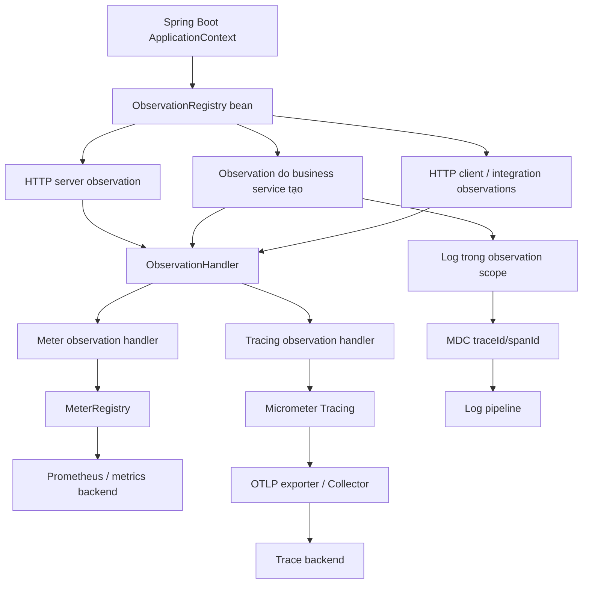

# Đăng ký ObservationRegistry trong Spring Boot

> **Chương:** Cấu hình registry  
> **Module:** `SPRING_BOOT_OBSERVABILITY` — Thiết lập observability cho Spring Boot bằng Micrometer Observation, metrics, logs và distributed tracing. Bài này giải thích cách đưa `ObservationRegistry` vào ứng dụng Spring Boot, dùng đúng instance đã được Spring cấu hình, đăng ký các thành phần mở rộng và xác minh đường đi từ một observation tới các tín hiệu giám sát.

## Mục tiêu học tập

Sau bài này, bạn có thể:

1. Giải thích `ObservationRegistry` là gì, khác `Observation` và `MeterRegistry` ở điểm nào, và vì sao ứng dụng cần một registry thống nhất.
2. Biết khi nào Spring Boot tự tạo `ObservationRegistry`, khi nào cần khai báo `@Bean` thủ công và vì sao không nên tạo registry mới trong mỗi service.
3. Inject registry bằng constructor vào service, mở một observation quanh nghiệp vụ và hiểu thứ tự start, scope, error, stop.
4. Dùng `ObservationRegistryCustomizer` để đăng ký `ObservationPredicate`, `ObservationFilter` hoặc `ObservationHandler` mà vẫn tận dụng cấu hình của Spring Boot.
5. Kiểm chứng metrics, traces và log correlation; nhận diện những lỗi như thiếu dependency, mất context, registry bị tách rời, tags có cardinality cao hoặc exporter chưa hoạt động.

## 1. ObservationRegistry nằm ở đâu trong kiến trúc observability?

`ObservationRegistry` là **điểm đăng ký và cấu hình Observation** của Micrometer. Nó giữ những thành phần quyết định observation nào được xử lý, xử lý ra sao và callback vòng đời sẽ tới handler nào. Đó không phải nơi lưu toàn bộ bản ghi trace, cũng không trực tiếp là cơ sở dữ liệu metrics.

Một ứng dụng Spring Boot có thể dùng chung registry này cho các observation tự động của framework và observation tùy chỉnh trong nghiệp vụ:



Các thành phần có tên gần giống nhưng trách nhiệm khác nhau:

| Thành phần | Vai trò | Tạo hoặc quản lý cái gì? |
|---|---|---|
| `ObservationRegistry` | Nơi cấu hình vòng đời observation, predicates, filters, handlers và current observation | Điều phối *cách một Observation được quan sát* |
| `Observation` | Đại diện cho một operation có tên, key-values, error và vòng đời | Một hoạt động cụ thể như `inventory.reserve` |
| `ObservationHandler` | Nhận callback `onStart`, `onError`, `onStop` và callback scope | Kết nối observation với hành vi ghi nhận hoặc tracing |
| `MeterRegistry` | Nơi meter/timer/counter được đăng ký và thu thập | Metrics và tags; có thể xuất Prometheus hoặc backend khác |
| `Tracer`/tracing bridge | Tạo và liên kết spans, cung cấp trace/span context | Distributed traces và propagation |
| Logback/SLF4J | Ghi sự kiện ứng dụng; dùng MDC khi có correlation context | Logs, thường gửi qua stdout và log agent |

**Một registry, nhiều observation:** đối với ứng dụng Spring Boot điển hình, `ObservationRegistry` được inject như một bean dùng chung. Mỗi request/operation có `Observation` riêng. Không tạo một registry cho mỗi request vì như vậy các handlers, filters và cầu nối telemetry có thể không được áp dụng nhất quán.

### 1.1. Vì sao việc “đăng ký” quan trọng?

Xét ứng dụng checkout có HTTP request, một call sang inventory và một bước `checkout.validate` do team tự instrument. Nếu tất cả sử dụng cùng registry đã cấu hình:

- Handler tạo timer cho custom observation có thể ghi nhận thời gian xử lý.
- Tracing handler có thể tạo span và liên kết với HTTP server span hiện hành.
- Khi mở observation scope, logs có thể nhận trace ID/span ID nếu tracing và logging được cấu hình.
- Predicate và filter chung có thể loại các observation không cần thiết hoặc bổ sung tags theo quy tắc đã duyệt.

Nếu tự tạo một `ObservationRegistry.create()` độc lập bên trong service, các custom observation có thể không đi qua các handler mà Spring Boot đã gắn với registry của ứng dụng. Nghiệp vụ vẫn chạy, nhưng timer hoặc span mong đợi có thể không xuất hiện.

## 2. Spring Boot tự đăng ký ObservationRegistry khi nào?

Trong **Spring Boot 3.x** với Actuator observability auto-configuration được kích hoạt, framework thường tự khai báo `ObservationRegistry` dưới dạng bean và thiết lập các thành phần thích hợp theo dependency có trên classpath. Đây là hướng sử dụng mặc định.

Với Maven project đã dùng Spring Boot parent/BOM, dependency nền tảng:

```xml
<dependency>
    <groupId>org.springframework.boot</groupId>
    <artifactId>spring-boot-starter-actuator</artifactId>
</dependency>
```

Gradle tương ứng:

```groovy
implementation 'org.springframework.boot:spring-boot-starter-actuator'
```

Spring Boot quản lý phiên bản Micrometer tương thích. Tránh ép một phiên bản Micrometer không thuộc BOM nếu chưa có lý do và kế hoạch kiểm thử tương thích.

**Đường đi thường gặp khi ứng dụng khởi động:**

1. Spring Boot đọc dependency, auto-configuration và các property của ứng dụng.
2. Nếu điều kiện auto-configuration được thỏa mãn, Boot cung cấp bean `ObservationRegistry`.
3. Boot áp dụng các customizer, convention, predicate, filter, handler thích hợp theo cấu hình và integration hiện diện.
4. Các bean nghiệp vụ inject `ObservationRegistry` qua constructor.
5. HTTP/WebClient và các integration được instrument có thể sử dụng observation registry đã được cấu hình.

Cụ thể có những điều kiện/chi tiết thay đổi theo phiên bản Spring Boot và dependency. Vì vậy, khi đưa code vào project dùng một minor version nhất định, hãy đối chiếu tài liệu của chính version đó; đừng mặc định mọi behavior của Spring Boot 3.x đều giống nhau tới từng thuộc tính.

### 2.1. Actuator, Prometheus và tracing là ba việc khác nhau

Có `ObservationRegistry` chưa có nghĩa đã xuất tất cả tín hiệu. Muốn dùng Prometheus với Actuator:

```xml
<dependency>
    <groupId>io.micrometer</groupId>
    <artifactId>micrometer-registry-prometheus</artifactId>
</dependency>
```

Muốn nối observation tới OpenTelemetry tracing trong một cấu hình Spring Boot 3.x thông dụng:

```xml
<dependency>
    <groupId>io.micrometer</groupId>
    <artifactId>micrometer-tracing-bridge-otel</artifactId>
</dependency>
<dependency>
    <groupId>io.opentelemetry</groupId>
    <artifactId>opentelemetry-exporter-otlp</artifactId>
</dependency>
```

Bốn khái niệm cần tách bạch:

- **Đăng ký registry:** có một `ObservationRegistry` mà service và các integration cùng sử dụng.
- **Meter handler và MeterRegistry:** biến các sự kiện observation thành metrics có thể truy vấn.
- **Tracing bridge và exporter:** tạo/hoàn thiện spans rồi chuyển traces sang Collector/backend theo sampling.
- **Log pipeline:** thu gom logs và bảo đảm trường correlation (trace ID/span ID) còn nguyên.

Không có Prometheus registry thì `/actuator/prometheus` có thể không tồn tại, dù `ObservationRegistry` vẫn được inject bình thường. Không có tracing bridge hoặc exporter thì logic `Observation` vẫn chạy nhưng trace có thể không đến backend.

## 3. Inject ObservationRegistry bằng constructor

Đây là cách đăng ký và sử dụng được khuyến nghị với Spring Boot đã có auto-configuration:

```java
package com.example.checkout;

import io.micrometer.observation.Observation;
import io.micrometer.observation.ObservationRegistry;
import org.springframework.stereotype.Service;

@Service
public class InventoryService {

    private final ObservationRegistry observationRegistry;

    public InventoryService(ObservationRegistry observationRegistry) {
        this.observationRegistry = observationRegistry;
    }

    public String reserve(String sku) {
        return Observation.createNotStarted(
                    "inventory.reserve", observationRegistry)
                .contextualName("reserve inventory")
                .lowCardinalityKeyValue("operation", "reserve")
                .observe(() -> {
                    if (sku == null || sku.isBlank()) {
                        throw new IllegalArgumentException("SKU is required");
                    }

                    // Vị trí thay bằng call database hoặc inventory service.
                    return "RESERVED";
                });
    }
}
```

Điều cần hiểu:

- `ObservationRegistry` là dependency của service; nó được Spring inject và có thể dùng chung nhiều request.
- `Observation.createNotStarted(...)` tạo **một observation mới** cho mỗi lần gọi `reserve`, gắn với cùng registry.
- `observe(...)` thực hiện start, mở scope, chạy callback, xử lý exception phát sinh, đóng scope và stop cho một khối công việc **đồng bộ**.
- `inventory.reserve` là tên operation ổn định; `operation=reserve` là tag có tập giá trị giới hạn.
- `contextualName` có thể giúp đặt tên span dễ đọc khi tracing handler hỗ trợ.
- Tên `sku` không xuất hiện trong tag; SKU là giá trị có thể rất đa dạng và không phù hợp làm label của metric.

**Lỗi thiết kế cần tránh:**

```java
// Không dùng trong service do Spring quản lý:
public InventoryService() {
    this.observationRegistry = ObservationRegistry.create();
}
```

Đoạn này tạo registry riêng, không bảo đảm dùng các handlers do Spring Boot đã cấu hình. Với dependency injection, constructor nhận bean chính thức từ application context.

### 3.1. Controller tối thiểu để chạy thử

```java
package com.example.checkout;

import org.springframework.web.bind.annotation.GetMapping;
import org.springframework.web.bind.annotation.PathVariable;
import org.springframework.web.bind.annotation.RequestMapping;
import org.springframework.web.bind.annotation.RestController;

@RestController
@RequestMapping("/demo/inventory")
public class InventoryController {

    private final InventoryService inventoryService;

    public InventoryController(InventoryService inventoryService) {
        this.inventoryService = inventoryService;
    }

    @GetMapping("/{sku}")
    public String reserve(@PathVariable String sku) {
        return inventoryService.reserve(sku);
    }
}
```

Gửi request tới `GET /demo/inventory/sku-001` sẽ đi qua HTTP server instrumentation (nếu được bật) và custom observation `inventory.reserve`. Khi tracing có hiệu lực, handler có thể liên kết span nghiệp vụ với span HTTP request thông qua current context.

### 3.2. Scope và lifecycle khi không dùng observe(...)

Nếu cần điều khiển thời điểm bắt đầu/kết thúc thủ công:

```java
Observation observation = Observation
        .createNotStarted("checkout.validate", observationRegistry)
        .start();

try (Observation.Scope scope = observation.openScope()) {
    validateCheckout();
} catch (RuntimeException exception) {
    observation.error(exception);
    throw exception;
} finally {
    observation.stop();
}
```

`validateCheckout()` là method nghiệp vụ minh họa. `openScope()` làm observation trở thành current observation trong khoảng xử lý; `Scope.close()` khôi phục context trước đó; `stop()` kết thúc vùng đo, gọi callback hoàn tất cho handlers. Nếu xảy ra exception, `error(...)` ghi nhận lỗi; nó không tự dừng observation.

Cấu trúc này giúp phân biệt hai ý:

- **Registry** sống theo vòng đời ứng dụng.
- **Observation và scope** sống trong phạm vi một hoạt động cụ thể.

Không lưu observation mutable vào field singleton của service để tái sử dụng giữa các requests. Mỗi operation cần một instance observation tương ứng.

## 4. Cấu hình registry bằng properties trước khi viết code

Các thay đổi đơn giản nên dùng cấu hình Spring Boot nếu phiên bản hỗ trợ. Ví dụ `application.yml`:

```yaml
spring:
  application:
    name: checkout-service

management:
  endpoints:
    web:
      exposure:
        include: health,metrics,prometheus
  observations:
    key-values:
      application: ${spring.application.name}
      deployment.environment: ${APP_ENVIRONMENT:local}
  tracing:
    sampling:
      probability: 0.10
  otlp:
    tracing:
      endpoint: ${OTLP_TRACES_ENDPOINT:http://localhost:4318/v1/traces}
```

Mục đích của các nhóm property khác nhau:

| Nhóm | Tác dụng |
|---|---|
| `management.endpoints.web.exposure.include` | Chọn Actuator endpoints được expose qua web; chỉ có hiệu lực với endpoints hiện diện |
| `management.observations.key-values` | Bổ sung key-values chung cho observations theo cơ chế của Spring Boot version tương ứng |
| `management.tracing.sampling.probability` | Xác suất head sampling traces, **không** phải tỷ lệ lấy mẫu metrics |
| `management.otlp.tracing.endpoint` | Endpoint nhận spans của OTLP HTTP exporter; cần dependency và receiver phù hợp |

Đây là cấu hình tham khảo cho Spring Boot 3.x. `/actuator/prometheus` chỉ tồn tại khi Prometheus registry được bật. Với Spring Boot 4 hoặc các minor version có thay đổi, hãy xác minh tên property/dependency trước khi áp dụng nguyên mẫu.

Trong production, nên dùng endpoint Collector nội bộ, ràng buộc quyền truy cập, transport bảo mật và không phụ thuộc default `localhost`. Giá trị `APP_ENVIRONMENT` phải có tập giá trị nhỏ, được quản lý thống nhất như `dev`, `staging`, `prod`; không đưa request ID hay user ID vào common tags.

### 4.1. Phân biệt common observation key-values và metric tags

Một key-value chung có thể được handler ghi vào metrics, traces hoặc cả hai tùy cách tích hợp. Khi chỉ cần metric tags, MeterRegistry cũng có hệ thống common tags riêng; **đừng mặc định hai cách cấu hình là đồng nghĩa hoặc tự đồng bộ**.

Trong dashboard, nhãn môi trường giúp phân biệt nơi phát tín hiệu. Nhưng nếu một nhãn đã được thêm từ Collector, Prometheus relabeling hoặc platform metadata, hãy kiểm tra nhãn trùng hoặc không nhất quán trước khi tiếp tục thêm trong ứng dụng.

## 5. Tùy biến ObservationRegistry bằng ObservationRegistryCustomizer

Khi cần logic vượt quá properties, Spring Boot cung cấp điểm mở rộng `ObservationRegistryCustomizer`. Mục tiêu là **tùy biến bean registry đang được Boot quản lý**, thay vì tự tạo thêm instance độc lập.

Ví dụ thêm observation filter cho nhãn môi trường với một giá trị đã được cấu hình:

```java
package com.example.checkout;

import io.micrometer.common.KeyValue;
import io.micrometer.observation.ObservationRegistry;
import org.springframework.beans.factory.annotation.Value;
import org.springframework.boot.actuate.autoconfigure.observation.ObservationRegistryCustomizer;
import org.springframework.context.annotation.Bean;
import org.springframework.context.annotation.Configuration;

@Configuration(proxyBeanMethods = false)
public class ObservabilityConfiguration {

    @Bean
    ObservationRegistryCustomizer<ObservationRegistry> environmentTagCustomizer(
            @Value("${app.observability.environment:local}") String environment) {

        return registry -> registry.observationConfig()
                .observationFilter(context -> {
                    context.addLowCardinalityKeyValue(
                            KeyValue.of("deployment.environment", environment));
                    return context;
                });
    }
}
```

Cấu hình đi kèm:

```yaml
app:
  observability:
    environment: prod
```

Đoạn trên cố định một nhãn có cardinality thấp cho observations được xử lý qua registry đó. Trong thực tế bạn thường chỉ cần **một** cách cấu hình chung cho cùng nhãn: nếu đã dùng `management.observations.key-values.deployment.environment`, không cần thêm filter giống hệt.

**Chú ý về thời điểm áp dụng:** `ObservationFilter` là cơ chế biến đổi context trong quá trình hoàn tất observation, nên không được xem là cách đưa một thuộc tính vào propagation ngay thời điểm mở scope. Nếu một thông tin phải có sớm để quyết định parent/child, baggage hoặc logic tại `onStart`, cần chọn một cơ chế khác thích hợp.

### 5.1. ObservationPredicate: bỏ qua những observation không cần thiết

Có thể bỏ qua một nhóm observation mang tính nội bộ, ví dụ hoạt động debug rất thường xuyên:

```java
@Bean
ObservationRegistryCustomizer<ObservationRegistry> predicateCustomizer() {
    return registry -> registry.observationConfig()
            .observationPredicate((name, context) ->
                    !name.startsWith("internal.debug."));
}
```

`ObservationPredicate` quyết định có quan sát operation được đề xuất hay không. Chỉ loại bỏ observation khi đã đánh giá ảnh hưởng; nếu loại toàn bộ HTTP server observations, các metrics và trace quan trọng có thể biến mất. Để kiểm soát volume, nhiều trường hợp nên điều chỉnh sampling traces hoặc histogram/labels riêng thay vì tắt toàn bộ telemetry của một operation.

**Cẩn thận với tên:** predicate dựa trên tên thực của observation. Hãy xác định tên operation sau instrumentation trước khi viết quy tắc. Không giả định route path, contextual name và observation name luôn giống nhau.

### 5.2. ObservationHandler: phản ứng theo vòng đời

Handler có thể nhận các callback như `onStart`, `onScopeOpened`, `onError`, `onScopeClosed` và `onStop`. Ví dụ handler đếm số lần hoàn tất một observation cụ thể để kiểm tra hoạt động:

```java
package com.example.checkout;

import io.micrometer.observation.Observation;
import io.micrometer.observation.ObservationHandler;
import java.util.concurrent.atomic.AtomicLong;

public final class CheckoutDiagnosticHandler
        implements ObservationHandler<Observation.Context> {

    private final AtomicLong completions = new AtomicLong();

    @Override
    public boolean supportsContext(Observation.Context context) {
        return "checkout.validate".equals(context.getName());
    }

    @Override
    public void onStop(Observation.Context context) {
        completions.incrementAndGet();
    }

    public long getCompletions() {
        return completions.get();
    }
}
```

Đăng ký handler **một lần** lên registry đang dùng:

```java
@Bean
CheckoutDiagnosticHandler checkoutDiagnosticHandler() {
    return new CheckoutDiagnosticHandler();
}

@Bean
ObservationRegistryCustomizer<ObservationRegistry> diagnosticHandlerCustomizer(
        CheckoutDiagnosticHandler handler) {
    return registry -> registry.observationConfig()
            .observationHandler(handler);
}
```

Hai method `@Bean` đặt trong một lớp `@Configuration` cùng với các import phù hợp. Handler trên minh họa cơ chế callback; nó **không thay thế** metrics/tracing handlers mà Spring Boot tích hợp và không phải cách đo count production được khuyến nghị. Nếu cần count, ưu tiên meter hiện có; handler tùy chỉnh chỉ nên xử lý nhu cầu cụ thể mà integration mặc định chưa đáp ứng.

Để tránh ghi nhận trùng, **không đồng thời đăng ký cùng handler qua nhiều cơ chế** (ví dụ vừa để auto-discovery đăng ký, vừa thêm thủ công bằng customizer). Cách các `ObservationHandler` bean được gom và sắp thứ tự có thể thay đổi theo Boot version; kiểm tra configuration thực tế khi thêm handler phức tạp, đặc biệt với handler liên quan đến tracing.

## 6. Khi nào tự khai báo @Bean ObservationRegistry?

Trong Spring Boot dùng Actuator, câu trả lời thông thường là **không cần**. Tuy nhiên, có các tình huống đặc biệt: ứng dụng tích hợp Micrometer mà không muốn dùng Actuator auto-configuration, môi trường test thuần Java, hoặc một cấu hình chủ động thay thế behavior mặc định.

Ví dụ đăng ký bean thủ công:

```java
package com.example.checkout;

import io.micrometer.observation.ObservationRegistry;
import org.springframework.context.annotation.Bean;
import org.springframework.context.annotation.Configuration;

@Configuration(proxyBeanMethods = false)
public class ManualObservationRegistryConfiguration {

    @Bean
    ObservationRegistry observationRegistry() {
        return ObservationRegistry.create();
    }
}
```

**Đây là phương án có chủ đích**, không nên thêm vào project chỉ vì muốn inject registry. Tùy auto-configuration, bean do bạn định nghĩa có thể khiến cấu hình tạo registry mặc định của Boot nhường quyền; bạn phải kiểm tra liệu filters, handlers, conventions và instrumentation mong muốn có được gắn vào registry ấy hay chưa.

Hai vấn đề thường gặp:

1. Bạn tạo bean thủ công nhưng quên cấu hình tracing/meter handlers nên custom observation chạy mà không có span hoặc timer như kỳ vọng.
2. Có nhiều bean cùng kiểu `ObservationRegistry` trong Spring context khiến constructor injection mơ hồ hoặc một integration sử dụng instance khác với business service.

Nếu thực sự cần nhiều registry tách biệt, hãy thiết kế rõ mục đích và wiring của từng instance, sử dụng `@Qualifier` khi cần, và kiểm thử end-to-end. Mô hình mặc định một registry chung đơn giản hơn rất nhiều cho ứng dụng web.

### 6.1. Trường hợp không dùng Spring container

Trong unit test hoặc ứng dụng Java thuần, có thể tạo registry độc lập:

```java
ObservationRegistry registry = ObservationRegistry.create();

String value = Observation
        .createNotStarted("demo.operation", registry)
        .observe(() -> "done");
```

Lúc này **chưa có handler** nếu bạn chưa cấu hình handler trên registry. Callback vẫn chạy và trả `done`; đừng dùng việc method thực thi thành công để khẳng định metrics/traces đã được xuất.

Một registry no-op cũng có thể được dùng có chủ đích khi không muốn ghi dữ liệu; cần phân biệt trạng thái no-op với tình huống cấu hình pipeline sai. Đừng “chữa” triệu chứng không thấy telemetry bằng cách tạo một registry mới mà chưa xác minh bean đang dùng.

## 7. Tác động của registry đến tracing, propagation và logs

Một observation đơn lẻ như `inventory.reserve` có thể xuất hiện trong một distributed trace khi tracing handler được gắn và trace được lấy mẫu. Để tạo quan hệ cha–con và truyền context:

1. HTTP server request được instrument và làm xuất hiện observation/tracing context.
2. Business service tạo observation mới bằng **cùng ObservationRegistry**.
3. `observe(...)` hoặc `openScope()` mở current context trong đoạn xử lý.
4. HTTP client được instrument có thể inject trace context vào outbound headers (thường W3C `traceparent`).
5. Downstream server extract context và liên kết span tiếp theo vào cùng trace.

### 7.1. Current observation và scope

Trong đoạn code chạy bên trong observation scope, có thể hỏi registry xem observation nào đang là current:

```java
Observation current = observationRegistry.getCurrentObservation();

if (current != null) {
    // Đang chạy trong một observation scope có thể truy cập được.
}
```

Kết quả phụ thuộc context của luồng đang chạy. Nếu tạo observation và chỉ gọi `start()` mà không mở scope, đừng giả định registry trả về observation vừa tạo.

Một scope không phải session phân tán hoặc cơ chế tự truyền qua mọi thread. Với `@Async`, executor tự tạo, `CompletableFuture`, Reactor hoặc messaging, cần context propagation phù hợp với framework và phiên bản đang dùng. Không truyền một đối tượng `Observation.Scope` sang thread khác rồi đóng tùy tiện; hãy quản lý scope trong nơi thực sự thực thi operation.

### 7.2. Logs có trace ID khác với “registry xuất log”

Khi Micrometer Tracing được cấu hình, log pattern hoặc structured log schema có thể lấy `traceId`/`spanId` từ MDC trong scope. Ví dụ dạng log tương quan:

```text
INFO [checkout-service,4bf92f3577b34da6a3ce929d0e0e4736,00f067aa0ba902b7] Inventory reserved
```

Nhưng `ObservationRegistry` không tự gửi log sang log backend. Ứng dụng cần logging configuration, một đường thu gom stdout/file và backend nhận logs. Đừng lấy trace ID làm low-cardinality metric tag: nó có rất nhiều giá trị khác nhau và sẽ khiến số time series tăng mạnh.

### 7.3. Sampling là quyết định ở tracing pipeline

Với `management.tracing.sampling.probability=0.10`, chỉ một phần traces thường được chọn theo chính sách head sampling. Metrics vẫn có thể ghi nhận toàn bộ số observation hoàn tất thông qua meter handler; số trace trong backend không phải số request.

Nếu thấy metric `inventory.reserve` có count nhưng không tìm được span tương ứng, cần kiểm tra sampling, bridge, exporter, Collector và retention. Đừng kết luận ngay rằng service đang dùng sai registry.

## 8. Cardinality và chính sách tags khi cấu hình registry

Registry là nơi các quy tắc chung có thể ảnh hưởng tới rất nhiều observations. Một lỗi nhỏ trong common filter hoặc common key-values có thể nhân số lượng time series trên toàn bộ service.

| Giá trị | Nên là low-cardinality tag? | Giải thích |
|---|---|---|
| `deployment.environment=prod` | Có | Tập môi trường nhỏ và được kiểm soát |
| `service=checkout-service` | Có | Số lượng service có giới hạn theo tổ chức |
| `operation=reserve` | Có | Giá trị thuộc một enum/tập nhỏ |
| `http.route=/orders/{id}` | Có, khi là route template | Gộp nhiều URL cụ thể thành cùng một route |
| `user.id=123456` | Không | Giá trị có thể khác theo từng người dùng; còn có rủi ro dữ liệu |
| `order.id=...` | Không | Gần như duy nhất theo request |
| `http.url=/orders/123456?token=...` | Không | Cardinality cao và có thể chứa bí mật |
| `trace.id=...` | Không | Trace ID nên phục vụ correlation trong traces/logs, không làm nhãn metric |

Lấy ví dụ một timer có 6 giá trị `operation` × 4 giá trị `environment` × 8 instances = tối đa 192 tổ hợp label trước khi tính các chiều khác. Nếu filter chung thêm `user.id` với 100.000 giá trị, số tổ hợp có thể bùng nổ. Số liệu chỉ minh họa; điều phải kiểm soát là tập giá trị thực tế của từng chiều.

Cân nhắc thêm high-cardinality attributes vào trace chỉ khi có mục tiêu điều tra cụ thể và được phép theo chính sách dữ liệu. Không ghi token, mật khẩu, nội dung thẻ, thông tin cá nhân hoặc toàn bộ request body vào tags, baggage hoặc logs.

## 9. Kiểm chứng đăng ký registry trong ứng dụng thật

### 9.1. Kiểm tra bean tồn tại trong Spring context

Một integration test đơn giản xác nhận Spring khởi tạo được registry:

```java
package com.example.checkout;

import io.micrometer.observation.ObservationRegistry;
import org.junit.jupiter.api.Test;
import org.springframework.beans.factory.annotation.Autowired;
import org.springframework.boot.test.context.SpringBootTest;

import static org.junit.jupiter.api.Assertions.assertNotNull;

@SpringBootTest
class ObservationRegistryWiringTest {

    @Autowired
    private ObservationRegistry observationRegistry;

    @Test
    void registryIsInjected() {
        assertNotNull(observationRegistry);
    }
}
```

Bài test này xác nhận **dependency injection**, không chứng minh backend đã nhận metrics/traces. Trong một số kiểu Spring Boot test, observability được giới hạn hoặc tắt mặc định; muốn kiểm tra exporter và integration thực tế cần cấu hình test observability phù hợp với version. Không yêu cầu network backend thực trong test wiring thuần túy.

### 9.2. Test lifecycle bằng registry độc lập

Để kiểm tra callback `onStop` mà không phụ thuộc backend:

```java
import io.micrometer.observation.Observation;
import io.micrometer.observation.ObservationHandler;
import io.micrometer.observation.ObservationRegistry;
import java.util.concurrent.atomic.AtomicInteger;
import org.junit.jupiter.api.Test;

import static org.junit.jupiter.api.Assertions.assertEquals;

class ObservationLifecycleTest {

    @Test
    void invokesHandlerOnStop() {
        ObservationRegistry registry = ObservationRegistry.create();
        AtomicInteger completions = new AtomicInteger();

        registry.observationConfig().observationHandler(
                new ObservationHandler<Observation.Context>() {
                    @Override
                    public boolean supportsContext(Observation.Context context) {
                        return "checkout.validate".equals(context.getName());
                    }

                    @Override
                    public void onStop(Observation.Context context) {
                        completions.incrementAndGet();
                    }
                });

        Observation.createNotStarted("checkout.validate", registry)
                .observe(() -> "ok");

        assertEquals(1, completions.get());
    }
}
```

Đây là test có ý nghĩa cho lifecycle handler. Nó cố ý tạo registry riêng **trong unit test** để không phụ thuộc cấu hình Spring Boot. Nếu muốn xác minh bean/configuration thật, dùng integration test riêng có application context.

### 9.3. Kiểm tra metrics bằng Actuator

Giả sử đã thêm Prometheus registry và expose endpoints như ví dụ, sau khi khởi động ứng dụng ở `localhost:8080`:

```bash
curl -i http://localhost:8080/actuator/health
curl -s http://localhost:8080/actuator/metrics
curl -s http://localhost:8080/demo/inventory/sku-001
curl -s http://localhost:8080/actuator/metrics/inventory.reserve
curl -s http://localhost:8080/actuator/prometheus
```

Đầu tiên kiểm tra `/actuator/metrics` đã liệt kê meter hay chưa; custom meter chỉ xuất hiện sau khi đã chạy operation và có handler hỗ trợ metrics. Dạng xuất Prometheus của timer thường có các series như:

```text
inventory_reserve_seconds_count{operation="reserve",...} 1
inventory_reserve_seconds_sum{operation="reserve",...} 0.012
```

Đây là **ví dụ hình dạng series**, không phải output chắc chắn của ứng dụng; tên, units, tags và số liệu phụ thuộc registry/version/configuration. Luôn kiểm tra output thật để viết PromQL. Nếu muốn p95 từ histogram, cần cấu hình histogram tương ứng và có bucket được xuất; việc đăng ký registry không tự tạo histogram cho mọi timer.

### 9.4. Kiểm tra traces và logs

Nếu dùng bridge OpenTelemetry, OTLP exporter và Collector/backend:

1. Tạm dùng sampling `1.0` trong môi trường local lưu lượng thấp.
2. Gửi một HTTP request có gọi `InventoryService.reserve(...)`.
3. Tìm trace theo service và thời gian trong backend. Kiểm tra span HTTP cha và span inventory con nếu integration có đầy đủ.
4. Kiểm tra logs trong scope có trace ID/span ID và backend logs hỗ trợ tìm kiếm theo trường đó.
5. Chạy thử nhánh lỗi, xác nhận observation được stop và error được ghi nhận theo semantics của operation.

Trước khi dùng production, hạ sampling theo ngân sách, giới hạn Actuator endpoints, kiểm tra đường truyền OTLP, bảo vệ dữ liệu và kiểm soát cardinality. Tỷ lệ sampling phục vụ traces; không giảm độ chính xác metrics theo cùng một cách.

## 10. Xử lý sự cố khi registry đã đăng ký nhưng telemetry thiếu

| Triệu chứng | Khả năng thường gặp | Cách kiểm tra |
|---|---|---|
| Spring báo không có bean `ObservationRegistry` | Thiếu Actuator/auto-configuration, điều kiện không thỏa hoặc test context quá hẹp | Kiểm tra dependency, Boot version, context được khởi tạo |
| Spring báo nhiều bean `ObservationRegistry` | Tạo nhiều registry thủ công hoặc nhập thêm config | Kiểm tra bean definitions, loại bỏ registry dư hoặc chỉ rõ qualifier có chủ đích |
| Service chạy nhưng custom metric không xuất hiện | Observation dùng registry tự tạo, thiếu meter handler, operation chưa được gọi hoặc đã bị predicate loại | Xác nhận inject bean Boot, handler, tên operation và callback stop |
| Có HTTP metrics nhưng không có metric custom | Method chưa thực sự đi qua `observe` hoặc `stop`; handler không hỗ trợ context | Gọi đúng code path, xem `/actuator/metrics`, kiểm tra lifecycle |
| Không có `/actuator/prometheus` | Thiếu `micrometer-registry-prometheus`, endpoint chưa expose hoặc request bị chặn | Kiểm tra dependencies, exposure, security và management port |
| Có metrics, không có trace | Tracing bridge/exporter thiếu, sampling thấp, OTLP sai protocol/endpoint hoặc Collector lỗi | Kiểm tra sampling, dependencies, receiver, service identity và thời gian tìm |
| Trace không nối với request cha | Thiếu scope hoặc context propagation qua HTTP/async | Kiểm tra current observation, client builder, W3C headers, executor |
| Logs không có trace ID | Tracing/MDC hoặc logging pattern/structured schema chưa có | Kiểm tra log format, scope và MDC context |
| Tags không xuất hiện | Tên key-values sai, filter/predicate không chạy hoặc handler/exporter sử dụng metadata khác | Kiểm tra registry được dùng, callback, tên metric/span thực tế |
| Số series tăng đột biến | Common tag chứa ID động, raw URL, dimension quá nhiều | Audit config/filter, giảm cardinality, chuẩn hóa route template |
| Xuất telemetry làm tăng latency | Handler đồng bộ nặng, logging quá nhiều, exporter/Collector bị nghẽn | Đo handler overhead, batching/queue và lỗi export |

**Quy trình điều tra hợp lý:**

1. **Registry:** Spring đã tạo đúng bean, service inject đúng instance chưa?
2. **Lifecycle:** code path có thực hiện observation và kết thúc bằng `stop` hoặc `observe` chưa?
3. **Handlers:** có meter/tracing handlers được gắn không? Predicate có loại observation không?
4. **Export:** MeterRegistry, Prometheus scrape, tracing exporter, Collector có hoạt động không?
5. **Correlation:** scope, async propagation, trace ID/span ID và log ingestion có nhất quán không?

Cách phân tầng này giúp phân biệt lỗi wiring trong ứng dụng với lỗi pipeline ngoài ứng dụng. Không nên sửa sampling hoặc dashboard khi nguyên nhân thực là service đã tự tạo một registry tách biệt.

## 11. Các quyết định thiết kế trong production

Khi đăng ký `ObservationRegistry` cho ứng dụng có lưu lượng thật, hãy tuân thủ một số nguyên tắc:

- **Một nguồn cấu hình thống nhất:** cho phép framework instrumentation và business instrumentation dùng chung registry phù hợp.
- **Dependency management:** dùng BOM của Spring Boot để giữ tương thích Micrometer Observation, Micrometer Tracing, registry exporter và instrumentation.
- **Tên operation ổn định:** không chèn request ID, SKU động hoặc user ID vào tên observation hay low-cardinality tags.
- **Tùy biến có phạm vi:** predicate/filter/handler dùng chung có thể ảnh hưởng tất cả observations; triển khai theo quy tắc rõ ràng và quan sát chi phí sau khi thay đổi.
- **Tách nhiệm vụ:** registry không thay thế metrics backend, trace exporter, collector hay logging pipeline.
- **Propagate context:** dùng HTTP clients/executors được instrument và kiểm chứng trace liên kết giữa các service.
- **Bảo mật:** không đưa dữ liệu bí mật vào attributes, logs, baggage; giới hạn truy cập Actuator và backends.
- **Độ tin cậy:** pipeline telemetry cần timeout, retry/queue có giới hạn và giám sát số dữ liệu rơi; sự cố export không nên khiến API ngừng phục vụ.
- **Thay đổi có thể kiểm chứng:** trước/sau deploy, xác nhận meter count, span correlation và metrics/traces/logs tiếp tục có dữ liệu.

Trong một hệ thống có nhiều module Spring hoặc nhiều ApplicationContext, mỗi context có thể có cách cấu hình bean riêng. Nếu dùng nhiều context, hãy ghi rõ registry nào mà từng integration sử dụng; đừng giả định toàn bộ JVM tự động chia sẻ cùng một instance.

## 12. Bài thực hành tổng hợp

**Tình huống:** service checkout đã có Actuator, nhưng team mới viết `inventory.reserve` và muốn xem thời gian xử lý, lỗi cũng như trace đi sang inventory service.

Thực hiện theo thứ tự:

1. **Đăng ký:** xác nhận `ObservationRegistry` được Spring Boot tạo tự động; constructor-inject vào `InventoryService`.
2. **Instrument:** dùng `createNotStarted(...).observe(...)` quanh đoạn nghiệp vụ đồng bộ. Nếu có async, đặt vòng đời theo thời điểm xử lý thực sự hoàn tất.
3. **Tùy biến:** bổ sung một nhãn môi trường có cardinality thấp bằng property hoặc `ObservationRegistryCustomizer`. Tránh thêm cùng một key hai lần.
4. **Kiểm chứng metrics:** gọi API vài lần, đọc `/actuator/metrics/inventory.reserve` hoặc Prometheus exporter để thấy timer tăng.
5. **Kiểm chứng trace:** bật tracing bridge, cấu hình exporter và local receiver; xem business span có xuất hiện trong trace cùng HTTP server span.
6. **Kiểm chứng logs:** ghi một dòng log trong observation scope và đối chiếu trace ID/span ID với backend.
7. **Chẩn đoán:** cố ý thử một bản code dùng `ObservationRegistry.create()` riêng trong service, quan sát sự khác biệt về handlers, rồi khôi phục constructor injection dùng bean chuẩn.
8. **Chuẩn bị production:** đặt sampling có kiểm soát, bảo vệ Actuator, quản lý exporter endpoint và kiểm tra chi phí cardinality.

**Câu hỏi tự kiểm tra:**

- Vì sao `ObservationRegistry` là một bean dùng chung trong khi `Observation` được tạo riêng cho mỗi operation?
- Khi nào `@Bean ObservationRegistry` là hợp lý, và cần kiểm tra những gì sau khi thay thế auto-configuration?
- Khác nhau thế nào giữa `ObservationRegistryCustomizer`, `ObservationFilter` và `ObservationHandler`?
- Vì sao có meter count mà không có span trong trace backend?
- Khi nào cần mở scope, và tại sao `start()` một mình không đảm bảo logs có trace context?
- Một common tag có user ID sẽ gây vấn đề gì đối với metrics?

## Ghi nhớ

Đăng ký `ObservationRegistry` đúng cách trong Spring Boot thường là **thêm Actuator, để auto-configuration tạo registry và inject bean đó bằng constructor**. Mỗi nghiệp vụ tạo observation riêng và quản lý vòng đời bằng `observe(...)` hoặc `start/openScope/error/stop`. Khi cần điều chỉnh hành vi toàn cục, dùng `ObservationRegistryCustomizer` và các predicate/filter/handler phù hợp; chỉ tự khai báo `@Bean ObservationRegistry` khi có mục đích rõ ràng và đã kiểm chứng integration. Metrics, logs và distributed tracing chỉ thực sự kết nối thành một câu chuyện điều tra lỗi, độ trễ khi registry, handlers, exporters, sampling, tags và context propagation đều được cấu hình nhất quán.
