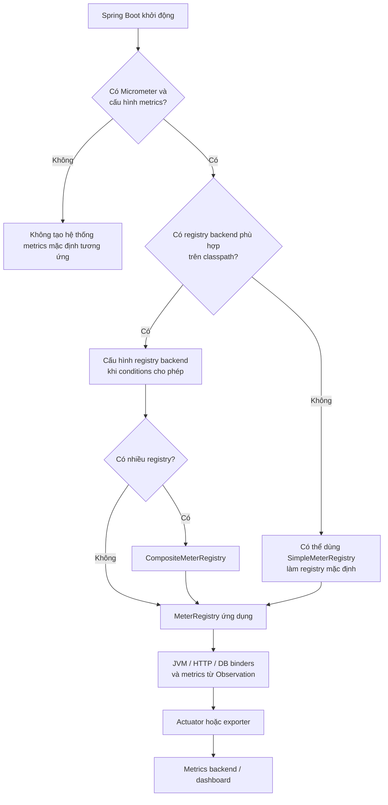
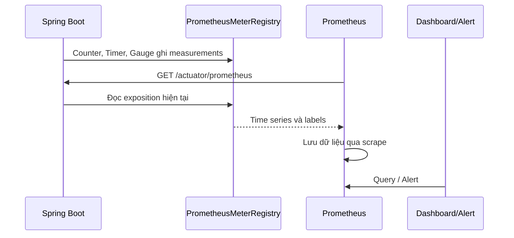
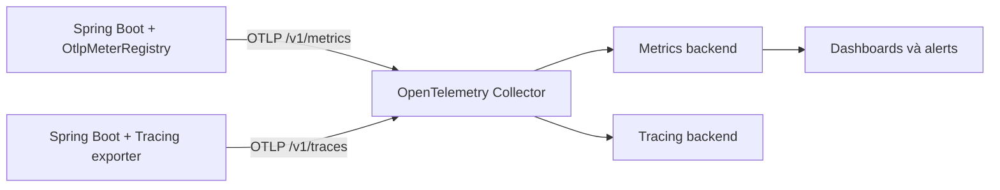

# Auto-configuration của registry trong Spring Boot

Trong Spring Boot Observability, **auto-configuration của registry** là cơ chế Spring Boot phát hiện các thư viện Micrometer trên classpath, tạo các bean `MeterRegistry` thích hợp và kết nối chúng với các thành phần đo lường trong ứng dụng. Nhờ vậy, ứng dụng có thể thu thập HTTP metrics, JVM metrics, connection pool metrics và các phép đo nghiệp vụ mà không phải tự khởi tạo registry cho từng backend.

Bài học thuộc chương **Cấu hình registry** của module **SPRING_BOOT_OBSERVABILITY**. Trọng tâm là hiểu điều kiện tự động tạo registry, cách cấu hình Prometheus và OTLP, cách tùy biến meter/tags, khả năng liên kết **Micrometer Observation** với metrics và traces, cùng quy trình xử lý sự cố khi metrics không xuất hiện trên dashboard.

## 1. Registry là gì và nằm ở đâu?

Trong Micrometer, **`MeterRegistry`** là nơi đăng ký, lưu trạng thái và xuất dữ liệu của các meter như `Counter`, `Timer`, `Gauge` và `DistributionSummary`. Business code ghi dữ liệu qua meter; registry quyết định cách dữ liệu đó được biểu diễn và chuyển tới backend.

Ví dụ hệ thống đặt hàng muốn quan sát:

- Tốc độ request, số lỗi và độ trễ `POST /orders`.
- Số đơn hàng được xác nhận hoặc bị từ chối.
- Thời gian kiểm tra tồn kho và cấp phép thanh toán.
- Áp lực lên JVM heap, threads và pool kết nối database.
- Đường đi của một request chậm qua nhiều dịch vụ.

Bốn nhóm đầu phù hợp với **metrics**; nhóm cuối phù hợp với **distributed tracing**. Một hoạt động có thể được ghi nhận qua **Observation** để đóng góp cho cả hai tín hiệu, nhưng các registry và exporter của metrics/traces không phải cùng một thành phần.

| Thành phần | Vai trò | Ví dụ |
| --- | --- | --- |
| **`MeterRegistry`** | Quản lý meter và cung cấp cơ chế xuất metrics | `PrometheusMeterRegistry`, `OtlpMeterRegistry` |
| **`CompositeMeterRegistry`** | Phân phối các phép ghi đến nhiều registry thành viên | Gửi metrics đến Prometheus và OTLP |
| **`ObservationRegistry`** | Điều phối vòng đời Observation qua các handler | Hoạt động `inventory.reserve` |
| **Metrics ObservationHandler** | Chuyển Observation thành dữ liệu đo lường | Timer cho một bước nghiệp vụ |
| **Tracing ObservationHandler** | Chuyển Observation thành span và tracing context | Span `payment.authorize` |
| **Exporter/backend** | Thu nhận, truyền, lưu và truy vấn dữ liệu | Prometheus scrape, OTLP Collector |

**Phân biệt rõ:** `MeterRegistry` quản lý metrics, còn `ObservationRegistry` quản lý Observation. Có `MeterRegistry` không có nghĩa ứng dụng đã được bật tracing. Có `ObservationRegistry` cũng không tự bảo đảm một span sẽ xuất hiện trên tracing backend nếu thiếu tracing handler, bridge, sampling hoặc exporter.

## 2. Spring Boot tự động cấu hình registry như thế nào?

Spring Boot thực hiện auto-configuration dựa trên **các dependency có trên classpath**, **các bean đã được đăng ký**, **properties** và **điều kiện kích hoạt** của từng cấu hình.



Sơ đồ thể hiện nguyên lý, không phải thứ tự khởi tạo chi tiết của mọi bean hay mọi phiên bản Spring Boot. Một số điều kiện quan trọng:

1. **Có class cần thiết:** `spring-boot-starter-actuator` hỗ trợ tích hợp observability; registry cụ thể như Prometheus cần thư viện `micrometer-registry-prometheus`.
2. **Auto-configuration được phép chạy:** ứng dụng không loại bỏ cấu hình tương ứng bằng exclusions hoặc thiết lập khác.
3. **Bean phù hợp:** một số cấu hình dựa trên điều kiện tương tự `@ConditionalOnMissingBean`; bean tùy biến có thể làm cấu hình mặc định lùi lại. Kết quả phụ thuộc từng auto-configuration.
4. **Backend/exporter được bật:** property `enabled` và các điều kiện liên quan có thể vô hiệu hóa một registry.
5. **Có hoạt động tạo measurement:** registry tồn tại chưa có nghĩa tất cả tên meter đã có. Ví dụ, timer HTTP có thể chỉ xuất hiện sau khi request được xử lý xong.

Khi debug, nên phân biệt ba tình huống: **không có registry bean**, **có registry nhưng không có meter**, và **có meter nhưng không xuất tới backend**. Mỗi tình huống có nguyên nhân khác nhau.

### 2.1. Những loại registry hay gặp

| Registry | Mô hình | Trường hợp sử dụng |
| --- | --- | --- |
| `SimpleMeterRegistry` | Lưu measurements trong tiến trình, không xuất theo backend production chuyên dụng | Dev, unit test, cấu hình metrics cơ bản |
| `PrometheusMeterRegistry` | Ứng dụng expose metrics để Prometheus scrape (pull) | Hạ tầng dùng Prometheus |
| `OtlpMeterRegistry` | Gửi metrics chủ động tới OTLP receiver (push) | OpenTelemetry Collector, observability platform |
| `StatsdMeterRegistry` | Gửi dữ liệu qua StatsD | Hạ tầng có StatsD agent |
| `CompositeMeterRegistry` | Kết hợp nhiều registry | Migration hoặc xuất đồng thời tới nhiều đích |

Thông thường Spring Boot có thể cấu hình **Simple** khi không có một registry xuất chuyên dụng được dùng; khi thêm registry backend, cấu trúc bean có thể thay đổi. Không nên viết business service phụ thuộc trực tiếp `SimpleMeterRegistry`, vì ứng dụng production có thể dùng Prometheus, OTLP hoặc composite.

### 2.2. Auto-configuration cũng gắn instrumentation

Ngoài việc tạo `MeterRegistry`, Spring Boot có thể kết nối:

- Meter binders cho JVM memory, GC, CPU, process và một số hạ tầng có sẵn.
- HTTP server observations/metrics từ web stack đã instrument.
- HTTP client observations khi sử dụng client được Spring Boot cấu hình.
- Metrics cho các thành phần được tích hợp như connection pool, cache hay messaging, nếu có thư viện và instrumentation phù hợp.
- Observations tùy biến để đo các thao tác nghiệp vụ.
- Common tags, filters, conventions và distribution settings.

**Không mặc định mọi thư viện sẽ tự có metric.** Ví dụ một HTTP client tự khởi tạo không đi qua instrumentation có thể không tạo HTTP client meter. Một DAO tự viết cũng không tự tạo một Timer cho từng SQL statement.

## 3. Cấu hình nền tảng với Spring Boot 3.x

Các ví dụ dùng **Spring Boot 3.x** và Maven, với dependency versions do Spring Boot BOM hoặc parent quản lý. Dòng Spring Boot khác có thể dùng starter/properties khác; cần đối chiếu theo phiên bản của dự án.

### 3.1. Bật Actuator

```xml
<dependency>
    <groupId>org.springframework.boot</groupId>
    <artifactId>spring-boot-starter-actuator</artifactId>
</dependency>
```

Trong `application.yml`:

```yaml
spring:
  application:
    name: order-service

management:
  endpoints:
    web:
      exposure:
        include: health,info,metrics
  metrics:
    tags:
      application: order-service
      environment: development
```

Sau khi ứng dụng chạy:

```bash
curl -s http://localhost:8080/actuator/metrics
curl -s http://localhost:8080/actuator/metrics/jvm.memory.used
```

`/actuator/metrics` liệt kê các tên meter đã đăng ký; `/actuator/metrics/{name}` hiển thị measurements và những tag có thể lọc. Endpoint này **không đồng nghĩa với một backend metrics**; nó giúp kiểm tra nội bộ ứng dụng. Cổng, đường dẫn, bảo mật và quyền truy cập có thể khác nếu ứng dụng tùy biến Actuator.

### 3.2. Common tags

Các tag như `application=order-service`, `environment=production` hoặc `region=apac` giúp nhóm dữ liệu khi nhiều instance cùng gửi metrics.

**Cardinality** là số lượng giá trị khác nhau của một tag. Nếu thêm `orderId`, `userId` hoặc raw URL chứa mã giao dịch, số tổ hợp tag có thể tăng theo lưu lượng thực tế và gây bùng nổ time series. Registry đang hoạt động đúng về mặt kỹ thuật nhưng backend có thể quá tải, lưu trữ tốn kém và truy vấn chậm.

Dùng các giá trị có tập nhỏ và hữu hạn. Khi route có ID, ưu tiên route template như `/orders/{id}` thay vì `/orders/123456` nếu instrumentation hỗ trợ.

## 4. Auto-configuration của PrometheusMeterRegistry

Để xuất metrics theo Prometheus, thêm dependency:

```xml
<dependency>
    <groupId>io.micrometer</groupId>
    <artifactId>micrometer-registry-prometheus</artifactId>
</dependency>
```

Với classpath và các điều kiện phù hợp, Spring Boot tự cấu hình registry Prometheus. Cho phép truy cập endpoint:

```yaml
management:
  endpoints:
    web:
      exposure:
        include: health,info,metrics,prometheus
  prometheus:
    metrics:
      export:
        enabled: true
```

Kiểm tra:

```bash
curl -s http://localhost:8080/actuator/prometheus
```

Ví dụ output minh họa:

```text
# HELP jvm_memory_used_bytes The amount of used memory
# TYPE jvm_memory_used_bytes gauge
jvm_memory_used_bytes{area="heap",id="G1 Eden Space"} 10485760.0
```

Tên pool và số liệu cụ thể thay đổi theo JVM, framework và lúc lấy mẫu. Những meter kiểu Timer thường được đổi tên và thêm suffix theo quy ước Prometheus; chẳng hạn một timer HTTP có thể sinh các series dạng `http_server_requests_seconds_count` và `http_server_requests_seconds_sum`.

### 4.1. Scrape không xảy ra chỉ vì endpoint đã hoạt động



Endpoint trả dữ liệu chứng minh registry có số liệu để xuất, **chưa chứng minh Prometheus đã scrape thành công**. Cần kiểm tra scrape config, target health, DNS, network, port, access và truy vấn dashboard. Trong Kubernetes còn có thể cần cấu hình ServiceMonitor/PodMonitor hoặc scrape annotations tùy hạ tầng.

Nếu thiếu `/actuator/prometheus`, kiểm tra cả dependency, endpoint exposure lẫn cấu hình registry; không kết luận ngay do thiếu các meter.

## 5. Auto-configuration của OtlpMeterRegistry

OTLP metrics phù hợp với mô hình **push**: ứng dụng gửi measurements định kỳ đến OpenTelemetry Collector hoặc backend tương thích.

Dependency:

```xml
<dependency>
    <groupId>io.micrometer</groupId>
    <artifactId>micrometer-registry-otlp</artifactId>
</dependency>
```

Cấu hình minh họa Spring Boot 3.x:

```yaml
management:
  otlp:
    metrics:
      export:
        enabled: true
        url: http://localhost:4318/v1/metrics
        step: 30s
```

Địa chỉ này giả định receiver **OTLP/HTTP** ở cổng 4318; `step` chỉ khoảng publish metrics theo registry. Nếu ứng dụng và Collector chạy ở hai container khác nhau, `localhost` trong ứng dụng **không chỉ tới container Collector**; thay bằng DNS/service name có thể truy cập.



Dù dùng chung Collector, **metrics và traces là hai pipeline khác nhau**:

| Tín hiệu | Thành phần ứng dụng | Địa chỉ mẫu |
| --- | --- | --- |
| Metrics | `micrometer-registry-otlp` | `http://collector:4318/v1/metrics` |
| Traces | Micrometer Tracing bridge + exporter tương ứng | `http://collector:4318/v1/traces` |
| Logs | Logging pipeline/agent hoặc cấu hình riêng | Tùy hệ thống |

Trong Spring Boot 3.x, property thường dùng cho tracing exporter là `management.otlp.tracing.endpoint`; property metrics là `management.otlp.metrics.export.url`. Không trao đổi hai property này cho nhau. Cổng 4317 thường liên quan OTLP/gRPC, còn 4318 thường dùng OTLP/HTTP, nhưng phải đối chiếu receiver cụ thể.

Chỉ thêm `micrometer-registry-otlp` không tự cấu hình distributed tracing, cũng không tự truyền `traceparent` qua HTTP. Để liên kết traces cần tracing bridge, propagator, exporter và các instrumentation thích hợp.

## 6. Khi có nhiều registry

Một ứng dụng có thể đồng thời có `micrometer-registry-prometheus` và `micrometer-registry-otlp`. Tùy cấu hình Spring Boot, các registry đang hoạt động có thể được điều phối qua **`CompositeMeterRegistry`**, giúp business code ghi meter một lần mà nhiều backend nhận dữ liệu.

```text
Business service / Observation
             |
        MeterRegistry
             |
    CompositeMeterRegistry
        /          \
 Prometheus       OTLP
    |               |
/actuator/       Collector
prometheus           |
    |            Metrics backend
Prometheus
```

Đây là mô hình khái niệm. Cấu trúc bean thực tế phụ thuộc version, auto-configuration và bean tùy biến. **Inject interface `MeterRegistry`** thay vì cast sang `PrometheusMeterRegistry` nếu logic nghiệp vụ không phụ thuộc riêng Prometheus.

Có nhiều exporter cần cân nhắc:

- Chi phí đo, xuất và lưu trữ dữ liệu tăng theo số đích.
- Mỗi backend có thể chuẩn hóa tên, units, histogram và labels khác nhau.
- Lỗi của một exporter chưa chắc ảnh hưởng exporter còn lại; cần kiểm tra từng đường xuất.
- Nếu nhiều đường xuất dẫn về cùng backend, có nguy cơ ghi trùng các time series.

Dùng composite khi thật sự cần nhiều đích hoặc trong giai đoạn migration. Nếu chỉ cần một nguồn dữ liệu chuẩn, cấu hình một registry backend thường đơn giản hơn.

## 7. Vì sao nên inject registry do Spring quản lý?

Ví dụ **không nên** đặt trong production service:

```java
// Registry riêng này nằm ngoài cấu hình Spring Boot:
SimpleMeterRegistry isolated = new SimpleMeterRegistry();
isolated.counter("orders.accepted").increment();
```

Counter trên có thể không đến Prometheus hoặc OTLP registry đang được Spring Boot quản lý. Dùng dependency injection:

```java
import io.micrometer.core.instrument.MeterRegistry;
import org.springframework.stereotype.Service;

@Service
public class OrderMetrics {

    private final MeterRegistry registry;

    public OrderMetrics(MeterRegistry registry) {
        this.registry = registry;
    }

    public void recordAccepted(String channel) {
        String group = "mobile".equals(channel) ? "mobile" : "web";

        registry.counter("orders.accepted",
                "channel", group).increment();
    }
}
```

Spring quản lý lifecycle và cấu hình chung của registry bean. Với unit test, có thể cung cấp một `SimpleMeterRegistry` riêng cho đối tượng đang test, nhưng không nên tạo registry cục bộ rồi xem đó là đường xuất metrics production.

### 7.1. Trường hợp bean tùy biến làm auto-configuration thay đổi

Một bean `MeterRegistry` do ứng dụng tự khai báo có thể tác động đến các điều kiện auto-configuration. Một số cấu hình mặc định lùi lại khi đã có bean tương ứng, nhưng mức độ thay thế phụ thuộc từng auto-configuration. Vì vậy khi muốn **tùy biến registry đang có**, ưu tiên `MeterRegistryCustomizer` hoặc properties phù hợp thay vì khai báo registry mới một cách tùy tiện.

## 8. Tùy biến registry do Spring Boot tạo

### 8.1. Common tags bằng property

```yaml
management:
  metrics:
    tags:
      application: order-service
      environment: staging
```

Cách này thuận tiện khi cần cấu hình nhất quán bằng deployment config. Không đưa dữ liệu phụ thuộc từng request vào common tags.

### 8.2. MeterRegistryCustomizer

Khi muốn cấu hình registry bằng code, Spring Boot 3.x hỗ trợ các bean `MeterRegistryCustomizer`:

```java
import io.micrometer.core.instrument.MeterRegistry;
import org.springframework.boot.actuate.autoconfigure.metrics.MeterRegistryCustomizer;
import org.springframework.context.annotation.Bean;
import org.springframework.context.annotation.Configuration;

@Configuration
public class MetricsConfig {

    @Bean
    MeterRegistryCustomizer<MeterRegistry> registryCustomization() {
        return registry -> registry.config()
                .commonTags("service_domain", "commerce");
    }
}
```

Customizer áp dụng cấu hình chung lên registry được Spring quản lý. Trong ví dụ này, `service_domain` có cardinality thấp. Không dùng cả property lẫn customizer để định nghĩa **cùng key** một cách mâu thuẫn.

### 8.3. MeterFilter

Dùng `MeterFilter` để từ chối meter, đổi mapping hoặc đặt chính sách cho những nhóm meter nhất định:

```java
import io.micrometer.core.instrument.config.MeterFilter;
import org.springframework.context.annotation.Bean;
import org.springframework.context.annotation.Configuration;

@Configuration
public class MeterFilterConfig {

    @Bean
    MeterFilter dropLegacyMetrics() {
        return MeterFilter.denyNameStartsWith("legacy.");
    }
}
```

Filter quá rộng có thể vô tình tắt metric cần thiết cho dashboard và cảnh báo. Nếu chỉ muốn tắt một nhóm đã có property hỗ trợ, có thể dùng cấu hình như:

```yaml
management:
  metrics:
    enable:
      jvm: false
```

Ví dụ này nhằm minh họa cơ chế; tắt JVM metrics trên production đồng nghĩa mất khả năng giám sát bộ nhớ, GC hoặc áp lực runtime.

### 8.4. Histogram và phân vị

Một `Timer` giúp đếm số lần và tổng thời gian; việc tính p95/p99 cho **nhiều instance** thường cần histogram buckets hoặc cơ chế backend tương ứng. Spring Boot 3.x có thể cấu hình histogram/SLO buckets:

```yaml
management:
  metrics:
    distribution:
      percentiles-histogram:
        http.server.requests: true
      slo:
        http.server.requests: 100ms,300ms,1s
```

Khi có histogram, Prometheus có thể tổng hợp các buckets trước rồi dùng `histogram_quantile`. Không lấy trung bình của những p95 riêng từng instance để suy ra p95 của toàn hệ thống.

**Histogram + nhiều tags có thể nhân mạnh số series.** Chỉ bật ở operation quan trọng, cân nhắc buckets và giới hạn labels. Kiểm tra names/units của backend trước khi viết PromQL.

## 9. Metrics registry và Micrometer Observation

Nếu cần cùng một hoạt động phục vụ metrics và traces, dùng **Observation API** giúp quản lý vòng đời nhất quán.

```java
import io.micrometer.observation.Observation;
import io.micrometer.observation.ObservationRegistry;
import org.springframework.stereotype.Service;

@Service
public class PaymentService {
    private final ObservationRegistry observationRegistry;

    public PaymentService(ObservationRegistry observationRegistry) {
        this.observationRegistry = observationRegistry;
    }

    public void authorize(String method, Runnable action) {
        String group = "wallet".equals(method) ? "wallet" : "card";

        Observation.createNotStarted(
                    "payment.authorize", observationRegistry)
                .lowCardinalityKeyValue("payment.method", group)
                .observe(action);
    }
}
```

Với Spring Boot có handler và registry tương ứng:

1. **Metrics ObservationHandler** có thể tạo Timer `payment.authorize` và ghi thời lượng cùng tag `payment.method`.
2. **Tracing ObservationHandler** có thể tạo span thuộc trace hiện hành khi tracing được cấu hình.
3. Metrics exporter (Prometheus/OTLP) chuyển measurements tới backend metrics.
4. Tracing exporter đưa sampled spans tới tracing backend.
5. Log correlation có thể dùng Trace ID/Span ID trong MDC khi tracing scope hiện hành đã được duy trì đúng.

**Observation không phải exporter.** Cần phân biệt việc Observation được ghi nhận, metric được xuất, span được lấy mẫu và trace được hiển thị.

### 9.1. Low-cardinality và high-cardinality values

Trong Micrometer Observation:

```java
Observation observation = Observation
        .createNotStarted("payment.authorize", observationRegistry)
        .lowCardinalityKeyValue("payment.method", "card")
        .lowCardinalityKeyValue("result", "approved");

observation.highCardinalityKeyValue("operation.reference", safeReference);
```

`safeReference` chỉ là biến minh họa cho dữ liệu không nhạy cảm được phép ghi trong tracing.

- Low-cardinality values thường được metrics handler đưa thành tags; nên giới hạn bằng enum/nhóm giá trị ổn định.
- High-cardinality values có thể trở thành span attributes khi có tracing handler thích hợp; thông thường không trở thành tags của metric qua handler chuẩn.
- High cardinality vẫn có thể gây tăng storage và rủi ro lộ dữ liệu.
- Không đưa email, ID người dùng, access token, dữ liệu thanh toán hoặc raw payload vào metrics, spans hay baggage.

### 9.2. Registry auto-configuration không xử lý propagation

Khi `order-service` gọi `payment-service`, muốn hai span có cùng Trace ID thì HTTP client/server phải truyền và trích xuất tracing context (chẳng hạn W3C `traceparent`):

```http
traceparent: 00-4bf92f3577b34da6a3ce929d0e0e4736-00f067aa0ba902b7-01
```

Metric registry có thể hoạt động hoàn hảo nhưng trace vẫn đứt nếu client không được instrument, proxy xóa header, hoặc context mất khi đổi thread/nhận message. Ở Spring Boot, nên dùng HTTP client builder và async/context propagation mà framework quản lý, rồi **kiểm chứng bằng Trace ID và quan hệ parent span**.

### 9.3. Tracing sampling có làm thiếu metrics không?

Cấu hình minh họa Spring Boot 3.x:

```yaml
management:
  tracing:
    sampling:
      probability: 0.10
```

Đây là xác suất lấy mẫu tại điểm tracing sampler được cấu hình; nó không cam kết đúng 10% trong mọi khoảng thời gian và có thể chịu ảnh hưởng quyết định upstream.

Metrics thường vẫn thu measurements của các hoạt động đi qua metrics handler, ngay cả khi trace của một request không được chọn. Do đó **một metric tổng hợp có thể biểu diễn nhiều request hơn số trace nhìn thấy**. Tail sampling ở Collector cũng không khôi phục spans đã bị head sampling loại từ nguồn.

| Tình huống | Metrics | Traces |
| --- | --- | --- |
| Observation được metrics handler xử lý, trace được lấy mẫu | Có measurement | Có thể có span trên backend nếu exporter hoạt động |
| Tracing không lấy mẫu request | Metrics vẫn có thể được ghi | Không có trace tương ứng được xuất |
| OTLP tracing exporter lỗi | Không nhất thiết ảnh hưởng metrics | Trace có thể không hiển thị |
| Metrics exporter lỗi | Meter có thể vẫn tồn tại trong ứng dụng | Tracing có thể vẫn hoạt động độc lập |

## 10. Kiểm tra auto-configuration theo từng lớp

Một lỗi observability thường dễ xác định hơn khi kiểm tra tuần tự từ ứng dụng đến hệ thống bên ngoài.

### 10.1. Kiểm tra bean và conditions

Bật chế độ debug trong môi trường phát triển để đọc **Conditions Evaluation Report**:

```bash
java -jar app.jar --debug
```

Report cho biết những auto-configuration nào khớp hoặc không khớp và lý do như classpath thiếu, bean đã tồn tại hoặc điều kiện property. Nếu chính sách bảo mật cho phép, Actuator có endpoint `/actuator/conditions` để kiểm tra điều kiện. Không mở endpoint này công khai trên production vì có thể làm lộ thông tin cấu hình.

Có thể tạm log kiểu registry bean khi ứng dụng khởi động:

```java
import io.micrometer.core.instrument.MeterRegistry;
import org.springframework.boot.ApplicationRunner;
import org.springframework.context.annotation.Bean;
import org.springframework.context.annotation.Configuration;

@Configuration
public class RegistryDiagnosticConfig {
    @Bean
    ApplicationRunner showRegistry(MeterRegistry registry) {
        return args -> System.out.println(
                "Registry implementation: " + registry.getClass().getName());
    }
}
```

Đây là snippet chẩn đoán cục bộ, nên bỏ sau khi kiểm tra. Kiểu bean in ra chưa đủ để kết luận mọi exporter đã gửi dữ liệu, nhất là khi có composite registry.

### 10.2. Kiểm tra meter đã được ghi hay chưa

```bash
curl -s http://localhost:8080/actuator/metrics
curl -s http://localhost:8080/actuator/metrics/http.server.requests
```

Nếu meter không xuất hiện, tạo một request HTTP hoặc chạy operation tạo metric rồi kiểm tra lại. Với Observation thủ công, xác nhận vòng đời kết thúc qua `observe(...)` hoặc `stop()`. Kiểm tra meter filter và khả năng một instrumentation không được kích hoạt.

**404 ở Actuator** có thể là do endpoint không expose, access policy, management port hoặc base path; không tự suy ra registry chưa được tạo.

### 10.3. Kiểm tra đường xuất

**Prometheus:** kiểm tra output `/actuator/prometheus` từ mạng của Prometheus, scrape target health, labels và PromQL query. Có output tại ứng dụng chưa chắc dữ liệu đã tới Prometheus.

**OTLP metrics:** kiểm tra property URL, protocol, receiver, mạng, TLS, authentication, publish step, logs của registry/Collector và pipeline backend. Meter trong `/actuator/metrics` có thể vẫn tồn tại ngay cả khi export thất bại.

**Tracing:** kiểm tra riêng tracing bridge, sampling, propagation, exporter, Collector và backend. Không dùng lỗi hiển thị trace để kết luận metrics registry bị lỗi.

### 10.4. Kiểm tra giá trị vận hành

Đánh giá tên, units, tags và cardinality; đồng nhất convention giữa các instance. Kiểm tra dashboard có đủ dữ liệu để phân biệt dịch vụ, endpoint, outcome và khoảng thời gian hay không. Khi phát hiện p95 tăng, sử dụng traces để khoanh vùng span chậm và logs để xác minh timeout, retry hoặc lỗi nghiệp vụ.

## 11. Bảng các lỗi thường gặp

| Triệu chứng | Nguyên nhân thường gặp | Hướng xử lý |
| --- | --- | --- |
| Không inject được `MeterRegistry` | Thiếu tích hợp Micrometer/Actuator, auto-config bị loại | Kiểm tra dependencies, conditions, Spring bean |
| Chỉ thấy Simple registry | Chưa có backend registry hoặc đã vô hiệu hóa | Thêm đúng registry dependency, kiểm tra config |
| `/actuator/metrics` trả 404 | Endpoint chưa expose, path/port/security khác | Kiểm tra Actuator exposure và quyền truy cập |
| `/actuator/prometheus` không tồn tại | Thiếu registry hoặc endpoint chưa bật | Kiểm tra dependency và expose endpoint |
| Prometheus endpoint có data, dashboard trống | Scrape target lỗi, query/labels không đúng | Kiểm tra target status và PromQL |
| OTLP metrics không đến backend | URL, receiver, protocol, TLS/auth hoặc mạng sai | Kiểm tra Collector, app logs và exporter config |
| Custom Counter không có trên backend | Tạo `SimpleMeterRegistry` riêng, meter chưa được ghi | Inject Spring bean và tạo activity thử |
| Timer không xuất hiện | Instrumentation thiếu hoặc Observation chưa kết thúc | Kiểm tra handler, filter, `stop()` |
| Số time series bùng nổ | Tag cardinality cao, histogram rộng | Dùng route template, giá trị nhỏ, tối ưu buckets |
| Metric có nhưng trace không có | Sampling, tracing handler hoặc exporter lỗi | Kiểm tra nhánh tracing độc lập |
| Trace đổi ID khi qua service | Thiếu context propagation | Kiểm tra HTTP headers và async context |
| Số liệu giữa hai backend khác nhau | Naming/step/scrape/tags khác | Chuẩn hóa query, cùng window và units |

## 12. Bài thực hành end-to-end

Mục tiêu là quan sát được **tác động cụ thể của auto-configuration** khi thêm dependency và properties.

1. **Chạy Spring Boot 3.x với Actuator.** Expose `metrics` và gửi vài HTTP requests. Kiểm tra `/actuator/metrics` có JVM metrics và HTTP meters sau khi request hoàn tất.
2. **Bổ sung Prometheus registry.** Thêm `micrometer-registry-prometheus`, expose `prometheus` và khởi động lại. Đối chiếu một meter ở `/actuator/metrics` với series tương ứng trong `/actuator/prometheus`.
3. **Kiểm tra common tags.** Thêm `application=order-service`. Quan sát label này xuất hiện trong metrics export, và xác nhận nó ổn định giữa các requests.
4. **Thử Counter nghiệp vụ.** Inject `MeterRegistry` và gọi `recordAccepted()` của ví dụ. Quan sát `orders.accepted` tăng sau mỗi thao tác.
5. **Thử Observation nghiệp vụ.** Gọi `PaymentService.authorize()` vài lần; tìm Timer `payment.authorize` qua Actuator. Nếu chưa xuất hiện, kiểm tra handler và vòng đời Observation.
6. **Thử OTLP metrics.** Khi có một Collector hỗ trợ OTLP/HTTP, cấu hình `OtlpMeterRegistry` và xác nhận backend metrics nhận dữ liệu theo publish step.
7. **Thêm tracing.** Với bridge và tracing exporter được cấu hình, tăng sampling tới `1.0` **trong lab** và tra span `payment.authorize` trên tracing backend. Đối chiếu với Timer của cùng operation.
8. **Tạo lỗi export có kiểm soát.** Đặt sai URL OTLP metrics chỉ trong lab, kiểm tra meter trong app vẫn còn nhưng backend không nhận. Khôi phục URL đúng và xác nhận exporter phục hồi.
9. **Thử sampling.** Giảm tracing sampling xuống `0.10`; gửi nhiều request và ghi nhận metrics tổng hợp vẫn có thể tăng trong khi số trace nhìn thấy giảm.
10. **Đánh giá production readiness.** Kiểm tra bảo mật Actuator, authentication/TLS, common tags, cardinality, histogram cost, scrape/push cadence và chính sách retention.

### Tiêu chí kiểm chứng

| Kiểm chứng | Kết quả mong đợi |
| --- | --- |
| Bean registry | Có `MeterRegistry` do Spring quản lý |
| Instrumentation mặc định | Có JVM/process metrics và HTTP meter khi có traffic phù hợp |
| Prometheus | Endpoint exposition xuất được series với labels đúng |
| OTLP | Collector nhận metrics và backend truy vấn được |
| Custom meter | Counter thay đổi sau khi business operation thực thi |
| Observation | Timer được ghi; span có thể xuất nếu tracing đầy đủ |
| Propagation | Các span xuyên dịch vụ có cùng Trace ID và parent hợp lý |
| Sampling | Giảm trace sampling không đồng nghĩa vô hiệu hóa metrics |
| Cardinality | Không chứa ID động hoặc dữ liệu nhạy cảm trong metric tags |
| Troubleshooting | Phân biệt lỗi bean, meter, exporter và backend |

## 13. Ghi nhớ

Auto-configuration giúp Spring Boot lắp ghép hệ metrics từ dependencies, bean conditions và properties. **Mọi phép đo nghiệp vụ nên dùng registry mà Spring quản lý** để hưởng cấu hình chung về tags, filters, distribution và exporter.

Khi thiết kế observability thực tế:

- **Chọn registry theo backend:** Prometheus dùng pull/scrape, OTLP dùng push tới Collector; Simple phù hợp trong dev/test.
- **Giữ meter name và tags ổn định**, không đưa request ID, user ID hay dữ liệu cá nhân vào metric labels.
- **Dùng Observation cho hoạt động nghiệp vụ cần cả metrics và traces**, với handlers, tracing bridge và exporters riêng biệt.
- **Không nhầm metrics export với trace propagation hoặc sampling**; đây là các cơ chế độc lập nhưng bổ trợ nhau.
- **Chẩn đoán theo thứ tự:** bean/conditions → meter → Actuator/exporter → Collector/backend → dashboard.
- **Kết nối metrics, traces và logs** để phát hiện xu hướng độ trễ/lỗi, tìm span có vấn đề và xác minh nguyên nhân qua log.

Nắm được cơ chế auto-configuration của registry giúp giải thích tại sao một metric xuất hiện, biến mất hoặc không tới backend sau khi thay đổi classpath hay cấu hình. Đây là nền tảng để xây dựng dashboard và cảnh báo đáng tin cậy cho ứng dụng Spring Boot trên môi trường vận hành thực.
