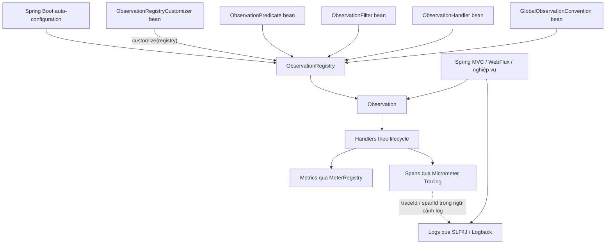

# ObservationRegistryCustomizer: Tùy biến ObservationRegistry trong Spring Boot

## 1. Mục tiêu học tập

Trong hệ thống Spring Boot có observability, việc tạo một `Observation` chỉ là bước đầu. Ứng dụng còn phải quyết định **observation nào được thu thập**, **metadata nào được bổ sung** và **handler nào xử lý dữ liệu**. Spring Boot cung cấp điểm mở rộng `ObservationRegistryCustomizer` để cấu hình registry quan sát chung trong quá trình khởi tạo ứng dụng.

Sau bài này, bạn có thể:

1. Giải thích vai trò và vòng đời của `ObservationRegistryCustomizer` trong Spring Boot.
2. Viết `@Bean ObservationRegistryCustomizer<ObservationRegistry>` để thêm `ObservationPredicate`, `ObservationFilter` hoặc cấu hình handler khi cần.
3. Chọn đúng giữa customizer, các bean `ObservationPredicate`/`ObservationFilter`/`ObservationHandler` và cấu hình thuộc tính Spring Boot.
4. Phân biệt `ObservationRegistryCustomizer`, `ObservationRegistry` và `MeterRegistryCustomizer`.
5. Kiểm tra cấu hình trên ứng dụng Spring Boot, đọc metrics/traces/logs và phát hiện lỗi do filter, cardinality, instrumentation trùng hoặc thiếu exporter.
6. Nhận diện sự thay đổi package của API giữa Spring Boot 3.5.x và Spring Boot 4.x.

Bài thuộc chương **Cấu hình registry** của module **SPRING_BOOT_OBSERVABILITY**. Kiến thức áp dụng cho việc thiết lập Micrometer Observation, metrics, logs và distributed tracing; các phần propagation, tags/cardinality, exporter, sampling và correlation được lồng vào các quyết định cấu hình registry để có thể điều tra lỗi và độ trễ trên môi trường thực.

## 2. ObservationRegistry là điểm phối hợp gì?

`io.micrometer.observation.ObservationRegistry` lưu các cấu hình dùng chung cho Micrometer Observation:

- **ObservationHandler**: nhận các sự kiện như `onStart`, `onStop`, `onError`, `onEvent` và sự kiện scope để chuyển một observation thành metric, span hoặc hành vi mở rộng.
- **ObservationPredicate**: quyết định tạo observation thật hay no-op đối với một tên và context nhất định.
- **ObservationFilter**: có thể bổ sung hoặc điều chỉnh `Observation.Context` trước khi các handler nhận `onStop`.
- **GlobalObservationConvention**: chuẩn hóa tên và key-values cho các context được hỗ trợ.

Khi ứng dụng gọi:

```java
Observation.createNotStarted("checkout.process", observationRegistry)
        .lowCardinalityKeyValue("channel", "web")
        .observe(this::chargePayment);
```

Micrometer dựa vào registry để gọi các handler phù hợp với context. Nếu có meter handler và `MeterRegistry` được kết nối, thao tác có thể sinh metric thời gian xử lý. Nếu có tracing handler/tracer phù hợp, nó có thể sinh span. Logs vẫn đi qua hệ thống logging; correlation bằng `traceId`/`spanId` phụ thuộc vào tracing scope và định dạng log.

`ObservationRegistry` **không phải** `MeterRegistry`: đối tượng thứ hai lưu các meter như `Counter`, `Timer`, `Gauge`. Cũng không phải exporter hoặc backend lưu trữ.

### Sơ đồ các điểm tích hợp



Các mũi tên bean là các cách **đăng ký cấu hình** với registry được Spring Boot tự cấu hình. Không phải mọi ứng dụng đều bật đủ handler metrics, tracing và exporter.

## 3. `ObservationRegistryCustomizer` là gì?

Trong **Spring Boot 3.5.x**, giao diện nằm ở package:

```java
org.springframework.boot.actuate.autoconfigure.observation.ObservationRegistryCustomizer
```

Nó là một functional interface:

```java
@FunctionalInterface
public interface ObservationRegistryCustomizer<T extends ObservationRegistry> {
    void customize(T registry);
}
```

Cách đọc:

| Thành phần | Ý nghĩa |
| --- | --- |
| `T extends ObservationRegistry` | Kiểu registry mà customizer có thể cấu hình |
| `customize(T registry)` | Callback nhận registry đã được tạo để đăng ký thêm thành phần/cấu hình |
| Functional interface | Có thể triển khai bằng lambda hoặc method reference |
| `@Bean` của Spring | Spring Boot phát hiện customizer và áp dụng cho observation registry do auto-configuration quản lý |

**Điểm mấu chốt:** Một `ObservationRegistryCustomizer` thông thường chạy **trong giai đoạn cấu hình registry**, không chạy lại mỗi khi request HTTP đến, mỗi lần start/stop observation hoặc khi một span được export. Nếu cần xử lý trên từng observation, đăng ký predicate/filter/handler thông qua registry hoặc bean tương ứng.

### Trình tự tư duy

```text
Khởi động Spring Boot
  ├─ Tạo/chuẩn bị ObservationRegistry do Boot quản lý
  ├─ Thu thập bean Predicate, Filter, Handler, Global Convention
  ├─ Thu thập và áp dụng ObservationRegistryCustomizer
  └─ Registry sẵn sàng cho các instrumentation

Runtime
  ├─ Code hoặc framework tạo Observation
  ├─ Predicate quyết định observation có hoạt động
  ├─ Handler nhận sự kiện start/scope/error/event
  └─ Filter → Handler.onStop, xuất tín hiệu nếu có handler/exporter
```

Đây là trình tự **khái niệm**. Thứ tự chi tiết của các pha cấu hình nội bộ phụ thuộc phiên bản Spring Boot; không nên viết customizer dựa trên giả định rằng một handler cụ thể đã/ chưa được đăng ký tại đúng một thời điểm. Các bean customizer nên độc lập, rõ trách nhiệm và không có tác dụng phụ ngoài cấu hình registry.

## 4. Bắt đầu với Spring Boot 3.5.x

Ví dụ sử dụng **Spring Boot 3.5.x và Java 17+**, một ứng dụng MVC. Khi sử dụng Spring Boot parent/BOM quản lý phiên bản, tối thiểu cần Actuator và Web:

```xml
<dependencies>
    <dependency>
        <groupId>org.springframework.boot</groupId>
        <artifactId>spring-boot-starter-web</artifactId>
    </dependency>
    <dependency>
        <groupId>org.springframework.boot</groupId>
        <artifactId>spring-boot-starter-actuator</artifactId>
    </dependency>
    <!-- Chỉ cần khi muốn xuất số liệu Prometheus -->
    <dependency>
        <groupId>io.micrometer</groupId>
        <artifactId>micrometer-registry-prometheus</artifactId>
    </dependency>
</dependencies>
```

Actuator tích hợp Micrometer Observation và cung cấp `ObservationRegistry` để inject. Prometheus registry cho phép xuất metrics theo định dạng scrape; **để có traces**, phải bổ sung tracing bridge (ví dụ Micrometer Tracing OTel), exporter và một collector/backend tương ứng. Chỉ thêm `ObservationRegistryCustomizer` chưa đủ để gửi traces.

Trong `application.yml`, khi cần kiểm tra bằng HTTP ở môi trường thử nghiệm:

```yaml
spring:
  application:
    name: checkout-service

management:
  endpoints:
    web:
      exposure:
        include: health,info,metrics,prometheus
```

Endpoint `/actuator/prometheus` chỉ có khi Prometheus registry nằm trong classpath và được expose. Cần giới hạn quyền truy cập Actuator trên môi trường thực; endpoint HTTP không mặc nhiên an toàn khi đưa ra Internet.

## 5. Ví dụ cơ bản: loại bỏ observation quá nhiều và ít giá trị

Giả sử hệ thống liên tục thực hiện thao tác `internal.poll.heartbeat` để kiểm tra trạng thái nội bộ. Tác vụ này chạy rất thường xuyên, gây nhiều observation nhưng không giúp điều tra checkout. Ta muốn bỏ **observation có prefix `internal.poll.`** trong khi vẫn cho nghiệp vụ hoạt động bình thường.

```java
package com.example.checkout.config;

import io.micrometer.observation.ObservationRegistry;
import org.springframework.boot.actuate.autoconfigure.observation.ObservationRegistryCustomizer;
import org.springframework.context.annotation.Bean;
import org.springframework.context.annotation.Configuration;

@Configuration(proxyBeanMethods = false)
public class ObservationConfiguration {

    @Bean
    ObservationRegistryCustomizer<ObservationRegistry> skipNoisyPolling() {
        return registry -> registry.observationConfig()
                .observationPredicate((name, context) ->
                        !name.startsWith("internal.poll."));
    }
}
```

Ở đây:

1. `@Bean` trả về một callback cho Spring Boot.
2. Khi được áp dụng lên registry, callback đăng ký `ObservationPredicate`.
3. Khi code tạo observation với tên như `internal.poll.heartbeat`, predicate trả `false`, Micrometer cung cấp no-op observation.
4. Nếu tên là `checkout.process`, predicate trả `true`, observation tiếp tục hoạt động theo các handler có mặt.

Giả sử service:

```java
package com.example.checkout.service;

import io.micrometer.observation.Observation;
import io.micrometer.observation.ObservationRegistry;
import org.springframework.stereotype.Service;

@Service
public class PollingService {
    private final ObservationRegistry registry;

    public PollingService(ObservationRegistry registry) {
        this.registry = registry;
    }

    public void poll() {
        Observation.createNotStarted("internal.poll.heartbeat", registry)
                .observe(() -> refreshInternalState());
    }

    private void refreshInternalState() {
        // Logic đọc trạng thái nội bộ vẫn chạy.
    }
}
```

**Bỏ observation không có nghĩa bỏ logic nghiệp vụ.** `refreshInternalState()` vẫn chạy. Điều bị bỏ là thu thập tín hiệu Micrometer Observation cho tên đó; logging độc lập hoặc meter được ghi trực tiếp bằng `MeterRegistry` không tự biến mất.

Để lọc *bằng tên* mà không cần viết Java, Spring Boot cũng hỗ trợ thuộc tính dạng:

```yaml
management:
  observations:
    enable:
      internal:
        poll: false
```

Cấu hình trên minh họa cách tắt prefix `internal.poll` theo quy tắc đặt tên; nếu cần phân biệt theo context hoặc điều kiện động, dùng `ObservationPredicate`. Khi cấu hình production, kiểm tra rõ prefix nào sẽ bị ảnh hưởng để không vô tình che các dấu hiệu lỗi quan trọng.

## 6. Thêm metadata bằng `ObservationFilter` trong customizer

Yêu cầu thứ hai: các observation mang tên `checkout.process` đều có nhãn `component=checkout` để dashboard nhóm theo chức năng. Ta có thể đăng ký filter từ customizer:

```java
package com.example.checkout.config;

import io.micrometer.common.KeyValue;
import io.micrometer.observation.ObservationRegistry;
import org.springframework.boot.actuate.autoconfigure.observation.ObservationRegistryCustomizer;
import org.springframework.context.annotation.Bean;
import org.springframework.context.annotation.Configuration;

@Configuration(proxyBeanMethods = false)
public class CheckoutTagConfiguration {

    @Bean
    ObservationRegistryCustomizer<ObservationRegistry> checkoutComponentTag() {
        return registry -> registry.observationConfig()
                .observationFilter(context -> {
                    if ("checkout.process".equals(context.getName())) {
                        context.addLowCardinalityKeyValue(
                                KeyValue.of("component", "checkout"));
                    }
                    return context;
                });
    }
}
```

`ObservationFilter` nhận `Observation.Context` và trả context đã cập nhật. Micrometer chạy filter **trước callback `onStop` của handler**, vì vậy metric Timer thường có thể thấy nhãn vừa được bổ sung. Nhưng **handler xử lý ngay ở `onStart`** sẽ không nhìn thấy nhãn được thêm muộn nếu chưa có từ lúc bắt đầu. Ví dụ, tùy cấu hình một LongTaskTimer đo các tác vụ đang chạy có thể yêu cầu tags sẵn từ `onStart`.

Nếu bạn cần một thuộc tính ngay khi mở span hoặc khi start, hãy gắn nó sớm tại instrumentation hoặc dùng convention tương ứng. Đừng dựa vào `ObservationFilter` để thay thế quy tắc đặt tên hoặc cung cấp dữ liệu cho mọi callback.

### Vì sao dùng low cardinality?

`component=checkout` chỉ có một tập giá trị nhỏ; thích hợp làm metric tag. Ngược lại, `orderId`, `userId`, URL thực chứa ID hoặc token có thể tạo lượng series cực lớn. High-cardinality key-values có thể đi vào trace attributes, nhưng vẫn phải tuân thủ chính sách dữ liệu nhạy cảm và chi phí lưu traces. Không thêm những giá trị này vào low-cardinality tags chỉ vì customizer có phạm vi toàn cục.

## 7. Có cần customizer cho mọi Predicate/Filter/Handler?

**Không.** Trong Spring Boot 3.5.x, bean thuộc các kiểu `ObservationPredicate`, `GlobalObservationConvention`, `ObservationFilter`, `ObservationHandler` sẽ được Boot tự đăng ký vào `ObservationRegistry`. Vì vậy cách sau là đủ:

```java
import io.micrometer.common.KeyValue;
import io.micrometer.observation.ObservationFilter;
import org.springframework.context.annotation.Bean;
import org.springframework.context.annotation.Configuration;

@Configuration(proxyBeanMethods = false)
class ObservationFilterBeans {

    @Bean
    ObservationFilter addInventoryComponentTag() {
        return context -> {
            if ("inventory.reserve".equals(context.getName())) {
                context.addLowCardinalityKeyValue(
                        KeyValue.of("component", "inventory"));
            }
            return context;
        };
    }
}
```

Spring Boot đã phát hiện `ObservationFilter` bean nên không cần thêm một customizer khác gọi `registry.observationConfig().observationFilter(addInventoryComponentTag)` cho **chính bean đó**. Đăng ký trùng có thể khiến filter/handler được chạy nhiều lần, tăng chi phí hoặc tạo tín hiệu không mong muốn.

### Bảng lựa chọn điểm cấu hình

| Nhu cầu | Cách ưu tiên | Vì sao |
| --- | --- | --- |
| Bật/tắt observation theo prefix tên | `management.observations.enable.*` | Không cần code, dễ theo dõi theo môi trường |
| Điều kiện lọc phụ thuộc tên và Context | Bean `ObservationPredicate` | Trả boolean trong quá trình tạo observation |
| Bổ sung low-cardinality key-values ở lúc dừng | Bean `ObservationFilter` | Rõ trách nhiệm, Boot tự đăng ký |
| Chuẩn hóa tên và nhãn cho một loại Context | Bean `GlobalObservationConvention` hoặc convention mà instrumentation chấp nhận | Giữ tên/tags nhất quán |
| Lắng nghe sự kiện `start/stop/error/event` | Bean `ObservationHandler` | Hành vi ở từng bước lifecycle |
| Cấu hình registry bằng chương trình, phối hợp nhiều thay đổi hoặc dùng thành phần tạo động | `ObservationRegistryCustomizer` | Có quyền truy cập registry và `observationConfig()` |
| Chỉnh histogram, meter tags hoặc registry metrics | `MeterRegistryCustomizer` / `MeterFilter` / cấu hình metrics | Thuộc tầng Micrometer Metrics |
| Chỉnh tracing sampling, exporter, endpoint collector | Cấu hình tracing/OpenTelemetry/exporter tương ứng | Không phải nhiệm vụ chính của observation customizer |

Mỗi cách chỉ giải quyết một tầng của hệ thống. Ví dụ, một `ObservationPredicate` không trực tiếp thay đổi sampling của tracer; một `MeterFilter` cũng không xóa span đã gửi tới trace backend.

## 8. Cấu hình nhiều thành phần trong một customizer

Khi tổ chức cần gói một chính sách thành một thay đổi có thể tái sử dụng, có thể kết hợp nhiều thao tác trên `observationConfig()`:

```java
import io.micrometer.common.KeyValue;
import io.micrometer.observation.ObservationRegistry;
import org.springframework.boot.actuate.autoconfigure.observation.ObservationRegistryCustomizer;
import org.springframework.context.annotation.Bean;
import org.springframework.context.annotation.Configuration;

@Configuration(proxyBeanMethods = false)
class CheckoutObservabilityPolicy {

    @Bean
    ObservationRegistryCustomizer<ObservationRegistry> checkoutPolicy() {
        return registry -> registry.observationConfig()
                .observationPredicate((name, context) ->
                        !name.startsWith("internal.poll."))
                .observationFilter(context -> {
                    if ("checkout.process".equals(context.getName())) {
                        context.addLowCardinalityKeyValue(
                                KeyValue.of("component", "checkout"));
                    }
                    return context;
                });
    }
}
```

Đoạn này là **một phương án thay thế** cho hai customizer ở mục 5–6; không đồng thời giữ cả ba cấu hình nếu chúng đăng ký trùng chức năng. Việc tách ra hai bean hay gộp thành một bean phụ thuộc vào ranh giới chính sách và nhu cầu tái sử dụng; trọng tâm là có **một nguồn chịu trách nhiệm** cho mỗi quy tắc.

### Nhiều customizer và thứ tự

Spring Boot có thể áp dụng nhiều `ObservationRegistryCustomizer` bean; khi cần thứ tự ổn định giữa các customizer, dùng cơ chế ordering của Spring (`@Order` hoặc `Ordered`) theo phiên bản tương ứng. Ví dụ:

```java
import io.micrometer.observation.ObservationRegistry;
import org.springframework.boot.actuate.autoconfigure.observation.ObservationRegistryCustomizer;
import org.springframework.context.annotation.Bean;
import org.springframework.context.annotation.Configuration;
import org.springframework.core.annotation.Order;

@Configuration(proxyBeanMethods = false)
class OrderedRegistryConfiguration {

    @Bean
    @Order(10)
    ObservationRegistryCustomizer<ObservationRegistry> firstPolicy() {
        return registry -> registry.observationConfig()
                .observationPredicate((name, context) ->
                        !name.startsWith("debug."));
    }
}
```

`@Order(10)` có ý nghĩa **so với các customizer khác**. Nó không chứng minh tất cả handler/filter của Spring Boot đã được cấu hình xong trước callback này. Hãy tránh logic phụ thuộc thứ tự nội bộ hoặc lặp lại hành động đăng ký khi ứng dụng khởi tạo lại context.

Nếu hai customizer đưa ra chính sách xung đột (ví dụ một predicate lọc mọi observation thuộc nhóm này, một customizer khác mong nhóm đó được ghi), thêm callback sau **không nhất thiết đảo ngược** predicate trước: các predicates được kết hợp và chỉ cần một điều kiện loại bỏ là observation không hoạt động. Cần giải quyết xung đột ở thiết kế quy tắc.

## 9. `ObservationRegistryCustomizer` và `MeterRegistryCustomizer` khác gì?

Hai interface đều có hậu tố `Customizer` nhưng điều chỉnh **hai registry ở hai lớp khác nhau**:

| Thuộc tính | ObservationRegistryCustomizer | MeterRegistryCustomizer |
| --- | --- | --- |
| Đối tượng | `ObservationRegistry` | `MeterRegistry` |
| Cấu hình | Predicate, Filter, Handler, Global Convention | Meter configuration, `MeterFilter`, naming, tags tùy registry |
| Thời điểm hiệu lực | Khi tạo observation và trong lifecycle observation | Khi đăng ký/đọc/xuất meters |
| Tác động đến trace | Có thể tác động gián tiếp nếu handler tracing xử lý observation | Không trực tiếp tạo hoặc sửa distributed trace |
| Ví dụ đúng | Bỏ `internal.poll.*`, thêm context tag cho `checkout.process` | Thêm tag chung cho mọi meter, giới hạn meter name/tag/cardinality |

Ví dụ thêm tag chung cho **các meter** trong Spring Boot 3.5:

```java
import io.micrometer.core.instrument.MeterRegistry;
import org.springframework.boot.actuate.autoconfigure.metrics.MeterRegistryCustomizer;
import org.springframework.context.annotation.Bean;
import org.springframework.context.annotation.Configuration;

@Configuration(proxyBeanMethods = false)
class MetricsRegistryConfiguration {

    @Bean
    MeterRegistryCustomizer<MeterRegistry> commonMetricTags() {
        return meterRegistry -> meterRegistry.config()
                .commonTags("service", "checkout");
    }
}
```

Điều này không làm cho tất cả span của bạn có attribute `service=checkout`. Tương tự, thêm một `ObservationFilter` không nhất thiết áp dụng cho `Counter` được code gọi trực tiếp qua `MeterRegistry` mà không tạo observation. Nếu muốn phân tích cùng chiều dữ liệu giữa metrics và traces, hãy thiết kế các nhãn/attribute ở từng tầng rõ ràng.

## 10. Kiểm tra customizer thực sự có hiệu lực

### 10.1. Kiểm tra nhanh trong ứng dụng

Sau khi ứng dụng khởi động với customizer tại mục 5, tạo hai observation bằng **registry inject từ Spring**:

```java
import io.micrometer.observation.Observation;
import io.micrometer.observation.ObservationRegistry;

class RegistryDiagnostics {
    private final ObservationRegistry registry;

    RegistryDiagnostics(ObservationRegistry registry) {
        this.registry = registry;
    }

    boolean isNoisyObservationSuppressed() {
        Observation disabled = Observation.createNotStarted(
                "internal.poll.heartbeat", registry);
        return disabled.isNoop(); // Kỳ vọng: true
    }

    boolean isCheckoutObservationEnabled() {
        Observation enabled = Observation.createNotStarted(
                "checkout.process", registry);
        return !enabled.isNoop(); // Kỳ vọng: true
    }
}
```

Đây là đoạn chẩn đoán minh họa, không phải API endpoint nên mở cho người dùng. Với một bài kiểm tra tích hợp, nên dùng `@SpringBootTest`, inject registry thật, gọi `isNoop()` và kiểm tra kết quả một cách xác định.

Lưu ý kết quả `isNoop()` chỉ cho biết observation có bị loại ở tầng Observation hay không; nó **chưa chứng minh** metric được export hay span đã đến backend.

### 10.2. Kiểm tra metrics

1. Bật Actuator và registry metrics phù hợp (ví dụ Prometheus).
2. Chạy một đoạn code gọi `Observation.createNotStarted("checkout.process", registry).observe(...)`.
3. Xem `GET /actuator/metrics/checkout.process` sau khi observation kết thúc; tên meter trong Prometheus sẽ được chuyển sang dạng phù hợp như `checkout_process_seconds_...`.
4. Kiểm tra tag `component=checkout` nếu filter ở mục 6 được áp dụng và meter handler hỗ trợ.
5. Chạy nhiều lần observation tên `internal.poll.heartbeat`, xác nhận không có metric **do observation này sinh ra**. Metric ghi trực tiếp bằng MeterRegistry có cùng/khác tên không bị predicate điều khiển.

Nếu truy vấn không thấy `checkout.process`, kiểm tra dependency Actuator, registry metrics, tên observation, cách đăng ký handler và việc đoạn code có thực sự chạy tới `stop()`. Việc truy cập được `/actuator/health` không đồng nghĩa metrics và traces đã đầy đủ.

### 10.3. Kiểm tra tracing và log correlation

Để quan sát span của `checkout.process`, cần bridge tracing và exporter hoạt động. Với **Spring Boot 3.5 + Micrometer Tracing OTel + OTLP exporter**, một cấu hình minh họa:

```yaml
spring:
  application:
    name: checkout-service

management:
  tracing:
    sampling:
      probability: 1.0 # Chỉ dùng cho bài thử có kiểm soát
  otlp:
    tracing:
      endpoint: http://localhost:4318/v1/traces
```

Bổ sung dependency `micrometer-tracing-bridge-otel` và `opentelemetry-exporter-otlp` do Boot BOM quản lý; collector OTLP/HTTP phải chạy và nhận được request. Khi chạy container, `localhost` là container ứng dụng, cần trỏ tới tên dịch vụ collector thích hợp.

Trong quá trình kiểm tra:

1. Gửi request qua Spring MVC/RestClient hoặc WebClient được instrument, có scope phù hợp.
2. Kiểm tra trace chứa span `checkout.process` (nếu sampling/exporter/handler hỗ trợ).
3. Kiểm tra log có `traceId` và `spanId` tương ứng, rồi đối chiếu với trace backend.
4. So sánh latency/error metrics của giai đoạn xảy ra lỗi với span và log của request cụ thể.

Sampling `1.0` có thể gây chi phí lớn trên môi trường thực. Giảm sampling có thể khiến một trace cụ thể không hiện ở backend dù metrics vẫn được tổng hợp; customizer không phải API trực tiếp đặt sampling của tracing SDK. Phân phối trace context qua HTTP, executor, hoặc Reactor là vấn đề **propagation**, cần instrumentation và cấu hình tương ứng. Thêm customizer không tự nối các trace đã bị đứt giữa các service.

## 11. Spring Boot 4.x: chú ý đổi package

Package của `ObservationRegistryCustomizer` **thay đổi giữa hai nhánh Spring Boot**:

| Phiên bản | Import |
| --- | --- |
| Spring Boot 3.5.x | `org.springframework.boot.actuate.autoconfigure.observation.ObservationRegistryCustomizer` |
| Spring Boot 4.0.x / 4.x | `org.springframework.boot.micrometer.observation.autoconfigure.ObservationRegistryCustomizer` |

Chữ ký callback về mặt ý tưởng vẫn là `void customize(T registry)`. Trong dự án thực, chọn **một** nhánh Spring Boot và dùng đúng API/dependency/BOM của nhánh đó. Các module/starter của Boot 4 phân chia lại một số chức năng Micrometer, nên đừng chỉ đổi import rồi giả định mọi starter và property exporter cũ vẫn tương thích.

Ví dụ phần import tương ứng ở Boot 4:

```java
import org.springframework.boot.micrometer.observation.autoconfigure.ObservationRegistryCustomizer;
```

Nếu gặp lỗi “cannot find symbol: ObservationRegistryCustomizer” khi nâng cấp, kiểm tra phiên bản `spring-boot` thực tế, package mới, classpath của starter tương ứng và sự thống nhất BOM trước khi sửa logic customizer.

## 12. Lỗi thường gặp và cách xử lý

| Triệu chứng | Nguyên nhân có thể | Cách kiểm tra/sửa |
| --- | --- | --- |
| Customizer không được gọi | Lớp `@Configuration` không được component-scan, `@Bean` bị conditional loại, registry không do Boot tạo | Kiểm tra phạm vi component scan, bean registration và nguồn tạo registry |
| Code vẫn xử lý nhưng không thấy observation | `ObservationPredicate` đã từ chối tên đó | Dùng `isNoop()`, kiểm tra mọi predicate và property `management.observations.enable` |
| Observation có chạy nhưng không thấy metric | Chưa có meter handler/registry/exporter, hoặc observation chưa dừng | Kiểm tra Actuator/registry, endpoint metrics và lifecycle |
| Có metrics nhưng không có traces | Chưa cấu hình tracing bridge/exporter hoặc sampling đã loại | Kiểm tra classpath, trace backend, collector, sampling |
| Metric bị tăng số lần ngoài dự kiến | Handler đăng ký hai lần, observation trùng instrumentation | Rà soát bean auto-registration và các customizer thủ công |
| Filter thêm tag nhưng long task đang chạy không có tag | Tag được thêm quá muộn sau `onStart` | Thêm nhãn trước khi start hoặc dùng convention thích hợp |
| Một tag sinh rất nhiều time series | Thêm ID hoặc URL động làm low-cardinality key | Chuyển sang category hữu hạn, route template; giới hạn cardinality |
| Sau `@Async` trace không nối với parent | Thiếu current observation/span propagation qua executor | Thiết lập context propagation; thử end-to-end qua ranh giới thread |
| Không tìm được `ObservationRegistryCustomizer` | Nhầm package Boot 3.x/4.x hoặc dependency | Kiểm tra API, BOM và starter đúng phiên bản |
| Customizer chỉnh registry không tác động lên một thư viện | Thư viện tự tạo registry riêng | Inject/đưa registry Boot quản lý vào đúng instrumentation; tránh registry tự tạo |
| Thêm customizer mới nhưng predicate cũ vẫn lọc | Các predicate đều được áp dụng; không có cơ chế “cho phép lại” đơn giản | Thiết kế lại chính sách tập trung và kiểm tra các rule xung đột |

### Lưu ý về nhiều registry và trùng lặp

Trong Spring, code có thể tạo `ObservationRegistry.create()` bằng tay cho test hoặc một thư viện. Những instance ấy **không mặc nhiên được tùy biến** bởi các `ObservationRegistryCustomizer` bean của Spring Boot. Nếu cần tính nhất quán, sử dụng registry đã inject từ Spring; chỉ tự tạo registry khi cố ý thiết kế cấu hình riêng.

Khi customizer đăng ký `ObservationHandler` do một bean riêng tạo, hãy tránh để cùng handler được auto-register rồi lại `observationConfig().observationHandler(...)`. Việc đăng ký lặp có thể làm callback chạy nhiều lần và dẫn tới metrics/traces sai lệch. Nếu chỉ cần handler, khai báo một `ObservationHandler` bean thường rõ ràng hơn customizer.

## 13. Quy tắc thiết kế cho hệ thống production

1. **Xác định mục đích trước khi chọn extension:** chặn observation, thay metadata, chuẩn hóa convention hay kiểm soát exporter là các trách nhiệm khác nhau.
2. **Ưu tiên cấu hình/bean trực tiếp cho quy tắc đơn giản:** dùng customizer khi cần thao tác ở cấp registry hoặc gom một chính sách có quản lý.
3. **Giữ callback nhanh và xác định:** không thực hiện network I/O, truy vấn database hay phụ thuộc vào request runtime trong `customize()`.
4. **Tránh đăng ký lặp:** một chính sách có một nơi cấu hình; khi có nhiều customizer, áp dụng ordering và mô tả rõ rule.
5. **Kiểm soát cardinality:** low-cardinality tags hữu hạn, đặt tên ổn định; không phát tán dữ liệu cá nhân/bí mật vào tags, spans hoặc log.
6. **Kiểm thử với registry thật:** một observation bị chặn, một observation được giữ; kiểm tra tên/tags/error qua metrics và spans nếu đã bật backend.
7. **Kiểm tra end-to-end theo ba tín hiệu:** metrics để xác định mức độ ảnh hưởng; traces để định vị bước chậm; logs để đọc nguyên nhân theo trace ID.
8. **Kiểm tra tương thích phiên bản:** tên import, module starter, cấu hình tracing/exporter và cách propagate thay đổi theo Spring Boot/Micrometer.
9. **Không dùng registry filter để che sự cố:** nếu quyết định bỏ các heartbeat thường xuyên, vẫn cần metric tổng hợp hoặc cảnh báo khác để theo dõi trạng thái thiết yếu.

## 14. Bài tập tự luyện

1. Tạo một `ObservationRegistryCustomizer` chỉ loại bỏ tên có prefix `internal.poll.`. Vì sao business logic vẫn chạy?
2. Tạo filter bổ sung `component=payment` cho `payment.charge`. Giải thích vì sao `orderId` không nên là low-cardinality tag.
3. Viết một `ObservationPredicate` bean thay cho customizer ở bài 1. Trường hợp nào bạn sẽ chọn mỗi cách?
4. Một `ObservationFilter` đã được khai báo là Spring bean. Điều gì có thể xảy ra nếu customizer cũng đăng ký đúng instance này lần nữa?
5. Dùng `MeterRegistryCustomizer` để thêm `service=checkout` vào metrics. Điều đó có tự thêm attribute vào distributed traces không?
6. Khi nâng cấp từ Boot 3.5 lên 4.x, hãy xác định package `ObservationRegistryCustomizer` cần đổi và những dependency/property cần kiểm tra thêm.
7. Predicate loại `checkout.process`, nhưng dashboard vẫn có `http.server.requests`. Giải thích vì sao hai tín hiệu khác nhau.
8. Trong hệ thống có metrics lỗi tăng nhưng trace rời rạc và log không có `traceId`, vì sao chỉ thêm `ObservationRegistryCustomizer` chưa giải quyết được propagation và correlation?

## 15. Tài liệu tham khảo

- [Spring Boot 3.5 API — ObservationRegistryCustomizer](https://docs.spring.io/spring-boot/3.5/api/java/org/springframework/boot/actuate/autoconfigure/observation/ObservationRegistryCustomizer.html)
- [Spring Boot 4.0 API — ObservationRegistryCustomizer](https://docs.spring.io/spring-boot/4.0/api/java/org/springframework/boot/micrometer/observation/autoconfigure/ObservationRegistryCustomizer.html)
- [Spring Boot 3.5 — Observability](https://docs.spring.io/spring-boot/3.5/reference/actuator/observability.html)
- [Spring Boot — Observability (current)](https://docs.spring.io/spring-boot/reference/actuator/observability.html)
- [Micrometer — Observation Components](https://docs.micrometer.io/micrometer/reference/observation/components.html)
- [Micrometer — Observation Introduction](https://docs.micrometer.io/micrometer/reference/observation/introduction.html)
