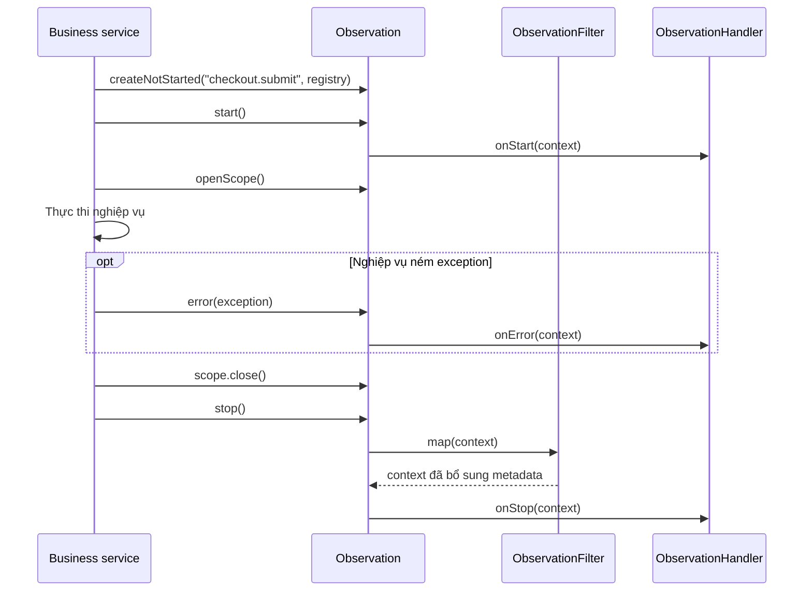
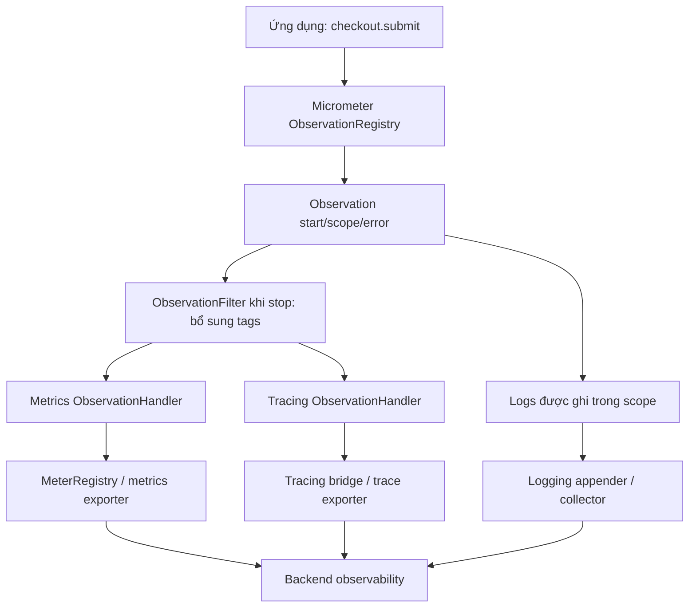

# ObservationFilter

> **Chương:** Cấu hình registry  
> **Module:** `SPRING_BOOT_OBSERVABILITY` — thiết lập observability cho Spring Boot bằng Micrometer Observation, metrics, logs và distributed tracing; chú trọng propagation ngữ cảnh, tags/cardinality, exporter, sampling và liên kết tín hiệu khi điều tra lỗi, độ trễ.

## Mục tiêu bài học

Sau bài này, bạn có thể:

- Giải thích `ObservationFilter` thuộc Micrometer Observation dùng để làm gì và được áp dụng **ở giai đoạn nào** trong vòng đời observation.
- Phân biệt `ObservationFilter` với `ObservationPredicate`, `ObservationConvention`, `ObservationHandler` và `MeterFilter`.
- Cấu hình một filter trong Spring Boot để làm giàu `Observation.Context` bằng các tag có cardinality thấp.
- Chọn dữ liệu an toàn để đưa vào metrics/traces và nhận ra giới hạn của filter đối với logs, context propagation, exporter và sampling.
- Kiểm tra filter bằng một tình huống nghiệp vụ, phát hiện sai sót khi tags không xuất hiện hoặc làm tăng số time series.

## 1. Bài toán: muốn bổ sung metadata cho nhiều observations

Giả sử hệ thống có các hoạt động:

- `checkout.submit` — khách hàng gửi đơn.
- `payment.authorize` — ứng dụng gọi đơn vị thanh toán.
- `inventory.reserve` — giữ tồn kho.

Mỗi hoạt động được đo bằng Micrometer Observation. Nhóm vận hành muốn các metrics của `checkout.submit` luôn mang nhãn `business.domain=checkout`, đồng thời có `outcome=success|error` để dễ so sánh tỷ lệ thất bại và độ trễ.

Có thể thêm tag thủ công ở từng nơi tạo observation. Tuy nhiên, khi quy tắc áp dụng chung cho nhiều nơi, cách đó dễ bị bỏ sót hoặc thiếu nhất quán.

**`ObservationFilter`** là điểm mở rộng cho phép **biến đổi/làm giàu `Observation.Context` trước khi observation kết thúc và các handler thực hiện xử lý cuối vòng đời**. Filter được đăng ký với `ObservationRegistry`; vì vậy một quy tắc có thể áp dụng tập trung cho các observation phù hợp.

Một cách dùng hữu ích là:

> Với observation mang tên `checkout.submit`, thêm các tag `business.domain=checkout` và `outcome` dựa trên trạng thái lỗi đã ghi nhận.

Điểm mấu chốt: filter nhận **context của observation**, không trực tiếp nhận đối tượng HTTP request hoặc bản ghi metric. Cần dựa trên dữ liệu thực sự có trong context khi filter chạy.

## 2. `ObservationFilter` nằm ở đâu trong vòng đời?

Một observation được tạo, bắt đầu, thực thi rồi dừng. Khi observation được dừng theo cơ chế Micrometer Observation thông thường, các filter đã đăng ký được áp dụng vào context **trước khi các `ObservationHandler` nhận bước xử lý kết thúc**.



**Ba hệ quả quan trọng:**

1. Filter được dùng **trước `onStop`**, nên có thể cung cấp tag hoặc metadata phục vụ xử lý kết thúc, chẳng hạn ghi nhận thời lượng một timer.
2. Filter **không quay ngược thời gian** để bổ sung những tag mà một handler đã đọc tại `onStart` hoặc `onError`. Nếu một thông tin phải có ngay khi span được khởi tạo hoặc khi ghi log trong scope, hãy đặt nó sớm hơn tại lúc tạo/start observation hoặc dùng cơ chế phù hợp khác.
3. Filter **không phải một đoạn code được gọi mỗi khi có log hoặc metric**. Nó hoạt động trên vòng đời observation, không phải trên pipeline logging hay mỗi lần exporter gửi dữ liệu.

Nếu observation không được dừng đúng cách, các bước hoàn tất và filter theo vòng đời này có thể không diễn ra như mong đợi. Vì vậy `try/finally` hoặc API `observe(...)` là thiết yếu khi tự instrument.

### 2.1. Ý nghĩa của phương thức `map(Context)`

`ObservationFilter` là functional interface; phương thức chính nhận một `Observation.Context` và trả về context:

```java
Observation.Context map(Observation.Context context);
```

Filter có thể dựa trên tên observation, lỗi được ghi nhận hoặc các thuộc tính context khác để bổ sung key-value. Đoạn code đơn giản:

```java
ObservationFilter filter = context -> {
    if ("checkout.submit".equals(context.getName())) {
        context.addLowCardinalityKeyValue(
                KeyValue.of("business.domain", "checkout"));
    }
    return context;
};
```

Ví dụ giả định đã import `io.micrometer.observation.ObservationFilter` và `io.micrometer.common.KeyValue`. Cách làm này **sửa context rồi trả lại** theo hợp đồng của filter. Với các observation không khớp tên, context được trả lại nguyên trạng.

Không nên lạm dụng filter để đọc dữ liệu từ thread-local hoặc HTTP request hiện hành: thời điểm `stop()` có thể nằm ngoài request scope, hoặc observation kết thúc ở thread khác trong một luồng bất đồng bộ.

## 3. Phân biệt các điểm mở rộng trong Micrometer

| Cơ chế | Nhiệm vụ | Thời điểm/đối tượng tác động | Trường hợp tiêu biểu |
| --- | --- | --- | --- |
| **`ObservationFilter`** | Biến đổi/làm giàu observation context. | Trước khi observation được xử lý ở bước dừng. | Thêm `business.domain`, kết quả `outcome` đã xác định. |
| **`ObservationPredicate`** | Quyết định có nên instrument observation hay không dựa trên tên và context. | Trong bước quyết định tạo/kích hoạt observation. | Bỏ qua một hoạt động ít giá trị, theo chính sách rõ ràng. |
| **`ObservationConvention`** | Quy định tên và key-values có ý nghĩa cho một loại observation/context. | Khi tên/metadata được tính theo convention của instrumentation. | Chuẩn hóa tên và tags cho HTTP hoặc hoạt động nghiệp vụ. |
| **`ObservationHandler`** | Nhận sự kiện vòng đời để tạo/điều khiển tín hiệu. | `onStart`, `onError`, `onScopeOpened`, `onStop`… | Handler metrics, handler tracing span. |
| **`MeterFilter`** | Chấp nhận, từ chối hoặc chỉnh sửa thông tin của meter ở tầng Micrometer Metrics. | Trên tầng `MeterRegistry`. | Giới hạn một nhóm meters hoặc phân phối metric tags. |

Cần phân biệt hai nghĩa của từ *filter*:

- `ObservationFilter` **không có nhiệm vụ chính là chặn một observation**. Nó biến đổi context trước khi dừng.
- Nếu mục tiêu là **không tạo phép đo** cho một nhóm observation, cần xem `ObservationPredicate` hoặc cơ chế cấu hình instrumentation tương ứng. Việc giảm số metric series cũng có thể cần `MeterFilter` tại tầng metrics; mỗi lựa chọn có phạm vi khác nhau.

`ObservationFilter` cũng **không phải tracing sampler**. Việc chọn trace nào được xuất/lưu chịu ảnh hưởng của sampler và tracing pipeline; một observation vẫn có thể được xử lý bằng metrics ngay cả khi trace không được lấy mẫu.

## 4. Đăng ký `ObservationFilter` trong Spring Boot

Khi sử dụng Spring Boot Actuator với Micrometer Observation, các bean `ObservationFilter` do ứng dụng khai báo thường được hệ thống cấu hình observability của Spring Boot tự đăng ký trên `ObservationRegistry` được quản lý.

Ví dụ dưới đây dùng bean để làm giàu observation `checkout.submit`:

```java
package example.observability;

import io.micrometer.common.KeyValue;
import io.micrometer.observation.ObservationFilter;
import org.springframework.context.annotation.Bean;
import org.springframework.context.annotation.Configuration;

@Configuration(proxyBeanMethods = false)
public class CheckoutObservationConfig {

    @Bean
    ObservationFilter checkoutObservationFilter() {
        return context -> {
            if (!"checkout.submit".equals(context.getName())) {
                return context;
            }

            context.addLowCardinalityKeyValue(
                    KeyValue.of("business.domain", "checkout"));

            String outcome = context.getError() == null
                    ? "success"
                    : "error";
            context.addLowCardinalityKeyValue(
                    KeyValue.of("outcome", outcome));

            return context;
        };
    }
}
```

**Cách đọc ví dụ:**

1. Spring quản lý bean `checkoutObservationFilter` và đăng ký vào registry qua cơ chế tích hợp của Spring Boot trong cấu hình tương thích.
2. Filter chỉ thay đổi context của observation có tên chính xác `checkout.submit`.
3. `business.domain` là giá trị cố định; `outcome` chỉ có hai giá trị. Cả hai đều phù hợp cho **low-cardinality tags**.
4. `context.getError()` dựa trên lỗi mà observation đã ghi nhận. Nếu code nghiệp vụ bắt exception rồi không gọi `observation.error(exception)`, filter có thể đánh dấu `success` dù nghiệp vụ đã có thất bại theo nghĩa ứng dụng.
5. Kết quả trả về là context, để các thành phần tiếp theo xử lý metadata đã bổ sung.

Quy tắc trên đo **lỗi đã được khai báo trong context**, không mặc nhiên phân loại mọi HTTP status. Chẳng hạn, một response `400` hoặc `500` có thể được xử lý mà không ném exception; nếu cần phân loại theo HTTP status, sử dụng context/convention của HTTP instrumentation hoặc đưa kết quả nghiệp vụ vào observation một cách tường minh.

### 4.1. Khi không dùng tự động cấu hình Spring Boot

Nếu bạn tạo và cấu hình `ObservationRegistry` thủ công, filter phải được đăng ký trên registry đó:

```java
import io.micrometer.observation.ObservationFilter;
import io.micrometer.observation.ObservationRegistry;

ObservationRegistry registry = ObservationRegistry.create();

ObservationFilter checkoutFilter = context -> {
    if ("checkout.submit".equals(context.getName())) {
        context.addLowCardinalityKeyValue(
                io.micrometer.common.KeyValue.of("business.domain", "checkout"));
    }
    return context;
};

registry.observationConfig().observationFilter(checkoutFilter);
```

Một registry mới tạo bằng tay **không tự bảo đảm** có metrics/tracing handlers hoặc exporters như registry của Spring Boot. Để tránh hai registry hoạt động độc lập, ứng dụng Spring Boot thông thường nên dùng registry được framework quản lý rồi đăng ký các thành phần mở rộng phù hợp.

Ở các phiên bản Spring Boot/Micrometer khác nhau, cách tự động đăng ký bean, tên API hoặc cơ chế autoconfiguration có thể thay đổi. Kiểm tra tài liệu đúng phiên bản của ứng dụng nếu filter bean không có hiệu lực.

## 5. Tạo một observation để thử filter

Một service nghiệp vụ đơn giản dùng `ObservationRegistry` do Spring Boot cung cấp:

```java
package example.observability;

import java.util.function.Supplier;

import io.micrometer.observation.Observation;
import io.micrometer.observation.ObservationRegistry;
import org.springframework.stereotype.Service;

@Service
public class CheckoutService {
    private final ObservationRegistry registry;

    public CheckoutService(ObservationRegistry registry) {
        this.registry = registry;
    }

    public <T> T submit(Supplier<T> action) {
        return Observation.createNotStarted("checkout.submit", registry)
                .lowCardinalityKeyValue("channel", "web")
                .observe(action);
    }
}
```

`observe(action)` quản lý start, scope, ghi nhận exception và stop cho một thao tác **đồng bộ**. Nhờ đó, khi stop, filter có thể dựa vào `getError()` để thêm `outcome`.

Ví dụ gọi:

```java
// Trường hợp thành công:
String orderId = checkoutService.submit(() -> "order-001");

// Trường hợp thất bại:
try {
    checkoutService.submit(() -> {
        throw new IllegalStateException("Inventory unavailable");
    });
} catch (IllegalStateException expected) {
    // Ứng dụng tự quyết định phản hồi HTTP / retry / rollback.
}
```

Đây là minh họa cách dùng API, không phải một ứng dụng Spring Boot đầy đủ với controller hoặc cơ sở dữ liệu. Khi có metrics handler, observation đã dừng có thể đóng góp số đo cho `checkout.submit` với tags:

```text
name: checkout.submit
tags: channel=web, business.domain=checkout, outcome=success
```

và khi exception được ghi nhận:

```text
name: checkout.submit
tags: channel=web, business.domain=checkout, outcome=error
```

Tên meter/chuỗi được exporter tạo ra có thể khác theo registry, quy tắc chuẩn hóa tên và backend đang dùng. Ví dụ trên mô tả **tên logic của observation** cùng tags, không khẳng định đây là dữ liệu thô ở một endpoint Prometheus cụ thể.

## 6. Chọn metadata phù hợp: low và high cardinality

Phần lớn lỗi vận hành khi làm giàu context đến từ việc thêm giá trị có **quá nhiều biến thể** vào metric tags.

| Thuộc tính | Ví dụ | Có nên là low-cardinality tag? | Ghi chú |
| --- | --- | --- | --- |
| `business.domain` | `checkout` | Có | Tập nhóm nghiệp vụ nhỏ. |
| `outcome` | `success` / `error` | Có | Kết quả được chuẩn hóa. |
| `channel` | `web` / `mobile` / `other` | Có | Phải kiểm soát giá trị từ bên ngoài. |
| `http.route` | `/orders/{id}` | Có, nếu đã chuẩn hóa | Không dùng URL chứa ID thực. |
| `orderId` | `ord-829114` | Không | Gần như mỗi request một giá trị. |
| `traceId` | Chuỗi hex duy nhất | Không | Dùng để tìm trace/log, không tạo metric label. |
| `email` / `accessToken` | Thông tin cá nhân/bí mật | Không | Không gắn vào telemetry khi không cần, tránh rủi ro lộ dữ liệu. |

Với Micrometer Observation:

- **Low-cardinality key values** thường được dùng cho metrics và cũng có thể được đưa vào traces tùy handler/convention.
- **High-cardinality key values** có thể hữu ích ở tracing context khi thật sự cần truy vấn một đối tượng cụ thể, nhưng phải cân nhắc dữ liệu nhạy cảm, kích thước payload và chi phí lưu trữ.
- Filter không tự quyết định trường nào là an toàn. Người thiết kế phải kiểm soát giá trị đầu vào và mục đích sử dụng.

**Sai lầm cần tránh:**

```java
// Không phù hợp: mỗi orderId tạo một tổ hợp metric tags mới.
context.addLowCardinalityKeyValue(
        KeyValue.of("orderId", orderId));
```

Ngoài tăng cardinality, việc lấy `orderId` từ một biến `ThreadLocal` ngay lúc observation stop có thể đọc sai ngữ cảnh trong luồng bất đồng bộ. Nếu thông tin đó thật sự cần cho một trace, nên đưa nó vào context một cách tường minh tại nơi dữ liệu có mặt, áp dụng quy tắc bảo mật và chọn đúng nhóm metadata.

### 6.1. Quy tắc mang tính toàn cục và theo nghiệp vụ

Filter có thể được dùng cho **mọi** observation, hoặc chỉ khi tên/context phù hợp. Cần cân nhắc:

- Tag toàn cục như `region=ap-southeast` hoặc `deployment.environment=staging` nên có giá trị hữu hạn, ổn định. Với một số cấu hình Spring Boot, thuộc tính `management.observations.key-values` cũng hỗ trợ thêm các cặp key/value chung.
- Tag nghiệp vụ như `business.domain=checkout` nên chỉ áp dụng đúng nhóm observation.
- Nếu một tag đã do framework/convention khai báo, tránh ghi thêm giá trị mâu thuẫn. Thống nhất **một nơi sở hữu** từng tag để dashboard và alert có ý nghĩa nhất quán.
- Mỗi filter bổ sung metadata đều làm tăng độ phức tạp. Không nên tạo nhiều filter chồng chéo nếu một convention hoặc cấu hình trực tiếp diễn đạt tốt hơn.

## 7. Filter tác động tới metrics, traces và logs ra sao?

Observation là một lớp trung gian cho nhiều tín hiệu. Tuy nhiên, một filter không tự biến dữ liệu thành đủ ba loại tín hiệu.



| Tín hiệu | Filter giúp gì? | Điều kiện hoặc giới hạn |
| --- | --- | --- |
| **Metrics** | Bổ sung các key-values có cardinality thấp được handler metrics dùng ở giai đoạn kết thúc. | Phải có metrics handler, `MeterRegistry` và pipeline/exporter phù hợp; kết quả còn phụ thuộc quy ước meter. |
| **Distributed tracing** | Có thể bổ sung metadata mà handler tracing xử lý khi observation dừng. | Tracing bridge/handler, sampling, exporter và thời điểm handler đọc thuộc tính quyết định kết quả; không thay thế việc truyền trace context. |
| **Logs** | Dữ liệu trong observation có thể hỗ trợ liên kết khi ứng dụng thiết kế logging tương ứng. | Filter chạy khi stop nên **không tự thêm trường vào các log đã ghi trước đó**; muốn correlation logs cần MDC/trace context hoặc structured logging đúng chỗ. |

Đặc biệt, nếu bạn muốn mọi log trong `checkout.submit` đều mang `traceId` và `spanId`, cách điển hình là bật Micrometer Tracing và dùng logging pattern/MDC phù hợp **khi scope đang mở**. Thêm các tag bằng `ObservationFilter` lúc stop không thể sửa lại những log đã phát sinh.

Nếu muốn liên kết metrics với một trace cụ thể, một số backend hỗ trợ **exemplars**. Đừng đưa `traceId` vào low-cardinality metric tags để tự mô phỏng liên kết đó. Exemplar phụ thuộc vào registry, exporter, backend và cấu hình tracing tương thích.

### 7.1. Filter không thay thế sampling và propagation

- **Sampling:** cấu hình tracing quyết định trace nào được lấy mẫu hoặc xuất ra. Một filter làm giàu context không bảo đảm span sẽ xuất hiện trong backend.
- **Context propagation:** HTTP client/server, executor, Reactor hoặc message instrumentation cần mang trace context qua các ranh giới. Filter không tự inject `traceparent`, tạo parent span hoặc chuyển MDC sang thread khác.
- **Exporter:** handler có thể tạo dữ liệu nhưng vẫn cần registry, exporter và backend để truy vấn. Sự cố mạng hoặc collector có thể làm mất tín hiệu sau khi filter đã chạy.
- **Metric coverage:** observation có thể bị bỏ qua bởi predicate, thiếu handler, không được dừng hoặc khác tên dự kiến, khiến bạn không thấy tag; không nên vội kết luận filter bị lỗi.

## 8. Kiểm tra `ObservationFilter` trên môi trường thực nghiệm

Một lộ trình thử nghiệm giúp xác định cả logic filter lẫn khả năng xuất dữ liệu.

### 8.1. Chuẩn bị ứng dụng

Dự án Spring Boot cần Micrometer Observation/Actuator phù hợp. Để xem metrics qua Prometheus, thường cần thêm Prometheus registry và bật endpoint tương ứng; để xem traces cần cấu hình Micrometer Tracing bridge, exporter và backend.

Ví dụ cấu hình khi các dependency đã có:

```yaml
spring:
  application:
    name: checkout-service

management:
  endpoints:
    web:
      exposure:
        include: health,info,prometheus
  tracing:
    sampling:
      probability: 0.1
```

Cấu hình này chỉ có tác dụng với telemetry khi các thành phần tích hợp đã được cài và cấu hình đúng. `/actuator/prometheus` phải được bảo vệ phù hợp; không công khai dữ liệu quản trị nhạy cảm ra Internet. Xác suất lấy mẫu 10% là ví dụ, không phải giá trị bắt buộc.

### 8.2. Các bước kiểm chứng

1. Chạy thao tác `checkoutService.submit(() -> "ok")` nhiều lần. Kiểm tra observation `checkout.submit` và các tag `business.domain=checkout`, `outcome=success` trên metrics (nếu handler metrics hoạt động).
2. Chạy trường hợp exception. Kiểm tra số đo tương ứng `outcome=error` sau khi `observe(...)` đã ghi nhận lỗi trước stop.
3. Chạy một observation tên `inventory.reserve`. Đảm bảo filter hiện tại **không** bổ sung `business.domain=checkout` cho observation đó.
4. Nếu bật tracing, mở một trace đã được thu thập có `checkout.submit` và kiểm tra các thuộc tính thực sự được exporter/backend thể hiện. Xem mối quan hệ giữa span HTTP và span nghiệp vụ.
5. Ghi log bên trong `checkout.submit` rồi xem `traceId`/`spanId` có được đưa vào log nhờ tracing context hay không; không kỳ vọng filter sửa log đã ghi.
6. Kiểm tra tập nhãn metrics sau nhiều request. Xác nhận `business.domain`, `outcome` và `channel` chỉ sinh ít tổ hợp, không có ID động.
7. Đối chiếu thời điểm filter chạy: thêm một log thử ngay bên trong code nghiệp vụ và một điểm kiểm tra khi filter được gọi, rồi quan sát thứ tự. Xóa log thử trước khi đưa lên production.

**Tiêu chí đạt:** filter được áp dụng tại lúc observation dừng, bổ sung đúng tag cho đúng loại observation, không tạo high-cardinality metric labels, không làm thay đổi luồng nghiệp vụ và dữ liệu thực sự có thể được quan sát tại backend khi pipeline hỗ trợ.

## 9. Chẩn đoán các sự cố thường gặp

| Hiện tượng | Nguyên nhân có thể | Cách kiểm tra |
| --- | --- | --- |
| `ObservationFilter` bean không được áp dụng | Registry không được Spring Boot quản lý, autoconfiguration không hoạt động hoặc dùng sai phiên bản/tích hợp. | Kiểm tra bean/registry được inject, cách đăng ký filter và cấu hình Actuator. |
| Filter chỉ xuất hiện với một số hoạt động | Điều kiện `context.getName()` không trùng tên thực tế. | Kiểm tra tên observation được instrument/convention quyết định. |
| `outcome=success` dù response bị lỗi | Error chưa được ghi vào `Observation.Context`; lỗi được xử lý thành trạng thái thay vì exception. | Ghi nhận lỗi/kết quả ở đúng ranh giới; không đánh đồng HTTP status và context error. |
| Không thấy metric tag mới | Chưa có handler metrics, observation chưa stop hoặc exporter/backend chưa lấy dữ liệu. | Kiểm tra vòng đời, MeterRegistry, endpoint và pipeline. |
| Không thấy span tag ở backend | Handler đọc tag ở thời điểm khác, thiếu tracing bridge/exporter hoặc trace không được lấy mẫu. | Kiểm tra handler, sampling, context propagation và trace đã được xuất. |
| Logs cũ không có tag được thêm bằng filter | Filter chạy ở bước stop, trong khi logs đã ghi trước đó. | Gắn logging context sớm hơn bằng MDC, baggage hoặc cơ chế correlation phù hợp. |
| Cardinality của metrics tăng mạnh | Tag chứa ID riêng từng request, URL chưa chuẩn hóa hoặc đầu vào client không được giới hạn. | Rà soát key-values, loại bỏ giá trị biến thiên lớn và chuẩn hóa nhãn. |
| Các filters gắn tag mâu thuẫn | Nhiều nơi cùng sở hữu một key hoặc không thống nhất quy ước. | Quy định nguồn khai báo tags, kiểm tra cấu hình convention/filter/handler. |
| Trace đứt giữa các service | Thiếu propagation hoặc instrumentation HTTP/message client/server. | Kiểm tra `traceparent`, scope và cơ chế inject/extract context. |

### 9.1. Những quyết định thiết kế nên chốt trước

Trước khi thêm một `ObservationFilter` mới, hãy xác định:

- **Phạm vi:** filter dùng cho observation nào? Tên hoặc kiểu context đã ổn định chưa?
- **Nguồn dữ liệu:** metadata có sẵn tại lúc stop không, hay cần thêm từ đầu?
- **Cardinality:** có bao nhiêu tổ hợp tag ở tải thực tế?
- **Vòng đời:** observation có được dừng sau thành công/lỗi/timeout không?
- **Tương quan:** tag giúp dashboard đo xu hướng hay thực sự cần trace ID/log correlation?
- **Quyền riêng tư:** dữ liệu có thể xuất hiện ở backend của bên thứ ba hoặc qua nhiều dịch vụ không?

Một filter tốt thường rất nhỏ: điều kiện khớp rõ ràng, gắn vài giá trị chuẩn hóa, không có network call và không gây side effect. Tránh truy vấn DB, gọi dịch vụ khác hay thực hiện tác vụ nặng trong filter: code này chạy ở đường hoàn tất phép đo và có thể tác động đến độ trễ ứng dụng.

## 10. Tự kiểm tra hiểu biết

**Câu 1.** `ObservationFilter` khác `ObservationPredicate` thế nào?  
**Gợi ý:** Filter biến đổi context khi observation chuẩn bị dừng; predicate quyết định có instrument observation dựa trên tên/context.

**Câu 2.** Có thể dùng filter để thêm `orderId` vào `lowCardinalityKeyValue` cho dễ tìm lỗi không?  
**Gợi ý:** Không phù hợp. Giá trị thay đổi theo từng đơn dẫn tới bùng nổ time series. Dùng thuộc tính tracing/log được quản lý phù hợp nếu cần truy vết một đơn cụ thể.

**Câu 3.** Vì sao `context.getError() == null` chưa chắc có nghĩa HTTP request thành công?  
**Gợi ý:** Framework hoặc nghiệp vụ có thể trả status lỗi mà không ném exception/ghi lỗi vào observation context. Phải định nghĩa outcome phù hợp.

**Câu 4.** Thêm `business.domain` bằng filter thì các log đã ghi trong scope có tự xuất hiện field này không?  
**Gợi ý:** Không. Filter chạy gần stop; logs được phát trước đó cần logging context riêng tại thời điểm ghi.

**Câu 5.** Đã đăng ký filter nhưng không thấy span trong backend, có thể kết luận filter sai không?  
**Gợi ý:** Chưa. Cần kiểm tra tracing handler, sampling, exporter và propagation; observation có thể vẫn ghi metrics.

**Câu 6.** Khi nào nên thêm metadata trực tiếp lúc tạo observation thay vì qua filter?  
**Gợi ý:** Khi handler hoặc code chạy trong scope cần dùng dữ liệu **ngay từ lúc bắt đầu**, hoặc khi metadata được biết chắc ở thời điểm đó và chỉ liên quan tới một thao tác.

**Ghi nhớ:** `ObservationFilter` là cơ chế **làm giàu `Observation.Context` vào giai đoạn dừng observation**. Trong Spring Boot, dùng nó để bổ sung metadata ổn định, có cardinality thấp và có ý nghĩa vận hành. Muốn quan sát đầy đủ metrics, logs và distributed tracing còn cần handlers, registry, context propagation, exporters và chiến lược sampling đúng; filter không thay thế các thành phần đó.
