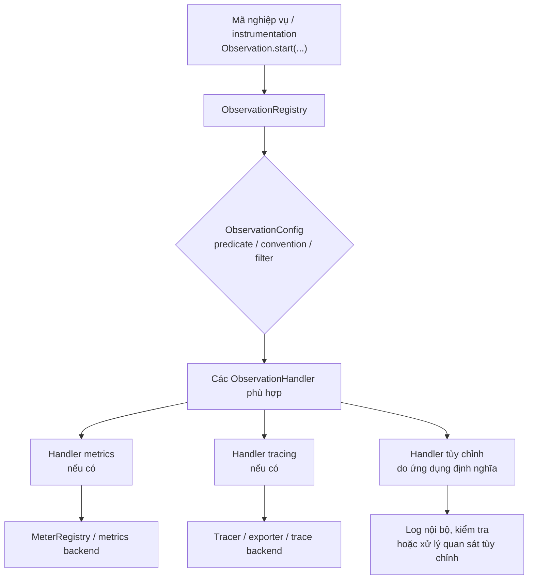
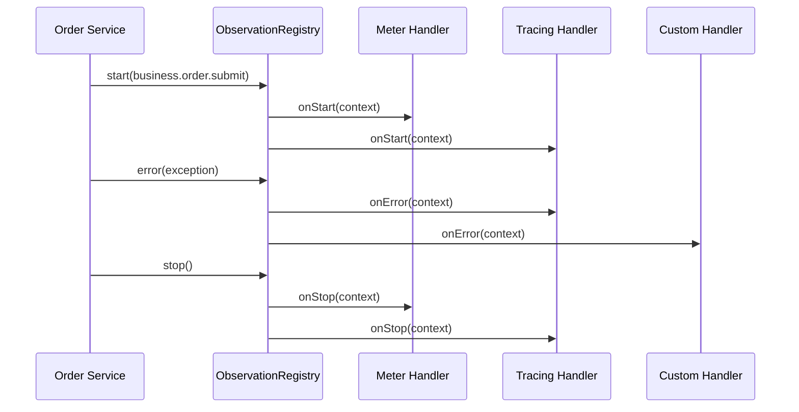

# ObservationHandler bean trong Spring Boot

Ứng dụng đã tạo `Observation` cho một nghiệp vụ nhưng dashboard vẫn không xuất hiện thông tin mong muốn: làm sao biết observation đã bắt đầu, xảy ra lỗi hoặc kết thúc? Câu trả lời nằm ở **`ObservationHandler`**. Đây là thành phần nhận các callback trong vòng đời observation, từ đó kết nối dữ liệu quan sát với cơ chế đo metrics, distributed tracing hoặc một hành vi tùy chỉnh.

Bài **ObservationHandler bean** thuộc chương **Cấu hình registry** của module **SPRING_BOOT_OBSERVABILITY**. Mục tiêu xuyên suốt module là thiết lập observability cho Spring Boot bằng Micrometer Observation, metrics, logs và distributed tracing; hiểu propagation ngữ cảnh, tag/cardinality, exporter, sampling và liên kết tín hiệu để điều tra lỗi, độ trễ, hành vi ứng dụng trên môi trường thực. Bài này tập trung vào việc khai báo, đăng ký, kiểm tra và sử dụng **bean `ObservationHandler`** đúng cách.

## 1. Mục tiêu học tập

Sau khi học xong, bạn có thể:

- Giải thích mối quan hệ giữa `Observation`, `ObservationRegistry` và `ObservationHandler`.
- Phân biệt `ObservationHandler` với `ObservationConvention`, `ObservationFilter` và `ObservationPredicate`.
- Tạo `ObservationHandler` dưới dạng Spring bean và hiểu điều kiện để nó được đăng ký vào registry.
- Sử dụng `supportsContext` và các callback `onStart`, `onError`, `onEvent`, `onStop`, `onScopeOpened` / `onScopeClosed`.
- Viết một handler tùy chỉnh chỉ xử lý observation của một nghiệp vụ mà không làm tăng cardinality metrics hay ghi lộ dữ liệu.
- Phân tích ảnh hưởng của registry, handler, tracing bridge, exporter và sampling khi một tín hiệu không xuất hiện ở backend.

## 2. Vị trí của ObservationHandler trong kiến trúc

Một `Observation` biểu diễn **công việc được quan sát**, ví dụ `business.order.submit` hoặc một HTTP request. `ObservationRegistry` giữ cấu hình và điều phối các quan sát viên. `ObservationHandler` là **điểm nhận sự kiện vòng đời** của observation.



**Điểm quan trọng:** `ObservationHandler` không đồng nghĩa exporter. Nó **nhận thông báo** khi observation thay đổi trạng thái. Để có metrics cần handler và meter registry tương ứng; để có distributed tracing cần tracing handler, bridge, tracer và exporter được cấu hình phù hợp. Một handler chỉ ghi log sẽ không tự gửi span đến hệ thống tracing.

Trong một ứng dụng Spring Boot tích hợp Actuator, bạn thường **tiêm `ObservationRegistry` đã được framework cấu hình** thay vì tự tạo registry khác. Nếu mỗi service tự gọi `ObservationRegistry.create()`, các observation ở registry riêng có thể không đi qua những handler mà Spring Boot đã đăng ký.

### Observation và handler khác nhau ở đâu?

| Thành phần | Trách nhiệm | Ví dụ |
| --- | --- | --- |
| `Observation` | Mô tả một công việc; quản lý start, scope, error, event, stop | `business.order.submit` |
| `ObservationRegistry` | Nơi giữ cấu hình và điều phối handler | Registry do Spring Boot cung cấp |
| `ObservationHandler` | Nhận callback vòng đời khi hỗ trợ context | Xử lý `onError` để ghi tín hiệu chẩn đoán |
| `MeterRegistry` | Quản lý meter/timer/counter cho metrics | Prometheus registry |
| Tracer / exporter | Tạo và truyền spans đến backend tracing | Micrometer Tracing bridge và OTLP exporter |

Không phải mọi observation đều sinh metrics hoặc traces. Một observation có thể không có handler phù hợp, bị predicate loại trừ, hay thiếu exporter. Vì vậy cần kiểm tra **toàn bộ đường đi** từ việc khởi tạo observation tới backend.

## 3. Cách Spring Boot đăng ký ObservationHandler bean

Với **Spring Boot 3.x** và cấu hình Actuator/observability phù hợp, Spring Boot có thể tự tạo và cấu hình `ObservationRegistry`. Các bean kiểu `ObservationHandler<?>` trong application context được cơ chế auto-configuration của Boot đăng ký vào registry. Tùy phiên bản Spring Boot và các dependency, handler cho metrics/tracing cũng có thể được Boot đăng ký tự động.

Dependency khởi đầu trong dự án Gradle Kotlin DSL:

```kotlin
dependencies {
    implementation("org.springframework.boot:spring-boot-starter-actuator")
}
```

Đoạn trên đủ để minh họa cấu hình nền cho Observation/Actuator trong Spring Boot 3.x. Nếu muốn xuất metrics hoặc traces, bổ sung registry, tracing bridge và exporter phù hợp; chỉ có Actuator không bảo đảm dữ liệu được gửi tới một backend ngoài. Để tránh lệch API, hãy quản lý phiên bản dependency theo Spring Boot BOM của dự án.

### Cấu hình bean: cách làm thường dùng

Khai báo một phương thức `@Bean` trả về `ObservationHandler<Observation.Context>`. Boot nhận diện bean và đưa nó vào registry đã auto-configure:

```java
import io.micrometer.observation.Observation;
import io.micrometer.observation.ObservationHandler;
import org.springframework.context.annotation.Bean;
import org.springframework.context.annotation.Configuration;

@Configuration(proxyBeanMethods = false)
public class ObservationHandlersConfiguration {

    @Bean
    ObservationHandler<Observation.Context> businessFailureHandler() {
        return new BusinessFailureObservationHandler();
    }
}
```

Trong ví dụ này, `BusinessFailureObservationHandler` là class do ứng dụng định nghĩa ở phần sau. Chỉ cần **một** cách khai báo: nếu đã đưa handler thành bean bằng `@Bean` thì không đồng thời thêm `@Component` cho cùng một implementation để tránh có hai bean và hai lần xử lý sự kiện.

### Khi nào phải đăng ký thủ công?

Nếu ứng dụng **không** sử dụng registry được Spring Boot cấu hình mà tự tạo Micrometer registry độc lập, việc khai báo bean không đủ để registry riêng tự biết handler. Đăng ký có thể thực hiện trực tiếp:

```java
ObservationRegistry isolatedRegistry = ObservationRegistry.create();
isolatedRegistry.observationConfig()
    .observationHandler(new BusinessFailureObservationHandler());
```

Đây chỉ là ví dụ cho **registry độc lập**, không phải đoạn nên thêm vào ứng dụng đã dùng Boot auto-configuration. Trong dự án Spring Boot bình thường, nên dùng registry được inject và để framework quản lý các handler chung. Nếu cần tùy chỉnh sâu, xem xét cơ chế customizer của phiên bản Boot đang sử dụng và kiểm tra tránh đăng ký lặp.

## 4. Hợp đồng của ObservationHandler

Giao diện `ObservationHandler<T extends Observation.Context>` cho phép handler đăng ký các callback; hai phương thức dễ bắt gặp nhất là `supportsContext` và các callback vòng đời như `onStart` / `onStop` / `onError`.

| Callback | Thời điểm điển hình | Dùng để làm gì? |
| --- | --- | --- |
| `supportsContext(context)` | Khi registry xem handler có áp dụng cho context hay không | Chỉ chấp nhận observation có phạm vi và loại context phù hợp |
| `onStart(context)` | Observation bắt đầu | Chuẩn bị state đo đạc hoặc ghi nhận sự kiện bắt đầu |
| `onError(context)` | Observation được báo lỗi qua `error(ex)` | Đọc lỗi trong context, tạo sự kiện chẩn đoán có kiểm soát |
| `onEvent(event, context)` | Observation được thêm event | Xử lý mốc có ý nghĩa trong công việc |
| `onScopeOpened(context)` | Mở scope observation | Phục vụ gắn hoặc đồng bộ ngữ cảnh theo integration |
| `onScopeClosed(context)` | Đóng scope observation | Dọn ngữ cảnh phù hợp với scope |
| `onStop(context)` | Observation kết thúc | Chốt thời lượng, counter hoặc state do handler quản lý |

Một số phiên bản API có thêm callback liên quan đến scope reset. Các callback được định nghĩa với hành vi mặc định khi không override; vì vậy một handler chỉ cần thực hiện **những callback thực sự cần**. `supportsContext` là điều kiện để handler tham gia vòng đời observation.

**Lưu ý:** `onError` không có nghĩa là Java tự chuyển sang `catch`. Callback chỉ được kích hoạt khi mã quản lý observation gọi `observation.error(ex)`, hoặc khi một API/instrumentation tự động chủ động ghi nhận lỗi. Việc một method tự viết ném exception **chưa chắc** làm handler tùy chỉnh nhận `onError`.

### Scope và context propagation

`onScopeOpened` và `onScopeClosed` hữu ích khi handler phải quản lý dữ liệu liên quan tới scope hiện hành. Trong xử lý đồng bộ, scope thường được gắn với thread hiện tại. Khi công việc chuyển sang thread pool, `@Async`, Reactor hoặc message consumer, context có thể không tự truyền tiếp. Cần sử dụng instrumentation và **Micrometer Context Propagation** phù hợp; đừng dựa vào một biến `ThreadLocal` tự viết rồi giả định nó được lan sang mọi luồng.

Không được giữ một `Observation.Scope` mở vượt quá phạm vi thực thi đã thiết kế, đặc biệt khi thread được tái sử dụng. Nếu handler tự sử dụng MDC, phải bảo đảm dọn context đúng lúc để tránh log của request sau mang dữ liệu của request trước.

## 5. Ví dụ đầy đủ: bean chỉ xử lý lỗi đặt hàng

Ta tạo một handler nhận `onError` **chỉ khi** tên observation bằng `business.order.submit`. Handler này ghi một dòng log chẩn đoán ngắn với tên observation và **loại exception**. Đây là ví dụ thể hiện cơ chế bean/callback, không phải đề xuất bật log cho mọi observation trong production.

### 5.1. Implementation của handler

```java
import io.micrometer.observation.Observation;
import io.micrometer.observation.ObservationHandler;
import org.slf4j.Logger;
import org.slf4j.LoggerFactory;

public final class BusinessFailureObservationHandler
        implements ObservationHandler<Observation.Context> {

    private static final Logger log =
        LoggerFactory.getLogger(BusinessFailureObservationHandler.class);

    @Override
    public boolean supportsContext(Observation.Context context) {
        return "business.order.submit".equals(context.getName());
    }

    @Override
    public void onError(Observation.Context context) {
        Throwable error = context.getError();
        if (error == null) {
            return;
        }

        log.warn(
            "event=business_observation_error observation={} exceptionType={}",
            context.getName(),
            error.getClass().getSimpleName()
        );
    }
}
```

**Giải thích thiết kế:**

1. `supportsContext` sử dụng phép so sánh tên cố định, chi phí thấp, tránh xử lý mọi HTTP, database hoặc messaging observation trong ứng dụng.
2. `getError()` lấy exception đã được báo cho observation. Handler **không** tạo exception mới và **không** thay đổi kết quả business.
3. Log có trường `event` ổn định và loại exception; handler không tự đưa request body, token hay `exception.getMessage()` vào log. Thông điệp exception có thể chứa dữ liệu nhạy cảm.
4. Handler không giữ state toàn cục theo request; mỗi callback đọc context của observation hiện tại. Điều này giảm rủi ro lẫn dữ liệu giữa các request đồng thời.
5. Nếu ứng dụng đã ghi đầy đủ cùng một lỗi ở tầng khác, nên cân nhắc chỉ dùng handler để thống kê hoặc log ở mức thấp hơn; tránh hai stack trace cho cùng một sự cố.

Ví dụ `BusinessFailureObservationHandler` không thay thế meter handler hay tracing handler. Mục tiêu của nó là minh họa việc **tự bổ sung một hành vi** mỗi khi observation phù hợp thông báo lỗi.

### 5.2. Bean đăng ký vào Spring

```java
import io.micrometer.observation.Observation;
import io.micrometer.observation.ObservationHandler;
import org.springframework.context.annotation.Bean;
import org.springframework.context.annotation.Configuration;

@Configuration(proxyBeanMethods = false)
public class ObservabilityConfiguration {

    @Bean
    ObservationHandler<Observation.Context> businessFailureHandler() {
        return new BusinessFailureObservationHandler();
    }
}
```

Đây là phiên bản hoàn chỉnh của cấu hình bean ở phần 3. Khi đưa vào ứng dụng thực, **chỉ sử dụng một** trong hai đoạn cấu hình trên để tránh khai báo trùng bean. Package của `ObservabilityConfiguration` cần nằm trong phạm vi component scan hoặc được import vào Spring application context.

### 5.3. Tạo observation để kích hoạt handler

```java
import io.micrometer.observation.Observation;
import io.micrometer.observation.ObservationRegistry;
import org.springframework.stereotype.Service;

@Service
public class OrderApplicationService {

    private final ObservationRegistry observationRegistry;
    private final PaymentGateway paymentGateway;

    public OrderApplicationService(
            ObservationRegistry observationRegistry,
            PaymentGateway paymentGateway) {
        this.observationRegistry = observationRegistry;
        this.paymentGateway = paymentGateway;
    }

    public void submit(String orderId) {
        Observation observation = Observation
            .createNotStarted("business.order.submit", observationRegistry)
            .lowCardinalityKeyValue("operation", "submit")
            .start();

        try (Observation.Scope scope = observation.openScope()) {
            try {
                paymentGateway.charge(orderId);
                observation.lowCardinalityKeyValue("outcome", "success");
            } catch (RuntimeException ex) {
                observation.lowCardinalityKeyValue("outcome", "error");
                observation.error(ex);
                throw ex;
            }
        } finally {
            observation.stop();
        }
    }
}

interface PaymentGateway {
    void charge(String orderId);
}
```

Với gateway thành công, observation đi qua `start`, scope và `stop`. Handler chỉ override `onError` nên **không ghi dòng lỗi**. Khi gateway ném `RuntimeException`, service gắn `outcome=error` rồi gọi `error(ex)`: registry gọi `onError` của handler phù hợp. Sau đó exception tiếp tục lan đến caller, scope đóng và `stop` chạy ở `finally`.

`orderId` không được đưa vào low-cardinality key-value. Nếu muốn tìm yêu cầu cụ thể, có thể ghi order ID nội bộ vào log ở tầng nghiệp vụ hoặc ngữ cảnh tracing có kiểm soát, theo chính sách dữ liệu của hệ thống.

Nếu `PaymentGateway` trả về một giá trị thể hiện thanh toán **bị từ chối hợp lệ** thay vì ném exception, thao tác có thể gắn `outcome=rejected` mà không gọi `error(ex)`. Handler ở trên sẽ không phát log lỗi; đây là kết quả đúng theo lựa chọn phân loại nghiệp vụ.

## 6. Handler tùy chỉnh khác gì convention, filter và predicate?

Trong phần cấu hình `ObservationRegistry`, các extension point có thể bị nhầm lẫn vì đều liên quan observation:

| Cơ chế | Chức năng chính | Ví dụ |
| --- | --- | --- |
| **`ObservationHandler`** | Nhận callback ở các thời điểm trong vòng đời | Ghi nhận lỗi hoặc chuyển context thành tín hiệu |
| **`ObservationConvention`** | Quy định tên, contextual name và key-value cho nhóm observation | Chuẩn hóa tên/tag của HTTP hoặc nghiệp vụ |
| **`ObservationFilter`** | Chỉnh sửa observation context qua pipeline cấu hình trước khi hoàn tất | Bổ sung một nhãn môi trường có tập giá trị hữu hạn |
| **`ObservationPredicate`** | Cho phép hoặc loại trừ observation theo điều kiện | Bỏ qua health-check observation không cần đo |
| **Registry customizer** | Thay đổi cấu hình registry, gồm những thành phần trên khi cần | Đăng ký handler trong ứng dụng dùng registry tùy biến |

Hãy dùng `ObservationHandler` khi bạn muốn **phản ứng với lifecycle**. Nếu mục tiêu chỉ là đổi tên hoặc bổ sung key-value chung, convention/filter thường phù hợp hơn. Nếu muốn ngăn hẳn observation ở một endpoint từ đầu, predicate mới là công cụ gần nhất với mục tiêu đó.

### Không nhồi mọi logic vào handler

Một handler phức tạp làm HTTP call tới hệ thống bên ngoài trong `onStart` hoặc `onStop` có thể ảnh hưởng thời gian phản hồi của request và làm lỗi trong instrumentation lan vào logic nghiệp vụ. Callback nên **nhanh, ít side effect và an toàn với concurrency**. Với tác vụ tốn thời gian như gửi sự kiện nghiệp vụ có bảo đảm, dùng cơ chế hàng đợi/giao dịch riêng; không biến handler thành kênh lưu trữ nghiệp vụ đáng tin cậy.

Handler phù hợp để bổ sung giám sát và metadata; nó không thay thế validation, audit trail, xử lý giao dịch hoặc cơ chế alert có quy tắc.

## 7. Nhiều handler cùng một registry

Một observation có thể cần đồng thời timer metrics, tracing span và handler tùy chỉnh. Micrometer hỗ trợ **composition** các handler, nhưng hành vi chọn handler phụ thuộc cách cấu hình registry:

- Một cơ chế **all-matching** chuyển callback tới tất cả handler hỗ trợ context.
- Một cơ chế **first-matching** chọn handler phù hợp đầu tiên, thường dùng khi nhiều handler là lựa chọn thay thế cho cùng một loại context.

Trong ứng dụng có Spring Boot auto-configuration, việc phối hợp các handler metrics/tracing đã có và bean tùy chỉnh do Boot quản lý phụ thuộc phiên bản và cấu hình. Đừng tự thay toàn bộ handler composition nếu chưa xác minh hệ quả, vì có thể làm mất metrics hoặc spans. Cũng không nên cho rằng một annotation thứ tự như `@Order` sẽ luôn giải quyết đúng quan hệ giữa các handler; cần hiểu registry/composite thực tế đang dùng.

### Rủi ro đăng ký trùng

Một lỗi phổ biến là vừa:

1. Khai báo bean `BusinessFailureObservationHandler` để Spring Boot auto-register.
2. Lại tự gọi `registry.observationConfig().observationHandler(handler)` cho **cùng instance hoặc một instance khác**.

Khi đó callback có thể xuất hiện hai lần. Nếu handler phát log hoặc counter, số lượng ghi nhận có thể tăng gấp đôi. Cách tránh là **chọn một cơ chế đăng ký**, sau đó kiểm tra thực nghiệm xem một observation lỗi tạo bao nhiêu sự kiện.

### Handler ứng dụng có thể đồng tồn tại với metrics/tracing

Nếu muốn giám sát đầy đủ:



Sơ đồ mô tả **trường hợp các handler đều được registry chọn và hỗ trợ context**; nó không cam kết mọi handler luôn được gọi trong mọi cấu hình. Handler tùy chỉnh của ví dụ chỉ thực hiện `onError`, còn handler đo metric và span có thể có tập callback riêng.

## 8. Cardinality, tag và thông tin nhạy cảm

Một handler có quyền truy cập `Observation.Context`, nhưng không vì thế mà mọi thông tin trong context đều nên xuất thành label metric hoặc log.

| Thông tin | Mức phù hợp | Lý do |
| --- | --- | --- |
| `operation=submit` | Low-cardinality key-value | Tập giá trị nhỏ, ổn định |
| `outcome=success|error|rejected` | Low-cardinality key-value | Dễ nhóm số lượt và tỷ lệ lỗi |
| `error.category=timeout|dependency` | Low-cardinality nếu quy định rõ | Phân nhóm lỗi hữu hạn |
| `traceId` / `spanId` | Trace context và log correlation | Quá nhiều giá trị để làm metric label |
| `orderId`, `userId`, `sessionId` | Chỉ dùng khi được phép trong log/trace context | Cardinality cao, có thể nhạy cảm |
| `exception.getMessage()` | Chẩn đoán có kiểm soát | Có thể chứa token, query, PII hoặc dữ liệu từ người dùng |

Trong **metrics**, low-cardinality key-value có thể trở thành label của time series. Nhiều nhãn với tập giá trị lớn sẽ làm số lượng series tăng mạnh. Trong **traces**, high-cardinality attributes có thể hợp lý cho chẩn đoán từng yêu cầu nhưng cũng làm tăng dữ liệu lưu trữ. Trong **logs**, cần kiểm soát masking, phân quyền, thời gian lưu giữ và việc ghi stack trace trùng lặp.

`supportsContext` cũng nên lọc theo **tên loại thao tác hoặc class context**, tránh ràng buộc vào ID request hay dữ liệu người dùng thay đổi liên tục. Nếu cần logic nghiệp vụ phức tạp, hãy xử lý ở tầng nghiệp vụ và gửi lên observation một phân loại ổn định.

## 9. Kiểm chứng bean hoạt động thật

Một handler được tạo thành bean không bảo đảm ứng dụng đã sử dụng nó. Cần kiểm tra cả dependency, Spring context, registry và vòng đời observation:

| Kiểm tra | Cách làm | Kết quả mong đợi |
| --- | --- | --- |
| Bean tồn tại | Kiểm tra Spring context có `businessFailureHandler` | Handler được khởi tạo đúng một lần theo cấu hình |
| Registry dùng đúng | Inject `ObservationRegistry` của Boot vào service | Không có registry tự tạo ngoài luồng |
| Tên khớp | Tạo `business.order.submit` và gây exception | `supportsContext` trả `true` |
| Callback lỗi | Gọi `observation.error(ex)` trước `stop` | `onError` chạy một lần cho lần báo lỗi |
| Quan sát khác | Tạo `business.order.validate` và báo lỗi | Handler minh họa **không** ghi log vì tên khác |
| Đường thành công | Gateway trả bình thường | Không có dòng `business_observation_error` |
| Không đăng ký trùng | Gây một lỗi và đếm log callback | Không có log nhân đôi do hai bản đăng ký |
| Metrics/traces | Kiểm tra registry/bridge/exporter và backend | Tín hiệu xuất hiện nếu pipeline hỗ trợ và được cấu hình |

### Một thử nghiệm nhỏ không cần backend ngoài

Khi chưa có Prometheus, Jaeger hay OpenTelemetry Collector, có thể kiểm tra handler bằng một `ObservationRegistry` độc lập trong **bài test đơn vị**, đăng ký handler một lần, sau đó tạo observation và gọi `error`. Ví dụ sau minh họa API; để khẳng định callback đã chạy, test thực tế nên dùng handler ghi bộ đếm in-memory hoặc spy thay cho quan sát bằng mắt:

```java
ObservationRegistry registry = ObservationRegistry.create();
registry.observationConfig()
    .observationHandler(new BusinessFailureObservationHandler());

Observation observation =
    Observation.start("business.order.submit", registry);
try {
    observation.error(new IllegalStateException("simulated failure"));
} finally {
    observation.stop();
}
```

Khi chạy đoạn này, bean của Spring Boot **không tham gia** vì đây là registry độc lập. Nó chỉ kiểm tra cơ chế Micrometer cơ bản. Để xác minh **auto-registration của bean**, cần kiểm tra trong Spring application context sử dụng registry được auto-configure.

### Nếu handler không được gọi, kiểm tra gì?

1. **Tên observation:** `supportsContext` có trả `true` cho tên/context thực tế không? Đừng nhầm contextual name hiển thị trên span với `context.getName()`.
2. **Registry:** service có inject đúng `ObservationRegistry` được Boot cấu hình, hay tự tạo một registry khác?
3. **Đăng ký:** handler có thực sự là Spring bean trong phạm vi component scan, và Boot có cấu hình observability phù hợp?
4. **Vòng đời:** đã gọi `start`, `error(ex)` và `stop` đúng thứ tự? Chỉ ném exception không tự kích hoạt `onError` cho observation thủ công.
5. **Bộ lọc/cấu trúc handler:** observation có bị predicate loại bỏ hoặc cấu hình composition chọn handler khác?
6. **Cách quan sát kết quả:** nếu callback đã chạy nhưng không có trace/log mong đợi, xem cấp logger, tracing bridge, exporter, sampling và pipeline thu thập.

## 10. Các lỗi thiết kế thường gặp

| Sai sót | Triệu chứng | Hướng sửa |
| --- | --- | --- |
| Tạo registry mới trong service | Bean handler của Boot không chạy | Inject registry có sẵn |
| Bean handler không thuộc application context | Không thấy callback | Đặt configuration trong component scan hoặc import |
| `supportsContext` luôn false hoặc so tên sai | Một số observation không được xử lý | So `context.getName()` với tên đã tạo thực tế |
| Cùng handler vừa là bean vừa đăng ký thủ công | Callback/log bị lặp | Chỉ chọn một cách đăng ký |
| Quên `error(ex)` trong observation thủ công | Handler chỉ thấy start/stop | Ghi lỗi trước stop rồi ném tiếp nếu cần |
| Quên `stop()` trên đường lỗi | Timer/span thiếu hoặc chưa kết thúc | Dùng `finally` hoặc `observe(...)` |
| Handler gọi network đồng bộ ở mỗi callback | Request chậm hoặc bị lỗi theo instrumentation | Giữ callback gọn, tránh blocking I/O |
| Đưa `orderId`/`traceId` vào metric label | Cardinality bùng nổ | Chỉ gắn low-cardinality values |
| Log toàn bộ exception ở handler và mọi tầng service | Log nhiễu và trùng stack trace | Chỉ log chi tiết tại ranh giới phù hợp |
| Tự thay cơ chế handler composition | Mất metrics hoặc tracing | Kiểm tra các handler auto-configured trước khi sửa |

## 11. Bài thực hành mở rộng

**Tình huống:** hệ thống có `order-service` gọi `payment-service`, thỉnh thoảng thất bại vì timeout. Bạn muốn theo dõi lỗi của nghiệp vụ đặt hàng mà không log mọi request thành công.

**Bước 1.** Tạo `BusinessFailureObservationHandler` với `supportsContext` chỉ khớp `business.order.submit` và `onError` ghi `event=business_observation_error`, tên observation và loại exception.

**Bước 2.** Khai báo handler dưới dạng `@Bean` và inject `ObservationRegistry` vào `OrderApplicationService`. Không đăng ký thủ công một lần nữa.

**Bước 3.** Tạo một lần đặt hàng thành công và một lần ném lỗi timeout. Với observation thủ công, gọi `error(ex)` rồi ném lại; `stop` phải nằm trong `finally`.

**Bước 4.** Kiểm tra callback chỉ xuất hiện ở lần thất bại; thử tạo observation khác tên để xác nhận handler không xử lý ngoài phạm vi.

**Bước 5.** Nếu đã có meter handler và tracing bridge/exporter, kiểm tra metric latency/counter, span và log tương quan bằng `traceId`. Đặt tracing sampling rõ ràng; không mặc định trace của mọi request đều được lưu.

**Bước 6.** Mô phỏng retry: attempt đầu timeout, attempt sau thành công. Quyết định observation cấp thao tác tổng thể báo `success` hay `recovered` theo chính sách, trong khi observation của attempt thất bại vẫn ghi lỗi. Tránh để một lỗi đã phục hồi bị đếm như hai request thất bại.

**Câu hỏi tự kiểm tra:**

1. Vì sao thêm `@Bean ObservationHandler<?>` có thể chưa đủ nếu service tự tạo một `ObservationRegistry` khác?
2. `onError` khác gì với lệnh Java `catch` và `log.error`?
3. Khi nào nên chọn `ObservationFilter` thay vì viết thêm handler?
4. Vì sao có metric nhưng không có trace, dù cùng một observation?
5. Nếu hai handler có `supportsContext` đều trả `true`, chúng có chắc chắn cùng nhận callback không? Cần kiểm tra phần nào của registry?
6. Vì sao `traceId` có ích để điều tra log nhưng không nên là low-cardinality metric label?

## 12. Ghi nhớ

**`ObservationHandler` là cầu nối giữa vòng đời một observation và những hành vi quan sát được cấu hình trong registry.** Trong Spring Boot có Actuator và auto-configuration phù hợp, khai báo một handler như Spring bean là cách phổ biến để bổ sung xử lý; các callback chỉ có tác dụng khi observation thực sự được tạo trên đúng registry, vượt qua điều kiện lọc và có vòng đời đúng.

Một handler tốt cần **phạm vi rõ**, `supportsContext` đơn giản, callback nhanh và an toàn với concurrency, không lưu thông tin nhạy cảm hay gắn tag có cardinality cao. Khi kết hợp handler tùy chỉnh với metrics, logs và distributed tracing, cần hiểu cơ chế đăng ký/composition, context propagation, exporter và sampling. Nhờ vậy các tín hiệu phản ánh đúng lỗi, độ trễ và hành vi của hệ thống Spring Boot khi vận hành thực tế.
