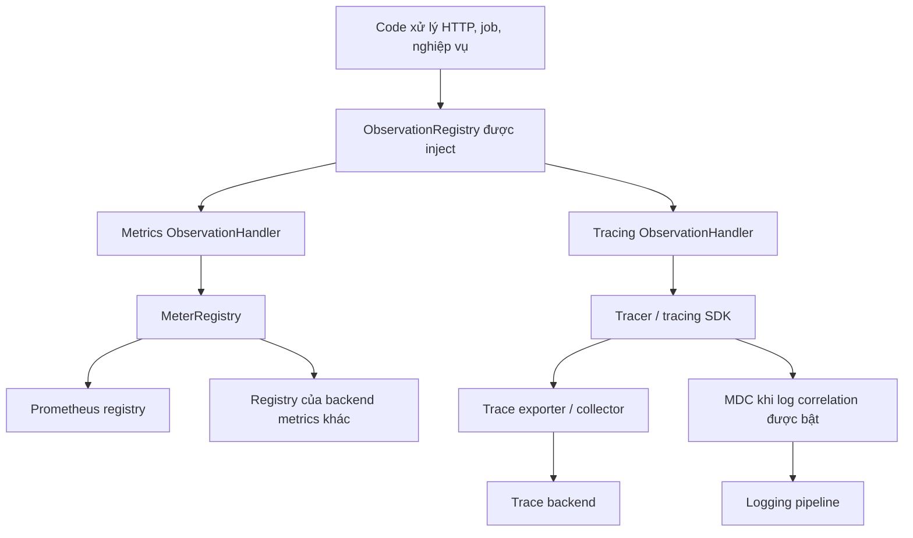
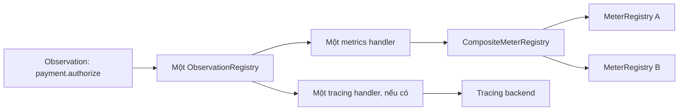
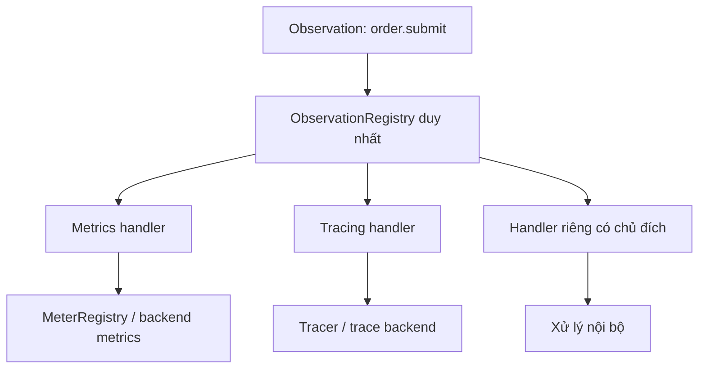
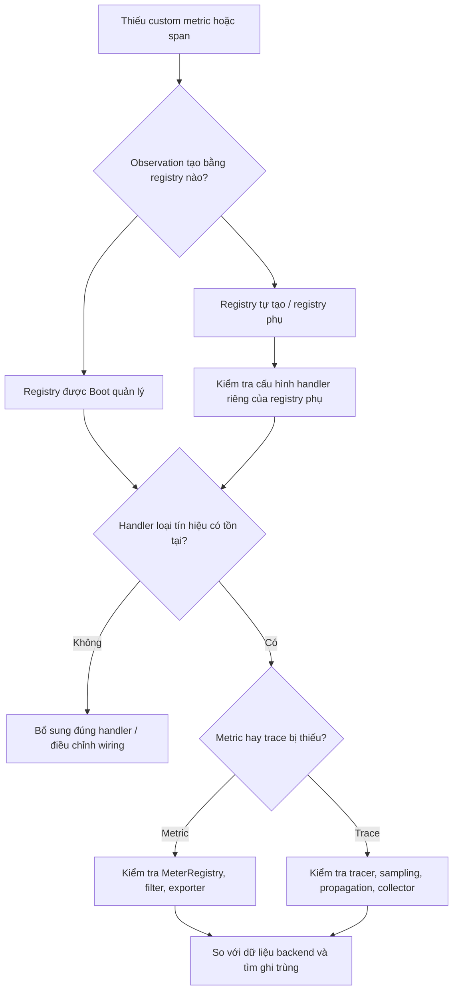

# Nhiều registry trong một ứng dụng Spring Boot

Trong Spring Boot, một ứng dụng có thể đồng thời gửi metrics đến Prometheus và một dịch vụ giám sát khác, tạo distributed trace qua OpenTelemetry, và ghi logs ra hệ thống tập trung. Khi cấu hình, nhóm phát triển dễ gặp câu hỏi: **có cần tạo nhiều registry để xuất dữ liệu đến nhiều nơi không?** Nếu thấy hai bean `ObservationRegistry` hoặc nhiều `MeterRegistry`, chúng có làm việc cùng nhau hay tách biệt? Điều gì xảy ra khi một service dùng registry A trong khi tracing handler lại được gắn vào registry B?

Bài **“Nhiều registry trong một ứng dụng”** thuộc chương **Cấu hình registry** của module **SPRING_BOOT_OBSERVABILITY**. Mục tiêu của module là thiết lập observability cho Spring Boot bằng Micrometer Observation, metrics, logs và distributed tracing; hiểu propagation ngữ cảnh, tag/cardinality, exporter, sampling và cách liên kết các tín hiệu để điều tra lỗi, độ trễ và hành vi ứng dụng ngoài thực tế.

Điểm cốt lõi: **“registry” không chỉ một loại đối tượng**. Cần phân biệt nơi điều phối vòng đời Observation với nơi quản lý meters, cũng như tracer/exporter. Việc tăng số registry không tự làm tăng khả năng quan sát; cấu hình đúng luồng dữ liệu mới quyết định dữ liệu có đến được backend và liên kết được với nhau hay không.

## 1. Phân biệt các registry trước khi cấu hình

Trong ứng dụng dùng Micrometer, hai khái niệm thường bị gọi chung là “registry”:

| Thành phần | Vai trò chính | API tiêu biểu | Khi có nhiều đối tượng |
| --- | --- | --- | --- |
| **`ObservationRegistry`** | Điều phối `Observation`, context, filter, predicate, convention và các `ObservationHandler` | `ObservationRegistry.create()`, `Observation.createNotStarted(...)` | Mỗi Observation được tạo với **một registry cụ thể**; cấu hình handler không tự lan sang registry khác |
| **`MeterRegistry`** | Tạo, quản lý, phân loại và xuất counter/timer/gauge/distribution summaries | `MeterRegistry`, `Counter`, `Timer` | Các registry có thể là backend riêng; cần phối hợp nếu muốn cùng một measurement đến nhiều đích |
| **`CompositeMeterRegistry`** | Một `MeterRegistry` tổng hợp chuyển meter đến các registry con đã đăng ký | `composite.add(childRegistry)` | Hữu ích khi cùng một bộ metrics cần gửi đến nhiều implementation/backend |
| **Tracer / tracing SDK** | Tạo và quản lý span, trace context, sampling, propagation; exporter gửi span | Micrometer Tracing / OpenTelemetry hoặc Brave | Không phải một `MeterRegistry`; việc nhiều registry metrics không quyết định cấu trúc trace |
| **Logging framework / log pipeline** | Ghi log, lưu MDC và vận chuyển sự kiện log | SLF4J, Logback, collector | Không tự được quản lý bởi `MeterRegistry` hay `CompositeMeterRegistry` |

Một sơ đồ giản lược:



Trong sơ đồ, hộp `MeterRegistry` có thể đại diện cho một `CompositeMeterRegistry`, nếu ứng dụng thật sự cấu hình nhiều registry con. **Không nhất thiết mọi Spring Boot app đều có đúng cấu trúc này**; Spring Boot, Micrometer và SDK phiên bản đang dùng quyết định các bean, handler và exporter được tạo ra.

### “Một Observation” là một lần quan sát, không phải một đường phát đến mọi registry

Khi viết:

```java
Observation observation =
        Observation.createNotStarted("payment.authorize", observationRegistry);
```

Observation này được gắn vào **đối tượng `observationRegistry` truyền vào**. Nếu ứng dụng còn có `otherRegistry`, registry kia không tự nhận lifecycle events của Observation vừa tạo.

Ngược lại, một `ObservationRegistry` có thể gắn **nhiều `ObservationHandler`** để mỗi handler xử lý một loại tín hiệu. Với cùng một Observation, metrics handler có thể cập nhật timer và tracing handler có thể tạo span; không cần hai ObservationRegistry chỉ vì muốn cả metrics lẫn tracing.

## 2. Vì sao một ứng dụng có thể có nhiều registry?

Một số lý do hợp lệ:

1. Ứng dụng phải **xuất cùng metrics đến nhiều đích** (ví dụ hệ thống giám sát nội bộ và nhà cung cấp bên ngoài). Đây chủ yếu là vấn đề **nhiều `MeterRegistry`**.
2. Một ứng dụng chứa nhiều thành phần/library, mỗi thành phần tự khởi tạo `ObservationRegistry` hoặc `MeterRegistry`. Điều này có thể là vô tình và tạo dữ liệu phân tán.
3. Hệ thống muốn cô lập instrumentation cho batch job, tác vụ thử nghiệm hoặc một vùng xử lý đặc biệt. **Nhiều `ObservationRegistry`** có thể là lựa chọn có chủ đích, nhưng phải quản lý vòng đời, handler và propagation cẩn thận.
4. Có nhiều Spring `ApplicationContext` hoặc một cấu hình test khác production. Mỗi context có thể định nghĩa bean registry khác nhau; cần xét **context và dependency injection thực tế**, không chỉ đếm class trên classpath.
5. Một thư viện tạo registry hoặc meter riêng mà không sử dụng registry do Spring Boot quản lý. Kết quả có thể là metric/span đúng tên nhưng vắng mặt ở đích giám sát mà người vận hành đang xem.

Điều cần xác định trước khi thêm registry là: **muốn thêm một nơi xuất dữ liệu, muốn thêm một loại tín hiệu, hay muốn cố ý tách vùng quan sát?** Ba mục tiêu đó cần cấu hình khác nhau.

## 3. Nhiều `ObservationRegistry` hoạt động độc lập như thế nào?

`ObservationRegistry` giữ cấu hình điều phối Observation như handler, filter, predicate và convention. Nếu tạo hai registry bằng `ObservationRegistry.create()`, ta có **hai điểm điều phối độc lập**.

Ví dụ Java thuần dưới đây chỉ dùng Micrometer Observation và Micrometer Core. Một registry được kết nối với meter handler; registry còn lại chưa gắn handler.

```java
import io.micrometer.core.instrument.simple.SimpleMeterRegistry;
import io.micrometer.core.instrument.observation.DefaultMeterObservationHandler;
import io.micrometer.observation.Observation;
import io.micrometer.observation.ObservationRegistry;

public final class MultipleObservationRegistriesDemo {
    public static void main(String[] args) {
        SimpleMeterRegistry meters = new SimpleMeterRegistry();

        ObservationRegistry webRegistry = ObservationRegistry.create();
        ObservationRegistry batchRegistry = ObservationRegistry.create();

        webRegistry.observationConfig().observationHandler(
                new DefaultMeterObservationHandler(meters));

        Observation.createNotStarted("job.execute", webRegistry)
                .lowCardinalityKeyValue("channel", "web")
                .observe(() -> doWork());

        Observation.createNotStarted("job.execute", batchRegistry)
                .lowCardinalityKeyValue("channel", "batch")
                .observe(() -> doWork());

        System.out.println(
                meters.find("job.execute")
                        .tag("channel", "web")
                        .timer()
                        .count()); // 1

        System.out.println(
                meters.find("job.execute")
                        .tag("channel", "batch")
                        .timer()); // null: chưa có meter tương ứng

        meters.close();
    }

    private static void doWork() {
        // Mã nghiệp vụ minh họa.
    }
}
```

Điều rút ra:

- Cả hai callback `doWork()` đều chạy.
- `webRegistry` đã có `DefaultMeterObservationHandler` nên cập nhật timer tương ứng.
- `batchRegistry` là một registry **thật** nhưng không có metrics handler, nên chỉ với cấu hình trên, Observation qua nó không cập nhật `meters`.
- Việc hai Observation có **cùng tên** `job.execute` không tạo ra cơ chế đồng bộ giữa hai registry.

Đoạn ví dụ chỉ chứng minh cách các registry và handler tương tác; dữ liệu xuất đi hay không còn phụ thuộc registry và exporter cụ thể trong ứng dụng thật.

### Không có handler khác với `NOOP`

`ObservationRegistry.NOOP` chủ động vô hiệu hóa đường thu thập qua Observation. Một registry được tạo bằng `ObservationRegistry.create()` nhưng chưa đăng ký handler là registry có thể được cấu hình tiếp. Từ góc nhìn dashboard, hai trường hợp có thể giống nhau vì không thấy custom metric/span, nhưng nguyên nhân khác nhau.

Nếu thấy một service vẫn trả kết quả đúng nhưng không thấy trace, **đừng vội kết luận service đang dùng NOOP**. Có thể nó đang dùng registry khác, registry thiếu tracing handler, sampler không giữ trace, hoặc exporter không đến backend.

### Observation scope và tracing context

Observation có thể mở `Scope` để tạo ngữ cảnh của công việc đang thực thi. Tracing handler có thể nối ngữ cảnh đó với tracer, span và MDC, tùy integration. Nếu tạo một Observation bằng registry A nhưng instrumentation lân cận lại sử dụng registry B, không có bảo đảm rằng mọi handler, convention hoặc logic liên kết trên A đều chạy cho B.

Một số hệ thống vẫn có tracing context chung nhờ tracer SDK ở tầng khác; vì vậy **không thể khẳng định** cứ có nhiều ObservationRegistry thì trace chắc chắn đứt. Điều đúng là phải kiểm tra registry mà từng instrumentation sử dụng, handler đang đăng ký và propagation thực tế qua thread, HTTP hoặc message broker.

## 4. Một ObservationRegistry, nhiều MeterRegistry: mẫu cấu hình thường gặp

Giả sử tất cả HTTP requests và công việc nghiệp vụ đều cần cùng metrics ở hai đích. Thay vì viết hai Observation cho mỗi công việc, có thể dùng **một ObservationRegistry**, một handler metrics, và một **CompositeMeterRegistry** chứa nhiều registry con.



Ví dụ Java thuần với hai `SimpleMeterRegistry` mô phỏng hai đích đo:

```java
import io.micrometer.core.instrument.composite.CompositeMeterRegistry;
import io.micrometer.core.instrument.simple.SimpleMeterRegistry;
import io.micrometer.core.instrument.observation.DefaultMeterObservationHandler;
import io.micrometer.observation.Observation;
import io.micrometer.observation.ObservationRegistry;

public final class CompositeMetersDemo {
    public static void main(String[] args) {
        SimpleMeterRegistry first = new SimpleMeterRegistry();
        SimpleMeterRegistry second = new SimpleMeterRegistry();
        CompositeMeterRegistry composite = new CompositeMeterRegistry();

        composite.add(first);
        composite.add(second);

        ObservationRegistry observations = ObservationRegistry.create();
        observations.observationConfig().observationHandler(
                new DefaultMeterObservationHandler(composite));

        Observation.createNotStarted("payment.authorize", observations)
                .lowCardinalityKeyValue("payment.method", "card")
                .observe(() -> authorizePayment());

        long countA = first.get("payment.authorize")
                .tag("payment.method", "card")
                .timer().count();
        long countB = second.get("payment.authorize")
                .tag("payment.method", "card")
                .timer().count();

        System.out.println(countA); // 1
        System.out.println(countB); // 1

        composite.close();
    }

    private static void authorizePayment() {
        // Công việc minh họa.
    }
}
```

Mẫu trên cho thấy **một lần instrument** vẫn có thể cập nhật nhiều meter registry con. `SimpleMeterRegistry` chỉ là registry lưu dữ liệu cục bộ phù hợp cho demo; production dùng các implementation tương ứng với đích cần xuất.

**Lưu ý với Spring Boot:** ví dụ tạo registry thủ công dành cho việc hiểu cơ chế. Trong ứng dụng đã có Spring Boot Actuator, nên ưu tiên **registry do Spring quản lý** và cấu hình export theo phiên bản đang dùng. Việc tự đăng ký một `@Bean CompositeMeterRegistry` hoặc một `@Bean ObservationRegistry` mới có thể can thiệp auto-configuration và khiến một số instrumentation trỏ sang bean khác.

### Composite không “gộp dữ liệu từ backend” theo nghĩa truy vấn

`CompositeMeterRegistry` điều phối các meter/cập nhật đến registry con ở phía **ứng dụng**. Nó không tự tải, hợp nhất hay truy vấn dữ liệu đã lưu trong Prometheus, OTLP backend hoặc các dashboard. Nếu cùng một measurement được gửi tới hai nơi, mỗi nơi có cơ chế lưu trữ, nhãn và retention riêng.

Nếu một child registry gửi được nhưng child kia lỗi, khả năng nhìn thấy dữ liệu có thể khác nhau theo backend. Cần kiểm tra từng exporter và từng đích thay vì giả định composite đồng nghĩa mọi đích luôn nhất quán.

## 5. Quan hệ giữa nhiều MeterRegistry và Spring Boot Actuator

Spring Boot Actuator thường cấu hình `MeterRegistry`, hỗ trợ nhiều implementation/exporter tùy dependency và properties. Trong cấu hình có nhiều implementation, Spring Boot có thể sử dụng composition để đưa cùng các meter đến nhiều registry. Cách auto-configuration cụ thể phụ thuộc **phiên bản Spring Boot**, dependency có trên classpath và cấu hình bật/tắt metrics.

Ví dụ hai nhu cầu thường gặp:

| Mục tiêu | Hướng xử lý | Không cần làm |
| --- | --- | --- |
| Cùng request count/latency sang hai metrics backend | Dùng khả năng export/registry của Boot hoặc composition phù hợp | Tạo hai Observation cho mỗi request |
| Một service có metrics và distributed tracing | Một ObservationRegistry với các handler thích hợp cho metrics và tracing | Tách riêng một ObservationRegistry chỉ để tracing |
| Một số metrics không được xuất đến backend bên ngoài | Cấu hình meter filters, tag policy và export registry phù hợp | Sao chép instrumentation nghiệp vụ |
| Test logic không cần xuất dữ liệu | Dùng registry cục bộ hoặc cấu hình `NOOP` phù hợp | Bắt production phụ thuộc registry thử nghiệm |

**Hai `MeterRegistry` không đồng nghĩa hai `ObservationRegistry`.** Các thành phần gọi trực tiếp `meterRegistry.counter(...)` và các thành phần tạo `Observation` có đường dữ liệu khác nhau. Phải xác định chúng có dùng cùng meter backend hay không.

### Ví dụ lệch đường dữ liệu

```text
HTTP auto-instrumentation ----> Boot-managed ObservationRegistry
                                 |
                                 +--> Metrics handler --> Boot MeterRegistry

Custom PaymentService --------> ObservationRegistry tự tạo
                                 |
                                 +--> (không có handler)

PaymentService vẫn trả đúng kết quả,
nhưng custom metric/span của payment.authorize không xuất hiện.
```

Vấn đề không nằm ở tên `payment.authorize`. Root cause là custom service được truyền **registry khác** với registry mà Spring Boot đã cấu hình handler.

## 6. Nhiều bean registry trong Spring: xác định rõ dependency injection

Trong Spring, có nhiều bean cùng kiểu `ObservationRegistry` hoặc `MeterRegistry` có thể khiến constructor injection không còn duy nhất. Nếu Spring không xác định được bean ứng viên, quá trình tạo bean có thể thất bại. Các quy tắc như `@Primary`, `@Qualifier` và tên bean có thể ảnh hưởng việc lựa chọn.

Ví dụ một service sử dụng registry chuẩn được inject:

```java
import io.micrometer.observation.Observation;
import io.micrometer.observation.ObservationRegistry;
import org.springframework.stereotype.Service;

@Service
public class CheckoutService {
    private final ObservationRegistry observations;

    public CheckoutService(ObservationRegistry observations) {
        this.observations = observations;
    }

    public void checkout(Runnable action) {
        Observation.createNotStarted("checkout.process", observations)
                .lowCardinalityKeyValue("channel", "web")
                .observe(action);
    }
}
```

Khi ứng dụng có một `ObservationRegistry` được quản lý đúng cách, đây là mô hình đơn giản và dễ vận hành.

Nếu ứng dụng **cố ý** có hai registry riêng, hãy khai báo rõ nơi nhận registry nào:

```java
import io.micrometer.observation.Observation;
import io.micrometer.observation.ObservationRegistry;
import org.springframework.beans.factory.annotation.Qualifier;
import org.springframework.stereotype.Service;

@Service
public class BatchRunner {
    private final ObservationRegistry batchObservations;

    public BatchRunner(
            @Qualifier("batchObservationRegistry")
            ObservationRegistry batchObservations) {
        this.batchObservations = batchObservations;
    }

    public void execute(Runnable work) {
        Observation.createNotStarted("batch.execute", batchObservations)
                .lowCardinalityKeyValue("batch.type", "daily")
                .observe(work);
    }
}
```

Đoạn mã thứ hai **chỉ hợp lệ khi ứng dụng đã cấu hình bean** có qualifier `batchObservationRegistry` và đăng ký các handler/filters cần thiết cho bean đó. Một qualifier chỉ chọn bean; nó không đồng bộ handler, không nối tracing context và không bảo đảm xuất dữ liệu.

### Cẩn thận với `@Bean` tự tạo

Ví dụ này trông đơn giản:

```java
@Bean
ObservationRegistry customObservationRegistry() {
    return ObservationRegistry.create();
}
```

Nhưng trong một ứng dụng Spring Boot, việc khai báo registry thủ công **có thể làm thay đổi điều kiện tạo bean của auto-configuration**. Kết quả phụ thuộc cấu hình/version và có thể khiến registry custom không có những handler vốn được Boot gắn vào registry chuẩn.

Nếu thật sự cần nhiều registry:

1. Xác định bean chính phục vụ HTTP/server instrumentation của Spring Boot.
2. Kiểm tra điều kiện auto-configuration và tên bean sau khi thêm bean phụ.
3. Chỉ định `@Qualifier`/`@Primary` rõ ràng để tránh injection mơ hồ.
4. Cấu hình handlers, filters, conventions, predicates cho registry phụ một cách có chủ đích.
5. Xác minh trace context, metric export và log correlation qua đường chạy thực.

**`@Primary` không phải cơ chế gộp các registry.** Nó chỉ giúp Spring ưu tiên một bean trong một số trường hợp chọn dependency.

### Kiểm tra bean registry thực tế

Trong môi trường phát triển hoặc test tích hợp, có thể dùng Spring `ApplicationContext` để liệt kê bean theo type:

```java
import io.micrometer.core.instrument.MeterRegistry;
import io.micrometer.observation.ObservationRegistry;
import org.springframework.context.ApplicationContext;

import java.util.Arrays;

public final class RegistryInspector {
    public static void printRegistryNames(ApplicationContext context) {
        System.out.println("ObservationRegistry beans: "
                + Arrays.toString(
                        context.getBeanNamesForType(ObservationRegistry.class)));
        System.out.println("MeterRegistry beans: "
                + Arrays.toString(
                        context.getBeanNamesForType(MeterRegistry.class)));
    }
}
```

Đây là bước khởi đầu để biết **có những bean nào**, chưa đủ xác định service đang nhận bean nào, handler nào được gắn hoặc exporter nào chạy. Đối với lỗi thực tế cần theo dõi đường inject và registry đang được Observation sử dụng.

## 7. Một registry có thể có nhiều handler mà không nhân đôi Observation

Một `ObservationRegistry` có thể điều phối nhiều handler khác nhau. Chẳng hạn:

- Handler metrics cập nhật `Timer`/`Counter` vào `MeterRegistry`.
- Handler tracing làm việc với `Tracer` để biểu diễn span và context.
- Handler riêng ghi nhận một loại sự kiện nội bộ khi ứng dụng thực sự cần.

Sơ đồ ý tưởng:



Khi sử dụng nhiều handler, cần hiểu mỗi handler **xử lý sự kiện nào**, có tạo dữ liệu trùng nhau hay không và có phụ thuộc vào scope/thread không. Đăng ký hai metrics handler cùng cập nhật một meter có thể khiến cùng một Observation bị tính hơn một lần trong một series. Đăng ký nhiều tracing handler cho cùng thao tác cũng có thể làm xuất hiện span thừa hoặc cấu trúc trace khó hiểu.

Việc mở rộng handler thường an toàn hơn nếu dựa trên cơ chế extension chính thức của phiên bản Spring Boot/Micrometer đang dùng thay vì ghi đè toàn bộ registry đã được auto-configure.

## 8. Chọn phương án thiết kế theo nhu cầu

| Nhu cầu | Cấu trúc nên cân nhắc | Vì sao |
| --- | --- | --- |
| Một service cần metrics, traces và log correlation | **Một ObservationRegistry**, metrics handler, tracing handler và logging/MDC phù hợp | Một luồng Observation được ghi nhận nhất quán |
| Metrics cần gửi đến Prometheus và backend thứ hai | Một ObservationRegistry với `MeterRegistry`/`CompositeMeterRegistry` hoặc exporter mà Boot hỗ trợ | Không cần duplicate Observation |
| Nhiều loại nghiệp vụ cần tag và tên khác nhau | Cùng ObservationRegistry; dùng tên, convention, filter và tag riêng | Cấu hình tập trung nhưng vẫn phân biệt nghiệp vụ |
| Batch cần cô lập hoàn toàn với instrumentation web | Có thể tạo registry phụ, explicit wiring và handlers riêng | Cô lập có chủ đích, đổi lại tăng trách nhiệm quản lý |
| Unit test chỉ quan tâm logic | `ObservationRegistry.NOOP` hoặc registry test được cấu hình rõ | Không phụ thuộc pipeline quan sát bên ngoài |
| Có một library không dùng registry của Boot | Ưu tiên inject registry được quản lý từ application boundary | Tránh mất/nhân đôi dữ liệu do registry tự tạo |

Đừng dùng nhiều registry để giải quyết vấn đề cardinality cao. Giảm cardinality bằng cách chọn **low-cardinality tags ổn định**, dùng route template, tránh `userId`/`orderId`/`traceId` trong metric labels; còn high-cardinality key có thể gắn vào span khi được phép và cần thiết. Tăng số registry không sửa một tập tag sai.

## 9. Nhiều registry ảnh hưởng thế nào đến tracing và log correlation?

Một hệ thống observability có giá trị khi có thể đi từ alert metric → trace của yêu cầu chậm/lỗi → log cùng `traceId` để hiểu nguyên nhân. Khi Observation được chia giữa các registry, các liên kết này có thể bị khó theo dõi.

### Một tình huống thường gặp

Giả sử `order-service` dùng một ObservationRegistry được Boot quản lý và có tracing handler. Một thư viện tích hợp thanh toán lại gọi:

```java
ObservationRegistry localRegistry = ObservationRegistry.create();

Observation.createNotStarted("payment.gateway.call", localRegistry)
        .observe(() -> invokeGateway());
```

Ở đây `localRegistry` không được gắn tracing handler. Vì vậy, **Observation `payment.gateway.call` tự nó không sinh span** qua registry này. Nếu HTTP client bên trong đã được auto-instrument riêng, vẫn có thể thấy HTTP client span; nhưng không thấy span nghiệp vụ `payment.gateway.call` như người viết thư viện kỳ vọng.

Nếu thư viện còn quản lý propagation tùy chỉnh dựa trên registry local, trace có thể bị rời rạc hơn. Hãy kiểm tra dữ liệu thực tế chứ không suy từ tên registry.

### Log và MDC

Log qua SLF4J/Logback là hệ thống riêng. Với Micrometer Tracing được cấu hình, `traceId`/`spanId` có thể xuất hiện trong MDC khi span/context đang hoạt động. Một ObservationRegistry không có tracing handler không tự tạo trace context cho đoạn code của nó. Tuy nhiên, log vẫn có thể chứa trace ID được kế thừa từ một span hoạt động bên ngoài.

High-cardinality key gắn trên Observation cũng **không tự động** thành field log hay W3C baggage. Nếu muốn đối chiếu giá trị nghiệp vụ giữa các tín hiệu, dùng trace ID làm khóa tương quan thông thường, chỉ bổ sung business reference được phép khi thật sự cần.

### Sampling và exporter

Một ObservationRegistry đã gắn tracing handler vẫn chưa đảm bảo xem được trace. Sampler có thể loại bỏ trace khỏi backend, exporter có thể lỗi hoặc collector có thể drop dữ liệu. Các registry có thể dùng handler/tracer config khác nhau nếu cố ý cấu hình độc lập.

| Biểu hiện | Một số nguyên nhân cần kiểm tra |
| --- | --- |
| Custom metric có, span nghiệp vụ không có | Registry chỉ có metrics handler; thiếu tracing handler; sampler/exporter |
| Trace có, custom timer không có | Registry chỉ có tracing handler; thiếu meter handler hoặc MeterRegistry/exporter |
| Có hai span giống nhau cho một thao tác | Instrumentation lặp; nhiều tracing handler; gọi cùng logic observe hai lần |
| Metric đếm nhiều lần cho một sự kiện | Hai instrumentation cùng đo; handler/registry gửi trùng về một series/backend |
| Log thiếu `traceId` ở task async | Context propagation qua executor/reactive/messaging bị thiếu; scope/tracer không đúng |
| Trace còn, log không tìm được | Logger format, MDC, pipeline log, retention, timestamp hoặc quyền truy cập khác nhau |

Các biểu hiện trên là gợi ý điều tra, **không phải kết luận nguyên nhân**. Phải đọc đường thực thi và cấu hình đang chạy để xác nhận.

## 10. Nguy cơ ghi trùng và cách nhận diện

Khi một thao tác được đo hai lần, dashboard có thể thấy count cao bất thường. Có nhiều đường dẫn đến trùng:

1. Một HTTP request đã có auto-instrumentation của Spring Boot, nhưng developer lại bọc cùng thao tác bằng Observation có tên/nhãn tương tự và sau đó tổng hợp hai series như thể chúng là cùng một loại yêu cầu.
2. Hai metrics handler cập nhật cùng `MeterRegistry` với cùng tên và nhãn.
3. Hai registry hoặc hai export pipeline gửi **cùng bộ dữ liệu** vào một backend, nhưng backend không được cấu hình để phân biệt nguồn.
4. Một registry tổng hợp gửi đến một registry con, trong khi registry con cũng được cấu hình xuất trực tiếp qua đường thứ hai đến cùng đích.

Phân biệt hai kiểu trùng:

| Loại | Hệ quả | Cách phát hiện |
| --- | --- | --- |
| **Trùng phép đo ở nguồn** | Một yêu cầu làm counter/timer tăng hơn một lần | Kiểm tra code instrumentation và số callback theo một request test |
| **Trùng dữ liệu khi export/ingest** | Backend nhận hai stream mô tả cùng phép đo | Kiểm tra registry/exporter/collector và các nhãn phân biệt nguồn |

Để tránh kết luận sai, hãy chạy một request test có thể xác định được, đo sự thay đổi của count từ đầu đến cuối, và đối chiếu dữ liệu ở registry local với dữ liệu trong backend. Với timer, `count` cho biết số lần ghi duration; với counter monotonic được scrape qua Prometheus, dùng `increase(...)` hoặc `rate(...)` theo cửa sổ phù hợp thay vì nhìn một giá trị tích lũy rồi gọi là số request của một phút.

## 11. Quy trình chẩn đoán “ứng dụng có nhiều registry nhưng thiếu dữ liệu”

Giả sử endpoint `POST /orders` vẫn chạy bình thường, nhưng trong dashboard chỉ thấy HTTP metrics; custom `order.process` không xuất hiện trong trace.

**Bước 1 — Khoanh vùng Observation bị thiếu.** Xác định tên `order.process`, đoạn code tạo Observation và registry được truyền vào `createNotStarted(...)`. Đừng dùng tên Observation để suy ra nó tự được gửi đến backend nào.

**Bước 2 — Xác định bean thực tế.** Kiểm tra constructor injection và qualifier; nếu mã tự gọi `ObservationRegistry.create()`, ghi nhận chính xác nơi tạo. Liệt kê bean registry ở Spring context khi cần.

**Bước 3 — Kiểm tra handler trên registry đúng.** Có metrics handler? Tracing handler? Filter/predicate có loại Observation? Các convention có đổi tên/tag? Một handler được đăng ký ở registry khác sẽ không nhận sự kiện từ registry này.

**Bước 4 — Kiểm tra MeterRegistry.** Nếu chỉ thiếu metrics, xác nhận metrics handler đang dùng MeterRegistry nào. Có `CompositeMeterRegistry` không? Registry con nào thực sự xuất dữ liệu và có kết nối đến backend?

**Bước 5 — Kiểm tra tracing pipeline.** Nếu chỉ thiếu trace, xác nhận tracer bridge, sampling, context propagation, exporter/collector và khả năng tìm kiếm trace ở backend. Với HTTP client, message hoặc async, quan sát trace ID tại ranh giới truyền context.

**Bước 6 — Đối chiếu log.** Tìm log theo `traceId`, `service.name` và khoảng thời gian. Log không chứa trace ID có thể do MDC/encoder hoặc context, không nhất thiết là thiếu registry.

**Bước 7 — Kiểm chứng không ghi trùng.** Sau khi sửa wiring, chạy lại một lượng request có kiểm soát để so count, duration và số span. Một cấu hình hết “thiếu dữ liệu” nhưng tạo dữ liệu trùng vẫn chưa đạt yêu cầu.

Cây quyết định tóm tắt:



## 12. Ví dụ thiết kế theo nhu cầu thực tế

Một ứng dụng `checkout-service` nhận HTTP request và chạy job đối soát thanh toán. Nhóm vận hành muốn:

- Xem số giao dịch, lỗi và p95 latency theo route/phương thức thanh toán.
- Tìm trace của giao dịch chậm để biết thời gian nằm ở database hay payment gateway.
- Từ trace mở log có `traceId` để xác định exception hoặc retry.
- Xuất metrics đến hai đích giám sát độc lập.

Một cấu trúc dễ kiểm soát:

```text
checkout-service
  |
  +-- Spring Boot HTTP instrumentation ---+
  |                                       |
  +-- Checkout / reconcile Observations --+--> Một ObservationRegistry
                                                  |
                                                  +--> Metrics handler
                                                  |       |
                                                  |       +--> MeterRegistry tổng hợp
                                                  |                +--> Metrics backend A
                                                  |                +--> Metrics backend B
                                                  |
                                                  +--> Tracing handler
                                                          |
                                                          +--> Tracer + exporter
                                                                  |
                                                                  +--> Trace backend

Logback / log pipeline <--- MDC traceId/spanId khi tracing đang hoạt động
```

Trong cấu trúc này, tên Observation có thể khác nhau: `checkout.pay`, `reconciliation.run`, `payment.gateway.call`. Nhãn metric chỉ nên dùng giá trị hữu hạn, chẳng hạn `payment.method=card` hoặc `result=success`. `orderId`, `customerId`, `traceId` và URL có tham số động không được dùng làm nhãn metric.

Nếu batch có yêu cầu cách ly telemetry thực sự, có thể tạo thêm `ObservationRegistry` phụ, nhưng cần tài liệu rõ ai sở hữu nó, các handler nào được gắn, naming/tag policy ra sao và thế nào là dữ liệu “đúng” ở backend. Lợi ích cách ly phải lớn hơn chi phí vận hành nhiều registry.

### Một quy ước giúp tránh lỗi cấu hình

- **Registry chính:** các instrumentation do Spring Boot và code ứng dụng sử dụng qua dependency injection.
- **Registry phụ:** chỉ dùng ở những vùng được chỉ định rõ, tên bean cụ thể và có kiểm tra export.
- **Metric registry và exporter:** một đường dữ liệu đo lường có thể được phát đến nhiều đích; quản lý các đích này ở lớp MeterRegistry/export.
- **Tracing:** thống nhất tracer, propagation và quy tắc sampling theo yêu cầu hệ thống.
- **Logging:** giữ trace correlation nhất quán, có chính sách bảo vệ dữ liệu và kiểm tra backend log độc lập.

Những quy ước này là nguyên tắc thiết kế; API, tên bean và hành vi auto-configuration cuối cùng cần được xác nhận trên phiên bản Spring Boot của ứng dụng đang triển khai.

## 13. Thực hành kiểm chứng từng phương án

### Bài thực hành A — Hai ObservationRegistry

Dùng ví dụ `MultipleObservationRegistriesDemo` ở mục 3, rồi đăng ký cùng `DefaultMeterObservationHandler(meters)` cho `batchRegistry`. Thử thực thi lại hai Observation và kiểm tra cả hai timer `job.execute` theo `channel=web` và `channel=batch`.

Câu hỏi: nếu hai handler cùng cập nhật cùng một `MeterRegistry`, điều gì sẽ xảy ra nếu cả hai được gắn vào **cùng một registry** và xử lý cùng một Observation? Hãy quan sát số lần ghi metric để xác nhận.

### Bài thực hành B — Một ObservationRegistry, hai MeterRegistry

Chạy ví dụ `CompositeMetersDemo` rồi xác minh cùng một Observation cập nhật cả hai registry con. Sau đó bỏ `composite.add(second)` và kiểm tra dữ liệu tại registry thứ hai. Cách kiểm tra này chứng minh nhiệm vụ của composite mà không cần một hệ thống giám sát bên ngoài.

### Bài thực hành C — Spring Boot có bean phụ

Trong một môi trường thử nghiệm có Spring Boot Actuator, xác định các `ObservationRegistry` và `MeterRegistry` beans. Nếu thêm registry phụ, hãy chỉ định `@Qualifier` đúng nơi dùng, bảo đảm instrumentation chính vẫn nhận registry có handler, và đối chiếu metric/span trước và sau thay đổi.

Không nên thực hiện thí nghiệm thay bean registry trong production khi chưa có khả năng quan sát tác động đến toàn bộ các tín hiệu.

### Bài thực hành D — Điều tra liên tín hiệu

Tạo một request cố ý chậm ở môi trường thử nghiệm, sau đó:

1. Định vị khoảng thời gian có độ trễ tăng bằng metric timer hoặc HTTP server metric.
2. Tìm trace đại diện trong trace backend, nếu sampling đã giữ nó.
3. Dùng `traceId` tra log cùng request; kiểm tra MDC và logging pipeline khi không tìm thấy.
4. Xác định registry/handler thực sự tạo custom span và metric của công đoạn chậm.
5. Kiểm tra rằng việc thêm backend metrics thứ hai không làm tăng **count gốc** cho một request.

Nếu trace không xuất hiện, kiểm tra sampler/propagation/exporter trước khi suy rằng registry không hoạt động.

## 14. Những nhầm lẫn cần tránh

| Nhận định | Vì sao sai hoặc thiếu | Cách hiểu đúng |
| --- | --- | --- |
| “Có hai nơi nhận metrics thì cần hai ObservationRegistry” | ObservationRegistry điều phối Observation, không quyết định số metrics exporter | Dùng một ObservationRegistry và nhiều MeterRegistry/export path khi phù hợp |
| “Tạo `ObservationRegistry.create()` sẽ dùng handler của Boot” | Registry mới có cấu hình riêng | Inject bean được Boot quản lý hoặc cấu hình handler cho registry mới |
| “Hai registry cùng tên Observation thì tự gộp sự kiện” | Cùng tên không tạo kết nối giữa hai đối tượng registry | Dữ liệu chỉ đi qua handler của registry được sử dụng |
| “Dùng `@Primary` để gộp metrics/tracing” | `@Primary` chỉ tác động đến chọn bean khi inject | Cấu hình handlers và exporters ở đúng registry |
| “Có CompositeMeterRegistry nghĩa là trace cũng được nhân bản” | CompositeMeterRegistry chỉ liên quan đến meters | Trace thuộc tracer/SDK và pipeline riêng |
| “Không thấy custom span nghĩa là mất toàn bộ trace” | Có thể chỉ thiếu span nghiệp vụ; HTTP instrumentation khác vẫn có | Kiểm tra từng span, handler và pipeline |
| “Thêm registry sẽ giải quyết high-cardinality labels” | Cardinality là vấn đề nhãn của metric | Thiết kế key values và meter filters đúng |
| “Có metric là có log correlation” | MDC và tracing context thuộc các thành phần khác | Kiểm tra tracing bridge, context và logging encoder |
| “Gửi cùng dữ liệu hai lần đến một backend là vô hại” | Có thể gây đếm trùng, tranh chấp series hoặc tăng chi phí | Kiểm soát các đường instrumentation/export |

## Kết luận

**Một ứng dụng Spring Boot có thể có nhiều registry, nhưng mỗi loại registry giải quyết một lớp vấn đề khác nhau.** Nhiều `ObservationRegistry` nghĩa là có nhiều điểm điều phối Observation với cấu hình handler độc lập. Nhiều `MeterRegistry`, thường được phối hợp bằng `CompositeMeterRegistry` hoặc auto-configuration phù hợp, hỗ trợ phát cùng metrics đến nhiều đích. Tracing và logs vẫn cần tracer, propagation, sampling, MDC, exporter và backend của riêng chúng.

Với phần lớn ứng dụng, **một ObservationRegistry được quản lý nhất quán, các handler thích hợp và cấu hình MeterRegistry/exporter rõ ràng** giúp theo dõi lỗi, độ trễ và hành vi ứng dụng đáng tin cậy hơn. Chỉ tạo registry phụ khi có yêu cầu cô lập cụ thể, kèm kiểm chứng rằng instrumentation nhận đúng bean, metric không bị đếm trùng, span không bị mất và các tín hiệu vẫn liên kết được trong điều tra sự cố.

