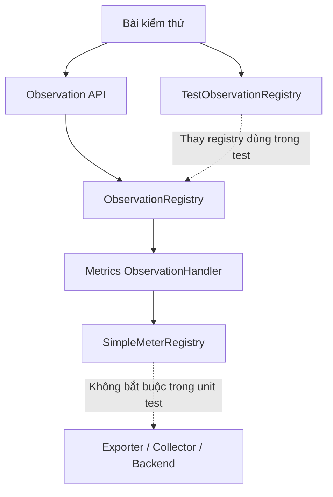
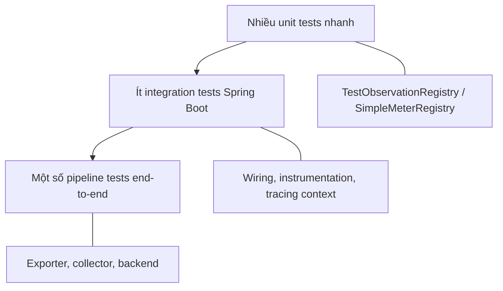

# Registry cho test trong Spring Boot Observability

Một bài kiểm thử nghiệp vụ có thể chạy đúng nhưng ứng dụng lại không phát ra telemetry như mong đợi: tên observation sai, tag không ổn định, handler không được gọi, hoặc lỗi bị bỏ sót. Ngược lại, nếu chạy test bằng registry và exporter của môi trường thật, bộ test có thể phải kết nối Prometheus, OpenTelemetry Collector hay một backend ngoài mạng; kết quả dễ chậm và thiếu ổn định.

Trong module **SPRING_BOOT_OBSERVABILITY**, chương **Cấu hình registry**, chủ đề **Registry cho test** tập trung vào cách tạo một registry **độc lập cho từng bài kiểm thử**, kiểm tra cách ứng dụng dùng **Micrometer Observation**, xác minh **metrics**, và quyết định khi nào thực sự cần test **tracing, propagation, sampling và exporter**. Mục tiêu là kiểm tra tín hiệu phục vụ điều tra lỗi, độ trễ và hành vi ứng dụng Spring Boot mà không buộc mọi unit test phải chạy toàn bộ hạ tầng observability.

## 1. Registry là gì trong ngữ cảnh kiểm thử?

Từ *registry* xuất hiện ở hai API liên quan nhưng không đồng nhất:

- **`ObservationRegistry`** thuộc Micrometer Observation. Đây là nơi observation được tạo và các `ObservationHandler` được cấu hình để phản ứng với vòng đời `start`, `stop`, `error`, `event` và scope.
- **`MeterRegistry`** thuộc Micrometer Metrics. Đây là nơi các meter như `Counter`, `Timer` và `Gauge` được đăng ký, cập nhật và tìm kiếm.

Một `ObservationRegistry` không phải nơi lưu mọi metric; ngược lại, `MeterRegistry` không ghi lại toàn bộ vòng đời observation. Khi nối chúng bằng một metrics observation handler, một observation có thể tạo ra phép đo trong `MeterRegistry`. Với tracing handler thích hợp, observation cũng có thể được biểu diễn thành span.

Trong test, chúng ta chọn registry theo **điều muốn chứng minh**:

| Mục tiêu test | Công cụ phù hợp | Điều kiểm tra |
| --- | --- | --- |
| Tên observation, tag, lifecycle hoặc error được phát đúng | `TestObservationRegistry` từ thư viện test Micrometer Observation | Hợp đồng instrumentation của ứng dụng |
| Một handler tùy chỉnh nhận start/stop/event/error | `ObservationRegistry.create()` với handler ghi nhận | Hành vi callback và thứ tự xử lý cần thiết |
| Counter/Timer/Gauge có giá trị đúng | `SimpleMeterRegistry` | Giá trị và nhãn metric trực tiếp |
| Observation thực sự sinh ra Timer | `ObservationRegistry` + `DefaultMeterObservationHandler` + `SimpleMeterRegistry` | Đường nối Observation → Metrics |
| Trace có span, parent-child, context propagation | Test tracer hoặc in-memory tracing exporter của stack sử dụng | Mối liên hệ tracing, không chỉ tên observation |
| Exporter/Collector nhận và lưu dữ liệu | Integration test có collector/backend được kiểm soát | Pipeline xuất telemetry thực tế |

Một registry “cho test” không phải một sản phẩm độc lập. Đây là **lựa chọn cấu hình của bài kiểm thử**: giữ dữ liệu trong bộ nhớ, cô lập trạng thái và tạo các assertion đáng tin cậy.

## 2. Vì sao không dùng registry production trong mọi bài test?

Giả sử test `CheckoutService.reserve(...)` chỉ cần xác minh rằng thao tác giữ hàng được gắn `outcome=accepted`. Nếu test còn phải khởi chạy Spring context, cấu hình OTLP endpoint, bật sampling, chờ exporter gửi dữ liệu và truy vấn tracing backend, số nguyên nhân khiến test thất bại sẽ lớn hơn chính nghiệp vụ cần kiểm tra.

Một registry trong bộ nhớ đem lại các lợi ích thực tế:

1. **Cô lập:** dữ liệu của test này không bị trộn với test khác.
2. **Tất định:** assertion dựa trên sự kiện/metric trong tiến trình, không chờ việc truyền qua mạng.
3. **Nhanh:** không yêu cầu Docker, collector hoặc backend cho phần lớn unit test.
4. **Rõ hợp đồng:** test kiểm tra tên observation, tag và lỗi thay vì phụ thuộc định dạng của một vendor.
5. **Dễ chẩn đoán:** khi assertion lỗi, có thể xác định do instrumentation, handler hay metric.

Điều đó không làm cho integration test trở nên thừa. Test registry trong bộ nhớ **không chứng minh** rằng Prometheus scrape thành công, collector được cấu hình đúng, trace được sample hay log có thể được tra cứu ở backend. Mỗi cấp test phải có phạm vi phù hợp.



Sơ đồ chỉ minh họa các lựa chọn. Có thể kiểm thử observation **chỉ với `TestObservationRegistry`**, hoặc kiểm thử metrics bằng `SimpleMeterRegistry` mà không cần tạo observation.

## 3. Chuẩn bị dependencies cho unit test

Với Spring Boot 3.x và Micrometer Observation tương ứng, một cấu hình Gradle điển hình:

```groovy
dependencies {
    implementation 'org.springframework.boot:spring-boot-starter-actuator'

    testImplementation 'org.springframework.boot:spring-boot-starter-test'
    testImplementation 'io.micrometer:micrometer-observation-test'
}
```

`spring-boot-starter-test` thông thường cung cấp JUnit Jupiter và assertions; `micrometer-observation-test` cung cấp công cụ kiểm thử observation chuyên biệt như `TestObservationRegistry`. Các dependency chính xác, phiên bản và package của annotation có thể thay đổi giữa các dòng Spring Boot/Micrometer; dùng dependency management/BOM tương ứng dự án thay vì tự đoán số phiên bản.

Nếu chỉ cần kiểm tra giá trị meter, `SimpleMeterRegistry` nằm trong Micrometer Core, thường đã có cùng stack Actuator/Micrometer. Nếu test không dùng Spring context, có thể tạo registry ngay trong phương thức `@Test`; không cần `@SpringBootTest`.

> **Nguyên tắc lựa chọn:** Kiểm tra **điều ứng dụng phát ra** trước bằng test registry; chỉ mở rộng sang registry/exporter thật nếu mục tiêu test nằm ở đường đi của dữ liệu.

## 4. Unit test Observation bằng TestObservationRegistry

Trước tiên viết một class dịch vụ nhận `ObservationRegistry` qua constructor. Trong ứng dụng Spring Boot, constructor này cũng có thể dùng với dependency injection; trong unit test chỉ cần tự tạo đối tượng.

```java
import io.micrometer.observation.Observation;
import io.micrometer.observation.ObservationRegistry;

public final class InventoryReservationService {
    private final ObservationRegistry observations;

    public InventoryReservationService(ObservationRegistry observations) {
        this.observations = observations;
    }

    public String reserve(boolean inStock) {
        Observation observation = Observation.createNotStarted(
                "inventory.reserve", observations)
            .lowCardinalityKeyValue("operation", "reserve");

        return observation.observe(() -> {
            String outcome = inStock ? "accepted" : "rejected";
            observation.lowCardinalityKeyValue("outcome", outcome);
            return outcome;
        });
    }
}
```

Service mô tả một hoạt động có tên ổn định, hai nhãn có số giá trị hữu hạn và một kết quả nghiệp vụ rõ ràng. Đây là ví dụ đơn giản: không có network call, retry, exporter hoặc tracing backend.

Bài kiểm thử sử dụng `TestObservationRegistry`:

```java
import io.micrometer.observation.tck.TestObservationRegistry;
import io.micrometer.observation.tck.TestObservationRegistryAssert;
import org.junit.jupiter.api.Test;

class InventoryReservationServiceTest {

    @Test
    void recordsAcceptedOutcome() {
        TestObservationRegistry registry = TestObservationRegistry.create();
        InventoryReservationService service =
            new InventoryReservationService(registry);

        String result = service.reserve(true);

        org.junit.jupiter.api.Assertions.assertEquals("accepted", result);
        TestObservationRegistryAssert.assertThat(registry)
            .hasObservationWithNameEqualTo("inventory.reserve")
            .that()
            .hasLowCardinalityKeyValue("operation", "reserve")
            .hasLowCardinalityKeyValue("outcome", "accepted");
    }

    @Test
    void recordsRejectedOutcome() {
        TestObservationRegistry registry = TestObservationRegistry.create();
        InventoryReservationService service =
            new InventoryReservationService(registry);

        org.junit.jupiter.api.Assertions.assertEquals(
            "rejected", service.reserve(false));

        TestObservationRegistryAssert.assertThat(registry)
            .hasObservationWithNameEqualTo("inventory.reserve")
            .that()
            .hasLowCardinalityKeyValue("outcome", "rejected");
    }
}
```

Các assertion mô tả **hợp đồng quan sát**:

- Observation có tên `inventory.reserve`.
- Cả hai kịch bản đều ghi nhãn `operation=reserve`.
- Kết quả được gắn đúng vào `outcome`, thay vì mỗi nhánh đặt tên tag khác nhau.
- Mỗi test tạo **registry mới** nên không phụ thuộc thứ tự thực thi.

`TestObservationRegistryAssert` thuộc API hỗ trợ kiểm thử của Micrometer. Cú pháp assertion có thể có khác biệt nhỏ khi thay phiên bản; ví dụ phản ánh kiểu dùng phổ biến trong Micrometer Observation 1.x. Hãy kiểm tra API của chính dependency được quản lý trong dự án nếu IDE không nhận dạng một method.

### Vì sao tạo registry mới cho mỗi test?

Registry giữ thông tin phục vụ assertion. Nếu tất cả test chia sẻ một registry `static`, bài test “rejected” có thể nhìn thấy observation “accepted” từ test trước và cho kết quả sai. Tương tự, đừng để test dựa trên việc xóa bằng tay một registry chung khi có thể tạo instance mới ngay từ đầu.

Nếu một test chứa nhiều lời gọi cùng tên observation, cần assert số lượng hoặc phân biệt theo thuộc tính **và thực tế snapshot/recorded observations mà công cụ test cung cấp**. Đừng chỉ assert “có ít nhất một observation đúng tên” khi mục tiêu là kiểm tra từng lượt gọi.

## 5. Test vòng đời và event bằng handler ghi nhận

Trong một số tình huống, cần kiểm tra trực tiếp **handler có nhận sự kiện nào**. Có thể dùng `ObservationRegistry.create()` và đăng ký handler in-memory, không cần backend:

```java
import io.micrometer.observation.Observation;
import io.micrometer.observation.ObservationHandler;
import io.micrometer.observation.ObservationRegistry;
import java.util.ArrayList;
import java.util.List;
import org.junit.jupiter.api.Test;
import static org.junit.jupiter.api.Assertions.assertEquals;

class ObservationLifecycleTest {
    static final class RecordingHandler
            implements ObservationHandler<Observation.Context> {
        final List<String> calls = new ArrayList<>();

        @Override
        public boolean supportsContext(Observation.Context context) {
            return true;
        }

        @Override
        public void onStart(Observation.Context context) {
            calls.add("start:" + context.getName());
        }

        @Override
        public void onEvent(Observation.Event event,
                            Observation.Context context) {
            calls.add("event:" + event.getName());
        }

        @Override
        public void onStop(Observation.Context context) {
            calls.add("stop:" + context.getName());
        }
    }

    @Test
    void invokesRegisteredHandler() {
        ObservationRegistry registry = ObservationRegistry.create();
        RecordingHandler handler = new RecordingHandler();
        registry.observationConfig().observationHandler(handler);

        Observation observation = Observation.createNotStarted(
            "inventory.reserve", registry).start();
        try {
            observation.event(
                Observation.Event.of("inventory.reserve.retry"));
        } finally {
            observation.stop();
        }

        assertEquals(
            List.of(
                "start:inventory.reserve",
                "event:inventory.reserve.retry",
                "stop:inventory.reserve"),
            handler.calls);
    }
}
```

Ví dụ này kiểm tra callback `onStart`, `onEvent` và `onStop` của handler cụ thể. Đó là bằng chứng rằng **registry đã chuyển sự kiện đến handler**. Nó **chưa chứng minh** rằng một tracing handler khác sẽ ghi span event hoặc rằng các event đã được exporter gửi đi.

Khi kiểm tra lỗi, có thể mở rộng handler với `onError(Observation.Context context)`, đọc `context.getError()` và assert loại exception mong đợi. Việc đặt tên một event là `failed` không thay thế `observation.error(exception)`: hai lời gọi phục vụ hai loại thông tin khác nhau.

## 6. Test metrics với SimpleMeterRegistry

`SimpleMeterRegistry` là registry metrics trong bộ nhớ, phù hợp để kiểm tra counter/timer/gauge trong unit test. Đây là một registry khác với `TestObservationRegistry`.

Ví dụ một service đếm số lần từ chối giữ hàng:

```java
import io.micrometer.core.instrument.Counter;
import io.micrometer.core.instrument.MeterRegistry;

public final class ReservationRejectionCounter {
    private final Counter rejected;

    public ReservationRejectionCounter(MeterRegistry registry) {
        this.rejected = Counter.builder("inventory.reservation.rejected")
            .description("Number of rejected inventory reservations")
            .tag("reason", "out_of_stock")
            .register(registry);
    }

    public void reject() {
        rejected.increment();
    }
}
```

Test giá trị counter không cần Prometheus hay Spring context:

```java
import io.micrometer.core.instrument.Counter;
import io.micrometer.core.instrument.simple.SimpleMeterRegistry;
import org.junit.jupiter.api.Test;
import static org.junit.jupiter.api.Assertions.*;

class ReservationRejectionCounterTest {
    @Test
    void incrementsRejectedCounter() {
        SimpleMeterRegistry registry = new SimpleMeterRegistry();
        try {
            ReservationRejectionCounter service =
                new ReservationRejectionCounter(registry);
            service.reject();
            service.reject();

            Counter counter = registry.find("inventory.reservation.rejected")
                .tag("reason", "out_of_stock")
                .counter();

            assertNotNull(counter);
            assertEquals(2.0, counter.count());
        } finally {
            registry.close();
        }
    }
}
```

Ưu điểm là assertion trên **giá trị số chính xác** và **tag cụ thể**, không cần scrape endpoint. Hạn chế là test chưa kiểm tra tên metric đã được registry Prometheus đổi định dạng thế nào, time series được export ra sao hay server monitoring lưu dữ liệu thế nào.

### Test Timer do Observation tạo ra

Nếu muốn xác minh observation thực sự tạo metric, hãy **nối registry** bằng metrics handler. Ví dụ sử dụng `DefaultMeterObservationHandler`:

```java
import io.micrometer.core.instrument.Timer;
import io.micrometer.core.instrument.simple.SimpleMeterRegistry;
import io.micrometer.core.instrument.observation.DefaultMeterObservationHandler;
import io.micrometer.observation.Observation;
import io.micrometer.observation.ObservationRegistry;
import org.junit.jupiter.api.Test;
import static org.junit.jupiter.api.Assertions.*;

class ObservationMetricsBridgeTest {
    @Test
    void recordsTimerOnObservationStop() {
        SimpleMeterRegistry meters = new SimpleMeterRegistry();
        try {
            ObservationRegistry observations = ObservationRegistry.create();
            observations.observationConfig()
                .observationHandler(new DefaultMeterObservationHandler(meters));

            Observation.createNotStarted("inventory.reserve", observations)
                .lowCardinalityKeyValue("outcome", "accepted")
                .observe(() -> {
                    // Mô phỏng thao tác được đo.
                });

            Timer timer = meters.find("inventory.reserve")
                .tag("outcome", "accepted")
                .timer();

            assertNotNull(timer);
            assertEquals(1L, timer.count());
        } finally {
            meters.close();
        }
    }
}
```

Test kiểm tra rằng handler ghi lại **một lần thực thi** trong Timer. Không assert giá trị duration cố định: scheduler, CPU và JIT làm thời gian chạy thay đổi. Khi cần kiểm tra latency theo ngưỡng trong bài test hiệu năng, hãy dùng môi trường và phương pháp đo chuyên biệt.

Trong ví dụ này, `DefaultMeterObservationHandler` được đăng ký **rõ ràng**. Chỉ tạo `ObservationRegistry.create()` rồi chạy observation sẽ không tự bảo đảm metric xuất hiện trong một `SimpleMeterRegistry` bất kỳ.

## 7. Registry cho test trong Spring Boot context

Không phải test nào cũng có thể khởi tạo service bằng `new`. Khi muốn kiểm tra wiring của Spring Boot, AOP, auto-configuration, instrumentation HTTP hoặc tích hợp nhiều bean, có thể dùng Spring test context.

Hai mức kiểm thử thường gặp:

| Mức | Cách làm | Khi nên dùng |
| --- | --- | --- |
| **Unit test thuần Java** | Tự tạo `TestObservationRegistry`, inject vào service | Kiểm tra instrumentation của một class |
| **Spring integration test** | Tạo test registry bean trong `@TestConfiguration` hoặc cơ chế override bean phù hợp | Kiểm tra cùng registry được inject vào nhiều bean và instrumentation hoạt động trong context |

Ví dụ cấu hình bean test (minh họa cho Spring Boot 3.x):

```java
import io.micrometer.observation.tck.TestObservationRegistry;
import org.springframework.boot.test.context.TestConfiguration;
import org.springframework.context.annotation.Bean;
import org.springframework.context.annotation.Primary;

@TestConfiguration(proxyBeanMethods = false)
class TestObservationConfiguration {
    @Bean
    @Primary
    TestObservationRegistry testObservationRegistry() {
        return TestObservationRegistry.create();
    }
}
```

Import cấu hình này vào test class theo cách phù hợp với cấu trúc dự án, ví dụ qua `@Import(TestObservationConfiguration.class)`. `@Primary` giúp Spring chọn bean test khi code phụ thuộc vào `ObservationRegistry` và có nhiều bean cùng kiểu. Hãy kiểm tra bối cảnh autoconfiguration thực tế: trong một số bản Spring Boot, đã có bean `ObservationRegistry` hoặc cấu hình test observability riêng, nên việc thêm bean test và wiring handler cần được rà soát để tránh hai registry cùng tồn tại ngoài ý muốn.

**Lưu ý quan trọng với `@SpringBootTest`:** trong nhiều dòng Spring Boot 3.x, việc tự động cấu hình observability cho tests được giảm/tắt theo mặc định để test không xuất telemetry. Khi mục tiêu là xác minh instrumentation tự động, có thể cần `@AutoConfigureObservability` và dependencies/configuration phù hợp với phiên bản đang dùng. Cơ chế này **không thay thế** một test registry để kiểm tra observation do code nghiệp vụ tạo. Hãy dùng đúng annotation package của phiên bản Spring Boot đang chạy.

### Bẫy khi Spring cache ApplicationContext

Spring Test thường cache `ApplicationContext` để tăng tốc. Nếu `TestObservationRegistry` là singleton bean trong context được cache, nhiều test method hoặc class có thể thấy dữ liệu observation đã ghi trước đó. Đừng giả định mỗi `@Test` sẽ tự có bean mới.

Cách xử lý:

- Ưu tiên test thuần Java với registry mới khi chỉ kiểm tra instrumentation của một service.
- Với integration test, thiết kế phương án cô lập trạng thái hoặc context phù hợp; cân nhắc chi phí của việc tạo lại context.
- Không chạy các test song song trên **một registry ghi nhận chung** nếu assertion giả định thứ tự hay số lượng tuyệt đối.
- Bảo đảm các lời gọi async hoàn tất trước khi assert; tránh kiểm tra dựa trên `Thread.sleep(...)` tùy tiện.

## 8. Testing tracing: cần nhiều hơn ObservationRegistry

`TestObservationRegistry` giúp kiểm tra vòng đời/tags observation, nhưng **không tự chứng minh** rằng tracing hoạt động. Với distributed tracing, thêm một lớp kiểm thử khi cần:

1. Cấu hình một tracer/bridge dành cho test hoặc một **in-memory span exporter** của SDK tracing đang dùng.
2. Dùng sampling phù hợp với mục tiêu test, để span cần assert thực sự được ghi nhận.
3. Chạy thao tác tạo observation và gọi qua các ranh giới HTTP, messaging hoặc async nếu đó là hành vi muốn kiểm tra.
4. Assert span name, parent-child relationship, attributes, error status và propagation; không dựa vào một trace ID cố định.
5. Đóng/export/flush tài nguyên sau test theo API tương ứng để tránh rò thread và trạng thái.

Một số điểm phải phân biệt:

- **Observation đã được ghi nhận**: chứng minh code đã phát tín hiệu Observation.
- **Span đã được tạo**: cần tracing handler/bridge và tracer hoạt động.
- **Span đã được export**: cần SDK/exporter được cấu hình và flush.
- **Trace đã hiển thị ở backend**: còn phụ thuộc collector, mạng, sampling, retention và hệ thống truy vấn.

Trong unit test, có thể dùng fake/in-memory tracer. Với integration test vận hành, collector test và backend test giúp kiểm chứng cấu hình xuất telemetry. Đừng gọi mạng thật trong hàng trăm unit test chỉ để assert tên observation.

### Context propagation trong test

Một test đồng bộ có thể qua `Observation.Scope` mà vẫn không phát hiện lỗi mất trace context khi ứng dụng dùng executor. Test propagation thực tế nên đi qua **đúng loại ranh giới** (thread, task executor, HTTP client/server hoặc message broker), sau đó xác nhận upstream/downstream được gắn đúng ngữ cảnh. Việc tạo `ObservationRegistry` mới không tự truyền context cho thread khác.

Khi cần kiểm tra MDC correlation trong logs, dùng một **test appender** hoặc capture logging phù hợp, kiểm tra `traceId`, `spanId` trong ngữ cảnh mong đợi. Log correlation không đồng nghĩa trace luôn tồn tại ở backend nếu sampling/export không lưu trace đó.

## 9. Kiểm thử tag, cardinality và tên tín hiệu

Một trong những mục tiêu hữu ích nhất của test registry là chặn việc instrumentation thay đổi ngoài ý muốn.

**Nên assert:**

- Tên observation ổn định, ví dụ `inventory.reserve`, không chứa SKU hoặc request ID.
- Low-cardinality tags hữu hạn như `operation=reserve` và `outcome=accepted/rejected/error`.
- Không đưa email, token, `userId` hoặc raw URL có ID vào nhãn metrics.
- Nhãn và error phản ánh kết quả thực tế, không mặc định xem mọi lần hết hàng là lỗi kỹ thuật.
- Khi bắt đầu/kết thúc hoạt động, handler nhận callback và metric Timer được ghi đúng số lần.

**Không nên assert:**

- Thời gian thực thi đúng từng mili giây trong unit test.
- Giá trị ngẫu nhiên của trace ID, span ID hoặc timestamp.
- Thứ tự tuyệt đối giữa các request async chạy song song khi không có hợp đồng thứ tự.
- Tên metric sau khi exporter đổi đơn vị/hậu tố bằng cách dựa trên `SimpleMeterRegistry`; loại test đó phải dùng exporter cụ thể.

Ví dụ: Một lập trình viên đặt `orderId=ORD-918273` làm low-cardinality key. Unit test có thể chạy xanh vì đúng nhãn yêu cầu, nhưng production sẽ tạo lượng lớn time series. Review/test hợp đồng observability nên phát hiện **thiết kế nhãn sai**, không chỉ kiểm tra việc API có nhận tag.

## 10. Những lỗi phổ biến khi dùng registry cho test

| Hiện tượng | Nguyên nhân có thể | Cách xử lý |
| --- | --- | --- |
| Assertion không thấy observation | Service nhận registry khác, observation không chạy/không stop | Inject chính xác cùng registry; kiểm tra vòng đời |
| Có Observation nhưng `SimpleMeterRegistry` trống | Chưa nối metrics handler | Đăng ký `DefaultMeterObservationHandler` |
| Counter của test B có số lớn bất thường | Dùng chung registry/bean giữa nhiều test | Tạo registry mới hoặc cô lập trạng thái |
| Observation test thành công nhưng không có trace | Không có tracing handler/bridge, bị sampling hoặc export lỗi | Test tracing ở cấp phù hợp |
| Integration test lỗi do gọi collector | Unit test dùng exporter production | Dùng in-memory registry; tách exporter integration test |
| Test thất thường khi assert duration | Đo thời gian thực phụ thuộc môi trường chạy | Assert count/tags; dành latency cho test chuyên biệt |
| Handler không nhận event | Chưa đăng ký hoặc `supportsContext(...)` không khớp | Kiểm tra registry, context và tên observation |
| Test không thấy HTTP instrumentation | Test context không bật observability auto-configuration hoặc thiếu dependency | Kiểm tra phiên bản Spring Boot và cấu hình test |
| Test pass nhưng query Prometheus sai | `SimpleMeterRegistry` không mô phỏng naming/bucket của exporter | Thêm contract/integration test với Prometheus registry |
| Log có trace ID nhưng thiếu trace được lưu | Sampling, exporter hoặc pipeline tracing | Xác minh riêng từng giai đoạn tracing |

Một sai lầm quan trọng là **mock toàn bộ `ObservationRegistry`** rồi chỉ assert số lần gọi method. Cách này có thể kiểm tra rằng code đã *gọi một API*, nhưng không xác minh vòng đời, tag trên observation đã hoàn thành hoặc handler. Khi chi phí thấp, registry thật chạy trong bộ nhớ thường là lựa chọn hữu ích hơn mock quá sâu.

## 11. Chiến lược test theo tầng cho dự án thực

Một chiến lược cân bằng thường gồm ba tầng:



**Tầng unit:** mỗi class nghiệp vụ có thể test tên observation, tags, outcome, error và metric riêng. Bằng chứng là dữ liệu trong bộ nhớ, chạy nhanh và dễ debug.

**Tầng integration:** chọn những đường xử lý quan trọng như HTTP checkout → service → executor hoặc downstream client. Kiểm tra instrumentation tự động, context propagation, handler/registry wiring và log correlation.

**Tầng pipeline:** chạy ít test có kiểm soát để xác nhận endpoint Prometheus, OTLP exporter, collector, credentials, sampling và backend thực sự nhận dữ liệu. Test này có thể chậm hơn, nên không đặt vào mọi unit test.

Tách tầng test giúp phân biệt nguyên nhân: nếu unit test thất bại, khả năng cao là instrumentation hoặc hợp đồng tag; nếu chỉ pipeline test thất bại, điều tra registry/exporter/collector/network trước khi thay đổi code nghiệp vụ.

## 12. Tình huống minh họa: checkout chậm nhưng không thấy trace

**Bối cảnh giả định:** nhóm phát triển thêm observation cho `checkout.payment.authorize`. Unit test dùng `TestObservationRegistry` xác nhận tên và `outcome=timeout`. Metrics test dùng `SimpleMeterRegistry` cho thấy Timer được ghi một lần. Tuy nhiên, môi trường staging không hiển thị trace.

Ta có thể phân tích theo chuỗi kiểm chứng:

1. **Observation contract:** unit test đã cho thấy thao tác có tên/tag đúng trong registry của test. Đây là bằng chứng instrumentation cơ bản.
2. **Metrics path:** một metrics handler trong test đã chuyển observation thành Timer. Điều này không chứng minh tracing handler cũng có trong staging.
3. **Tracing path:** kiểm tra dependency tracing bridge, sampler và tracer tương ứng với staging. Một observation không có tracing handler sẽ không cho span dù unit test xanh.
4. **Exporter path:** kiểm tra OTLP endpoint, protocol, TLS/credentials, collector và số liệu dropped spans. Sampling có thể làm mất trace của request đang tìm.
5. **Correlation:** nếu có log của request với `traceId`, dùng nó để tìm trace được sample/export thành công. Sự hiện diện của mã tương quan không bảo đảm trace có trong kho lưu trữ.
6. **Điều tra độ trễ:** sau khi tracing hoạt động, kết hợp p95/error-rate metrics, trace span chậm và logs liên quan để xác định điểm nghẽn rồi đo lại sau thay đổi.

Các kết quả test cho phép khoanh vùng: **đã kiểm tra Observation API, chưa kiểm tra pipeline tracing**. Không nên kết luận rằng `TestObservationRegistry` hỏng chỉ vì trace staging vắng mặt.

## 13. Bài tập tự kiểm tra

**Bài 1.** Test cần xác minh rằng `PaymentService` tạo observation tên `payment.authorize` cùng `outcome=declined`. Nên dùng registry nào?

*Gợi ý:* `TestObservationRegistry`, với registry mới cho test và assertion trên tên/tag observation đã hoàn thành.

**Bài 2.** Test muốn chắc chắn counter `checkout.errors` tăng ba lần và có tag `cause=timeout`. Nên dùng gì?

*Gợi ý:* `SimpleMeterRegistry` rồi tìm đúng counter và assert `count() == 3`; không cần tracing backend.

**Bài 3.** Một test tạo `ObservationRegistry.create()` và `SimpleMeterRegistry` nhưng không thấy Timer. Hãy nêu lý do.

*Gợi ý:* Hai registry không tự nối với nhau. Cần metrics observation handler tương ứng hoặc dùng trực tiếp MeterRegistry.

**Bài 4.** `@SpringBootTest` có bean `TestObservationRegistry` dùng chung; test chạy riêng thành công nhưng chạy cả suite thất bại. Vì sao?

*Gợi ý:* Spring có thể cache ApplicationContext và registry mang trạng thái qua nhiều test. Cần cô lập registry hoặc điều chỉnh phạm vi test; chú ý chạy song song.

**Bài 5.** Một test trên `TestObservationRegistry` pass, nhưng trace giữa checkout và inventory bị tách thành hai trace trên môi trường thực. Bước tiếp theo là gì?

*Gợi ý:* Thử context propagation qua HTTP/async và kiểm tra instrumentation ở cả hai phía; đơn thuần test tên observation không chứng minh propagation.

**Bài 6.** Vì sao không nên assert rằng một lời gọi thực thi trong đúng 50 ms?

*Gợi ý:* Thời gian chạy chịu tác động của scheduler/JIT/môi trường test. Kiểm tra Timer tồn tại, count và tags; test hiệu năng cần cách đo riêng.

## 14. Ghi nhớ

- **`TestObservationRegistry`** kiểm tra hợp đồng vòng đời, tên và tag của Micrometer Observation mà không phụ thuộc exporter thật.
- **`SimpleMeterRegistry`** kiểm tra Counter/Timer/Gauge. Muốn kiểm tra Timer xuất phát từ Observation, cần kết nối qua **metrics observation handler**.
- **Registry mới cho từng test** giúp cô lập dữ liệu; với Spring Test, phải tính đến **ApplicationContext cache** và các bài test chạy song song.
- **Tracing, context propagation, sampling và exporter** cần thêm integration tests phù hợp; unit test observation không chứng minh trace đã đến backend.
- Một bộ test observability hữu ích kiểm tra **ý nghĩa nghiệp vụ của tín hiệu**: tên ổn định, low-cardinality tags hợp lý, lỗi được biểu diễn đúng và dữ liệu đủ để điều tra sự cố.
