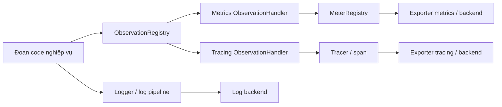
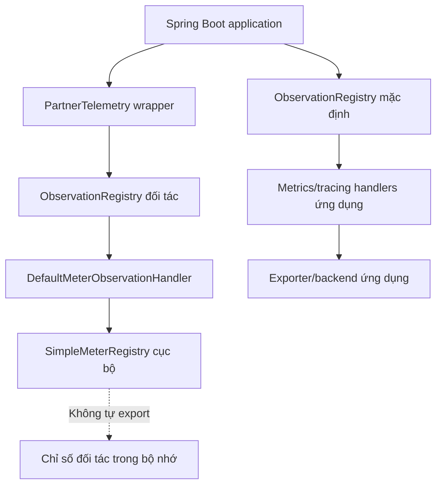

# Tách registry theo boundary

Một ứng dụng Spring Boot có thể vừa xử lý yêu cầu người dùng, vừa gọi dịch vụ thanh toán bên ngoài và chạy tác vụ đồng bộ dữ liệu nội bộ. Các hoạt động này khác nhau về người chịu trách nhiệm, yêu cầu quan sát, độ nhạy cảm của dữ liệu và ngân sách telemetry. Khi nào nên dùng **một ObservationRegistry chung**, khi nào nên **tách registry theo boundary**?

Trong module **SPRING_BOOT_OBSERVABILITY**, chúng ta xây dựng khả năng quan sát bằng Micrometer Observation, metrics, logs và distributed tracing; đồng thời học context propagation, tag/cardinality, exporter, sampling và cách liên kết tín hiệu để điều tra lỗi hoặc độ trễ. Bài này thuộc chương **Cấu hình registry** và tập trung vào quyết định kiến trúc: registry nào sở hữu observation, cấu hình xử lý ra sao và ranh giới đó có thật sự tách dữ liệu vận hành hay không.

**Ý chính:** tách `ObservationRegistry` giúp tách **cấu hình và vòng đời xử lý observation** theo một phạm vi trong cùng ứng dụng. Nó **không mặc nhiên** tách `MeterRegistry`, tracer, exporter, backend hoặc quyền truy cập dữ liệu. Nếu cần cách ly hoàn toàn, phải thiết kế cả đường đi của metrics, logs và traces.

## Mục tiêu học tập

Sau bài này, bạn có thể:

1. Giải thích **boundary** là gì và phân biệt nó với đường biên HTTP/service hoặc ranh giới triển khai.
2. Phân biệt trách nhiệm của `ObservationRegistry`, `MeterRegistry`, tracing bridge và exporter trong Spring Boot.
3. Quyết định khi nào dùng một registry với tag/filter/convention, khi nào tạo registry độc lập.
4. Cấu hình một vùng quan sát riêng có handler cho metrics mà vẫn giữ registry do Spring Boot quản lý cho các thành phần khác.
5. Phân tích ảnh hưởng của việc tách registry đến current observation, scope, propagation, span liên kết và correlation log.
6. Tránh nhầm lẫn giữa tách cấu hình và cách ly dữ liệu, kiểm soát cardinality/sampling và xác minh kết quả trên môi trường thực.

## 1. Boundary trong observability nghĩa là gì?

**Boundary** là một ranh giới trách nhiệm hoặc chính sách mà tại đó ta muốn điều khiển cách thu thập và xử lý tín hiệu quan sát. Nó có thể được xác định bởi:

- **Nghiệp vụ:** checkout, đối soát thanh toán, gửi thông báo và báo cáo.
- **Quyền sở hữu:** nền tảng chung, nhóm thanh toán, nhóm tích hợp đối tác.
- **Độ tin cậy:** logic nội bộ so với lời gọi ra hệ thống bên thứ ba.
- **Yêu cầu dữ liệu:** thông tin cần che giấu, thời gian lưu, quyền truy vấn hoặc vị trí lưu trữ.
- **Đặc tính vận hành:** lưu lượng lớn nhưng ít giá trị điều tra so với luồng quan trọng có lỗi hiếm cần giữ trace.
- **Môi trường thực thi:** request đồng bộ, tác vụ nền, consumer xử lý message; đây có thể là boundary hữu ích nhưng không nhất thiết phải có registry riêng.

Boundary không đồng nghĩa với “mỗi class một registry” hay “mỗi controller một registry”. Nếu tách quá nhỏ, ứng dụng phải duy trì nhiều bộ handler, tag, sampling và exporter khác nhau; việc đối chiếu tín hiệu cũng khó hơn.

Ví dụ, trong một ứng dụng `checkout-service`:

```text
checkout-service (một JVM)
├── API checkout
│   ├── validateCart()
│   ├── reserveStock()
│   └── authorizePayment()
├── Adapter gọi payment provider (boundary đối tác)
└── Job reconcilePayments() (boundary tác vụ nền)
```

Ta có thể muốn đo độ trễ chung của checkout và có một chính sách riêng cho lời gọi payment provider. Nhưng **mong muốn có dashboard riêng chưa đủ là lý do tạo nhiều ObservationRegistry**: một registry với tên observation, tag ổn định và các bộ lọc phù hợp thường đơn giản hơn.

## 2. Registry nào đang được nói tới?

Từ “registry” dễ gây nhầm vì trong hệ sinh thái Micrometer có những đối tượng khác nhau.

| Thành phần | Vai trò | Tách đối tượng này mang lại điều gì? |
|---|---|---|
| `ObservationRegistry` | Quản lý cấu hình các observation: predicate, filter, convention, handler và ngữ cảnh observation hiện hành | Tách chính sách xử lý và phạm vi current observation theo từng registry |
| `MeterRegistry` | Đăng ký, lưu/thu thập các meter như counter, timer, gauge; nối tới hệ thống metrics tùy loại registry | Có thể tạo phạm vi đo hoặc đường xuất metric riêng, nếu cấu hình backend phù hợp |
| `Tracer` / tracing implementation | Tạo/quản lý span, context và quyết định tracing theo implementation | Có thể thay đổi cách trace hình thành, lấy mẫu và truyền ngữ cảnh; không đồng nghĩa tách exporter |
| Exporter / collector / backend | Vận chuyển, lọc, lưu trữ, truy vấn telemetry | Quyết định dữ liệu thực sự đến nơi nào, được giữ bao lâu và ai truy cập được |
| Logging framework / log pipeline | Ghi sự kiện, correlation, chuyển tiếp structured logs | Có chính sách log riêng; việc tách `ObservationRegistry` không tự tách log |

**Micrometer Observation là lớp điều phối**, không phải nơi lưu tất cả metrics, logs và traces. Khi một observation được `start()`, mở `scope` rồi `stop()`, các `ObservationHandler` được đăng ký trong registry có thể biến các sự kiện vòng đời thành timer, span hoặc hành vi khác.



Nhìn sơ đồ sẽ thấy: **mở thêm một registry không tự tạo handler tương ứng**. Một registry mới không được cấu hình có thể vẫn cho code gọi API Observation nhưng không tạo ra metric hay span hữu ích.

### Spring Boot đang cung cấp gì?

Trong các ứng dụng Spring Boot 3.x được cấu hình observability, Spring Boot có thể tự tạo `ObservationRegistry` và kết nối nó với instrumentation/handler phù hợp theo các dependency, bean và cấu hình hiện có. Đây thường là registry được các thành phần auto-instrumented dùng.

Việc tự khai báo thêm `@Bean ObservationRegistry` phải rất thận trọng:

- Điều kiện auto-configuration có thể thay đổi khi ứng dụng tự cung cấp bean cùng kiểu.
- Nếu có nhiều bean cùng kiểu, injection không định danh có thể trở nên mơ hồ.
- Registry tự tạo không mặc nhiên kế thừa các `ObservationHandler`, `ObservationPredicate`, `ObservationFilter` hoặc customizer được áp dụng cho registry khác.
- Một số instrumentation của Spring hoặc thư viện có thể vẫn sử dụng registry mặc định, còn code nghiệp vụ dùng registry riêng.

Tên dependency, hook auto-configuration và cơ chế lấy mẫu/export cần được xác minh theo phiên bản Spring Boot/Micrometer đang chạy.

## 3. Khi nào nên dùng registry chung?

**Mặc định nên bắt đầu bằng một `ObservationRegistry` được Spring Boot quản lý** cho các luồng trong cùng ứng dụng nếu chúng dùng chung mục tiêu quan sát, handler và hạ tầng telemetry.

Cần xem các vấn đề sau trước khi quyết định tách:

1. **Cần phân loại trên dashboard?** Dùng tên observation và tag có cardinality thấp, chẳng hạn `boundary=partner` hoặc `operation=authorize`.
2. **Cần bỏ qua một số observation?** Xem xét `ObservationPredicate` phù hợp thay vì tạo registry mới chỉ để loại bỏ một nhóm hoạt động.
3. **Cần bổ sung hoặc chuẩn hóa tag?** Dùng convention/filter được cấu hình phù hợp để giữ ngữ nghĩa thống nhất; chú ý thời điểm áp dụng tag đối với handler.
4. **Cần tạo vài span nghiệp vụ riêng?** Instrument những đoạn có giá trị điều tra bằng observation với tên và scope đúng; không cần tách registry chỉ vì có span con.
5. **Cần dashboard riêng cho từng đội?** Dùng query, namespace, resource attributes, label và quyền truy cập tại backend.

Ví dụ, một registry chung có thể ghi metric về `checkout.payment.authorize` với tag `boundary=external-partner`. Trường này có tập giá trị nhỏ, nên giúp lọc dữ liệu mà không tạo hàng triệu time series như `orderId` hoặc `traceId`.

```java
import io.micrometer.observation.Observation;
import io.micrometer.observation.ObservationRegistry;
import org.springframework.stereotype.Service;

@Service
class CheckoutPaymentService {
    private final ObservationRegistry observationRegistry;
    private final PaymentGateway gateway;

    CheckoutPaymentService(ObservationRegistry observationRegistry,
                           PaymentGateway gateway) {
        this.observationRegistry = observationRegistry;
        this.gateway = gateway;
    }

    PaymentResult authorize(PaymentRequest request) {
        return Observation.createNotStarted(
                        "checkout.payment.authorize", observationRegistry)
                .lowCardinalityKeyValue("boundary", "external-partner")
                .lowCardinalityKeyValue("operation", "authorize")
                .observe(() -> gateway.authorize(request));
    }
}
```

Các kiểu `PaymentGateway`, `PaymentRequest` và `PaymentResult` là giả định. Mẫu này dựa vào registry Spring Boot cung cấp qua dependency injection và API `observe(...)` quản lý vòng đời đồng bộ. **Tag `boundary` phục vụ phân nhóm, không phải một cơ chế bảo mật hoặc cách ly exporter.**

## 4. Khi nào tách ObservationRegistry thật sự có ích?

Có thể cân nhắc registry riêng khi một tập thao tác cần **chính sách xử lý khác nhau và độc lập**, chẳng hạn:

- Một adapter đối tác cần một chuỗi `ObservationHandler` đặc thù, trong khi telemetry của ứng dụng chính được giữ ổn định.
- Một bộ thư viện hoặc workflow có vòng đời instrumentation riêng, cần bảo đảm không làm thay đổi handler của ứng dụng chính.
- Một tác vụ thử nghiệm cần registry và meter store **cục bộ, không xuất đi**, để đo một nhóm hoạt động một cách có kiểm soát.
- Các nhóm hoạt động có vòng đời và ngữ nghĩa khác biệt, đến mức dùng chung filter/convention có nguy cơ tác động ngoài ý muốn; sự tách biệt này đã được chứng minh cần thiết.

Nếu chỉ khác tên service, route, team hoặc mức độ ưu tiên, tách registry có thể tạo thêm chi phí mà không giải quyết vấn đề.

Bảng quyết định:

| Nhu cầu | Phương án thường phù hợp | Lý do |
|---|---|---|
| Dashboard checkout và inventory riêng | Một `ObservationRegistry`, phân loại bằng tên/tag | Giữ tracing và context nhất quán |
| Phân biệt đối tác A/B trong phép đo | Tag hữu hạn như `partner=alpha|beta` | Cardinality được kiểm soát |
| Bỏ qua một hoạt động nhiễu | Predicate/filter theo chính sách | Tránh tạo thêm registry |
| Handler riêng cho một thư viện độc lập | Registry riêng được cấu hình đầy đủ | Tách handler và vòng đời cấu hình |
| Không muốn metric của bài thử nghiệm vào backend chính | Registry và meter store riêng, **không nối** exporter chính | Cách ly đường đo thực tế |
| Hai tenant phải có quyền truy cập dữ liệu tách biệt | Thiết kế pipeline/exporter/backend và quyền truy cập riêng | Registry đơn lẻ không phải ranh giới bảo mật |
| Sampling trace khác nhau cho từng loại request | Chính sách sampler/collector phù hợp với tracing stack | Tách ObservationRegistry không tự tạo sampling policy độc lập |

**Điều kiện trước khi tách:** biết chính xác mình muốn tách **cấu hình observation**, **tập metrics**, **traces**, hay **nơi lưu dữ liệu**. Đây là các mục tiêu khác nhau.

## 5. Ví dụ Spring Boot: một registry cục bộ cho boundary đối tác

Ví dụ dưới đây cho thấy cách một vùng tích hợp tạo **ObservationRegistry và MeterRegistry riêng** nhằm đo thử nghiệm độc lập với registry ứng dụng. Đoạn mã minh họa cho Spring Boot 3.x và Micrometer; sử dụng `SimpleMeterRegistry` để dễ hiểu cơ chế, không phải cấu hình exporter production.

Để không thay thế bean `ObservationRegistry` mặc định của Spring Boot, ta **đóng gói** registry thứ hai trong một bean có kiểu khác:

```java
import io.micrometer.core.instrument.observation.DefaultMeterObservationHandler;
import io.micrometer.core.instrument.simple.SimpleMeterRegistry;
import io.micrometer.observation.ObservationRegistry;
import org.springframework.context.annotation.Bean;
import org.springframework.context.annotation.Configuration;

record PartnerTelemetry(ObservationRegistry observations,
                        SimpleMeterRegistry meters) {}

@Configuration(proxyBeanMethods = false)
class PartnerTelemetryConfiguration {

    @Bean
    PartnerTelemetry partnerTelemetry() {
        SimpleMeterRegistry meters = new SimpleMeterRegistry();
        ObservationRegistry observations = ObservationRegistry.create();

        observations.observationConfig()
                .observationHandler(new DefaultMeterObservationHandler(meters));

        return new PartnerTelemetry(observations, meters);
    }
}
```

Ở cấu hình này:

- `observations` là registry được tạo riêng cho boundary đối tác; nó chưa được đưa ra dưới dạng bean Spring kiểu `ObservationRegistry`.
- `meters` là meter store độc lập ở bộ nhớ. `DefaultMeterObservationHandler` biến một số observation được registry xử lý thành metric tương ứng.
- Registry này **chưa được gắn tracing handler**, và `SimpleMeterRegistry` **không tự gửi metric đến Prometheus/OTLP**.
- Vì vậy, ví dụ có ích để học cách tách cấu hình và xác minh metric tại chỗ; nếu triển khai production, cần chọn loại registry/exporter, kiểm soát vòng đời/giải phóng tài nguyên và tích hợp tracing theo yêu cầu.

Dịch vụ dùng registry của boundary:

```java
import io.micrometer.observation.Observation;
import org.springframework.stereotype.Service;

@Service
class PartnerPaymentAdapter {
    private final PartnerTelemetry telemetry;
    private final PartnerClient client;

    PartnerPaymentAdapter(PartnerTelemetry telemetry, PartnerClient client) {
        this.telemetry = telemetry;
        this.client = client;
    }

    PartnerResponse send(PartnerRequest request) {
        return Observation.createNotStarted(
                        "partner.payment.send", telemetry.observations())
                .lowCardinalityKeyValue("operation", "send")
                .lowCardinalityKeyValue("partner", "provider-a")
                .observe(() -> client.send(request));
    }
}
```

`PartnerClient`, `PartnerRequest` và `PartnerResponse` là các kiểu minh họa. `observe(...)` quản lý start, scope, ghi nhận lỗi được hỗ trợ và stop cho callback đồng bộ. Sau khi thao tác kết thúc, metric có thể được truy vấn trong `telemetry.meters()` nếu handler và context đáp ứng điều kiện đo.

### Điều gì được tách, điều gì chưa?



**Đã tách:** việc áp dụng handler cho các observation tạo bằng `telemetry.observations()` và nơi giữ metric của chúng trong ví dụ.

**Chưa tự có:** span/trace cho observation ở boundary đối tác, correlation với span của request gốc, exporter riêng, log pipeline riêng hoặc quyền truy cập theo tenant. Nếu ứng dụng cần điều tra request xuyên suốt, những phần đó phải được tích hợp một cách tường minh.

### Vì sao không tạo hai `@Bean ObservationRegistry` ngay?

Giả sử ta khai báo `@Bean("applicationRegistry")` và `@Bean("partnerRegistry")` với cùng kiểu `ObservationRegistry`. Lúc ấy:

- Inject `ObservationRegistry` vào một controller hoặc instrumentation nào đó có thể gặp nhập nhằng nếu không có qualifier/primary.
- Bean tùy chỉnh có thể thay đổi hành vi auto-configuration vốn dựa vào điều kiện thiếu bean.
- Nếu chỉ một registry có tracing handler, luồng quan sát dùng registry còn lại có thể không sinh span như mong đợi.
- Đổi một registry sang `@Primary` giúp chọn bean mặc định cho injection nhưng **không tự sao chép** handlers, sampler và exporter giữa các registry.

Mẫu đóng gói trong `PartnerTelemetry` giúp **làm rõ quyền sở hữu** và hạn chế tác động của ví dụ đến auto-configuration của ứng dụng. Nếu thật sự cần nhiều registry được Spring quản lý, phải thiết kế bean wiring, customizer/handler chain và instrumentation theo phiên bản cụ thể, đồng thời kiểm thử end-to-end.

## 6. Tách registry và quan hệ observation cha–con

Một trong những chi phí dễ bị bỏ qua của việc tách registry là **mất khả năng suy luận về ngữ cảnh hiện hành**.

Trong một registry, code có thể tạo observation cha, mở scope, rồi tạo observation con:

```java
Observation parent = Observation.createNotStarted(
        "checkout.request", applicationRegistry).start();

try (Observation.Scope parentScope = parent.openScope()) {
    // Registry ứng dụng thấy observation cha là current.
    executeCheckout();
} finally {
    parent.stop();
}
```

Nếu `executeCheckout()` gọi adapter sử dụng `partnerTelemetry.observations()`, registry thứ hai có **bộ quản lý current observation riêng**. Khi đó:

- `applicationRegistry.getCurrentObservation()` có thể nhìn thấy `checkout.request` trong scope cha.
- `partnerTelemetry.observations().getCurrentObservation()` không mặc nhiên nhìn thấy observation đang current trong registry khác.
- Quan hệ observation cha–con ở mức Micrometer Observation không thể được giả định chỉ từ việc code gọi lồng nhau.

Điều này **không đồng nghĩa mọi trace đều chắc chắn bị đứt**. Tracing implementation có thể có context span riêng, và một số integration có khả năng khôi phục/lan truyền span theo cơ chế của nó. Tuy nhiên, với registry đối tác ở ví dụ trên **không có tracing handler**, ta không nên trông đợi span của `partner.payment.send` xuất hiện.

Vì vậy, nếu mục tiêu là giữ **một trace xuyên suốt từ HTTP request đến payment provider**, registry chung với observation/span con thường là lựa chọn ít rủi ro hơn. Chỉ tách registry khi đã định nghĩa rõ cách tạo quan hệ và khôi phục context ở ranh giới.

### Phân biệt tách scope và tách trace

| Hiện tượng | Điều có thể kết luận | Điều chưa thể kết luận |
|---|---|---|
| `getCurrentObservation()` ở registry B trả về `null` | B không có current observation trong context đang xét | Request không có parent span ở tracer toàn hệ thống |
| Metric ở registry B có giá trị | Handler metric của B đã xử lý observation phù hợp | Trace được export hoặc log có trace ID |
| HTTP downstream vẫn nhận `traceparent` | Có thành phần đã inject trace context | Backend đã lưu đủ span của mọi service |
| Không thấy span đối tác | Có khoảng trống telemetry cần điều tra | Adapter đối tác chắc chắn không chạy |

**Không dùng việc tách registry để cố “cắt trace” như một cơ chế bảo mật.** Ranh giới dữ liệu tin cậy cần kiểm soát headers, baggage, attribute, exporter và quyền truy cập ở các lớp tương ứng.

## 7. Tách theo chính sách handler, tag và cardinality

Điểm mạnh thực tế của `ObservationRegistry` là có thể cấu hình cách observation được xử lý. Khi tách registry, các cấu hình này phải được kiểm soát theo từng boundary.

### 7.1. Một registry có thể có nhiều handler

`ObservationHandler` nhận callback như start, stop, event, error hoặc scope theo những phương thức handler hỗ trợ. Có thể có handler đo metrics, handler tracing và handler tùy chỉnh. Thứ tự/chiến lược kết hợp các handler cần được cấu hình phù hợp để tránh vừa ghi thiếu vừa ghi lặp.

**Đừng giả định “thêm một registry sẽ tự copy các handler từ registry chính”.** Mỗi registry phải được wiring rõ ràng. Ngược lại, nếu một observation bị instrument hai lần bởi hai cơ chế, metric hoặc span có thể bị đếm lặp.

### 7.2. Predicate và filter có mục đích khác nhau

- **ObservationPredicate** quyết định một observation có được quan sát bởi hệ handler tại registry hay không, dựa trên tên và context tại thời điểm đánh giá.
- **ObservationFilter** cho phép bổ sung/điều chỉnh context của observation theo vòng đời phù hợp; việc filter tác động tới tag ở thời điểm nào cần được hiểu để không kỳ vọng nó sửa dữ liệu đã được ghi từ trước.
- **ObservationConvention** xác định tên/ngữ cảnh và key values chuẩn hóa của một nhóm observation.

Các cơ chế này giúp áp dụng chính sách trên một registry chung khi sự khác biệt giữa các boundary chỉ nằm ở tên, tag hoặc loại thao tác.

### 7.3. Giữ cardinality thấp ngay cả khi đã tách registry

Tách registry **không làm label có cardinality cao trở nên an toàn**. Ví dụ:

```text
Tốt cho metric:
  boundary=partner
  operation=send
  partner=provider-a
  outcome=success|failure

Không phù hợp làm metric label:
  orderId=84923842
  userId=391847
  traceId=...
  requestUrl=/orders/84923842
```

`orderId` hoặc một request identifier nếu cần điều tra nên được lưu trong log/trace theo chính sách bảo mật, không đưa làm metric tag. Việc giữ nhiều registry nhưng cùng gắn các ID độc nhất vào meter name/tag vẫn tạo ra chi phí cao.

**Nguyên tắc:** boundary nên mô tả loại hoạt động và chủ sở hữu ổn định; nó không nên là tên động theo từng request hay từng khách hàng.

## 8. Sampling, exporter và privacy: ba lớp tách biệt

Giả sử đội thanh toán muốn giữ 100% trace lỗi đối tác nhưng chỉ giữ 10% trace thành công, trong khi luồng checkout thông thường dùng chính sách sampling khác. Chỉ việc tạo thêm `ObservationRegistry` **không đủ để thực hiện yêu cầu đó**.

Cần tách ba câu hỏi:

1. **Làm thế nào observation tạo span?** Registry tương ứng phải có tracing handler/bridge được cấu hình. Nếu thiếu, không có span để exporter gửi.
2. **Span nào được giữ?** Điều này phụ thuộc sampler của tracing implementation, cơ chế head/tail sampling và collector. Head sampling thường quyết định trước khi biết kết quả cuối; muốn ưu tiên lỗi chậm có thể cần chính sách tail sampling với bộ đệm đủ lớn.
3. **Span/log/metric được gửi và xem ở đâu?** Exporter, collector routing, backend, retention và phân quyền quyết định dữ liệu thực sự được cách ly.

Một registry riêng vẫn có thể cùng gửi đến **một exporter và một backend** nếu mọi thành phần được cấu hình dùng đường xuất chung. Với trace, cùng một tracer hoặc trace context có thể xuất hiện ở cả các hoạt động khác nhau; cần kiểm tra policy cụ thể.

### Ranh giới bảo mật không thể chỉ đặt trong ObservationRegistry

Trong môi trường có nhiều tenant/đối tác hoặc dữ liệu nhạy cảm:

- Kiểm tra thuộc tính span, baggage, log fields và dữ liệu gửi sang backend. Không chứa token, số thẻ, bí mật hoặc payload nhạy cảm.
- Nếu cần phân quyền, dùng backend namespace/tenant/project, collector routing và cơ chế access control phù hợp.
- Quy định mức retention, export, sampling và vị trí lưu dữ liệu theo yêu cầu thực tế.
- Kiểm tra cả đường đi HTTP headers: trace context có thể cần truyền để liên kết, nhưng baggage hoặc attribute có thể phải giới hạn.
- Xem xét hậu quả khi exporter của một boundary bị nghẽn: liệu có ảnh hưởng latency hoặc tài nguyên của ứng dụng chính không?

**Registry là một boundary cấu hình trong tiến trình; không phải một security sandbox.**

## 9. Tình huống vận hành: thanh toán chậm sau khi tách registry

Giả sử một ứng dụng Spring Boot ban đầu dùng một registry duy nhất. Sau đó đội phát triển tách adapter payment provider sang registry riêng để quản lý metrics đối tác. Ngày hôm sau, dashboard vẫn thấy p95 `POST /checkout` tăng, nhưng các trace không còn thể hiện span `partner.payment.send`.

Từ hiện tượng trên, chưa nên kết luận lời gọi payment provider không chạy.

### Đường điều tra

**Bước 1 — Xác minh observation có được tạo hay không.** Kiểm tra instrumentation thật sự dùng `PartnerTelemetry` và callback có chạy đúng phạm vi; xem metric cục bộ ở registry đối tác nếu đang dùng thiết kế giống ví dụ.

**Bước 2 — Kiểm tra handler trong registry đối tác.** Nếu chỉ có `DefaultMeterObservationHandler` thì mất span là hành vi đúng với cấu hình hiện tại. Cần tracing handler/bridge được thiết kế phù hợp nếu muốn có span.

**Bước 3 — Kiểm tra scope và current context.** Quan sát ở registry A không mặc nhiên trở thành current observation của B. Nếu muốn trace liên tục, xác định cách liên kết context giữa hai vùng; không tự suy diễn bằng thứ tự lời gọi Java.

**Bước 4 — Kiểm tra HTTP client và propagation.** Tracing handler có thể tồn tại nhưng client không inject context, hoặc gateway lọc `traceparent`. Kiểm tra instrumented client, headers và span phía downstream.

**Bước 5 — Kiểm tra sampling và exporter.** Span có thể được tạo nhưng không được giữ do sampling, bị drop ở collector hoặc backend chưa cấu hình để nhận. Cần đọc tín hiệu trạng thái pipeline thay vì dựa duy nhất trên màn hình truy vấn trace.

**Bước 6 — Đánh giá lại việc tách.** Nếu mục tiêu thực sự chỉ là dashboard riêng, một registry chung với tag `boundary=external-partner` có thể giảm độ phức tạp, giữ liên kết trace và vẫn phục vụ nhu cầu phân nhóm metrics.

### Những bằng chứng cần phối hợp

| Bằng chứng | Cho biết | Chưa chứng minh |
|---|---|---|
| Metric HTTP p95 tăng | Độ trễ của một nhóm request thay đổi | Bước chậm nằm ở đâu |
| Metric `partner.payment.send` cục bộ vẫn tăng | Observation adapter có được đo trong registry thử nghiệm | Span/traces đã xuất sang backend |
| Log timeout từ provider | Có sự kiện timeout được ghi nhận | Mọi request chậm đều do cùng lỗi |
| Trace thiếu span adapter | Có khoảng trống trong tín hiệu trace đang xem | Adapter không được thực thi |
| Trace context xuất hiện qua HTTP | Header có được truyền tại một đoạn | Trace của tất cả service đều được lưu |

Ở đây việc tách registry đã tạo **khoảng mù về tracing** nếu thiết kế không đồng bộ giữa các handler. Cần quyết định rõ liệu nhu cầu isolation có đáng đổi lấy độ phức tạp tương quan telemetry.

## 10. Checklist trước khi đưa vào production

Trước khi chia một ứng dụng thành nhiều registry, hãy trả lời:

1. **Boundary này là gì?** Nghiệp vụ, chủ sở hữu, khác biệt chính sách hay yêu cầu pháp lý? Có thật sự cần một registry mới?
2. **Ai tạo observation?** Mỗi instrumentation, filter, convention và handler đang gắn với registry nào?
3. **Current context ở đâu?** Có lời gọi lồng nhau, thread pool, `@Async`, Reactor hoặc message queue cần capture/restore context không?
4. **Metrics lưu ở đâu?** Registry cục bộ hay exporter thực? Có duplicate meters, sai tag hoặc cardinality cao không?
5. **Tracing có liền mạch không?** Có handler tương ứng, span con, propagation qua HTTP/messaging, sampler và collector không?
6. **Log có liên kết được không?** Log trong adapter có `traceId`/`spanId` theo cấu hình log correlation và context không?
7. **Dữ liệu có cách ly theo yêu cầu không?** Exporter, collector, backend, retention, quyền truy cập và chính sách loại bỏ dữ liệu nhạy cảm đã được cấu hình chưa?
8. **Spring Boot auto-configuration còn hoạt động không?** Việc thêm bean registry có làm thay đổi lựa chọn bean mặc định, handlers hay instrumentation sẵn có không?
9. **Có thể chẩn đoán sự cố thiếu telemetry không?** Quan sát cả lỗi exporter, dropped spans, scrape failures và tình trạng backend.
10. **Đã kiểm thử end-to-end chưa?** Chạy request thành công, lỗi, chậm và xử lý bất đồng bộ; đối chiếu số liệu ở từng đường đi.

### Những lỗi thiết kế thường gặp

| Lỗi | Vì sao xảy ra | Cách sửa |
|---|---|---|
| Tạo `ObservationRegistry.create()` rồi chờ có trace | Registry mới chưa có tracing handler | Cấu hình handler/bridge và pipeline cần thiết, hoặc dùng registry chung |
| Thêm bean registry phụ khiến injection lỗi | Nhiều bean cùng kiểu hoặc thay đổi điều kiện auto-config | Đóng gói registry phụ, cấu hình định danh/primary và kiểm tra bean wiring |
| Có metric riêng nhưng không thấy ở Prometheus | `SimpleMeterRegistry` lưu trong bộ nhớ, không tự export | Dùng meter registry/exporter đúng mục đích |
| Gắn `userId` vào metric tag để phân tenant | Cardinality tăng theo người dùng | Dùng tag nhóm hữu hạn; ID riêng trong tín hiệu có kiểm soát |
| Tách registry để bảo vệ dữ liệu đối tác | Dữ liệu vẫn có thể đi chung exporter/backend | Cấu hình routing, storage, access control và redaction |
| Trace bị đứt khi gọi adapter | Current observation khác registry, handler/propagation thiếu | Truy vết context qua từng ranh giới và thiết kế liên kết rõ |
| Một thao tác bị đếm hai lần | Instrumentation tự động và thủ công cùng đo trùng phạm vi | Chọn một cơ chế sở hữu phép đo hoặc phân biệt rõ tên/ngữ nghĩa |
| Không có trace lỗi hiếm | Sampling hoặc exporter không giữ lại | Kiểm tra sampler/collector và dùng metrics/logs để xác nhận mức ảnh hưởng |

## 11. Tự đánh giá

**Câu 1.** Hai nhóm muốn dashboard khác nhau cho cùng một ứng dụng Spring Boot. Có bắt buộc phải tạo hai `ObservationRegistry` không?

**Gợi ý:** Không. Nếu chỉ cần lọc theo nhóm hoạt động, tên observation, tag có cardinality thấp và quyền truy vấn backend thường đủ.

**Câu 2.** Một adapter dùng `ObservationRegistry.create()` độc lập và không đăng ký handler. Có chắc sẽ thấy timer và span trong backend không?

**Gợi ý:** Không. Tạo registry chỉ chuẩn bị lớp điều phối observation; cần handler, meter/tracer và exporter tương ứng.

**Câu 3.** Khi registry A đang có current observation, gọi `registryB.getCurrentObservation()` có mặc định trả lại observation đó không?

**Gợi ý:** Không nên giả định. Hai registry có quản lý current observation riêng. Tracing context ở lớp khác có thể có cơ chế riêng, vì vậy phải kiểm tra luồng thực tế.

**Câu 4.** Tách `ObservationRegistry` có đủ để bảo đảm dữ liệu của đối tác không xuất tới backend chính không?

**Gợi ý:** Không. Cần tách hoặc điều khiển cả handler, meter registry, tracer/exporter, collector routing, storage và quyền truy cập.

**Câu 5.** Sau khi tách registry, metric thanh toán vẫn có nhưng trace không còn span của adapter. Nên kiểm tra gì trước?

**Gợi ý:** Xác định registry nào được dùng, những handler nào được đăng ký, scope/current observation và tracing bridge; sau đó kiểm tra propagation, sampling và exporter.

## Kết luận

**Tách registry theo boundary là quyết định tách chính sách xử lý observation**, hữu ích khi có lý do rõ ràng về handler hoặc trách nhiệm. Trong đa số ứng dụng Spring Boot, **một `ObservationRegistry` chung với tên, tag, convention và filter hợp lý** giúp duy trì ngữ cảnh và giảm độ phức tạp. Khi cần registry riêng, hãy cấu hình đầy đủ handler, meter/tracer và đường export; kiểm tra propagation, sampling, cardinality, correlation logs và quyền truy cập. Cách thiết kế tốt là cách giúp kỹ sư vẫn có thể nối metrics, logs và traces để điều tra một request đi qua nhiều boundary mà không mất những thông tin cần thiết.
