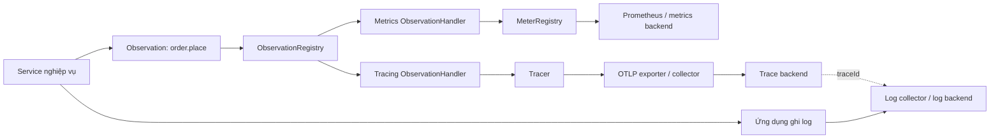
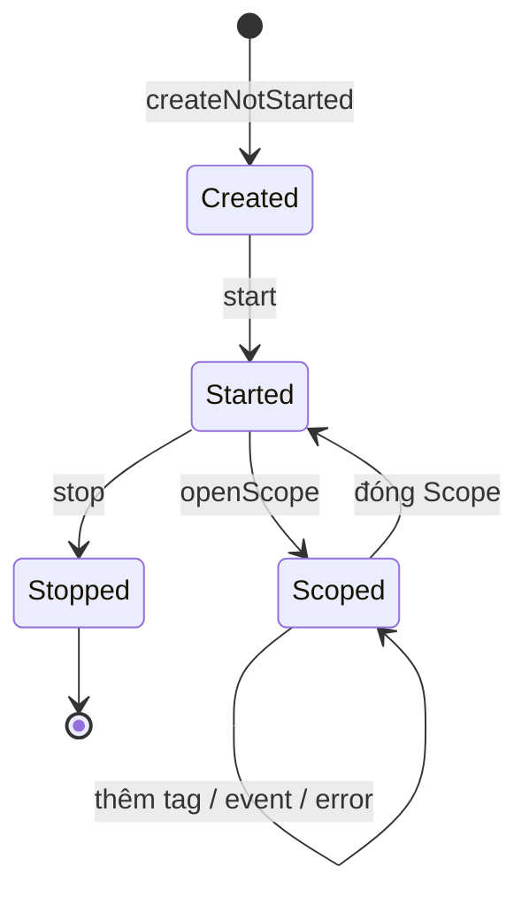

# Tạo observation cho nghiệp vụ trong Spring Boot

Một hệ thống bán hàng có endpoint `POST /orders`. Spring Boot có thể tự ghi nhận độ trễ và kết quả HTTP request, nhưng một request ấy gồm nhiều công việc: kiểm tra tồn kho, áp dụng khuyến mãi, giữ hàng và gửi yêu cầu thanh toán. Khi p95 của endpoint tăng, metric HTTP chỉ cho biết **toàn bộ request chậm**; nó chưa chắc cho biết **bước nghiệp vụ nào** làm chậm request. Để nhìn sâu hơn, ứng dụng cần tự instrument những thao tác có ý nghĩa đối với sản phẩm.

Trong chương **Custom observation** của module `SPRING_BOOT_OBSERVABILITY`, chúng ta sẽ tạo **Micrometer Observation cho một thao tác nghiệp vụ** và đưa tín hiệu vào hệ sinh thái observability của Spring Boot. Module hướng tới việc kết hợp Micrometer Observation, metrics, logs và distributed tracing; vì vậy bài học cũng giải thích cách chọn tag/cardinality, truyền ngữ cảnh, cấu hình exporter và sampling, rồi liên kết các tín hiệu để điều tra lỗi hoặc độ trễ trên môi trường thực.

> **Mục tiêu:** Sau bài này, bạn có thể chọn đúng ranh giới cần quan sát, viết code tạo Observation, gắn các thông tin có ý nghĩa mà không làm tăng cardinality mất kiểm soát, ghi nhận lỗi, kiểm tra metric/trace được sinh ra và nhận biết các tình huống cần bổ sung context propagation.

## 1. Khi nào nên tạo custom Observation?

Micrometer và Spring Boot đã có instrumentation cho nhiều thành phần phổ biến như HTTP server, một số HTTP client và các thư viện tích hợp. Tuy vậy, những câu hỏi nghiệp vụ không phải lúc nào cũng tương ứng với một endpoint hoặc thư viện.

Ví dụ:

- **Đặt hàng:** Thời gian kiểm tra tồn kho và xác nhận đơn hàng là bao lâu?
- **Thanh toán:** Bước authorize thất bại theo kênh thanh toán nào, tỷ lệ lỗi thay đổi ra sao?
- **Nhập dữ liệu:** Mỗi batch nhập sản phẩm mất bao lâu, batch có hoàn tất hay không?
- **Phát hành voucher:** Quy trình kiểm tra điều kiện và cấp voucher chậm ở giai đoạn nào?
- **Xử lý message:** Từ lúc consumer bắt đầu xử lý đến khi ghi kết quả mất bao lâu?

Một custom Observation hữu ích khi nó đại diện cho một **đơn vị công việc ổn định, có ý nghĩa khi điều tra**, không chỉ là một method Java bất kỳ.

| Chỉ dùng instrumentation kỹ thuật | Thêm custom Observation nghiệp vụ |
| --- | --- |
| `http.server.requests` đo request vào API | `order.place` đo thao tác đặt đơn |
| HTTP client metric đo lời gọi tới gateway | `payment.authorize` đo công đoạn authorize bất kể adapter |
| Database metric đo truy vấn hoặc connection pool | `inventory.reserve` đo toàn bộ bước giữ hàng |
| Có thể thấy “request chậm” | Có thêm bằng chứng “bước nghiệp vụ nào chậm” |

Không nên tạo một Observation cho từng getter, phép gán biến hay vòng lặp quá nhỏ. Instrumentation dày đặc làm tăng chi phí xử lý, lượng span và độ phức tạp khi đọc trace. Hãy bắt đầu từ các ranh giới có mục đích vận hành rõ ràng.

## 2. Một Observation nghiệp vụ đi qua những thành phần nào?



Các vai trò:

1. **`Observation`:** đối tượng biểu diễn một thao tác, tên, context, key-value, lỗi và vòng đời.
2. **`ObservationRegistry`:** registry dùng chung, chứa cấu hình và điều phối các handler, predicate, convention, filter.
3. **`ObservationHandler`:** nhận callback khi Observation bắt đầu/kết thúc hoặc có lỗi; handler metrics và tracing có thể tạo ra các tín hiệu tương ứng.
4. **`MeterRegistry` và `Tracer`:** quản lý dữ liệu metric hoặc span theo tích hợp đã chọn.
5. **Exporter/collector/backend:** chuyển tiếp, lưu trữ và cho phép truy vấn theo thời gian; không tự xuất hiện khi chỉ tạo một Observation trong code.

Sơ đồ là luồng **khái niệm**. Không phải ứng dụng nào cũng có đồng thời mọi handler và exporter. Một Observation có thể đo metrics mà không tạo trace khi ứng dụng chỉ cài đặt metrics; ngược lại, thiếu cấu hình metrics có thể làm tên observation không xuất hiện trong `/actuator/metrics`.

## 3. Chuẩn bị một ứng dụng Spring Boot

Ví dụ sử dụng Spring Boot 3.x, Java 17+ và Maven. Với một project đã dùng Spring Boot parent hoặc BOM, các version của Micrometer nên để hệ sinh thái Boot quản lý.

```xml
<dependencies>
    <dependency>
        <groupId>org.springframework.boot</groupId>
        <artifactId>spring-boot-starter-web</artifactId>
    </dependency>
    <dependency>
        <groupId>org.springframework.boot</groupId>
        <artifactId>spring-boot-starter-actuator</artifactId>
    </dependency>
    <!-- Chỉ cần khi Prometheus scrape metrics -->
    <dependency>
        <groupId>io.micrometer</groupId>
        <artifactId>micrometer-registry-prometheus</artifactId>
    </dependency>
</dependencies>
```

Với Spring Boot 3.x, Actuator thường thiết lập bean `ObservationRegistry` và các tích hợp cần thiết cho metrics. Service nên **inject bean registry được Spring quản lý**, tránh tự tạo `ObservationRegistry.create()` bên trong từng service vì registry tự tạo có thể không mang các handler và policy đã cấu hình.

```yaml
spring:
  application:
    name: order-service

management:
  endpoints:
    web:
      exposure:
        include: health,metrics,prometheus
  observations:
    key-values:
      application: order-service
```

Các endpoint thường có tiền tố `/actuator`. `/actuator/metrics` giúp khám phá meter; `/actuator/prometheus` cần registry Prometheus có mặt. Cấu hình `exposure` chỉ cho phép công bố endpoint qua HTTP, **không tự bảo vệ endpoint bằng xác thực hoặc phân quyền**. Trên production, giới hạn truy cập management endpoint bằng mạng nội bộ, Spring Security hoặc gateway được cấu hình đúng.

## 4. Thiết kế Observation trước khi viết code

Đừng bắt đầu bằng việc tùy tiện thêm tag. Hãy trả lời:

1. **Đo công việc gì?** Ví dụ, toàn bộ bước xác nhận đơn hàng, từ khi kiểm tra điều kiện đến khi kết quả nghiệp vụ được quyết định.
2. **Tên ổn định là gì?** Ví dụ, `order.place`. Tên này không chứa ID, URL động hoặc dữ liệu người dùng.
3. **Cần phân tích theo chiều nào?** Ví dụ, `order.channel` gồm `web`, `mobile`, `partner`.
4. **Thông tin nào chỉ phục vụ truy vết từng request?** Ví dụ, mã đơn hàng dạng opaque, không đưa vào nhãn metric.
5. **Khi nào là thành công/thất bại?** Cần phân biệt exception kỹ thuật, kết quả nghiệp vụ bị từ chối và lỗi có thể thử lại.
6. **Có đường thực thi async không?** Nếu có, cần xác định rõ thời điểm bắt đầu, hoàn thành và propagation.

Một hợp đồng telemetry mẫu:

| Thuộc tính | Giá trị | Lý do |
| --- | --- | --- |
| Observation name | `order.place` | Gom các phép đo cùng loại |
| Contextual name | `place-order` | Tên dễ đọc cho span khi tracing được bật |
| Low-cardinality key-value | `order.channel=web/mobile/partner/other` | Phân tích theo tập giá trị hữu hạn |
| Low-cardinality key-value | `outcome=success/rejected/error` | Nhìn tỷ lệ kết quả nếu được handler ghi nhận |
| High-cardinality key-value | `order.reference=<mã opaque>` | Tra cứu request cụ thể trong trace nếu được phép |
| Error | Exception phát sinh | Phục vụ đánh dấu sự cố kỹ thuật |

**Low cardinality** là tập giá trị nhãn nhỏ, ổn định, thích hợp cho tổng hợp metrics. **High cardinality** là dữ liệu có nhiều giá trị khác nhau; nên giữ ở trace/log có kiểm soát thay vì thêm vào metric tags. High-cardinality **không có nghĩa** dữ liệu tự động an toàn: tránh bí mật, token, email hoặc dữ liệu cá nhân nếu không có nhu cầu và chính sách bảo vệ phù hợp.

## 5. Cách đơn giản nhất: `Observation.observe(...)`

Đoạn mã sau minh họa một service đặt hàng đồng bộ. Để tập trung vào instrumentation, ta giả định có adapter `OrderGateway` xử lý nghiệp vụ thực tế.

```java
import io.micrometer.observation.Observation;
import io.micrometer.observation.ObservationRegistry;
import org.springframework.stereotype.Service;

@Service
public class OrderPlacementService {
    private final ObservationRegistry observationRegistry;
    private final OrderGateway orderGateway;

    public OrderPlacementService(
            ObservationRegistry observationRegistry,
            OrderGateway orderGateway) {
        this.observationRegistry = observationRegistry;
        this.orderGateway = orderGateway;
    }

    public OrderReceipt place(OrderCommand command) {
        String channel = normalizeChannel(command.channel());

        return Observation.createNotStarted("order.place", observationRegistry)
            .contextualName("place-order")
            .lowCardinalityKeyValue("order.channel", channel)
            .highCardinalityKeyValue("order.reference", command.reference())
            .observe(() -> orderGateway.place(command));
    }

    private static String normalizeChannel(String input) {
        if ("web".equals(input)
                || "mobile".equals(input)
                || "partner".equals(input)) {
            return input;
        }
        return "other";
    }
}

// Các type minh họa cho ranh giới nghiệp vụ.
record OrderCommand(String reference, String channel) {}
record OrderReceipt(String confirmationCode) {}

interface OrderGateway {
    OrderReceipt place(OrderCommand command);
}
```

Giả sử `OrderGateway` đã có một implementation được đăng ký làm Spring bean; nếu chạy nguyên ví dụ, bạn cần cung cấp implementation đó.

Điều diễn ra khi gọi `place(...)`:

- Tạo một Observation tên `order.place` gắn với registry của ứng dụng.
- Bổ sung thông tin channel đã chuẩn hóa và mã tham chiếu có cardinality cao.
- `observe(Supplier`)` quản lý start, scope và stop cho khối code **đồng bộ**; giá trị trả về của gateway được trả lại cho người gọi.
- Nếu gateway ném exception, cơ chế `observe(...)` ghi nhận lỗi theo vòng đời Observation rồi truyền exception ra ngoài để tầng gọi xử lý.
- Handler đã cấu hình có thể ghi metric timer hoặc tạo span. Việc một tín hiệu xuất hiện trên backend còn phụ thuộc handler, exporter và sampling.

Việc đặt tên như `order.place` nên dùng một quy ước thống nhất trong toàn ứng dụng. Tránh `"order.place." + reference` vì mỗi mã đơn sẽ tạo một tên riêng, khó tổng hợp và có thể gây bùng nổ số chuỗi metric.

### 5.1. Vì sao normalize tag ngay tại ranh giới nghiệp vụ?

Trường `channel` có thể đến từ request header, form hoặc đối tác. Nếu ghi nguyên đầu vào, hàng nghìn giá trị không hợp lệ có thể trở thành tag khác nhau. Hàm `normalizeChannel` giới hạn về bốn giá trị cho phép, nhờ đó metric có thể dùng để phân tích xu hướng mà không sinh cardinality khó kiểm soát.

Ví dụ, `order.channel=web` và `order.channel=mobile` là các chiều phân tích có ích. `order.reference=ORD-734829` không phù hợp với metric; trace có thể sử dụng mã opaque này để điều tra một đơn cụ thể khi chính sách cho phép.

## 6. Quản lý vòng đời thủ công khi cần outcome và event

`observe(...)` là lựa chọn tốt cho thao tác đồng bộ đơn giản. Nếu cần ghi outcome theo kết quả hoặc event tại những điểm xác định, có thể dùng vòng đời thủ công:

```java
import io.micrometer.observation.Observation;
import io.micrometer.observation.ObservationRegistry;

public PaymentDecision authorizePayment(
        PaymentCommand command, ObservationRegistry registry,
        PaymentGateway gateway) {

    Observation observation =
        Observation.createNotStarted("payment.authorize", registry)
            .contextualName("authorize-payment")
            .lowCardinalityKeyValue("payment.channel", command.channel());

    observation.start();
    try (Observation.Scope scope = observation.openScope()) {
        PaymentDecision decision = gateway.authorize(command);

        String outcome = decision.approved() ? "approved" : "rejected";
        observation.lowCardinalityKeyValue("outcome", outcome);
        observation.event(Observation.Event.of("gateway.responded"));
        return decision;
    } catch (RuntimeException ex) {
        observation.lowCardinalityKeyValue("outcome", "error");
        observation.error(ex);
        throw ex;
    } finally {
        observation.stop();
    }
}

// Phần contract minh họa; đặt trong class/service phù hợp khi tích hợp.
record PaymentCommand(String channel) {}
record PaymentDecision(boolean approved) {}
interface PaymentGateway {
    PaymentDecision authorize(PaymentCommand command);
}
```

Trong ví dụ này, `approved` và `rejected` là **hai kết quả nghiệp vụ**; `error` dành cho ngoại lệ kỹ thuật. Không phải mọi lần từ chối thanh toán đều cần được coi là exception. Sự phân biệt đó giúp alert chính xác hơn.

### Vòng đời chi tiết



Điểm cần phân biệt:

| API | Tác dụng |
| --- | --- |
| `createNotStarted(name, registry)` | Tạo Observation, chưa bắt đầu vòng đời |
| `start()` | Bắt đầu quan sát; handler có thể nhận callback `onStart` |
| `openScope()` | Đặt Observation làm ngữ cảnh hiện hành ở phạm vi thực thi tương ứng |
| `lowCardinalityKeyValue(...)` | Bổ sung chiều có ít giá trị, thường dùng làm metric tag |
| `highCardinalityKeyValue(...)` | Bổ sung dữ liệu chi tiết cho handler phù hợp; thường không làm metric tag |
| `event(...), error(ex)` | Thông báo sự kiện hoặc lỗi tới observation/handler |
| `scope.close()` | Khôi phục ngữ cảnh hiện hành trước đó; **không kết thúc Observation** |
| `stop()` | Kết thúc Observation, cho handler hoàn tất phép ghi nhận |

**Lưu ý thời điểm gắn tag:** ví dụ thêm `outcome` sau khi đã nhận kết quả. Handler ghi metric ở cuối vòng đời có thể thấy giá trị đó, nhưng handler tracing tạo span hoặc gắn một số thuộc tính tại `onStart` có thể xử lý khác. Nếu dữ liệu cần thiết ngay khi bắt đầu span, hãy đặt key-value trước `start()` hoặc dùng convention/handler phù hợp với mục tiêu. Không giả định mọi handler cập nhật mọi tag cùng thời điểm.

Với code đồng bộ, `try-with-resources` giúp đóng Scope ngay cả khi exception phát sinh; `finally` bảo đảm `stop()`. Không giữ scope mở khi phương thức đã hoàn tất, vì thread của server có thể được tái sử dụng cho request khác.

## 7. Scope cha–con và cách hiểu trace nghiệp vụ

Giả sử một request HTTP vào `order-service` gọi `order.place`, bên trong tiếp tục gọi `payment.authorize`:

```text
HTTP POST /orders              [--------------------------]
  order.place                     [----------------------]
    inventory.reserve                [---------]
    payment.authorize                          [--------]
      HTTP client POST /authorize                 [-----]
```

Đây là **mô hình lý tưởng khi tracing được tích hợp**, không phải kết quả chắc chắn từ việc thêm code Observation. Để thấy span lồng nhau trong cùng trace:

1. Observation cha cần có scope hiện hành khi Observation con bắt đầu.
2. Ứng dụng phải có Micrometer Tracing bridge và handler phù hợp để tạo span từ những Observation đó.
3. HTTP client hoặc message instrumentation cần truyền trace context sang service khác.
4. Phía nhận phải extract context tương thích; trace exporter và backend cần thu nhận span.
5. Sampling có thể khiến một số trace không được lưu dù request vẫn thực thi đúng.

Khi không dùng tracing bridge, Observation vẫn có thể tạo metric qua handler metrics. Khi không dùng metrics registry, có span chưa có nghĩa đã có dashboard độ trễ theo thời gian.

### Scope không tự qua mọi ranh giới bất đồng bộ

Một nhầm lẫn phổ biến là dùng:

```java
Observation.createNotStarted("order.submit", observationRegistry)
    .observe(() -> CompletableFuture.supplyAsync(this::doWork));
```

Đoạn này **chỉ bọc thao tác tạo/sắp lịch `CompletableFuture`**, không bảo đảm đo đến khi `doWork` hoàn tất; scope trong thread tạo future cũng không tự di chuyển qua worker thread. Vì vậy không nên dùng ví dụ trên để đo toàn bộ công việc async.

Với `@Async`, `Executor`, Reactor/WebFlux hoặc message consumer, cần hiểu mô hình thực thi và sử dụng tích hợp **Micrometer Context Propagation** tương thích. Quy tắc chung là capture ngữ cảnh ở điểm gửi công việc, restore trong phạm vi xử lý ở phía nhận, đóng scope đã restore sau khi xong và kết thúc Observation ở thời điểm công việc thật sự hoàn tất.

Không chuyển trực tiếp một `Observation.Scope` đang mở sang thread khác rồi gọi `close()` tại đó. Đối với các flow reactive, dùng Reactor Context/khả năng propagation của framework thay vì giả định ThreadLocal của một thread sẽ tồn tại xuyên pipeline.

## 8. Dùng `@Observed` khi instrumentation phù hợp với method

Micrometer có annotation `@Observed` và AOP aspect hỗ trợ tạo Observation quanh lời gọi method. Ví dụ:

```java
import io.micrometer.observation.annotation.Observed;
import org.springframework.stereotype.Service;

@Service
public class CouponService {
    @Observed(
        name = "coupon.validate",
        contextualName = "validate-coupon",
        lowCardinalityKeyValues = {"operation", "validate"})
    public boolean validate(String code) {
        return code != null && !code.isBlank();
    }
}
```

Annotation **không tự có hiệu lực chỉ nhờ viết lên method**. Cần AOP và một `ObservedAspect` được cấu hình, hoặc cơ chế auto-configuration tương ứng của phiên bản Spring Boot:

```java
import io.micrometer.observation.ObservationRegistry;
import io.micrometer.observation.aop.ObservedAspect;
import org.springframework.context.annotation.Bean;
import org.springframework.context.annotation.Configuration;

@Configuration
class ObservedAopConfiguration {
    @Bean
    ObservedAspect observedAspect(ObservationRegistry observationRegistry) {
        return new ObservedAspect(observationRegistry);
    }
}
```

Ví dụ dùng AOP của Spring yêu cầu dependency phù hợp như `spring-boot-starter-aop` (thêm vào Maven như một starter của Spring Boot), và method cần được gọi qua Spring proxy để aspect hoạt động. Kiểm tra xem phiên bản Boot đã tự đăng ký aspect hay chưa để tránh cấu hình trùng. Lời gọi nội bộ từ một method của bean tới method khác trong chính bean đó (**self-invocation**) thường đi vòng qua proxy nên có thể không được instrument.

**Chọn API nào?** Với thao tác nghiệp vụ cần kiểm soát key-value động, lỗi, kết quả, scope hoặc thời điểm kết thúc, API `Observation` thủ công thường rõ ràng hơn. `@Observed` phù hợp cho các method có ranh giới đồng bộ và schema telemetry đơn giản, với điều kiện AOP thực sự hoạt động. Đừng áp cả annotation và manual Observation lên cùng một đoạn code nếu không có mục đích rõ, vì có thể tạo span/metric trùng lặp.

## 9. Tạo outcome và tags có thể phân tích

Một bộ tag tốt trả lời câu hỏi “trong 15 phút vừa qua, tác vụ nào chậm hoặc lỗi nhiều?” mà không khiến backend phải lưu hàng triệu chuỗi.

Ví dụ `payment.authorize` có:

| Tag | Số giá trị dự kiến | Khuyến nghị |
| --- | --- | --- |
| `payment.channel` | 3–5 | Low cardinality |
| `outcome` | 3–4 | Low cardinality |
| `environment` | Một số môi trường triển khai | Low cardinality, quản lý nhất quán |
| `region` | Một số vùng | Low cardinality |
| `order.id` | Hàng triệu | High cardinality; không làm metric tag |
| `customer.email` | Rất nhiều, nhạy cảm | Tránh đưa vào telemetry nghiệp vụ |
| `exception.message` | Có thể gần như vô hạn | Không dùng làm tag metric |

Giả sử bốn tag đầu có tương ứng 4 × 3 × 2 × 3 giá trị, số tổ hợp tối đa đã là **72** cho một metric, trước khi tính instance, bucket histogram và các nhãn khác. Khi thêm `order.id`, cardinality tăng theo lượng đơn hàng, làm tăng chi phí và khiến truy vấn khó ổn định.

Đừng dùng mã HTTP làm kết quả duy nhất cho Observation nghiệp vụ: một API có thể trả HTTP 200 nhưng nghiệp vụ cho kết quả `rejected`, hoặc trả HTTP 202 vì đã chấp nhận xử lý bất đồng bộ. Xây dựng outcome gắn với **định nghĩa nghiệp vụ**, rồi phân biệt với lỗi hạ tầng và ngoại lệ.

## 10. Kiểm tra kết quả bằng Actuator và trace backend

Với các dependency ở mục 3 và handler metrics được cấu hình, sau khi gọi `OrderPlacementService.place(...)` ít nhất một lần, kiểm tra:

```bash
curl -s http://localhost:8080/actuator/health
curl -s http://localhost:8080/actuator/metrics
curl -s http://localhost:8080/actuator/metrics/order.place
curl -s http://localhost:8080/actuator/prometheus
```

Tên metric dưới `/actuator/metrics` thường tương ứng với tên Observation khi dùng default meter observation handler và không có convention đổi tên. Kết quả cụ thể phụ thuộc cấu hình và phiên bản Micrometer. Metrics của một Observation chưa chạy hoặc chưa kết thúc có thể chưa xuất hiện.

Thông thường, một `Timer` cung cấp số lần đo và tổng thời gian; histogram/percentile cần chính sách meter phù hợp. Không nên coi một lần đo lẻ là đủ để đánh giá p95 hoặc p99. Với Prometheus, cần scrape theo thời gian và áp dụng truy vấn histogram/summary đúng loại series đã cấu hình.

### 10.1. Muốn thấy distributed trace thì thêm gì?

Với một cấu hình OpenTelemetry trong Spring Boot 3.x, các dependency thường dùng gồm:

```xml
<dependency>
    <groupId>io.micrometer</groupId>
    <artifactId>micrometer-tracing-bridge-otel</artifactId>
</dependency>
<dependency>
    <groupId>io.opentelemetry</groupId>
    <artifactId>opentelemetry-exporter-otlp</artifactId>
</dependency>
```

Ngoài dependency, ứng dụng cần cấu hình exporter/collector đúng giao thức và endpoint, cùng với hệ thống trace backend. Ví dụ:

```yaml
management:
  tracing:
    sampling:
      probability: 0.1
  otlp:
    tracing:
      endpoint: http://otel-collector:4318/v1/traces
```

Đây là mẫu cấu hình thường gặp trong các phiên bản Spring Boot 3.x có hỗ trợ OTLP HTTP tracing. Kiểm tra tên property và giao thức exporter theo đúng phiên bản ứng dụng và collector đang dùng.

`sampling.probability: 0.1` minh họa việc chỉ giữ một phần trace; **không bảo đảm mọi request lỗi đều có trace**. Nếu cần điều tra lỗi hiếm, hãy cân nhắc khả năng lấy mẫu và lưu giữ thích hợp, bao gồm giải pháp collector có hỗ trợ tail-based sampling nếu kiến trúc cho phép.

### 10.2. Liên kết log với Observation

Khi tracing bridge và logging correlation được cấu hình đúng, log ghi bên trong scope của custom Observation có thể mang `traceId` và `spanId`. Điều này giúp:

1. Tìm log của một request lỗi dựa trên trace ID.
2. Mở trace liên quan để xem span `order.place`, `inventory.reserve` hoặc `payment.authorize`.
3. Đối chiếu metric để biết lỗi đó là riêng lẻ hay thuộc một xu hướng nhiều request.

Registry tự nó không thu thập, vận chuyển hoặc lưu trữ log. Bạn vẫn cần pattern JSON/text, MDC correlation và pipeline log phù hợp. Không in toàn bộ payload thanh toán hay dữ liệu người dùng vào log chỉ để tạo liên kết.

## 11. Điều tra tình huống thực tế: API chậm nhưng health vẫn UP

Giả sử dashboard cho thấy p95 của `POST /orders` tăng từ 180 ms lên 1,4 s, trong khi `/actuator/health` vẫn trả `UP`.

| Bước | Tín hiệu | Câu hỏi cần trả lời |
| --- | --- | --- |
| 1. Xác định phạm vi | HTTP metrics | Chậm trên mọi route hay chỉ `/orders`? Có thay đổi traffic không? |
| 2. So sánh nghiệp vụ | `order.place`, `inventory.reserve`, `payment.authorize` | Bước nào chiếm tỷ lệ thời gian lớn hoặc có lỗi? |
| 3. Phân nhóm | Low-cardinality tags `channel`, `outcome` | Chậm ở web/mobile hay trên mọi kênh? |
| 4. Truy một yêu cầu | Tracing span và traceId | Có retry hoặc timeout outbound nào kéo dài request? |
| 5. Xem nguyên nhân | Log có cùng traceId/spanId | Đối tác có báo lỗi, connection pool có cạn, có exception cụ thể không? |
| 6. Đánh giá sau sửa | Metrics theo thời gian và traces mẫu | Tỷ lệ lỗi, độ trễ có giảm trong điều kiện tải tương đương không? |

Kịch bản có thể là metric `order.place` chậm, nhưng `inventory.reserve` bình thường; trace cho thấy `payment.authorize` tốn phần lớn thời gian vì gateway timeout và retry. Lúc này, health tổng quát `UP` không mâu thuẫn với lỗi trải nghiệm người dùng: health chỉ đo các điều kiện được khai báo, trong khi custom Observation giúp khoanh vùng luồng nghiệp vụ cụ thể.

## 12. Những lỗi thường gặp khi tạo Observation nghiệp vụ

| Triệu chứng/lỗi | Nguyên nhân có thể | Cách xử lý |
| --- | --- | --- |
| Không thấy `order.place` trong metrics | Chưa chạy code; chưa `stop`; registry/handler metric không đúng; predicate loại bỏ | Kiểm tra đường chạy và cấu hình registry |
| Metrics có nhưng span không thấy | Thiếu tracing bridge, exporter, backend hoặc trace bị sampling | Kiểm tra từ handler tới collector và chính sách sampling |
| Span giữa hai dịch vụ rời rạc | Client/server không truyền/extract trace context; thay thread không restore | Cấu hình propagation và instrumentation |
| Log không có traceId | Thiếu tracing/log correlation hoặc log nằm ngoài scope | Kiểm tra MDC và logging pattern |
| Tăng đột biến số time series | Dùng ID/URL động/error message làm metric tag | Chuẩn hóa tập giá trị low cardinality |
| Timer đo quá ngắn với async | `observe(...)` chỉ bao quanh lệnh tạo future | Gắn vòng đời Observation vào completion thực tế |
| Metric/span bị nhân đôi | Instrument cùng đoạn code bằng nhiều cơ chế | Kiểm tra custom và auto instrumentation chồng nhau |
| Lỗi nghiệp vụ bị mất | Bắt exception nhưng không báo error/outcome đúng | Xác định semantic outcome và error của nghiệp vụ |
| Tracing hoạt động local nhưng backend trống | Exporter chưa kết nối hoặc endpoint/giao thức sai | Kiểm tra exporter, collector, network, retention |

**Lưu ý bảo mật:** không để endpoint quản trị chứa dữ liệu nhạy cảm có thể truy cập công khai, không đưa thông tin nhận dạng người dùng vào tag metric, và không coi tracing backend là nơi có thể ghi mọi dữ liệu nghiệp vụ tùy ý.

## 13. Bài thực hành

Xây dựng một service nhỏ xử lý luồng đặt hàng, ban đầu có hai bước `inventory.reserve` và `payment.authorize`.

1. **Instrument thủ công** hai bước bằng `Observation.createNotStarted(...).observe(... )`; chọn tên ổn định theo nghiệp vụ.
2. Thêm `channel` với bộ giá trị hữu hạn, thêm outcome `approved/rejected/error`. Giữ mã đơn hàng ở high-cardinality context (hoặc bỏ hoàn toàn nếu không cần).
3. Gọi mỗi bước vài lần, tạo cả tình huống thành công lẫn lỗi; kiểm tra `/actuator/metrics` để xem meter nào đã được ghi.
4. Thêm handler tracing/exporter và một backend thử nghiệm; xác minh các custom span nằm bên trong trace của HTTP request khi context propagation đúng.
5. Thử gọi payment gateway từ executor và so sánh việc mất trace context khi chưa propagation với kết quả sau khi áp dụng cơ chế truyền context tương thích.
6. Đưa log vào các vị trí có ý nghĩa, cấu hình correlation và tìm trace tương ứng từ `traceId`.
7. Rà soát tags, endpoint management, sampling, cấu hình exporter và chi phí; chỉ giữ những tín hiệu giúp trả lời câu hỏi vận hành thật.

### Câu hỏi tự kiểm tra

1. Vì sao một custom Observation cho `order.place` có ích dù đã có `http.server.requests`?
2. Khác biệt giữa `order.channel` và `order.reference` về cardinality là gì?
3. Trong đường exception, `observation.error(ex)`, `scope.close()` và `observation.stop()` giải quyết các trách nhiệm nào?
4. Vì sao dùng `observe(() -> CompletableFuture.supplyAsync(...))` có thể ghi nhận thời gian không đúng?
5. Cần những thành phần nào ngoài Observation để thấy trace đi qua hai dịch vụ và tìm log tương ứng?

## Kết luận

**Tạo observation cho nghiệp vụ** là cách đưa câu hỏi vận hành thực tế vào code một cách có cấu trúc. Hãy chọn ranh giới có ý nghĩa, đặt tên ổn định, dùng `ObservationRegistry` do Spring quản lý, ưu tiên `observe(...)` cho đoạn đồng bộ và quản lý start/scope/error/stop thủ công khi cần điều khiển sâu hơn. Low-cardinality tags giúp tổng hợp metrics, high-cardinality context hỗ trợ truy vết có kiểm soát. Khi được kết nối đúng với handler, exporter, sampling, propagation và logging correlation, custom Observation trở thành cầu nối giữa **số liệu độ trễ**, **span của một request** và **log lỗi cụ thể** để điều tra hành vi ứng dụng Spring Boot trong production.
