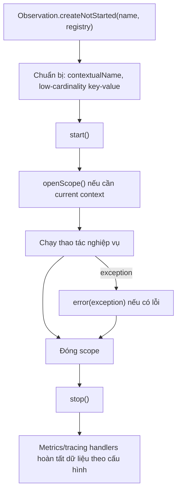
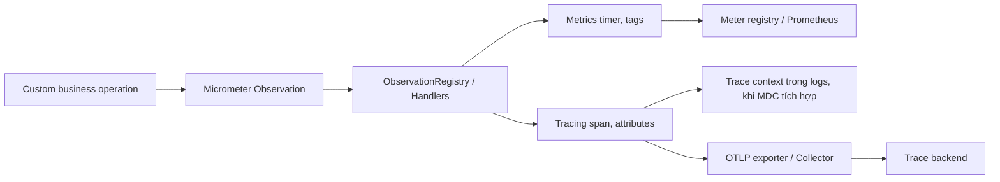

# Observation.createNotStarted

Trong chương **Custom observation** của mô-đun **SPRING_BOOT_OBSERVABILITY**, `Observation.createNotStarted(...)` là API cốt lõi để tự mô tả một thao tác nghiệp vụ cần theo dõi nhưng **chưa bắt đầu đo ngay**. Thao tác có thể là tính phí giao hàng, gọi cổng thanh toán, tìm giá sản phẩm hoặc xử lý một message. Khi code chủ động tạo observation, bạn kiểm soát tên, nhãn, ranh giới thời gian và cách ghi nhận lỗi, thay vì chỉ dựa vào các chỉ số HTTP tự động của Spring Boot.

Mô-đun hướng đến khả năng điều tra hành vi ứng dụng thực bằng **Micrometer Observation, metrics, logs và distributed tracing**. Một custom observation là điểm nối giữa mã nghiệp vụ và các tín hiệu đó: handlers có thể tạo timer hoặc tracing span; log có thể nhận trace context khi scope được mở; exporter, sampling và backend quyết định dữ liệu cuối cùng có xuất hiện trong hệ thống observability hay không.

## 1. Mục tiêu

Sau bài này, bạn có thể:

1. Giải thích giá trị trả về của `Observation.createNotStarted(name, registry)` và thời điểm bắt đầu đo thực sự.
2. Viết custom observation với `lowCardinalityKeyValue(...)`, `contextualName(...)` và vòng đời `start/openScope/error/stop`.
3. Quyết định thời điểm tạo observation trước khi biết đủ dữ kiện, và thời điểm bắt đầu phần công việc cần đo.
4. Dùng `observe(...)` cho thao tác đồng bộ đơn giản; chọn điều khiển thủ công khi cần logic hoặc kết quả phức tạp.
5. Đặt tên và tag an toàn về cardinality, đồng thời tránh ghi dữ liệu nhạy cảm.
6. Kiểm tra vì sao có observation trong code nhưng chưa thấy metrics, logs tương quan hoặc traces trong backend.
7. Vận dụng custom observation để khoanh vùng lỗi, độ trễ và dependency trong Spring Boot.

## 2. API `createNotStarted` làm gì?

Cú pháp phổ biến:

```java
Observation observation =
        Observation.createNotStarted("shipping.quote", observationRegistry);
```

`Observation` là abstraction của Micrometer cho một hoạt động được quan sát. `ObservationRegistry` là nơi các `ObservationHandler`, quy tắc và cấu hình observation được gắn với ứng dụng. Tên `shipping.quote` xác định **loại hoạt động**, không đại diện cho một request cụ thể.

Sau câu lệnh trên, bạn có một đối tượng observation để chuẩn bị thêm ngữ cảnh. Tuy nhiên:

- Chưa có khoảng thời gian được đo bởi một vòng `start()` – `stop()` cho hoạt động này.
- Chưa có lý do để kỳ vọng một timer đã ghi nhận mẫu hoàn tất hoặc một span tracing đã kết thúc.
- Đối tượng có thể hoạt động như no-op tùy registry và chính sách bật/tắt observation, vì thế tạo thành công một biến Java không chứng minh hệ thống đã phát telemetry.
- Việc lưu metrics hoặc traces phụ thuộc handlers, meter/tracing registry, exporter và backend, không phụ thuộc riêng lời gọi `createNotStarted(...)`.

Một observation chỉ trở thành phép đo hữu ích khi **phần việc cần quan sát thực sự diễn ra trong một vòng đời hoàn chỉnh**.

### Trước và sau khi bắt đầu



**Tạo** và **bắt đầu** là hai mốc riêng. Nếu bạn tạo observation, rồi mất 50 ms dựng request trước khi gọi `start()`, 50 ms đó không nằm trong duration. Nếu 50 ms là một phần người dùng phải chờ và cần tính vào SLO, hãy dịch chuyển `start()` lên trước hoặc tạo observation bao quanh cả giai đoạn chuẩn bị.

## 3. Chữ ký, tên và registry

Ta thường sử dụng overload nhận tên và registry:

```java
Observation.createNotStarted(String name, ObservationRegistry registry)
```

Các thành phần có vai trò khác nhau:

| Thành phần | Vai trò | Ví dụ |
| --- | --- | --- |
| `name` | Tên logic ổn định của loại thao tác, thường được handlers dùng cho tên metric/observation. | `shipping.quote`, `inventory.reserve` |
| `observationRegistry` | Kết nối observation với handlers và cấu hình trong ứng dụng. | Bean `ObservationRegistry` do Spring Boot cung cấp |
| `Observation` trả về | Đối tượng đang chuẩn bị, có API thêm key-value, bắt đầu, mở scope, báo lỗi và dừng. | Biến `observation` |
| `contextualName(...)` | Tên theo ngữ cảnh dễ hiểu hơn cho tracing khi handler hỗ trợ. | `calculate shipping quote` |
| `lowCardinalityKeyValue(...)` | Thuộc tính có số lượng giá trị phân biệt được kiểm soát. | `carrier=standard`, `operation=quote` |

Micrometer còn có các cơ chế dùng custom context và `ObservationConvention` khi cần tái sử dụng quy tắc đặt tên hoặc tags giữa nhiều nơi. Tuy nhiên, với một thao tác đơn lẻ, overload `createNotStarted(String, ObservationRegistry)` là điểm bắt đầu dễ hiểu nhất.

### Tạo sớm, bắt đầu đúng lúc

Giả sử endpoint cần tính phí vận chuyển. Bạn đã biết thao tác và loại carrier ngay khi nhận request nhưng muốn chỉ đo **lời gọi sang hệ thống báo giá**.

```java
Observation observation =
        Observation.createNotStarted("shipping.quote", registry)
                .contextualName("quote shipping")
                .lowCardinalityKeyValue("carrier", "standard")
                .lowCardinalityKeyValue("operation", "quote");

// Phần chuẩn bị bên ngoài khoảng đo.
QuoteRequest request = buildQuoteRequest(order);

// Phần lời gọi dependency mới là nội dung cần đo.
observation.start();
try (Observation.Scope scope = observation.openScope()) {
    return shippingGateway.quote(request);
} catch (RuntimeException exception) {
    observation.error(exception);
    throw exception;
} finally {
    observation.stop();
}
```

`QuoteRequest`, `order` và `shippingGateway` là các thành phần minh họa do ứng dụng định nghĩa.

Điểm quan trọng nằm ở cách đặt `start()` **sau** `buildQuoteRequest(order)`: observation `shipping.quote` trả lời câu hỏi “lời gọi báo giá mất bao lâu?”. Nếu muốn trả lời “toàn bộ tính giá mất bao lâu?”, hãy đặt `start()` trước khi xây request hoặc tạo một observation cha cho toàn quy trình. **Tên observation và ranh giới đo cần nhất quán**; nếu mỗi nơi đo một đoạn khác nhau nhưng đều gọi `shipping.quote`, số liệu tổng hợp sẽ khó diễn giải.

## 4. Tích hợp `ObservationRegistry` vào Spring Boot

Với ứng dụng Spring Boot 3.x có Actuator, bạn có thể inject registry như một bean. Ví dụ Gradle:

```groovy
dependencies {
    implementation 'org.springframework.boot:spring-boot-starter-actuator'
}
```

Service minh họa:

```java
import io.micrometer.observation.ObservationRegistry;
import org.springframework.stereotype.Service;

@Service
public class ShippingService {
    private final ObservationRegistry observationRegistry;

    public ShippingService(ObservationRegistry observationRegistry) {
        this.observationRegistry = observationRegistry;
    }
}
```

`ObservationRegistry` là điểm tích hợp instrumentation, **không phải database của metrics hay traces**. Để xem custom metrics qua Prometheus, thêm registry tương ứng; để xem tracing phân tán, cần bridge và exporter:

```groovy
dependencies {
    implementation 'io.micrometer:micrometer-registry-prometheus'
    implementation 'io.micrometer:micrometer-tracing-bridge-otel'
    implementation 'io.opentelemetry:opentelemetry-exporter-otlp'
}
```

Các dependency trên là ví dụ phổ biến cho Spring Boot 3.x; quản lý version theo BOM tương ứng. Cấu hình backend cụ thể phụ thuộc phiên bản Spring Boot, pipeline và môi trường vận hành.

Ví dụ cấu hình thử nghiệm:

```yaml
spring:
  application:
    name: shipping-api

management:
  endpoints:
    web:
      exposure:
        include: health,metrics,prometheus
  tracing:
    sampling:
      probability: 1.0
  otlp:
    tracing:
      endpoint: http://otel-collector:4318/v1/traces
```

Đường `http://otel-collector:4318/v1/traces` giả định có một collector nhận OTLP HTTP tại địa chỉ này. `sampling.probability: 1.0` dành cho môi trường thực hành ít traffic, không nên mặc định áp dụng cho production quy mô lớn. Endpoint Actuator phải được bảo vệ theo chính sách mạng và phân quyền.

Chỉ sau khi ứng dụng phát sinh request phù hợp, registry/handler được cấu hình và exporter hoạt động, ta mới kỳ vọng telemetry hiện lên hệ thống quan sát.

## 5. Mẫu thực hiện đầy đủ cho custom observation

Bài toán: `shipping-api` tính phí từ một gateway. Ta muốn quan sát riêng lời gọi `shippingGateway.quote(...)`; khi gateway ném lỗi, observation phải ghi nhận lỗi và hoàn thành vòng đời ngay cả khi exception được chuyển tiếp.

```java
import io.micrometer.observation.Observation;
import io.micrometer.observation.ObservationRegistry;
import org.springframework.stereotype.Service;

@Service
public class ShippingQuoteService {

    private final ObservationRegistry registry;
    private final ShippingGateway gateway;

    public ShippingQuoteService(ObservationRegistry registry,
                                ShippingGateway gateway) {
        this.registry = registry;
        this.gateway = gateway;
    }

    public ShippingQuote getQuote(ShippingRequest request) {
        Observation observation =
                Observation.createNotStarted("shipping.quote", registry)
                    .contextualName("get shipping quote")
                    .lowCardinalityKeyValue("operation", "quote")
                    .lowCardinalityKeyValue("dependency", "shipping-gateway");

        observation.start();

        try (Observation.Scope scope = observation.openScope()) {
            ShippingQuote result = gateway.quote(request);
            observation.lowCardinalityKeyValue("outcome", "success");
            return result;
        } catch (RuntimeException exception) {
            observation.lowCardinalityKeyValue("outcome", "error");
            observation.error(exception);
            throw exception;
        } finally {
            observation.stop();
        }
    }

    public interface ShippingGateway {
        ShippingQuote quote(ShippingRequest request);
    }

    public record ShippingRequest(String destinationZone, int packageCount) {}
    public record ShippingQuote(long amountMinorUnits, String currency) {}
}
```

Điều kiện giả định: `gateway.quote` trả về số tiền bằng đơn vị nhỏ nhất của tiền tệ; code không nhằm minh họa nghiệp vụ quy đổi tiền. Ví dụ có thể được đặt trong một dự án Spring Boot 3.x sử dụng Java hỗ trợ `record`.

**Giải thích trình tự:**

1. `createNotStarted` tạo một đối tượng chưa đo, với tên ổn định `shipping.quote`.
2. `contextualName` và các thuộc tính `operation/dependency` được khai báo trước khi chạy.
3. `start()` bắt đầu vòng đời; handler thích hợp có thể tạo timer context/span.
4. `openScope()` giúp observation trở thành ngữ cảnh hiện hành trong luồng đồng bộ; child instrumentation và logs có cơ hội nhận trace context khi tracing được tích hợp.
5. `gateway.quote(request)` là phần được đo.
6. Khi thành công, `outcome=success` được thêm; khi có `RuntimeException`, đặt `outcome=error`, gọi `error(exception)` rồi ném lại ngoại lệ.
7. Scope được đóng bởi `try-with-resources`; `stop()` trong `finally` hoàn tất observation ở cả hai nhánh.

Các thuộc tính `outcome` được bổ sung trong lúc observation đang chạy. Thực tế handler metrics thường ghi nhận kết quả khi observation kết thúc, nên có thể dùng outcome tính được sau thao tác. Tuy nhiên, nếu tổ chức có custom handlers đọc tags ở callback khác, cần kiểm tra thời điểm tags được quan sát để bảo đảm dữ liệu nhất quán.

### Vì sao cả `openScope()` và `stop()` đều cần thiết?

Hai lệnh giải quyết **hai vấn đề khác nhau**:

- `openScope()` xác định observation hiện hành cho code đang chạy trong scope, quan trọng với parent/child tracing và ngữ cảnh logs.
- `stop()` kết thúc phép quan sát; handlers có cơ hội hoàn tất duration/metrics/span.

Đóng scope không tự bảo đảm observation đã dừng. Ngược lại, nếu chỉ gọi `start()` rồi `stop()` mà không mở scope, bạn vẫn có thể thu duration nhưng các hoạt động con/logs có thể không nhận được ngữ cảnh mà bạn mong đợi.

Nếu `getQuote` chạy bên trong một request HTTP đang có server observation, lời gọi custom observation được bắt đầu trong HTTP scope phù hợp có thể được hiển thị như một span con, miễn là tracing handler và context propagation hoạt động.

## 6. Khi nào nên chọn `observe(...)`?

Với tác vụ đồng bộ gọn, bạn có thể viết:

```java
public ShippingQuote getQuote(ShippingRequest request) {
    return Observation.createNotStarted("shipping.quote", registry)
            .lowCardinalityKeyValue("dependency", "shipping-gateway")
            .observe(() -> gateway.quote(request));
}
```

`observe(...)` là cách dùng thuận tiện để bao bọc công việc, xử lý vòng đời và exception cho trường hợp đơn giản. Nó đặc biệt phù hợp khi **phần việc cần đo trùng với toàn bộ lambda**, không cần can thiệp ở nhiều thời điểm.

| Tiêu chí | `createNotStarted(...).observe(...)` | `createNotStarted(...)` + điều khiển thủ công |
| --- | --- | --- |
| Chạy một lambda đồng bộ đơn giản | Gọn, ít code quản lý vòng đời | Dài hơn mức cần thiết |
| Cần chuẩn bị trước khi bắt đầu đo | Có thể chuẩn bị trước khi gọi `observe` | Dễ quyết định vị trí `start()` |
| Cần gắn `outcome` từ kết quả thực thi | Có thể xử lý qua custom logic/convention hoặc cấu trúc phù hợp | Dễ gắn tag rõ ràng trước `stop()` |
| Cần chủ động mở/đóng scope ở một đoạn riêng | Ít quyền kiểm soát hơn | Kiểm soát trực tiếp |
| Công việc bất đồng bộ hoặc publisher lazy | Không tự động đo tới lúc hoàn tất bất đồng bộ | Cần thiết kế vòng đời theo completion signal và context propagation |

**Không gọi `start()` rồi lại gọi `observe(...)` trên cùng một observation chỉ vì nghĩ rằng `observe` chỉ dùng để chạy lambda.** Hãy chọn một cách quản lý vòng đời nhất quán.

## 7. Phân biệt observation name, contextual name và tags

Một custom observation có ba loại thông tin rất khác nhau.

### 7.1 Tên observation phải ổn định

Dùng:

```java
Observation.createNotStarted("shipping.quote", registry);
```

Tránh:

```java
// Không nên: tên khác nhau theo từng đơn hàng.
Observation.createNotStarted("shipping.quote." + orderId, registry);
```

Tên biến đổi theo request có thể tạo vô số metric names, khiến dashboard khó sử dụng và làm tăng chi phí lưu trữ.

### 7.2 Contextual name giúp trace dễ đọc

```java
Observation.createNotStarted("shipping.quote", registry)
        .contextualName("quote shipping cost");
```

Các tracing handler có thể dùng contextual name khi đặt tên span. Tên này nên dễ hiểu, đủ ổn định và không chứa dữ liệu nhạy cảm. Nó không thay thế tên quan sát kỹ thuật dùng để nhóm metric.

### 7.3 Low-cardinality và high-cardinality

```java
Observation observation =
        Observation.createNotStarted("shipping.quote", registry)
                .lowCardinalityKeyValue("operation", "quote")
                .lowCardinalityKeyValue("carrier", "standard");
```

`operation` và `carrier` có tập giá trị hữu hạn, phù hợp làm low-cardinality tags.

Nếu một mã tham chiếu cần gắn vào trace để điều tra request cụ thể, có thể cân nhắc:

```java
// Chỉ khi đã đánh giá quyền riêng tư và giới hạn dữ liệu.
observation.highCardinalityKeyValue("provider.request_ref", safeReference);
```

Không dùng `safeReference` trừ khi đã xác định thật sự không chứa thông tin nhạy cảm và backend được phép lưu trữ trường này. **High cardinality không đồng nghĩa an toàn**, và tracing attributes cũng có chi phí đáng kể.

Bảng quyết định nhanh:

| Thuộc tính | Low cardinality? | Cách xử lý khuyến nghị |
| --- | --- | --- |
| `operation=quote` | Có | Tag metric phù hợp |
| `carrier=standard/express` | Có, khi tập giá trị hữu hạn | Tag metric phù hợp |
| `outcome=success/error` | Có | Tag metric phù hợp |
| `orderId=...` | Không | Tránh metric tag; chỉ cân nhắc trace/log theo chính sách |
| `customerEmail=...` | Không và nhạy cảm | Không ghi vào telemetry mặc định |
| `requestPath=/orders/43821` | Không nếu là URL thô | Chuẩn hóa thành route ` /orders/{id}` |

Không biến động `traceId` hay `spanId` thành low-cardinality tags. Chúng giúp **liên kết sự kiện riêng lẻ**, không phù hợp để nhóm hàng triệu lần đo trên metric backend.

## 8. Một observation có tạo ra những tín hiệu gì?

`Observation.createNotStarted(...)` là API trung lập đối với backend. Điều kiện để ba trụ cột xuất hiện:



Tín hiệu thực tế không nhất thiết có đủ mọi nhánh trong sơ đồ; một số hệ thống dùng exporter và pipeline khác. Để điều tra một request bị chậm:

1. **Metrics** chỉ ra `shipping.quote` bị tăng P95 hoặc tỉ lệ lỗi.
2. **Logs** trong cùng cửa sổ thời gian cho biết timeout, retry hay lỗi response; khi logging integration hỗ trợ, có thể lọc theo `traceId`.
3. **Distributed trace** cho thấy `shipping.quote` nằm ở đâu trong request cha và có child spans cho HTTP/database hay không.
4. Dùng thông tin dependency để xác minh nguyên nhân, rồi quay lại metrics xác nhận tình hình cải thiện.

Không phải mọi observation đều tạo span hiển thị. Tracing sampling có thể loại bỏ một số traces; exporter/collector cũng có thể gặp lỗi. Metrics vẫn có thể tổng hợp lần chạy nếu meter handler hoạt động, ngay cả khi trace của một request cụ thể không được giữ lại.

### Đặt tên metric và xác minh thực tế

Với Prometheus registry, các timer do ObservationHandler tạo thường được xuất dưới dạng các series có hậu tố như `_seconds_count` và `_seconds_sum`; histogram buckets cần cấu hình phù hợp. Không suy từ tên observation ra tên metric xuất chính xác nếu chưa kiểm tra convention, registry và phiên bản đang chạy.

Ở môi trường thử nghiệm, sau khi gọi service vài lần:

```bash
curl -s http://localhost:8080/actuator/metrics
curl -s http://localhost:8080/actuator/metrics/shipping.quote
curl -s http://localhost:8080/actuator/prometheus
```

`actuator/metrics/shipping.quote` chỉ có dữ liệu nếu observation thực sự tạo metric có tên đó; có thể kiểm tra danh sách names ở `actuator/metrics` trước. Metrics HTTP server tự động không thay thế một metric nghiệp vụ như `shipping.quote`. Traces cần được kiểm tra ở backend tracing đã cấu hình.

## 9. Custom event và lỗi trong vòng đời

Ngoài duration và tags, custom observation có thể ghi nhận các event mang ý nghĩa theo tiến trình:

```java
Observation observation =
        Observation.createNotStarted("shipping.quote", registry)
                .lowCardinalityKeyValue("operation", "quote");

observation.start();
try (Observation.Scope scope = observation.openScope()) {
    observation.event(Observation.Event.of("gateway.request.sent"));

    ShippingQuote quote = gateway.quote(request);

    observation.event(Observation.Event.of("gateway.response.received"));
    return quote;
} catch (RuntimeException exception) {
    observation.error(exception);
    throw exception;
} finally {
    observation.stop();
}
```

Một `Observation.Event` là tín hiệu trong vòng đời; tracing handler có thể chuyển thành span event, trong khi metric backend thông thường **không tự xuất mọi event** thành một metric riêng. Nếu cần đếm số lần fallback, timeout hoặc retry tổng hợp, thiết kế metrics hoặc conventions tương ứng thay vì giả định event đã trở thành counter.

Không nên ghi event cho từng bước rất nhỏ trong vòng lặp nóng vì có thể làm tăng overhead và kích thước trace. Chỉ ghi những mốc giúp phân tích: bắt đầu gọi dependency, kích hoạt fallback, retry hết ngân sách, chọn cache hay remote.

**Lỗi kỹ thuật và outcome nghiệp vụ cũng khác nhau.** Gateway trả “không hỗ trợ địa chỉ” có thể là một kết quả hợp lệ, không nhất thiết phải ném exception. Khi đó, bạn có thể bổ sung `outcome=unsupported` và trả response nghiệp vụ, thay vì đánh dấu mọi trường hợp 4xx là lỗi runtime. Quy tắc phân loại outcome cần được dùng nhất quán giữa metrics và traces.

## 10. Parent/child observation và propagation

Một custom observation có thể nằm bên trong server observation của HTTP request và chứa những observation con:

```text
HTTP GET /shipping/quote
└── shipping.quote
    ├── shipping.read-cache
    └── HTTP client POST carrier-service /quotes
```

Để handler tracing tạo đúng parent/child, observation cha cần ở trong context active khi child được bắt đầu. `start()` và `openScope()` không phải thao tác giống nhau; mở scope mới giúp mã đồng bộ bên trong thấy observation hiện hành. Một ví dụ:

```java
return Observation.createNotStarted("shipping.quote", registry)
        .observe(() -> Observation.createNotStarted("shipping.read-cache", registry)
                .observe(() -> cache.find(key)));
```

Hai observation sẽ được lồng theo cấu trúc thực thi đồng bộ. Tuy nhiên, child HTTP span còn phụ thuộc HTTP client có instrumentation hay không.

Khi gọi sang một service Spring Boot khác, hai tiến trình **không chia sẻ cùng đối tượng Observation Java**. Context tracing phải được inject/extract qua carrier (ví dụ HTTP `traceparent` theo W3C Trace Context). Với queue, message headers đóng vai trò tương tự. Nếu trace bị tách ở ranh giới service, kiểm tra propagation và instrumentation hai phía.

### Bất đồng bộ và Reactor: không đo nhầm việc tạo task

Đoạn mã sau rất dễ gây hiểu lầm:

```java
CompletableFuture<ShippingQuote> task =
        Observation.createNotStarted("shipping.quote", registry)
                .observe(() -> CompletableFuture.supplyAsync(
                        () -> gateway.quote(request)));
```

Đây chỉ là **thời gian tạo/lên lịch `CompletableFuture`** trong lambda, không phải thời gian gateway chạy xong. Parent observation có thể đã kết thúc trước khi work item thực thi. Tương tự, dùng `observe(() -> mono)` với publisher Reactor lazy có thể chỉ đo việc tạo `Mono`.

Với async/reactive, hãy dùng cơ chế context propagation, instrumentation và vòng đời observation bám theo thực thi thực tế (completion, error, cancel) của stack đang dùng. Đừng truyền một `Observation.Scope` đang mở qua thread khác; phải quản lý scope trên execution context phù hợp.

## 11. Những lỗi thường gặp

| Hiện tượng | Nguyên nhân có thể | Cách kiểm tra/sửa |
| --- | --- | --- |
| Có `createNotStarted` nhưng không thấy metric | Chưa gọi `start/stop`, registry không có handler metric hoặc thao tác chưa chạy. | Xác minh code path, Actuator/registry và metric name thực tế. |
| Có duration nhưng thiếu trace | Chưa cấu hình tracing bridge, sampling bỏ trace, exporter/collector/backend lỗi. | Kiểm tra cấu hình tracing, sampling và pipeline xuất. |
| Độ trễ metric nhỏ hơn thời gian người dùng chờ | `start()` được đặt sau phần chuẩn bị/công việc tốn thời gian. | Xác định lại phạm vi đo và chọn mốc start/stop tương ứng. |
| Child span không nằm dưới parent | Không mở scope cha, mất context qua thread hoặc HTTP client không instrument. | Kiểm tra scope hiện hành và propagation ở từng ranh giới. |
| Không có kết quả khi exception | `stop()` không nằm trong `finally`; không báo lỗi. | Dùng `catch` với `error(e)` và `finally` với `stop()`. |
| Số series metrics tăng bất thường | Đưa ID request, URL thô hoặc dữ liệu người dùng vào tên/tag. | Giới hạn low-cardinality và dùng route template. |
| Logs thiếu `traceId` | Không có tracing/MDC integration hoặc log xảy ra ngoài active scope. | Kiểm tra logging pattern, tracing và context. |
| Metrics/traces khác nhau về số lượng | Sampling/exporter, tags, conventions và đơn vị đo khác nhau. | Phân biệt tổng hợp metrics với sampling traces; đọc dữ liệu gốc. |

Một anti-pattern khác là instrument trùng lặp không có mục đích: nếu HTTP server request đã được Spring Boot quan sát tự động, thêm một custom observation cũng mang ý nghĩa “HTTP request” có thể khiến người vận hành hiểu nhầm có hai request. Custom observation nên mô tả một **công đoạn nghiệp vụ hoặc dependency cụ thể** chưa được đo rõ.

## 12. Thực hành: từ anomaly đến bằng chứng

Giả sử cảnh báo cho biết sau phiên bản mới, P95 của `GET /shipping/quote` tăng từ 180 ms lên 1.100 ms, còn CPU của ứng dụng gần như không đổi. Bạn có custom observation `shipping.quote` bao quanh lời gọi gateway.

Quy trình điều tra:

1. Xem **metrics** HTTP và custom `shipping.quote` theo cùng cửa sổ thời gian. Nếu cả hai tăng tương ứng, lời gọi gateway là nhánh cần kiểm tra.
2. Lọc **logs** của shipping service theo thời gian, lỗi timeout, retry và các trường correlation (nếu có).
3. Chọn một `traceId` từ request chậm; mở **distributed trace** và xem span `shipping.quote`. So sánh thời lượng với client span HTTP và server span của carrier service.
4. Nếu client span dài nhưng server span ngắn, kiểm tra connection pool, DNS, network, retry và timeout. Nếu server span dài, xem CPU, hàng đợi và dependency phía carrier.
5. Sau khi xử lý nguyên nhân, dùng metrics P95, error rate và traffic để xác nhận tình hình trên một tập request đủ lớn. Một trace nhanh duy nhất chưa chứng minh sự cố đã hết.

Khi telemetry không đầy đủ, câu hỏi đầu tiên không phải “gateway có lỗi gì?” mà là **mình có đang đo đúng đoạn cần đo, và dữ liệu đã được xuất thành công chưa?** Vì vậy, kiểm tra tên, vòng đời và pipeline của `createNotStarted` là một phần quan trọng của runbook.

## 13. Câu hỏi luyện tập

### Câu 1: API có bắt đầu đo ngay không?

```java
Observation o = Observation.createNotStarted("tax.calculate", registry);
loadTaxRules();
o.start();
try {
    calculateTax();
} finally {
    o.stop();
}
```

**Câu hỏi:** `loadTaxRules()` có nằm trong duration của `tax.calculate` không?

**Đáp án:** Không, vì nó chạy trước `start()`. Nếu muốn đo tổng thời gian tính thuế gồm cả tải quy tắc, hãy bắt đầu observation trước `loadTaxRules()`. Nếu muốn phân tích riêng bước tải quy tắc, dùng observation con có tên rõ.

### Câu 2: Tìm lỗi vòng đời

```java
Observation o = Observation.createNotStarted("payment.authorize", registry);
o.start();
Payment payment = gateway.authorize();
o.stop();
return payment;
```

**Câu hỏi:** Khi `gateway.authorize()` ném exception, kết quả đo ra sao?

**Đáp án:** `o.stop()` không chạy, nên observation chưa được hoàn tất đúng cách. Cần bao thao tác trong `try/catch/finally`, báo lỗi qua `o.error(exception)` và đặt `o.stop()` ở `finally`. Hoặc dùng `observe(...)` cho lambda đồng bộ đơn giản.

### Câu 3: Đánh giá cardinality

Từ bốn thuộc tính sau, chọn thuộc tính phù hợp làm low-cardinality key-value: `provider=bank_a`, `requestId=uuid`, `outcome=success`, `customerEmail=...`.

**Đáp án:** `provider` và `outcome` phù hợp nếu tập giá trị hữu hạn. `requestId` có cardinality cao, `customerEmail` vừa nhiều giá trị vừa nhạy cảm; tránh đưa hai giá trị này vào metric tags.

### Câu 4: Có metrics, không có trace

Tài liệu vận hành hiển thị số lượng gọi `shipping.quote` và duration trong metrics, nhưng không tìm thấy trace tương ứng. Điều đó có nghĩa `createNotStarted` lỗi không?

**Đáp án:** Chưa đủ cơ sở. Kiểm tra tracing bridge, sampling, exporter, collector, backend, mốc thời gian và filters. Một phép đo metrics có thể hoàn chỉnh trong khi trace bị sample out hoặc pipeline traces gặp sự cố.

## 14. Checklist cho custom observation

- [ ] Tên observation mô tả **loại thao tác**, ổn định qua các request.
- [ ] `ObservationRegistry` được inject hoặc tạo theo cấu hình ứng dụng phù hợp.
- [ ] Chỉ đưa những giá trị hữu hạn vào low-cardinality tags; không ghi dữ liệu nhạy cảm.
- [ ] `start()` nằm ngay trước phần công việc thực sự muốn đo.
- [ ] Nếu cần trace/log correlation hoặc nested observation, scope được mở và đóng đúng.
- [ ] Lỗi được thông báo bằng `error(...)`, còn `stop()` luôn chạy trên mọi nhánh sau khi start.
- [ ] Chọn `observe(...)` khi đo một lambda đồng bộ đơn giản để giảm code quản lý vòng đời.
- [ ] Với async/reactive, vòng đời và propagation được gắn vào lúc công việc thực thi, không chỉ lúc tạo task.
- [ ] Metrics, logs và traces được kiểm tra tại đường xuất tương ứng; cân nhắc sampling và exporter.
- [ ] Khi điều tra, so sánh metric tổng thể với một số request đại diện thay vì dựa vào một trace duy nhất.

**Điểm cốt lõi:** `Observation.createNotStarted(...)` cho phép **khai báo và chuẩn bị một custom observation trước thời điểm bắt đầu đo**. Nhờ quyền kiểm soát này, bạn có thể đặt đúng ranh giới nghiệp vụ, giới hạn cardinality và ghi nhận outcome một cách nhất quán. Kết hợp vòng đời `start/openScope/error/stop` với registry, tracing propagation và đường xuất tín hiệu phù hợp sẽ biến custom observation thành một nguồn bằng chứng hữu ích khi Spring Boot gặp lỗi hoặc độ trễ trên môi trường thực.
