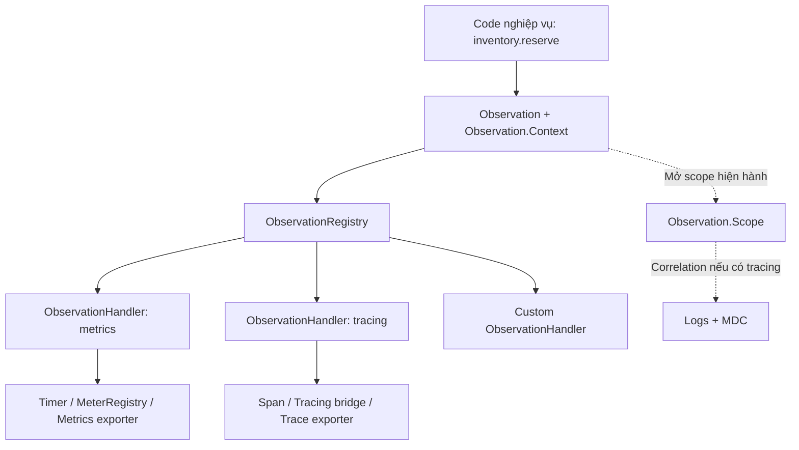
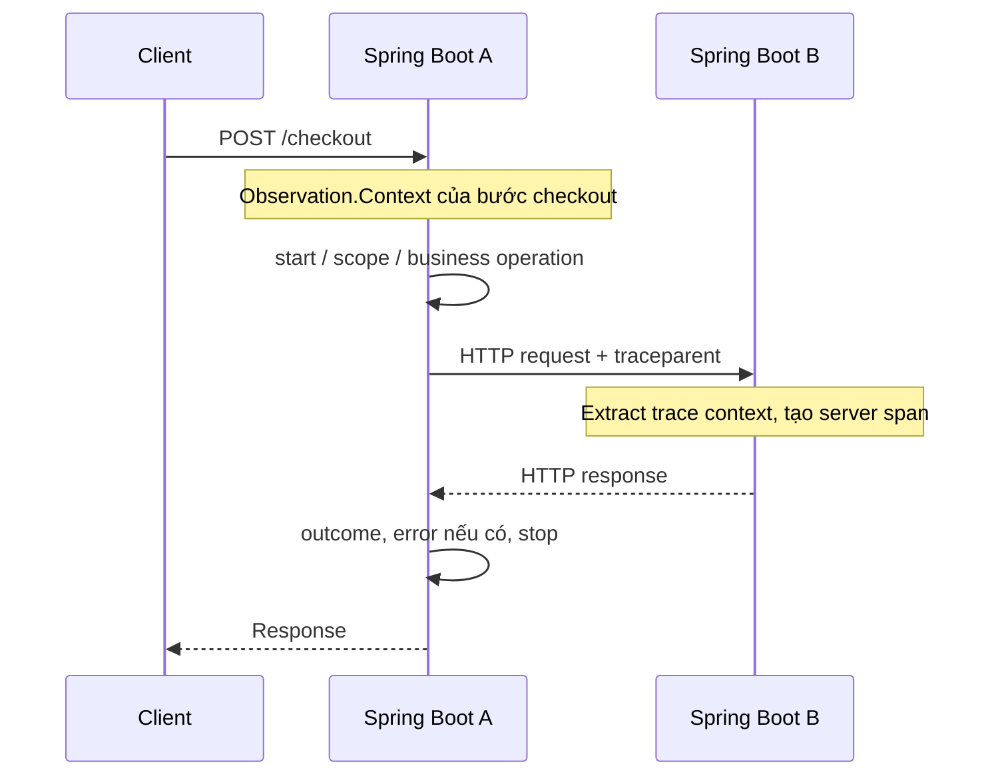

# Chọn context phù hợp

Khi xây dựng custom observation cho một bước đặt hàng, bạn cần ghi thời lượng, kết quả, lỗi và đường đi qua các dịch vụ. Bạn có nên đặt toàn bộ đối tượng `Order` vào observation? Nên khai báo các tag trực tiếp trên `Observation`, tạo một lớp kế thừa `Observation.Context`, hay đưa dữ liệu sang trace context để các service khác nhận được? Nếu chọn sai, metrics có thể bùng số lượng time series, tracing mất liên kết, dữ liệu nhạy cảm đi vào exporter, hoặc việc bổ sung instrumentation trở nên khó bảo trì.

Trong chương **Custom observation** của module **SPRING_BOOT_OBSERVABILITY**, bài **“Chọn context phù hợp”** giải quyết vấn đề thiết kế đó. Micrometer Observation là điểm chung để biểu diễn một thao tác trong Spring Boot; metrics, logs và distributed tracing có thể sử dụng dữ liệu mà observation cung cấp. Việc chọn đúng context giúp bạn mô tả thao tác vừa đủ, giữ ranh giới rõ ràng giữa dữ liệu nghiệp vụ và telemetry, đồng thời duy trì khả năng điều tra lỗi, độ trễ và hành vi ứng dụng trên môi trường thực.

Mục tiêu học tập:

1. Phân biệt `Observation.Context` với `Observation.Scope`, trace context, logging MDC, Reactor Context và dữ liệu nghiệp vụ.
2. Chọn **context mặc định** hoặc **context chuyên biệt** theo nhu cầu của observation, convention và handler.
3. Thiết kế context có tên, thuộc tính và vòng đời ổn định, không rò rỉ thông tin nhạy cảm hoặc tạo metric cardinality lớn.
4. Áp dụng `ObservationConvention` để chuẩn hóa cách ánh xạ context thành tên observation và key-values.
5. Chọn cách truyền ngữ cảnh phù hợp khi đi qua thread, reactive pipeline, HTTP client/server hoặc message broker.
6. Nhận diện các lỗi thực tế: dùng chung context giữa nhiều request, lưu quá nhiều payload, gắn tag sau stop và nhầm context nội bộ với trace propagation.

## 1. Context là gì trong Micrometer Observation?

Một **Observation** biểu diễn một lần thực hiện công việc có tên và vòng đời: bắt đầu, có thể mở scope, có thể ghi lỗi hoặc sự kiện, rồi kết thúc. **Observation.Context** là đối tượng chứa trạng thái và metadata đi cùng *một lần thực hiện* đó để observation, convention và các handler có thể sử dụng.

Ví dụ với `inventory.reserve`, một context có thể cung cấp:

- Loại nghiệp vụ đang đo, chẳng hạn `reserve`.
- Kênh gọi được chuẩn hóa thành một tập hữu hạn: `web`, `mobile`, `batch`.
- Kết quả cuối cùng: `reserved`, `rejected`, `error`.
- Exception được ghi nhận nếu thao tác thất bại.
- Dữ liệu kỹ thuật có kiểu cụ thể mà custom handler cần để thực hiện hành vi phù hợp.

Context **không phải bản sao của request hoặc database entity**. Trừ khi có lý do cụ thể được kiểm soát, đừng nhét vào đó payload JSON, token thanh toán, password, email, mã khách hàng hay toàn bộ đồ thị object. Context nên mô tả những thông tin vừa đủ cho công việc quan sát và có vòng đời tương ứng với observation.

Hình dung vị trí của context:



Một observation có thể được nhiều handler xử lý. Context là nơi mang thông tin chung cho các handler; **handler và cấu hình registry** quyết định tín hiệu nào thực sự được tạo ra. Chỉ tạo `Observation.Context` không tự động xuất metrics, sinh span, gửi OTLP hay ghi log nghiệp vụ.

## 2. Các loại “context” dễ bị nhầm lẫn

Từ *context* xuất hiện ở nhiều tầng của hệ thống. Chúng liên quan nhưng không thay thế nhau.

| Khái niệm | Vai trò | Phạm vi và cách sử dụng |
| --- | --- | --- |
| **`Observation.Context`** | Metadata/trạng thái của một occurrence mà handler/convention đọc | Gắn với một Observation; có thể được chuyên biệt hóa bằng lớp con |
| **`Observation.Scope`** | Đặt observation thành observation hiện hành trong một đoạn thực thi | Mở và đóng đúng chỗ; scope không thay cho `stop()` |
| **Trace context** | Định danh trace/span và liên kết parent–child | Được truyền qua lời gọi khi instrumentation và propagator được cấu hình |
| **W3C `traceparent`/`tracestate`** | Biểu diễn một phần trace context qua HTTP headers | Phục vụ propagation giữa tiến trình; không phải nơi gói toàn bộ metadata nghiệp vụ |
| **Baggage** | Một số thuộc tính có thể được lan truyền xuyên dịch vụ khi cấu hình | Có chi phí và nguy cơ lộ dữ liệu; cần allowlist và giới hạn rõ |
| **MDC / log correlation** | Trường ngữ cảnh phục vụ một log event, ví dụ `traceId`/`spanId` | Phụ thuộc cấu hình logging, scope và ngữ cảnh thực thi |
| **Reactor Context** | Ngữ cảnh đi theo subscription của Reactor | Hỗ trợ trao đổi dữ liệu qua reactive chain; khác `Observation.Context` |
| **Domain context / request DTO** | Dữ liệu nghiệp vụ cần thiết để xử lý yêu cầu | Không mặc nhiên phù hợp để xuất telemetry hoặc làm metric label |

Một sai lầm thường gặp là thấy một custom `Observation.Context` có trường `customerId` rồi cho rằng field này sẽ tự lan sang dịch vụ B. **Không có cơ chế như vậy theo mặc định.** Để truyền trace giữa dịch vụ A và B, bạn cần instrumentation và propagator cho client/server; để chuyển dữ liệu nghiệp vụ, dùng hợp đồng request/message rõ ràng và chính sách dữ liệu phù hợp.

Tương tự, việc gọi `observation.openScope()` không tự bảo đảm mọi tác vụ chạy trên executor khác hoặc trong Reactor sẽ giữ nguyên trace context. Chọn context đúng phải đi cùng chọn **cơ chế propagation đúng ranh giới**.

## 3. Bắt đầu từ câu hỏi: handler thực sự cần dữ liệu nào?

Đừng tạo lớp context chuyên biệt chỉ vì một observation có nhiều key-value. Trước tiên hãy trả lời:

1. **Thao tác nào đang được đo?** Một HTTP request, bước nghiệp vụ, lời gọi dependency hay công việc nền?
2. **Bạn cần những tín hiệu nào?** Duration và số lần; trace spans; logs có correlation; hay custom handler khác?
3. **Tín hiệu nào phải được gom theo nhóm?** Chẳng hạn `operation`, `provider`, `outcome` với tập giá trị hữu hạn.
4. **Dữ liệu nào chỉ cần để xử lý nội bộ?** Có custom handler hoặc convention nào cần đọc thông tin có kiểu riêng?
5. **Có vượt ranh giới thread/process không?** Nếu có, hãy xác định đường propagation độc lập với kiểu context.
6. **Điểm kết thúc ở đâu?** Context có sẵn trước start hay chỉ có kết quả sau khi công việc kết thúc?

Bảng quyết định:

| Tình huống | Lựa chọn khởi đầu | Lý do |
| --- | --- | --- |
| Chỉ đo một bước đồng bộ, vài low-cardinality tags | `Observation.Context` mặc định thông qua API `Observation` | Đơn giản, ít mã cần bảo trì |
| Cần quy tắc đặt tên/tag dùng lại ở nhiều nơi | `ObservationConvention` với context phù hợp | Tập trung naming và tag policy |
| Handler cần thông tin có kiểu riêng: loại operation, outcome, số lần retry | Lớp con của `Observation.Context` | Cấu trúc rõ ràng, tránh ép kiểu hoặc map tùy ý |
| Đang instrument HTTP server/client đã được framework hỗ trợ | Sử dụng context và instrumentation sẵn có của framework | Tránh tạo ranh giới đo trùng và làm mất dữ liệu HTTP có cấu trúc |
| Cần context đi xuyên HTTP/message boundaries | Tracing/propagation instrumentation và các carrier tương ứng | Domain context không tự truyền qua mạng |
| Cần lưu và truy vấn payload nghiệp vụ | Domain store, log/audit có kiểm soát | Không lạm dụng Observation.Context làm kho lưu trữ |

Quy tắc tổng quát: **chọn context đơn giản nhất vẫn đáp ứng được handler và convention hiện tại**. Khi trách nhiệm tăng lên, bổ sung kiểu chuyên biệt có chủ đích thay vì chuyển mọi dữ liệu từ request vào context.

## 4. Khi nào dùng context mặc định?

Nếu chỉ muốn đo thời gian gọi một dependency và gắn một số tag ổn định, bạn thường không cần tự khai báo lớp context.

Ví dụ Spring Boot (Java 17+, ứng dụng đã có bean `ObservationRegistry` do Actuator/instrumentation phù hợp cung cấp):

```java
import io.micrometer.observation.Observation;
import io.micrometer.observation.ObservationRegistry;
import org.springframework.stereotype.Service;

@Service
public class ShippingQuoteService {
    private final ObservationRegistry registry;
    private final ShippingGateway gateway;

    public ShippingQuoteService(ObservationRegistry registry,
                                ShippingGateway gateway) {
        this.registry = registry;
        this.gateway = gateway;
    }

    public long quote(String destinationPostcode) {
        return Observation.createNotStarted("shipping.quote", registry)
                .contextualName("calculate shipping quote")
                .lowCardinalityKeyValue("operation", "quote")
                .lowCardinalityKeyValue("provider", "primary")
                .observe(() -> gateway.quote(destinationPostcode));
    }
}

interface ShippingGateway {
    long quote(String destinationPostcode);
}
```

Với cấu hình metrics handler, một lần gọi có thể cập nhật timer/metric tương ứng. Với tracing handler, nó có thể tạo một span. `observe(...)` đảm nhiệm lifecycle đồng bộ: start, mở scope, thực thi lambda, xử lý exception theo cơ chế API và stop.

Ở đây:

- `shipping.quote` là **tên đo ổn định**.
- `operation=quote` và `provider=primary` là **low-cardinality tags**.
- `destinationPostcode` chỉ là tham số đầu vào của nghiệp vụ; không tự trở thành tag.
- Mã không cần lớp `ShippingQuoteContext` riêng vì chưa có handler/convention nào đòi hỏi thêm trạng thái có kiểu cụ thể.

### Khi cách này bắt đầu không đủ

Giả sử sau này bạn phải xử lý ba nhà cung cấp vận chuyển, mỗi nhà cung cấp có retry riêng; custom handler cần phân biệt lỗi do `timeout`, `invalid_response`, `rate_limited` và biết số lần thử để gửi một sự kiện nội bộ. Nếu cứ thêm hàng chục dòng chọn tag trong từng service, cách biểu diễn context mặc định trở nên khó duy trì. Đây là tín hiệu nên thiết kế **typed context** và có thể là một convention chung.

Đừng tạo typed context chỉ để bọc duy nhất một chuỗi `operation`; lợi ích chưa đủ bù thêm lớp, quy tắc tạo context và trách nhiệm quản lý vòng đời.

## 5. Context chuyên biệt: biểu diễn có kiểu và nhất quán

Một context chuyên biệt là lớp kế thừa `Observation.Context`, chứa **những thuộc tính mà handler/convention thực sự cần**. Nó vẫn tham gia vòng đời Observation, nhưng giúp phần instrumentation có hợp đồng rõ thay vì chuỗi/map rải rác.

Ví dụ quan sát thao tác giữ tồn kho với các kết quả:

- `reserved`: giữ chỗ thành công.
- `rejected`: từ chối hợp lệ vì không đủ hàng.
- `error`: exception/technical failure.

Chúng ta muốn dùng kênh gọi (tập nhỏ) làm metric dimension, đồng thời giữ kết quả cuối trong context để handler khác có thể đọc.

### 5.1. Định nghĩa typed context

```java
import io.micrometer.observation.Observation;

public final class InventoryReserveContext extends Observation.Context {
    private final String channel;
    private String outcome = "unknown";

    public InventoryReserveContext(String channel) {
        // Caller phải chuẩn hóa channel thành tập giá trị hữu hạn.
        this.channel = channel;
    }

    public String channel() {
        return channel;
    }

    public String outcome() {
        return outcome;
    }

    public void outcome(String value) {
        this.outcome = value;
    }
}
```

Lớp này có hai thuộc tính cần thiết. Nó **không giữ `sku`, `orderId`, request body hoặc token**. Dù đây chỉ là object trong bộ nhớ, chúng ta thiết kế theo nguyên tắc *data minimization*: những gì không cần cho instrumentation thì không lưu.

Một context **mới** được tạo cho **mỗi lần gọi**. Không inject một `InventoryReserveContext` singleton vào service để nhiều request cùng thay đổi `outcome`; đó sẽ là shared mutable state và khiến observation này đọc nhầm kết quả của observation khác.

### 5.2. Tạo convention cho context

`ObservationConvention<T>` cho phép định nghĩa tên và key-value dựa trên kiểu context, giúp nhiều điểm instrument cùng một operation dùng chung quy tắc. Ví dụ:

```java
import io.micrometer.common.KeyValue;
import io.micrometer.common.KeyValues;
import io.micrometer.observation.Observation;
import io.micrometer.observation.ObservationConvention;

public final class InventoryReserveConvention
        implements ObservationConvention<InventoryReserveContext> {

    @Override
    public boolean supportsContext(Observation.Context context) {
        return context instanceof InventoryReserveContext;
    }

    @Override
    public String getName() {
        return "inventory.reserve";
    }

    @Override
    public String getContextualName(InventoryReserveContext context) {
        return "reserve inventory";
    }

    @Override
    public KeyValues getLowCardinalityKeyValues(
            InventoryReserveContext context) {
        return KeyValues.of(
                KeyValue.of("operation", "reserve"),
                KeyValue.of("channel", context.channel())
        );
    }
}
```

Ở đây convention chỉ phát các tag đã biết từ đầu; `outcome` chưa có giá trị cuối cho tới khi công việc hoàn thành, nên sẽ được gắn lúc đó. Lợi ích của convention là không phải chép tên meter và chính sách tag sang nhiều nơi.

**Ghi nhớ:** `supportsContext(...)` giúp convention áp dụng đúng kiểu context. Nếu nhiều convention/handler cùng hỗ trợ, cấu hình registry và thứ tự/ưu tiên có thể ảnh hưởng kết quả; khi tùy biến framework instrumentation, hãy kiểm chứng bằng metrics/traces thực tế. Không dùng một convention HTTP cho một context nghiệp vụ chỉ vì tên trường trông giống nhau.

### 5.3. Sử dụng context trong service

```java
import io.micrometer.observation.Observation;
import io.micrometer.observation.ObservationRegistry;
import org.springframework.stereotype.Service;

@Service
public class InventoryService {
    private final ObservationRegistry registry;
    private final InventoryGateway gateway;
    private final InventoryReserveConvention convention =
            new InventoryReserveConvention();

    public InventoryService(ObservationRegistry registry,
                            InventoryGateway gateway) {
        this.registry = registry;
        this.gateway = gateway;
    }

    public boolean reserve(String channel, String sku) {
        String normalizedChannel = switch (
                channel == null ? "" : channel) {
            case "web" -> "web";
            case "mobile" -> "mobile";
            case "batch" -> "batch";
            default -> "other";
        };

        InventoryReserveContext context =
                new InventoryReserveContext(normalizedChannel);

        Observation observation = Observation
                .createNotStarted("inventory.reserve", () -> context, registry)
                .observationConvention(convention)
                .start();

        try (Observation.Scope scope = observation.openScope()) {
            boolean reserved = gateway.reserve(sku);
            String outcome = reserved ? "reserved" : "rejected";

            context.outcome(outcome);
            observation.lowCardinalityKeyValue("outcome", outcome);
            return reserved;
        } catch (RuntimeException | Error failure) {
            context.outcome("error");
            observation.error(failure);
            observation.lowCardinalityKeyValue("outcome", "error");
            throw failure;
        } finally {
            observation.stop();
        }
    }
}

interface InventoryGateway {
    boolean reserve(String sku);
}
```

Đường đi dữ liệu:

1. Chọn `channel` từ một tập hữu hạn, không để input tùy ý tạo nhãn mới.
2. Tạo **một** `InventoryReserveContext` cho occurrence.
3. Tạo Observation với context supplier và gắn convention, sau đó `start()`.
4. Mở scope cho phần nghiệp vụ; đặt `outcome` vào context và vào low-cardinality key-value trước khi stop.
5. Nếu ném exception, ghi nhận bằng `observation.error(failure)`; `finally` vẫn stop.

**Điểm quan trọng về thời điểm:** handler có thể đọc key-values ở những mốc lifecycle khác nhau. Code minh họa thêm `outcome` khi đã biết và trước `stop()`, nhưng muốn bảo đảm nhãn xuất hiện trên metric/span của một hệ thống cụ thể phải kiểm tra handler/convention đang dùng. Không giả định mọi backend sẽ cập nhật những attributes từng được đọc ở `onStart`. Nếu yêu cầu nghiệp vụ cần một bộ nhãn outcome hoàn toàn chính xác, hãy kiểm chứng cách metrics handler ghi nhận tag tại `onStop` và cách tracing handler xử lý tag trước khi span kết thúc.

Code trên minh họa API và thiết kế, không bao gồm bean implementation cho `InventoryGateway`, dependencies build hoặc toàn bộ cấu hình production. Với custom handler cần dữ liệu `outcome`, nên đọc nó ở **thời điểm kết thúc** thay vì `onStart`.

### 5.4. Lúc nào nên dùng custom ObservationHandler?

Một custom handler có thể hữu ích khi cần chuyển một sự kiện nội bộ sang hệ thống quan sát riêng hoặc áp dụng chính sách đặc thù. Handler nên khai báo rõ context được hỗ trợ:

```java
import io.micrometer.observation.Observation;
import io.micrometer.observation.ObservationHandler;

public final class InventoryOutcomeHandler
        implements ObservationHandler<InventoryReserveContext> {

    @Override
    public boolean supportsContext(Observation.Context context) {
        return context instanceof InventoryReserveContext;
    }

    @Override
    public void onStop(InventoryReserveContext context) {
        // Chỉ đọc dữ liệu cần thiết, ví dụ context.outcome().
        // Ví dụ giáo dục: chưa gửi dữ liệu đến hệ thống bên ngoài.
    }
}
```

Handler này phải được đăng ký vào cấu hình `ObservationRegistry` thì mới được gọi. Tạo class handler mà không đăng ký không sinh telemetry. Không để handler tự ghi lại một timer thứ hai nếu metrics handler đã đo cùng occurrence, trừ khi có mục tiêu đo khác được định nghĩa rõ.

**Không dùng handler để viết logic bắt buộc của nghiệp vụ**, chẳng hạn tự trừ số lượng tồn kho trong `onStop`. Các callback instrumentation có thể bị thay đổi cấu hình, sampling hoặc bị vô hiệu trong môi trường khác; tính đúng đắn nghiệp vụ phải nằm ở business service/transaction thích hợp.

## 6. Context nên mang dữ liệu nào, và dữ liệu nào phải loại bỏ?

Tách ba mục đích thường gặp:

- **Để phân nhóm metrics:** Chọn low-cardinality keys có bộ giá trị nhỏ, ổn định.
- **Để giải thích một trace cụ thể:** Có thể dùng thêm attributes chi tiết khi handler hỗ trợ, nhưng phải tuân thủ giới hạn dữ liệu và sampling.
- **Để xử lý nghiệp vụ:** Dùng tham số/domain object riêng; không tự động đưa chúng vào observation hoặc exporter.

| Dữ liệu | Có nên ở Observation.Context? | Có nên làm metric tag? | Lưu ý |
| --- | --- | --- | --- |
| `operation=reserve` | Có | Có | Tên/value ổn định |
| `channel=web|mobile|batch|other` | Có | Có | Normalize tại ranh giới input |
| `outcome=reserved|rejected|error` | Có | Có | Chỉ gắn khi biết kết quả; thống nhất taxonomy |
| `provider=inventory-a|inventory-b` | Có nếu cần | Có nếu tập hữu hạn | Tránh hostname/pod ID biến động làm card không kiểm soát |
| Số lần retry | Có nếu handler cần | Cân nhắc bucket hoặc metric riêng | Tránh gắn số attempt tăng vô hạn làm nhãn |
| `http.route=/orders/{id}` | Có qua HTTP instrumentation phù hợp | Có | Dùng route template, không dùng URL chứa ID |
| `orderId`, `customerId`, email | Thường không cần | Không | Cardinality cao; nguy cơ dữ liệu cá nhân |
| Secret, access token, password, payment payload | Không | Không | Không xuất vào traces/logs bằng đường vòng |
| Full request body/response body | Thường không | Không | Dễ chứa PII và tăng chi phí lưu trữ |
| Exception/loại lỗi kỹ thuật | Có bằng `observation.error(...)` | Dùng nhóm mã lỗi ổn định nếu cần | Đừng lấy nguyên message exception làm tag |
| Trace ID/span ID | Từ tracing context | Không làm metric tag | Dùng để liên kết log/trace, không để gom time series |

### 6.1. Cardinality tăng nhanh như thế nào?

Một meter có các dimensions `operation` (3 giá trị), `channel` (4 giá trị) và `outcome` (3 giá trị) có thể có tới:

```text
3 × 4 × 3 = 36 tổ hợp nhãn
```

Nếu thêm `orderId` với 100.000 giá trị, số tổ hợp **tiềm năng** tăng lên tới 3.600.000, chưa tính các chiều khác hoặc histogram buckets. Đây là ví dụ nhân tổ hợp lý thuyết; số series tồn tại thực tế phụ thuộc những tổ hợp đã xuất hiện. Tuy nhiên, rủi ro về bộ nhớ, tải exporter và chi phí truy vấn là có thật.

Micrometer Observation phân biệt:

- `lowCardinalityKeyValue(k, v)`: hợp lý cho dimensions của metrics và có thể dùng cho traces.
- `highCardinalityKeyValue(k, v)`: ngữ cảnh chi tiết mà tracing handler có thể dùng; thông thường **không nên** trở thành metric dimension.

Từ **high-cardinality** không cho phép gửi PII/secrets. Dù không vào metrics, dữ liệu vẫn có thể rời hệ thống qua exporter trace và được lưu lại. Quy tắc giảm thiểu dữ liệu áp dụng cho **tất cả** tín hiệu.

### 6.2. Bảo toàn ngữ nghĩa của một tag

Các string tự do thường tạo lỗi chất lượng dữ liệu:

```text
outcome="SUCCESS"       khác outcome="success"
outcome="OK"            khác outcome="success"
outcome="err 503"       có thể tạo vô số biến thể theo mã lỗi/message
channel="<raw header>"  có thể có số lượng giá trị không giới hạn
```

Tốt hơn là định nghĩa danh mục thống nhất và chuẩn hóa input trước khi gắn vào Observation. Nếu muốn thêm loại lỗi, dùng mã phân loại hữu hạn như `timeout`, `rejected`, `upstream_error`, `other`, tránh ghi nguyên error message làm label.

## 7. Tên observation, convention và context có quan hệ thế nào?

Một context thường mang dữ liệu; convention quyết định cách dữ liệu đó được biểu diễn nhất quán:

| Phần | Câu hỏi thiết kế |
| --- | --- |
| **Tên observation** | Có ổn định qua các occurrence và phù hợp để gom metrics không? |
| **Contextual name** | Có mô tả công việc dễ đọc trên trace không, nhưng không chứa ID tùy ý? |
| **Low-cardinality key-values** | Tập giá trị có giới hạn, tên rõ ràng và tương thích backend không? |
| **High-cardinality key-values** | Có thật sự cần thiết? Có dữ liệu nhạy cảm không? |
| **Context class** | Có lưu đúng dữ liệu mà convention/handler cần, với kiểu rõ ràng? |
| **Handler** | Có xử lý đúng loại context và đọc dữ liệu ở lifecycle callback phù hợp? |

Ví dụ:

```text
Observation name   : inventory.reserve
Contextual name    : reserve inventory
Low-cardinality    : operation=reserve, channel=web, outcome=reserved
High-cardinality   : (không cần trong ví dụ)
Typed context      : InventoryReserveContext(channel, outcome)
Handler            : metrics/tracing đã cấu hình; custom onStop nếu cần
```

Không đặt tên observation là `inventory.reserve.customer-9981` rồi kỳ vọng backend tự gom đúng. Khi bạn cần nghiên cứu cụ thể một đơn hàng, phương pháp phù hợp thường là trace/log correlation có chính sách truy cập, chứ không phải tăng độ chi tiết của metric name.

Một convention được dùng lại ở nhiều nơi giúp giữ đồng nhất nhãn khi mã ứng dụng phát triển. Nhưng nếu convention chuyển field quá chi tiết thành tag tự do, việc tập trung hóa **không** tự làm nó an toàn. Chất lượng taxonomy vẫn cần được thiết kế.

## 8. Chọn context đúng theo ranh giới instrumentation

### 8.1. Nghiệp vụ trong một Spring Boot service

Chọn context mặc định khi chỉ cần timer và một vài nhãn cố định. Tạo typed context khi logic và handler phải chia sẻ trạng thái có kiểu, ví dụ category nghiệp vụ và outcome; đặt điểm start/stop đúng ranh giới business step.

Ví dụ HTTP server có observation cho `POST /orders`, bên trong có custom `inventory.reserve`. Hai observation có **câu hỏi khác nhau**:

- HTTP server observation: request xử lý bao lâu, status nào?
- Inventory observation: bước giữ tồn kho mất bao lâu, kết quả nào?

Không nên tạo nhiều observation lặp lại đúng một ranh giới đã được framework instrument nếu chúng không cung cấp thêm tín hiệu có ý nghĩa.

### 8.2. HTTP client và server

Các integration HTTP thường có context chuyên biệt do framework tạo ra để mô tả request, response, URI template hoặc carrier propagation. Nếu muốn thay đổi cách đặt tên route hay tag, ưu tiên sử dụng convention/configuration tương ứng với framework và đúng loại context thay vì tự tạo một `Observation.Context` mới cho mỗi request.

Với Spring Boot, sử dụng HTTP client builder do Boot cấu hình (ví dụ `RestClient.Builder` hoặc `WebClient.Builder`) giúp tận dụng observation/tracing integration khi có dependency cần thiết. Nếu tạo client độc lập rồi bỏ qua instrumentation, context nội bộ của custom observation **không tự biến thành** outbound `traceparent`.

### 8.3. Message broker

Một producer và consumer có thể cần propagation qua headers của message. Phần context được gửi qua message phải do instrumentation/propagator của hệ thống đó quy định. Không serialise nguyên lớp `InventoryReserveContext` vào message chỉ để “giữ trace”; đây là object phục vụ instrumentation trong tiến trình, có lifecycle và quyền sở hữu riêng.

### 8.4. Batch, scheduler và background job

Với công việc nền không bắt đầu từ HTTP request, tạo observation mới ở ranh giới job. Context nên mang `job.type`, `operation`, `outcome` có cardinality hữu hạn. ID chạy job có thể dùng trong hệ thống job/audit hoặc log được bảo vệ, không đưa trực tiếp vào metric label.

Nếu scheduler tạo nhiều attempt/retry, xác định có observation tổng đo cả job và observation con đo từng attempt hay không. Mỗi observation phải có lifecycle riêng và stop đúng khi công việc tương ứng kết thúc.

## 9. Scope và context propagation: hai công việc khác nhau

Một custom context được tạo trong service A không tự tồn tại bên trong service B. Tracing có thể liên kết các thao tác qua header, nếu pipeline instrumentation được thiết lập:



Ba việc cần được thực hiện riêng:

1. **Instrument:** Dùng Observation/handlers để mô tả công việc và dữ liệu.
2. **Activate:** Mở/đóng scope khi cần một observation là current trong đoạn thực thi.
3. **Propagate:** Dùng tracing instrumentation và propagator để đưa trace context qua HTTP, message headers hoặc ranh giới thread/reactive phù hợp.

Ví dụ:

```java
Observation observation = Observation
        .createNotStarted("checkout.authorize", registry)
        .start();

try (Observation.Scope scope = observation.openScope()) {
    // Code đồng bộ ở đây có thể thấy observation hiện hành.
    paymentClient.authorize();
} catch (RuntimeException | Error failure) {
    observation.error(failure);
    throw failure;
} finally {
    observation.stop();
}
```

Đóng `Scope` không thay thế `Observation.stop()`. Trong tracing, current span/log correlation thường phụ thuộc scope đang hoạt động. Nếu code chạy ở thread khác, bạn cần cơ chế truyền context. **Không truyền trực tiếp mutable `Observation.Context` rồi đồng thời sửa các field từ nhiều thread** như một cách thay thế context propagation.

### 9.1. Baggage không phải chỗ chuyển toàn bộ business context

Baggage có thể được truyền qua các process và đôi khi liên kết với MDC tùy cấu hình. Tuy nhiên, các thuộc tính được mang theo có thể lộ ra ở mạng, downstream hoặc logs. Hãy dùng baggage có allowlist, giới hạn độ dài và chính sách dữ liệu rõ ràng. Không đưa email, token, raw customer ID hoặc request body vào baggage chỉ để tìm trace nhanh hơn.

Nếu mục tiêu chỉ là nối các spans của một request, thường **trace context** là đủ. Nếu muốn downstream biết một quyết định nghiệp vụ, hãy đưa dữ liệu đó vào contract của API/message theo đúng trách nhiệm, thay vì đẩy mọi trường vào baggage.

## 10. Chọn context trong xử lý bất đồng bộ và reactive

### 10.1. Không tái sử dụng một context cho nhiều request song song

`Observation.Context` thường là đối tượng có trạng thái thay đổi trong lifetime. Nếu hai request dùng chung instance, các trường như `outcome` hoặc `error` có thể ghi đè lên nhau, làm telemetry sai và gây race condition. Tạo một context cho mỗi occurrence, bảo đảm phần mã chịu trách nhiệm duy nhất cập nhật state.

```text
Sai:
  singleton InventoryReserveContext
      ├── request A -> outcome = reserved
      └── request B -> outcome = error

Đúng:
  request A -> Context A -> Observation A -> stop A
  request B -> Context B -> Observation B -> stop B
```

Nếu nhiều callback có thể kết thúc một thao tác, hãy xác định một bên chịu trách nhiệm stop và đồng bộ hóa việc cập nhật context khi thật sự cần. Chỉ dùng object có cùng tên field không làm những cập nhật xuyên thread trở nên an toàn.

### 10.2. CompletableFuture

Một lỗi thường gặp:

```java
return Observation.createNotStarted("inventory.reserve.async", registry)
        .observe(() -> inventoryClient.reserveAsync());
```

Nếu `reserveAsync()` trả về `CompletableFuture` ngay, `observe(...)` chỉ đo thời gian *tạo future*, không đo đến khi công việc hoàn tất. Trong mô hình bất đồng bộ, chọn một context cho invocation và kết thúc observation khi future nguồn kết thúc theo định nghĩa của bạn; dùng callback terminal như `whenComplete`, ghi lỗi và stop trong cleanup.

Cần phân biệt **future bị cancel** với **tác vụ vật lý đã dừng**: cancellation của một future không đảm bảo downstream dừng ngay. Nếu muốn đo cả thời gian người dùng chờ và thời gian tác vụ nền, dùng hai observation ở hai ranh giới riêng.

### 10.3. Reactor / WebFlux

`Mono`/`Flux` có thể được subscribe nhiều lần. Nên tạo observation và context *theo subscription*, tránh tạo context dùng chung ở thời điểm xây dựng publisher:

```java
import io.micrometer.observation.Observation;
import reactor.core.publisher.Mono;

public Mono<Boolean> reserveReactive(String channel, String sku) {
    return Mono.defer(() -> {
        InventoryReserveContext context =
                new InventoryReserveContext(normalizeChannel(channel));

        Observation observation = Observation.createNotStarted(
                "inventory.reserve.reactive", () -> context, registry
        ).start();

        try {
            return reactiveGateway.reserve(sku)
                    .doOnNext(reserved -> {
                        String outcome = reserved ? "reserved" : "rejected";
                        context.outcome(outcome);
                        observation.lowCardinalityKeyValue("outcome", outcome);
                    })
                    .doOnError(failure -> {
                        context.outcome("error");
                        observation.error(failure);
                        observation.lowCardinalityKeyValue("outcome", "error");
                    })
                    .doFinally(signal -> observation.stop());
        } catch (RuntimeException | Error setupFailure) {
            context.outcome("error");
            observation.error(setupFailure);
            observation.stop();
            throw setupFailure;
        }
    });
}
```

Ví dụ chỉ diễn đạt pattern lifecycle của một publisher đơn giản và giả định `normalizeChannel`, `reactiveGateway` đã có sẵn. Tùy nghiệp vụ, bạn còn phải xử lý kết quả `Mono.empty()` và `CANCEL` (chưa có `doOnNext` hoặc `doOnError`), tránh để `outcome` mãi là `unknown` nếu đó là dữ liệu quan trọng. **`doFinally` không tự động kích hoạt scope/tracing context xuyên các operator hoặc scheduler**; hãy dùng cơ chế Reactor/Micrometer Context Propagation tương thích.

Với `retry`, `share`, `cache` và các loại publisher nóng (hot), ý nghĩa “một lần thực hiện” phụ thuộc cách chuỗi được xây dựng. Hãy quyết định observation đo **mỗi subscription**, **mỗi attempt** hay **toàn bộ thao tác người dùng**, rồi đặt `defer` và `doFinally` ở ranh giới tương ứng.

## 11. Context và kết quả: cách ghi error, outcome, duration

Hai nhóm tín hiệu phải được phân biệt:

- **Technical error:** Exception, timeout, upstream failure, serialization error.
- **Business outcome:** Giữ hàng thành công, từ chối do hết hàng, thanh toán bị từ chối đúng quy trình.

Ví dụ `gateway.reserve(sku)` trả `false` có thể là trường hợp nghiệp vụ bình thường, không có exception. Nếu chỉ dựa vào `observation.error(...)` để tính tỷ lệ từ chối, bạn sẽ bỏ sót kết quả này.

Bảng outcome đề xuất:

| Trường hợp | `context.outcome` | `observation.error(...)` | Metric/tag |
| --- | --- | --- | --- |
| Giữ hàng thành công | `reserved` | Không | `outcome=reserved` |
| Hết hàng hợp lệ | `rejected` | Không | `outcome=rejected` |
| Timeout dependency | `error` | Có exception timeout | `outcome=error` và/hoặc error category hữu hạn |
| Exception lập trình | `error` | Có exception | `outcome=error` |
| Cancel trước khi có kết quả | `cancelled` nếu được định nghĩa | Không tự mặc định là exception | `outcome=cancelled` nếu cần |

Khi convention đọc dữ liệu context tại `onStart`, giá trị `outcome` chưa tồn tại. Khi handler đọc ở `onStop`, nó thường có đủ kết quả. Nếu một tag cần được xuất ở thời điểm khác, chủ động thiết kế callback, quy ước và thời điểm cập nhật. Quan trọng nhất là **đừng gắn kết quả sau khi observation đã stop** rồi kỳ vọng dữ liệu đã export sẽ tự thay đổi.

## 12. Context liên quan thế nào đến metrics, logs và distributed tracing?

Việc chọn context đúng chỉ giải quyết cách biểu diễn dữ liệu; để quan sát trong production, cần xem toàn bộ pipeline.

| Tín hiệu | Context giúp gì? | Cần cấu hình thêm gì? | Điểm mù thường gặp |
| --- | --- | --- | --- |
| Metrics | Tên, các chiều tag có kiểm soát, kết quả thao tác | Metrics handler, `MeterRegistry`, exporter/scrape | Tag cardinality cao; timer không xuất vì chưa có stop |
| Traces | Tên span, thuộc tính chẩn đoán, quan hệ scope/parent | Tracing handler/bridge, sampler, exporter, propagation | Trace bị sampling loại hoặc mất parent qua HTTP/async |
| Logs | Trace/span correlation khi scope/tracing được kích hoạt | Logging pattern/MDC, log pipeline | Log phát ngoài scope hoặc MDC bị mất |
| Custom handler | Đọc typed context để thực hiện xử lý telemetry riêng | Đăng ký handler vào registry | Không xử lý đúng context; thực hiện logic nghiệp vụ trong callback |

### 12.1. Ví dụ cấu hình nền cho Spring Boot 3.x

Trong dự án Maven đã dùng Spring Boot dependency management, một cấu hình tiêu biểu gồm Actuator, Prometheus registry và Micrometer Tracing qua OpenTelemetry:

```xml
<dependency>
    <groupId>org.springframework.boot</groupId>
    <artifactId>spring-boot-starter-actuator</artifactId>
</dependency>

<!-- Khi cần Prometheus metrics -->
<dependency>
    <groupId>io.micrometer</groupId>
    <artifactId>micrometer-registry-prometheus</artifactId>
</dependency>

<!-- Khi dùng Micrometer Tracing + OpenTelemetry -->
<dependency>
    <groupId>io.micrometer</groupId>
    <artifactId>micrometer-tracing-bridge-otel</artifactId>
</dependency>

<!-- Khi xuất traces qua OTLP -->
<dependency>
    <groupId>io.opentelemetry</groupId>
    <artifactId>opentelemetry-exporter-otlp</artifactId>
</dependency>
```

```yaml
management:
  endpoints:
    web:
      exposure:
        include: health,metrics,prometheus
  tracing:
    sampling:
      probability: 0.1
  otlp:
    tracing:
      endpoint: http://localhost:4318/v1/traces
```

Địa chỉ `localhost:4318` là ví dụ khi collector/backend chấp nhận OTLP HTTP tại máy đang chạy ứng dụng. Muốn xem trace phải có collector/backend hoạt động và nhận được dữ liệu. Sampling `0.1` chỉ ra chính sách lấy mẫu tracing, **không có nghĩa chỉ 10% metrics được ghi nhận**.

Với Spring Boot **4.x**, starter và cấu hình tracing/OTLP có thay đổi. Khi triển khai, đọc tài liệu đúng phiên bản đang dùng; không sao chép nguyên nhóm dependency/property của 3.x sang 4.x. Việc dùng `Observation.Context`, convention, scope và handler vẫn tuân theo các nguyên tắc thiết kế vừa học.

Kiểm tra ở môi trường lab:

```bash
curl -fsS http://localhost:8080/actuator/metrics
curl -fsS http://localhost:8080/actuator/metrics/inventory.reserve
curl -fsS http://localhost:8080/actuator/prometheus
```

Các endpoint trên chỉ tồn tại khi Actuator/web exposure được cấu hình phù hợp và thao tác đã được instrument/thực thi. Một meter chưa xuất hiện không đủ chứng minh code sai: cũng có thể thiếu handler, registry, endpoint hoặc dữ liệu bị lọc. Trong production, bảo vệ endpoint quản trị bằng mạng và phân quyền thích hợp; không công khai tùy tiện.

### 12.2. Context không quyết định sampling và exporter

Giả sử một observation có `channel=web` và `outcome=error`, nhưng không thấy trace tương ứng:

- Có thể trace bị sampler loại.
- Có thể tracing handler/bridge chưa hoạt động.
- Có thể exporter/collector/backend bị lỗi.
- Có thể scope/propagation đã đứt khi gọi dịch vụ khác.
- Có thể log có `traceId` nhưng trace không được lưu.

Đừng thay context hoặc thêm càng nhiều tag để “chữa” thiếu trace khi vấn đề nằm ở pipeline. Hãy xác minh từng mắt xích.

## 13. Những anti-pattern nên tránh

| Anti-pattern | Vì sao có vấn đề | Phương án |
| --- | --- | --- |
| Mỗi observation chứa toàn bộ DTO/request | Tốn bộ nhớ, coupling lớn, dễ lộ dữ liệu | Chỉ giữ những trường cần cho handler/convention |
| Một singleton mutable context cho mọi request | Race condition, lẫn outcome và exception | Tạo context mới cho mỗi occurrence |
| Dùng `orderId` làm metric tag | Bùng cardinality, khó vận hành | Dùng outcome/route chuẩn; trace/log correlation khi cần |
| Truyền typed `Observation.Context` thẳng qua HTTP | Context object không phải format propagation chuẩn | HTTP instrumentation + W3C Trace Context |
| Cho rằng `openScope()` tự lan qua mọi thread | Context có thể mất ở executor/reactive operator | Dùng context propagation integration |
| Convention gắn field kết quả chưa có từ lúc start | Tag/attribute có thể sai hoặc thiếu | Gắn đúng trước stop, xác minh handler callback |
| Viết logic nghiệp vụ trong `ObservationHandler.onStop` | Telemetry bị vô hiệu hoặc thay đổi làm ảnh hưởng business | Logic nghiệp vụ ở service; handler chỉ dành cho quan sát |
| Tạo custom observation trùng HTTP instrumentation | Span/metrics trùng ranh giới, khó đọc | Chỉ tạo custom span cho business step có ý nghĩa |
| Lưu bí mật ở `highCardinalityKeyValue(...)` | Trace cũng có thể bị export/lưu | Loại bỏ hoặc khử nhạy cảm; áp dụng policy dữ liệu |
| Quên `stop()` khi exception/early return | Timer/span thiếu điểm kết thúc | `observe(...)` hoặc `try/finally` |
| Tạo context một lần khi khai báo `Mono` | Nhiều subscription có thể chia sẻ state | `Mono.defer(...)`, context theo occurrence |

## 14. Bài thực hành: chọn context cho ba tình huống

### Tình huống A: tính phí vận chuyển

Ứng dụng có một lời gọi đồng bộ sang một nhà cung cấp, chỉ cần duration và error rate. Tập tag cố định: `operation=quote` và `provider=primary`.

**Lựa chọn hợp lý:** Dùng `Observation.createNotStarted(...).lowCardinalityKeyValue(...).observe(...)` với context mặc định. Không cần lớp context chuyên biệt. Giữ postcode trong business argument.

### Tình huống B: giữ tồn kho đa kênh

Ứng dụng có các kênh `web`, `mobile`, `batch`; kết quả `reserved`, `rejected`, `error`. Nhiều handler hoặc convention cần đọc outcome đồng nhất.

**Lựa chọn hợp lý:** Tạo `InventoryReserveContext` và convention, dùng tên `inventory.reserve`, chuẩn hóa kênh, cập nhật outcome trước stop. Đừng thêm `sku` hay `orderId` làm metric label. Nếu một phần việc chạy async, chọn owner/lifetime và cơ chế propagation riêng.

### Tình huống C: gọi hai microservices qua HTTP

Mỗi service đã có Actuator và tracing. Cần tìm nguyên nhân vì sao checkout chậm trên service B.

**Lựa chọn hợp lý:** Giữ instrumentation HTTP sẵn có và propagation qua client builder/header. Tạo thêm custom observation cho một bước nghiệp vụ trong B nếu cần phân tích riêng. Không thêm full `CheckoutRequest` vào baggage hay serialise typed context sang service B.

### Ma trận tự đánh giá

| Câu hỏi | Nếu câu trả lời là “Có” thì nên làm gì? |
| --- | --- |
| Chỉ cần timer và 2–3 tags ổn định? | Bắt đầu từ context mặc định |
| Handler cần đọc nhiều thuộc tính có kiểu và outcome? | Xem xét typed `Observation.Context` |
| Nhiều nơi cần cùng naming/tag taxonomy? | Dùng `ObservationConvention` |
| Đang ở ranh giới HTTP có auto instrumentation? | Tái dùng integration và context sẵn có |
| Cần đi qua service hoặc message broker? | Xác minh trace propagation thay vì chuyển domain context |
| Có field ID động, PII hoặc secret? | Loại khỏi metric tags/telemetry không cần thiết |
| Có async, retry hoặc cancellation? | Định nghĩa lifetime, owner và thời điểm stop |
| Dashboard thiếu trace dù metric có? | Kiểm tra sampler/exporter/collector và propagation |

### Câu hỏi tự kiểm tra

**1. Tại sao không nên dùng một typed context singleton cho mọi request?**

Vì context mang trạng thái của **một occurrence** và thường thay đổi trong khi chạy. Dùng chung giữa nhiều request có thể khiến các field outcome/error chồng chéo, đồng thời gây lỗi cạnh tranh dữ liệu.

**2. Khi nào context mặc định tốt hơn typed context?**

Khi chỉ cần tên observation cùng một vài key-value ổn định, không có custom handler/convention cần thêm dữ liệu có kiểu. Lớp context mới lúc đó chỉ làm tăng độ phức tạp.

**3. Một context có field `traceId` có làm ứng dụng tự truyền trace sang service khác không?**

Không. Trace propagation phụ thuộc tracing instrumentation, propagator và carrier như HTTP headers. Tự đặt một chuỗi vào Observation.Context không thay thế W3C Trace Context.

**4. Vì sao `orderId` không phù hợp làm low-cardinality tag?**

Vì nó tạo số giá trị không giới hạn và có nguy cơ lộ dữ liệu. Dùng các dimensions hữu hạn cho metrics; dùng log/trace correlation có phân quyền thích hợp để tìm từng request.

**5. Nếu `outcome` chỉ được biết sau khi hàm trả về, nên làm gì?**

Giữ outcome trong context nếu handler cần, gắn low-cardinality value trước stop và kiểm tra handler đang đọc nó ở callback nào. Với async/reactive, bảo đảm stop ở lúc công việc thật hoàn tất theo ranh giới đã định.

## 15. Những nguyên tắc cần nhớ

- **`Observation.Context` mô tả một occurrence**, không phải kho chứa toàn bộ domain object. Chọn context theo nhu cầu thực của handler và convention.
- **Ưu tiên context mặc định** cho các bước đơn giản; chuyển sang typed context khi có dữ liệu có kiểu và quy tắc dùng chung đủ rõ.
- **Tách context khỏi propagation:** scope phục vụ current observation, tracing context phục vụ liên kết spans qua ranh giới, Reactor Context phục vụ reactive chain, MDC phục vụ correlation trong logs.
- **Kiểm soát cardinality và quyền riêng tư:** các tag trong metrics phải có giá trị hữu hạn; không đưa token, PII, full payload vào telemetry.
- **Vòng đời gắn với đúng công việc:** tạo context riêng mỗi occurrence, gắn kết quả/lỗi trước stop, không tái sử dụng shared mutable context trong các tác vụ song song.
- **Kiểm chứng trên tín hiệu thật:** xem meter/timer, traces, correlation logs và exporter; thiếu trace có thể do sampling hoặc pipeline chứ không nhất thiết do chọn sai context.

### Tài liệu tham khảo

- [Micrometer — Observation API](https://docs.micrometer.io/micrometer/reference/observation.html)
- [Micrometer — Observation components và conventions](https://docs.micrometer.io/micrometer/reference/observation/components.html)
- [Micrometer — Context Propagation](https://docs.micrometer.io/context-propagation/reference/)
- [Spring Boot 3.5 — Observability](https://docs.spring.io/spring-boot/3.5/reference/actuator/observability.html)
- [Spring Boot 3.5 — Tracing](https://docs.spring.io/spring-boot/3.5/reference/actuator/tracing.html)
- [OpenTelemetry — Context propagation](https://opentelemetry.io/docs/concepts/context-propagation/)

