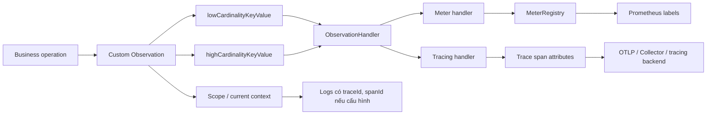
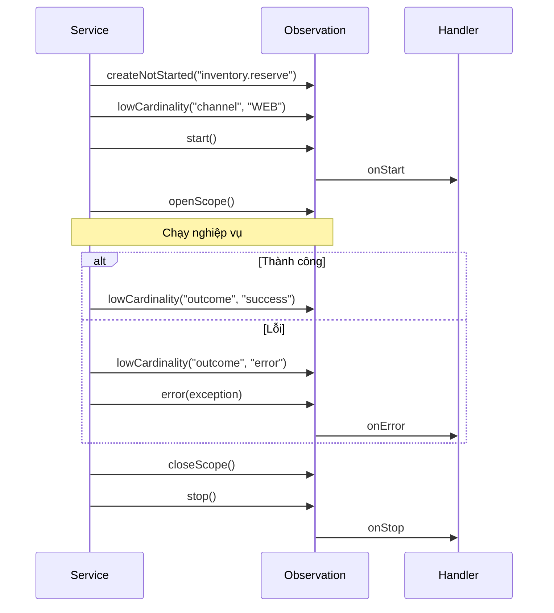

# Gắn low-cardinality metadata cho custom Observation trong Spring Boot

> **Chương:** Custom observation  
> **Module:** `SPRING_BOOT_OBSERVABILITY` — thiết lập observability cho Spring Boot bằng Micrometer Observation, metrics, logs và distributed tracing; hiểu propagation ngữ cảnh, exporter, sampling, tag/cardinality và liên kết tín hiệu khi điều tra lỗi, độ trễ, hành vi ứng dụng.  
> **Trọng tâm:** Cách chọn, chuẩn hóa, gắn và kiểm tra **low-cardinality key-values** trên custom observation để metrics có thể tổng hợp, traces dễ lọc và pipeline telemetry duy trì chi phí hợp lý.

## 1. Mục tiêu học tập

Sau bài này, bạn có thể:

1. Giải thích low-cardinality metadata là gì và vì sao số lượng **giá trị phân biệt** của tag ảnh hưởng trực tiếp đến số time series.
2. Phân biệt low-cardinality và high-cardinality key-values trong Micrometer Observation, đồng thời phân biệt metadata với trace context.
3. Dùng `lowCardinalityKeyValue(...)` trên `Observation` hoặc thêm key-value vào `Observation.Context` đúng thời điểm trong vòng đời.
4. Thiết kế tập giá trị **ổn định và có giới hạn** cho các chiều như `channel`, `operation`, `outcome`, `dependency`; tránh đưa ID hay raw URL vào nhãn metric.
5. Dùng cấu hình toàn cục, observation filter hoặc convention để giữ naming/tagging nhất quán khi module lớn dần.
6. Xác minh các tag bằng Actuator, Prometheus và một bài test không cần backend; chẩn đoán khi tag không xuất hiện hoặc cardinality tăng bất thường.

## 2. Low-cardinality metadata là gì?

*Metadata* là thông tin bổ sung mô tả một hoạt động đang được quan sát. Ví dụ với observation `inventory.reserve`, ta có thể muốn biết operation được gọi từ kênh nào (`WEB`, `MOBILE`, `PARTNER`) và kết quả ra sao (`success`, `error`).

Trong Micrometer Observation, một phần metadata được biểu diễn thành **key-values**. Ta phân thành:

| Loại metadata | Ví dụ | Ý nghĩa vận hành |
|---|---|---|
| **Low-cardinality** | `channel=WEB`, `outcome=success`, `dependency=inventory` | Có số giá trị **hữu hạn và được kiểm soát**; thích hợp làm nhãn metrics, có thể được dùng làm thuộc tính traces |
| **High-cardinality** | `order.id=...`, `attempt.id=...`, `request.id=...` | Có rất nhiều giá trị khác nhau; chỉ dùng có chọn lọc trong traces nếu cần và được phép, **không đưa thành nhãn metric** |
| **Trace/correlation context** | `traceId`, `spanId`, header `traceparent` | Dùng liên kết hoạt động trong distributed tracing, tìm logs liên quan; không được biến thành nhãn metrics |
| **Dữ liệu nhạy cảm** | Password, token, email, số thẻ, request body riêng tư | Không gửi vào metric tags/traces/logs mặc định; cần chính sách bảo vệ dữ liệu riêng |

**Cardinality** có thể hiểu là số lượng giá trị phân biệt của một nhãn trong một khoảng thời gian. Một tag `channel` có đúng 3 giá trị đã định là low-cardinality. Một tag `userId` thay đổi theo 500.000 người dùng là high-cardinality dù tên tag nhìn có vẻ đơn giản.

### 2.1. Vì sao low-cardinality quan trọng với metrics?

Prometheus và nhiều metrics backend lưu time series theo **tên metric cộng với tập nhãn**. Với một metric `inventory_reserve_seconds_count`, các giá trị sau là những series khác nhau:

```text
inventory_reserve_seconds_count{channel="WEB",outcome="success"} 154
inventory_reserve_seconds_count{channel="WEB",outcome="error"} 7
inventory_reserve_seconds_count{channel="MOBILE",outcome="success"} 42
```

Đây là các dòng minh họa, không phải kết quả mặc định từ một ứng dụng cụ thể.

Giả sử một timer có 3 `channel` × 3 `outcome` × 4 `dependency` × 6 instance; chỉ riêng những chiều này đã có thể tạo tối đa **216 tổ hợp nhãn** nếu mọi tổ hợp đều xuất hiện. Histogram còn tạo ra nhiều series phụ cho các bucket, sum và count. Thêm một tag `orderId` có hàng trăm nghìn giá trị sẽ khiến số series có thể tăng theo số đơn hàng.

Điều này ảnh hưởng trực tiếp đến RAM, disk, thời gian scrape, thời gian query, retention và chi phí backend. Vì vậy, **ít tag có ý nghĩa và tập giá trị giới hạn** tốt hơn rất nhiều tag mô tả từng request riêng lẻ.

### 2.2. “Low” là thuộc tính của giá trị thực tế

Tên `endpoint` không tự động là low-cardinality. Nếu giá trị là `/orders/{id}` (URI template đã chuẩn hóa), nó thường có tập giá trị nhỏ. Nếu giá trị là `/orders/123456` với ID thay đổi liên tục, đó lại là high-cardinality.

Tương tự, `result` có thể là low-cardinality nếu chỉ nhận `success`, `rejected`, `error`; nó trở thành high-cardinality nếu mỗi lần gán một chuỗi exception message khác nhau.

## 3. Low-cardinality metadata đi đâu trong hệ thống?



`ObservationRegistry` chứa các handler, filter, predicate và convention áp dụng cho observations. Khi code tạo một `Observation` bằng registry do Spring Boot quản lý, các handler có thể đọc metadata từ `Observation.Context`.

Thông thường:

- **Meter handler** đọc low-cardinality key-values để tạo dimensions/tags cho timers và meters tương ứng.
- **Tracing handler** có thể đưa low- và high-cardinality key-values vào span attributes, tùy bridge, handler và convention.
- **Logs** thường liên kết với traces qua `traceId`/`spanId` trong MDC hoặc structured logging; việc gắn `channel=WEB` không tự động biến nó thành một trường trong mọi dòng log.
- **Exporter và Collector** có thể thêm, đổi tên, loại bỏ hoặc map attributes. Vì vậy phải kiểm tra dữ liệu thật đến backend thay vì chỉ nhìn vào code.

Micrometer Observation là API instrumentation chung. **Có một observation chứa key-value không đảm bảo đã xuất metric hoặc trace**, bởi còn phụ thuộc registry, handlers, sampling, exporter và cấu hình backend.

## 4. API gắn low-cardinality key-value

Với Micrometer Observation được Spring Boot 3.x cấu hình, dạng cơ bản là:

```java
Observation observation = Observation
        .createNotStarted("inventory.reserve", observationRegistry)
        .lowCardinalityKeyValue("channel", "WEB")
        .lowCardinalityKeyValue("dependency", "inventory");
```

Trong đoạn code:

- `"inventory.reserve"` là **tên observation** có ý nghĩa ổn định.
- `"channel"` và `"dependency"` là **key**. Cần đặt tên nhất quán giữa các chỗ sử dụng.
- `"WEB"` và `"inventory"` là **value**. Đây là phần cần kiểm soát cardinality.
- `lowCardinalityKeyValue(...)` bổ sung metadata vào observation; nó **không tự start/stop observation**.

Một cách gắn tương đương là làm việc với `Observation.Context`, thường thấy trong filter, convention hoặc handler tùy biến:

```java
import io.micrometer.common.KeyValue;
import io.micrometer.observation.Observation;

void addEnvironment(Observation.Context context) {
    context.addLowCardinalityKeyValue(
            KeyValue.of("deployment.environment", "prod"));
}
```

Sự khác nhau chủ yếu nằm ở **ai sở hữu thao tác**:

| Nơi gắn | Khi phù hợp | Lưu ý |
|---|---|---|
| `Observation.lowCardinalityKeyValue(...)` | Một operation nghiệp vụ tự biết dữ liệu phân loại của mình | Rõ ràng, gần nơi phát sinh; cần chuẩn hóa trước khi gắn |
| `Observation.Context.addLowCardinalityKeyValue(...)` | Code xử lý context trong filter/handler/convention | Cẩn thận thời điểm callback và dữ liệu đã có |
| Cấu hình common key-values của Spring Boot | Những nhãn cố định theo deployment/service | Giá trị không nên thay đổi theo request |
| `ObservationConvention` | Chuẩn hóa tập key-values/tên observation cho một loại operation | Hữu ích khi nhiều nơi phát sinh cùng một kiểu observation |

## 5. Ví dụ Spring Boot: tag kênh gọi và kết quả đặt hàng

Ta sẽ instrument một bước `inventory.reserve` của dịch vụ checkout. Bài toán: đo số lần reserve, thời gian xử lý và tỷ lệ lỗi theo **kênh gọi có giới hạn**, trong khi SKU là thông tin động không được đưa vào metrics.

### 5.1. Dependency nền tảng

Một ứng dụng Spring Boot 3.x dùng Maven với Spring Boot parent/BOM phù hợp có thể bắt đầu từ:

```xml
<dependency>
    <groupId>org.springframework.boot</groupId>
    <artifactId>spring-boot-starter-actuator</artifactId>
</dependency>

<!-- Chỉ cần khi muốn xuất Prometheus scrape endpoint. -->
<dependency>
    <groupId>io.micrometer</groupId>
    <artifactId>micrometer-registry-prometheus</artifactId>
</dependency>
```

Để có distributed traces cần thêm tracing bridge và exporter phù hợp; ví dụ stack OpenTelemetry với `micrometer-tracing-bridge-otel` và `opentelemetry-exporter-otlp` trên các phiên bản Spring Boot 3.x hỗ trợ. Dependency cụ thể có thể khác ở Spring Boot 4 hoặc các version khác; giữ chúng đồng bộ với BOM và tài liệu phiên bản đang dùng.

### 5.2. Service với tập giá trị có kiểm soát

```java
package com.example.checkout;

import io.micrometer.observation.Observation;
import io.micrometer.observation.ObservationRegistry;
import java.util.Locale;
import org.springframework.stereotype.Service;

@Service
public class InventoryService {

    private final ObservationRegistry observationRegistry;
    private final StockGateway stockGateway;

    public InventoryService(ObservationRegistry observationRegistry,
                            StockGateway stockGateway) {
        this.observationRegistry = observationRegistry;
        this.stockGateway = stockGateway;
    }

    public String reserve(String sku, String rawChannel) {
        String channel = normalizeChannel(rawChannel);

        Observation observation = Observation
                .createNotStarted("inventory.reserve", observationRegistry)
                .contextualName("reserve inventory")
                .lowCardinalityKeyValue("channel", channel)
                .lowCardinalityKeyValue("dependency", "stock-gateway")
                .start();

        try (Observation.Scope scope = observation.openScope()) {
            stockGateway.reserve(sku);
            observation.lowCardinalityKeyValue("outcome", "success");
            return "RESERVED";
        } catch (RuntimeException exception) {
            observation.lowCardinalityKeyValue("outcome", "error");
            observation.error(exception);
            throw exception;
        } finally {
            observation.stop();
        }
    }

    private static String normalizeChannel(String rawChannel) {
        if (rawChannel == null) {
            return "OTHER";
        }

        return switch (rawChannel.trim().toUpperCase(Locale.ROOT)) {
            case "WEB" -> "WEB";
            case "MOBILE" -> "MOBILE";
            case "PARTNER" -> "PARTNER";
            default -> "OTHER";
        };
    }
}

interface StockGateway {
    void reserve(String sku);
}
```

`StockGateway` là abstraction minh họa. Trong ứng dụng thật, triển khai `StockGateway` sẽ gọi database hoặc HTTP downstream đã được instrument. Ví dụ dùng Java 17+, phù hợp với Spring Boot 3.x.

**Điều cần chú ý:**

1. `ObservationRegistry` được inject từ Spring container. Từng lần gọi `reserve(...)` tạo observation riêng, nhưng dùng chung registry.
2. `channel` được chuẩn hóa về **bốn giá trị**: `WEB`, `MOBILE`, `PARTNER`, `OTHER`. Bất kỳ input lạ nào đều vào `OTHER`.
3. `dependency=stock-gateway` là giá trị cố định. Nếu có nhiều dependency, dùng tên logic với danh sách được quản lý, tránh host/URL động.
4. `sku` không được gắn làm tag metric, vì mỗi SKU có thể là một giá trị riêng.
5. `outcome` được gắn **trước khi stop**: `success` sau khi gateway xử lý xong, `error` khi ngoại lệ phát sinh. Handler có thể dùng field này khi hoàn tất observation.
6. `Observation.error(exception)` thông báo lỗi cho handler, còn `throw` vẫn giữ đúng semantics nghiệp vụ. `finally` bảo đảm gọi `stop()`.

`try-with-resources` đóng scope trước `finally` gọi `stop()`; khi exception truyền ra khỏi scope, callback ở `catch` chạy sau khi scope đã đóng. Nếu cần **ghi log lỗi có trace ID/span ID trong chính child scope**, đặt đoạn catch/log vào bên trong scope hoặc bảo đảm có parent tracing context phù hợp.

### 5.3. Vì sao không lấy rawChannel làm tag?

**Sai:**

```java
observation.lowCardinalityKeyValue("channel", rawChannel);
```

Một request do người dùng tự tạo có thể đưa giá trị `"WEB-abcdef..."` hoặc hàng triệu chuỗi khác nhau. Gắn raw input vào meter tag khiến cardinality tăng mà dashboard lại khó tổng hợp.

**Đúng:**

```java
observation.lowCardinalityKeyValue(
        "channel", normalizeChannel(rawChannel));
```

Giải pháp cốt lõi là **kiểm soát tập giá trị ở nguồn**. Regex làm sạch ký tự và cắt độ dài chưa đủ: dù mỗi giá trị ngắn, vẫn có thể có vô số giá trị khác nhau. Hãy map sang enum, nhóm mã lỗi hoặc danh sách đã được phê duyệt.

## 6. Gắn metadata khi observation đã chạy

Một số giá trị có sẵn trước khi bắt đầu, chẳng hạn `operation` và `channel`. Một số khác chỉ biết khi kết thúc như `outcome` hoặc `result.category`.



**Cách chọn thời điểm:**

- Metadata biết từ đầu nên được gắn **trước `start()`**, để các handler quan tâm `onStart` có thể nhìn thấy.
- Metadata chỉ biết ở cuối nên được gắn **trước `stop()`** và trước khi handler cần đọc thông tin đó.
- Không nên cố thêm tag sau `stop()` rồi kỳ vọng backend cập nhật timer/span đã hoàn tất.
- Không mọi handler đều tiêu thụ metadata tại cùng một thời điểm. Traces, metrics và exporters có thể có thời điểm chụp dữ liệu khác nhau; cần kiểm tra phiên bản và hành vi tích hợp đang dùng.
- `openScope()` liên quan tới **current observation/tracing context**, không phải cơ chế tạo metric tag. Gắn key-value không thay thế việc mở scope khi cần parent–child context hoặc propagation.

### 6.1. Trường hợp dùng observe(...)

Khi không cần điền kết quả theo từng nhánh, API `observe(...)` gọn hơn:

```java
public String reserveSimple(String sku) {
    return Observation
            .createNotStarted("inventory.reserve", observationRegistry)
            .lowCardinalityKeyValue("operation", "reserve")
            .observe(() -> {
                stockGateway.reserve(sku);
                return "RESERVED";
            });
}
```

`observe(...)` bao quanh callback **đồng bộ**: start, scope, error khi callback ném exception, close, stop được quản lý bởi Micrometer. Nếu cần tag `outcome` theo kết quả, có thể cập nhật observation trong callback, hoặc dùng vòng đời thủ công cho dễ đọc như ví dụ `reserve(...)`.

**Giới hạn quan trọng:** không dùng `observe(() -> CompletableFuture.supplyAsync(...))` để đo toàn bộ thời gian task bất đồng bộ. Callback thường trả future ngay; observation đã kết thúc trước khi future hoàn tất. Với async/reactive, gắn start/stop vào tín hiệu hoàn thành thực sự và cấu hình context propagation.

## 7. Thiết kế bộ tag: tên, phạm vi và ngữ nghĩa

Một hệ thống dễ vận hành khi mỗi custom observation có **tag contract** rõ ràng: tên, mô tả, tập giá trị cho phép, cách xử lý giá trị không biết và ai sở hữu định nghĩa.

Ví dụ hợp đồng cho `inventory.reserve`:

| Key | Tập giá trị cho phép | Nguồn dữ liệu | Khi nào gắn? |
|---|---|---|---|
| `channel` | `WEB`, `MOBILE`, `PARTNER`, `OTHER` | Mapping request/channel enum | Trước start |
| `dependency` | `stock-gateway`, `backup-gateway` | Routing đã được kiểm soát | Trước start hoặc trước stop |
| `outcome` | `success`, `error` | Kết quả thực tế | Trước stop |
| `deployment.environment` | `local`, `staging`, `prod` | Cấu hình deployment | Thông qua common config/filter |
| `retry.category` | `initial`, `retry` | Logic nghiệp vụ | Trước stop |

### 7.1. Tên nhất quán và tránh trùng lặp

Nên chọn key như `channel`, `outcome` có ngữ nghĩa ổn định. Nếu dùng nhiều integration, xem conventions có sẵn trước khi đặt thêm key trùng nghĩa. Chẳng hạn HTTP server metric chuẩn thường có dimension `uri`, `method`, `status`; không tạo thêm `full_url` có giá trị từng URL cụ thể.

Không đổi bất chợt tên key `outcome` thành `result` giữa các phiên bản nếu dashboard/alerts đã dùng `outcome`. Đổi tên là thay đổi schema telemetry: có thể làm truy vấn bị chia series hoặc mất dữ liệu mong đợi.

### 7.2. Có nên gắn exception class?

Một exception category được **whitelist** như `timeout`, `rejected`, `dependency_unavailable`, `other` thường là lựa chọn ổn định. Raw exception message không phù hợp làm metric tag; nó có thể chứa URL, ID hoặc dữ liệu nhạy cảm.

```java
private static String errorCategory(Throwable error) {
    if (error instanceof java.net.SocketTimeoutException) {
        return "timeout";
    }
    if (error instanceof IllegalArgumentException) {
        return "invalid_request";
    }
    return "other";
}
```

Trong thực tế, kiểu exception xuất hiện ở từng tầng có thể được wrap; cần có mapping theo lỗi nghiệp vụ và integration đang dùng. Không nên phân loại exception bằng cách lấy `error.getMessage()` làm nhãn.

### 7.3. Giữ ngữ nghĩa của outcome

Ví dụ `inventory.lookup` thất bại nhưng fallback cache thành công. Bạn cần phân biệt:

- `dependency.outcome=error` cho bước gọi dependency bị timeout;
- `checkout.outcome=success` cho API bao ngoài nếu trả kết quả fallback hợp lệ.

Mỗi observation có ranh giới và kết quả riêng; không nhất thiết mọi span trong một trace phải có cùng `outcome`. Việc đặt outcome rõ ràng giúp giải thích tại sao traces có lỗi downstream nhưng tỷ lệ lỗi HTTP server vẫn thấp.

## 8. Low-cardinality metadata khác với high-cardinality metadata thế nào?

Micrometer Observation cung cấp API tách riêng:

```java
Observation observation = Observation
        .createNotStarted("payment.authorize", observationRegistry)
        .lowCardinalityKeyValue("provider", "primary")
        .lowCardinalityKeyValue("outcome", "success")
        .highCardinalityKeyValue("attempt.id", nonSensitiveAttemptId);
```

`nonSensitiveAttemptId` là định danh nội bộ **đã được phép đưa vào telemetry**. High-cardinality key-value có thể được tracing handler dùng làm span attribute; không mặc định được đưa vào metrics tags. Tuy nhiên, “high-cardinality” không có nghĩa là “an toàn”: định danh người dùng, token, thông tin thanh toán và nội dung cá nhân vẫn phải được kiểm soát theo chính sách bảo mật.

| Thuộc tính | Low-cardinality | High-cardinality |
|---|---|---|
| Số lượng giá trị | Giới hạn và dự đoán được | Có thể tăng theo mỗi request/giao dịch |
| Phù hợp với metrics labels | Thường có | Không |
| Phù hợp với trace span attributes | Có thể | Có thể, nếu có mục đích và cho phép |
| Mục đích | Lọc/nhóm/aggregate/alert | Tìm một giao dịch hoặc bước cụ thể |
| Rủi ro | Bùng nổ series nếu thiết kế sai hoặc kết hợp quá nhiều tags | Khối lượng dữ liệu, quyền riêng tư, tìm kiếm/indexing |

**Không có “mức cardinality an toàn” chung cho mọi hệ thống.** Với một deployment lưu lượng nhỏ, vài chục giá trị có thể chấp nhận; với một metric có nhiều labels và nhiều histogram buckets, cùng số giá trị đó có thể rất tốn tài nguyên. Đánh giá theo tổng số series, tần suất mẫu, số instance và ngân sách lưu trữ.

## 9. Gắn metadata chung cho toàn bộ ứng dụng

Các giá trị như `application` hoặc `deployment.environment` có thể áp dụng cho nhiều observations. Spring Boot hỗ trợ cấu hình common key-values trong những phiên bản phù hợp.

Ví dụ `application.yml` cho Spring Boot 3.x:

```yaml
spring:
  application:
    name: checkout-service

management:
  observations:
    key-values:
      application: ${spring.application.name}
      deployment.environment: ${APP_ENVIRONMENT:local}
  endpoints:
    web:
      exposure:
        include: health,metrics,prometheus
```

**Phạm vi sử dụng:** dùng các giá trị thay đổi theo deployment, không theo request. Nếu tag `tenant` có hàng chục nghìn giá trị và được gắn vào mọi observation, đó không còn là một common low-cardinality dimension hợp lý.

Cần phân biệt **common observation key-values** và **MeterRegistry common tags**. Chúng nằm ở những lớp khác nhau của pipeline; tùy registry/handler, hai cơ chế có thể cho kết quả khác nhau. Nếu một nhãn đã được thêm qua Prometheus scrape labels, Collector hoặc một tầng khác, hãy đối chiếu để tránh trùng và sai lệch giá trị.

### 9.1. Dùng ObservationRegistryCustomizer và filter

Khi chính sách gắn tag cần code (ví dụ map cấu hình environment vào tập cho phép), có thể tùy biến **registry do Spring Boot quản lý**, thay vì tự tạo registry rời:

```java
import io.micrometer.common.KeyValue;
import io.micrometer.observation.ObservationRegistry;
import org.springframework.beans.factory.annotation.Value;
import org.springframework.boot.actuate.autoconfigure.observation.ObservationRegistryCustomizer;
import org.springframework.context.annotation.Bean;
import org.springframework.context.annotation.Configuration;

@Configuration(proxyBeanMethods = false)
class ObservabilityTagsConfiguration {

    @Bean
    ObservationRegistryCustomizer<ObservationRegistry> envTags(
            @Value("${app.environment:local}") String rawEnvironment) {

        String environment = switch (rawEnvironment) {
            case "prod", "production" -> "prod";
            case "staging" -> "staging";
            default -> "local";
        };

        return registry -> registry.observationConfig()
                .observationFilter(context -> {
                    context.addLowCardinalityKeyValue(
                            KeyValue.of("deployment.environment", environment));
                    return context;
                });
    }
}
```

`ObservationFilter` có khả năng sửa `Observation.Context` trong quá trình hoàn tất observation. Điều đó phù hợp với metadata dùng cho xuất metric/timer sau khi đo, nhưng **không bảo đảm tag đã có khi handler chạy `onStart`**. Nếu một giá trị cần hiện diện ngay lúc bắt đầu hoặc dùng cho quyết định propagation/sampling, hãy chọn thời điểm/cơ chế tạo context tương ứng.

Không dùng đồng thời cấu hình `management.observations.key-values.deployment.environment` và filter ở trên cho cùng tag nếu không có chủ đích rõ ràng. Lựa chọn một nguồn thống nhất giúp dễ bảo trì.

### 9.2. Khi nào dùng ObservationConvention?

Khi có nhiều điểm tạo observation cùng loại, convention giúp quy định tên operation và key-values một cách thống nhất. Ví dụ với nhiều adapter gọi `inventory.reserve`, convention có thể quy định:

- Tên kỹ thuật luôn là `inventory.reserve`;
- Contextual name có ý nghĩa trên trace như `reserve inventory`;
- `channel` lấy từ enum đã chuẩn hóa;
- `outcome` dùng `success`/`error`;
- Phần bổ sung thuộc dữ liệu động không được đưa thành metric tag.

Convention hữu ích để giảm trùng lặp logic naming/tagging và giới hạn việc mỗi team tự đặt key mới. API `ObservationConvention<T extends Observation.Context>` có thể được tích hợp vào observation cụ thể; khi cần convention cho framework đã instrument, hãy tham khảo convention của framework đó vì context type và tên tag có thể khác custom observation.

**Quy tắc lựa chọn:** một custom operation nhỏ có thể gắn tag trực tiếp bằng `lowCardinalityKeyValue`. Nhiều operation cùng ngữ nghĩa nên cân nhắc convention. Nhãn deployment dùng common config/filter. Đừng tạo nhiều lớp abstraction chỉ để gắn một tag cố định.

## 10. Quan sát trên local và production

Ở local, mục tiêu là xác nhận metadata đúng mà không cần có backend phức tạp. Khi ứng dụng đã có Actuator và Prometheus registry, ví dụ:

```yaml
management:
  endpoints:
    web:
      exposure:
        include: health,metrics,prometheus
```

Giả sử app phục vụ ở `localhost:8080` và có endpoint gọi vào `InventoryService.reserve`. Sau khi thực thi vài request:

```bash
curl -s http://localhost:8080/actuator/metrics
curl -s http://localhost:8080/actuator/metrics/inventory.reserve
curl -s http://localhost:8080/actuator/prometheus
```

Nếu meter handler phù hợp đã đăng ký và observation được stop, `/actuator/metrics/inventory.reserve` thường có các measurement như `COUNT` và `TOTAL_TIME` cùng các available tags. Trên Prometheus exposition, timer có thể có các series dạng:

```text
inventory_reserve_seconds_count{channel="WEB",dependency="stock-gateway",outcome="success",...} 12
inventory_reserve_seconds_sum{channel="WEB",dependency="stock-gateway",outcome="success",...} 0.361
inventory_reserve_seconds_count{channel="WEB",dependency="stock-gateway",outcome="error",...} 2
```

Đây là **output ví dụ**. Tên series, đơn vị, thứ tự labels và tags thực tế phụ thuộc phiên bản Micrometer, registry, conventions và cấu hình. Hãy xem output thật trước khi viết dashboard.

Nếu có Prometheus scrape, một số PromQL tham khảo (đổi tên metric/labels theo hệ thống):

**Số lần reserve/giây theo channel và outcome:**

```promql
sum by (channel, outcome) (
  rate(inventory_reserve_seconds_count[5m])
)
```

**Tỷ lệ lỗi reserve trên toàn bộ lần gọi (0–1):**

```promql
sum(rate(inventory_reserve_seconds_count{outcome="error"}[5m]))
/
clamp_min(
  sum(rate(inventory_reserve_seconds_count[5m])),
  1e-9
)
```

**Tổng duration trung bình theo channel (đơn vị giây):**

```promql
sum by (channel) (
  rate(inventory_reserve_seconds_sum[5m])
)
/
clamp_min(
  sum by (channel) (
    rate(inventory_reserve_seconds_count[5m])
  ),
  1e-9
)
```

Truy vấn trung bình này là **mean duration**, không phải p95. Muốn tính p95/p99 từ histogram, cần bật histogram phù hợp, cân nhắc số bucket và dùng `histogram_quantile` đúng cách; không tính p95 toàn cụm bằng trung bình p95 từng instance.

### 10.1. Kết hợp với traces và logs

Khi Micrometer Tracing bridge, exporter, Collector và backend hoạt động, custom observation có thể tạo span có các attributes theo metadata mà tracing handler nhận được. Một kịch bản điều tra:

1. Dashboard cho thấy `inventory.reserve` có `outcome=error` tăng ở `channel=PARTNER`.
2. Tra cứu traces theo service, thời gian, operation và attributes tương ứng (nếu backend index/filter được).
3. Xem span của call inventory để xác định latency và điểm phát sinh exception.
4. Dùng `traceId` tìm logs liên quan. Log có thể mang `traceId`/`spanId` trong MDC/structured fields; không tự nhiên có `channel` ở mọi log.
5. Kiểm tra lại error ratio/latency metrics sau khi triển khai bản sửa.

**Sampling ảnh hưởng traces, không đồng nghĩa giảm metrics cùng tỷ lệ.** Một metric timer có thể đếm toàn bộ observation đã hoàn tất trong khi chỉ một phần traces được ghi ở backend. Không dùng số trace tìm được để suy ra chính xác số request đã xử lý.

### 10.2. Chính sách khi chuyển sang production

| Nội dung | Local | Production |
|---|---|---|
| Cardinality | Dữ liệu thử nhỏ nhưng vẫn cần tag contract đúng | Giới hạn dimension và tổng series; giám sát tăng trưởng |
| Sampling traces | Có thể dùng 100% khi lưu lượng thấp để kiểm tra correlation | Chọn tỷ lệ theo traffic/chi phí và mục tiêu điều tra |
| Tags | Dùng dữ liệu giả, thử đủ nhánh `success/error/OTHER` | Không chứa dữ liệu nhạy cảm, kiểm soát giá trị mới khi release |
| Exporter | Có thể xem endpoint Actuator và Collector debug | Có pipeline scrape/OTLP/logs đáng tin cậy, auth/TLS và retention |
| Theo dõi thay đổi | Quan sát trực tiếp một lần gọi | Kiểm thử compatibility dashboard/alerts, so sánh số series sau deploy |

## 11. Kiểm thử tag mà không cần Prometheus

Có thể viết một unit test thuần Micrometer sử dụng `ObservationRegistry.create()` **chỉ trong test**, gắn một handler để đọc context khi observation stop. Cách này xác nhận code gắn metadata, độc lập với exporter và backend:

```java
import io.micrometer.common.KeyValue;
import io.micrometer.observation.Observation;
import io.micrometer.observation.ObservationHandler;
import io.micrometer.observation.ObservationRegistry;
import java.util.concurrent.atomic.AtomicReference;
import org.junit.jupiter.api.Test;

import static org.junit.jupiter.api.Assertions.assertNotNull;
import static org.junit.jupiter.api.Assertions.assertTrue;

class LowCardinalityMetadataTest {

    @Test
    void handlerSeesBoundedTagsOnStop() {
        ObservationRegistry registry = ObservationRegistry.create();
        AtomicReference<Observation.Context> captured = new AtomicReference<>();

        registry.observationConfig().observationHandler(
                new ObservationHandler<Observation.Context>() {
                    @Override
                    public boolean supportsContext(Observation.Context context) {
                        return "inventory.reserve".equals(context.getName());
                    }

                    @Override
                    public void onStop(Observation.Context context) {
                        captured.set(context);
                    }
                });

        Observation.createNotStarted("inventory.reserve", registry)
                .lowCardinalityKeyValue("channel", "WEB")
                .lowCardinalityKeyValue("outcome", "success")
                .observe(() -> "RESERVED");

        Observation.Context observed = captured.get();
        assertNotNull(observed);

        boolean hasWebChannel = false;
        for (KeyValue kv : observed.getLowCardinalityKeyValues()) {
            if ("channel".equals(kv.getKey()) &&
                    "WEB".equals(kv.getValue())) {
                hasWebChannel = true;
                break;
            }
        }
        assertTrue(hasWebChannel);
    }
}
```

Trong test dùng registry độc lập là hợp lý vì đang kiểm tra chính API Observation. Trong ứng dụng thật, hãy inject registry do Spring Boot cấu hình để nhận các handlers tích hợp. **Test này không chứng minh Prometheus có series** hoặc OTLP backend đã nhận span; hai điều đó cần kiểm thử integration/đường truyền thực tế.

Một test bổ sung có ích là kiểm tra `normalizeChannel(...)` luôn trả đúng bốn giá trị và với các input bất thường, kết quả là `OTHER`. Mục tiêu của test là bảo vệ **contract cardinality**, không chỉ xác nhận method được gọi.

### 11.1. Không đánh đồng key xuất hiện trong context và key xuất hiện trên backend

Tag có thể tồn tại trong `Observation.Context` nhưng không thấy trong metrics/traces vì:

- Observation không có handler phù hợp hoặc được tạo bằng registry rời.
- Observation chưa `stop()` (handler chưa hoàn tất timer/span).
- Predicate loại observation.
- Convention hoặc filter có quy tắc bổ sung/ghi đè metadata.
- Backend/Collector xử lý, loại bỏ hoặc đổi tên attribute.
- Traces bị sampling loại hoặc exporter lỗi.
- Query đang lọc sai service, thời gian, metric name hoặc label.

Vì vậy nên kiểm tra theo tầng: **code/context → handler/registry → exporter → backend → truy vấn**.

## 12. Những lỗi thường gặp khi gắn metadata

### 12.1. Đưa định danh duy nhất vào low-cardinality

**Không nên:**

```java
observation.lowCardinalityKeyValue("order.id", orderId);
observation.lowCardinalityKeyValue("user.id", userId);
observation.lowCardinalityKeyValue("request.url", rawUrl);
```

**Nên:** dùng `channel`, `operation`, `outcome`, route template hoặc nhóm lỗi đã chuẩn hóa. Nếu cần liên kết một giao dịch cụ thể, dùng tracing/log correlation có kiểm soát thay vì metric labels.

### 12.2. Tự thêm tag trong filter mà không kiểm soát tập giá trị

**Không nên:**

```java
context.addLowCardinalityKeyValue(
        KeyValue.of("tenant", rawTenantId));
```

Đây là một lỗi **cấp độ toàn ứng dụng** nếu filter được áp dụng cho mọi observation. Nó nhân thêm dimension có số giá trị cao lên cả HTTP, database, JVM-adjacent observations và custom metrics được handler tạo ra.

**Nên:** chỉ thêm các nhãn cấu hình chung có số giá trị giới hạn; tenant ID có thể thuộc trace/log tùy chính sách hoặc một cơ chế aggregate riêng đã hoạch định.

### 12.3. Gắn outcome sau stop

**Sai:**

```java
observation.stop();
observation.lowCardinalityKeyValue("outcome", "success");
```

**Đúng:** đặt kết quả trước khi stop hoặc bên trong callback `observe(...)`. Sau khi stop, handler đã có thể hoàn tất dữ liệu telemetry.

### 12.4. Gắn giá trị không nhất quán

```text
channel=web
channel=WEB
channel=Web
channel=mobile
channel=MOBILE
```

Về mặt metrics, đây là năm giá trị khác nhau dù nghiệp vụ chỉ có hai kênh. Chuẩn hóa viết hoa/thường, trimming và fallback ở một điểm dùng chung. Định nghĩa enum/contract rõ ràng để giảm drift giữa các service.

### 12.5. Đổi tên tag nhưng quên dashboard

Khi phiên bản mới đổi `outcome` thành `result`, các truy vấn dựa trên `outcome` có thể bị thiếu dữ liệu. Nên quản lý thay đổi schema telemetry như thay đổi API: có giai đoạn tương thích, cập nhật dashboard/alerts, kiểm tra trước và sau triển khai.

### 12.6. Nhầm metadata với scope hoặc propagation

Gắn `channel=WEB` không tự truyền trace context qua HTTP. Để các span ở các service nằm trong cùng trace, cần tracing handler, HTTP client/server instrumentation và propagation headers (thường W3C `traceparent`). Với async, cần context propagation tương ứng; không dùng metric tag để thay cho trace ID.

## 13. Chẩn đoán thực tế theo biểu hiện

| Biểu hiện | Nguyên nhân khả dĩ | Hành động kiểm tra |
|---|---|---|
| `/actuator/metrics/inventory.reserve` không thấy | Chưa gọi code path, registry rời, thiếu handler, predicate loại, chưa stop | Gọi operation thật, xác nhận bean registry và lifecycle |
| Meter có nhưng tag `channel` không hiện | Tag gắn sai observation, gắn sau stop, handler/convention không đọc, tag bị đổi tên | In/kiểm tra context trong test; so sánh metric output |
| Xuất Prometheus nhưng không có metric custom | Thiếu registry Prometheus, endpoint chưa expose hoặc chưa scrape | Kiểm tra `/actuator/prometheus` trực tiếp trước rồi mới kiểm tra target |
| `outcome=error` không có khi exception | Catch rồi không gắn outcome, observation không stop, hoặc lỗi nằm ngoài vùng đo | Đọc lại try/catch/finally và ranh giới observation |
| Series tăng sau deploy | Thêm tag từ input tự do, tag mới có quá nhiều giá trị, histogram nhiều bucket | Audit nhãn mới, thống kê distinct values, giảm cardinality |
| Có metrics nhưng không có traces | Chưa bật tracing bridge/exporter, sampling thấp, Collector không nhận | Kiểm tra config tracing, endpoint, protocol, sampling |
| Log thiếu correlation ID | Không có tracing context/scope, MDC hoặc log format không hỗ trợ | Kiểm tra scope và logger pattern/structured fields |
| Mỗi bản triển khai có tên tag khác | Không có tag contract, nhiều convention/filter riêng | Thống nhất schema và mapping giá trị |
| Label trùng hoặc không nhất quán | Gắn cùng key ở observation, MeterRegistry, Collector/Prometheus | Kiểm tra từng tầng và xác định nguồn sự thật |

### 13.1. Quy trình điều tra một sự cố liên quan đến tag

Giả sử dashboard `inventory.reserve` mất series `channel=PARTNER` ngay sau deploy:

1. Kiểm tra API vẫn nhận traffic từ `PARTNER` và service thực sự thực hiện operation.
2. Kiểm tra kết quả `normalizeChannel` với input của request; có vô tình map về `OTHER` không?
3. Kiểm tra observation gắn `channel` trước khi `stop()` và cùng instance registry với các handler hay không.
4. Xem `/actuator/metrics/inventory.reserve` và `/actuator/prometheus` trên chính instance đang có traffic.
5. Nếu dữ liệu ở ứng dụng đúng, xem scrape target, relabeling, Collector/remote write và query dashboard.
6. Xác nhận migration schema: tên tag, chữ hoa/thường, label filters và tên metric có đổi không?

Quy trình này tránh kết luận sai rằng hệ thống không còn request PARTNER chỉ vì dashboard không hiển thị nhãn cũ.

## 14. Bài thực hành tổng hợp

**Tình huống:** API `POST /checkout` gọi cổng thanh toán theo ba loại kênh `WEB`, `MOBILE`, `PARTNER`. Team muốn dashboard thể hiện request rate, error ratio và thời gian xử lý theo kênh. Một số request có `customerId` và `paymentAttemptId` để tra cứu lỗi.

### Yêu cầu

1. Tạo custom observation `checkout.payment` quanh call payment gateway.
2. Gắn `channel` với tập giá trị ba kênh và một fallback `OTHER`.
3. Gắn `provider` từ một danh sách cố định (ví dụ `primary`, `backup`).
4. Gắn `outcome` thành `success`, `rejected` hoặc `error` trước khi stop.
5. Không gắn `customerId` hay `paymentAttemptId` thành low-cardinality tags.
6. Viết test xác nhận normalization và handler nhìn thấy `channel`/`outcome`.
7. Kiểm tra meter trong Actuator hoặc Prometheus, sau đó so sánh với traces/logs khi đã có tracing backend.
8. Ước lượng sự gia tăng series nếu có 4 `channel` × 2 `provider` × 3 `outcome` × 10 instance; kết quả tối đa theo các chiều đó là **240 tổ hợp nhãn**, chưa tính các labels khác, histogram buckets và những tập giá trị không xuất hiện.

### Tiêu chí hoàn thành

- Tất cả key-value có danh sách giá trị và ngữ nghĩa được mô tả.
- Một request lỗi được ghi `outcome=error` trước khi observation stop; không “nuốt” ngoại lệ ngoài ý muốn.
- Timer count tăng theo số lần observation được hoàn tất và có thể group theo `channel`/`outcome`.
- Không có trace ID, user ID, order ID hay raw URL trong metrics labels.
- Có thể đi từ metric nhóm lỗi tăng sang trace và log cùng request, đồng thời giải thích được ảnh hưởng của sampling.

## 15. Checklist trước khi đưa tag mới lên production

- [ ] Key và tập giá trị cho phép đã được định nghĩa; có chính sách `UNKNOWN`/`OTHER`.
- [ ] Tag mô tả **một chiều phân tích cần thiết**, có dashboard, truy vấn hoặc alert dự kiến sử dụng.
- [ ] Giá trị đầu vào được normalize trước khi gắn; không dùng raw user input, ID riêng hoặc exception message.
- [ ] Không chứa secrets, thông tin cá nhân hay dữ liệu thanh toán.
- [ ] Đã xem sự kết hợp với những tags khác và số series/histogram buckets dự kiến.
- [ ] Tag được gắn đúng thời điểm trong lifecycle; observation được stop kể cả khi có lỗi.
- [ ] Không trùng nghĩa với tag đã được thêm bởi Boot, convention, MeterRegistry hoặc collector.
- [ ] Đã kiểm tra output thật từ metrics backend và traces khi pipeline tương ứng được bật.
- [ ] Đã cập nhật dashboard, alerts, tài liệu schema telemetry và chủ sở hữu của thay đổi.
- [ ] Có phương án theo dõi cardinality sau deploy và rollback nếu số series tăng bất thường.

---

## Ghi nhớ

**Low-cardinality metadata là những key-values có tập giá trị nhỏ, ổn định và được kiểm soát**, được gắn cho custom `Observation` bằng `lowCardinalityKeyValue(...)` hoặc thông qua context/convention/filter. Chúng giúp metrics có thể group, rate và alert theo các chiều nghiệp vụ mà không làm bùng nổ time series. Gắn tag biết trước lúc `start()`, gắn kết quả trước `stop()`, chuẩn hóa input về enum/whitelist và tránh ID động.

Trong Spring Boot, hãy dùng chung `ObservationRegistry` đã được cấu hình. Metrics handler, tracing bridge, exporter, sampling và log correlation quyết định dữ liệu xuất hiện ở backend nào. Một thiết kế metadata tốt vừa trả lời được “nhóm request nào chậm hoặc lỗi?”, vừa tạo điểm nối hợp lý để chuyển từ metrics sang traces và logs khi điều tra nguyên nhân.
