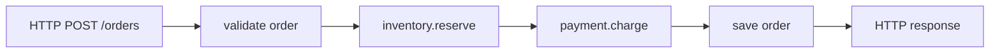
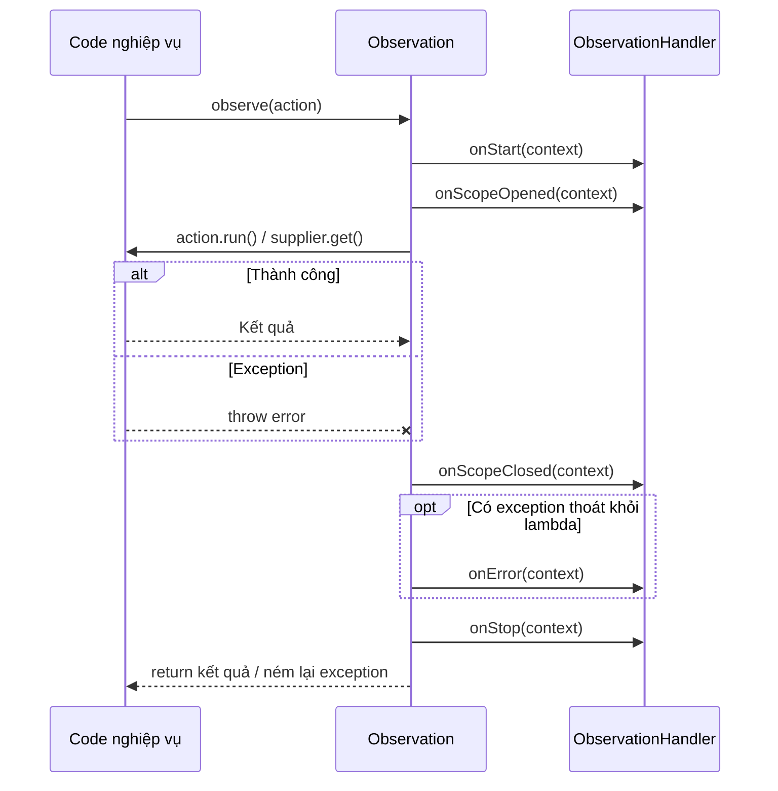

# Bao quanh đoạn code bằng `observe` trong Micrometer Observation

## 1. Mục tiêu học tập và bối cảnh

Trong một hệ thống Spring Boot, việc biết **HTTP request chậm** mới là bước đầu. Khi một request đi qua kiểm tra tồn kho, tính giá, lưu đơn và gọi cổng thanh toán, người vận hành cần biết *bước nào* tốn thời gian hoặc gây lỗi. **Micrometer Observation** cho phép đặt một ranh giới quan sát quanh đoạn code nghiệp vụ để các handler có thể tạo metrics và distributed tracing từ một điểm instrumentation chung.

Bài thuộc chương **Custom observation** trong module **SPRING_BOOT_OBSERVABILITY**. Trọng tâm là phương thức **`Observation.observe(...)`**: cách dùng đúng, vòng đời, xử lý exception, tên/tag, tác động tới metrics, logs, trace và giới hạn khi code chạy bất đồng bộ.

Sau bài này, bạn có thể:

- Phân biệt `observe(Runnable)`, `observe(Supplier<T>)` và `observeChecked(...)`.
- Giải thích những gì `observe` thực hiện tự động với `start()`, `openScope()`, `error()`, `close()` và `stop()`.
- Chọn một ranh giới nghiệp vụ có ý nghĩa, instrument bằng `ObservationRegistry` trong Spring Boot và đặt key-values đúng cardinality.
- Kiểm tra kết quả qua Actuator metrics, Prometheus, trace backend và log correlation.
- Nhận diện các sai sót khi dùng `observe` với lambda bắt exception, observation đã start, `CompletableFuture`, Reactor và callback.
- Biết lúc nào cần vòng đời thủ công thay vì `observe`.

## 2. Vì sao bao quanh code bằng `observe`?

Giả sử `POST /orders` có các bước sau:



Spring MVC có thể đã instrument request HTTP để đo toàn bộ thời gian xử lý, nhưng metric HTTP không tự giải thích bước nội bộ nào gây chậm. Nếu bọc riêng `inventory.reserve` bằng `observe`, ta có một thao tác nghiệp vụ với tên ổn định, thời gian và lỗi riêng.

```java
Observation.createNotStarted("inventory.reserve", observationRegistry)
        .observe(() -> reserveInventory());
```

Đoạn code trên có hai ý quan trọng:

1. `createNotStarted(...)` tạo một observation **chưa bắt đầu** với tên `inventory.reserve`.
2. `observe(...)` **thực thi** lambda ngay trong lời gọi hiện tại và quản lý toàn bộ vòng đời observation quanh code đó.

Khi có `DefaultMeterObservationHandler` hoặc handler đo thời gian tương đương, observation có thể tạo Timer. Khi có tracing handler và tracer/exporter, nó có thể tạo span. Không nên khẳng định rằng chỉ cần gọi `observe` là metrics và traces chắc chắn đã xuất hiện ở backend: kết quả còn tùy cấu hình registry, handler, exporter và sampling.

### Một lần instrument, nhiều tín hiệu

| Thành phần | Trả lời câu hỏi | Dữ liệu ví dụ |
| --- | --- | --- |
| Metrics | Có bao nhiêu lần reserve? Thời gian trung bình/histogram? | `inventory.reserve`, `channel=web` |
| Traces | Trong request này reserve mất bao lâu và nằm dưới span cha nào? | Span `reserve inventory` bên trong span HTTP |
| Logs | Khi thao tác đó lỗi, hệ thống ghi nhận gì? | Log có `traceId`, `spanId` khi tracing scope được cấu hình |
| `Observation.Context` | Handler biết metadata và error nào của thao tác? | Key-values, exception, dữ liệu nội bộ |

Micrometer Observation là tầng mô tả thao tác; các hệ thống như Prometheus, Tempo/Jaeger/Zipkin hoặc log backend chịu trách nhiệm lưu và hiển thị tín hiệu tương ứng.

## 3. `observe` thực hiện những bước nào?

Hình dung mã tương đương về mặt vòng đời của `Observation.observe(Runnable)`:

```java
observation.start();
try (Observation.Scope scope = observation.openScope()) {
    action.run();
} catch (Throwable error) {
    observation.error(error);
    throw error;
} finally {
    observation.stop();
}
```

Đây là sơ đồ diễn giải cách `observe` hoạt động, **không phải đoạn bạn cần viết lại** khi đã dùng `observe`. Micrometer sẽ:

1. Gọi `start()` để handler nhận sự kiện bắt đầu.
2. Mở `Scope`, giúp observation trở thành current observation trong ngữ cảnh thực thi hiện hành.
3. Chạy lambda; trả kết quả nếu dùng `Supplier`.
4. Đóng scope kể cả khi lambda ném lỗi.
5. Nếu lambda ném `Throwable`, báo `observation.error(error)` và ném lại lỗi.
6. Gọi `stop()` trong `finally` để handler nhận sự kiện kết thúc.

Thứ tự xử lý khi exception được ném có chi tiết quan trọng: scope do `try-with-resources` đóng khi thoát khỏi khối `try`, rồi `catch` thông báo lỗi và `finally` dừng observation. Với người dùng API, điều cần giữ là **scope luôn được đóng, lỗi được báo, observation luôn được dừng**.



**`observe` không nuốt exception.** Nó giữ hành vi thành công/thất bại của code gốc và bổ sung tín hiệu quan sát. Nếu lambda ném `IllegalStateException`, caller vẫn nhận `IllegalStateException` trừ trường hợp lỗi thứ cấp xảy ra khi handler hoặc cleanup thực thi.

### `Observation` và `Scope` là hai khái niệm riêng

- `Observation` mô tả toàn bộ thao tác, thời điểm bắt đầu/kết thúc và metadata.
- `Scope` đặt observation vào ngữ cảnh hiện hành để các span/log và observation lồng nhau có thể xác định quan hệ.
- Đóng `Scope` **không thay thế** `stop()`; `observe` thực hiện cả hai.
- `ObservationRegistry.getCurrentObservation()` chỉ phản ánh scope hiện hành trên ngữ cảnh đang thực thi, không tự chuyển qua mọi thread.
- Một observation cần được tạo cho **mỗi lần thực thi**; không giữ lại và gọi `observe` nhiều lần trên cùng instance đã dừng.

## 4. Ba dạng lambda cần biết

`Observation` hỗ trợ các overload phổ biến sau:

| API | Đầu vào | Kết quả | Ví dụ |
| --- | --- | --- | --- |
| `observe(Runnable)` | Thao tác không trả kết quả | `void` | Gửi thông báo nội bộ |
| `observe(Supplier<T>)` | Thao tác trả kết quả | `T` | Tính giá, đọc đơn hàng |
| `observeChecked(CheckedRunnable<E>)` | Thao tác `void` có checked exception | `void`, khai báo `throws E` | Ghi file với `IOException` |
| `observeChecked(CheckedCallable<T,E>)` | Thao tác trả kết quả và có checked exception | `T`, khai báo `throws E` | Đọc dữ liệu từ stream |

`Runnable` và `Supplier` là functional interface của JDK, phù hợp với exception unchecked. `CheckedRunnable` và `CheckedCallable` là kiểu lồng do `Observation` định nghĩa; `observeChecked` giữ được hợp đồng exception checked mà không cần biến chúng thành `RuntimeException`.

### 4.1. Đo đoạn code không trả kết quả

```java
import io.micrometer.observation.Observation;

void sendConfirmation() {
    Observation.createNotStarted("notification.send", observationRegistry)
            .contextualName("send confirmation")
            .lowCardinalityKeyValue("channel", "email")
            .observe(() -> mailSender.sendConfirmation());
}
```

Ở đây `mailSender` là dependency nghiệp vụ có phương thức `sendConfirmation()`. Nếu `sendConfirmation()` thất bại bằng `RuntimeException`, observation sẽ nhận lỗi và lỗi đi tiếp tới caller.

### 4.2. Đo đoạn code trả kết quả

```java
PriceQuote quote = Observation
        .createNotStarted("pricing.calculate", observationRegistry)
        .lowCardinalityKeyValue("channel", "web")
        .observe(() -> pricingService.calculate(cart));
```

Không cần một biến mutable ở ngoài lambda để cất kết quả. `observe(Supplier<T>)` trả đúng giá trị từ `supplier.get()`. `PriceQuote`, `pricingService` và `cart` là các kiểu/biến nghiệp vụ của ứng dụng.

### 4.3. Khi code ném checked exception

```java
import java.io.IOException;
import java.nio.file.Files;
import java.nio.file.Path;

byte[] readInvoice(Path path) throws IOException {
    return Observation.createNotStarted("invoice.read", observationRegistry)
            .lowCardinalityKeyValue("source", "local-file")
            .observeChecked(() -> Files.readAllBytes(path));
}
```

Ví dụ `Files.readAllBytes(path)` ném `IOException`; `observeChecked` cho phép truyền lỗi này ra ngoài theo chữ ký `throws IOException`. Với thao tác checked `void`, tương tự:

```java
void writeInvoice(Path path, byte[] bytes) throws IOException {
    Observation.createNotStarted("invoice.write", observationRegistry)
            .observeChecked(() -> {
                Files.write(path, bytes);
            });
}
```

Không đưa đường dẫn file tuyệt đối, tên người dùng hoặc ID nghiệp vụ vào low-cardinality key-values. Hãy chọn các nhóm như `source=local-file`, `result=success|failure` nếu cần.

## 5. Ví dụ chạy được với Spring Boot 3.5.x

Để minh họa rõ ranh giới `observe`, dùng một ứng dụng Spring Boot 3.5.x, Java 17+ và Spring MVC. Ví dụ controller dưới đây **không cần database hay hệ thống thanh toán**, tạo một bước reserve giả lập bên trong request HTTP.

### 5.1. Dependency

Nếu dự án đã dùng Spring Boot parent hoặc BOM:

```xml
<dependencies>
    <dependency>
        <groupId>org.springframework.boot</groupId>
        <artifactId>spring-boot-starter-web</artifactId>
    </dependency>
    <dependency>
        <groupId>org.springframework.boot</groupId>
        <artifactId>spring-boot-starter-actuator</artifactId>
    </dependency>
    <dependency>
        <groupId>io.micrometer</groupId>
        <artifactId>micrometer-registry-prometheus</artifactId>
    </dependency>
</dependencies>
```

`spring-boot-starter-actuator` cung cấp tích hợp Observation/metrics và `ObservationRegistry` cho Spring inject. `micrometer-registry-prometheus` cần khi muốn dùng endpoint scrape Prometheus. Nếu cần distributed tracing, bổ sung tracing bridge, exporter và backend; chúng không bắt buộc cho demo `observe` ở mức metrics.

### 5.2. Cấu hình kiểm tra

```yaml
spring:
  application:
    name: inventory-service

management:
  endpoints:
    web:
      exposure:
        include: health,info,metrics,prometheus
```

Trong ứng dụng thật, phải bảo vệ actuator endpoints theo chính sách mạng/quyền truy cập. Ví dụ chỉ expose metrics để kiểm tra cục bộ hoặc trên mạng nội bộ được phép.

### 5.3. Controller đầy đủ

```java
package com.example.inventory;

import io.micrometer.observation.Observation;
import io.micrometer.observation.ObservationRegistry;
import org.springframework.web.bind.annotation.GetMapping;
import org.springframework.web.bind.annotation.RequestParam;
import org.springframework.web.bind.annotation.RestController;

@RestController
public class InventoryDemoController {
    private final ObservationRegistry observations;

    public InventoryDemoController(ObservationRegistry observations) {
        this.observations = observations;
    }

    @GetMapping("/demo/reserve")
    public String reserve(
            @RequestParam(defaultValue = "false") boolean fail) {

        Observation observation = Observation
                .createNotStarted("inventory.reserve", observations)
                .contextualName("reserve inventory")
                .lowCardinalityKeyValue("operation", "reserve")
                .lowCardinalityKeyValue("source", "demo");

        return observation.observe(() -> {
            if (fail) {
                throw new IllegalStateException("Simulated out of stock");
            }
            return "reserved";
        });
    }
}
```

Kết quả:

- `GET /demo/reserve`: trả `reserved`, ghi nhận `inventory.reserve` thành công.
- `GET /demo/reserve?fail=true`: ném `IllegalStateException`, HTTP mặc định trả 500 nếu không có exception handler tùy biến; observation ghi nhận error và vẫn dừng.
- Vì `observe` nằm **bên trong** handler HTTP, nó mô tả bước nghiệp vụ; instrumentation Spring MVC có thể ghi nhận HTTP server observation riêng. Khi có tracing handler, chúng có thể là span cha/con trong cùng trace.
- Demo tạo không quá hai giá trị tag cố định (`operation=reserve`, `source=demo`), nên tránh nguy cơ cardinality tăng theo request.

Ở môi trường thực, các phương thức nghiệp vụ có thể trả kết quả phong phú và gọi hệ thống ngoài. Giữ tên observation mô tả *thao tác* (ví dụ `inventory.reserve`, `payment.authorize`) thay vì xây tên chứa request ID, email, SKU hoặc URL động.

### 5.4. Kiểm tra kết quả qua HTTP và metrics

Gửi vài request thành công và lỗi, sau đó xem:

```text
GET /actuator/metrics
GET /actuator/metrics/inventory.reserve
GET /actuator/prometheus
```

Ở Actuator metrics, một Timer thường có các thống kê như `COUNT`, `TOTAL_TIME` và một số tag `operation`, `source`, cùng những tag handler/convention tạo thêm. Ở Prometheus, tên đo thời gian có thể được chuyển đổi theo naming convention thành các chuỗi như `inventory_reserve_seconds_count` và `inventory_reserve_seconds_sum`. Tên/tags cuối cùng phụ thuộc registry và phiên bản Micrometer.

Mẹo kiểm tra: nếu không thấy meter, hãy xác nhận request đã chạy tới lambda, observation đã dừng, registry/handler metrics đã đăng ký và endpoint được expose. Có thể quan sát handler và registry ngay trong ứng dụng khi chưa chạy Prometheus server thật.

## 6. Bổ sung metadata đúng lúc

Bạn có thể thêm metadata trước khi gọi `observe`:

```java
Observation.createNotStarted("payment.authorize", observationRegistry)
        .contextualName("authorize payment")
        .lowCardinalityKeyValue("provider", "acquirer-a")
        .lowCardinalityKeyValue("channel", "web")
        .observe(() -> paymentGateway.authorize(command));
```

**Low-cardinality key-values** có số giá trị nhỏ và hữu hạn, có thể trở thành metric tags và trace attributes. **High-cardinality key-values** chỉ dành cho tín hiệu phù hợp như trace attributes khi được handler hỗ trợ và khi dữ liệu được phép lưu; chúng không nên tạo metric label.

| Metadata | Có nên dùng làm metric tag? | Lý do |
| --- | --- | --- |
| `provider=acquirer-a` | Có | Danh sách nhà cung cấp ít, được quản lý |
| `channel=web|mobile|other` | Có | Tập hữu hạn, phân tích được |
| `outcome=success|failure` | Có, nếu thống nhất ngữ nghĩa | Chỉ có vài trạng thái |
| `orderId=...` | Không | Mỗi đơn hàng tạo giá trị mới |
| `customerEmail=...` | Không | Cardinality cao và thông tin cá nhân |
| `url=/orders/934725` | Không | Dùng route template `/orders/{id}` thay thế |
| `exceptionMessage=...` | Không | Giá trị có thể đa dạng và chứa bí mật |

**Ví dụ cardinality:** với 3 channel, 4 provider, 2 outcome, có tối đa `3 × 4 × 2 = 24` tổ hợp *trước* các chiều như instance, region, status. Nếu thêm `orderId` có một triệu giá trị, số time series có thể bùng nổ, tốn bộ nhớ và tài nguyên query ở metrics backend.

### Metadata biết sau khi chạy

Khi outcome chỉ được biết sau lời gọi, bạn có thể giữ reference đến `Observation` và thêm key-value trong lambda:

```java
Observation observation =
        Observation.createNotStarted("payment.authorize", observationRegistry)
                .lowCardinalityKeyValue("provider", "acquirer-a");

PaymentResult result = observation.observe(() -> {
    PaymentResult payment = paymentGateway.authorize(command);
    observation.lowCardinalityKeyValue(
            "outcome", payment.approved() ? "approved" : "declined");
    return payment;
});
```

Ví dụ chỉ cập nhật outcome khi lời gọi trả về thành công. Nếu exception thoát ra trước khi gắn outcome, không có `outcome` từ đoạn code trên; cần xác định trước chính sách metric labels để tránh chuỗi thiếu tag hoặc phân loại không nhất quán.

Lưu ý thời điểm: tag được gắn trong lambda có thể đến sau khi handler nhận `onStart`, nhưng trước `onStop`. Timer thông thường có thể đọc tag ở `onStop`; một số handler cần tag ngay khi bắt đầu sẽ không thấy giá trị thêm muộn. Nếu yêu cầu nghiêm ngặt, xác định metadata từ đầu hoặc sử dụng `ObservationConvention` và context được thiết kế cho nghiệp vụ.

## 7. Exception: ba tình huống khác nhau

### 7.1. Exception thoát khỏi lambda

```java
return observation.observe(() -> {
    PaymentReceipt receipt = gateway.charge(command);
    return receipt;
});
```

Nếu `gateway.charge(command)` ném `RuntimeException`, `observe` báo lỗi cho observation, đóng scope, dừng observation và **ném lại** exception. Tracing handler có thể gắn error vào span; metrics handler có thể ghi nhãn trạng thái khi được thiết kế hỗ trợ. Cách hiển thị chính xác do handler/convention quyết định.

### 7.2. Exception được xử lý *bên trong* lambda

```java
Observation observation =
        Observation.createNotStarted("payment.charge", observationRegistry);

Receipt receipt = observation.observe(() -> {
    try {
        return gateway.charge(command);
    } catch (PaymentTimeoutException ex) {
        return Receipt.pending(); // fallback hợp lệ của nghiệp vụ
    }
});
```

Vì exception bị bắt và không thoát khỏi lambda, `observe` nhìn thấy lambda **hoàn thành bình thường**. Nếu nghiệp vụ muốn đánh dấu đã có sự cố dù đã fallback, hãy báo lỗi tường minh:

```java
Observation observation =
        Observation.createNotStarted("payment.charge", observationRegistry);

Receipt receipt = observation.observe(() -> {
    try {
        return gateway.charge(command);
    } catch (PaymentTimeoutException ex) {
        observation.error(ex);
        return Receipt.pending();
    }
});
```

Việc gọi `observation.error(ex)` mô tả một sự cố đã xảy ra. Chọn cách đánh dấu lỗi dựa trên định nghĩa SLI/SLO: một fallback thành công có thể vẫn cần metric riêng về timeout hoặc degraded outcome. **Không tự coi mọi exception được bắt là yêu cầu HTTP thất bại.**

`PaymentTimeoutException`, `Receipt` và `gateway` là các kiểu nghiệp vụ ví dụ; khi đưa vào ứng dụng thật cần dùng loại exception và logic fallback thực tế.

### 7.3. Exception phát sinh *sau khi* lambda trả về

```java
CompletableFuture<Receipt> future =
        observation.observe(() -> CompletableFuture.supplyAsync(
                () -> gateway.charge(command), executor));
```

Đoạn trên chỉ bọc **thời gian tạo/schedule future**. `observe` dừng khi `supplyAsync` trả về đối tượng `CompletableFuture`; lỗi xảy ra sau đó nằm ngoài lambda, nên không được tự động báo cho observation đã kết thúc.

Đây là sai lầm rất hay gặp khi đo latency bất đồng bộ. Cần đặt ranh giới quan sát quanh công việc thực sự chạy, hoặc quản lý observation theo thời điểm future hoàn tất.

## 8. `observe` đồng bộ và vòng đời bất đồng bộ

### 8.1. `CompletableFuture`: đo phần việc ở worker thread

Nếu chỉ cần đo riêng thao tác xảy ra **bên trong worker thread**, có thể tạo observation tại đó:

```java
CompletableFuture<Receipt> future =
        CompletableFuture.supplyAsync(() ->
                Observation.createNotStarted(
                        "payment.charge.async", observationRegistry)
                        .observe(() -> gateway.charge(command)),
                executor);
```

Khi đó thời lượng observation bao quanh lời gọi `gateway.charge` trên worker; lỗi từ lời gọi được báo cho observation của worker và future hoàn thành exceptionally. **Tuy nhiên quan hệ với span cha/request hiện hành chưa chắc được giữ**: `CompletableFuture.supplyAsync` không tự truyền mọi ngữ cảnh tracing từ thread gọi sang worker.

Để tiếp tục trace cha, cần **context propagation** được thiết lập đúng cho executor, chẳng hạn thông qua `ContextPropagatingTaskDecorator` với `AsyncTaskExecutor` của Spring hoặc thư viện Micrometer Context Propagation. Xác minh bằng một request đi xuyên thread và so sánh trace ID ở hai phía.

### 8.2. Nếu cần đo toàn bộ thời gian từ khi gửi đến lúc hoàn tất

Đoạn đồng bộ sau chỉ phù hợp khi công việc bắt đầu và kết thúc trên cùng đường thực thi:

```java
Observation.createNotStarted("payment.charge", observationRegistry)
        .observe(() -> gateway.charge(command));
```

Nếu cần đo **tổng thời gian tồn tại của future**, bao gồm chờ hàng đợi và thực thi, hãy dùng `Observation.start` và hoàn tất observation trong callback khi future hoàn thành, xử lý cả thành công lẫn ngoại lệ, đóng scope ở đúng thread, và tránh ghi trạng thái vào Context từ nhiều thread không đồng bộ. Ví dụ khung ý tưởng:

```text
start observation
  ├─ ghi nhận thời điểm gửi công việc
  ├─ gửi vào executor (có truyền context nếu cần trace cha)
  └─ future.whenComplete((value, error) -> {
         if (error != null) record error (unwrap wrapper nếu phù hợp)
         stop observation exactly once
     })
```

Đây chỉ là **sơ đồ**, không phải mẫu Java đầy đủ vì quản lý scope/tracing qua thread phụ thuộc executor và framework. Không nên mở một `Scope` trên thread A rồi đóng nó trong callback chạy trên thread B. Với tải cao, cần kiểm soát số observation đang mở và các đường hủy/timeout để không rò rỉ tài nguyên.

### 8.3. Reactor/WebFlux: bao quanh thời điểm thực thi

Đoạn dễ sai:

```java
Mono<Receipt> mono = observation.observe(() ->
        webClient.post()
                .uri("/charge")
                .retrieve()
                .bodyToMono(Receipt.class));
```

`bodyToMono(...)` tạo một publisher **lazy**; request thường chỉ diễn ra khi được subscribe. Vì vậy `observe` ở ngoài chỉ đo thời gian *lắp ghép pipeline*, không phải round-trip mạng. Trong WebFlux, ưu tiên instrumentation có sẵn từ `WebClient.Builder` do Spring Boot quản lý và cơ chế Reactor context propagation. Nếu cần đo thêm một bước reactive riêng, hãy instrument tại giai đoạn subscribe/termination bằng API và lifecycle phù hợp với phiên bản Reactor/Micrometer thay vì đo tại assembly.

Trong Spring Boot 3.5, `spring.reactor.context-propagation=auto` có thể hỗ trợ tự truyền ngữ cảnh qua các reactive operators khi cấu hình phù hợp; không có nghĩa các `ThreadLocal` hoặc dữ liệu `Observation.Context` tùy ý luôn được truyền.

## 9. `observe` so với `start/openScope/stop` và `scoped`

`observe` ngắn gọn và an toàn nhất khi bạn có một đoạn code **đồng bộ có điểm bắt đầu/kết thúc rõ**.

| Cách dùng | Ai start/stop? | Ai quản lý scope? | Khi nào chọn |
| --- | --- | --- | --- |
| `observation.observe(action)` | API tự làm | API tự mở/đóng | Code đồng bộ, thông thường |
| `observation.observeChecked(action)` | API tự làm | API tự mở/đóng | Đồng bộ, có checked exception |
| `observation.start(); ... stop()` | Người viết code | Người viết code mở/đóng nếu cần | Lifecycle trải qua nhiều callback |
| `observation.scoped(action)` | **Caller** phải kiểm soát vòng đời | API chỉ bao một scope quanh action | Observation đã start, chỉ cần chạy một đoạn trong scope |
| `observation.wrap(action)` | Khi action được gọi mới chạy `observe` | Khi action được gọi | Truyền một `Runnable`/`Supplier` để thực thi *sau* |

`scoped(...)` không thay cho `observe(...)`. Việc chỉ tạo scope không tự mở một vòng đo mới. Nếu code đã `start()` observation và muốn mở/đóng scope nhiều lần trong quá trình xử lý, bạn có thể dùng `scoped(...)` hay `openScope()`, nhưng phải tự `stop()` khi thao tác thực sự hoàn tất.

Ví dụ quản lý thủ công cho code đồng bộ:

```java
Observation observation =
        Observation.start("inventory.reserve", observationRegistry);

try (Observation.Scope scope = observation.openScope()) {
    inventoryService.reserve();
} catch (RuntimeException ex) {
    observation.error(ex);
    throw ex;
} finally {
    observation.stop();
}
```

Đừng gọi `observation.start()` trước rồi lại `observation.observe(...)` trên cùng instance: `observe` vốn đã gọi `start()`, dẫn đến vòng đời không phù hợp. Cũng tránh tự gọi `stop()` thêm lần nữa sau một `observe` thành công.

### Một chi tiết về `wrap`

```java
Observation observation = Observation.createNotStarted(
        "notification.send", observationRegistry);

Runnable task = observation.wrap(() -> mailSender.sendConfirmation());
// Chưa chạy task tại đây.

task.run(); // Bây giờ mới bắt đầu observation và thực thi công việc.
```

`wrap` giúp hoãn việc đo đến thời điểm Runnable/Supplier chạy. Không dùng lại cùng `task` để thực thi nhiều lần vì nó giữ **cùng observation instance**; muốn đo từng lần độc lập, tạo observation mới bên trong mỗi lần thực thi.

## 10. Quan hệ cha-con, propagation và log correlation

Khi `observe` mở scope cho `inventory.reserve` bên trong một HTTP request đã instrument, observation con có thể nhận biết parent hiện hành. Một trace minh họa:

```text
Trace ID: 4af8...
└─ POST /orders               [HTTP server span]
   ├─ inventory.reserve       [custom observation/span]
   └─ payment.charge          [custom observation/span]
```

Điều kiện để nhìn thấy cấu trúc này là tracing handler có mặt, sampler chọn trace, exporter gửi dữ liệu, backend lưu dữ liệu và scope/propagation đúng.

Ở outbound HTTP, hãy sử dụng `RestClient.Builder` hoặc `WebClient.Builder` do Spring Boot cấu hình để tích hợp instrumentation/propagation phù hợp. Nếu tự tạo HTTP client thuần, các header như W3C `traceparent` có thể không được inject tự động. Ở executor hoặc message broker, cần cơ chế chuyển ngữ cảnh riêng.

Log của ứng dụng đi qua SLF4J/Logback; khi tracing được cấu hình, hệ thống có thể đưa `traceId`/`spanId` vào MDC trong phạm vi scope:

```text
2026-11-22 10:00:00 INFO  [traceId=4af8...,spanId=25c1...] Reserve started
2026-11-22 10:00:00 ERROR [traceId=4af8...,spanId=25c1...] Stock service timeout
```

Log trên chỉ là minh họa định dạng. `observe` không tự gửi logs sang Elasticsearch/Loki/OTLP Logs; pipeline log và mẫu log phải được cấu hình riêng. Một log có trace ID cũng không chứng minh trace đã được sample và giữ lại trong backend.

### Sampling không đồng nghĩa metric sampling

Trong Spring Boot 3.5 có thể chỉnh:

```yaml
management:
  tracing:
    sampling:
      probability: 0.1
```

Tỷ lệ `0.1` là ví dụ sampling 10% đối với trace theo chính sách sampler; nó **không khiến Timer của `inventory.reserve` chỉ đo 10% lượt gọi**. Metrics có thể tiếp tục phản ánh toàn bộ các observation được meter handler ghi nhận, trong khi chỉ một phần trace có mặt ở trace backend.

Exporter (OTLP/Zipkin) quyết định đường gửi spans; `Observation.observe` chỉ cung cấp vòng đời cho handler, không cấu hình collector thay bạn.

## 11. Tránh instrument trùng và chọn ranh giới có ý nghĩa

Không phải đoạn code nào cũng nên được bao quanh bằng observation.

**Nên thêm** khi cần đo một thao tác nghiệp vụ mà HTTP metric không giải thích được: thanh toán, kiểm tra giá, tính thuế, tính giá vận chuyển hoặc bước gọi provider ngoài mà instrumentation sẵn có không đủ ngữ nghĩa.

**Cần cân nhắc** khi framework đã tự instrument:
- Spring MVC/WebFlux inbound request;
- `RestClient`, `WebClient` và các integration được hỗ trợ;
- một số repository, messaging hoặc executor khi đã bật instrumentation.

Ví dụ controller `POST /orders` đã có HTTP server observation. Nếu lại bọc toàn bộ controller bằng một observation tên `http.server.requests` có cùng ý nghĩa, có thể tạo dữ liệu trùng và gây khó giải thích. Quan sát một bước *bên trong* controller như `inventory.reserve` hoặc `payment.authorize` có giá trị hơn.

Các annotation như `@Observed` cũng có thể tạo observation qua AOP khi bật đúng hỗ trợ của Spring Boot; tránh vừa dùng `@Observed` vừa gọi `observe` cho **chính cùng thao tác** trừ khi có chủ đích đo hai phạm vi khác nhau. Lời gọi method nội bộ cùng bean có thể không đi qua proxy AOP.

### Quy tắc đặt tên và nhãn

- Dùng tên ngắn, ổn định theo thao tác: `checkout.validate`, `payment.authorize`.
- Dùng contextual name dễ đọc cho span: `validate checkout`, `authorize payment`.
- Dùng enum/nhóm hữu hạn cho tags; không tạo tên hoặc tag chứa order ID, customer ID, địa chỉ email, URL thực hoặc thông điệp lỗi.
- Nếu metadata biết sau `observe`, cân nhắc thời điểm handler cần nó.
- Dữ liệu nhạy cảm không nên được đưa vào high-cardinality attributes chỉ vì chúng không là metric tags.

## 12. Quy trình chẩn đoán độ trễ và lỗi bằng một custom observation

Giả sử biểu đồ thời gian phản hồi `POST /orders` tăng mạnh từ 100 ms lên 2 s.

1. **Metrics**: xem request count, error rate, latency và Timer `inventory.reserve`, `payment.authorize` theo thời điểm. Xác định thao tác tăng thời gian hoặc lỗi.
2. **Traces**: chọn request đã được sample tại đúng khoảng thời gian, so sánh duration của HTTP server span và các custom spans.
3. **Logs**: tra `traceId` từ trace và tìm log tương ứng, phân tích thông báo timeout/retry/fallback của provider.
4. **So sánh**: xác nhận mẫu trace có đại diện cho xu hướng tổng hợp hay không; một trace chậm có thể là ngoại lệ.
5. **Sửa và xác minh**: thay đổi timeout/cache/logic tương ứng, quan sát xu hướng metrics, trace và logs sau thay đổi.

Các metric histogram nếu bật bucket thích hợp có thể được dùng tính p95/p99 qua Prometheus; `_sum/_count` chỉ cho trung bình, không phải p95. Sampling và chi phí lưu spans/logs/histogram là các quyết định vận hành riêng.

## 13. Lỗi thường gặp khi dùng `observe`

| Triệu chứng | Nguyên nhân | Hướng xử lý |
| --- | --- | --- |
| Không thấy Timer dù lambda chạy | Thiếu meter handler/registry hoặc chưa expose metrics | Kiểm tra Actuator, registry, handler, `/actuator/metrics` |
| Có Timer nhưng không có trace | Thiếu tracing bridge/exporter, sampling hoặc backend chưa nhận | Kiểm tra dependency, exporter, sampler, collector |
| Thời gian đo cực ngắn dù API ngoài chậm | Chỉ bọc lúc tạo `CompletableFuture`/`Mono` | Bọc đoạn thực thi thật hoặc quản lý vòng đời async |
| Exception đã được xử lý nhưng observation không có error | Exception bị bắt bên trong lambda | Gọi `observation.error(ex)` nếu ngữ nghĩa yêu cầu |
| Lỗi thật bị che | Code instrumentation/handler ném lỗi thứ cấp | Giữ handler gọn, kiểm tra lỗi của handler; tránh biến observability thành điểm lỗi nghiệp vụ |
| Custom span bị mất parent sau `@Async` | Không truyền current context qua executor | Cấu hình context propagation và kiểm tra trace ID |
| Mỗi request tạo metric mới | Tên observation hoặc tag chứa ID/URL động | Dùng tên thao tác, route template, enum nhãn |
| Có hai span cho cùng bước nghiệp vụ | `@Observed` và `observe` cùng instrument, hoặc framework đã instrument | Loại bỏ phần trùng, giữ span nghiệp vụ có ý nghĩa |
| `observe` ném lỗi dù muốn trả fallback | Exception vẫn thoát khỏi lambda | Xử lý fallback bên trong lambda, quyết định có báo error tường minh |
| Scope/log chứa trace ID sai | Observation bị tái sử dụng hoặc scope bị quản lý sai | Tạo mới mỗi lần gọi, không lưu observation trong singleton |
| Không thấy dữ liệu sau deploy | Nhầm rằng `observe` tự vận chuyển dữ liệu | Kiểm tra xuất metric/trace/log xuyên suốt từ app tới backend |

## 14. Checklist áp dụng thực tế

- [ ] Đã xác định ranh giới thao tác **đồng bộ** cần đo và không trùng instrumentation sẵn có.
- [ ] Dùng `createNotStarted` và gọi `observe` **một lần trên mỗi observation instance**.
- [ ] Chọn `Runnable` cho `void`, `Supplier<T>` cho kết quả; checked exception dùng `observeChecked`.
- [ ] Giữ exception và return value của nghiệp vụ; ghi `error(ex)` thủ công nếu exception bị xử lý nhưng vẫn phải quan sát.
- [ ] Đặt tên ổn định; low-cardinality tags hữu hạn và không chứa thông tin nhạy cảm.
- [ ] Không dùng `observe` bên ngoài bước chỉ tạo `Mono` hoặc `Future` để đo thời gian công việc bất đồng bộ.
- [ ] Kiểm tra propagation qua thread, reactive chain hoặc network nếu cần quan hệ trace cha-con.
- [ ] Kiểm tra meter sau khi observation kết thúc, trace exporter/sampling và correlation trên log thực tế.
- [ ] Ghi nhận chi phí cardinality, histogram, trace sampling và retention của backend.

## 15. Câu hỏi tự luyện

1. `observe(Runnable)` làm gì với scope và observation khi lambda ném `IllegalStateException`?
2. Khi một phương thức tính giá trả `PriceQuote`, dùng `observe(Runnable)` hay `observe(Supplier<PriceQuote>)`? Vì sao?
3. Cách bọc một phương thức `throws IOException` mà vẫn giữ checked exception trong chữ ký là gì?
4. Vì sao `observation.observe(() -> CompletableFuture.supplyAsync(...))` thường không đo đúng thời gian chạy task?
5. Nếu lambda bắt timeout rồi trả fallback, làm thế nào để vẫn ghi nhận timeout trong observation?
6. Việc thêm `orderId` làm low-cardinality tag có thể ảnh hưởng tới Prometheus ra sao?
7. Một custom observation bên trong Spring MVC controller có thể tạo span con của request HTTP trong điều kiện nào?
8. Khi metrics có thời lượng nhưng trace backend không thấy span, bạn cần kiểm tra những bước nào?
9. Vì sao không nên gọi `start()` trước rồi lại `observe(...)` trên cùng observation?
10. Khi nào chọn `start()/openScope()/stop()` thủ công thay vì `observe(...)`?

## Tài liệu tham khảo

- [Micrometer — Observation Components](https://docs.micrometer.io/micrometer/reference/observation/components.html)
- [Micrometer — Instrumentation](https://docs.micrometer.io/micrometer/reference/observation/instrumenting.html)
- [Micrometer — Observation API/Javadoc](https://javadoc.io/doc/io.micrometer/micrometer-observation/latest/io/micrometer/observation/Observation.html)
- [Spring Boot 3.5 — Observability](https://docs.spring.io/spring-boot/3.5/reference/actuator/observability.html)
- [Spring Boot 3.5 — Tracing](https://docs.spring.io/spring-boot/3.5/reference/actuator/tracing.html)
- [Spring Framework — Observability Support](https://docs.spring.io/spring-framework/reference/integration/observability.html)
