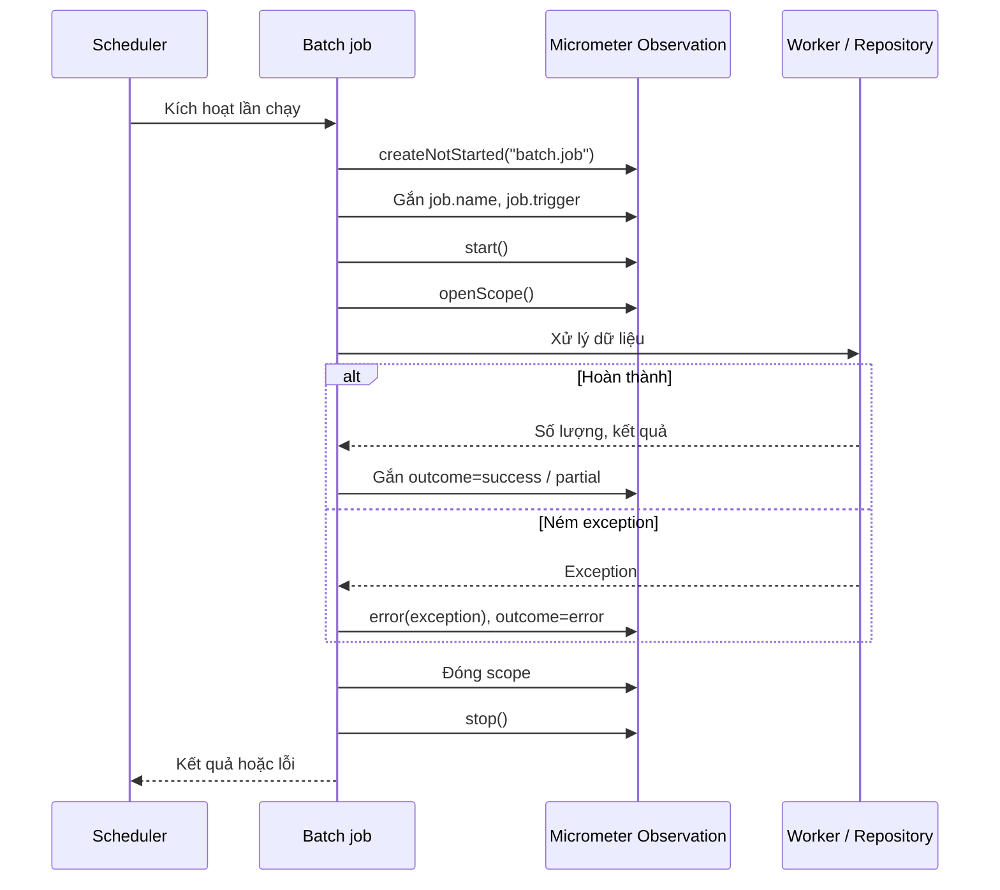
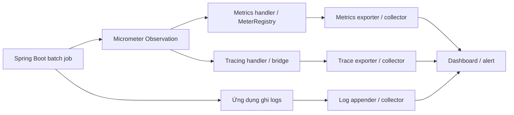

# Custom observation cho batch job

> **Chương:** Custom observation  
> **Module:** `SPRING_BOOT_OBSERVABILITY` — thiết lập observability cho Spring Boot bằng Micrometer Observation, metrics, logs và distributed tracing; kết hợp context propagation, tags/cardinality, exporter và sampling để điều tra lỗi, độ trễ và hành vi ứng dụng trong môi trường thực.

## Mục tiêu học tập

Sau bài học, bạn có thể:

- Xác định **ranh giới observation** cho một lần chạy batch job, một step hoặc một chunk; chọn mức chi tiết phù hợp.
- Dùng `ObservationRegistry` và `Observation` để đo thời gian thực thi, ghi nhận lỗi và gắn kết quả cho job tự viết trong Spring Boot.
- Phân biệt **duration của job**, **số bản ghi xử lý**, **số lỗi** và **trạng thái một lần chạy**; biết khi nào dùng observation, counter, gauge hoặc log.
- Liên kết metrics, logs và distributed traces bằng job name, run ID, trace ID và span ID mà không làm tăng cardinality ngoài kiểm soát.
- Hiểu giới hạn của `@Scheduled`, Spring Batch, xử lý song song, retries, sampling và exporter; áp dụng checklist kiểm chứng khi vận hành.

## 1. Batch job cần observability khác HTTP request như thế nào?

Một API đồng bộ thường có ranh giới rõ ràng: nhận HTTP request, xử lý, trả response. Batch job lại có thể bắt đầu bởi scheduler, message, CLI hoặc người vận hành; chạy từ vài giây đến nhiều giờ; xử lý hàng nghìn đến hàng triệu bản ghi.

Ví dụ, lúc 02:00 mỗi ngày, `invoice-settlement` đối soát hóa đơn:

1. Đọc danh sách hóa đơn chưa đối soát.
2. Chia các hóa đơn thành từng nhóm (chunk).
3. Gọi dịch vụ thanh toán và cập nhật kết quả.
4. Retry một số lỗi tạm thời; ghi nhận bản ghi không xử lý được.
5. Tổng hợp số lượng thành công/thất bại và kết thúc.

Đội vận hành cần trả lời: **Lần chạy nào thất bại? Chậm ở bước đọc dữ liệu hay gọi đối tác? Số hóa đơn được xử lý giảm vì không có dữ liệu hay job bị lỗi? Sau lần triển khai gần nhất, thời lượng job thay đổi ra sao?**

Có thể ghi một dòng log “batch started” và “batch completed”, nhưng điều đó không đủ để nhìn **xu hướng thời lượng** hoặc điều tra một chuỗi lời gọi giữa các dịch vụ.

**Custom observation cho batch job** là việc tự xác định ranh giới công việc, tên observation, metadata và vòng đời để Micrometer Observation có thể kết nối hoạt động batch với metrics và traces. Logs được ghi riêng nhưng có thể liên kết nhờ trace context hoặc run ID.

## 2. Chọn tín hiệu theo câu hỏi vận hành

| Câu hỏi | Tín hiệu nên dùng | Ví dụ |
| --- | --- | --- |
| Job có chạy đúng lịch và hoàn thành không? | Metrics + logs, và trạng thái scheduler/job repository | Số lần chạy theo outcome; cảnh báo lần chạy thành công cuối đã quá lâu. |
| Job mất bao lâu? | Timer/metric về thời lượng | p95 duration của `invoice-settlement` theo ngày. |
| Có bao nhiêu bản ghi được xử lý? | Counter hoặc summary/gauge được chọn theo ngữ nghĩa | Số bản ghi thành công/thất bại, throughput của batch. |
| Bước nào chậm? | Traces hoặc metrics theo step | Span `batch.read` hoặc `payment.authorize` chiếm phần lớn thời gian. |
| Một lần chạy cụ thể lỗi ở đâu? | Logs có `batchRunId`, trace ID, span ID | Lọc logs theo run ID và mở trace liên quan. |
| Lỗi có lan rộng không? | Metrics tổng hợp + logs/traces mẫu | Tỷ lệ thất bại tăng ở nhiều lần chạy. |

Metrics trả lời **xu hướng, mức độ**, trace trả lời **đường đi, quan hệ và thời gian của các bước**, logs trả lời **sự kiện cụ thể**. Không nên thay thế cả ba bằng một metric chứa ID riêng của từng lần chạy.

### 2.1. Một run, một step và một chunk

Các cấp đo lường thường gặp:

- **Job run:** một lần thực thi `invoice-settlement`, bao gồm các bước đã được chọn. Đây là cấp ưu tiên để đo tổng duration và outcome.
- **Step/phase:** đọc dữ liệu, kiểm tra, đối soát, ghi kết quả. Quan sát ở cấp này giúp khoanh vùng bottleneck mà không tạo quá nhiều dữ liệu.
- **Chunk:** một nhóm bản ghi được xử lý trong một transaction hoặc một thao tác. Chỉ tạo observation chi tiết khi cần biết chi phí theo chunk.
- **Item/record:** từng bản ghi riêng lẻ. Thường **không** tạo span/observation cho mọi item của một batch lớn, trừ khi có mục tiêu điều tra rõ ràng và kiểm soát được chi phí.

Nếu một job xử lý 500.000 bản ghi, tạo 500.000 spans có thể làm tăng tải và chi phí telemetry đáng kể. Thường tốt hơn khi đo job/step, tổng hợp counters, và chỉ tăng mức chi tiết trong giai đoạn chẩn đoán có kiểm soát.

## 3. Thiết kế ranh giới và vòng đời observation

Với một job chạy đồng bộ, lựa chọn đơn giản là **mỗi lần chạy tạo một observation**:



Các API có vai trò khác nhau:

| API | Vai trò trong batch job |
| --- | --- |
| `Observation.createNotStarted("batch.job", registry)` | Tạo observation cho một lần chạy với tên **ổn định**. |
| `lowCardinalityKeyValue(...)` | Gắn nhãn có tập giá trị hữu hạn: `job.name`, `job.trigger`, `job.outcome`. |
| `start()` | Bắt đầu vòng đời đo của job tại ranh giới đã chọn. |
| `openScope()` | Đưa observation vào ngữ cảnh hiện hành trong lúc job thực thi; hỗ trợ observation con/tracing/log correlation. |
| `error(Throwable)` | Báo exception thật của công việc cho observation handlers. |
| `stop()` | Kết thúc vòng đời, cho phép handlers hoàn tất metric/span. |
| `observe(Supplier/Runnable)` | Cách ngắn gọn để quản lý start/scope/error/stop cho công việc **đồng bộ**. |

**Cần định nghĩa chính xác thời gian muốn đo.** Nếu `start()` ngay trước lúc scheduler gửi task vào queue nhưng `stop()` ngay sau khi enqueue, duration chỉ là thời gian gửi task. Nếu mục tiêu là thời gian từ lúc enqueue tới lúc hoàn tất, phải đo cả thời gian chờ và hoàn thành, với quản lý lifecycle phù hợp cho async.

Một job có thể **hoàn thành có lỗi từng phần** mà không ném exception. Vì vậy `getError() == null` không phải luôn tương đương `job.outcome=success`. Cần phân biệt:

- `success`: hoàn thành theo hợp đồng nghiệp vụ.
- `partial`: hoàn thành nhưng có bản ghi thất bại hoặc bị bỏ qua, theo chính sách đã xác định.
- `error`: job thất bại hoặc bị dừng bởi lỗi làm không hoàn tất mục tiêu.
- `cancelled`: bị hủy chủ động, nếu hệ thống hỗ trợ và đo được.

Trạng thái kết quả nên dựa trên **ngữ nghĩa của batch**, không chỉ dựa vào việc method có ném exception hay không.

## 4. Ví dụ Spring Boot: đo một scheduled batch job

Giả sử một ứng dụng Spring Boot dùng `@Scheduled` để đối soát hóa đơn. Phần xử lý nghiệp vụ được trừu tượng hóa qua `SettlementService`; khi áp dụng vào dự án thực, bạn triển khai service này để truy vấn, xử lý và commit dữ liệu.

### 4.1. Bật scheduler và các dependency cần thiết

Trong ứng dụng Spring Boot, bật scheduling bằng `@EnableScheduling`:

```java
import org.springframework.boot.SpringApplication;
import org.springframework.boot.autoconfigure.SpringBootApplication;
import org.springframework.scheduling.annotation.EnableScheduling;

@SpringBootApplication
@EnableScheduling
public class BillingApplication {
    public static void main(String[] args) {
        SpringApplication.run(BillingApplication.class, args);
    }
}
```

Dự án cần Micrometer Observation và các tích hợp Spring Boot tương thích. Spring Boot Actuator thường cung cấp cơ sở cho `ObservationRegistry` được quản lý. Muốn xuất metrics tới Prometheus cần registry exporter tương ứng; muốn traces phải cấu hình thêm Micrometer Tracing bridge và trace exporter.

**Ví dụ không giả định một phiên bản Spring Boot cụ thể:** tên dependency, chính sách instrument scheduler và thuộc tính exporter cần đối chiếu với phiên bản ứng dụng. Khi Spring Boot/Spring Batch đã cung cấp instrumentation cho một ranh giới, kiểm tra dữ liệu có sẵn trước khi tự tạo một observation trùng ý nghĩa.

### 4.2. Tạo observation cho lần chạy job

Ví dụ triển khai dưới đây đo toàn bộ phần xử lý đồng bộ của một lần chạy. `SettlementService` là hợp đồng nghiệp vụ cần có một bean triển khai trong ứng dụng thật.

```java
package example.batch;

import io.micrometer.core.instrument.MeterRegistry;
import io.micrometer.observation.Observation;
import io.micrometer.observation.ObservationRegistry;
import org.slf4j.Logger;
import org.slf4j.LoggerFactory;
import org.springframework.scheduling.annotation.Scheduled;
import org.springframework.stereotype.Component;

@Component
public class InvoiceSettlementJob {
    private static final Logger log =
            LoggerFactory.getLogger(InvoiceSettlementJob.class);

    private final ObservationRegistry observations;
    private final MeterRegistry meters;
    private final SettlementService settlement;

    public InvoiceSettlementJob(
            ObservationRegistry observations,
            MeterRegistry meters,
            SettlementService settlement) {
        this.observations = observations;
        this.meters = meters;
        this.settlement = settlement;
    }

    // Mỗi ngày lúc 02:00 UTC, khi scheduling đã được bật.
    @Scheduled(cron = "0 0 2 * * *", zone = "UTC")
    public void execute() {
        Observation observation = Observation
                .createNotStarted("batch.job", observations)
                .contextualName("invoice settlement")
                .lowCardinalityKeyValue("job.name", "invoice-settlement")
                .lowCardinalityKeyValue("job.trigger", "scheduled")
                .start();

        try (Observation.Scope scope = observation.openScope()) {
            BatchSummary result = settlement.settlePending();

            String outcome = result.failed() > 0
                    ? "partial"
                    : "success";
            observation.lowCardinalityKeyValue("job.outcome", outcome);

            meters.counter(
                    "batch.records.processed",
                    "job.name", "invoice-settlement"
            ).increment(result.processed());

            meters.counter(
                    "batch.records.failed",
                    "job.name", "invoice-settlement"
            ).increment(result.failed());

            log.info("Invoice settlement completed: processed={}, failed={}",
                    result.processed(), result.failed());

        } catch (RuntimeException | Error failure) {
            observation.error(failure);
            observation.lowCardinalityKeyValue("job.outcome", "error");
            log.error("Invoice settlement failed", failure);
            throw failure;
        } finally {
            observation.stop();
        }
    }

    public interface SettlementService {
        BatchSummary settlePending();
    }

    public record BatchSummary(long processed, long failed) {}
}
```

**Cách hoạt động:**

1. `@Scheduled` kích hoạt một lần chạy. `@EnableScheduling` cần được bật trong ứng dụng; thông thường nên cấu hình chính sách tránh chạy trùng ở nhiều instance nếu job không idempotent.
2. `ObservationRegistry` nhận một observation tên `batch.job`. Tên chung giúp nhiều lần chạy cùng đóng góp vào một nhóm metrics.
3. `job.name=invoice-settlement` và `job.trigger=scheduled` là tags hữu hạn. Các biến này **không chứa** mã riêng của từng run.
4. `start()` bắt đầu đo; `openScope()` duy trì ngữ cảnh cho hoạt động con và logs trong cùng thread, nếu tracing/logging được cấu hình.
5. `SettlementService` xử lý nghiệp vụ và trả `BatchSummary`; code chọn `partial` nếu có bản ghi thất bại, `success` nếu không.
6. `MeterRegistry.counter(...)` ghi số lượng bản ghi đã xử lý hoặc thất bại **theo ngữ nghĩa đã quy ước**. Đây là metric bổ sung ngoài duration/count của observation.
7. Nếu có exception, `observation.error(failure)` báo lỗi, `job.outcome=error` được gắn trước khi stop. Exception được ném lại để scheduler hoặc tầng điều phối xử lý theo chính sách hệ thống.
8. `finally` bảo đảm `stop()` được gọi dù có exception; `try-with-resources` đóng scope và khôi phục ngữ cảnh trước đó.

Ví dụ sử dụng Java 17+ do có `record`; có thể thay bằng class DTO nếu stack dùng phiên bản Java thấp hơn. `SettlementService` chỉ là interface minh họa; cần có implementation thực tế, transaction/retry và kiểm thử nghiệp vụ trước khi chạy trong môi trường thật.

**Giới hạn quan trọng:** Nếu `settlePending()` ném exception sau khi đã xử lý một số bản ghi, `BatchSummary` không được trả nên hai counter ví dụ **chưa ghi nhận số bản ghi đã xử lý một phần**. Khi cần số đếm chính xác cho cả ca lỗi giữa chừng, cập nhật counters ở bước commit thành công hoặc lấy số liệu từ execution repository. Không đếm lại item chỉ vì retry nếu định nghĩa metric là “số bản ghi duy nhất đã hoàn tất”.

### 4.3. Ví dụ metadata và tín hiệu thu được

Với một lần chạy thành công:

```text
Observation name: batch.job
Contextual name:  invoice settlement

low-cardinality tags:
  job.name=invoice-settlement
  job.trigger=scheduled
  job.outcome=success

metrics:
  batch.records.processed += 1200
  batch.records.failed    += 0
```

Nếu handler metrics đã được cấu hình, observation còn có thể góp vào metric số lần/duration theo cách triển khai của registry/convention. Tên metric thực tế trong backend có thể được chuẩn hóa hoặc thay đổi theo registry; không giả định nguyên văn tên `batch.job` là chuỗi Prometheus được xuất ra.

Nếu handler tracing phù hợp, observation có thể tạo một span tên `invoice settlement` hoặc tên do convention quyết định. Nếu trace bị sampling loại bỏ hoặc exporter chưa cấu hình, span đó có thể **không xuất hiện** trong backend dù method `execute()` thực sự đã chạy.

## 5. Dùng `observe(...)` hay quản lý vòng đời thủ công?

`observe(...)` thường đơn giản nhất nếu không cần gắn kết quả sau khi công việc chạy:

```java
public void refreshCache(ObservationRegistry registry) {
    Observation.createNotStarted("batch.job", registry)
            .lowCardinalityKeyValue("job.name", "cache-refresh")
            .lowCardinalityKeyValue("job.trigger", "manual")
            .observe(() -> {
                reloadCache();
            });
}
```

Hàm `reloadCache()` là placeholder cho logic nghiệp vụ của ứng dụng.

Với bài toán cần phân biệt `partial` với `success`, cần thêm tag kết quả sau khi xử lý và quan sát exception, nên cách quản lý `start()` / `openScope()` / `stop()` tường minh ở phần trước dễ hiểu hơn. Khi triển khai, chọn **một** cơ chế điều khiển vòng đời cho cùng một observation; tránh gọi `start()` rồi lại dùng `observe(...)` trên cùng đối tượng mà không kiểm soát lifecycle.

| Điều kiện | Cách tiếp cận |
| --- | --- |
| Job đồng bộ, không cần cập nhật metadata sau công việc | `observe(Runnable/Supplier)` ngắn gọn. |
| Cần phân loại `success/partial/error` theo kết quả | Tạo observation và điều khiển vòng đời tường minh. |
| Job bất đồng bộ, một lần gọi chỉ enqueue công việc | Đặt observation tại nơi thực thi thật và quản lý thời điểm stop phù hợp. |
| Spring Batch đã cung cấp metrics/spans cho job/step | Tận dụng instrumentation có sẵn, thêm observation cho hoạt động nghiệp vụ còn thiếu. |

## 6. Đo step và chunk để tìm điểm nghẽn

Một job có thể hoàn tất chậm vì **đọc dữ liệu**, **gọi dịch vụ ngoài**, **ghi DB** hoặc **retry**. Khi quan sát `batch.job` tổng thể là chưa đủ, thêm một số observation con có ý nghĩa.

```text
batch.job: invoice-settlement             02:00:00 - 02:03:45
├── batch.fetch                            00:00:16
├── batch.reconcile                        00:03:08
│   ├── payment.partner-call (mẫu)         00:00:03
│   └── payment.partner-call (mẫu)         00:00:05
└── batch.persist                          00:00:21
```

Ví dụ helper đo một bước đồng bộ trong scope job hiện hành:

```java
import java.util.function.Supplier;
import io.micrometer.observation.Observation;
import io.micrometer.observation.ObservationRegistry;

public class BatchStepObserver {
    private final ObservationRegistry registry;

    public BatchStepObserver(ObservationRegistry registry) {
        this.registry = registry;
    }

    public <T> T observeStep(String step, Supplier<T> operation) {
        String normalizedStep = switch (step) {
            case "fetch", "reconcile", "persist" -> step;
            default -> "other";
        };

        return Observation.createNotStarted("batch.step", registry)
                .lowCardinalityKeyValue("job.name", "invoice-settlement")
                .lowCardinalityKeyValue("step.name", normalizedStep)
                .observe(operation);
    }
}
```

Ví dụ trên chỉ phù hợp khi `observeStep(...)` được gọi trong **scope còn hoạt động** của observation cha và cùng context thực thi (hoặc context đã được truyền đúng cách).

Chú ý **chuẩn hóa step name**. Không dùng `step.name="chunk-192847"` hoặc ID khác nhau mỗi lần xử lý vì sẽ tạo nhãn cardinality cao. Với batch lớn, nên dùng metrics tổng hợp cho chunk duration/throughput; chỉ tạo spans chi tiết cho những phần thật sự cần quan sát.

### 6.1. Khi dùng Spring Batch

Spring Batch cung cấp các khái niệm `Job`, `Step`, `JobExecution`, `StepExecution`, chunk processing, retry và trạng thái thực thi. Tùy phiên bản và cấu hình, framework có thể đã phát metrics hoặc observation liên quan.

Với Spring Batch, bạn nên:

- Đọc trạng thái thực tế `COMPLETED`, `FAILED`, `STOPPED`... từ job/step execution thay vì suy đoán chỉ bằng exception.
- Dùng `JobExecutionListener`, `StepExecutionListener`, tasklet/processor hoặc service nghiệp vụ khi cần thêm tín hiệu; chọn **một điểm bắt đầu và kết thúc có phạm vi rõ**.
- Không lưu một `Observation` sống lâu hay `Observation.Scope` vào execution context được persist/serialize. Scope là ngữ cảnh thực thi, không phải dữ liệu job để lưu qua restart.
- Khi một job được restart hoặc retry, định nghĩa rõ một `execution` mới khác gì một `job instance`, và đếm metric theo ngữ nghĩa nào.
- Tránh đo cùng một duration job bằng cả instrumentation mặc định và observation thủ công với tên/tag giống nhau nếu điều đó làm dashboard bị tính trùng.

Ví dụ `@Scheduled` ở mục 4 là **custom scheduler job**, không phải triển khai Spring Batch JobRepository hay giao thức restart. Nếu dự án dùng Spring Batch, hãy dựa vào trạng thái và cơ chế điều phối của Spring Batch để quyết định outcome chính xác.

## 7. Correlation ID, trace context và batch run ID

Batch job thường không có HTTP request cha. Một run do scheduler kích hoạt có thể bắt đầu một trace gốc, còn các thao tác trong run được liên kết thành spans con nếu tracing handlers và scope được cấu hình.

**Cần phân biệt ba loại định danh:**

| Định danh | Mục đích | Nên xuất hiện ở đâu? |
| --- | --- | --- |
| `job.name` | Nhóm các lần chạy cùng loại | Metrics tags, logs và trace attributes (cardinality thấp). |
| `batchRunId` / `jobExecutionId` | Tìm **một lần chạy cụ thể**, liên kết restart/retry theo quy ước | Structured logs, execution repository hoặc thuộc tính trace được kiểm soát. |
| `traceId`, `spanId` | Liên kết các thao tác trong distributed trace | Tracing backend và logs có tracing correlation. |

**Không đưa `batchRunId`, `jobExecutionId` hay `traceId` vào metric tags.** Chúng thay đổi theo từng run/trace, có thể tạo quá nhiều time series và tăng tải backend. Với một run ID, log và trace thường là nơi thích hợp hơn.

### 7.1. Thêm run ID vào logging context

Nếu cần tìm logs theo một lần chạy độc lập với tracing sampler, có thể tạo một ID ở đầu job, đặt vào **SLF4J MDC** trong scope xử lý đồng bộ:

```java
import java.util.UUID;
import org.slf4j.MDC;

String runId = UUID.randomUUID().toString();

try (MDC.MDCCloseable ignored =
        MDC.putCloseable("batchRunId", runId)) {
    // Thực thi job đồng bộ và ghi log tại đây.
    // Tracing (nếu có) quản lý traceId/spanId theo cơ chế riêng.
}
```

MDC giúp log phát ra trong thread hiện tại có `batchRunId` khi logging pattern/structured logging đã được cấu hình đọc trường đó. `MDCCloseable` xóa/khôi phục giá trị khi kết thúc scope, tránh rò ID sang job khác dùng cùng thread.

Ví dụ cấu hình Logback/Spring Boot có thể bao gồm:

```yaml
logging:
  pattern:
    level: "%5p traceId=%X{traceId:-} spanId=%X{spanId:-} batchRunId=%X{batchRunId:-}"
```

`traceId`/`spanId` xuất hiện khi Micrometer Tracing và MDC integration có hiệu lực trong scope thích hợp. `batchRunId` ở ví dụ này được đặt thủ công. Nếu dùng structured logging JSON, nên ghi các trường tương đương để backend truy vấn theo key riêng.

Nếu batch khởi chạy bởi Spring Batch có `jobExecutionId` ổn định được lưu trong repository, có thể dùng định danh đó thay cho UUID riêng để giảm số lượng ID cần đối chiếu.

### 7.2. Gọi các dịch vụ khác và truyền ngữ cảnh

Giả sử batch gọi `payment-service` qua HTTP hoặc gửi message tới queue. Muốn hai phía thuộc cùng trace, cần:

1. Dùng tracing bridge và instrumentation phù hợp cho client/server hoặc producer/consumer.
2. Inject/extract W3C Trace Context (ví dụ `traceparent`) hoặc định dạng propagation đã thống nhất.
3. Với tác vụ trên executor, thread khác hoặc Reactor, cấu hình **capture/restore context** đúng ranh giới.
4. Truyền `batchRunId` bằng message/HTTP metadata khi có hợp đồng và chính sách dữ liệu phù hợp; trace context không tự mang theo ID nghiệp vụ tùy chỉnh.

Một run dài có thể tạo nhiều traces: sau khi đẩy message vào queue, một consumer được thực thi lâu sau đó có thể có trace riêng. Khi đó `batchRunId`/workflow ID và message ID hỗ trợ liên hệ sự kiện, còn span links hoặc quan hệ tracing phù hợp được dùng nếu công cụ hỗ trợ. Không kết luận hai spans có cùng run ID thì đương nhiên có quan hệ cha–con.

### 7.3. Async và xử lý song song

Không nên tạo observation ở thread lập lịch rồi `stop()` ngay khi giao việc cho executor nếu thời gian cần đo là lúc các task thật sự hoàn tất. Cũng không nên mở một `Observation.Scope` ở thread chính rồi giả định scope đó tự đi theo mọi worker.

Hai chiến lược thường gặp:

- **Mỗi worker tự đo phần việc:** truyền ngữ cảnh qua executor, tạo observation child tại worker, đóng scope/stop trong worker; aggregate metrics ở mức job sau khi các future đã hoàn thành.
- **Đo tổng job:** bắt đầu trước khi phát việc, chỉ dừng sau khi đã join/await toàn bộ công việc và tổng hợp kết quả; quản lý observation lifecycle tại coordinator, không giữ thread-local scope mở vô hạn qua nhiều thread.

Trường hợp tác vụ kéo dài nhiều giờ hoặc có hàng triệu spans cần đánh giá chi phí tracing và cách chia giai đoạn. Metrics tổng hợp và logging theo run ID có thể phù hợp hơn việc giữ một cây trace cực lớn cho toàn bộ đời sống của job.

## 8. Tags, cardinality và chính sách ghi dữ liệu

Một số nhãn nên định nghĩa ngay từ đầu:

| Key | Giá trị ví dụ | Có dùng cho metric tag? | Lý do |
| --- | --- | --- | --- |
| `job.name` | `invoice-settlement` | Có | Tập job đã biết, ổn định. |
| `job.trigger` | `scheduled`, `manual`, `event` | Có | Giá trị hữu hạn. |
| `job.outcome` | `success`, `partial`, `error`, `cancelled` | Có | Phân nhóm kết quả. |
| `step.name` | `fetch`, `reconcile`, `persist` | Có nếu đã chuẩn hóa | Dùng để so sánh duration theo phase. |
| `tenant.tier` | `free`, `pro`, `enterprise` | Có nếu tập giá trị kiểm soát | Chỉ khi cần và được phép phân nhóm. |
| `tenantId` | Giá trị riêng từng tenant | Thường không | Có nguy cơ cardinality và vấn đề riêng tư. |
| `batchRunId` | UUID mỗi lần chạy | Không | Mỗi run một giá trị mới. |
| `recordId` / `invoiceId` | ID mỗi bản ghi | Không | Cardinality rất cao, không phù hợp metrics. |

Một metric dùng tổng cộng nhiều nhãn có số tổ hợp tiềm năng **bằng tích cardinality của các nhãn**. Ví dụ 20 job × 3 trigger × 4 outcome × 5 step đã có thể cho 1.200 tổ hợp trước khi tính instance/region; cần kiểm tra cả nhãn hệ thống tự động thêm.

**Low-cardinality key-values** thích hợp cho metrics; **high-cardinality key-values** có thể mang ý nghĩa điều tra trong traces nhưng vẫn cần kiểm tra quyền riêng tư, quy mô payload và khả năng backend. Không nên đưa token, mật khẩu, PII, toàn bộ payload hoặc dữ liệu thanh toán vào log/trace chỉ để “dễ tìm lỗi”.

## 9. Exporter, sampling và giới hạn quan sát

Để thấy dữ liệu ngoài process, cần các tích hợp phù hợp:



Lưu ý:

- **Metrics** có thể đếm lần chạy, duration và số bản ghi ngay cả khi trace của run không được lấy mẫu. Tuy nhiên dữ liệu vẫn có thể thiếu nếu pipeline metrics lỗi hoặc ứng dụng kết thúc bất thường trước khi flush.
- **Trace sampling** ví dụ 10% nghĩa là không phải mọi run đều có trace xuất ra. Với job hiếm và quan trọng, xác suất thấp có thể khiến khó lấy được dấu vết của run lỗi; chọn chiến lược theo mức độ rủi ro và khả năng lưu trữ.
- **Exporter/collector** có thể mất kết nối, quá tải hoặc làm rơi dữ liệu. Không thấy span trong backend **không chứng minh** job chưa chạy.
- **Long-running job:** span có thể chưa được export đầy đủ trước khi observation kết thúc; nếu process bị kill đột ngột, tín hiệu hoàn tất có thể không có. Nên kết hợp liveness/heartbeat, job repository và last-success timestamp để nhận ra job treo hoặc không chạy.
- **Logs** nên có cấu trúc và mức độ hợp lý; log mỗi item trong batch lớn có thể vừa tốn chi phí vừa làm chìm thông tin quan trọng.

Ví dụ cấu hình cơ bản cho một dự án Spring Boot dùng các integration phù hợp:

```yaml
spring:
  application:
    name: billing-batch

management:
  endpoints:
    web:
      exposure:
        include: health,info,prometheus
  tracing:
    sampling:
      probability: 0.1
```

`prometheus` chỉ hoạt động khi đã thêm Prometheus registry. Tracing cần bridge/exporter và điểm nhận tương thích. Tên dependency hoặc thuộc tính exporter có thể khác giữa các phiên bản Spring Boot; kiểm tra cấu hình tương ứng của ứng dụng trước khi triển khai.

Endpoint Actuator phải được bảo vệ theo môi trường. Không mở công khai dữ liệu quản trị hoặc thông tin vận hành nhạy cảm trên Internet.

## 10. Cảnh báo: job bị treo và lần chạy bị bỏ lỡ

Một metric về duration chỉ được hoàn tất khi observation **stop**. Nếu process bị treo mãi hoặc chết trước lúc stop, chỉ nhìn metric duration các job đã hoàn thành sẽ bỏ sót đúng ca nghiêm trọng.

Vì vậy observability cho batch không dừng ở timer. Có thể thêm:

1. **Last successful completion timestamp:** gauge hoặc giá trị được cập nhật sau khi job hoàn tất thành công, để phát hiện nhiều chu kỳ không có kết quả.
2. **Job running/active count:** số job đang chạy; tăng bất thường có thể chỉ ra job bị chồng lấn hoặc dừng không đúng.
3. **Job heartbeat/progress:** ghi mốc tiến độ cho job dài; lấy từ storage bền vững nếu cần sống qua restart.
4. **Job execution state trong repository:** trạng thái bắt đầu/kết thúc, retry, checkpoint, restart; dùng nguồn sự thật nghiệp vụ thay vì suy luận hoàn toàn từ telemetry.
5. **Alerts có ngữ cảnh:** ví dụ “job đối soát chưa có lần chạy thành công trong khoảng thời gian cho phép” thường hữu ích hơn chỉ “p95 duration > 5 phút”.

Không suy ra “không có lỗi” chỉ vì counter `batch.jobs.errors` không tăng. Job có thể không được scheduler kích hoạt, crash trước khi ghi metric, hoặc exporter bị lỗi.

## 11. Thực hành điều tra một batch job chậm

**Tình huống:** `invoice-settlement` thường hoàn thành trong 3 phút nhưng hôm nay mất gần 20 phút, có nhiều hóa đơn chưa được đối soát.

Các bước điều tra gợi ý:

1. **Kiểm tra dữ liệu job thực:** xem execution repository/scheduler, số lượng item đầu vào, kết quả job, số retry và các lần chạy chồng lấn. Xác minh đây là một run kéo dài hay nhiều runs.
2. **Xem metrics tổng hợp:** kiểm tra duration, số run theo `job.outcome`, throughput và số records failed; so sánh với các ngày có lượng dữ liệu tương tự.
3. **Lọc logs theo `batchRunId`/`jobExecutionId`:** xác định thời điểm bắt đầu, phase chuyển trạng thái, warnings, timeout, retry và lần checkpoint cuối.
4. **Mở trace nếu được thu thập:** tìm spans `batch.fetch`, `batch.reconcile`, `batch.persist`; xem phase nào chiếm thời lượng. Nếu không có trace do sampling, dùng logs và metrics để tiếp tục điều tra.
5. **Đối chiếu dependency:** metrics về DB connection pool, queue backlog, HTTP client latency và lỗi nhà cung cấp; tìm thay đổi triển khai hoặc cấu hình gần lúc hiện tượng bắt đầu.
6. **Phân biệt triệu chứng và nguyên nhân:** `batch.reconcile` lâu có thể vì đối tác chậm, quá nhiều retry, DB lock, tăng dữ liệu hoặc thread pool cạn; một span dài chưa chứng minh nguyên nhân gốc.
7. **Kiểm chứng sau sửa:** đo lại duration, records processed, outcome và last-success timestamp; bảo đảm thay đổi không làm duplicate processing hoặc sai dữ liệu.

Ví dụ diễn giải:

> Từ metrics thấy thời lượng job tăng từ ~3 phút lên ~20 phút, phần lớn thời gian nằm ở phase `reconcile`. Logs cùng `batchRunId` ghi nhận HTTP timeout và retry; metrics của payment dependency cũng tăng latency. Các bằng chứng này hướng điều tra đến dependency hoặc chính sách retry, cần kiểm chứng bằng dữ liệu mạng, cấu hình và các lần chạy khác.

Đây là cách **liên kết nhiều tín hiệu** trong observability; không nhầm một log hay một trace đơn lẻ thành bằng chứng đại diện cho mọi run.

## 12. Các lỗi thiết kế thường gặp

| Hiện tượng | Nguyên nhân thường gặp | Hướng xử lý |
| --- | --- | --- |
| Timer chỉ đo vài ms trong khi job chạy hàng phút | `stop()` ngay sau khi submit async task | Đặt stop sau khi công việc thực sự hoàn thành, hoặc đo queue time và processing time tách biệt. |
| Không thấy metrics của job | Chưa có metrics handler/registry, observation chưa stop, exporter chưa hoạt động | Kiểm tra registry, lifecycle và pipeline thu dữ liệu. |
| Không thấy trace | Tracing bridge/exporter thiếu, trace bị sampling hoặc context mất | Kiểm tra instrumentation, sampling và propagation. |
| Span con không liên hệ với span job | Scope cha không mở hoặc context không truyền qua executor/HTTP | Kiểm tra `openScope()` và context capture/restore. |
| Counters cao bất thường khi retry | Đếm mỗi attempt thay vì bản ghi được commit | Định nghĩa lại ngữ nghĩa counters, cập nhật tại điểm commit. |
| Metrics nổ số lượng series | Dùng `batchRunId`, `recordId` hoặc URL động làm label | Chuyển ID sang log/trace, chuẩn hóa low-cardinality tags. |
| Job báo `success` dù có nhiều item lỗi | Chỉ kiểm tra exception, không xét `BatchSummary`/execution status | Định nghĩa outcome theo điều kiện nghiệp vụ. |
| Job chạy trùng trên nhiều instance | Mỗi instance đều kích hoạt `@Scheduled` | Dùng cơ chế điều phối/khóa phân tán hoặc scheduler trung tâm phù hợp, bảo đảm idempotency. |
| Dashboard không phát hiện job bị bỏ lỡ | Chỉ đo các runs đã hoàn thành | Thêm last-success, trạng thái scheduler và alert cho missed execution. |
| Có trace ID nhưng không thấy logs tương ứng | Chưa cấu hình logging MDC, log ngoài scope hoặc sampling/pipeline khác nhau | Kiểm tra log fields, context propagation và log backend. |

## 13. Bài thực hành tự kiểm chứng

Trên môi trường thử nghiệm, triển khai service và giả lập ba kịch bản:

1. **Thành công:** `settlePending()` trả `BatchSummary(100, 0)`. Kiểm tra outcome `success` và counters tăng theo kỳ vọng, nếu registry/exporter đã hoạt động.
2. **Hoàn thành một phần:** trả `BatchSummary(100, 7)`. Kiểm tra outcome `partial` và số bản ghi lỗi. Làm rõ `processed=100` nghĩa là tổng đã thử hay tổng đã commit.
3. **Thất bại bởi exception:** ném `IllegalStateException`. Kiểm tra error được ghi trong observation, outcome `error`, exception vẫn truyền đến scheduler và observation được stop.
4. **Dữ liệu liên kết:** ghi logs có run ID, bật tracing và xác minh trace/span ID trong log của một run được lấy mẫu. Thử gọi dependency và kiểm tra context propagation.
5. **Tải lớn:** giả lập nhiều chunks và kiểm tra số metric series không tăng theo item ID/run ID. Chỉ instrument thêm step quan trọng khi có nhu cầu điều tra.
6. **Job treo hoặc chết giữa chừng:** giả lập có kiểm soát trên môi trường thử nghiệm; xác minh cơ chế last-success/heartbeat/monitoring phát hiện thiếu kết quả ngay cả khi duration timer chưa được hoàn tất.

**Tiêu chí đạt:** Có thể chỉ ra chính xác observation đo khoảng thời gian nào, outcome được xác định ra sao, số bản ghi được tính theo quy tắc nào, và bằng cách nào liên kết logs/traces của một run với metrics tổng hợp mà không gắn ID biến thiên vào metric tags.

## 14. Câu hỏi tự kiểm tra

**Câu 1.** Có nên dùng `batchRunId` làm low-cardinality metric tag để tìm một lần chạy không?  
**Gợi ý:** Không. `batchRunId` thay đổi theo mỗi run; dùng cho logs/execution repository/trace attributes có kiểm soát. Metrics dùng tên job và nhóm trạng thái hữu hạn.

**Câu 2.** Job xử lý xong 100 bản ghi, có 7 bản ghi lỗi nhưng không ném exception. Outcome nên là gì?  
**Gợi ý:** Theo chính sách ví dụ, `partial`; không thể chỉ dựa vào `Observation.Context.getError()`.

**Câu 3.** Vì sao `stop()` phải được gọi khi quản lý vòng đời thủ công?  
**Gợi ý:** Handler cần biết hoạt động kết thúc để tính duration/hoàn tất span; `finally` giúp stop cả khi exception.

**Câu 4.** `@Scheduled` chạy trên hai instance thì custom observation có ngăn xử lý trùng không?  
**Gợi ý:** Không. Observation chỉ giúp đo và điều tra; cần scheduler/lock/idempotency ở tầng điều phối nghiệp vụ.

**Câu 5.** Không có trace của một batch run có nghĩa job chưa chạy?  
**Gợi ý:** Không. Có thể trace bị sampling, exporter lỗi hoặc thiếu instrumentation; dùng job repository, logs và metrics để xác minh.

**Câu 6.** Khi nào nên dùng thêm observation `batch.step`?  
**Gợi ý:** Khi cần khoanh vùng phase tốn thời gian hoặc thường lỗi; giới hạn số lượng và chuẩn hóa tên/tags.

**Câu 7.** Một job mất 20 phút nhưng metric duration của nó chỉ 10 ms. Kiểm tra điều gì trước?  
**Gợi ý:** Kiểm tra ranh giới start/stop. Có thể observation chỉ bao quanh bước enqueue task chứ không bao quanh xử lý bất đồng bộ.

**Ghi nhớ:** Custom observation cho batch job bắt đầu từ **ranh giới đo đúng**, **outcome có ý nghĩa nghiệp vụ** và **nhãn có cardinality thấp**. Dùng `ObservationRegistry` kết hợp metrics counters, logs có run ID và distributed traces khi phù hợp. Với Spring Boot, cần quan tâm đặc biệt tới lifecycle, context propagation, retries, sampling/exporter và trạng thái job bị treo hoặc bỏ lỡ; chúng quyết định liệu observability có thật sự hỗ trợ điều tra sự cố trên môi trường thực hay không.
