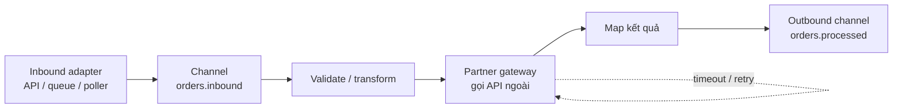
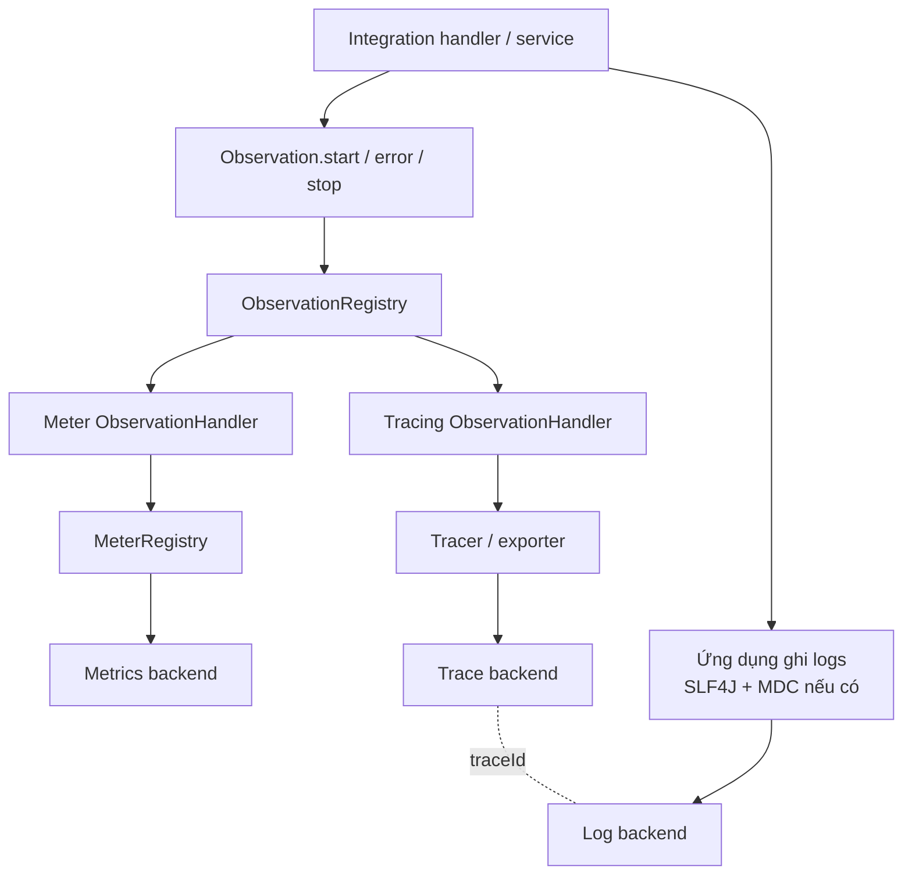
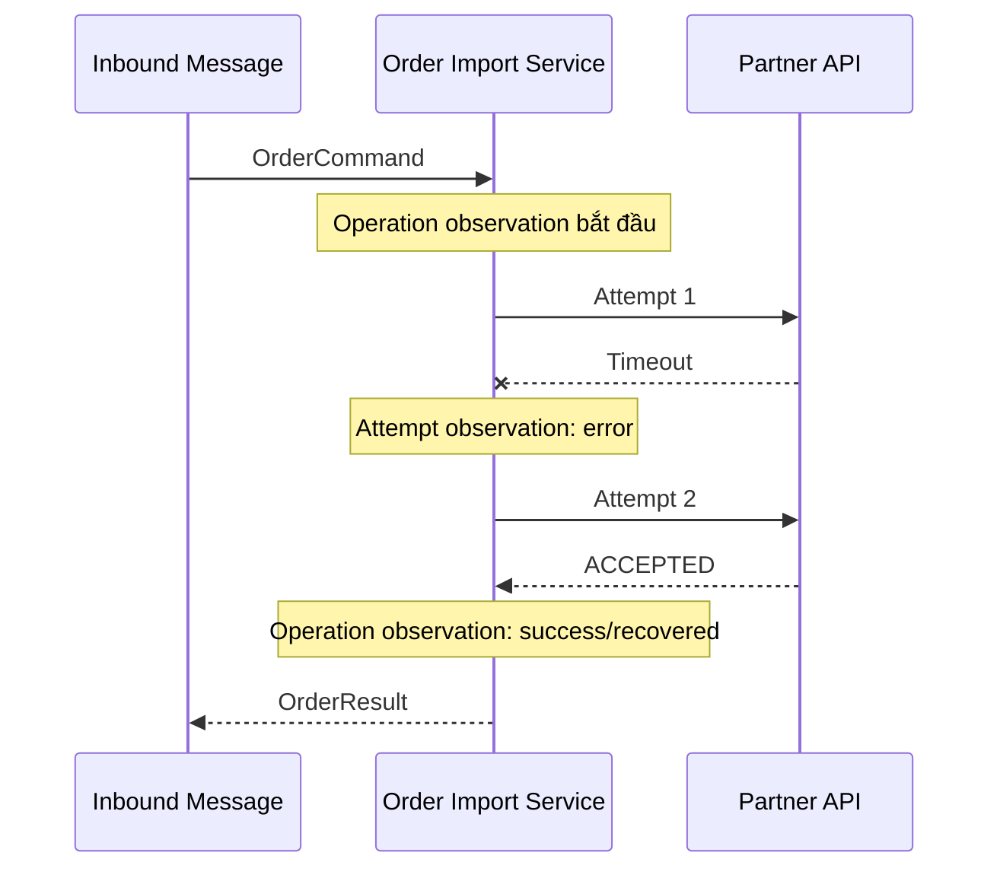

# Custom observation cho integration flow trong Spring Boot

Một ứng dụng tích hợp thường nhận dữ liệu từ API, hàng đợi hoặc lịch polling, kiểm tra và chuyển đổi message, gọi dịch vụ đối tác rồi phát kết quả sang bước tiếp theo. Nếu toàn bộ quá trình chỉ có metric HTTP, chúng ta biết yêu cầu vào ứng dụng mất bao lâu nhưng khó biết **bước chuyển đổi, lời gọi đối tác hay cơ chế retry** làm chậm luồng xử lý. **Custom observation** giúp mô tả một công việc có ý nghĩa trong integration flow để liên kết metrics, distributed tracing và logs với đúng ranh giới nghiệp vụ.

Đây là bài **Custom observation cho integration flow**, thuộc chương **Custom observation** của module **SPRING_BOOT_OBSERVABILITY**. Mục tiêu của module là thiết lập observability cho Spring Boot bằng Micrometer Observation, metrics, logs và distributed tracing; học propagation ngữ cảnh, tag/cardinality, exporter, sampling và liên kết tín hiệu nhằm điều tra lỗi, độ trễ, hành vi ứng dụng trong môi trường thực.

Trong bài này, *integration flow* chỉ một chuỗi xử lý thông điệp kết nối các thành phần, đặc biệt là mô hình **Spring Integration** với channel, handler, transformer, adapter hoặc gateway. Các nguyên tắc đặt ranh giới observation cũng áp dụng được cho luồng tích hợp viết bằng service Java thông thường.

## 1. Mục tiêu học tập

Sau khi hoàn thành bài, bạn có thể:

- Chọn ranh giới custom observation phù hợp cho flow và từng bước xử lý có giá trị điều tra.
- Thêm `ObservationRegistry` vào handler/service của Spring Integration và tạo observation bằng mã Java.
- Gắn nhãn `flow`, `stage`, `outcome` có cardinality thấp; ghi nhận exception bằng `error(ex)` và đóng observation trên mọi đường đi.
- Phân biệt một lần xử lý message, một lần gọi dependency và một lần retry để tránh đếm sai số lượng nghiệp vụ.
- Hiểu giới hạn của scope hiện hành khi message đi qua `DirectChannel`, `ExecutorChannel`, queue, broker hoặc Reactor.
- Kiểm chứng sự tương quan giữa log, metric và tracing, đồng thời xử lý những tình huống không có trace do sampling/exporter.

## 2. Quan sát điểm nào trong integration flow?

Giả sử hệ thống nhập đơn hàng từ một đối tác:



Có ba cấp độ quan sát thường gặp:

| Ranh giới | Tên gợi ý | Đo cái gì? | Khi nào phù hợp? |
| --- | --- | --- | --- |
| Toàn bộ nghiệp vụ xử lý message | `integration.order.process` | Thời gian từ khi bắt đầu handler đến khi có kết quả cuối | Muốn biết tỷ lệ thành công và độ trễ của một công việc |
| Bước tích hợp quan trọng | `integration.partner.call` | Thời gian và lỗi của lời gọi đối tác | Muốn phân biệt nghẽn ở đối tác với xử lý nội bộ |
| Một lần thử gọi bên ngoài | `integration.partner.attempt` | Độ trễ và kết quả của từng attempt | Cần điều tra retry, timeout và chất lượng dependency |

Không cần tạo observation cho **mọi** dòng code hoặc mọi thao tác chuyển đổi nhỏ. Một flow có quá nhiều span sẽ gây khó đọc, tăng chi phí thu thập và có thể trùng với instrumentation của HTTP client, messaging hoặc Spring Integration đã sẵn có.

**Nguyên tắc chọn ranh giới:** Một observation nên bao quanh **một công việc có tên rõ**, có điểm bắt đầu/kết thúc xác định, và có outcome mà đội vận hành thực sự muốn đo. Ví dụ một custom observation cho bước chuẩn hóa dữ liệu giá trị cao sẽ hữu ích hơn việc thêm span cho từng phép gán field.

### Phân biệt tuổi thọ message với thời gian chạy method

Một `Message<?>` có thể nằm trong queue trước khi consumer xử lý. Nếu custom observation chỉ bao quanh một handler đồng bộ, timer đo **thời gian handler thực thi**; nó không tự bao gồm thời gian chờ queue hay thời gian xử lý ở subscriber khác. Nếu muốn đo **end-to-end latency**, cần đặt một cơ chế đo ở phạm vi toàn giao dịch/message, có quy tắc về thời điểm bắt đầu, kết thúc và correlation xuyên bất đồng bộ.

## 3. Observation, registry, handler và exporter phối hợp thế nào?

**Micrometer Observation** là API thống nhất để mô tả các thao tác được quan sát. Một `Observation` có tên, key-value, event, trạng thái lỗi và vòng đời start/stop. `ObservationRegistry` điều phối các `ObservationHandler` đã được cấu hình.



Trong Spring Boot tích hợp Actuator, hãy **inject registry của Spring** vào service xử lý flow. Nếu tự tạo `ObservationRegistry.create()` ở một nơi khác, custom observation có thể không đi qua meter/tracing handlers mà ứng dụng đã cấu hình.

Một số lưu ý:

- Observation **không tự xuất metrics/traces/logs**. Metrics cần meter registry và handler tương ứng; tracing cần bridge/tracer/exporter, còn log do logger và pipeline thu thập xử lý.
- `Observation.error(ex)` thông báo lỗi cho handler; nó không tự viết dòng log nghiệp vụ và cũng không tự ném exception.
- Việc có `traceId` trong log **không bảo đảm** một span sẽ được lưu: tracing có thể bị sampling hoặc exporter/backend gặp lỗi.
- Nếu HTTP client, broker adapter hoặc một Spring Integration component đã được instrument, kiểm tra observation tự động trước khi tạo custom observation cùng ranh giới.

## 4. Chuẩn bị dự án Spring Boot

Với Spring Boot 3.x, Spring Integration 6.x và quản lý phiên bản qua Spring Boot BOM, ví dụ dependency bằng Gradle Kotlin DSL:

```kotlin
dependencies {
    implementation("org.springframework.boot:spring-boot-starter-integration")
    implementation("org.springframework.boot:spring-boot-starter-actuator")

    // Tùy chọn khi cần distributed tracing dùng OpenTelemetry:
    implementation("io.micrometer:micrometer-tracing-bridge-otel")
    runtimeOnly("io.opentelemetry:opentelemetry-exporter-otlp")
}
```

Spring Integration cung cấp các thành phần message channel và DSL cấu hình flow. Actuator/Micrometer cung cấp khả năng observation theo cấu hình Spring Boot. Hai dependency tracing phía cuối chỉ cần khi muốn chuyển observation thành spans theo stack OpenTelemetry và xuất chúng; cần cấu hình exporter/collector phù hợp môi trường. Không nên giả định có tracing backend chỉ vì ứng dụng khởi động thành công.

Ở môi trường phát triển, trước tiên xác minh **service có bean `ObservationRegistry`**, luồng message đi qua handler dự kiến và các trường outcome xuất hiện. Sau đó mới mở rộng sang backend metrics/tracing và log tập trung.

## 5. Ví dụ Spring Integration: quan sát bước xử lý đơn hàng

Ta xây dựng flow đồng bộ:

1. Message kiểu `OrderCommand` đi vào channel `ordersInbound`.
2. `OrderImportService` gọi một `PartnerGateway` để đăng ký đơn hàng với đối tác.
3. Kết quả kiểu `OrderResult` đi tới channel `ordersProcessed`.

Custom observation bao quanh **bước xử lý trong service**, từ trước khi gọi partner đến khi có kết quả hoặc exception. Ví dụ không cố đo thời gian message chờ trong queue hoặc thời gian xử lý ở consumer nhận kết quả.

### 5.1. Cấu hình IntegrationFlow

```java
import org.springframework.beans.factory.annotation.Qualifier;
import org.springframework.context.annotation.Bean;
import org.springframework.context.annotation.Configuration;
import org.springframework.integration.channel.DirectChannel;
import org.springframework.integration.channel.QueueChannel;
import org.springframework.integration.dsl.IntegrationFlow;
import org.springframework.messaging.MessageChannel;
import org.springframework.messaging.PollableChannel;

@Configuration(proxyBeanMethods = false)
public class OrderFlowConfiguration {

    @Bean
    MessageChannel ordersInbound() {
        return new DirectChannel();
    }

    @Bean
    PollableChannel ordersProcessed() {
        return new QueueChannel();
    }

    @Bean
    IntegrationFlow orderImportFlow(
            @Qualifier("ordersInbound") MessageChannel inbound,
            @Qualifier("ordersProcessed") PollableChannel processed,
            OrderImportService service) {

        return IntegrationFlow.from(inbound)
            .handle(OrderCommand.class,
                (payload, headers) -> service.process(payload))
            .channel(processed)
            .get();
    }
}
```

`DirectChannel` gọi subscriber trong cùng thread gửi message ở cấu hình cơ bản, vì thế custom observation trong `service.process` bao quanh phần xử lý đồng bộ. `QueueChannel` ở đầu ra là nơi **đặt message đã xử lý** để consumer có thể nhận về sau. Nếu đổi sang `ExecutorChannel`, broker hoặc async gateway, ranh giới thread và thời gian đo sẽ khác; ta sẽ phân tích ở phần sau.

### 5.2. Kiểu dữ liệu và gateway giả định

```java
public record OrderCommand(String orderId, String content) { }

public record PartnerReply(boolean accepted, String reference) { }

public record OrderResult(String orderId, String status) { }

public interface PartnerGateway {
    PartnerReply submit(OrderCommand command);
}
```

`content` đại diện cho payload có thể chứa dữ liệu nghiệp vụ; ví dụ **không** đưa payload đó vào log/tag. `PartnerGateway` là giao diện cần có implementation phù hợp, chẳng hạn client HTTP. Các record ở đây phục vụ ví dụ Spring Boot chạy Java 17 trở lên.

### 5.3. Tạo custom observation trong handler service

```java
import io.micrometer.observation.Observation;
import io.micrometer.observation.ObservationRegistry;
import org.springframework.stereotype.Service;

@Service
public class OrderImportService {

    private final ObservationRegistry registry;
    private final PartnerGateway partnerGateway;

    public OrderImportService(
            ObservationRegistry registry,
            PartnerGateway partnerGateway) {
        this.registry = registry;
        this.partnerGateway = partnerGateway;
    }

    public OrderResult process(OrderCommand command) {
        Observation observation = Observation
            .createNotStarted("integration.order.process", registry)
            .contextualName("process imported order")
            .lowCardinalityKeyValue("flow", "order-import")
            .lowCardinalityKeyValue("stage", "partner-submit")
            .start();

        try (Observation.Scope ignored = observation.openScope()) {
            try {
                PartnerReply reply = partnerGateway.submit(command);

                if (!reply.accepted()) {
                    observation.lowCardinalityKeyValue(
                        "outcome", "rejected");
                    observation.event(
                        Observation.Event.of("partner.rejected"));
                    return new OrderResult(
                        command.orderId(), "REJECTED");
                }

                observation.lowCardinalityKeyValue(
                    "outcome", "success");
                return new OrderResult(
                    command.orderId(), "ACCEPTED");
            } catch (RuntimeException ex) {
                observation.lowCardinalityKeyValue(
                    "outcome", "error");
                observation.error(ex);
                throw ex;
            }
        } finally {
            observation.stop();
        }
    }
}
```

Phân tích vòng đời:

- `createNotStarted` đặt tên ổn định cho custom observation; tên `integration.order.process` mô tả công việc nghiệp vụ, không phải một request ID.
- `lowCardinalityKeyValue("flow", "order-import")` và `stage=partner-submit` dùng tập giá trị nhỏ, hợp lý cho metrics.
- `start()` bắt đầu observation; `openScope()` đặt observation hiện hành để các tích hợp logging/tracing ở đoạn đồng bộ có thể lấy context.
- Kết quả đối tác **từ chối theo hợp đồng** nhận `outcome=rejected`; ví dụ không giả định trường hợp này là lỗi kỹ thuật.
- Exception từ dependency nhận `outcome=error` và `observation.error(ex)` trước khi ném lại. Việc ném lại để Spring Integration và caller tiếp tục xử lý lỗi theo cấu hình của flow.
- Scope được đóng bởi `try-with-resources`; `stop()` chạy trong `finally` ở cả thành công, bị từ chối và exception.

**Điều cần phân biệt:** Nếu `PartnerGateway` tự dùng HTTP client đã được instrument, custom observation cấp `integration.order.process` có thể là **parent observation** của HTTP client observation. Chúng đo hai phạm vi khác nhau, nên cùng tồn tại có ý nghĩa. Nếu chỉ muốn đo đúng lời gọi HTTP đã được instrument, tạo thêm custom observation có cùng mục đích sẽ gây trùng lặp.

## 6. Gửi message và quan sát kết quả

Trong ứng dụng thực, inbound adapter có thể đưa dữ liệu vào `ordersInbound`. Để thử flow ở môi trường phát triển, một component có thể inject channel và gửi message:

```java
import org.springframework.beans.factory.annotation.Qualifier;
import org.springframework.messaging.Message;
import org.springframework.messaging.MessageChannel;
import org.springframework.messaging.PollableChannel;
import org.springframework.messaging.support.MessageBuilder;
import org.springframework.stereotype.Component;

@Component
public class OrderFlowClient {

    private final MessageChannel inbound;
    private final PollableChannel processed;

    public OrderFlowClient(
            @Qualifier("ordersInbound") MessageChannel inbound,
            @Qualifier("ordersProcessed") PollableChannel processed) {
        this.inbound = inbound;
        this.processed = processed;
    }

    public boolean send(OrderCommand command) {
        return inbound.send(
            MessageBuilder.withPayload(command).build()
        );
    }

    // Chỉ minh họa một consumer thử nghiệm.
    public Message<?> receive(long timeoutMillis) {
        return processed.receive(timeoutMillis);
    }
}
```

Đoạn nhận từ `QueueChannel` phù hợp để thử nghiệm **một** message, nhưng trong môi trường có nhiều request đồng thời, không được giả định message nhận đầu tiên chắc chắn tương ứng với lệnh vừa gửi; phải dùng correlation, gateway theo request-reply hoặc cơ chế routing phù hợp.

Khi `PartnerGateway` ném exception trong flow đồng bộ, thông thường lỗi sẽ đi ngược về phía sender; flow có thể không phát ra `OrderResult`. Trong flow chạy bằng poller, executor hoặc broker, lỗi có thể đi qua `errorChannel`, cơ chế retry/recovery hoặc dead-letter queue theo cách cấu hình. Custom observation trong service vẫn cần ghi đúng lỗi tại phạm vi của nó, còn việc retry/ack/nack là **trách nhiệm của tầng messaging**.

## 7. Tên observation, tag và cardinality

Nên chuẩn hóa dữ liệu ngay khi thiết kế flow:

| Trường | Ví dụ | Phạm vi sử dụng |
| --- | --- | --- |
| Observation name | `integration.order.process` | Ổn định, mô tả thao tác |
| `flow` | `order-import`, `shipment-export` | Low-cardinality, tên flow hữu hạn |
| `stage` | `validate`, `transform`, `partner-submit` | Low-cardinality, tên bước chuẩn hóa |
| `outcome` | `success`, `rejected`, `error`, `degraded` | Low-cardinality để phân loại kết quả |
| `error.category` | `timeout`, `dependency`, `invalid-message` | Low-cardinality nếu tập giá trị hữu hạn |
| `attempt.kind` | `initial`, `retry` | Low-cardinality nếu cần theo dõi attempts |
| `orderId`, `messageId`, `traceId` | Giá trị riêng từng message | Dùng trong log/trace context có kiểm soát, không làm metric label |
| Payload, token, Authorization header | Dữ liệu có thể nhạy cảm | Không ghi trực tiếp vào metric/log/trace |

**Cardinality** là số lượng giá trị khác nhau của nhãn. Giả sử có 100.000 order ID khác nhau trong ngày: đưa `orderId` vào low-cardinality key sẽ tạo ra số lượng time series lớn khi kết hợp với các nhãn khác. Cách tốt hơn là dùng nhãn hữu hạn như `flow`, `stage`, `outcome` cho metrics; dùng log hoặc high-cardinality trace attribute được kiểm soát khi cần tìm một đơn hàng cụ thể.

Một `Observation` có thể nhận high-cardinality key-value, nhưng không nên nhầm điều đó với quyền ghi tùy ý mọi dữ liệu. Tracing backend vẫn tốn dung lượng, đồng thời dữ liệu nhạy cảm có thể bị truyền sang nhiều hệ thống ngoài ứng dụng.

### Vì sao không gắn full endpoint hoặc exception message?

- URL chứa mã đơn, query parameter, token hoặc tên khách hàng có cardinality cao và rủi ro lộ dữ liệu. Nếu muốn phân loại endpoint, dùng **route template** hoặc danh mục dịch vụ đối tác có tập giá trị hữu hạn.
- Exception message có thể bao gồm dữ liệu do đối tác hoặc người dùng cung cấp, thay đổi liên tục và chứa PII. Hãy gắn `error.category=timeout` và lưu chẩn đoán chi tiết ở logger thích hợp với quy tắc masking.
- Payload message thường lớn; việc đưa payload vào observation/event gây tăng chi phí và có thể làm lộ thông tin. Chỉ ghi những thuộc tính cần thiết đã kiểm soát.

## 8. Xử lý lỗi, retry, fallback và kết quả cuối

Một integration flow thường có ít nhất hai cấp độ kết quả:

1. **Attempt:** một lần gọi đối tác có thể timeout hoặc bị từ chối.
2. **Operation:** toàn bộ xử lý một message có thể được phục hồi thành công sau retry.



| Trường hợp | Observation cấp attempt | Observation cấp operation |
| --- | --- | --- |
| Đối tác trả ACCEPTED ngay | Thành công | `success` |
| Đối tác trả REJECTED theo quy tắc dự kiến | Nhận phản hồi hợp lệ | `rejected` |
| Timeout, retry rồi thành công | Attempt đầu `error`, attempt sau thành công | `success` hoặc `recovered` theo quy ước |
| Mọi lần thử thất bại | Các attempts báo lỗi | `error` |
| Nguồn chính lỗi, fallback trả dữ liệu giảm chất lượng | Gọi nguồn chính báo lỗi | `degraded` nếu nghiệp vụ cần phân biệt |

Hãy chọn quy ước outcome **trước khi triển khai dashboard**. Nếu metric cấp operation đo kết quả cuối cùng, không tự động báo `error(ex)` lên observation ngoài đối với lỗi đã được xử lý và khôi phục hoàn toàn ở cấp attempt. Ngược lại, lỗi kỹ thuật cuối cùng không được phục hồi phải được ghi nhận cho observation của operation.

### Observation bao quanh retry có thể gây hiểu nhầm

Nếu service gọi vào một thư viện retry bên trong khối `try`, exception của lần thử đầu có thể **không bao giờ đi vào `catch` cấp ngoài**, vì retry library đã xử lý. Khi đó operation kết thúc thành công và observation cấp ngoài có `outcome=success`. Điều này đúng nếu observation đó được định nghĩa để đo kết quả cuối; muốn xem số lần timeout, cần thêm metrics/logs/observation **ở cấp attempt hoặc retry callback**.

Trong Spring Integration, những thành phần như retry advice, error channel hoặc recovery flow có thể thay đổi nơi exception được bắt và nơi message được phát lại. Cần kiểm tra luồng thực tế trước khi đặt observation, tránh vừa bọc retry trong handler vừa đếm thêm cùng retry ở tầng adapter.

### Lỗi tại message boundary

Lỗi mapping/validation trước khi tới `OrderImportService` sẽ **không** xuất hiện trong custom observation của service. Nếu cần theo dõi chúng, hãy đặt observation tại bước validation hoặc ở ranh giới inbound phù hợp. Một message chết trong dead-letter queue cũng có thể cần metric riêng về số lượng dead-letter, vì metric nghiệp vụ trong handler không cho biết mọi message chưa từng đến handler.

## 9. Propagation khi flow chuyển qua thread, queue và broker

Một điểm dễ nhầm là scope hiện hành trong Java thường gắn với context của **thread hoặc reactive execution**. Khi `DirectChannel` gọi handler đồng bộ, trace context của caller có thể được tiếp nối trong cùng thread nếu các integration đã cấu hình. Nhưng một số channel/adapter tạo ra ranh giới bất đồng bộ:

| Ranh giới | Nguy cơ | Cách tiếp cận |
| --- | --- | --- |
| `DirectChannel` đồng bộ | Thường cùng thread; vẫn cần scope đúng | Mở/đóng scope ở đoạn xử lý thật |
| `ExecutorChannel`, async gateway | Handler chạy thread khác; mất MDC/span cha nếu không propagate | Dùng context propagation hoặc instrumentation tương thích executor |
| `QueueChannel`, poller | Message chờ rồi được tiêu thụ lúc khác | Quan sát phần enqueue/dequeue và xử lý với ranh giới phù hợp |
| Broker Kafka/RabbitMQ | Qua network và process; ThreadLocal không thể tự đi theo | Dùng propagation qua message headers và instrumentation của messaging |
| Reactor/`Mono`/`Flux` | Code thực thi lúc subscribe; callback có thể đổi thread | Sử dụng operator/instrumentation và Reactor Context phù hợp |

**Không** mở một `Observation.Scope` ở producer rồi giữ nó qua hàng đợi đến consumer. Producer và consumer có thể chạy ở hai thời điểm, thread, thậm chí hai máy khác nhau. Với broker, cần truyền trace context bằng cơ chế propagation được các thư viện hỗ trợ, thường qua message headers theo chuẩn W3C Trace Context khi hệ thống tương thích.

Ví dụ, `traceparent` có thể mang trace ID và span context qua boundary, nhưng chỉ gắn một header string thủ công **không** bảo đảm tracer tự hiểu hay tạo parent-child span chính xác. Hãy xác minh instrumentation của Spring Integration/messaging, Micrometer Tracing và cấu hình propagator ở **cả producer lẫn consumer**.

### Tránh mất ngữ cảnh trong log

Khi Micrometer Tracing và logging được cấu hình thích hợp, MDC của log có thể chứa `traceId`/`spanId`. Nếu flow đi qua thread pool mà không có propagation, log trong handler có thể không còn ID đó hoặc bị gắn nhầm context cũ. Không nên tự sao chép `traceId` sang biến `ThreadLocal` rồi bỏ quên cleanup. Nên dùng cơ chế **Micrometer Context Propagation** tương thích với executor hoặc reactive pipeline và kiểm tra bằng nhiều request chạy đồng thời.

## 10. Liên kết metrics, logs và traces để điều tra flow

Một pipeline vận hành hữu ích thường có:

- **Metrics:** đo thời gian theo `integration.order.process` và phân loại outcome theo `flow`, `stage`; theo dõi tỷ lệ lỗi và p95 khi cấu hình histogram/percentile phù hợp.
- **Traces:** xem parent span của custom observation cùng HTTP client span hoặc messaging span, xác định lời gọi partner, retry và thời lượng từng bước.
- **Logs:** ghi sự kiện chẩn đoán với mã lỗi ổn định, thời gian và trace ID nếu có; tránh ghi toàn bộ payload hoặc log một exception ở nhiều tầng.

Ví dụ log minh họa, không phải output tự động của `Observation.error(ex)`:

```text
2026-11-22T04:10:02Z INFO  event=order_import_started   flow=order-import traceId=4bf92f3577b34da6a3ce929d0e0e4736
2026-11-22T04:10:04Z WARN  event=partner_submit_retry  flow=order-import errorCode=PARTNER_TIMEOUT
2026-11-22T04:10:05Z INFO  event=order_import_finished flow=order-import outcome=success
```

Log ở mức `WARN` cho retry có thể hữu ích nếu số lượng vừa phải; nếu retries rất thường xuyên, nên dùng counter metric để giám sát tỷ lệ và chỉ log các trường hợp bất thường cần điều tra. Log một lỗi retry không đồng nghĩa toàn operation đã thất bại.

### Quy trình xử lý sự cố ví dụ

**Triệu chứng:** số message được xử lý mỗi phút giảm, p95 của `integration.order.process` tăng và backlog trong queue lớn dần.

1. **Bắt đầu từ metrics:** xem throughput, timer latency và outcome theo flow/stage; so sánh với queue depth, consumer lag hoặc số poller đang chạy. Metric của handler không tự đo backlog.
2. **Xem traces được lấy mẫu:** tìm một trace có độ trễ cao. Nếu span partner call chiếm phần lớn thời gian, kiểm tra timeout/retry. Nếu handler nhanh nhưng end-to-end chậm, nghi ngờ queueing hoặc downstream sau handler.
3. **Tìm logs theo trace/message correlation:** xác định mã lỗi, attempt, thời điểm retry, kết quả cuối. Không yêu cầu mọi log đều có trace tương ứng vì tracing có thể được sampling.
4. **Khoanh vùng nguyên nhân:** đối chiếu latency của partner, số kết nối, pool thread, độ sâu queue, thay đổi deployment và lỗi downstream; tránh kết luận dựa vào một trace đơn lẻ.
5. **Xác minh sau khắc phục:** theo dõi throughput phục hồi, backlog giảm, tỷ lệ lỗi/retry và p95 trở về mức bình thường.

Observation giúp đo **một phần nguyên nhân**; để có góc nhìn toàn bộ flow, vẫn cần metric về queue, consumer, retry và dead-letter tương ứng với topology của hệ thống.

## 11. Những lỗi thiết kế thường gặp

| Sai sót | Hậu quả | Cách khắc phục |
| --- | --- | --- |
| Tạo observation cho mọi chuyển đổi nhỏ | Nhiều span/metric khó hiểu và tốn chi phí | Chọn bước có ý nghĩa nghiệp vụ/vận hành |
| Dùng `traceId` hoặc `orderId` làm low-cardinality tag | Số time series tăng mạnh | Chỉ dùng nhãn hữu hạn, định danh để trong log/trace phù hợp |
| Dừng observation ngay sau khi tạo future/publisher | Timer chỉ đo lúc lập lịch, thiếu lỗi thực tế | Gắn lifecycle với completion/error/cancellation |
| Gọi `stop()` sau dòng có thể ném exception | Observation không được dừng khi lỗi | Đặt trong `finally` hoặc dùng API `observe(...)` |
| Không gọi `error(ex)` trong observation tự quản lý | Handler có thể không biết lỗi | Báo exception trước khi ném lại |
| Cấp operation đếm mọi lỗi retry như lỗi cuối | Báo động sai tỷ lệ thất bại của người dùng | Phân biệt attempt và final outcome |
| Bọc thêm observation trùng với HTTP/messaging instrumentation | Span/timer chồng chéo | Kiểm tra instrumentation có sẵn rồi chọn ranh giới nghiệp vụ khác |
| Giữ scope qua queue/broker | Context sai và nguy cơ rò MDC | Propagate qua message headers/instrumentation |
| Đưa payload/headers nhạy cảm vào tag hoặc log | Rò rỉ dữ liệu | Chỉ ghi field cần thiết và áp dụng masking |
| Giả định trace luôn có trong backend | Không tìm thấy trace khi sampling/exporter lỗi | Kiểm tra sampler, collector, pipeline; vẫn dùng metrics/logs |
| Đo timer handler rồi gọi đó là end-to-end latency | Không thấy thời gian message chờ queue | Thiết kế mốc đo E2E riêng và correlation hợp lý |

## 12. Bài thực hành có thể tự kiểm chứng

**Bài toán:** triển khai flow nhập đơn hàng với ba chế độ của `PartnerGateway`: trả `accepted=true`, trả `accepted=false`, và ném timeout. Sau đó mở rộng thành retry một lần khi timeout.

| Ca | Đầu vào/hành vi | Kỳ vọng |
| --- | --- | --- |
| A — Thành công | Đối tác trả accepted | Có `OrderResult(ACCEPTED)`, `outcome=success`, observation stop |
| B — Bị từ chối | Đối tác trả rejected | Có `OrderResult(REJECTED)`, `outcome=rejected`, không tự coi là lỗi kỹ thuật |
| C — Lỗi kỹ thuật | Đối tác ném exception | `outcome=error`, `error(ex)` được báo, exception lan theo flow, observation stop |
| D — Retry thành công | Lần đầu timeout, lần sau thành công | Metric cấp attempt có lỗi; metric operation phản ánh kết quả cuối |
| E — Lỗi ở validation trước handler | Message bị chặn trước khi gọi service | Observation của service không xuất hiện; cần tín hiệu ở validation boundary |
| F — Async | Xử lý qua executor/queue | Context không bị mất hoặc lẫn giữa messages nếu propagation đúng |

### Các bước xác minh

1. Gửi từng message và quan sát `ordersProcessed`; khi chạy nhiều message song song, dùng correlation thay vì giả định thứ tự hàng đợi là quan hệ request-reply.
2. Xác minh mỗi lần thực thi `OrderImportService.process` tạo một observation được start và stop đúng; nhãn `outcome` có giá trị dự kiến.
3. Khi gateway ném exception, kiểm tra lỗi không bị nuốt do instrumentation. Kiểm tra cấp messaging xử lý lỗi qua caller, error channel hoặc retry theo cấu hình.
4. Nếu đã bật metrics, so sánh tổng số lần xử lý với nhãn `success/rejected/error`, đồng thời kiểm tra tên/tập giá trị các tag.
5. Nếu đã bật tracing, tìm span của custom observation và các span con liên quan. Khi không có span, kiểm tra bridge, handler, exporter, collector và sampling.
6. Nếu chuyển sang async hoặc broker, gửi đồng thời nhiều message, xác minh trace ID/correlation vẫn đúng, MDC được dọn và không có context rò sang message khác.
7. Kiểm tra log và trace không ghi `content`, token, dữ liệu cá nhân; xác nhận metric label không chứa ID động.

### Câu hỏi tự đánh giá

1. Custom observation bao quanh `service.process` sẽ đo điều gì và bỏ sót phần nào của `QueueChannel`?
2. Vì sao `outcome=rejected` có thể không nên được tính là lỗi kỹ thuật, dù nghiệp vụ không được chấp nhận?
3. Khi retry thành công, vì sao tỷ lệ lỗi của partner attempts khác tỷ lệ lỗi cuối cùng của flow?
4. Nếu log có `traceId` nhưng tracing backend không thấy trace, cần kiểm tra những thành phần nào?
5. Tại sao giữ `Observation.Scope` xuyên một broker hoặc thread pool là thiết kế nguy hiểm?
6. Khi nào nên dùng custom observation thay vì chỉ dựa vào HTTP client instrumentation?

## 13. Ghi nhớ

**Custom observation cho integration flow** hữu ích khi được đặt tại **ranh giới công việc có ý nghĩa**, chẳng hạn toàn bộ xử lý một message, bước gọi đối tác hoặc từng retry attempt. Với Spring Boot, hãy inject `ObservationRegistry` được cấu hình sẵn, dùng tên observation nhất quán, gắn low-cardinality tags, báo exception qua `observation.error(ex)` khi phù hợp và luôn kết thúc observation.

Khi flow vượt qua thread, queue hoặc broker, cần thiết kế context propagation và correlation phù hợp với mô hình bất đồng bộ. Metrics giúp đo throughput, độ trễ và tỷ lệ kết quả; traces giúp thấy chuỗi lời gọi; logs giải thích sự kiện cụ thể. Kết hợp chúng với metric queue/retry, kiểm soát exporter, sampling và dữ liệu nhạy cảm sẽ giúp điều tra độ trễ, lỗi và hành vi tích hợp trong môi trường thực.
