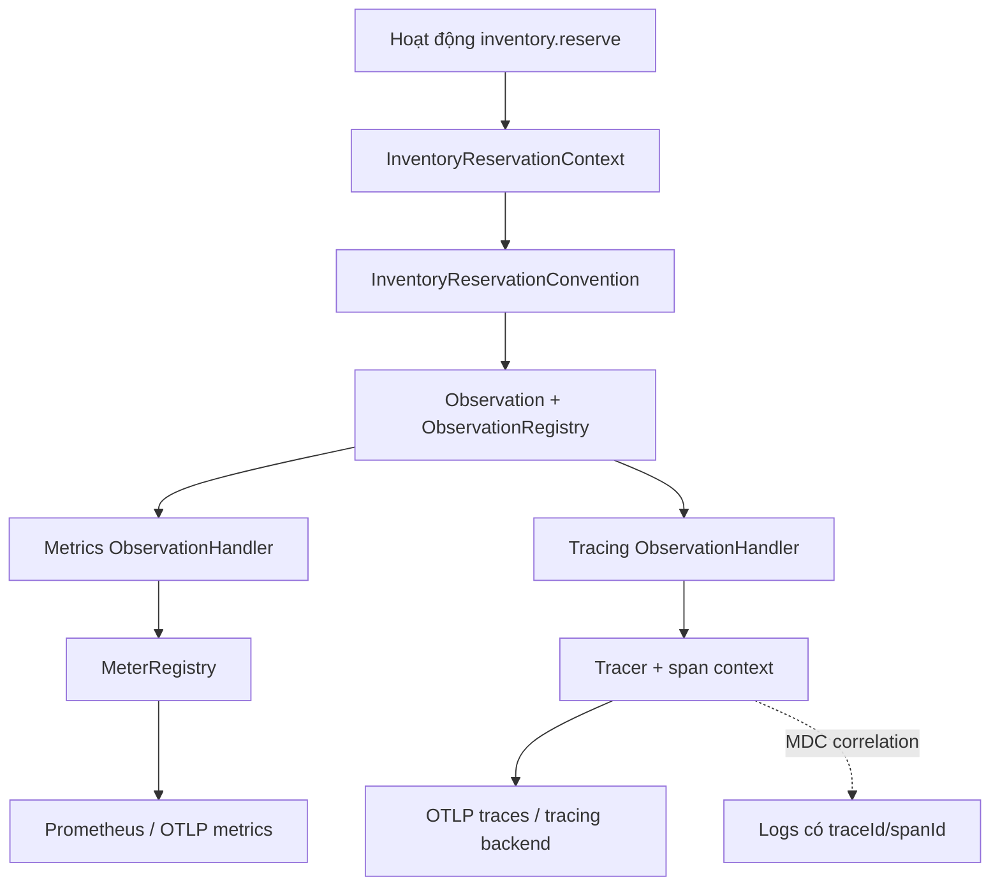

# ObservationConvention trong Spring Boot Observability

Trong ứng dụng Spring Boot, một **Observation** mô tả một hoạt động có vòng đời như xử lý HTTP request, truy vấn dữ liệu hay giữ hàng cho đơn đặt hàng. Khi hệ thống có nhiều điểm tạo Observation, việc đặt tên và gắn tags riêng lẻ ở từng nơi thường gây ra những vấn đề: cùng một hoạt động lại có nhiều tên; metrics dùng tên tag khác tracing; mã người dùng vô tình đi vào metric labels; dữ liệu không thể tổng hợp nhất quán qua các phiên bản.

**`ObservationConvention`** của Micrometer giải quyết nhu cầu chuẩn hóa đó. Nó định nghĩa cách đặt tên và trích xuất các **key-values** từ **`Observation.Context`** cho một loại hoạt động. Spring Boot và các thành phần instrumented cũng sử dụng conventions để thống nhất tên observation và dữ liệu đi kèm.

Bài thuộc chương **Convention và filter** của module **SPRING_BOOT_OBSERVABILITY**. Người học sẽ xây dựng một convention cho nghiệp vụ, hiểu độ ưu tiên của convention, kiểm soát **tag/cardinality**, biết điểm khác biệt giữa convention, filter và predicate, rồi kiểm chứng kết quả trong **metrics, logs và distributed traces** qua Micrometer Observation, exporter và sampling.

## 1. Vấn đề: instrumentation có hoạt động nhưng dữ liệu không nhất quán

Giả sử `order-service` xử lý một bước giữ hàng. Nhiều đội phát triển đã tự tạo Observation:

```java
Observation.createNotStarted("reserve-item", registry)
        .lowCardinalityKeyValue("salesChannel", "web")
        .observe(() -> reserveItem());

Observation.createNotStarted("inventory-reservation", registry)
        .lowCardinalityKeyValue("channel", "WEB")
        .observe(() -> reserveItem());
```

Hai đoạn này đo cùng loại công việc nhưng:

- Tên Observation khác nhau: dashboard có thể coi chúng là hai operation.
- Cùng ý nghĩa nhưng tên tag khác nhau: `salesChannel` và `channel`.
- Giá trị tag khác nhau về quy ước: `web` và `WEB`.
- Tracing có thể hiển thị hai tên span không đồng nhất.
- Khi mở rộng thêm `orderId` hoặc URL động, số time series có thể tăng rất nhanh.

Muốn phân tích độ trễ và lỗi của thao tác giữ hàng trên toàn hệ thống, cần một **hợp đồng đặt tên và tags** nhất quán. Convention đóng vai trò hợp đồng đó, dựa trên dữ liệu ngữ cảnh mà instrumentation cung cấp.

### Kết quả mong đợi

| Thành phần | Quy ước thống nhất |
| --- | --- |
| Observation name | `inventory.reserve` |
| Contextual name | `reserve inventory` |
| Low-cardinality key | `channel=web/mobile` |
| Low-cardinality key | `warehouse.region=apac/eu/other` |
| High-cardinality key | Chỉ các dữ liệu tương quan kỹ thuật thực sự cần và được phép |
| Exception/error | Ghi nhận qua vòng đời Observation |
| Metrics | Tổng hợp các lần thực thi cùng loại hoạt động |
| Trace | Có span với tên và attributes phù hợp, nếu tracing được cấu hình và span được lấy mẫu |

Một convention tốt khiến các nhóm phát triển không cần tự nhớ hoặc tự tạo lại bộ tên và tags ở mọi vị trí.

## 2. ObservationConvention là gì?

`ObservationConvention<T extends Observation.Context>` là giao diện dùng để mô tả quy tắc cho một loại Observation. Nó thường cung cấp:

- **`getName()`**: tên kỹ thuật ổn định của operation; có thể được metrics handler sử dụng làm tên meter.
- **`getContextualName(T context)`**: tên diễn giải operation trong ngữ cảnh, thường hữu ích khi đọc tracing span.
- **`getLowCardinalityKeyValues(T context)`**: tập key-values có ít giá trị phân biệt, phù hợp với metric tags và có thể trở thành span attributes.
- **`getHighCardinalityKeyValues(T context)`**: tập key-values chi tiết hơn cho tracing khi handler hỗ trợ; không nên được đưa vào metric tags.
- **`supportsContext(Observation.Context context)`**: xác định convention có áp dụng cho loại context cụ thể hay không, quan trọng khi đăng ký conventions cho nhiều loại Observation.

Các phương thức trên mô tả một **quy tắc**, chứ không thực hiện việc lưu metric hoặc xuất trace. `ObservationRegistry` chứa cấu hình và các handler sẽ gọi quy tắc khi xử lý Observation.



**Phân biệt hai registry:** `ObservationRegistry` quản lý Observation handlers, filters, predicates và conventions; `MeterRegistry` quản lý metrics như Timer và Counter. Một Observation có thể tạo dữ liệu cho cả hai tín hiệu khi ứng dụng đã cấu hình đầy đủ các handler và exporter cần thiết.

## 3. Observation.Context mang dữ liệu gì?

Convention cần dữ liệu đầu vào để quyết định tags và contextual name. **`Observation.Context`** là nơi instrumentation lưu những thông tin về hoạt động.

Ví dụ với nghiệp vụ giữ hàng, context có thể chứa:

- Kênh bán hàng: `web` hoặc `mobile`.
- Khu vực kho hàng: `apac`, `eu` hoặc `other`.
- Kết quả thao tác: thành công, hết hàng, lỗi phụ thuộc.
- Trạng thái lỗi được ghi nhận trong Observation.

Không phải mọi dữ liệu phải trở thành tags. Context có thể giữ thêm các tham số nội bộ phục vụ xử lý, nhưng convention chỉ nên đưa vào observability những thuộc tính cần thiết và được phép.

Một nguyên tắc quan trọng là **tách dữ liệu được xử lý khỏi dữ liệu được xuất**. Context có thể chứa một đối tượng của framework hoặc dữ liệu nghiệp vụ; convention phải quyết định rõ những gì được đưa vào metrics/traces.

### Ví dụ context riêng

```java
import io.micrometer.observation.Observation;

public final class InventoryReservationContext extends Observation.Context {

    private final String channel;
    private final String warehouseRegion;

    public InventoryReservationContext(String channel, String warehouseRegion) {
        this.channel = normalizeChannel(channel);
        this.warehouseRegion = normalizeRegion(warehouseRegion);
    }

    public String getChannel() {
        return channel;
    }

    public String getWarehouseRegion() {
        return warehouseRegion;
    }

    private static String normalizeChannel(String value) {
        return "mobile".equalsIgnoreCase(value) ? "mobile" : "web";
    }

    private static String normalizeRegion(String value) {
        if ("apac".equalsIgnoreCase(value)) {
            return "apac";
        }
        if ("eu".equalsIgnoreCase(value)) {
            return "eu";
        }
        return "other";
    }
}
```

**Tại sao chuẩn hóa ngay ở context?** Vì tags được tạo từ tập giá trị có giới hạn. Nếu kênh được gửi dưới các cách viết khác nhau như `mobile`, `Mobile`, `MOBILE`, dữ liệu dashboard sẽ bị phân mảnh. Việc chuẩn hóa phải phù hợp với hợp đồng nghiệp vụ; ví dụ này chỉ minh họa hai kênh và ba nhóm vùng.

## 4. Viết ObservationConvention riêng

Convention cho context trên:

```java
import io.micrometer.common.KeyValue;
import io.micrometer.common.KeyValues;
import io.micrometer.observation.Observation;
import io.micrometer.observation.ObservationConvention;

public final class InventoryReservationConvention
        implements ObservationConvention<InventoryReservationContext> {

    @Override
    public boolean supportsContext(Observation.Context context) {
        return context instanceof InventoryReservationContext;
    }

    @Override
    public String getName() {
        return "inventory.reserve";
    }

    @Override
    public String getContextualName(InventoryReservationContext context) {
        return "reserve inventory";
    }

    @Override
    public KeyValues getLowCardinalityKeyValues(
            InventoryReservationContext context) {

        return KeyValues.of(
                KeyValue.of("channel", context.getChannel()),
                KeyValue.of("warehouse.region", context.getWarehouseRegion())
        );
    }

    @Override
    public KeyValues getHighCardinalityKeyValues(
            InventoryReservationContext context) {

        return KeyValues.empty();
    }
}
```

Đây là một convention an toàn cho metrics: các giá trị có số lượng hữu hạn, tên ổn định và không chứa thông tin nhạy cảm.

### Ý nghĩa từng phương thức

| Phương thức | Giá trị trong ví dụ | Vai trò |
| --- | --- | --- |
| `supportsContext(...)` | Đúng với `InventoryReservationContext` | Giới hạn convention vào loại hoạt động liên quan |
| `getName()` | `inventory.reserve` | Tên operation để nhóm metrics |
| `getContextualName(...)` | `reserve inventory` | Tên diễn giải thuận tiện khi đọc trace |
| `getLowCardinalityKeyValues(...)` | `channel`, `warehouse.region` | Chia metrics thành số nhóm nhỏ và nhất quán |
| `getHighCardinalityKeyValues(...)` | Rỗng | Tránh thêm dữ liệu chi tiết chưa được xét duyệt |

`getName()` thường trả về chuỗi không phụ thuộc từng request. Nếu cần biểu diễn ID cụ thể, **không** thay tên bằng `inventory.reserve.order-123456`. Khi cần một thuộc tính truy vết, hãy đánh giá xem nó có phù hợp làm span attribute, có được phép lưu, có thời gian lưu hợp lý và có thể truy cập qua những ai.

### Những phần mà convention không đảm nhiệm

Convention **không** tự:

- Tạo request HTTP hay lời gọi cơ sở dữ liệu.
- Mở scope và kết thúc Observation thay cho mã sử dụng Observation.
- Chọn tracing sampling hoặc bảo đảm exporter đưa span đến backend.
- Truyền W3C trace context sang HTTP service khác.
- Chuyển mọi giá trị trong context thành thông tin có thể truy vấn.

Convention chỉ định nghĩa metadata theo một hợp đồng nhất quán.

## 5. Sử dụng convention trong service

Một cách dùng rõ ràng là truyền convention và context khi khởi tạo Observation. Ví dụ một service Spring Boot có registry được framework quản lý:

```java
import io.micrometer.observation.Observation;
import io.micrometer.observation.ObservationRegistry;
import org.springframework.stereotype.Service;

@Service
public class InventoryReservationService {

    private static final InventoryReservationConvention CONVENTION =
            new InventoryReservationConvention();

    private final ObservationRegistry observationRegistry;

    public InventoryReservationService(ObservationRegistry observationRegistry) {
        this.observationRegistry = observationRegistry;
    }

    public void reserve(String channel, String region, Runnable reservationAction) {
        InventoryReservationContext context =
                new InventoryReservationContext(channel, region);

        Observation.createNotStarted(
                    CONVENTION,
                    () -> context,
                    observationRegistry)
                .observe(reservationAction);
    }
}
```

Ở đây:

1. Service nhận `ObservationRegistry` do Spring Boot quản lý.
2. Context mang các giá trị cần thiết cho operation.
3. Convention xác định tên, contextual name và key-values.
4. `observe(...)` quản lý vòng đời Observation quanh hành động nghiệp vụ.
5. Khi metrics/tracing handlers được cấu hình, cùng một hoạt động có thể đóng góp vào các tín hiệu tương ứng.

Dùng `Runnable` chỉ để ví dụ tập trung vào API Observation. Trong ứng dụng thực, `reservationAction` thường là một lời gọi tới repository, client hoặc component nghiệp vụ.

### 5.1. Xử lý exception và outcome

Nếu `reservationAction` ném exception, phương thức `observe(...)` thông thường ghi nhận lỗi và vẫn kết thúc Observation. Việc một metric hoặc span hiển thị lỗi theo tag/status nào phụ thuộc handler và convention được cấu hình.

Nếu muốn có `outcome` ở mọi lần chạy, cần thiết kế rõ:

- Một **tập giá trị cố định** như `reserved`, `out_of_stock`, `failed`.
- Một thời điểm xác định outcome trong context hoặc trong Observation.
- Cách metrics và tracing handler thu thập giá trị này trong vòng đời.
- Đảm bảo không ghi đúp, không để outcome ở trạng thái không xác định khi ném exception.

Ví dụ dùng key-value thêm trực tiếp trên Observation, khi cần cập nhật trạng thái sau xử lý:

```java
Observation observation = Observation.createNotStarted(
        CONVENTION,
        () -> new InventoryReservationContext("web", "apac"),
        observationRegistry);

observation.observe(() -> {
    try {
        reserveInventory();
        observation.lowCardinalityKeyValue("outcome", "reserved");
    } catch (RuntimeException exception) {
        observation.lowCardinalityKeyValue("outcome", "failed");
        throw exception;
    }
});
```

Ở ví dụ này `reserveInventory()` là hàm nghiệp vụ giả định. Các key-values được bổ sung khi Observation còn hoạt động; việc chúng xuất hiện trong metrics/traces phụ thuộc lifecycle và từng handler. Để quy ước outcome được áp dụng thống nhất trên diện rộng, có thể mở rộng context/convention hoặc dùng cơ chế filter thích hợp, sau đó kiểm chứng đầu ra thực tế.

### 5.2. Scope và việc tạo span con

`observe(...)` thường mở scope khi thực thi callback, giúp instrumentation ở bên trong truy cập Observation hiện hành. Ví dụ khi thao tác giữ hàng gọi HTTP client được instrument, tracing handler có thể tạo span cho HTTP client dưới span `inventory.reserve`.

Nếu tạo Observation rồi chỉ gọi `start()`/`stop()` mà không mở scope, phần code bên trong có thể không nhìn thấy cùng ngữ cảnh. Đừng dùng `Observation.Context` như biến toàn cục hoặc tự sao chép Trace ID để thay thế context propagation.

## 6. Quy ước toàn cục và quy ước cục bộ

Trong hệ thống lớn, có hai nhu cầu khác nhau:

- **Convention cục bộ:** điểm instrumentation chủ động truyền convention thích hợp khi tạo Observation. Mọi call site của operation đó dùng một quy tắc rõ ràng.
- **Convention được đăng ký trên ObservationRegistry:** framework hoặc ứng dụng có thể đăng ký convention cho các context phù hợp để dùng chung cho nhiều điểm instrumentation.

Quy ước cục bộ thường có ưu tiên cao hơn lựa chọn convention mặc định khi API/framework hỗ trợ cơ chế này. Cách một framework chọn convention giữa **local**, **custom** và **default** phụ thuộc implementation và phiên bản, vì vậy không nên đoán thứ tự mọi trường hợp. Hãy đọc hợp đồng instrumentation đang dùng và kiểm tra tên/tags xuất ra sau khi đăng ký.

### 6.1. Tại sao supportsContext quan trọng?

Giả sử cả HTTP server observations và `InventoryReservationContext` cùng nằm trong một ObservationRegistry. Nếu custom convention chấp nhận mọi context rồi ép kiểu về `InventoryReservationContext`, hệ thống có thể lỗi khi handler xử lý request HTTP.

Cách kiểm tra:

```java
@Override
public boolean supportsContext(Observation.Context context) {
    return context instanceof InventoryReservationContext;
}
```

Convention chỉ áp dụng khi context phù hợp. Với các Observation contexts do Spring Framework hoặc Spring MVC/WebFlux cung cấp, cần dùng convention interface chuyên dụng của instrumentation tương ứng nếu muốn thay đổi tên/tags HTTP. Không nên áp một convention nghiệp vụ tổng quát lên mọi loại context.

### 6.2. Khi nào nên tạo custom convention?

Nên dùng khi:

- Nhiều vị trí thực hiện cùng loại công việc và cần tên/tags đồng nhất.
- Cần ẩn chi tiết framework để giữ ổn định schema dashboards qua refactor.
- Các tags mặc định thiếu một chiều nghiệp vụ có **cardinality thấp**.
- Cần kiểm soát dữ liệu đưa vào span attributes và metric labels.
- Có yêu cầu quy ước chung cho nhiều dịch vụ hoặc nhiều phiên bản ứng dụng.

Không cần tạo convention riêng chỉ để đổi một tag đơn giản ở một Observation duy nhất nếu việc khai báo trực tiếp đã đủ rõ ràng. Mục đích là giảm phân mảnh và sai sót, không phải tăng số lớp Java.

## 7. Phân biệt ObservationConvention, ObservationFilter và ObservationPredicate

Chúng thuộc cùng họ API quản lý dữ liệu Observation nhưng hoạt động ở các thời điểm và phạm vi khác nhau.

| API | Câu hỏi mà nó trả lời | Công việc điển hình |
| --- | --- | --- |
| **`ObservationConvention`** | Loại Observation này tên gì và có những key-values nào? | Thống nhất `inventory.reserve`, `channel`, `warehouse.region` |
| **`ObservationFilter`** | Có cần bổ sung hoặc chỉnh context trước khi Observation kết thúc? | Bổ sung tag chung, chuẩn hóa một thuộc tính |
| **`ObservationPredicate`** | Observation này có được xử lý hay cần tắt instrumentation cho trường hợp cụ thể? | Không theo dõi một nhóm hoạt động nội bộ ít giá trị |
| **`MeterFilter`** | Meter cụ thể nào được đăng ký hoặc đổi cấu hình ở MeterRegistry? | Từ chối meter, kiểm soát tên/tags hoặc distribution |
| **`ObservationHandler`** | Khi Observation start/stop/error/scope thì phải ghi nhận tín hiệu gì? | Ghi Timer, tạo/kết thúc tracing span |

**Convention** là nơi thể hiện schema của một loại hoạt động. **Filter** thiên về biến đổi/bổ sung dữ liệu trong pipeline. **Predicate** quyết định có bật observation tại đó hay không. **MeterFilter** chỉ tác động đến metrics registry, không thay thế convention cho span.

Ví dụ một `ObservationFilter` có thể thêm nhãn `deployment.environment=production` theo chính sách chung. Tuy nhiên, không nên dùng filter để tự động lấy mọi HTTP headers hoặc payload rồi chuyển thành low-cardinality tags. Cách làm đó vừa tăng cardinality vừa gây rủi ro dữ liệu.

### 7.1. Kết hợp nhiều quy tắc có thể gây chồng chéo

Nếu convention đã đặt `channel=web` mà filter lại thêm `channel=mobile`, dữ liệu sẽ khó hiểu và phụ thuộc cách handler xử lý key-values trùng nhau. Đặt tên và trách nhiệm rõ ràng:

- Convention quy định schema cơ bản của operation.
- Filter chỉ bổ sung thuộc tính có lý do rõ ràng, không tùy tiện ghi đè schema.
- MeterFilter quản lý riêng việc đăng ký và cách xuất metrics.
- Predicate được dùng khi muốn **không tạo tín hiệu** cho một nhóm observations cụ thể.

Cần chạy thử mọi đường đi (thành công, lỗi, timeout) để đảm bảo tags và metric names nhất quán.

## 8. Cardinality: quyết định nào ảnh hưởng trực tiếp đến chi phí?

**Cardinality** của một tag là số lượng giá trị phân biệt có thể xuất hiện. Với metrics backend dùng time series, số tổ hợp labels là một yếu tố quan trọng tạo ra nhiều series.

Ví dụ một timer có:

- `channel`: 2 giá trị.
- `warehouse.region`: 3 giá trị.
- `outcome`: 3 giá trị.

Số tổ hợp tối đa theo ba nhãn này là:

\[
2 \times 3 \times 3 = 18
\]

Nếu thêm `orderId` với hàng triệu giá trị, số series có thể tăng theo số đơn hàng, chưa kể các nhãn khác. Vì thế, **low-cardinality key-values phải được thiết kế như một tập danh mục hữu hạn**.

| Dữ liệu | Nên đặt ở đâu? | Lý do |
| --- | --- | --- |
| `channel=web/mobile` | Low-cardinality key-value | Ít giá trị, hữu ích cho dashboard |
| `warehouse.region=apac/eu/other` | Low-cardinality key-value | Phân tích hiệu năng theo vùng |
| `outcome=reserved/failed` | Low-cardinality key-value | So sánh tỷ lệ kết quả |
| Trace ID | Trace context và log correlation | Định danh một trace, không dùng làm metric label |
| Order ID | Không đưa vào metric labels; chỉ xem xét attribute đã được phê duyệt | Giá trị rất nhiều, có thể nhạy cảm |
| Email, token, số thẻ, raw body | Không ghi vào observability | Nguy cơ rò rỉ thông tin |
| URL `/orders/123` | Dùng route template thay vì raw URL làm tag | Tránh một tag cho mỗi tài nguyên |

Cần nhớ high-cardinality key-values không phải vùng dữ liệu tự do. Span attributes cũng được lưu, lập chỉ mục hoặc tìm kiếm tùy backend, và có thể truyền qua những hệ thống bên ngoài. Kiểm soát loại dữ liệu, độ dài, thời gian lưu và quyền truy cập.

### 8.1. Tên operation cũng phải ổn định

Ngoài metric tags, **tên meter/span** cũng nên đại diện cho một *loại* công việc. Không tạo operation names chứa ID, timestamp hoặc thông số truy vấn tùy ý:

- Phù hợp: `payment.authorize`, `inventory.reserve`, `HTTP GET /orders/{id}`.
- Không phù hợp: `payment.authorize.user-18437`, `GET /orders/18437`.

Nếu ứng dụng có nhiều instance, tất cả nên cùng dùng naming convention để dashboard có thể tổng hợp.

## 9. ObservationConvention tác động tới metrics và tracing như thế nào?

Một Observation có thể tạo **Timer** trong metrics và **span** trong distributed trace. Convention cung cấp tên và metadata cho các handler đó.

### 9.1. Trong metrics

Giả sử `inventory.reserve` được gọi nhiều lần qua `ObservationRegistry` đã có metrics handler. Một Timer có thể ghi nhận count và thời lượng theo tags `channel` và `warehouse.region`.

Trên Actuator, có thể tìm meter qua:

```bash
curl -s http://localhost:8080/actuator/metrics
curl -s http://localhost:8080/actuator/metrics/inventory.reserve
```

Registry Prometheus có thể đổi tên theo quy tắc Prometheus; ví dụ timer sinh các series hậu tố như `_seconds_count` hoặc `_seconds_sum`. Tên cụ thể phụ thuộc convention, registry và phiên bản; kiểm tra output thật trước khi viết PromQL.

**Một Observation không bảo đảm một metric xuất hiện ngay.** Phải có metrics handler, MeterRegistry phù hợp và hoạt động thực sự hoàn tất. Nếu meter không thấy, kiểm tra registry, Observation lifecycle và filter trước khi kết luận convention sai.

### 9.2. Trong tracing

Khi Micrometer Tracing bridge và exporter hoạt động, một Observation có thể tạo span. Contextual name được convention cung cấp giúp tên span có ý nghĩa; low/high-cardinality key-values có thể được tracing handler đưa vào span attributes.

Span chứa Trace ID, Span ID và quan hệ parent–child. Khi request gọi `inventory-service`, HTTP client/server phải truyền context, ví dụ qua header W3C:

```http
traceparent: 00-4bf92f3577b34da6a3ce929d0e0e4736-00f067aa0ba902b7-01
```

Convention **không tự truyền header** và không tự bảo toàn context khi chuyển thread. Với HTTP client, dùng instrumentation phù hợp với Spring Boot; với `@Async`, Reactor hoặc messaging, cần cơ chế context propagation tương ứng.

Sampling cũng là cơ chế riêng. Nếu chỉ lấy mẫu một phần request, metrics có thể vẫn phản ánh mọi lần Observation được metrics handler xử lý, trong khi tracing backend chỉ có subset spans.

### 9.3. Trong logs

Khi tracing scope được duy trì và logging integration đã cấu hình, MDC có thể chứa `traceId` và `spanId`, cho phép lọc logs của một request. Convention đóng góp dữ liệu operation nhưng không tự cấu hình logging pattern và không làm cho logs xuất sang backend.

Một ví dụ log được định dạng có correlation:

```text
INFO  [order-service,4bf92f3577b34da6a3ce929d0e0e4736,00f067aa0ba902b7] Inventory reservation started
WARN  [order-service,4bf92f3577b34da6a3ce929d0e0e4736,8a2f3bce9d013057] Inventory timeout
```

Đây chỉ là format minh họa, không phải mẫu bắt buộc của Spring Boot. Log correlation giúp đi từ một span lỗi sang chi tiết exception, nhưng không chứng minh nguyên nhân gốc nếu chưa đối chiếu metrics và các hệ thống phụ thuộc.

## 10. Cấu hình Spring Boot để kiểm chứng

Dưới đây là cấu hình minh họa **Spring Boot 3.x**. Các tên artifact/property có thể thay đổi giữa các dòng Spring Boot; trong dự án thực tế cần dùng đúng dependency management và tài liệu theo version đang chạy.

### 10.1. Maven dependencies

```xml
<dependencies>
    <dependency>
        <groupId>org.springframework.boot</groupId>
        <artifactId>spring-boot-starter-actuator</artifactId>
    </dependency>

    <!-- Xuất metrics theo Prometheus -->
    <dependency>
        <groupId>io.micrometer</groupId>
        <artifactId>micrometer-registry-prometheus</artifactId>
    </dependency>

    <!-- Tracing qua OpenTelemetry -->
    <dependency>
        <groupId>io.micrometer</groupId>
        <artifactId>micrometer-tracing-bridge-otel</artifactId>
    </dependency>

    <!-- Xuất span qua OTLP -->
    <dependency>
        <groupId>io.opentelemetry</groupId>
        <artifactId>opentelemetry-exporter-otlp</artifactId>
    </dependency>
</dependencies>
```

Nếu chưa có tracing bridge/exporter thì vẫn có thể kiểm tra convention qua metrics. Khi kết hợp tracing, cần một tracing backend và pipeline OTLP nhận span. Không thêm phiên bản Micrometer/OpenTelemetry tùy ý khi Spring Boot BOM đã quản lý.

### 10.2. application.yml minh họa

```yaml
spring:
  application:
    name: order-service

management:
  endpoints:
    web:
      exposure:
        include: health,info,metrics,prometheus
  tracing:
    sampling:
      probability: 1.0    # Chỉ dùng cho môi trường lab
  otlp:
    tracing:
      endpoint: http://localhost:4318/v1/traces
```

Ở đây `localhost:4318` là receiver OTLP/HTTP trên cùng môi trường mạng mà ứng dụng nhìn thấy. Nếu Spring Boot chạy trong container khác Collector, cần dùng tên dịch vụ/DNS phù hợp thay vì `localhost`. Trên production, cân nhắc sampling, TLS, xác thực, bảo vệ Actuator và chính sách retention. Tracing exporter không liên quan trực tiếp tới PrometheusMeterRegistry.

### 10.3. Kiểm chứng từ một request

Ví dụ một HTTP endpoint gọi `InventoryReservationService.reserve(...)` rồi gọi downstream qua client được instrument. Sau khi gửi request:

1. Kiểm tra `inventory.reserve` có trong `/actuator/metrics`.
2. Kiểm tra tags `channel` và `warehouse.region` thuộc tập giá trị đã quy định.
3. Kiểm tra `/actuator/prometheus` để xác nhận series cùng ý nghĩa xuất ra theo quy ước backend.
4. Tra tracing backend theo `service.name=order-service` hoặc tên operation.
5. Xác minh span `reserve inventory` có quan hệ hợp lý với HTTP server span và cùng Trace ID.
6. Gây lỗi nghiệp vụ có kiểm soát, rồi kiểm tra metric, span và logs có đủ thông tin để theo dõi.
7. Thử giảm sampling; xác nhận sự khác biệt giữa metric tổng hợp và số trace hiện trên UI.

## 11. Những lỗi thường gặp khi triển khai convention

| Triệu chứng | Nguyên nhân cần kiểm tra | Hướng xử lý |
| --- | --- | --- |
| Tên metric không như mong đợi | Convention không được áp dụng, tên bị thay theo registry hoặc framework | Kiểm tra cách tạo Observation và tên metric thực |
| Convention không được chọn | `supportsContext` sai, context type không phù hợp, precedence khác dự kiến | Kiểm tra context, registration, local/default conventions |
| `ClassCastException` trong convention | Code ép kiểu context không kiểm tra | Chỉ nhận đúng context, dùng generic interface và `instanceof` |
| Metric tags thiếu nhưng span có attributes | Metrics/tracing handlers xử lý key-values khác nhau | Kiểm tra low/high-cardinality key-values |
| Meter series tăng đột biến | Tag có ID động, quá nhiều giá trị hoặc histogram quá rộng | Chuẩn hóa enum, route template, giới hạn dimensions |
| Observation có Timer nhưng không có span | Tracing bridge/exporter chưa có, sampling loại span | Kiểm tra tracing pipeline riêng |
| Span bị đứt khi gọi dịch vụ khác | Thiếu W3C propagation, client hoặc async instrumentation chưa đúng | Kiểm tra `traceparent` và context propagation |
| Log không có Trace ID | Không có active span, scope bị mất, logging pattern chưa cấu hình | Kiểm tra MDC và luồng async |
| Lỗi không được gắn outcome mong đợi | Logic exception/status chưa đồng nhất với convention | Thiết kế kết quả rõ ràng, kiểm tra các đường đi |
| Một metric có nhiều tên tag gần giống nhau | Các dịch vụ dùng conventions khác nhau | Định nghĩa và áp dụng schema chung |
| Exporter không gửi dữ liệu | Endpoint/protocol/auth/mạng sai | Kiểm tra Collector và backend; phân biệt export với convention |

Không giải quyết lỗi exporter bằng cách thay đổi convention khi chính Observation và meter đã được tạo đúng. Ngược lại, backend nhận dữ liệu thành công vẫn có thể khiến dashboard khó dùng nếu tên, tags hoặc cardinality thiếu chuẩn hóa.

## 12. Bài thực hành: xây dựng một convention dùng chung

Mục tiêu là quan sát ảnh hưởng của convention trên cả metrics và traces, đồng thời kiểm soát schema khi nghiệp vụ thay đổi.

1. **Tạo context và convention** theo phần 3–4. Đảm bảo `supportsContext` chỉ nhận `InventoryReservationContext`.
2. **Instrument service** bằng `Observation.createNotStarted(CONVENTION, ... , observationRegistry)`, dùng `observe(...)` để quản lý vòng đời.
3. **Chạy hai nhóm traffic** với `channel=web/mobile` và `warehouse.region=apac/eu`. Không sử dụng mã khách hàng hoặc dữ liệu cá nhân.
4. **Quan sát metric** trong Actuator. Kiểm tra một tên operation ổn định; so sánh số lần và thời lượng giữa các tập tags.
5. **Xuất metrics** qua Prometheus hoặc registry phù hợp. Kiểm tra tên series và labels theo backend, đừng suy từ tên Java.
6. **Bật tracing** với sampling 100% trên lab, gửi request và tìm span theo tên/context. Ghi lại Trace ID của một request.
7. **Gây lỗi có kiểm soát**, đọc trace timeline và logs có Trace ID/Span ID; đối chiếu với metric của operation.
8. **Thử một context khác**, chẳng hạn HTTP server context do framework cung cấp. Xác minh convention nghiệp vụ không áp nhầm cho hoạt động đó.
9. **Thử một thay đổi schema có kiểm soát**, ví dụ thêm `warehouse.region=other`. Kiểm tra cardinality tăng trong giới hạn dự kiến, không tạo vô hạn series.
10. **Kiểm tra sampling và propagation** khi gọi một dịch vụ downstream. Giảm sampling để hiểu tại sao metrics đầy đủ nhưng traces thiếu, và xác minh HTTP headers truyền đúng ở các trace được lấy mẫu.

### Checklist kết quả

| Điều cần chứng minh | Tiêu chí |
| --- | --- |
| Convention đúng loại context | Chỉ nhận `InventoryReservationContext` |
| Tên operation ổn định | Tất cả request cùng loại dùng `inventory.reserve` |
| Contextual name rõ ràng | Span trong backend có tên hữu ích để đọc |
| Tags kiểm soát | Không có ID động; các giá trị channel/region thuộc tập hữu hạn |
| Metrics đo được | Timer/measurement xuất hiện sau khi hoạt động hoàn tất |
| Tracing liên kết | Span nghiệp vụ nằm dưới parent thích hợp trong trace được lấy mẫu |
| Log correlation | Có thể tìm logs bằng Trace ID nếu logging đã cấu hình |
| Filter/predicate không xung đột | Không bị thêm tag trùng hoặc tắt ngoài ý muốn |
| Export có thể kiểm chứng | Tách được lỗi convention với lỗi OTLP/Prometheus pipeline |

## 13. Những nguyên tắc áp dụng ở môi trường thực

Một `ObservationConvention` hữu ích nhất khi nó làm cho metadata của một loại hoạt động **ổn định, dự đoán được và an toàn**:

1. **Định nghĩa contract theo loại hoạt động.** Tên observation, contextual name và key-values phải có ý nghĩa nghiệp vụ chung, không phụ thuộc ID từng request.
2. **Chuẩn hóa ở context.** Chuyển input tự do thành nhóm giá trị được hỗ trợ trước khi xuất thành low-cardinality key-values.
3. **Phân biệt metadata với vận chuyển dữ liệu.** Convention định nghĩa tên/tags; handlers, MeterRegistry, Tracer và exporter quyết định việc ghi và xuất.
4. **Không trộn vai trò convention/filter/predicate.** Dùng convention để tạo schema; filter để bổ sung/chuẩn hóa; predicate để loại observation; MeterFilter cho chính sách meter.
5. **Đánh giá chi phí cardinality và quyền riêng tư** trước khi thêm tag hoặc span attribute; không dùng baggage để truyền dữ liệu nhạy cảm.
6. **Giữ distributed trace context** qua HTTP, async và messaging; kiểm tra với Trace ID thay vì chỉ nhìn tên span.
7. **Kết hợp ba tín hiệu.** Metrics chỉ ra xu hướng và mức độ ảnh hưởng; traces cho thấy đường đi của request; logs cung cấp chi tiết để xác minh giả thuyết về lỗi hoặc độ trễ.

Nhờ một `ObservationConvention` được thiết kế đúng, Spring Boot có thể ghi nhận nhiều lần thực thi theo cùng một hệ tên và key-values. Đây là tiền đề để so sánh metrics qua thời gian, tìm các span có ý nghĩa trong distributed traces và liên kết với logs khi điều tra hành vi ứng dụng trên môi trường thực.
