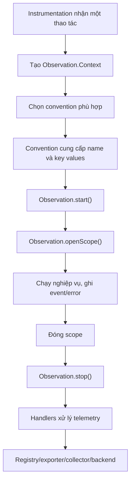

# Default convention trong Micrometer Observation

Một ứng dụng Spring Boot có thể ghi nhận hàng triệu thao tác HTTP, truy vấn cơ sở dữ liệu hoặc lời gọi dịch vụ ngoài. Nếu mỗi lập trình viên tự đặt tên observation và tag theo cách riêng, cùng một hành vi sẽ xuất hiện dưới nhiều tên metric và span khác nhau. Dashboard khó tổng hợp, cảnh báo dễ bỏ sót, còn điều tra lỗi giữa các service thiếu nhất quán.

**Default convention** giải quyết phần nền tảng đó: nó cung cấp **quy ước mặc định** cho tên observation, tên ngữ cảnh hiển thị và các key-value của một **loại observation cụ thể**. Khi cần điều chỉnh cho nghiệp vụ, hệ thống có thể chọn custom convention phù hợp mà vẫn giữ default convention làm phương án dự phòng.

Bài học thuộc chương **Convention và filter** trong module **SPRING_BOOT_OBSERVABILITY**. Module thiết lập observability cho Spring Boot bằng Micrometer Observation, metrics, logs và distributed tracing; đồng thời sử dụng context propagation, tag/cardinality, exporter và sampling để liên kết tín hiệu khi điều tra lỗi hoặc độ trễ. Hiểu default convention giúp giữ cách đặt tên và phân loại dữ liệu ổn định ngay từ điểm instrumentation.

## Mục tiêu học tập

Sau bài này, bạn có thể:

1. Giải thích default convention là gì, nằm ở đâu trong quá trình tạo observation và khác custom convention ra sao.
2. Phân biệt `getName()`, `getContextualName(...)`, low-cardinality và high-cardinality key values.
3. Thiết kế một `ObservationConvention<T>` mặc định cho một thao tác Spring Boot.
4. Hiểu cách instrumentation lựa chọn custom/default convention và vì sao chỉ khai báo bean chưa chắc đã thay đổi mọi observation.
5. Phân biệt convention với `ObservationFilter`, `ObservationPredicate`, `ObservationHandler` và cấu hình exporter.
6. Nhận biết lỗi đổi tên metric, tag bùng nổ cardinality, trace khó liên kết hoặc convention không được áp dụng.

## 1. Default convention là gì?

Trong Micrometer Observation, một `ObservationConvention<T extends Observation.Context>` định nghĩa quy ước quan sát cho một kiểu context. Convention mô tả những trường mà ứng dụng muốn dùng nhất quán khi biến một thao tác thành telemetry.

Một **default observation convention** thường do thư viện instrumentation hoặc chính ứng dụng cung cấp. Nó trả lời các câu hỏi:

- Observation này tên gì, ví dụ `checkout.payment.authorize`?
- Nếu có tracing, tên hiển thị theo ngữ cảnh của span nên là gì, ví dụ `authorize payment`?
- Những chiều có số giá trị ít nào phù hợp cho metrics, ví dụ `operation=authorize`?
- Những chi tiết nào có số giá trị phân biệt cao hơn, có thể hữu ích trong trace nhưng không nên trở thành metric label?

Điểm cần phân biệt: **default convention không phải một tập tag mặc định dùng chung cho mọi observation của ứng dụng**. Một convention thường gắn với một loại context và một instrumentation cụ thể. HTTP server, HTTP client, messaging và nghiệp vụ thanh toán có thể dùng các convention khác nhau.

Ví dụ:

```text
Instrumentation: checkout payment
   |
   +-- Context chứa operation, partner, kết quả...
   |
   +-- Custom convention phù hợp? -- có --> Dùng custom convention
   |                                  |
   |                                  không
   +----------------------------------+--> Default convention
                                              |
                                              +--> name
                                              +--> contextual name
                                              +--> low-cardinality tags
                                              +--> high-cardinality values
                                              |
                                              v
                                     Observation / handlers
                                              |
                                 Metrics, traces (nếu cấu hình)
```

Sơ đồ minh họa mô hình lựa chọn. **Cơ chế chọn thực tế thuộc API hoặc instrumentation tạo observation**, không phải một quy tắc ngầm rằng mọi bean convention trong Spring đều tự động được dùng cho mọi observation.

### Default không có nghĩa là bất biến

Convention mặc định là điểm xuất phát nhất quán. Một thư viện có thể cho phép tùy biến convention để đổi tên hoặc tag; ứng dụng cũng có thể viết convention mặc định của riêng mình cho thao tác nghiệp vụ tự instrument.

Điều quan trọng là việc tùy biến phải có lý do rõ ràng. Nếu mỗi đội tự đổi tên HTTP metric theo ý mình, khả năng dùng lại dashboard và quy tắc cảnh báo sẽ suy giảm.

## 2. Các thông tin mà convention cung cấp

Với Micrometer Observation, hai nhóm thông tin dễ nhầm nhất là **tên** và **key values**.

| Phương thức/khái niệm | Ý nghĩa | Ví dụ | Lưu ý |
|---|---|---|---|
| `getName()` | Tên kỹ thuật ổn định của observation | `checkout.payment.authorize` | Thường có ảnh hưởng tới tên metric hoặc span, tùy handler |
| `getContextualName(context)` | Tên mô tả hành động trong ngữ cảnh | `authorize payment` | Thường hữu ích làm tên hiển thị span; tránh ID động |
| `getLowCardinalityKeyValues(context)` | Các chiều với tập giá trị hữu hạn | `operation=authorize`, `partner=provider-a` | Phù hợp hơn với tag của metric |
| `getHighCardinalityKeyValues(context)` | Chi tiết có nhiều giá trị phân biệt | Một định danh request không nhạy cảm đã được phép thu thập | Có thể phục vụ trace; không thích hợp làm metric label |
| `supportsContext(context)` | Cho biết convention có hỗ trợ loại context đó không | `context instanceof CheckoutContext` | Quan trọng khi lựa chọn convention theo kiểu context |

### 2.1. `getName()`: tên kỹ thuật cần ổn định

Ví dụ tên `checkout.payment.authorize` xác định loại hoạt động được quan sát. Nên giữ tên này ổn định qua các release để dashboard và phép đo vẫn có cùng ý nghĩa.

Không nên biến tên observation thành:

```text
checkout.payment.authorize.order-4837289
checkout.payment.authorize.user-991027
checkout.payment.authorize.2026-11-22T09:30:15
```

Các biến thể theo request có thể gây bùng nổ số meter/span name và khiến dữ liệu khó tổng hợp. Phân loại bằng tên ổn định cùng tag hữu hạn là lựa chọn tốt hơn.

Tên cụ thể mà backend hiển thị có thể được đổi dạng theo naming convention của meter registry hoặc semantic conventions của tracing. Vì vậy, tên được chọn trong code không bảo đảm trùng từng ký tự với tên cuối cùng trên mọi exporter.

### 2.2. `getContextualName(...)`: tên mô tả hoạt động

Contextual name trả lời “đang làm gì?” theo cách người điều tra dễ đọc trên trace timeline. Ví dụ:

```text
Observation name:     checkout.payment.authorize
Contextual name:      authorize payment
Low-cardinality tag:  operation=authorize
```

Cần tránh đặt contextual name chứa dữ liệu riêng cho từng giao dịch, ví dụ `authorize payment for user 827391`. Một trace có thể mang thông tin phân biệt ở các thuộc tính được kiểm soát, nhưng tên span thường nên ngắn, ổn định và dễ nhận diện.

Không phải mọi handler đều dùng contextual name giống nhau. Một metric handler quan tâm nhiều hơn tới tên đo và tag; tracing handler có thể dùng contextual name để mô tả span.

### 2.3. Low-cardinality: dữ liệu để tổng hợp

Low cardinality nghĩa là số giá trị khác nhau trong một chiều nhỏ và được kiểm soát. Chẳng hạn:

- `operation=authorize|capture|refund`
- `partner=provider-a|provider-b`
- `result=approved|declined|error`
- `channel=web|mobile|batch`

Nếu số tổ hợp tag quá nhiều, chi phí lưu trữ và truy vấn time series tăng nhanh. Ngay cả mỗi tag riêng lẻ có ít giá trị, **tích số của nhiều chiều** vẫn có thể lớn.

Ví dụ: 4 operation × 3 partner × 4 result × 5 environment × 20 instance = **4.800 tổ hợp tiềm năng** cho một metric. Cần tính cả số phiên bản, route và chiều khác trước khi quyết định thêm nhãn.

### 2.4. High-cardinality: hữu ích nhưng phải kiểm soát

Một mã tương quan request riêng lẻ có thể giúp tìm đúng trace, nhưng có rất nhiều giá trị phân biệt. Vì vậy nó **không phù hợp làm metric label**.

High-cardinality key values trong convention có thể được một số handler sử dụng làm thuộc tính trace; không có bảo đảm rằng mọi backend sẽ giữ chúng. Cũng không nên mặc định có thể gắn mọi ID vào trace:

- Không thu thập access token, số thẻ, email hoặc payload nhạy cảm.
- Giới hạn kích thước, retention và quyền truy cập.
- Kiểm tra quy tắc sampling: trace có thể không được giữ lại.
- Không dùng request ID hoặc order ID làm tên observation hay tên span.

**Low/high cardinality mô tả mục đích sử dụng và mức độ phân biệt của dữ liệu**, không phải hai chế độ bật/tắt bảo mật.

## 3. Default convention ở đâu trong vòng đời observation?

Một observation điển hình:



Sơ đồ mô tả ý nghĩa tổng quát; thời điểm cụ thể mà handler đọc tên/tag và các filter được áp dụng có thể phụ thuộc vào phiên bản, API và cách instrumentation được viết.

Một số quy tắc quan trọng:

1. **Convention mô tả dữ liệu**. Nó không tự chạy nghiệp vụ, đo thời gian hay tạo network request.
2. **Observation điều phối vòng đời**. `start()`, `openScope()`, `error()` và `stop()` tạo ra các mốc handler có thể sử dụng.
3. **Handler chuyển các mốc thành tín hiệu**. Metric handler có thể ghi timer; tracing handler có thể tạo span.
4. **Exporter/collector chịu trách nhiệm vận chuyển**. Convention tự nó không quyết định trace có được lấy mẫu và gửi tới backend hay không.
5. **Current context là vấn đề khác**. Để log/span con có correlation, scope và propagation vẫn cần được thiết lập đúng.

Do đó, cấu hình convention đúng **chưa đủ** để có metrics và traces. Registry còn cần handler, meter/tracer, exporter và backend phù hợp.

## 4. Xây dựng default convention cho nghiệp vụ Spring Boot

Giả sử một ứng dụng cần quan sát lời gọi authorize payment. Muốn các service thống nhất:

- Tên kỹ thuật: `checkout.payment.authorize`.
- Tên hiển thị trace: `authorize payment`.
- Hai chiều metric: `operation=authorize` và `partner=provider-a`.
- Không thêm order ID, user ID hoặc raw URL làm metric tag.

Trước hết tạo context chuyên biệt:

```java
import io.micrometer.observation.Observation;

final class PaymentObservationContext extends Observation.Context {

    private final String operation;
    private final String partner;

    PaymentObservationContext(String operation, String partner) {
        this.operation = operation;
        this.partner = partner;
    }

    String operation() {
        return operation;
    }

    String partner() {
        return partner;
    }
}
```

Trong ví dụ, `operation` và `partner` phải được chuẩn hóa về **tập giá trị hữu hạn** ở nơi tạo context. Không truyền nguyên chuỗi do client gửi vào mà chưa kiểm soát.

Tiếp theo, viết convention mặc định:

```java
import io.micrometer.common.KeyValue;
import io.micrometer.common.KeyValues;
import io.micrometer.observation.Observation;
import io.micrometer.observation.ObservationConvention;

final class DefaultPaymentObservationConvention
        implements ObservationConvention<PaymentObservationContext> {

    @Override
    public boolean supportsContext(Observation.Context context) {
        return context instanceof PaymentObservationContext;
    }

    @Override
    public String getName() {
        return "checkout.payment.authorize";
    }

    @Override
    public String getContextualName(PaymentObservationContext context) {
        return "authorize payment";
    }

    @Override
    public KeyValues getLowCardinalityKeyValues(
            PaymentObservationContext context) {

        return KeyValues.of(
                KeyValue.of("operation", context.operation()),
                KeyValue.of("partner", context.partner())
        );
    }

    @Override
    public KeyValues getHighCardinalityKeyValues(
            PaymentObservationContext context) {

        return KeyValues.empty();
    }
}
```

Đây là cách biểu diễn một contract mặc định theo `ObservationConvention<T>`. Các phương thức chỉ đọc context và trả về các giá trị ổn định; chúng **không** tự đưa dữ liệu vào Prometheus hoặc hệ thống tracing.

### Vì sao custom context là hữu ích?

Context chứa dữ liệu của thao tác, còn convention quyết định **cách diễn giải dữ liệu đó thành telemetry**. Khi chính sách đặt tên hoặc tag thay đổi, có thể chỉnh convention mà không phải sửa mọi vị trí gọi gateway.

Tuy nhiên, nếu context chứa quá nhiều thông tin hoặc convention đọc dữ liệu từ request bên ngoài không qua chuẩn hóa, thiết kế này có thể dẫn đến cardinality cao hay rò rỉ thông tin nhạy cảm. Hãy giữ context có ý nghĩa nghiệp vụ và giới hạn những trường xuất ra telemetry.

## 5. Default và custom convention được chọn thế nào?

Trong một instrumentation cho phép cả default convention và custom convention, ý tưởng thường là:

1. Có một **default convention** dành riêng cho loại context.
2. Nếu custom convention được cung cấp và hỗ trợ context, chọn nó.
3. Nếu không có custom convention thích hợp, dùng default convention.
4. Observation được tạo theo convention đã chọn; handlers nhận các mốc vòng đời như bình thường.

Cách lựa chọn này **phải được API hoặc lớp instrumentation hỗ trợ**. Việc chỉ đặt tên class là `Default...Convention` không khiến Micrometer tự biết class đó là mặc định.

### Ví dụ sử dụng convention khi tạo observation

Ví dụ sau minh họa overload lựa chọn custom/default convention của Micrometer Observation trong một luồng đồng bộ. Đường import và chữ ký cụ thể nên đối chiếu với phiên bản Micrometer của dự án khi chuyển ví dụ sang production.

```java
import io.micrometer.observation.Observation;
import io.micrometer.observation.ObservationConvention;
import io.micrometer.observation.ObservationRegistry;
import org.springframework.stereotype.Service;

@Service
class PaymentService {
    private final ObservationRegistry observationRegistry;
    private final PaymentGateway paymentGateway;

    private final ObservationConvention<PaymentObservationContext> customConvention;
    private final ObservationConvention<PaymentObservationContext> defaultConvention =
            new DefaultPaymentObservationConvention();

    PaymentService(
            ObservationRegistry observationRegistry,
            PaymentGateway paymentGateway) {

        this.observationRegistry = observationRegistry;
        this.paymentGateway = paymentGateway;
        this.customConvention = null; // Ví dụ: chưa cung cấp custom convention.
    }

    PaymentResult authorize(PaymentRequest request) {
        PaymentObservationContext context =
                new PaymentObservationContext("authorize", "provider-a");

        return Observation.createNotStarted(
                        customConvention,
                        defaultConvention,
                        () -> context,
                        observationRegistry)
                .observe(() -> paymentGateway.authorize(request));
    }
}
```

`PaymentGateway`, `PaymentRequest` và `PaymentResult` là các kiểu giả định. Mục tiêu của đoạn code là làm rõ hai vai trò:

- **Default convention** cung cấp tên và tag nếu không có custom convention thích hợp.
- **`observe(...)`** bao quanh callback đồng bộ, quản lý start/scope/stop và ghi nhận lỗi theo API hỗ trợ; convention không làm công việc này.

Trên một số phiên bản hoặc integration, API tiện ích của `ObservationDocumentation` hoặc chính instrumentation có thể là nơi nhận cặp custom/default convention. Nguyên lý fallback vẫn cần được hiểu, nhưng **không nên giả định mọi loại observation dùng đúng một overload hoặc cùng một cơ chế dependency injection**.

### Custom convention không phải một bộ lọc tag tự động

Nếu bạn muốn đổi tên observation của một thư viện, hãy xem thư viện có cung cấp interface convention riêng hoặc bean customization phù hợp không. Có thư viện dùng `ObservationConvention<T>` chuyên biệt cho HTTP, messaging hay các client khác; có thư viện không cho override bằng một bean generic.

Nếu tự xây instrumentation, bạn chủ động quyết định lúc nào truyền custom convention. Nếu dùng Spring Boot auto-instrumentation, cần xác minh extension point mà framework công bố. Chỉ thêm một `@Bean ObservationConvention<?>` vào application context **không đảm bảo** mọi HTTP observation, JDBC span hay background task tự chuyển sang dùng nó.

## 6. So sánh default convention, filter, predicate và handler

Chương này có cả **convention** và **filter**; chúng xử lý những vấn đề khác nhau.

| Thành phần | Câu hỏi chính | Ví dụ | Không nên dùng để |
|---|---|---|---|
| **Default convention** | Nếu không có tùy biến phù hợp, observation được đặt tên/tag theo quy ước nào? | `checkout.payment.authorize` với `operation=authorize` | Quyết định mọi trace được xuất tới backend nào |
| **Custom convention** | Với loại context này, muốn thay quy ước mặc định ra sao? | Đổi tên span, bổ sung tag hữu hạn | Tự thay đổi tất cả instrumentation mà không wiring |
| **`ObservationFilter`** | Cần điều chỉnh hoặc bổ sung context cho observations đã tạo như thế nào? | Thêm trường `deployment.environment=prod` vào context phù hợp | Dùng như một cơ chế bảo mật thay cho redaction/export controls |
| **`ObservationPredicate`** | Có nên quan sát một thao tác theo điều kiện đã cho không? | Bỏ qua một thao tác nội bộ gây nhiễu | Giải quyết mọi nhu cầu sampling tracing |
| **`ObservationHandler`** | Phản ứng ra sao trước start/stop/error/event/scope? | Ghi timer, tạo span, xử lý sự kiện | Đặt quy tắc nghiệp vụ cho một transaction |
| **`MeterFilter`** | Cần điều chỉnh/giới hạn meter phía metrics như thế nào? | Từ chối một nhóm meter hoặc áp dụng quy tắc tag | Đổi tên contextual span hoặc xử lý log correlation |
| **Exporter / sampler** | Dữ liệu nào được vận chuyển hoặc lưu lại? | OTLP exporter, trace sampling | Chuẩn hóa tên/tag bằng convention |

### Tại sao không dùng filter thay cho default convention?

Filter thích hợp để điều chỉnh context theo chính sách chung, ví dụ thêm environment hoặc một thuộc tính đã được chuẩn hóa. Convention phù hợp để định nghĩa **ngữ nghĩa của một loại hoạt động**: tên thao tác, tên hiển thị, low/high cardinality.

Nếu một filter cố đổi tên và tag cho mọi observation dựa trên việc phân tích chuỗi tên tùy ý, logic dễ giòn khi thư viện đổi tên ở bản nâng cấp. Một convention rõ ràng cho đúng loại context thường dễ duy trì hơn.

### Và tại sao một convention không đủ để lọc telemetry?

Convention có thể trả về các key values, nhưng không nhất thiết cho phép bỏ qua cả observation. Nếu muốn loại trừ một hoạt động khỏi xử lý, dùng predicate hoặc chính sách instrumentation phù hợp. Nếu muốn chỉ giữ 10% trace, phải xét sampler/collector; việc bỏ vài key values trong convention không đồng nghĩa sampling.

## 7. Default convention và hệ thống Spring Boot có sẵn

Trong Spring Boot 3.x, nhiều instrumentation đã có convention hoặc semantic naming riêng cho HTTP server/client và các thành phần tích hợp. Chúng thường phát ra những tên và tag được backend metrics/tracing kỳ vọng.

Ví dụ HTTP server instrumentation có thể sử dụng các trường như method, route, status và exception theo cách chuẩn hóa. **Tên metric chính xác phụ thuộc phiên bản Spring Boot, Micrometer, naming convention và exporter**, vì vậy không nên sao chép tên từ một dashboard rồi mặc định code nào cũng phải đặt giống vậy.

Khi muốn tùy biến, hãy trả lời:

1. **Dữ liệu nào đang thiếu?** Route mẫu, operation nghiệp vụ, partner hay outcome?
2. **Điểm tạo observation ở đâu?** HTTP instrumentation của framework hay code tự tạo observation?
3. **Framework có extension point nào?** Custom server/client observation convention, filter, handler, hay cách tạo observation thủ công?
4. **Giá trị có ổn định không?** URI đã chuẩn hóa khác raw URL; partner ID hữu hạn khác user ID.
5. **Ai đọc dữ liệu đó?** Dashboard Prometheus, trace UI, log query hay SLO alert?
6. **Thay đổi có phá chuỗi dữ liệu cũ không?** Đổi name/tag có thể khiến dashboard và alert phải sửa.

Một default convention tốt cần bền vững trước các thay đổi nhỏ của code. Chẳng hạn một controller được tách thành hai class vẫn nên giữ tên operation công khai nếu ngữ nghĩa nghiệp vụ không đổi.

## 8. Ví dụ sai và cách sửa

### Lỗi 1 — Dùng ID động làm tên observation

```java
// Không nên: mỗi order ID trở thành một tên khác nhau.
String name = "checkout.payment.authorize." + orderId;
Observation.createNotStarted(name, registry)
        .observe(() -> gateway.authorize(request));
```

**Hậu quả:** metric name/span name bị phân mảnh và có thể gây tăng cardinality hoặc số series. **Cách sửa:** dùng `checkout.payment.authorize` ổn định; chỉ lưu một mã định danh đã được cho phép vào trace/log có kiểm soát khi thật sự cần.

### Lỗi 2 — Đặt full URL vào low-cardinality tag

```text
Sai:
  uri=/orders/987654321/payment
  uri=/orders/987654322/payment

Tốt hơn:
  uri=/orders/{id}/payment
  operation=authorize
```

URL động không nên biến thành metric label. Với HTTP instrumentation, dùng route template đã chuẩn hóa. Nếu code tự tạo context, chuẩn hóa ngay trước khi đưa vào convention.

### Lỗi 3 — Đổi default convention nhưng không kiểm tra dashboard

Giả sử tên metric trước đây được lấy từ `checkout.payment.authorize`, sau khi đổi convention thành `checkout.authorize`, dashboard cũ có thể không còn thấy series mới. Hệ thống không nhất thiết bị lỗi; **schema telemetry đã thay đổi**.

Khi thay đổi tên/tag:

- Thông báo và kiểm tra bên sử dụng metric: dashboard, alert, recording rule, SLO.
- Có kế hoạch chuyển tiếp và theo dõi cả tên cũ/mới trong thời gian hợp lý nếu cần.
- Xác nhận tag mới không làm tăng cardinality hoặc thay đổi nghĩa của tỷ lệ lỗi.
- Đối chiếu span name và log correlation để tránh đọc sai sự cố lịch sử.

### Lỗi 4 — Gắn một generic custom convention và kỳ vọng mọi thư viện sử dụng

Một bean `ObservationConvention<?>` generic không đảm bảo can thiệp được instrumentation HTTP hoặc messaging. **Cách sửa:** xác định convention extension point của chính thư viện và cách Spring Boot wiring nó; với nghiệp vụ tự instrument, truyền convention tường minh.

### Lỗi 5 — Nhầm “không có trace” với “convention không hoạt động”

Một metric được đặt tên đúng theo convention nhưng không có span tương ứng có thể do tracing handler chưa được đăng ký, context propagation bị đứt, sampler không giữ trace, exporter lỗi hoặc collector drop. Cần kiểm tra từng lớp telemetry, không chỉ tên convention.

### Lỗi 6 — Tính outcome dựa trên trạng thái chưa có khi convention được đọc

Nếu convention đọc `outcome` từ context ngay lúc observation bắt đầu nhưng nghiệp vụ chỉ biết thành công/thất bại sau khi chạy xong, một số handler có thể nhận giá trị chưa cập nhật. Thời điểm handler thu thập key values có thể khác nhau.

**Cách sửa:** phân biệt metadata biết trước khi chạy (operation, loại đối tác) và kết quả biết sau (success, timeout, declined). Kiểm tra vòng đời handler/convention cụ thể, cập nhật context đúng thời điểm và xác minh metric/span kết quả thực tế. Không mặc định một giá trị mutable sẽ được mọi handler đọc lại khi stop.

## 9. Tình huống điều tra: cùng lỗi, hai tên metric khác nhau

Giả sử ứng dụng Spring Boot có hai service thanh toán: `checkout-service` và `reconciliation-service`. Cả hai gọi một API authorize payment, nhưng đội phát triển ghi:

```text
checkout-service:
  metric operation name = checkout.payment.authorize
  tag operation=authorize

reconciliation-service:
  metric operation name = payment.authorize.request
  tag action=auth
```

Khi provider gặp timeout, dashboard xem theo một tên metric chỉ hiển thị một service. Nhóm vận hành tưởng rằng service còn lại không bị ảnh hưởng.

### Phân tích

1. **Monitoring phát hiện:** lỗi và độ trễ đang tăng, nhưng phép tổng hợp trên một tên metric không đại diện cho tất cả các luồng authorize.
2. **Đối chiếu convention:** hai instrumentation mô tả cùng loại hoạt động nhưng không dùng schema tên/tag thống nhất.
3. **Thống nhất quy ước:** chọn một default convention dùng chung với `checkout.payment.authorize` hoặc tên nghiệp vụ phù hợp, tag `operation=authorize`, `service.name`/resource attributes theo chuẩn của stack.
4. **Giữ ngữ cảnh riêng:** mỗi service vẫn có thể có contextual name hoặc thuộc tính span có ý nghĩa. Không gắn request ID vào metric để cố nối từng giao dịch.
5. **Đánh giá tác động:** cập nhật dashboard, alert và rule. Kiểm tra khả năng truy vấn dữ liệu lịch sử trước/sau thay đổi.
6. **Kiểm chứng end-to-end:** tạo request thành công, request timeout và request qua service khác; xem metric, trace và log correlation. Kiểm tra sampling và exporter nếu trace không có.

Một convention thống nhất giúp hai service được đo dưới **cùng một ngữ nghĩa**, còn trace/log cho phép đào sâu từng request khi cần. Tuy nhiên, đổi convention không tự nối context giữa service; HTTP/messaging propagation vẫn phải hoạt động.

## 10. Checklist thiết kế default convention

Trước khi đưa convention mới vào production, hãy kiểm tra:

- **Tên:** `getName()` có ổn định, phản ánh loại thao tác và không chứa ID/timestamp không?
- **Contextual name:** có ngắn, hữu ích trên trace và tránh thông tin nhạy cảm không?
- **Tag thấp cardinality:** có tập giá trị hữu hạn, rõ nghĩa, được chuẩn hóa và phù hợp phân nhóm metric không?
- **Tag cao cardinality:** có thực sự cần thiết không, được phép thu thập và có kiểm soát retention/truy cập không?
- **Context support:** `supportsContext(...)` có nhận đúng loại context và tránh áp nhầm sang instrumentation khác không?
- **Fallback:** khi không có custom convention, instrumentation có thực sự dùng default đã khai báo không?
- **Vòng đời:** handler đọc key values ở thời điểm nào? Kết quả biết sau có được ghi đúng không?
- **Spring wiring:** custom bean có được tích hợp qua đúng extension point, không làm rối auto-configuration không?
- **Schema compatibility:** dashboard/alert/SLO còn truy vấn đúng tên và tag sau thay đổi không?
- **Correlation:** các log/span có trace context liên quan không; có truyền context qua HTTP, executor, message queue không?
- **Pipeline:** registry, handlers, sampler, exporter và backend đã được xác minh riêng chưa?
- **Chi phí:** số time series mới và kích thước span attributes có nằm trong ngân sách telemetry không?

## 11. Câu hỏi tự đánh giá

**Câu 1.** Default convention được khai báo cho `PaymentObservationContext`. Nó có tự động đổi tên mọi HTTP server observation không?

**Gợi ý:** Không. Convention gắn với loại context và instrumentation sử dụng nó. Framework cần hỗ trợ hoặc code phải truyền convention vào điểm tạo observation.

**Câu 2.** Vì sao `getName()` nên trả `checkout.payment.authorize` thay vì `checkout.payment.authorize.order-283`?

**Gợi ý:** Tên ổn định giúp metric/span được tổng hợp và truy vấn nhất quán; tên biến theo ID làm phân mảnh telemetry và có thể gây bùng nổ cardinality.

**Câu 3.** Một trace có span `authorize payment` nhưng metrics không xuất hiện. Có thể kết luận default convention sai không?

**Gợi ý:** Chưa đủ. Tracing handler có thể hoạt động trong khi metrics handler, meter registry hoặc exporter chưa được cấu hình. Kiểm tra đường đi metrics độc lập.

**Câu 4.** Hai loại context sử dụng chung một custom convention; `supportsContext(...)` trả `false` với một loại. Điều gì nên xảy ra trong cơ chế fallback?

**Gợi ý:** Nếu instrumentation hỗ trợ lựa chọn custom/default, một custom convention không phù hợp sẽ không được áp dụng cho context đó; default convention tương ứng được sử dụng.

**Câu 5.** Một đội muốn 100% trace lỗi nhưng chỉ 10% trace thành công. Có thể giải quyết bằng `getHighCardinalityKeyValues(...)` không?

**Gợi ý:** Không. Đó là chính sách sampling, thường thuộc tracer/sampler hoặc collector. Convention định nghĩa tên và thuộc tính; nó không quyết định tỷ lệ giữ trace.

## Kết luận

**Default convention là bộ quy ước dự phòng cho một loại observation**, giữ tên và key values nhất quán khi không có custom convention phù hợp. Trong Spring Boot, nó giúp metrics dễ tổng hợp, tracing dễ đọc và dữ liệu giữa các service có cùng ngữ nghĩa. Nhưng convention chỉ là một lớp của hệ thống observability: scope, context propagation, observation handlers, meter/tracing registries, sampler và exporter vẫn quyết định telemetry nào thực sự được ghi và liên kết. Thiết kế tốt bắt đầu từ tên ổn định, tag có cardinality được kiểm soát, extension point đúng và kiểm chứng end-to-end với dashboard, logs và traces.
