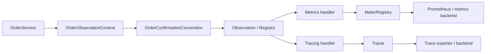
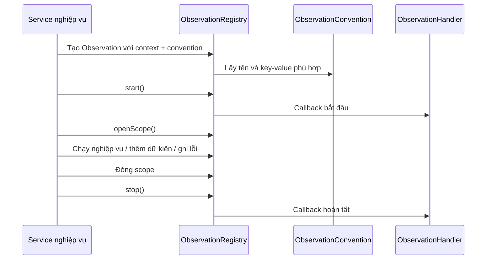

# Custom convention trong Micrometer Observation

Giả sử hệ thống Spring Boot có ba nhóm chức năng đặt hàng: web, ứng dụng di động và đối tác. Mỗi nhóm đều gọi thao tác xác nhận đơn hàng, nhưng các nhóm phát triển đặt tên telemetry khác nhau: `checkout.submit`, `placeOrder`, `order.confirm`. Có nhóm dùng tag `channel`, nhóm dùng `source`, thậm chí có nơi đưa thẳng mã đơn hàng vào metric tag. Hậu quả là dashboard khó tổng hợp, các truy vấn theo thời gian thiếu nhất quán và số chuỗi metric có thể tăng rất lớn.

**Custom convention** giải quyết vấn đề này bằng cách quy định **tên Observation, tên theo ngữ cảnh và bộ key-value** theo một hợp đồng dùng chung. Thay vì để từng đoạn nghiệp vụ tự ghép chuỗi và chọn nhãn, ta định nghĩa quy ước ở một lớp có trách nhiệm rõ ràng.

Bài học nằm trong chương **Convention và filter** của module `SPRING_BOOT_OBSERVABILITY`. Mục tiêu của module là thiết lập observability cho Spring Boot qua Micrometer Observation, metrics, logs và distributed tracing, đồng thời hiểu context propagation, tag/cardinality, exporter, sampling và cách liên kết tín hiệu để điều tra lỗi, độ trễ và hành vi ứng dụng trên môi trường thực. Trong bài này, trọng tâm là tự xây dựng và áp dụng một `ObservationConvention` cho nghiệp vụ.

## 1. Observation convention là gì?

Một `Observation` mô tả hoạt động cần quan sát, chẳng hạn xác nhận đơn hàng hoặc tính phí vận chuyển. `ObservationRegistry` điều phối vòng đời Observation đến các handler. **`ObservationConvention<T>` là giao diện định nghĩa cách diễn giải context của một loại Observation thành tên và các key-value có ý nghĩa.**

Convention thường trả lời bốn câu hỏi:

1. **Observation này được đặt tên gì?** Ví dụ `order.confirm` là tên ổn định để nhóm metric cùng loại.
2. **Tên dễ đọc trong ngữ cảnh là gì?** Ví dụ `confirm-order` dùng làm tên span phù hợp khi tracing được kích hoạt.
3. **Thông tin nào là low cardinality?** Ví dụ `order.channel=web/mobile/partner/other`, phù hợp để tổng hợp metrics.
4. **Thông tin nào là high cardinality?** Ví dụ mã tham chiếu một giao dịch để tra cứu trace, không phù hợp làm nhãn metric.

Các API thường gặp trên convention gồm `getName()`, `getContextualName(context)`, `getLowCardinalityKeyValues(context)`, `getHighCardinalityKeyValues(context)` và `supportsContext(context)`. Chúng giúp tách **hợp đồng telemetry** khỏi code thực thi nghiệp vụ.

| Đối tượng | Vai trò |
| --- | --- |
| `Observation.Context` | Chứa dữ kiện của một lần thực thi, như kênh đặt hàng và mã tham chiếu |
| `ObservationConvention<T>` | Quy định tên và key-value cho loại context tương ứng |
| `ObservationRegistry` | Quản lý các cấu hình observation và điều phối các handler |
| `ObservationHandler` | Nhận callback vòng đời để ghi metrics, tạo span hoặc thực hiện tác vụ tích hợp |
| `MeterRegistry` | Lưu và tổng hợp metric ở phía ứng dụng trước khi xuất |
| Tracer và exporter | Quản lý, truyền và xuất trace tới hệ thống nhận dữ liệu |

Convention **không tự ghi metric, tạo trace hoặc xuất log**. Muốn có telemetry thực tế, ứng dụng phải có handler, registry, exporter và backend phù hợp.

## 2. Vì sao cần custom convention thay vì gắn tag tùy ý?

Micrometer vẫn cho phép ghi:

```java
Observation.createNotStarted("order.confirm", observationRegistry)
    .lowCardinalityKeyValue("order.channel", "web")
    .observe(() -> confirmOrder());
```

Với một thao tác đơn giản, cách này hợp lý. Khi nhiều service cùng instrument một loại công việc, các vấn đề bắt đầu xuất hiện:

- Tên có thể thay đổi giữa các phiên bản, khiến dashboard hoặc alert đứt chuỗi.
- Tag `order.channel` có thể được ghi thành `channel`, `payment.channel` hoặc `sales.source` ở các vị trí khác nhau.
- Một nhóm gắn ID theo từng request thành low-cardinality key-value, gây bùng nổ cardinality.
- Lỗi `timeout`, `rejected` và `error` có thể được hiểu khác nhau.
- Muốn thay đổi quy ước, phải tìm và sửa nhiều chỗ trong code.

Custom convention cung cấp **một schema nhất quán**. Tùy tính chất ứng dụng, quy ước có thể dành riêng cho một kiểu context của nghiệp vụ hoặc dùng chung trong phạm vi rộng hơn.

### Sơ đồ luồng thông tin



Sơ đồ thể hiện các **trách nhiệm logic**, không có nghĩa convention trực tiếp gọi handler. Trong thực thi, Observation được tạo với registry và convention; handler đọc context/tên/key-value trong các callback thích hợp của vòng đời.

## 3. Thiết kế hợp đồng convention trước khi lập trình

Giả sử nghiệp vụ `order.confirm` cần đo thời gian, tỷ lệ lỗi và so sánh theo kênh.

| Thành phần | Quy ước | Ghi chú |
| --- | --- | --- |
| Observation name | `order.confirm` | Ổn định theo thời gian, không chứa ID |
| Contextual name | `confirm-order` | Dễ đọc trong trace khi tracing được bật |
| Low-cardinality key | `order.channel` | `web`, `mobile`, `partner`, `other` |
| Low-cardinality key | `order.mode` | `immediate` hoặc `scheduled` |
| High-cardinality key | `order.reference` | Mã opaque, chỉ dùng khi chính sách telemetry cho phép |
| Kết quả | `outcome=success/rejected/error` | Ngữ nghĩa do nghiệp vụ định nghĩa, cần chọn thời điểm ghi |

Không dùng raw URL, SQL, địa chỉ email, token hoặc exception message làm metric tag. Những giá trị không giới hạn thường làm tăng số time series và có thể đưa dữ liệu nhạy cảm vào hệ thống telemetry.

**Cardinality** là số tổ hợp giá trị nhãn khác nhau. Ví dụ `order.channel` có 4 giá trị và `order.mode` có 2 giá trị thì riêng hai chiều đó tạo tối đa **8 tổ hợp**. Nếu thêm `order.reference` cho 100.000 đơn, số tổ hợp lý thuyết có thể tăng mạnh. Đây là lý do phân loại key-value ngay trong convention rất quan trọng.

Quy ước cũng phải phù hợp với khả năng truy vấn của backend: đổi tên `order.confirm` sang `checkout.complete` không chỉ là refactor Java, mà có thể buộc sửa dashboard, alert và truy vấn lịch sử.

## 4. Tạo custom context cho một thao tác nghiệp vụ

Ví dụ tiếp theo dùng Spring Boot 3.x, Java 17+ và Micrometer Observation do `spring-boot-starter-actuator` quản lý. Phiên bản Micrometer thực tế do Spring Boot BOM/parent lựa chọn.

Ta tạo một context riêng thay vì dồn mọi thông tin vào các chuỗi rời rạc:

```java
import io.micrometer.observation.Observation;

public final class OrderConfirmationContext extends Observation.Context {
    private final String channel;
    private final String mode;
    private final String reference;

    public OrderConfirmationContext(
            String channel, String mode, String reference) {
        this.channel = normalizeChannel(channel);
        this.mode = normalizeMode(mode);
        this.reference = reference;
    }

    public String channel() {
        return channel;
    }

    public String mode() {
        return mode;
    }

    public String reference() {
        return reference;
    }

    private static String normalizeChannel(String input) {
        if ("web".equals(input)
                || "mobile".equals(input)
                || "partner".equals(input)) {
            return input;
        }
        return "other";
    }

    private static String normalizeMode(String input) {
        return "scheduled".equals(input) ? "scheduled" : "immediate";
    }
}
```

Lớp context này diễn tả **dữ kiện của một lần thực thi**. Việc chuẩn hóa tại ranh giới nhận dữ liệu giúp bảo đảm convention không vô tình sinh hàng nghìn giá trị tag từ input không kiểm soát.

`reference` được giữ trong context như dữ liệu có cardinality cao, nhưng cần cân nhắc xem có thật sự cần đẩy nó vào telemetry hay không. Không nên đưa các trường có chứa thông tin cá nhân hoặc bí mật vào trace chỉ vì API cho phép.

## 5. Implement `ObservationConvention<T>`

Convention dùng type `OrderConfirmationContext` để xác định tên Observation và bộ key-value:

```java
import io.micrometer.common.KeyValue;
import io.micrometer.common.KeyValues;
import io.micrometer.observation.Observation;
import io.micrometer.observation.ObservationConvention;

public final class OrderConfirmationConvention
        implements ObservationConvention<OrderConfirmationContext> {

    @Override
    public boolean supportsContext(Observation.Context context) {
        return context instanceof OrderConfirmationContext;
    }

    @Override
    public String getName() {
        return "order.confirm";
    }

    @Override
    public String getContextualName(OrderConfirmationContext context) {
        return "confirm-order";
    }

    @Override
    public KeyValues getLowCardinalityKeyValues(
            OrderConfirmationContext context) {
        return KeyValues.of(
            KeyValue.of("order.channel", context.channel()),
            KeyValue.of("order.mode", context.mode())
        );
    }

    @Override
    public KeyValues getHighCardinalityKeyValues(
            OrderConfirmationContext context) {
        if (context.reference() == null
                || context.reference().isBlank()) {
            return KeyValues.empty();
        }
        return KeyValues.of("order.reference", context.reference());
    }
}
```

**Ý nghĩa các phương thức:**

- `supportsContext` nhận biết context mà convention xử lý; khi áp dụng theo dạng global hoặc qua các cơ chế chọn convention, điều này giúp tránh xử lý nhầm.
- `getName` trả về tên ổn định để các handler metrics có thể tổng hợp cùng một loại công việc.
- `getContextualName` trả về tên có ý nghĩa để hiển thị trong tracing. Tránh nhét mã đơn hàng vào contextual name vì sẽ khó tổng hợp và có thể làm lộ dữ liệu.
- `getLowCardinalityKeyValues` quy định các chiều hữu hạn, thích hợp cho metrics và các bộ lọc dashboard.
- `getHighCardinalityKeyValues` trả về dữ liệu chi tiết cho những handler biết sử dụng nó, thường là tracing. Việc một thuộc tính xuất hiện trong span phụ thuộc handler và cấu hình cụ thể.

Convention không bắt buộc phải trả mọi nhóm key-value. Nếu chưa cần high-cardinality data, trả `KeyValues.empty()` là lựa chọn tốt. Đối với tài liệu nội bộ hoặc chính sách bảo mật nghiêm ngặt, có thể bỏ hoàn toàn `order.reference`.

## 6. Sử dụng custom convention trong service Spring Boot

Trong ứng dụng Spring Boot, có thể đăng ký convention làm bean và inject cùng `ObservationRegistry`:

```java
import org.springframework.context.annotation.Bean;
import org.springframework.context.annotation.Configuration;

@Configuration
public class OrderObservationConfiguration {
    @Bean
    OrderConfirmationConvention orderConfirmationConvention() {
        return new OrderConfirmationConvention();
    }
}
```

Ví dụ một service áp dụng convention khi tạo Observation:

```java
import io.micrometer.observation.Observation;
import io.micrometer.observation.ObservationRegistry;
import org.springframework.stereotype.Service;

@Service
public class OrderConfirmationService {
    private final ObservationRegistry registry;
    private final OrderConfirmationConvention convention;
    private final OrderGateway gateway;

    public OrderConfirmationService(
            ObservationRegistry registry,
            OrderConfirmationConvention convention,
            OrderGateway gateway) {
        this.registry = registry;
        this.convention = convention;
        this.gateway = gateway;
    }

    public OrderReceipt confirm(OrderCommand command) {
        OrderConfirmationContext context = new OrderConfirmationContext(
            command.channel(), command.mode(), command.reference()
        );

        Observation observation = Observation.createNotStarted(
            null, convention, () -> context, registry
        );

        return observation.observe(() -> gateway.confirm(command));
    }
}

record OrderCommand(String channel, String mode, String reference) {}
record OrderReceipt(String confirmationId) {}

interface OrderGateway {
    OrderReceipt confirm(OrderCommand command);
}
```

Ở overload `Observation.createNotStarted(customConvention, defaultConvention, contextSupplier, registry)` của Micrometer Observation, tham số đầu đại diện cho convention được ưu tiên tùy chỉnh nếu có; tham số thứ hai là convention mặc định cho loại công việc. Trong ví dụ, `null` ở vị trí custom convention nghĩa là dùng trực tiếp `OrderConfirmationConvention` như hợp đồng mặc định của thao tác này. Khi chọn Micrometer version cụ thể, cần đối chiếu chữ ký API tương ứng.

`OrderGateway` là adapter nghiệp vụ giả định; ứng dụng thực tế phải cung cấp một bean implementation. `observe(...)` bọc công việc **đồng bộ**, quản lý vòng đời start, scope, ghi lỗi và stop, rồi trả kết quả hoặc truyền exception theo hành vi nghiệp vụ.

**Lưu ý:** Đăng ký một bean `OrderConfirmationConvention` không có nghĩa mọi Observation trong ứng dụng sẽ tự dùng nó. Trong ví dụ này service **truyền convention khi tạo Observation**. Những instrumentation có sẵn của framework thường có giao diện convention riêng và điểm cấu hình riêng.

### Vì sao không tự gọi `ObservationRegistry.create()` trong service?

Bean `ObservationRegistry` do Spring Boot quản lý có thể đã được gắn handler, predicate, filter và các chính sách toàn cục. Tự tạo registry cục bộ cho từng service dễ làm metrics hoặc tracing mất đi vì những cấu hình đó không được áp dụng cho registry mới.

## 7. Custom convention, global convention, filter và predicate

Các cơ chế thường cùng xuất hiện nhưng phục vụ những nhu cầu khác nhau:

| Cơ chế | Mục tiêu | Thời điểm/đặc điểm |
| --- | --- | --- |
| `ObservationConvention<T>` | Chuẩn hóa tên và key-value của **một loại Observation** | Dùng khi tạo/điều phối Observation của context phù hợp |
| `GlobalObservationConvention<T>` | Cung cấp quy ước dùng chung cho các context tương thích khi được đăng ký | Phải xác định phạm vi `supportsContext` và quan hệ ưu tiên với convention cụ thể |
| `ObservationFilter` | Chỉnh hoặc bổ sung dữ liệu context theo chính sách | Thường được áp dụng cuối vòng đời, trước khi hoàn tất xử lý ở handler thích hợp |
| `ObservationPredicate` | Quyết định Observation có được ghi nhận hay trở thành no-op | Lọc trước khi thực hiện các callback quan sát có ý nghĩa |
| `ObservationHandler` | Tạo tác động thực tế khi Observation start/stop/error/event | Phụ thuộc handler có hỗ trợ context và cấu hình registry |

### 7.1. Khi nào dùng convention?

Chọn custom convention nếu tên và schema của thao tác nên nhất quán trong nhiều nơi gọi, hoặc bạn đang thay đổi cách instrument một loại context cụ thể. Ví dụ mọi lần `order.confirm` dùng `order.channel`, `order.mode` theo cùng quy ước.

Convention không phải nơi thích hợp để thực hiện lời gọi network, truy vấn database hoặc tạo side effect nghiệp vụ. Các phương thức lấy key-value có thể được gọi tại nhiều thời điểm tùy handler; logic nên nhẹ, xác định, không tạo dữ liệu có cardinality ngoài dự kiến.

### 7.2. Khi nào dùng ObservationFilter?

Nếu muốn gắn nhãn tổ chức cho nhiều Observation, chẳng hạn `team=checkout`, filter có thể đơn giản hơn việc sửa từng convention:

```java
import io.micrometer.common.KeyValue;
import io.micrometer.observation.ObservationFilter;
import org.springframework.context.annotation.Bean;
import org.springframework.context.annotation.Configuration;

@Configuration
class ObservationTagPolicy {
    @Bean
    ObservationFilter checkoutTeamTag() {
        return context -> context.addLowCardinalityKeyValue(
            KeyValue.of("team", "checkout")
        );
    }
}
```

Khi dùng auto-configuration Micrometer Observation của Spring Boot 3.x, các bean `ObservationFilter` có thể được thêm vào registry do Boot quản lý. Nếu cấu hình registry thủ công, cần đăng ký filter vào `observationConfig()` tương ứng.

**Khác biệt quan trọng:** filter thường chạy muộn hơn giai đoạn bắt đầu Observation. Nếu tracing handler cần một thuộc tính ngay lúc `onStart` để tạo tên hoặc span context, một giá trị được gắn quá muộn có thể không xuất hiện như kỳ vọng. Nên đặt dữ liệu quan trọng trước `start()` hoặc sử dụng convention/handler phù hợp.

### 7.3. Khi nào dùng ObservationPredicate?

Predicate hữu ích khi quyết định bỏ các Observation không có giá trị vận hành, ví dụ một phép thử nội bộ có tên xác định:

```java
import io.micrometer.observation.ObservationPredicate;
import org.springframework.context.annotation.Bean;

@Bean
ObservationPredicate excludeSyntheticOperation() {
    return (name, context) -> !"internal.synthetic.check".equals(name);
}
```

Đặt method này bên trong một lớp `@Configuration` khi tích hợp Spring. Nếu predicate từ chối Observation, handler metrics/tracing dựa trên nó có thể không tạo dữ liệu. Không dùng predicate quá rộng để vô tình bỏ tín hiệu lỗi production cần điều tra.

### 7.4. Sự khác nhau với convention có sẵn của HTTP

Spring HTTP instrumentation có thể cung cấp interface convention chuyên biệt như `ServerRequestObservationConvention` hoặc convention khác tùy stack Servlet/WebFlux và phiên bản Spring Framework. Muốn chỉnh tên hoặc tag HTTP server, hãy ưu tiên điểm mở rộng **của instrumentation đó**; một bean `OrderConfirmationConvention` cho custom context không tự động áp dụng cho HTTP request.

Khi thực hiện override convention của framework, nên kế thừa hoặc kết hợp các key-value chuẩn hợp lý để giữ các chiều quan trọng như HTTP method, status và URI template. Thay nguyên bộ tag vô ý có thể làm các dashboard và alert trước đó mất dữ liệu.

## 8. Vòng đời: convention được sử dụng lúc nào?



Sơ đồ rút gọn các callback. Tùy handler và Micrometer version, tên và key-value có thể được đọc ở các thời điểm khác nhau trong vòng đời. Để tránh kết quả không nhất quán, **dữ liệu dùng để xác định tên và các tag ổn định nên có trước khi Observation bắt đầu**.

Giả sử cần đưa thêm `outcome=success/rejected/error`, nhưng outcome chỉ biết sau khi gateway phản hồi. Có thể dùng low-cardinality key-value thêm trong lúc Observation chạy. Đoạn sau minh họa phần thân một phương thức thuộc service ở mục 6, với biến `registry`, `convention`, `context`, `gateway` và `command` đã có sẵn:

```java
Observation observation = Observation.createNotStarted(
    null, convention, () -> context, registry
);

observation.start();
try (Observation.Scope scope = observation.openScope()) {
    OrderReceipt receipt = gateway.confirm(command);
    observation.lowCardinalityKeyValue("outcome", "success");
    return receipt;
} catch (BusinessRejectionException ex) {
    observation.lowCardinalityKeyValue("outcome", "rejected");
    throw ex;
} catch (RuntimeException ex) {
    observation.lowCardinalityKeyValue("outcome", "error");
    observation.error(ex);
    throw ex;
} finally {
    observation.stop();
}
```

Ví dụ giả định `BusinessRejectionException` là exception riêng trong domain; service thực tế có thể biểu diễn từ chối nghiệp vụ bằng kiểu kết quả thay vì exception. Nếu xem đó là lỗi cần ghi nhận, hãy quyết định rõ có gọi `observation.error(ex)` hay không. Outcome và error event không đồng nghĩa với nhau.

Trong ứng dụng thật, không nên cố đặt tag kết quả vào convention bằng cách đọc một biến chưa xác định tại thời điểm bắt đầu. Tùy handler, kết quả thêm sau start có thể ảnh hưởng metrics ở stop nhưng không nhất thiết cập nhật mọi trường đã được tracing handler dùng khi khởi tạo span.

## 9. Context propagation, logs và tracing khi dùng convention

Một convention chuẩn hóa dữ liệu cho *một Observation*. Nó **không thay thế** các cơ chế truyền context giữa thread hoặc dịch vụ.

Ví dụ khi `order-service` gọi `payment-service` qua HTTP:

1. Observation `order.confirm` được tạo trong scope xử lý request.
2. Tracing handler có thể tạo span con và duy trì trace/span context phù hợp.
3. HTTP client instrumentation phải inject thông tin trace context vào header, thường theo chuẩn W3C Trace Context như `traceparent`.
4. Phía nhận phải extract context và tạo span phía server; các Observation mới ở phía nhận được đặt trong ngữ cảnh trace đó.
5. Nếu logging có MDC correlation được cấu hình, log trong scope có thể chứa `traceId` và `spanId`.

Các thành phần cần thiết bao gồm tracing bridge, client/server instrumentation, propagation format tương thích và exporter/backend tương ứng. Chỉ thêm custom convention không làm trace tự động nối qua nhiều service.

Trong `CompletableFuture`, `@Async`, executor hoặc Reactor/WebFlux, scope đang hiện hành trên một thread không tự đảm bảo context xuất hiện trên thread khác. Cần dùng Micrometer Context Propagation và tích hợp framework phù hợp để capture/restore ngữ cảnh. Không mang một `Observation.Scope` đang mở sang thread khác rồi đóng nó ở nơi không sở hữu scope.

Nếu trace bị sampling loại bỏ hoặc exporter gặp lỗi, một custom Observation vẫn có thể được ghi nhận dưới dạng metric nếu handler metrics đã được cấu hình. Việc không thấy span trên backend **chưa đủ** để kết luận convention không chạy.

## 10. Kiểm tra convention trong Spring Boot

Với Spring Boot 3.x, dự án có thể bắt đầu với:

```xml
<dependencies>
    <dependency>
        <groupId>org.springframework.boot</groupId>
        <artifactId>spring-boot-starter-actuator</artifactId>
    </dependency>
    <dependency>
        <groupId>io.micrometer</groupId>
        <artifactId>micrometer-registry-prometheus</artifactId>
    </dependency>
</dependencies>
```

Cấu hình minh họa:

```yaml
spring:
  application:
    name: order-service
management:
  endpoints:
    web:
      exposure:
        include: health,metrics,prometheus
  tracing:
    sampling:
      probability: 0.1
```

Ứng dụng phải có một `OrderGateway` implementation và một cách gọi `OrderConfirmationService.confirm(... )`, ví dụ REST endpoint hoặc bài kiểm thử. Sau khi thực thi một vài lần:

```bash
curl -s http://localhost:8080/actuator/health
curl -s http://localhost:8080/actuator/metrics
curl -s http://localhost:8080/actuator/metrics/order.confirm
curl -s http://localhost:8080/actuator/prometheus
```

Nếu metrics handler đang ghi nhận Observation theo convention được chỉ định, meter thường có tên `order.confirm`. Hãy kiểm tra các tag `order.channel` và `order.mode`, rồi thử chạy bằng kênh không hợp lệ để xác nhận nó được chuẩn hóa thành `other`.

`/actuator/metrics` phản ánh những meter hiện có trong ứng dụng, không phải kho lịch sử chuỗi thời gian. `/actuator/prometheus` cần registry Prometheus; Prometheus phải scrape theo thời gian để phục vụ dashboard và cảnh báo. Percentile/histogram của latency không tự có đầy đủ chỉ vì một observation được ghi; cần cấu hình metrics distribution phù hợp.

### 10.1. Kiểm tra trace

Nếu muốn quan sát span được đặt tên theo convention, bổ sung bridge và exporter tương thích, ví dụ với Spring Boot 3.x và OpenTelemetry:

```xml
<dependency>
    <groupId>io.micrometer</groupId>
    <artifactId>micrometer-tracing-bridge-otel</artifactId>
</dependency>
<dependency>
    <groupId>io.opentelemetry</groupId>
    <artifactId>opentelemetry-exporter-otlp</artifactId>
</dependency>
```

Sau đó cấu hình collector/tracing endpoint theo version và giao thức exporter đang dùng. Sampling 0.1 là ví dụ lấy mẫu 10% trace và không đảm bảo mọi lỗi đều có span ở backend. Hãy kiểm tra trace ID xuyên các dịch vụ, giá trị low/high cardinality ở span nếu handler hỗ trợ, và khả năng liên kết log có cùng trace ID.

### 10.2. Bảo vệ endpoint và dữ liệu

`management.endpoints.web.exposure.include` chỉ chỉ định endpoint có thể truy cập qua HTTP, không tự thiết lập authentication. Cần giới hạn truy cập management endpoints bằng network policy và Spring Security/gateway phù hợp. Không đưa dữ liệu khách hàng, payload thanh toán, secret hoặc token vào key-value của convention.

## 11. Gỡ lỗi khi custom convention không có tác dụng

| Hiện tượng | Nguyên nhân có thể | Cách điều tra |
| --- | --- | --- |
| Tên metric vẫn là tên cũ | Service không dùng convention hoặc instrumentation có convention riêng | Xác minh nơi gọi `createNotStarted` và convention được truyền |
| Không thấy tag tùy chỉnh | Context không đúng loại, convention không được chọn, meter chưa ghi nhận | Kiểm tra `supportsContext`, key-value và callback |
| Chỉ thấy metrics, không có span | Chưa cấu hình tracing bridge/exporter, sampling loại hoặc backend lỗi | Kiểm tra handler và tracing pipeline |
| Có span nhưng không có `order.confirm` trên Prometheus | Metrics handler/registry chưa hoạt động, chưa scrape hoặc tên khác | Kiểm tra `/actuator/metrics`, registry, exporter |
| Số time series tăng nhanh | Giá trị raw input/ID bị đưa thành low-cardinality tag | Chuẩn hóa tag và phân tách high-cardinality |
| HTTP server metrics đổi sai tag | Override convention framework nhưng bỏ các tag chuẩn | Dùng convention chuyên biệt và giữ các chiều cần thiết |
| Span của request mất quan hệ cha–con | Scope hoặc context propagation không liên tục | Kiểm tra async thread, client/server propagation |
| Log không có trace ID | Chưa tích hợp tracing với MDC/log pattern hoặc log nằm ngoài scope | Kiểm tra logging và tracing config |
| Tag outcome xuất hiện muộn | Giá trị chỉ xác định sau `start` trong khi một handler đọc tại `onStart` | Thiết kế lại vòng đời và cách handler lấy dữ liệu |

Đừng kết luận convention sai chỉ vì Prometheus hay backend tracing chưa thấy dữ liệu. Hãy phân biệt hai vấn đề: **hợp đồng Observation được áp dụng đúng không** và **đường đi xuất dữ liệu có hoạt động không**.

## 12. Bài thực hành: thống nhất schema observability

Bạn có thể sử dụng một Spring Boot service thử nghiệm xử lý xác nhận đơn hàng:

1. Tạo `OrderConfirmationContext` mang `channel`, `mode` và mã tham chiếu tùy chọn. Chuẩn hóa các giá trị trước khi ghi telemetry.
2. Tạo `OrderConfirmationConvention` cung cấp `getName`, `getContextualName`, `getLowCardinalityKeyValues` và `getHighCardinalityKeyValues`.
3. Inject `ObservationRegistry`, gọi nghiệp vụ trong `Observation.createNotStarted(...).observe(... )` với convention vừa tạo.
4. Thử các trường hợp `web/immediate`, `partner/scheduled`, và một giá trị channel lạ. Xác minh tag được chuẩn hóa, số series không tăng theo mã đơn.
5. Thêm `ObservationFilter` gắn nhãn `team=checkout`, so sánh với các tag được convention tạo. Kiểm tra xem tên và các tag của context cụ thể có bị thay đổi ngoài dự kiến hay không.
6. Bổ sung trạng thái `outcome` ở cuối thao tác, kiểm chứng handler metrics và tracing xử lý giá trị cập nhật theo đúng thời điểm.
7. Bật tracing backend thử nghiệm, gửi request qua hai dịch vụ và đối chiếu metric, span cùng log liên quan. Kiểm tra sự khác biệt khi đổi sampling hoặc cố ý làm mất context trên một executor.
8. Rà soát bảo mật management endpoint, dữ liệu high cardinality và khả năng duy trì dashboard khi thay đổi schema ở lần phát hành tiếp theo.

**Tiêu chí hoàn thành:** bạn giải thích được custom convention khác filter/predicate/handler ở đâu, tạo được context riêng, tái sử dụng tên và tag ổn định, tránh cardinality quá lớn và xác minh được đường đi của metrics, logs, traces từ ứng dụng đến hệ thống quan sát.

## 13. Nguyên tắc thiết kế khi triển khai production

- Đặt tên Observation theo **công việc ổn định**, không theo route động, ID hoặc lớp Java có thể bị đổi tên.
- Chọn tag dựa trên câu hỏi vận hành thật và giới hạn tập giá trị đầu vào; mô tả schema để các service dùng thống nhất.
- Tách thuộc tính tổng hợp (low cardinality) khỏi dữ liệu truy vết chi tiết (high cardinality); luôn cân nhắc chính sách riêng tư.
- Dùng context chuyên biệt cho dữ liệu nghiệp vụ và convention dành riêng cho loại context đó.
- Không thêm logic tốn tài nguyên hoặc truy cập network vào convention.
- Quản lý version của telemetry schema cùng với dashboard, alert và tài liệu vận hành.
- Kiểm tra handler, exporter, sampling và context propagation độc lập với logic convention.
- Duy trì khả năng điều tra lỗi qua kết hợp metric xu hướng, trace của một request và log có correlation phù hợp.

## Kết luận

**Custom convention** là cách biến quy ước telemetry của nghiệp vụ thành một hợp đồng có thể tái sử dụng và kiểm soát. Trong Spring Boot, hãy định nghĩa một `Observation.Context` phù hợp, triển khai `ObservationConvention<T>` để chuẩn hóa tên và các key-value, rồi truyền convention khi tạo Observation. Các handler metrics/tracing sử dụng dữ liệu đó theo cấu hình của registry; exporter, sampling, context propagation và log correlation quyết định mức độ đầy đủ khi điều tra trên môi trường thực. Convention tốt giúp dashboard có ý nghĩa, trace dễ đọc và chi phí quan sát ổn định khi ứng dụng phát triển.
