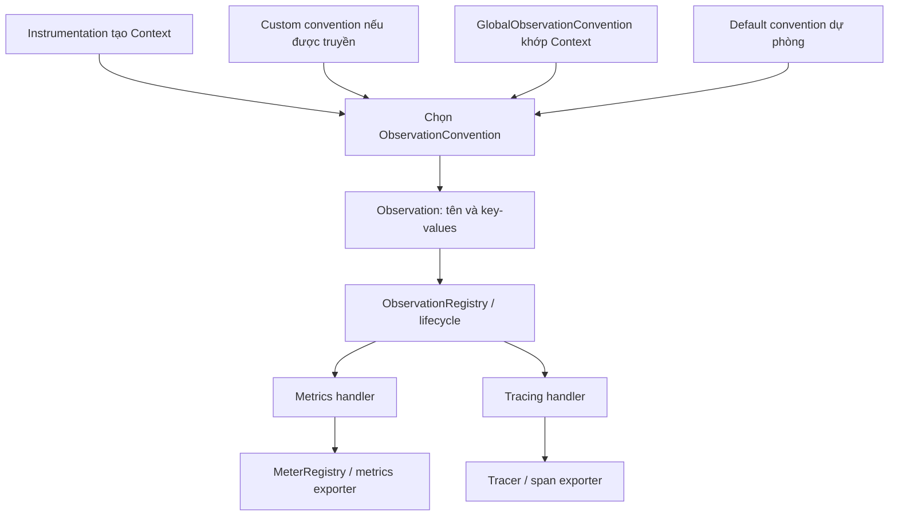
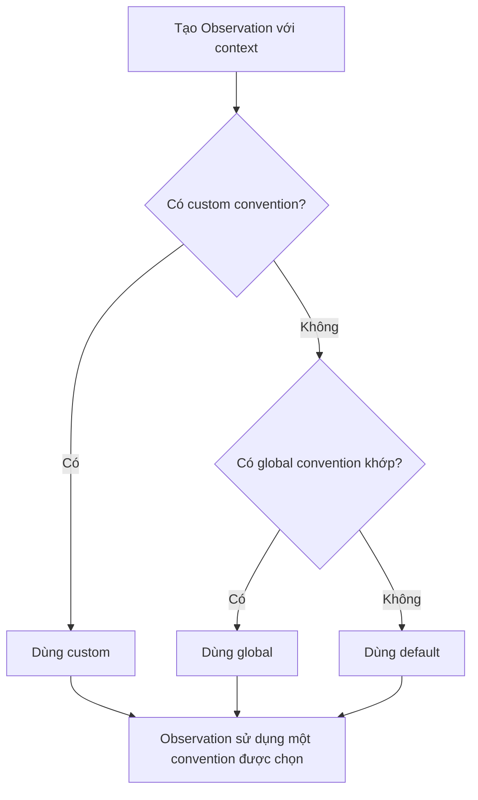

# GlobalObservationConvention trong Micrometer Observation

Một ứng dụng Spring Boot thường chứa nhiều nơi tạo Observation: HTTP server, HTTP client, message consumer, scheduled job và các thao tác nghiệp vụ. Khi nhiều thành phần cùng phát dữ liệu, người vận hành muốn **tên Observation**, **low-cardinality tags** và **high-cardinality attributes** nhất quán để dễ đọc metrics, traces và liên kết logs. Nếu mỗi nơi tự viết quy tắc đặt tên, dashboard dễ bị phân mảnh: cùng một loại thao tác lại xuất hiện với các tên và tập nhãn khác nhau.

Trong chương **Convention và filter** của module **SPRING_BOOT_OBSERVABILITY**, `GlobalObservationConvention` là một cơ chế chuẩn hóa cách biểu diễn Observation **theo loại context**. Bài này giải thích cách định nghĩa, đăng ký, chọn convention theo thứ tự ưu tiên và kiểm tra ảnh hưởng của nó đối với hệ thống quan sát Spring Boot dùng Micrometer Observation, metrics, logs và distributed tracing. Những phần về cardinality, exporter, sampling và propagation giúp áp dụng quy tắc đặt tên an toàn khi điều tra lỗi, độ trễ và hành vi ứng dụng trên môi trường thực.

## 1. Convention giải quyết vấn đề gì?

**Observation** đại diện cho một hoạt động đang được quan sát. Một Observation có tên và các key–value mô tả hoạt động; các `ObservationHandler` quyết định cách xử lý sự kiện vòng đời để ghi metrics hoặc traces.

**Observation convention** gom quy tắc suy ra tên và key–value từ một `Observation.Context` vào một đối tượng riêng, để mã nghiệp vụ không phải tự lặp lại cùng một quy tắc.

Ví dụ, ứng dụng xử lý thanh toán có context chứa:

- Phương thức thanh toán đã chuẩn hóa: `card`, `wallet` hoặc `bank_transfer`.
- Loại kết quả: `success`, `declined` hoặc `timeout`.
- Mã tham chiếu kỹ thuật của từng lần xử lý, đã được phép sử dụng trong telemetry.

Thay vì tạo nhiều Observation có tên thay đổi theo phương thức, kết quả hoặc mã tham chiếu, ta có thể thống nhất:

| Loại dữ liệu | Ví dụ | Mục đích |
| --- | --- | --- |
| Tên Observation | `payment.authorize` | Nhóm cùng một hoạt động; thường là cơ sở cho tên meter |
| Contextual name | `authorize payment` | Tên dễ đọc trong tracing khi handler hỗ trợ |
| Low-cardinality key values | `payment.method=card` | Nhóm metrics theo số giá trị hữu hạn |
| High-cardinality key values | `payment.operation_ref=op-7c91` | Điều tra một lần thực thi cụ thể trong trace khi được phép |

`GlobalObservationConvention` áp dụng quy tắc cho những Observation **có context phù hợp** và được tạo qua API có cơ chế lựa chọn convention. “Global” mô tả phạm vi **đăng ký trên một `ObservationRegistry`**, không có nghĩa mọi Observation trong mọi registry hay mọi loại context đều bị thay đổi.

## 2. Các thành phần tham gia

| Thành phần | Trách nhiệm | Điểm cần nhớ |
| --- | --- | --- |
| `Observation.Context` | Mang dữ liệu của một lần thực thi | Một loại context riêng giúp convention biết lấy thuộc tính ở đâu |
| `ObservationConvention<T>` | Định nghĩa tên, contextual name và các key–value cho context kiểu `T` | Có thể dùng làm convention mặc định hoặc tùy chọn tại chỗ |
| **`GlobalObservationConvention<T>`** | Một `ObservationConvention` được đăng ký trên registry | Được xét khi context khớp và không có custom convention ưu tiên cao hơn |
| `ObservationRegistry` | Lưu cấu hình convention, filter, predicate và handler | Đăng ký global convention qua `observationConfig()` |
| `ObservationFilter` | Bổ sung/chỉnh sửa `Observation.Context` ở giai đoạn lọc | Dùng khi muốn thêm key–value dù convention nào được chọn |
| `ObservationPredicate` | Quyết định Observation có được tạo hay trở thành no-op | Khác với đổi tên/tag |
| `ObservationHandler` | Xử lý vòng đời Observation để tạo metric/span hoặc hành vi khác | Có convention chưa đồng nghĩa đã có telemetry xuất ra backend |

Quan hệ tổng quát:



Sơ đồ nhấn mạnh việc **chọn một convention** và việc **chạy nhiều handler** là hai cơ chế khác nhau.

## 3. API của `GlobalObservationConvention<T>`

Trong Micrometer Observation, interface có dạng tổng quát:

```java
public interface GlobalObservationConvention<T extends Observation.Context>
        extends ObservationConvention<T> {
}
```

Các phương thức quan trọng của `ObservationConvention<T>`:

| API | Dữ liệu trả về | Tác động mong đợi |
| --- | --- | --- |
| `supportsContext(Observation.Context)` | `boolean` | Quyết định convention có phù hợp loại context này không |
| `getName()` | `String` hoặc `null` theo hợp đồng API | Đề xuất tên kỹ thuật cho Observation |
| `getContextualName(T context)` | `String` hoặc `null` | Đề xuất tên mang ngữ cảnh, thường hữu ích cho span |
| `getLowCardinalityKeyValues(T context)` | `KeyValues` | Thuộc tính có số giá trị giới hạn, phù hợp cho metric tags |
| `getHighCardinalityKeyValues(T context)` | `KeyValues` | Thuộc tính chi tiết, thường dành cho span/tracing |

Phương thức `supportsContext(...)` là điều kiện quan trọng nhất đối với global convention. Nếu viết nó quá rộng, một quy ước vốn dành cho payment có thể bị áp dụng sai cho HTTP requests, database operations hoặc loại nghiệp vụ khác.

Một convention như sau nên **chỉ** chấp nhận `PaymentContext`:

```java
@Override
public boolean supportsContext(Observation.Context context) {
    return context instanceof PaymentContext;
}
```

Kiểm tra bằng kiểu cụ thể cũng làm mã dễ đọc hơn so với chọn convention theo chuỗi `getName()` vốn có thể bị đổi bởi instrumentation hoặc framework.

## 4. Ví dụ đầy đủ: custom context và global convention

Ta viết một instrumentation đơn giản cho thao tác `payment.authorize`. Ví dụ gồm một context chuyên biệt, một convention mặc định và một global convention. Tên class trong code là tên minh họa; trong dự án thật nên tách mỗi class public ra file Java riêng theo quy ước.

### Bước 1 — Định nghĩa context nghiệp vụ

```java
import io.micrometer.observation.Observation;

public final class PaymentContext extends Observation.Context {
    private final String method;
    private final String safeOperationRef;

    public PaymentContext(String method, String safeOperationRef) {
        this.method = method;
        this.safeOperationRef = safeOperationRef;
    }

    public String getMethod() {
        return method;
    }

    public String getSafeOperationRef() {
        return safeOperationRef;
    }
}
```

Giá trị `method` cần được **chuẩn hóa từ trước** thành nhóm hữu hạn như `card`, `wallet` và `bank_transfer`. `safeOperationRef` là mã kỹ thuật giả lập được phép lưu; nó không nên là token, email, số thẻ hoặc định danh cá nhân chưa có cơ sở xử lý.

### Bước 2 — Convention mặc định

```java
import io.micrometer.common.KeyValues;
import io.micrometer.observation.Observation;
import io.micrometer.observation.ObservationConvention;

public final class DefaultPaymentConvention
        implements ObservationConvention<PaymentContext> {

    @Override
    public boolean supportsContext(Observation.Context context) {
        return context instanceof PaymentContext;
    }

    @Override
    public String getName() {
        return "payment.process";
    }

    @Override
    public KeyValues getLowCardinalityKeyValues(PaymentContext context) {
        return KeyValues.of("payment.method", context.getMethod());
    }
}
```

Đây là quy tắc dự phòng do instrumentation cung cấp. Nó được sử dụng khi không có custom convention và không tìm thấy global convention tương ứng.

### Bước 3 — Global convention thay cách đặt tên và bổ sung chi tiết

```java
import io.micrometer.common.KeyValues;
import io.micrometer.observation.GlobalObservationConvention;
import io.micrometer.observation.Observation;

public final class GlobalPaymentConvention
        implements GlobalObservationConvention<PaymentContext> {

    @Override
    public boolean supportsContext(Observation.Context context) {
        return context instanceof PaymentContext;
    }

    @Override
    public String getName() {
        return "payment.authorize";
    }

    @Override
    public String getContextualName(PaymentContext context) {
        return "authorize payment";
    }

    @Override
    public KeyValues getLowCardinalityKeyValues(PaymentContext context) {
        return KeyValues.of("payment.method", context.getMethod());
    }

    @Override
    public KeyValues getHighCardinalityKeyValues(PaymentContext context) {
        return KeyValues.of(
                "payment.operation_ref",
                context.getSafeOperationRef()
        );
    }
}
```

Ở đây, `getLowCardinalityKeyValues` giữ số lượng nhãn metric có giới hạn, trong khi `getHighCardinalityKeyValues` trả thông tin chi tiết phục vụ điều tra từng lần thực thi.

**Global convention thay thế convention mặc định khi được chọn**; nó không tự động cộng dồn tất cả kết quả `getLowCardinalityKeyValues` từ default convention. Nếu cần giữ những key bắt buộc, khai báo chúng trong convention được chọn hoặc tái sử dụng một lớp convention chung một cách có chủ đích.

### Bước 4 — Đăng ký convention vào ObservationRegistry

Ví dụ Java thuần:

```java
import io.micrometer.observation.ObservationRegistry;

ObservationRegistry registry = ObservationRegistry.create();

registry.observationConfig().observationConvention(
        new GlobalPaymentConvention()
);
```

Cấu hình này đăng ký global convention trên **`registry` cụ thể**. Nếu một phần ứng dụng lại tạo `anotherRegistry = ObservationRegistry.create()`, global convention không tự xuất hiện trên registry mới đó.

### Bước 5 — Tạo Observation theo đường chọn convention

```java
import io.micrometer.observation.Observation;
import io.micrometer.observation.ObservationRegistry;

public final class PaymentOperations {
    private final ObservationRegistry registry;

    public PaymentOperations(ObservationRegistry registry) {
        this.registry = registry;
    }

    public void authorize(String method, String safeReference,
                          Runnable gatewayCall) {
        Observation.createNotStarted(
                    null,                               // Custom convention
                    new DefaultPaymentConvention(),     // Default convention
                    () -> new PaymentContext(method, safeReference),
                    registry)
                .observe(gatewayCall);
    }
}
```

Tham số thứ nhất là `null` để cho phép hệ thống lựa chọn **global convention** phù hợp. Nếu `GlobalPaymentConvention` đã được đăng ký trên registry thì tên sử dụng sẽ là `payment.authorize` và các key–value được trả từ nó. Nếu chưa đăng ký global convention phù hợp thì dùng `DefaultPaymentConvention` với tên `payment.process`.

Tham số `Supplier<PaymentContext>` giúp Micrometer tạo context khi cần. Đừng hiểu đây là cách trì hoãn **mã nghiệp vụ**: `gatewayCall` vẫn được chạy bên trong `observe(...)`, trừ khi chính code bao quanh quyết định không gọi.

> Lưu ý: API `Observation.createNotStarted("payment.authorize", registry)` tạo Observation theo **tên trực tiếp** với context mặc định. Không nên giả định global convention viết riêng cho `PaymentContext` sẽ được chọn qua đường API đó. Ví dụ dùng overload nhận custom/default convention và context supplier để việc chọn convention diễn ra tường minh.

## 5. Thứ tự ưu tiên: custom → global → default

Với overload:

```java
Observation.createNotStarted(
        customConvention,
        defaultConvention,
        contextSupplier,
        observationRegistry
);
```

quy tắc chọn convention là:

1. **Custom convention được truyền trực tiếp** vào vị trí `customConvention`, nếu khác `null`.
2. Nếu không có custom, **global convention khớp context** đã đăng ký trên `ObservationRegistry`.
3. Nếu không có custom và không có global phù hợp, dùng **default convention**.



Một bảng ví dụ:

| Custom truyền vào | Registry có `GlobalPaymentConvention` | Context | Convention được chọn |
| --- | --- | --- | --- |
| `null` | Có | `PaymentContext` | GlobalPaymentConvention |
| `null` | Không | `PaymentContext` | DefaultPaymentConvention |
| CustomPaymentConvention | Có | `PaymentContext` | CustomPaymentConvention |
| `null` | Có | Context không phải PaymentContext | Default convention tương ứng với context đó |

Khi hai global conventions cùng trả `true` với một context, không nên dựa vào thứ tự ngầm định làm hợp đồng nghiệp vụ. Cấu hình nên tránh **điều kiện khớp chồng lấp**. Trong implementation có thể duyệt danh sách các global conventions theo thứ tự đăng ký để chọn convention khớp đầu tiên, nhưng thứ tự đó không phải cơ chế tốt để biểu diễn ưu tiên tính năng.

### Lưu ý về phạm vi “global”

`GlobalObservationConvention<PaymentContext>` có thể ảnh hưởng **mọi Observation được tạo qua cơ chế chọn global convention với PaymentContext và cùng registry**, cho dù chúng đến từ nhiều service trong ứng dụng. Nó không bảo đảm sửa tên của Observation có loại context khác, hoặc những Observation do một thư viện tự tạo theo cách không tham gia cơ chế chọn convention.

Để tùy biến instrumentation HTTP cụ thể của Spring, cần xem **loại ObservationContext và extension point** mà instrumentation đó sử dụng. Convention payment trong ví dụ không tác động đến `ServerRequestObservationContext` chỉ vì cả hai cùng nằm trong một ứng dụng.

## 6. Đăng ký bằng Spring Boot: bean tự động và cấu hình thủ công

Trong Spring Boot có tích hợp Actuator/Micrometer Observation, bean `GlobalObservationConvention` được hỗ trợ tự động đăng ký trên `ObservationRegistry` do Boot quản lý. Có thể khai báo:

```java
import org.springframework.context.annotation.Bean;
import org.springframework.context.annotation.Configuration;

@Configuration
public class ObservationConventionsConfig {

    @Bean
    GlobalPaymentConvention globalPaymentConvention() {
        return new GlobalPaymentConvention();
    }
}
```

Hoặc đánh dấu class convention bằng `@Component` (nếu class nằm trong vùng component scan). **Chọn một trong hai cách đăng ký** để tránh tạo hai bean convention trùng chức năng.

Service nghiệp vụ nên inject `ObservationRegistry` do Boot quản lý:

```java
import io.micrometer.observation.ObservationRegistry;
import org.springframework.stereotype.Service;

@Service
public class PaymentService {
    private final PaymentOperations operations;

    public PaymentService(ObservationRegistry registry) {
        this.operations = new PaymentOperations(registry);
    }

    public void authorize(String method, String safeReference,
                          Runnable gatewayCall) {
        operations.authorize(method, safeReference, gatewayCall);
    }
}
```

Lợi ích là quy tắc được gắn vào registry mà các Observation ứng dụng sử dụng, đồng thời giữ khả năng tích hợp metrics và tracing handler của Spring Boot.

### Khi tự tạo ObservationRegistry

Nếu một thư viện hoặc service tự làm:

```java
ObservationRegistry local = ObservationRegistry.create();
```

bean `GlobalPaymentConvention` của Spring không mặc nhiên có trên `local`. Muốn nó áp dụng, phải đăng ký nó với `local.observationConfig().observationConvention(...)`. Đồng thời, registry local cũng cần các handler tương ứng nếu muốn metrics/traces thực sự được tạo.

Trong ứng dụng Spring Boot, một bean `ObservationRegistry` tự khai báo có thể thay đổi điều kiện auto-configuration tùy phiên bản. Vì thế cần kiểm tra registry mà các thành phần thực sự nhận, thay vì tạo bean mới chỉ để gắn convention.

### Dùng ObservationRegistryCustomizer khi cần

Spring Boot hỗ trợ điểm mở rộng `ObservationRegistryCustomizer` để cấu hình registry được quản lý. Khi mục tiêu là **đăng ký một GlobalObservationConvention**, khai báo bean convention trực tiếp thường rõ ràng hơn. Customizer phù hợp khi cần thêm cấu hình registry khác; cần tránh đăng ký cùng một convention hai lần từ cả bean và customizer.

Kiểm tra behavior thực tế trên phiên bản Spring Boot đang chạy là cần thiết, vì auto-configuration, tên bean và các instrumentation tích hợp có thể thay đổi giữa các phiên bản.

## 7. GlobalObservationConvention khác ObservationFilter như thế nào?

Cả convention và filter đều được dùng để tác động đến tên hoặc key–value, nhưng phạm vi và thời điểm áp dụng khác nhau.

| Tiêu chí | GlobalObservationConvention | ObservationFilter |
| --- | --- | --- |
| Mục đích | Xác định **quy ước** tên và key–value từ một loại context | **Chỉnh sửa/bổ sung** context sau khi Observation đã hoạt động |
| Cách chọn | Qua `supportsContext(...)` trong đường chọn convention | Được gọi cho Observation được xử lý bởi registry có filter |
| Quan hệ với custom convention | Có thể bị custom convention ưu tiên cao hơn thay thế | Có thể thêm key–value dù custom/global/default convention nào được chọn |
| API đăng ký | `observationConfig().observationConvention(...)` | `observationConfig().observationFilter(...)` |
| Ví dụ | Đặt tên mọi PaymentContext thành `payment.authorize` | Thêm `deployment.environment=prod` cho các Observation |
| Thời điểm | Quy ước được xét khi tạo/khởi tạo Observation qua API hỗ trợ | Filter được chạy trước các callback `onStop` của handler |
| Giới hạn | Không tự gắn tag cho mọi loại context | Sửa context muộn có thể không ảnh hưởng mọi hành vi đã xảy ra ở `onStart` |

Một `ObservationFilter` có thể viết như sau:

```java
import io.micrometer.common.KeyValue;
import io.micrometer.observation.Observation;
import io.micrometer.observation.ObservationFilter;

public final class EnvironmentObservationFilter
        implements ObservationFilter {

    @Override
    public Observation.Context map(Observation.Context context) {
        return context.addLowCardinalityKeyValue(
                KeyValue.of("deployment.environment", "prod")
        );
    }
}
```

Đăng ký:

```java
registry.observationConfig().observationFilter(
        new EnvironmentObservationFilter()
);
```

Filter này bổ sung tag môi trường cho Observation đi qua registry, kể cả khi convention của Observation là custom convention. Nhưng tag mới thường được đưa vào context **trước khi stop handler chạy**, không có nghĩa span đã khởi tạo trước đó sẽ tự cập nhật mọi trường một cách đồng nhất. Cần xác minh handler và exporter thực tế.

**Quy tắc lựa chọn:**

- Muốn **thay quy ước tên và tập nhãn cho một loại context cụ thể**: cân nhắc `GlobalObservationConvention`.
- Muốn **bổ sung một key–value chung** cho nhiều loại Observation, bất kể convention nào thắng: cân nhắc `ObservationFilter`.
- Muốn **bỏ qua** một số Observation từ lúc tạo: dùng `ObservationPredicate` với quy tắc rõ ràng.
- Muốn **xử lý lifecycle** để ghi metric/span hoặc sự kiện riêng: dùng `ObservationHandler` phù hợp.

Đừng dùng convention để thực hiện việc ngăn tạo Observation hoặc gửi dữ liệu; đó là trách nhiệm của predicate/handler/export pipeline ở các tầng khác.

## 8. Low-cardinality và high-cardinality trong global convention

Một global convention có thể sửa cách tạo **rất nhiều** Observation. Nếu chọn nhãn sai, một thay đổi tưởng nhỏ có thể làm tăng chi phí của toàn hệ thống.

### Low-cardinality: ổn định, số giá trị hữu hạn

Nên dùng các nhóm đã chuẩn hóa:

```java
@Override
public KeyValues getLowCardinalityKeyValues(PaymentContext context) {
    return KeyValues.of("payment.method", context.getMethod());
}
```

Giả sử `getMethod()` chỉ trả về `card`, `wallet`, `bank_transfer` và `unknown`. Với một tên meter và các nhãn khác không đổi, key này chỉ bổ sung số tổ hợp có giới hạn.

Ngược lại, những giá trị sau thường **không phù hợp** làm metric tag:

- `order.id`, `transaction.id` hoặc `traceId` thay đổi theo mỗi yêu cầu.
- Tên người dùng, email hoặc định danh khách hàng.
- URL đã chứa path parameter và query string chưa chuẩn hóa.
- Message lỗi nguyên bản, stack trace hoặc raw user-agent.
- Giá trị được sinh ngẫu nhiên trong mỗi lần chạy.

Với HTTP, dùng route template như `/payments/{id}` thay vì URL chứa ID cụ thể. Với lỗi, dùng `error.category=timeout` nếu hệ thống có tập giá trị được quản lý.

### High-cardinality: chi tiết phục vụ truy vết

`getHighCardinalityKeyValues` phù hợp hơn với mã tham chiếu kỹ thuật cần điều tra từng lần thực thi:

```java
@Override
public KeyValues getHighCardinalityKeyValues(PaymentContext context) {
    return KeyValues.of("payment.operation_ref",
            context.getSafeOperationRef());
}
```

Khi tracing handler và exporter hoạt động, high-cardinality key có thể xuất hiện thành span attribute. **Nó không tự động được ghi vào log, không tự thành W3C baggage và không tự được truyền qua HTTP**.

Không được hiểu rằng high-cardinality có nghĩa có thể đưa mọi dữ liệu cá nhân hoặc bí mật vào trace. Dữ liệu span có thể được export, lưu, index và chia sẻ với nhiều nhóm. Giá trị cần có mục đích điều tra cụ thể, chính sách bảo vệ và thời hạn lưu phù hợp.

### Ảnh hưởng tới các backend

| Tín hiệu | Convention có thể tác động | Điều kiện để nhìn thấy |
| --- | --- | --- |
| Metrics | Tên meter và low-cardinality tags | Metrics handler, MeterRegistry, exporter/scrape, backend |
| Traces | Span name và attributes từ low/high key-values | Tracing handler/bridge, sampling, collector/exporter |
| Logs | Không tự ghi các key của convention thành log fields | Logging framework, MDC/encoder và pipeline log riêng |
| Liên kết metric → trace | Có thể tìm span theo tên/tags nếu backend hỗ trợ; exemplar là tính năng riêng | Trace có được thu và backend hỗ trợ correlation/search |

Dù convention làm cách đặt tên nhất quán, nó **không thay thế context propagation** giữa các service. Trace ID phải được truyền và trích xuất đúng qua HTTP/messaging/async; log correlation cần MDC và cấu hình logger phù hợp.

## 9. Một ví dụ về sai cấu hình và cách sửa

Giả sử ba service cùng tham gia thanh toán:

```text
checkout-service  ->  payment-service  ->  bank-adapter
```

`checkout-service` và `payment-service` dùng `payment.authorize` theo global convention. Riêng `bank-adapter` có một `ObservationRegistry` tự tạo, không đăng ký convention và tracing handler. Khi điều tra chậm:

- Metric tổng hợp ở hai service đầu tiên dùng các tên chuẩn, còn custom metric ở adapter có thể vắng mặt.
- Trong một trace được lưu, không thấy span nghiệp vụ `payment.authorize` của adapter, dù HTTP client instrumentation bên ngoài có thể vẫn tạo span.
- Log của adapter có thể thiếu `traceId`/`spanId` nếu tracing context không được propagate vào phạm vi log.

**Không thể kết luận root cause chỉ từ việc span vắng mặt**. Cần phân biệt những bước sau:

1. Đoạn instrumentation adapter có tạo Observation và dùng **đúng context** không?
2. Observation đó được tạo qua overload có xét custom/global/default convention không?
3. Registry mà adapter sử dụng có đăng ký `GlobalPaymentConvention` không?
4. Registry đó có handler metrics và tracing không?
5. Có `ObservationPredicate` vô hiệu hóa Observation hay không?
6. Trace có bị sampling hoặc exporter/collector loại bỏ không?
7. Log correlation được cấu hình chưa; propagation qua HTTP, messaging hoặc executor có còn nguyên không?

Sửa naming convention không tự động sửa exporter hoặc propagation. Cần xác nhận từng tầng.

## 10. Thử nghiệm quy tắc ưu tiên convention

Một bài thực hành nhỏ có thể chứng minh **global chỉ được chọn khi không có custom**.

Định nghĩa thêm convention tại chỗ:

```java
import io.micrometer.observation.Observation;
import io.micrometer.observation.ObservationConvention;

public final class CustomPaymentConvention
        implements ObservationConvention<PaymentContext> {

    @Override
    public boolean supportsContext(Observation.Context context) {
        return context instanceof PaymentContext;
    }

    @Override
    public String getName() {
        return "payment.custom";
    }
}
```

Rồi tạo Observation với custom convention:

```java
Observation.createNotStarted(
        new CustomPaymentConvention(),
        new DefaultPaymentConvention(),
        () -> new PaymentContext("card", "op-7c91"),
        registry
).observe(() -> {
    // Gọi nghiệp vụ thử nghiệm.
});
```

Nếu `registry` có `GlobalPaymentConvention`, phương thức trên vẫn chọn **`CustomPaymentConvention`** theo thứ tự ưu tiên. Dữ liệu được tạo theo convention tại chỗ, thay vì tự động hợp nhất các key–value từ global.

Muốn so sánh ba trường hợp:

| Thử nghiệm | Custom convention | Global đã đăng ký | Tên kỳ vọng |
| --- | --- | --- | --- |
| A | `null` | Không | `payment.process` |
| B | `null` | Có | `payment.authorize` |
| C | CustomPaymentConvention | Có | `payment.custom` |

Để quan sát tên metric, cần đăng ký metrics handler với `MeterRegistry` và thực thi từng Observation. Để quan sát span name, cần tracing handler/tracer. Không thể dựa vào việc chỉ tạo `ObservationRegistry.create()` rồi nhìn dashboard để kiểm chứng.

### Kiểm chứng qua metrics handler

Một cấu hình Java tối giản, không phụ thuộc Spring container:

```java
import io.micrometer.core.instrument.simple.SimpleMeterRegistry;
import io.micrometer.core.instrument.observation.DefaultMeterObservationHandler;
import io.micrometer.observation.Observation;
import io.micrometer.observation.ObservationRegistry;

SimpleMeterRegistry meters = new SimpleMeterRegistry();
ObservationRegistry registry = ObservationRegistry.create();

registry.observationConfig().observationHandler(
        new DefaultMeterObservationHandler(meters));
registry.observationConfig().observationConvention(
        new GlobalPaymentConvention());

Observation.createNotStarted(
        null,
        new DefaultPaymentConvention(),
        () -> new PaymentContext("card", "op-7c91"),
        registry
).observe(() -> {
    // Công việc minh họa.
});

long count = meters.find("payment.authorize")
        .tag("payment.method", "card")
        .timer()
        .count(); // Dự kiến: 1

meters.close();
```

Ví dụ này kiểm tra convention được chọn có tạo metric với tên `payment.authorize` và tag `payment.method=card` hay không. `SimpleMeterRegistry` lưu meter trong bộ nhớ và phù hợp cho demo/test; không tự export sang Prometheus hoặc trace backend.

Khi mở rộng bài thực hành, thử thêm custom convention trước và kiểm tra timer `payment.custom`. Nhờ đó có thể xác nhận hành vi ưu tiên bằng dữ liệu thực tế, thay vì suy từ tên class.

## 11. Các lỗi thường gặp

| Sai lầm | Hậu quả | Cách sửa |
| --- | --- | --- |
| `supportsContext` luôn trả `true` | Convention có thể áp dụng nhầm cho nhiều loại Observation | Giới hạn theo loại context phù hợp |
| Đăng ký convention trên registry A nhưng instrument bằng registry B | Convention không tác dụng tại nơi mong muốn | Inject đúng registry; kiểm tra bean và wiring |
| Tạo Observation theo tên trực tiếp rồi chờ global convention theo context chuyên biệt hoạt động | Không dùng đường chọn convention/context như dự kiến | Sử dụng overload có custom/default convention và context supplier |
| Nghĩ global convention cộng dồn mọi tags từ default convention | Thiếu key–value trong tín hiệu | Định nghĩa đủ keys trên convention được chọn; dùng filter khi cần bổ sung chung |
| Hai global conventions cùng khớp một context | Quy tắc được chọn khó dự đoán theo cấu hình | Tách bạch `supportsContext` và tránh overlap |
| Gắn ID vào low-cardinality key | Metric series tăng mạnh | Chỉ dùng tập giá trị hữu hạn; ID chi tiết để ở span nếu được phép |
| Dùng global convention để loại bỏ Observation | Mục đích API không khớp | Dùng `ObservationPredicate` |
| Dùng filter để thay tên lúc stop rồi kỳ vọng mọi handler nhận tên mới | Một số dữ liệu đã được xử lý tại start | Dùng convention cho tên và kiểm tra vòng đời handler |
| Nghĩ convention tự tạo metric/span/log | Không nhìn thấy dữ liệu nếu thiếu handler/backend | Kiểm tra ObservationHandler, exporter và log pipeline |
| Đổi tên metric toàn hệ thống mà không cập nhật dashboard | Alert, PromQL và SLO có thể sai | Xác định tác động, cập nhật truy vấn và kiểm chứng ở staging |
| Gắn token hoặc thông tin nhạy cảm vào high-cardinality key | Dữ liệu bí mật có thể vào trace backend | Áp dụng whitelist thuộc tính, hạn chế dữ liệu và quyền truy cập |

## 12. Thực hành vận hành trước khi đưa global convention lên production

Vì một convention có thể ảnh hưởng nhiều Observation cùng loại, hãy xác nhận tác động bằng các bước cụ thể:

1. **Liệt kê nhóm Observation bị ảnh hưởng.** Xác định các instrumentation dùng context tương ứng, registry mà chúng sử dụng và điểm tạo Observation.
2. **Kiểm tra tập tên/tags hiện tại.** Chụp lại các tên meter, span và key values mà dashboard/alert đang dùng; đánh giá việc đổi tên có gây gián đoạn truy vấn hay không.
3. **Chạy một đường đi thành công và một đường đi lỗi.** So count, latency, error tag, span status và log correlation trước/sau thay đổi.
4. **Đánh giá cardinality.** Dùng đầu vào nhiều ID khác nhau và xác nhận `payment.operation_ref` không xuất hiện như metric label; kiểm tra quy tắc do handler tùy chỉnh tạo.
5. **Kiểm tra tracing và sampling.** Với trace được lưu, xem tên span và attributes; nếu không tìm thấy, kiểm tra sampler/exporter trước khi quy lỗi cho convention.
6. **Kiểm tra ranh giới dịch vụ.** Xác nhận `traceparent`/context propagation qua HTTP/messaging, và việc log còn `traceId` khi cần.
7. **Theo dõi khi triển khai.** Đảm bảo truy vấn metric, dashboard, alert và SLO dùng tên mới; nếu cần giai đoạn chuyển tiếp, lên kế hoạch cho việc thay đổi tên meter thay vì tạo duplicate instrumentation kéo dài.

Một convention áp dụng đúng giúp **đồng nhất ngôn ngữ quan sát**, còn chất lượng điều tra vẫn phụ thuộc metrics, logs, traces và pipeline được cấu hình đầy đủ.

## 13. Câu hỏi tự kiểm tra

1. Một `GlobalObservationConvention<PaymentContext>` có làm thay đổi tất cả Observation HTTP của Spring Boot không? Vì sao?
2. Thứ tự ưu tiên giữa convention truyền trực tiếp, global convention và default convention là gì?
3. Nếu custom convention chỉ trả một key, các key của global và default có tự cộng thêm vào không?
4. Tại sao `supportsContext(...)` là một phần thiết yếu của GlobalObservationConvention?
5. Khi muốn thêm `deployment.environment` cho mọi Observation, nên cân nhắc GlobalObservationConvention hay ObservationFilter?
6. Đăng ký bean `GlobalPaymentConvention` mà service tự tạo `ObservationRegistry.create()` thì chuyện gì có thể xảy ra?
7. Vì sao một span không tìm thấy trong backend chưa đủ để kết luận global convention không được áp dụng?
8. Nếu `payment.operation_ref` có gần như một triệu giá trị mỗi ngày, cần phân loại key này thế nào và kiểm soát rủi ro gì?
9. Vì sao đổi tên Observation có thể ảnh hưởng tới alert và dashboard dù số request và độ trễ thực không thay đổi?
10. Khi context được propagate qua message broker, global convention có tự đảm nhiệm inject/extract trace context không?

## Tài liệu tham khảo

- [Micrometer — Observation Components](https://docs.micrometer.io/micrometer/reference/observation/components.html): `ObservationContext`, `ObservationConvention`, `GlobalObservationConvention`, filter, predicate và thứ tự ưu tiên.
- [Micrometer Observation — Javadoc `ObservationConvention`](https://javadoc.io/static/io.micrometer/micrometer-observation/1.15.0/io/micrometer/observation/ObservationConvention.html): các phương thức lựa chọn tên và key values.
- [Spring Boot — Observability](https://docs.spring.io/spring-boot/reference/actuator/observability.html): tích hợp Observation với beans, metrics và tracing.

## Kết luận

**`GlobalObservationConvention` chuẩn hóa tên và key–value cho các Observation có context phù hợp trong một `ObservationRegistry`.** Nó được chọn sau custom convention và trước default convention trên đường tạo Observation hỗ trợ việc chọn convention. Dùng `supportsContext(...)` đủ hẹp, phân loại low/high cardinality đúng mục đích và chọn `ObservationFilter` khi cần bổ sung thuộc tính chung bất kể convention nào được chọn.

Trong Spring Boot, đăng ký convention với registry thực sự được instrumentation sử dụng rồi kiểm chứng metrics, traces và log correlation trên dữ liệu chạy thật. Một quy tắc tên thống nhất giúp điều tra sự cố thuận lợi hơn, nhưng không thay cho handler, exporter, sampler, context propagation hoặc chính sách bảo vệ dữ liệu.

