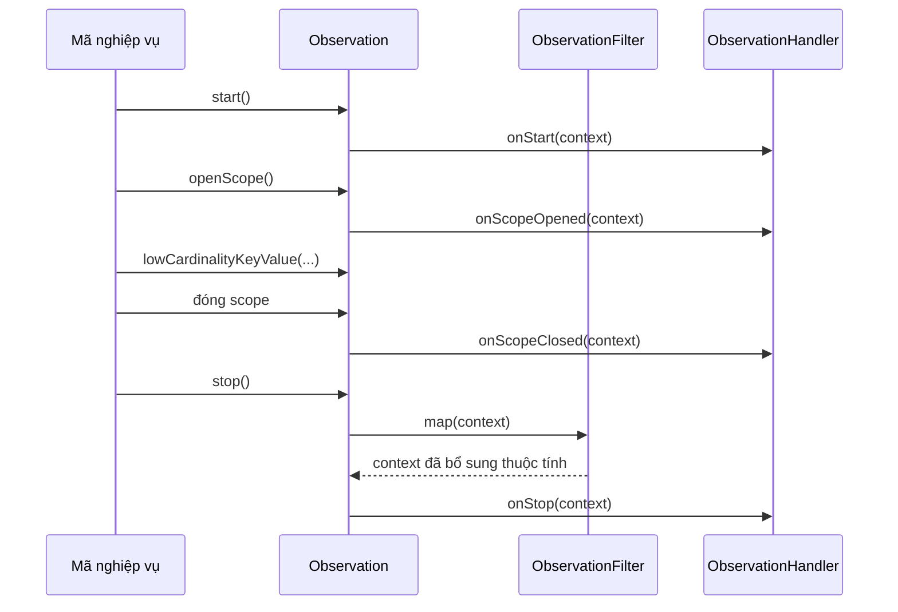
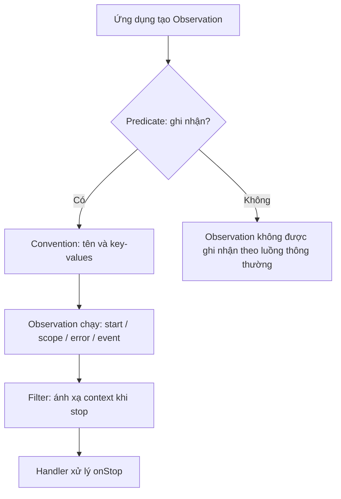
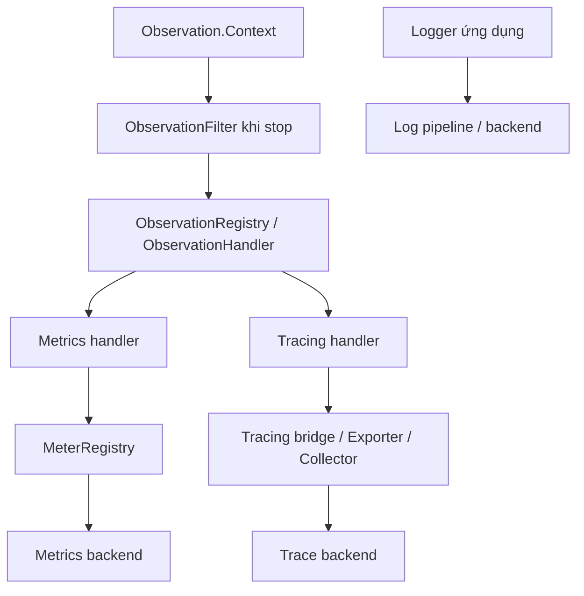

# ObservationFilter: bổ sung và chuẩn hóa ngữ cảnh quan sát

Khi một ứng dụng Spring Boot xử lý `POST /checkout`, các observation ở controller, service và HTTP client có thể mang tên và tag khác nhau. Để phân tích p95 latency, tỷ lệ lỗi hay hành vi một request trên nhiều môi trường, đội vận hành đôi khi muốn thêm cùng một thuộc tính như `deployment.environment=staging` hoặc `service.domain=checkout` vào các observation liên quan. Sao chép logic thêm tag vào từng phương thức dễ gây trùng lặp và không nhất quán.

**`ObservationFilter`** của Micrometer Observation giúp **điều chỉnh `Observation.Context` thông qua một quy tắc được đăng ký tại `ObservationRegistry`**. Nó phù hợp để bổ sung key-value theo điều kiện và chuẩn hóa các thuộc tính dùng chung. Bài học này thuộc chương **Convention và filter** của module **SPRING_BOOT_OBSERVABILITY**, trong phạm vi xây dựng observability cho Spring Boot bằng Micrometer Observation, metrics, logs và distributed tracing.

Chúng ta sẽ xem filter chạy ở thời điểm nào, khác `ObservationConvention` và `ObservationPredicate` ra sao, cách đăng ký và kiểm thử, rồi liên hệ tới cardinality, context propagation, exporter, sampling và cách liên kết tín hiệu khi điều tra lỗi, độ trễ trên hệ thống thực.

## 1. ObservationFilter thực chất làm gì?

`Observation` đại diện cho một hoạt động có vòng đời, tên và ngữ cảnh. `Observation.Context` chứa thông tin như name, key-values, error cùng các dữ liệu phục vụ xử lý. Interface `ObservationFilter` nhận context và trả lại context đã được ánh xạ:

```java
import io.micrometer.common.KeyValue;
import io.micrometer.observation.Observation;
import io.micrometer.observation.ObservationFilter;

ObservationFilter environmentFilter = context -> {
    context.addLowCardinalityKeyValue(
        KeyValue.of("deployment.environment", "staging"));
    return context;
};
```

Trong ví dụ, filter thêm nhãn môi trường cho observation. Nó **không tự sinh** metric, span hoặc log; những tín hiệu đó còn phụ thuộc handler, registry, bridge, exporter và cấu hình ứng dụng.

Điểm dễ nhầm nhất: tên “filter” ở đây **không có nghĩa là loại bỏ observation** giống servlet filter loại request. `ObservationFilter` chủ yếu dùng để **chỉnh/hoàn thiện context**. Muốn quyết định không ghi nhận một observation, cần xem `ObservationPredicate`. Muốn từ chối một meter, cần xem `MeterFilter` của Micrometer Metrics.

| Nhu cầu | Công cụ phù hợp |
| --- | --- |
| Thêm `deployment.environment` vào observation | `ObservationFilter` |
| Chuẩn hóa tên, contextual name và key-values theo một kiểu instrumentation | `ObservationConvention` |
| Quyết định observation có được ghi nhận hay không | `ObservationPredicate` |
| Phản ứng khi observation start, stop, error hoặc event | `ObservationHandler` |
| Đổi tên/tag hoặc chấp nhận/từ chối một meter | `MeterFilter` |
| Chỉ giữ một phần trace để giảm chi phí | Sampler trong tracing stack |

## 2. Thời điểm chạy trong vòng đời Observation

Ở luồng thực thi thông thường của Micrometer Observation, `ObservationFilter` được áp dụng **khi observation kết thúc**, trước callback `onStop` của handler. Điều này khác với việc thêm key-value ngay lúc tạo observation.



Đây là sơ đồ minh họa một observation có scope; không phải mọi thao tác đều cần mở scope. Callback và chi tiết triển khai phụ thuộc phiên bản Micrometer/handler, nhưng sự khác biệt giữa dữ liệu có sẵn **lúc start** và dữ liệu được bổ sung **lúc stop** rất quan trọng.

Hệ quả:

1. Filter thích hợp cho thuộc tính phải có khi observation **hoàn tất**, chẳng hạn nhãn triển khai ổn định, kết quả đã được gắn trong quá trình xử lý hoặc thông tin phân nhóm.
2. Filter không làm thông tin xuất hiện ngược thời gian trong `onStart`, những dòng log đã ghi trước đó hoặc span đã tạo từ trước.
3. Metrics handler ghi Timer khi observation dừng có thể nhìn thấy low-cardinality tags mới. Tracing handler có thể sử dụng context ở nhiều callback; phải kiểm tra implementation cụ thể.
4. Observation cần được `stop()` hợp lệ. Dùng `try/finally` hoặc `observe(...)` để kết thúc vòng đời kể cả khi xảy ra exception.
5. Filter không tự mở trace scope, không propagate context qua thread/HTTP và không thay đổi tracing sampling.

## 3. Ví dụ: filter tag cho nhóm checkout

Giả sử những operation thuộc checkout có tên bắt đầu bằng `checkout.`. Ta muốn tự động bổ sung tag `service.domain=checkout` và môi trường triển khai, đồng thời không thêm các tag đó cho observation thuộc inventory.

```java
import io.micrometer.common.KeyValue;
import io.micrometer.observation.Observation;
import io.micrometer.observation.ObservationFilter;

public final class CheckoutObservationFilter implements ObservationFilter {
    private final String environment;

    public CheckoutObservationFilter(String environment) {
        this.environment = environment;
    }

    @Override
    public Observation.Context map(Observation.Context context) {
        String name = context.getName();
        if (name != null && name.startsWith("checkout.")) {
            context.addLowCardinalityKeyValue(
                KeyValue.of("service.domain", "checkout"));
            context.addLowCardinalityKeyValue(
                KeyValue.of("deployment.environment", environment));
        }
        return context;
    }
}
```

Các lựa chọn trong đoạn mã đều có mục đích:

- `environment` là giá trị truyền qua constructor, phù hợp với thông tin deployment ổn định; không dùng biến mutable chia sẻ dữ liệu giữa request.
- Điều kiện theo tên operation giới hạn phạm vi của filter.
- Hai key mới dùng tập giá trị nhỏ; thích hợp cho truy vấn phân nhóm metrics.
- Filter trả về context để phần xử lý tiếp theo dùng.
- Tên tag được chuẩn hóa ở một điểm; dashboard không phải xử lý các biến thể như `env`, `environment` và `deployment_env`.

Nếu toàn hệ thống đã có một instrumentation khác tạo `service.domain`, phải kiểm tra xung đột trước khi thêm lần nữa. Key trùng với giá trị khác nhau có thể cho kết quả khó dự đoán tùy API và thứ tự áp dụng.

### Đăng ký với Micrometer ObservationRegistry

```java
import io.micrometer.observation.Observation;
import io.micrometer.observation.ObservationRegistry;

ObservationRegistry registry = ObservationRegistry.create();
registry.observationConfig()
    .observationFilter(new CheckoutObservationFilter("test"));

Observation.createNotStarted("checkout.payment.authorize", registry)
    .lowCardinalityKeyValue("outcome", "accepted")
    .observe(() -> {
        // Thao tác nghiệp vụ được quan sát.
    });
```

Registry trong ví dụ có filter nhưng **chưa được nối với metrics hoặc tracing handler**. Vì vậy chạy đoạn mã không bảo đảm dashboard có Timer hoặc backend tracing có span. `ObservationFilter` điều chỉnh dữ liệu observation, còn handler và exporter quyết định dữ liệu đi đâu.

## 4. Đăng ký filter trong ứng dụng Spring Boot

Ở nhiều dự án Spring Boot 3.x có Actuator/Micrometer, có thể khai báo `ObservationFilter` như một Spring bean để cơ chế cấu hình observability đăng ký vào `ObservationRegistry` được quản lý:

```java
import io.micrometer.observation.ObservationFilter;
import org.springframework.beans.factory.annotation.Value;
import org.springframework.context.annotation.Bean;
import org.springframework.context.annotation.Configuration;

@Configuration(proxyBeanMethods = false)
public class ObservabilityConfiguration {
    @Bean
    ObservationFilter checkoutObservationFilter(
            @Value("${app.telemetry.environment:local}") String environment) {
        return new CheckoutObservationFilter(environment);
    }
}
```

```yaml
app:
  telemetry:
    environment: staging
```

Trong code Java trên, `@Value` đọc property `app.telemetry.environment`, mặc định `local` khi chưa cấu hình. **Hãy đối chiếu khả năng tự đăng ký `ObservationFilter` bean của phiên bản Spring Boot đang chạy.** Với registry tự tạo hoặc cấu hình đặc biệt, có thể cần đăng ký filter tường minh qua `registry.observationConfig().observationFilter(...)` ngay trong bước khởi tạo.

Các lỗi cấu hình đáng chú ý:

- Filter được đăng ký vào registry A, trong khi service lại inject registry B.
- Filter được thêm ở mỗi request, dẫn tới cấu hình lặp và hành vi khó kiểm soát.
- Spring có nhiều cấu hình instrumentation hoặc registry; filter bean chưa chắc đã tác động tới mọi pipeline ngoài `ObservationRegistry` đó.
- Giá trị environment do request đầu tiên quyết định rồi bị giữ trong singleton filter, khiến các request sau nhìn thấy giá trị sai.

Với thuộc tính thay đổi theo request, hãy đưa nó vào `Observation.Context` của **từng observation** hoặc custom context/convention phù hợp. Một singleton filter không tự truy cập được dữ liệu request trên mọi thread. Nếu dùng bất đồng bộ, cần context propagation đúng cách.

## 5. Phân biệt Convention, Filter, Predicate và Handler

Bốn thành phần có trách nhiệm liên quan nhưng khác nhau:

| Thành phần | Trách nhiệm điển hình | Ví dụ |
| --- | --- | --- |
| **`ObservationConvention`** | Cung cấp tên và các key-values theo quy ước của một loại observation | Đặt tên HTTP server theo route template |
| **`ObservationFilter`** | Bổ sung, ánh xạ context ở giai đoạn kết thúc | Thêm `deployment.environment` |
| **`ObservationPredicate`** | Quyết định có ghi nhận observation hay không | Bỏ một nhóm instrumentation không cần thiết |
| **`ObservationHandler`** | Xử lý callback và tạo tín hiệu quan sát | Metrics handler hoặc tracing handler |



Sơ đồ mô tả **vai trò khái quát**, không trình bày mọi callback nội bộ. Handler có thể đã nhận `onStart` từ trước khi filter chạy.

**Ví dụ phân biệt bằng yêu cầu thực:**

- “Muốn loại metric hoặc observation của health check”: cần xác định đúng cấp lọc và cân nhắc `ObservationPredicate` hoặc `MeterFilter` tùy tín hiệu cần loại.
- “Muốn tên span HTTP theo route chuẩn”: thường thuộc quy ước instrumentation và `ObservationConvention`; thêm tag cuối vòng đời không bảo đảm đổi tên span tạo lúc start.
- “Muốn tất cả checkout Timer có nhãn môi trường”: `ObservationFilter` cộng với metrics handler phù hợp là một lựa chọn.
- “Muốn làm gì đó khi observation lỗi”: `ObservationHandler.onError` hoặc code xử lý lỗi; filter không thay thế callback lỗi.

## 6. ObservationFilter khác MeterFilter như thế nào?

`ObservationFilter` thuộc `io.micrometer.observation`, xử lý **context của observation**. `MeterFilter` thuộc `io.micrometer.core.instrument.config`, xử lý **đăng ký và cấu hình meter**. Dù đều có chữ “filter”, phạm vi áp dụng hoàn toàn khác.

| Tình huống | Lớp thích hợp |
| --- | --- |
| Thêm tag chung vào context của hoạt động | ObservationFilter |
| Chấp nhận/từ chối một meter cụ thể | MeterFilter |
| Đổi tên/tag metrics khi đăng ký meter | MeterFilter |
| Tạo Counter cho một sự kiện nghiệp vụ | Micrometer Metrics API / MeterRegistry |
| Chỉ giữ 10% trace | Tracing sampler |
| Ghi log khi xảy ra sự kiện nghiệp vụ | Logger hoặc handler logging phù hợp |

Thêm tag vào observation không mặc nhiên thay đổi những meter đã được đăng ký trước đó; ngược lại, `MeterFilter` không tự sửa thuộc tính của span tracing. Muốn hiểu một thay đổi sẽ xuất hiện ở đâu, hãy xác định **nó tác động tại lớp dữ liệu nào**.

## 7. Cardinality và an toàn dữ liệu

Micrometer phân biệt:

- **Low-cardinality key-values**: có số giá trị nhỏ, hữu ích khi gom nhóm metrics, ví dụ `outcome=accepted/rejected/error`, `service.domain=checkout`.
- **High-cardinality key-values**: có số giá trị nhiều hơn, đôi khi hữu ích trên trace để điều tra từng request; vẫn cần hạn chế dung lượng và dữ liệu nhạy cảm.

Với metrics, số time series phụ thuộc số **tổ hợp** giá trị nhãn. Nếu `environment` có 3 giá trị, `domain` có 4 và `outcome` có 3, riêng các nhãn này có thể tạo tối đa **3 × 4 × 3 = 36 tổ hợp**, chưa tính các nhãn của service, instance hoặc registry.

Thêm `orderId`, `customerId` hoặc `requestId` vào low-cardinality tags có thể làm số tổ hợp tăng theo mỗi request. Nếu filter chung thêm những tag đó cho hàng trăm operation, chi phí lưu trữ và tải hệ thống metrics có thể tăng mạnh.

```java
// Không nên: một nhãn mới gần như cho mỗi request.
context.addLowCardinalityKeyValue(
    KeyValue.of("request.id", requestId));

// Có thể phù hợp nếu channel thuộc một tập giá trị cố định.
context.addLowCardinalityKeyValue(
    KeyValue.of("request.channel", "web"));
```

Đây là những dòng code **minh họa lựa chọn tag**, không phải phương thức Java hoàn chỉnh. Với ID của người dùng hoặc giao dịch, tốt hơn là dùng hệ thống dữ liệu nghiệp vụ hoặc cơ chế correlation/tracing đã được thiết kế với phân quyền và xử lý dữ liệu phù hợp. Không đưa token, mật khẩu, email hay thông tin cá nhân vào tag chỉ vì có API `highCardinalityKeyValue`.

Trước khi thêm key-value bằng filter, nên xác minh:

1. Nhãn có bao nhiêu giá trị khác nhau trong production?
2. Có tag cùng tên do Spring Boot, convention hoặc filter khác đặt không?
3. Thông tin cần xuất hiện ở metrics, traces, logs hay chỉ một tín hiệu?
4. Lúc filter chạy đã đủ dữ liệu để tính nhãn chưa?
5. Có cần bảo vệ dữ liệu, giới hạn retention hay quyền truy cập không?

## 8. Tác động thực tế tới metrics, traces và logs

`ObservationFilter` không kết nối backend trực tiếp; nó chỉ hoàn thiện context để những thành phần khác sử dụng.



Sơ đồ giản lược luồng dữ liệu khi observation kết thúc. Trong thực tế handler metrics/tracing có thể đã xử lý một số callback trước thời điểm này.

**Metrics:** khi kết nối `DefaultMeterObservationHandler` với `MeterRegistry`, Timer được ghi khi observation kết thúc. Các low-cardinality tags mà filter bổ sung có thể thành nhãn của Timer. Tên chuỗi metric xuất ra Prometheus hoặc backend khác có thể được chuyển đổi theo quy tắc registry và đơn vị.

**Traces:** tracing handler có thể chuyển key-values thành span attributes. Nhưng span thường được tạo từ đầu observation, còn filter áp dụng khi dừng. Do đó, thay đổi tên/tag bằng filter **không bảo đảm** hiệu quả giống nhau ở mọi tracing bridge; hãy kiểm tra dữ liệu span đã export và cách handler xử lý thuộc tính tại stop.

**Logs:** application logs được ghi bởi logger hoặc logging handler riêng. Filter không tự tạo log và không cập nhật những dòng log đã được ghi trước đó. Correlation của log với trace thường dựa vào `traceId` và `spanId` trong logging context khi scope hoạt động.

**Sampling:** trace có thể bị loại khỏi lưu trữ dù observation được tạo và filter được áp dụng. Sampler nằm ở lớp tracing; tăng số tag hay thêm filter không “cứu” trace đã không được ghi.

**Propagation:** filter không truyền context qua HTTP, message broker hay executor. Cần instrumentation phía gửi/nhận, headers như W3C `traceparent` hoặc cơ chế capture/restore context trong async. Thông tin ứng dụng đưa vào observation cũng không tự động trở thành propagated baggage.

## 9. Nhiều filter: trách nhiệm, thứ tự và concurrency

Một registry có thể có nhiều `ObservationFilter` cho khu vực, tenant tier, môi trường hoặc các nhóm nghiệp vụ. Điều này hữu ích khi quy ước độc lập, nhưng cần tránh các tình huống:

- Hai filter cùng thêm `deployment.environment` với hai giá trị khác nhau.
- Filter A giả định filter B đã chạy trước, trong khi không có hợp đồng rõ ràng về thứ tự.
- Filter gọi database, mạng hoặc thao tác blocking trong `map`, làm tăng latency ở đường xử lý observation.
- Singleton filter giữ một `currentUserId` mutable, khiến dữ liệu giữa các request đồng thời bị trộn.
- Filter thêm tag từ dữ liệu chưa được chuẩn hóa hoặc dữ liệu do người dùng tùy ý gửi.

Nên giữ filter **ngắn, có trách nhiệm rõ, gần như không trạng thái**, chỉ ánh xạ context. Giá trị có số lượng hữu hạn như `environment` có thể là field bất biến; dữ liệu theo request phải nằm ở context tương ứng. Với quy ước đặt tên phức tạp, nên dùng `ObservationConvention` phù hợp thay vì xếp chồng nhiều filter.

Một số handler có thể đọc context tại các giai đoạn khác nhau, nên sự tương tác giữa filter với handler metrics/tracing phải được kiểm chứng theo phiên bản đang sử dụng. Không phụ thuộc vào tác dụng phụ chưa được thư viện cam kết.

## 10. Kiểm thử filter với registry trong bộ nhớ

Chúng ta có thể kiểm tra chính xác các nhãn metrics từ observation **không cần Prometheus hoặc collector**. Ví dụ dùng JUnit 5, `SimpleMeterRegistry` và `DefaultMeterObservationHandler`; `CheckoutObservationFilter` lấy từ mục 3.

```java
import io.micrometer.core.instrument.Timer;
import io.micrometer.core.instrument.observation.DefaultMeterObservationHandler;
import io.micrometer.core.instrument.simple.SimpleMeterRegistry;
import io.micrometer.observation.Observation;
import io.micrometer.observation.ObservationRegistry;
import org.junit.jupiter.api.Test;
import static org.junit.jupiter.api.Assertions.*;

class CheckoutObservationFilterTest {
    @Test
    void enrichesOnlyCheckoutObservations() {
        try (SimpleMeterRegistry meters = new SimpleMeterRegistry()) {
            ObservationRegistry observations = ObservationRegistry.create();
            observations.observationConfig()
                .observationFilter(new CheckoutObservationFilter("test"))
                .observationHandler(
                    new DefaultMeterObservationHandler(meters));

            Observation.createNotStarted(
                    "checkout.payment.authorize", observations)
                .lowCardinalityKeyValue("outcome", "accepted")
                .observe(() -> {
                    // Thực thi một thao tác.
                });

            Timer checkout = meters.find("checkout.payment.authorize")
                .tag("service.domain", "checkout")
                .tag("deployment.environment", "test")
                .tag("outcome", "accepted")
                .timer();

            assertNotNull(checkout);
            assertEquals(1L, checkout.count());

            Observation.createNotStarted(
                    "inventory.stock.check", observations)
                .observe(() -> {
                    // Không thuộc nhóm checkout.
                });

            assertNull(meters.find("inventory.stock.check")
                .tag("service.domain", "checkout")
                .timer());
        }
    }
}
```

Test chứng minh filter được áp dụng vào observation checkout, metrics handler thấy các nhãn mới và filter không gắn nhãn domain checkout vào thao tác inventory. Nó **không chứng minh** trace backend đã nhận thuộc tính, log được correlation, hay exporter hoạt động.

Đừng assert duration tuyệt đối vài mili giây: thời gian thật có thể thay đổi theo CPU/JIT/scheduler. Assert `Timer.count()`, tên metric và tags sẽ ổn định hơn. Với Spring Boot context, cần thêm integration test để chứng minh bean filter được đăng ký vào **đúng registry** và auto-configuration không vô hiệu hóa instrumentation cần kiểm tra.

### Test thời điểm filter được áp dụng

Nếu cần kiểm tra điểm cuối vòng đời, hãy đăng ký một custom `ObservationHandler` ghi snapshot key-values trong `onStart` và `onStop`. Với filter mục 3, tag `deployment.environment` có thể chưa tồn tại ở start, nhưng hiện diện khi handler nhận stop. Test này giúp tránh giả định rằng một filter làm mọi handler biết tag ngay khi observation bắt đầu.

Tạo registry mới cho mỗi test. Khi dùng `@SpringBootTest`, lưu ý Spring Test có thể cache `ApplicationContext`, dẫn đến dùng chung bean registry và trạng thái giữa các test.

## 11. Tình huống thực tế: dashboard checkout thiếu tag môi trường

**Bối cảnh giả định:** sau một đợt triển khai, p95 của `checkout.payment.authorize` ở staging tăng từ khoảng 250 ms lên 1,5 giây. Metrics và traces đều được thu thập nhưng dashboard không có `deployment.environment`, khiến staging và production khó phân biệt.

Một quy trình điều tra hợp lý:

1. **Xác nhận metric nguồn.** Tìm Timer của checkout ở `MeterRegistry` và kiểm tra các tags hiện có, tránh kết luận từ một truy vấn dashboard sai.
2. **Kiểm tra filter bean.** `CheckoutObservationFilter` có được tạo và gắn vào registry mà service đang dùng không?
3. **Kiểm tra điều kiện lọc.** Tên observation thực tế có bắt đầu bằng `checkout.`? Convention hoặc instrumentation có thể dùng tên khác.
4. **Kiểm tra vòng đời.** Observation đã được `stop()` chưa? Metrics handler có ghi Timer vào registry không?
5. **Kiểm tra tên và cardinality.** Có filter khác tạo `environment` hoặc gắn ID làm low-cardinality tag không?
6. **Kiểm tra exporter.** Nếu registry có tag nhưng backend không có, kiểm tra relabeling, mapping, collector, lưu trữ và query.
7. **Điều tra latency.** Sau khi phân biệt môi trường, đối chiếu metrics p95/error rate với traces và logs cùng trace ID để kiểm tra payment timeout, retry hoặc vấn đề downstream.

Filter giúp **phân nhóm kết quả đo**, không tự sửa lỗi độ trễ. Khi thêm dimension mới, tổng số time series có thể tăng; cần đánh giá tác động tới tài nguyên và dashboard.

Nếu Timer có `deployment.environment=staging` nhưng một trace cụ thể thiếu thuộc tính này, không nên vội kết luận filter không chạy. Tracing handler có thể dùng context khác thời điểm, trace có thể không được sample hoặc collector có thể chuyển đổi/bỏ attributes. Kiểm tra từng giai đoạn của pipeline trước khi chỉnh code.

## 12. Lỗi thường gặp và cách xử lý

| Hiện tượng | Nguyên nhân có thể | Cách kiểm tra |
| --- | --- | --- |
| Filter không được áp dụng | Chưa đăng ký hoặc service dùng registry khác | Kiểm tra bean, registry được inject và cấu hình startup |
| Tag không thấy trong `onStart` | Filter chỉ được áp dụng gần giai đoạn stop | Đặt tag sớm hơn khi handler cần dùng lúc start |
| Viết filter để bỏ observation nhưng vẫn thấy metric | Nhầm `ObservationFilter` với predicate | Dùng `ObservationPredicate` hoặc bộ lọc ở lớp meter |
| Time series tăng mạnh | Tag chứa request ID/user ID | Kiểm soát low-cardinality labels |
| Một thuộc tính có nhiều tên | Convention và filter không thống nhất | Xây hợp đồng đặt tên và kiểm tra tags |
| Metrics có tag nhưng traces không có | Handler đọc context khác thời điểm hoặc exporter xử lý khác | Kiểm tra bridge, sampling, span attributes và collector |
| Không thấy log mới sau khi thêm filter | Filter không tự sinh log | Dùng logging instrumentation phù hợp và correlation |
| Filter làm request chậm | Chứa thao tác I/O/blocking ở `map` | Giữ filter nhẹ và không gọi downstream |
| Unit test pass nhưng staging thiếu tag | Unit test chưa kiểm tra Spring wiring/exporter | Thêm integration test đúng tầng |

## 13. Bài tập tự kiểm tra

**Bài 1.** Muốn mọi observation của checkout có tag `deployment.environment=production`, bạn dùng gì? Nếu chỉ muốn thay đổi nhãn ở meter registration thì sao?

*Gợi ý:* `ObservationFilter` phù hợp với context observation; `MeterFilter` phù hợp với lớp meter. Chọn theo tín hiệu và nơi cần tác động.

**Bài 2.** Một lập trình viên viết `ObservationFilter` để loại bỏ observation của `GET /actuator/health` nhưng metric vẫn tồn tại. Vì sao?

*Gợi ý:* Filter này không có hợp đồng từ chối observation. Xem `ObservationPredicate` hoặc cơ chế lọc instrumentation/meter tương ứng.

**Bài 3.** Tracing handler không thấy tag mới trong callback `onStart`, nhưng metrics Timer có tag ở `onStop`. Đó có chắc là lỗi không?

*Gợi ý:* Không. Thời điểm chạy filter và việc mỗi handler đọc context có thể giải thích khác biệt.

**Bài 4.** Filter thêm `customerId` làm low-cardinality tag. Điều gì sẽ xảy ra ở quy mô 100.000 người dùng?

*Gợi ý:* Số tổ hợp time series tăng mạnh, đồng thời có nguy cơ lộ dữ liệu. Dùng nhãn hữu hạn; việc tra giao dịch riêng nên qua cơ chế thích hợp.

**Bài 5.** Unit test với `SimpleMeterRegistry` thấy nhãn mới nhưng staging không có nhãn đó trong span. Nêu ít nhất ba bước kiểm tra.

*Gợi ý:* Tracing handler/bridge, thời điểm sử dụng context, sampling, exporter/collector, mapping và backend.

**Bài 6.** Vì sao không nên thêm filter vào `ObservationRegistry` trong mỗi request?

*Gợi ý:* Registry là cấu hình dùng chung; đăng ký lặp có thể làm xử lý trùng, tăng chi phí và tạo hành vi thiếu nhất quán.

## 14. Ghi nhớ

- **`ObservationFilter`** ánh xạ `Observation.Context`, thường tại thời điểm observation **stop**, trước `onStop`; nó không phải bộ lọc loại bỏ observation.
- **`ObservationConvention`** thiết lập quy ước tên/tag; **`ObservationPredicate`** quyết định ghi nhận; **`MeterFilter`** tác động ở lớp meter.
- Filter thích hợp với **nhãn ổn định, low-cardinality**, nhưng cần tránh tag trùng, ID duy nhất, dữ liệu nhạy cảm và trạng thái mutable dùng chung.
- Filter **không tự ghi log, thiết lập exporter, propagate trace context hoặc điều khiển sampling**. Metrics, traces và logs cần handler/pipeline thích hợp.
- Dùng **`ObservationRegistry` + `SimpleMeterRegistry` + `DefaultMeterObservationHandler`** để kiểm tra nhanh; thêm integration test để xác minh Spring Boot wiring và dữ liệu sau export.
