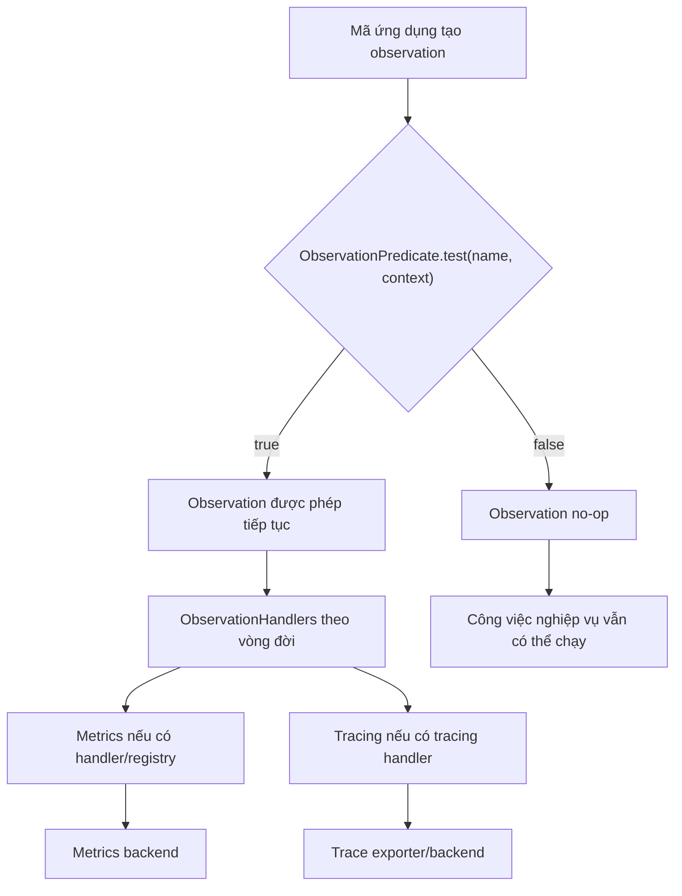

# ObservationPredicate

Trong chương **Convention và filter** của mô-đun **SPRING_BOOT_OBSERVABILITY**, `ObservationPredicate` là cơ chế quyết định **một observation có được ghi nhận qua Micrometer Observation hay không**. Nó đặc biệt hữu ích khi ứng dụng Spring Boot phát sinh những hoạt động tần suất cao nhưng ít giá trị điều tra, chẳng hạn một tác vụ heartbeat nội bộ lặp lại liên tục.

Mục tiêu của observability là kết nối **metrics, logs và distributed tracing** để xác định lỗi, độ trễ và hành vi ứng dụng trên môi trường thực. Thu thập nhiều dữ liệu hơn chưa chắc tốt hơn: các observation không hữu ích có thể làm dashboard nhiễu, làm tăng chi phí metric/trace, khiến tín hiệu quan trọng khó nổi bật. `ObservationPredicate` cho phép đưa ra quyết định loại trừ sớm, ngay ở tầng Observation. Tuy nhiên, việc loại trừ phải có chủ đích vì có thể khiến bạn mất dữ liệu cần thiết khi điều tra sự cố.

## 1. Mục tiêu học tập

Sau bài này, bạn có thể:

1. Giải thích vai trò của `ObservationPredicate` và ý nghĩa của kết quả `true` / `false`.
2. Đăng ký predicate với `ObservationRegistry` và sử dụng trong cấu hình Spring Boot.
3. Phân biệt `ObservationPredicate`, `ObservationFilter`, `ObservationConvention`, `ObservationHandler` và tracing sampling.
4. Chọn điều kiện loại trừ ổn định, không phụ thuộc vào thông tin chưa có lúc observation được tạo.
5. Hiểu tác động của predicate đến metrics và tracing, cũng như những gì nó **không** làm với logs và luồng nghiệp vụ.
6. Kiểm tra hoạt động của một quy tắc loại trừ mà không vô tình làm mất tín hiệu quan trọng.
7. Đánh giá trade-off giữa giảm dữ liệu, cardinality, khả năng truy vết và an toàn vận hành.

## 2. Bài toán: tiếng ồn từ các hoạt động nội bộ

Giả sử `payment-api` có hai loại công việc:

- `payment.authorize`: giao dịch nghiệp vụ quan trọng, cần theo dõi độ trễ và lỗi.
- `internal.cache.heartbeat`: kiểm tra trạng thái cache mỗi vài giây, đã có một kênh health monitoring riêng.

Nếu cả hai được instrument bằng observation, chúng có thể cùng tạo timing metrics và tracing spans. Khi số instance tăng, heartbeat có thể chiếm phần đáng kể lưu lượng telemetry, trong khi nhóm vận hành chủ yếu cần biết giao dịch thanh toán có lỗi hoặc chậm hay không.

Yêu cầu phù hợp là: **giữ observation cho giao dịch thanh toán, bỏ observation cho heartbeat nội bộ**. Ta không muốn dừng heartbeat, cũng không muốn loại toàn bộ tracing của ứng dụng.



Sơ đồ mô tả quyết định ở tầng Micrometer Observation. Các tín hiệu cụ thể chỉ được tạo khi có handlers và pipeline tương ứng; ngay cả observation được phép chạy cũng chưa bảo đảm span sẽ được xuất do sampling hoặc lỗi exporter.

## 3. API `ObservationPredicate`

Trong Micrometer Observation, `ObservationPredicate` là một functional interface với ý tưởng chính:

```java
import io.micrometer.observation.Observation;
import io.micrometer.observation.ObservationPredicate;

ObservationPredicate predicate =
        (String name, Observation.Context context) -> {
            return !"internal.cache.heartbeat".equals(name);
        };
```

Phương thức trừu tượng của predicate nhận **tên observation** và **`Observation.Context`** rồi trả về một giá trị boolean:

| Kết quả | Ý nghĩa trong registry | Tác động thường thấy |
| --- | --- | --- |
| `true` | Cho phép observation đi tiếp qua cơ chế Observation. | Có thể được handler ghi metrics, span hoặc xử lý callback, tùy cấu hình. |
| `false` | Từ chối observation này; Micrometer sử dụng quan sát dạng no-op cho trường hợp bị loại. | Không có telemetry do vòng đời observation bị loại phát ra qua các handler đó. |

Quy tắc ở ví dụ chỉ từ chối observation tên chính xác là `internal.cache.heartbeat`. Tất cả các tên khác đều được phép.

Một vài điểm dễ hiểu nhầm:

- Predicate **không ngăn hàm Java hoặc HTTP endpoint thực thi**. Nó quyết định việc quan sát, không quyết định quyền chạy nghiệp vụ.
- Predicate **không xóa các dòng log** do ứng dụng tự ghi; logs vẫn có thể được phát, dù những thông tin tương quan như span ID có thể khác khi observation bị loại.
- Predicate **không phải bộ lọc bảo mật**, cũng không có chức năng tự động ẩn email, token hoặc dữ liệu cá nhân.
- Predicate **không quyết định xác suất lấy mẫu tracing**; nó loại observation ở một tầng sớm hơn so với chính sách giữ/bỏ trace.
- Nếu một metric được ghi trực tiếp qua `MeterRegistry` thay vì qua observation handler, predicate của Observation **không tự động chặn metric trực tiếp đó**.

Tên quan sát phải được biết rõ. Viết `name.equals(...)` có thể gây lỗi nếu code không kỳ vọng `name` rỗng; mẫu `"literal".equals(name)` là cách so sánh dễ đọc và an toàn.

## 4. Đăng ký predicate với `ObservationRegistry`

Registry chứa các handler, convention, filter và predicate được sử dụng trong quá trình instrumentation. Với mã Java Micrometer tối giản, bạn có thể đăng ký:

```java
import io.micrometer.observation.Observation;
import io.micrometer.observation.ObservationRegistry;

ObservationRegistry registry = ObservationRegistry.create();

registry.observationConfig()
        .observationPredicate(
                (name, context) ->
                        !"internal.cache.heartbeat".equals(name)
        );

Observation permitted =
        Observation.createNotStarted("payment.authorize", registry);

Observation excluded =
        Observation.createNotStarted("internal.cache.heartbeat", registry);
```

Đoạn ví dụ này minh họa cách cấu hình một registry độc lập. Trong ứng dụng Spring Boot dùng Actuator, **hãy tùy biến registry mà Spring Boot đang quản lý** để các HTTP/custom observations cùng dùng cấu hình; không tạo thêm registry độc lập nếu không có chủ đích về phạm vi.

### Đăng ký trong Spring Boot bằng customizer

Ví dụ cho cấu hình Spring Boot 3.x có `spring-boot-starter-actuator`:

```groovy
dependencies {
    implementation 'org.springframework.boot:spring-boot-starter-actuator'
}
```

```java
import io.micrometer.observation.ObservationRegistry;
import org.springframework.boot.actuate.autoconfigure.observation.ObservationRegistryCustomizer;
import org.springframework.context.annotation.Bean;
import org.springframework.context.annotation.Configuration;

@Configuration(proxyBeanMethods = false)
public class ObservationPolicyConfiguration {

    @Bean
    ObservationRegistryCustomizer<ObservationRegistry> observationPolicy() {
        return registry -> registry.observationConfig()
                .observationPredicate((name, context) ->
                        !"internal.cache.heartbeat".equals(name));
    }
}
```

`ObservationRegistryCustomizer` giúp đăng ký quy tắc lên registry được Spring Boot cấu hình. Ví dụ này giả định ứng dụng dùng Spring Boot 3.x và có Actuator; hãy kiểm tra package/API theo phiên bản Spring Boot thực tế. Predicate nên được đăng ký **trước khi những observation cần lọc được tạo** để tránh tình trạng một số lần chạy trước đó đã xuất telemetry.

Giả sử service thực hiện hai hoạt động:

```java
import io.micrometer.observation.Observation;
import io.micrometer.observation.ObservationRegistry;
import org.springframework.stereotype.Service;

@Service
public class PaymentWorkflow {

    private final ObservationRegistry registry;
    private final PaymentGateway gateway;
    private final HeartbeatClient heartbeat;

    public PaymentWorkflow(ObservationRegistry registry,
                           PaymentGateway gateway,
                           HeartbeatClient heartbeat) {
        this.registry = registry;
        this.gateway = gateway;
        this.heartbeat = heartbeat;
    }

    public PaymentResult authorize(PaymentRequest request) {
        return Observation.createNotStarted("payment.authorize", registry)
                .lowCardinalityKeyValue("operation", "authorize")
                .observe(() -> gateway.authorize(request));
    }

    public void checkCacheHeartbeat() {
        Observation.createNotStarted("internal.cache.heartbeat", registry)
                .observe(heartbeat::check);
    }

    public interface PaymentGateway {
        PaymentResult authorize(PaymentRequest request);
    }

    public interface HeartbeatClient {
        void check();
    }

    public record PaymentRequest(String operationRef) {}
    public record PaymentResult(boolean accepted) {}
}
```

`PaymentGateway` và `HeartbeatClient` là các interface minh họa do ứng dụng triển khai. Sau khi đăng ký predicate:

- `authorize(...)` vẫn chạy và observation `payment.authorize` có thể tạo dữ liệu đo.
- `checkCacheHeartbeat()` **vẫn gọi `heartbeat.check()`**. Phần observation do `internal.cache.heartbeat` đại diện bị loại khỏi pipeline Observation.
- Nếu `heartbeat.check()` tự ghi một log, một counter trực tiếp, hoặc gọi một HTTP client đã được instrument riêng, các tín hiệu độc lập đó **không mặc nhiên biến mất** chỉ vì observation bao ngoài bị từ chối.

Cần đánh giá các instrumentation bên trong hàm được lọc: predicate chỉ từ chối những observation phù hợp điều kiện của chính nó. Nếu một công việc vẫn phát nhiều loại observation có tên khác nhau, quy tắc lọc theo tên cha không nhất thiết làm mất các observation con được instrument độc lập.

## 5. Quy tắc được đánh giá vào lúc nào?

`ObservationPredicate` tham gia vào **quyết định tạo observation** ở registry, trước khi một observation bị loại có thể chạy vòng đời bình thường. Vì vậy, đừng thiết kế predicate dựa trên một thuộc tính chỉ được thêm **sau khi đã gọi `createNotStarted(...)`**.

Ví dụ dễ sai:

```java
Observation observation =
        Observation.createNotStarted("gateway.call", registry)
                .lowCardinalityKeyValue("traffic", "synthetic");

observation.observe(() -> gateway.call());
```

Nếu predicate muốn loại `traffic=synthetic`, giá trị này có thể **chưa tồn tại trong context lúc predicate được đánh giá**, vì lời gọi `lowCardinalityKeyValue(...)` xảy ra sau khi `createNotStarted(...)` trả về. Kết quả là quy tắc có thể không hoạt động như mong muốn.

Một số cách xử lý đúng:

1. **Ưu tiên tên quan sát phân biệt rõ ràng** khi hai hoạt động có ngữ nghĩa khác nhau, ví dụ `internal.synthetic.gateway-call` và `gateway.call`.
2. Nếu cần dựa vào dữ liệu của context, hãy tạo **custom `Observation.Context` chứa dữ liệu quyết định từ đầu** và dùng overload tạo observation nhận context/supplier khi API và instrumentation hỗ trợ.
3. Với HTTP server observation, chỉ dựa vào trường được bảo đảm có sẵn tại thời điểm predicate chạy; kiểm tra loại context và instrumentation đang dùng trước khi truy cập route, URI hoặc request metadata.
4. Nếu mục tiêu chỉ là bổ sung hoặc sửa tags trước khi xuất dữ liệu, dùng `ObservationFilter` hoặc convention phù hợp thay vì cố dùng predicate cho một quyết định đến quá muộn.

**Tình huống quan trọng:** `http.server.requests` thường là tên observation của nhiều route. Nếu viết:

```java
(name, context) -> !"http.server.requests".equals(name)
```

bạn có thể vô tình loại **tất cả** HTTP server observations thay vì chỉ một đường probe. Muốn quyết định dựa trên route cần một quy tắc hiểu đúng loại request context, dữ liệu đã sẵn có, và tác động tới hoạt động giám sát HTTP. Không nên áp dụng một bộ lọc toàn cục khi chưa xác minh phạm vi.

## 6. `ObservationPredicate` khác `ObservationFilter` thế nào?

Hai API đều tác động đến observation, nhưng phục vụ hai mục đích khác nhau.

| Tiêu chí | `ObservationPredicate` | `ObservationFilter` |
| --- | --- | --- |
| Câu hỏi chính | **Có quan sát hoạt động này không?** | **Cần điều chỉnh/bổ sung context của observation đã được quan sát không?** |
| Kiểu xử lý | Trả về `boolean` từ tên và context. | Nhận và trả về `Observation.Context` đã được xử lý. |
| Thời điểm | Sớm, khi registry xem xét tạo observation. | Trong vòng đời observation, thường trước bước hoàn tất/xử lý dừng. |
| Có thể loại toàn bộ observation? | Có, bằng `false`. | Không phải công cụ thiết kế để loại toàn bộ observation. |
| Tình huống phù hợp | Bỏ một observation không cần thiết, có điều kiện xác định sớm. | Gắn `outcome`, nhãn chuẩn hóa hoặc metadata tính được sau khi chạy. |
| Rủi ro khi dùng sai | Mất metrics/traces của hoạt động quan trọng. | Gắn sai nhãn, tạo cardinality cao hoặc sửa context quá muộn cho một handler cụ thể. |

Ví dụ observation filter có thể bổ sung nhãn có tập giá trị hữu hạn khi đã có kết quả được đưa vào context:

```java
registry.observationConfig().observationFilter(context -> {
    if ("payment.authorize".equals(context.getName())) {
        context.addLowCardinalityKeyValue(
                io.micrometer.common.KeyValue.of("domain", "payment"));
    }
    return context;
});
```

Đây là **ví dụ minh họa cơ chế `ObservationFilter`**, không cần triển khai cùng predicate của bài nếu mục tiêu chỉ là loại heartbeat. Một filter có thể giúp thống nhất nhãn, nhưng quy tắc phải được thiết kế sao cho không chèn trùng nhãn hoặc dữ liệu không được phép lưu.

### So với `ObservationConvention`

`ObservationConvention` quy định cách đặt tên và ánh xạ context thành key-values cho một loại observation. Nó phù hợp khi bạn muốn nhiều nơi instrument `payment.authorize` đều dùng một quy ước naming và tags giống nhau.

`ObservationPredicate` không thay thế convention: predicate quyết định **cho phép hay loại**, còn convention quyết định **mô tả observation ra sao** khi nó tồn tại.

### So với `ObservationHandler`

`ObservationHandler` xử lý các callback của vòng đời và có thể tạo số đo hoặc span. Predicate đánh giá trước khi observation được xử lý theo vòng đời bình thường. Nếu handler không được đăng ký, một observation được predicate cho phép vẫn có thể **không sinh telemetry** mong muốn.

### So với `MeterFilter` và tracing sampling

`MeterFilter` hoạt động ở tầng **metrics registry**: có thể từ chối meter hoặc điều chỉnh metadata của meter. Nó không tự chặn tracing spans của observation. Ngược lại, `ObservationPredicate` từ chối ở tầng Observation, nên có thể ảnh hưởng đồng thời đến metrics và tracing do observation tương ứng tạo ra.

**Sampling tracing** quyết định trace nào được ghi hoặc giữ theo cơ chế sampling của tracing stack. Khi chỉ muốn giảm số lượng traces nhưng vẫn giữ metrics của các giao dịch quan trọng, hãy cân nhắc **sampling tracing** thay vì dùng observation predicate để bỏ cả observation đó. Head sampling, tail sampling tại collector, exporter và backend là những cơ chế riêng với predicate.

```text
Micrometer Observation
  ├─ ObservationPredicate: loại hoặc cho phép observation
  ├─ ObservationFilter/Convention: bổ sung, chuẩn hóa context
  └─ ObservationHandler
       ├─ Metrics handler -> meter registry -> MeterFilter -> metrics backend
       └─ Tracing handler -> tracing sampler -> exporter/collector -> trace backend
```

Sơ đồ là mô hình khái niệm; thứ tự chi tiết của callback và cách sampling được áp dụng phụ thuộc phiên bản, handler và pipeline. Không dùng sơ đồ này như hợp đồng đảm bảo thứ tự mọi callback tùy biến.

## 7. Kết hợp nhiều predicate: giữ chính sách dễ hiểu

Khi nhiều bộ phận cùng cung cấp `ObservationPredicate`, quy tắc tổng hợp có thể trở nên khó theo dõi. Một mô hình an toàn để suy nghĩ là **mỗi predicate phải đồng ý** thì observation mới được phép đi tiếp; chỉ cần một quy tắc từ chối thì observation có thể bị loại.

Ví dụ hai điều kiện:

```java
registry.observationConfig()
        .observationPredicate((name, context) ->
                !"internal.cache.heartbeat".equals(name))
        .observationPredicate((name, context) ->
                !"internal.debug.poll".equals(name));
```

Ý định của ví dụ là loại hai tên nội bộ và cho phép những tên khác. Trong môi trường thực, nên đặt các quy tắc có chung mục đích gần nhau hoặc ghi rõ người sở hữu để dễ kiểm tra xung đột, đặc biệt khi nhiều thư viện tự đăng ký customizer.

Những nguyên tắc giảm rủi ro:

- Dùng tên chính xác hoặc tập tên đã kiểm soát; tránh `contains("health")` hay `startsWith("http")` quá rộng.
- Không thêm predicate cho phép `true` với kỳ vọng nó sẽ “ghi đè” một predicate khác đang từ chối.
- Đặt tên metric/observation ổn định; quyết định bằng các điều kiện dễ dự đoán.
- Ghi nhận lý do tại sao có một quan sát bị loại và tín hiệu thay thế nào vẫn theo dõi hoạt động đó.
- Đăng ký chính sách lúc khởi tạo ứng dụng thay vì sửa bộ predicate liên tục theo trạng thái request.

Một predicate được viết sai có thể làm mất dữ liệu trước khi nó đến registry/exporter; **không thể khôi phục các traces đã không được tạo** chỉ bằng cách chỉnh dashboard.

## 8. Cardinality không phải tiêu chí duy nhất để loại

Tag có cardinality cao là vấn đề lớn trong observability, nhưng không phải trường hợp nào cũng nên xử lý bằng `ObservationPredicate`.

Ví dụ hệ thống tạo:

```text
payment.authorize{paymentId="unique-id-1"}
payment.authorize{paymentId="unique-id-2"}
payment.authorize{paymentId="unique-id-3"}
```

Nếu dùng predicate để loại toàn bộ `payment.authorize`, bạn giảm số liệu nhưng cũng đánh mất khả năng nhìn lỗi và độ trễ của thanh toán. Cách đúng hơn là giữ observation và sửa **key-value design**:

```java
Observation.createNotStarted("payment.authorize", registry)
        .lowCardinalityKeyValue("operation", "authorize")
        .lowCardinalityKeyValue("provider", "bank-a")
        .observe(() -> paymentGateway.authorize(request));
```

Tên và low-cardinality tags nên có số lượng giá trị hữu hạn. Các trường `paymentId`, `userId`, email, URL thô chứa ID hoặc token không phù hợp với metric tags, đồng thời có rủi ro riêng tư. Nếu thật sự cần một giá trị chi tiết cho tracing, phải xem xét `highCardinalityKeyValue(...)`, chính sách dữ liệu và chi phí backend riêng; predicate không phải cơ chế redaction.

Có ba lựa chọn thường gặp:

| Nhu cầu | Cơ chế phù hợp |
| --- | --- |
| Muốn bỏ một loại observation ít giá trị, xác định được sớm | `ObservationPredicate` |
| Muốn giữ observation nhưng không xuất nhãn có cardinality cao | Sửa instrumentation/convention/filter và thiết kế tags |
| Muốn giữ metrics của giao dịch nhưng giảm số traces | Tracing sampling/pipeline tracing |

Chọn nhầm cơ chế làm mất dữ liệu không cần thiết, đặc biệt với sự cố hiếm hoặc chỉ ảnh hưởng một nhóm khách hàng.

## 9. Tác động đến logs và context propagation

Khi Spring Boot có Micrometer Tracing tích hợp phù hợp, một observation được phép chạy có thể sinh tracing span. Trong scope, logs có thể nhận `traceId` và `spanId` qua MDC. Nếu predicate từ chối một observation, không có span của observation đó để làm context riêng.

Tuy nhiên:

- Một request vẫn có thể có **span cha** từ HTTP server observation; log bên trong một thao tác bị loại có thể tiếp tục dùng context cha nếu context đó còn active.
- Nếu logging framework được gọi trực tiếp, lời gọi `logger.info(...)` hoặc `logger.error(...)` vẫn xảy ra.
- Nếu hệ thống đã có trace context được truyền từ upstream, việc một observation con bị loại không có nghĩa mọi trace context khác đều biến mất.
- Nếu tắt nhầm HTTP server observation, khả năng ghi correlation của cả request có thể bị ảnh hưởng đáng kể.

Tương tự, một service có thể gọi service khác qua HTTP dùng header W3C `traceparent`. Việc tạo client span và propagation phụ thuộc client instrumentation/context đang active; lọc observation bao ngoài không bảo đảm mọi span của dependency biến mất hoặc ngược lại. Cần kiểm tra trace thực tế nếu quy tắc loại trừ liên quan đến các ranh giới distributed tracing.

Predicate không dùng để sửa propagation bị đứt. Nếu trace tách ở một hop, hãy kiểm tra HTTP client instrumentation, context qua thread/async, message headers, sampling và exporter; đừng thêm quy tắc lọc để che dấu hiện tượng mất trace.

## 10. Đánh giá trong môi trường thử nghiệm

Một quy trình kiểm tra có thể thực hiện sau khi gắn `ObservationRegistryCustomizer`:

1. Khởi động ứng dụng với Actuator và metrics handler/registry phù hợp. Xác minh một thao tác **được phép** thực sự tạo timing metric.
2. Gọi `payment.authorize` vài lần thành công và lỗi có kiểm soát; ghi lại các metrics đang xuất.
3. Gọi `internal.cache.heartbeat` vài lần. Xác nhận heartbeat **vẫn được thực thi**, đồng thời không có telemetry do observation bị từ chối tạo ra ở handlers tương ứng.
4. Khi có tracing bridge và exporter, đối chiếu một request có cả hoạt động cho phép và bị loại: trace nên giữ phần nghiệp vụ cần thiết.
5. Quan sát logs, correlation và health monitoring của ứng dụng. Xác nhận việc loại observation không xóa bằng chứng điều tra quan trọng.
6. Kiểm tra độ trễ/error rate trước và sau thay đổi để phát hiện tác dụng phụ. Mở rộng chính sách lọc theo kết quả thử nghiệm, không theo cảm giác “nhiều span là thừa”.

Có thể cấu hình Prometheus cho môi trường thử:

```groovy
dependencies {
    implementation 'io.micrometer:micrometer-registry-prometheus'
}
```

```yaml
management:
  endpoints:
    web:
      exposure:
        include: health,metrics,prometheus
```

Sau khi chạy các thao tác, bạn có thể kiểm tra những tên metric thực tế:

```bash
curl -s http://localhost:8080/actuator/metrics
curl -s http://localhost:8080/actuator/prometheus
```

Việc một metric vắng mặt **không đủ** để kết luận predicate hoạt động: có thể vì handler, meter registry, traffic hoặc exporter chưa đúng. Trước tiên xác minh trường hợp **được phép** có dữ liệu, sau đó so sánh với trường hợp **bị loại** trong cùng điều kiện. Cần bảo vệ Actuator bằng chính sách mạng/phân quyền phù hợp, không để endpoint quản trị công khai.

Khi muốn kiểm tra hành vi ở mức mã, một thử nghiệm gọn có thể đăng ký predicate vào một `ObservationRegistry` riêng và xác nhận code bên trong `observe(...)` vẫn chạy dù observation bị từ chối. Trong bài này, ta tập trung quy trình và ví dụ; việc xây dựng bộ kiểm thử tự động cho dự án cụ thể là bước độc lập.

## 11. Các lỗi thường gặp

| Hiện tượng | Nguyên nhân có thể | Cách xử lý |
| --- | --- | --- |
| Sau khi thêm predicate, mất toàn bộ HTTP metrics | Lọc theo tên `http.server.requests` quá rộng. | Thu hẹp điều kiện dựa trên context phù hợp; kiểm tra các route quan trọng. |
| Predicate không loại request có tag dự kiến | Tag được gắn sau lúc predicate đã được đánh giá. | Dùng thông tin có sẵn khi tạo context hoặc phân biệt bằng tên observation. |
| Predicate trả `false` nhưng log vẫn xuất | Predicate không điều khiển logger. | Giải quyết tại logging configuration nếu thực sự cần hạn chế logs. |
| Vẫn thấy metric sau khi loại observation | Metric được ghi trực tiếp qua meter registry hoặc bởi observation khác. | Xác định nguồn phát telemetry, handler và metric name. |
| Không thấy trace ở cả nhóm được phép | Tracing bridge, sampler, exporter hoặc backend chưa đúng. | Kiểm tra pipeline tracing độc lập trước khi quy lỗi cho predicate. |
| Không thấy span con nhưng HTTP span còn | Child observation bị loại, còn server observation vẫn được phép. | Xem cấu trúc span và xác nhận tác động có chủ đích. |
| Một số instance vẫn xuất heartbeat spans | Registry policy chưa được áp dụng đồng nhất hoặc cấu hình chưa được nạp lúc tạo observation. | Đối chiếu version/config và đường khởi tạo trên từng instance. |
| Mất dữ liệu cho request lỗi hiếm | Predicate đã loại một observation quan trọng. | Khôi phục chính sách thu thập phù hợp; không dùng predicate để thay sampling thông minh. |

## 12. Tình huống điều tra sự cố thực tế

Một đợt triển khai làm P95 của `POST /payments/authorize` tăng từ 250 ms lên 1,4 giây. Hệ thống có predicate bỏ `internal.cache.heartbeat` nhưng vẫn giữ `payment.authorize`.

Đường điều tra hợp lý:

1. **Metrics** xác định route có latency tăng, tỉ lệ 5xx, số lượng request và mốc bắt đầu.
2. Metrics của `payment.authorize` giúp xác định độ trễ nằm trong nghiệp vụ thanh toán hay ở lớp HTTP khác.
3. **Logs** chứa thông tin lỗi timeout/retry và `traceId` nếu tracing integration đã cung cấp context.
4. **Distributed tracing** cho thấy `payment.authorize` nằm dưới server span; các client spans tiếp theo giúp phát hiện dependency chậm.
5. Nếu traces vắng bất thường, kiểm tra **predicate trước**, xem có thay đổi rule nào vô tình loại `payment.authorize` không; sau đó kiểm tra sampler, collector, exporter và context propagation.
6. Sau khi điều chỉnh hệ thống hoặc khôi phục rule bị sai, đối chiếu metrics trên nhiều request để kiểm chứng hiệu quả.

Điểm quyết định là biết rõ **tín hiệu nào đã được chủ động loại bỏ**. Điều tra viên không nên hiểu nhầm “không thấy span heartbeat” thành “heartbeat không hoạt động”; cũng không nên đánh đổi span thanh toán chỉ để làm dashboard ít dữ liệu hơn.

## 13. Bài tập tự kiểm tra

### Bài tập 1: Diễn giải boolean

```java
registry.observationConfig().observationPredicate(
        (name, context) -> !name.startsWith("internal.")
);
```

**Câu hỏi:** `internal.cache.heartbeat`, `payment.authorize` và `internal.reconciliation` được xử lý ra sao?

**Đáp án:** Hai tên bắt đầu bằng `internal.` bị từ chối; `payment.authorize` được cho phép. Quy tắc này quá rộng nếu `internal.reconciliation` là công việc quan trọng cần theo dõi. Hãy ưu tiên danh sách tên được phép loại cụ thể.

### Bài tập 2: Phân biệt predicate với filter

Một ứng dụng muốn giữ `payment.authorize` nhưng thêm nhãn `outcome=success/error` sau khi biết kết quả. Dùng predicate có phù hợp không?

**Đáp án:** Không phải lựa chọn chính. Predicate dùng để chấp nhận hoặc loại observation. Hãy ghi nhận outcome ở context trong vòng đời hoặc dùng `ObservationFilter`/convention thích hợp; kiểm tra cardinality và thời điểm handler đọc tags.

### Bài tập 3: Dữ liệu có sẵn lúc tạo

```java
Observation obs = Observation.createNotStarted("gateway.call", registry);
obs.lowCardinalityKeyValue("kind", "synthetic");
obs.observe(this::callGateway);
```

**Câu hỏi:** Có thể chắc chắn một predicate đọc `kind` sẽ thấy `synthetic` không?

**Đáp án:** Không. Tag được thêm sau lời gọi `createNotStarted`; predicate đưa ra quyết định sớm. Đổi sang tên phân biệt hoặc đưa dữ liệu quyết định vào context ngay khi khởi tạo theo API phù hợp.

### Bài tập 4: Tại sao logs vẫn có?

Sau khi predicate từ chối `internal.cache.heartbeat`, người vận hành vẫn thấy dòng `INFO heartbeat check passed`. Đây có phải lỗi của predicate không?

**Đáp án:** Không. Predicate điều khiển observation, không chặn logger. Hãy xem log được ghi ở đâu và có cần giảm mức log/đổi logging policy hay không. Nếu log có `traceId` từ HTTP observation cha, điều đó cũng không chứng minh heartbeat observation đã được tạo span.

### Bài tập 5: Giảm traces nhưng giữ metrics

Một service muốn giữ latency metrics của toàn bộ `payment.authorize` nhưng chỉ lưu một phần distributed traces. Có nên dùng predicate trả `false` cho 90% lần gọi dựa trên lựa chọn ngẫu nhiên?

**Đáp án:** Không nên. Quy tắc đó sẽ loại cả observation ở phần bị từ chối, làm metrics từ các handlers Observation không còn phản ánh toàn bộ traffic. Hãy dùng cấu hình **tracing sampling** thích hợp để giảm traces trong khi vẫn giữ đo lường metrics.

## 14. Checklist trước khi đưa quy tắc vào production

- [ ] Predicate chỉ loại các observation có tên/phạm vi được mô tả rõ và có chủ sở hữu.
- [ ] Điều kiện dựa trên dữ liệu đã có lúc registry quyết định chấp nhận observation.
- [ ] Không vô tình loại toàn bộ `http.server.requests` hay nghiệp vụ thiết yếu.
- [ ] Có metric/health signal thay thế cho các hoạt động nội bộ bị loại nếu vận hành còn cần chúng.
- [ ] Đã phân biệt chính sách Observation với tracing sampling, `MeterFilter` và logging.
- [ ] Không dùng predicate để che vấn đề cardinality do tag thiết kế sai.
- [ ] Đã xác minh cả trường hợp được phép và bị loại trong cùng môi trường.
- [ ] Đã quan sát tác động lên parent/child spans, logs correlation và propagation xuyên service.
- [ ] Đã ghi nhận lý do loại trừ, nơi cấu hình và cách khôi phục khi cần điều tra.
- [ ] Đã theo dõi error rate/latency của hoạt động quan trọng sau khi áp dụng.

**Ghi nhớ:** `ObservationPredicate` là công cụ **loại trừ observation sớm tại registry** dựa trên tên và context, nhằm giảm những phép đo ít giá trị. Kết quả `false` không chặn công việc nghiệp vụ và không phải cơ chế lấy mẫu traces hay lọc logs. Trong Spring Boot, dùng predicate có mục đích rõ ràng, kết hợp convention/filter để chuẩn hóa nhãn và tracing sampling để kiểm soát chi phí sẽ giúp metrics, logs và distributed tracing vẫn đủ tin cậy khi cần điều tra lỗi, độ trễ hoặc hành vi ứng dụng.
