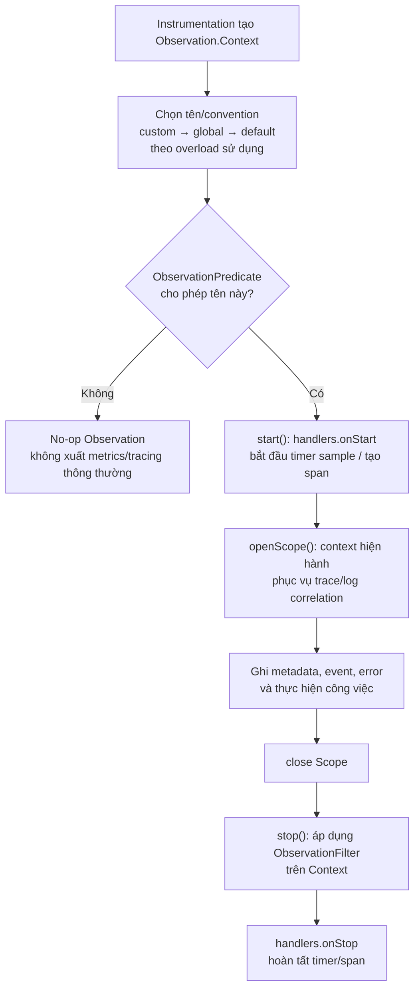
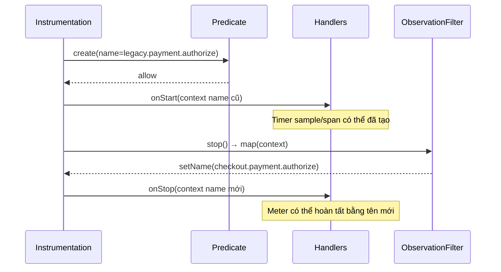
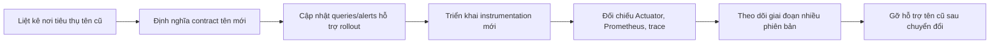

# Đổi observation name

Một ngày sau khi triển khai phiên bản Spring Boot mới, biểu đồ thời gian xử lý thanh toán bỗng không còn dữ liệu. API vẫn trả kết quả, log vẫn ghi yêu cầu và một số trace vẫn xuất hiện. Khi kiểm tra, nhóm vận hành phát hiện tên metric đã chuyển từ `payment.authorize` sang `checkout.payment.authorize`, còn PromQL và alert vẫn truy vấn tên cũ.

Thay đổi này là ví dụ cho thấy **observation name là một phần của hợp đồng telemetry**. Đổi tên có thể giúp mô tả công việc rõ hơn hoặc đồng bộ conventions, nhưng đồng thời ảnh hưởng dashboard, cảnh báo, khả năng so sánh lịch sử và việc liên kết giữa metrics với traces.

Bài **Đổi observation name** thuộc chương **Convention và filter**, trong module **SPRING_BOOT_OBSERVABILITY**. Module hướng đến thiết lập observability trên Spring Boot bằng **Micrometer Observation, metrics, logs và distributed tracing**; nắm context propagation, tag/cardinality, exporter, sampling và liên kết tín hiệu để điều tra lỗi, độ trễ, hành vi ứng dụng thực tế. Ở bài này, ta tập trung vào **cách đổi tên đúng nơi, đúng thời điểm và giữ sự nhất quán giữa các tín hiệu**.

## 1. Mục tiêu học tập

Sau bài học, bạn có thể:

1. Phân biệt **observation name**, **contextual name/span name**, tên meter trong Micrometer và tên metric sau exporter.
2. Chọn phương pháp đổi tên cho một custom observation, observation do Spring Framework tạo hoặc toàn bộ một nhóm observation.
3. Giải thích thứ tự tác động của `ObservationConvention`, `ObservationPredicate`, `ObservationFilter` và `ObservationHandler`.
4. Hiểu vì sao đổi tên ở `ObservationFilter` lúc `stop()` có thể quá muộn đối với một số handler.
5. Xây dựng convention có tên ổn định, tag hữu hạn và giữ ngữ nghĩa phép đo.
6. Kiểm tra metric/trace sau khi đổi tên và chuyển dashboard, alert, SLO mà không mất dữ liệu hoặc đếm trùng.

## 2. Ta đang đổi tên nào?

Một Observation là một hoạt động được instrument, chẳng hạn “xác thực một lần thanh toán”. Nó có thể được xử lý bởi nhiều handler để ghi timer, tạo span hoặc thực hiện chức năng khác. Vì vậy, không phải mọi chuỗi mà ta thấy trong hệ thống quan sát đều là cùng một “tên”.

| Khái niệm | Ví dụ | Ý nghĩa | Khi đổi |
|---|---|---|---|
| **Observation name** | `payment.authorize` | Tên kỹ thuật của **loại hoạt động**, dùng bởi Micrometer handlers. | Có thể thay đổi tên timer/meter và cách các thành phần nhận diện observation. |
| **Contextual name** | `authorize payment` | Tên hoạt động theo ngữ cảnh, được tracing handler sử dụng để đặt tên span khi phù hợp. | Thường ảnh hưởng cách nhóm/tìm kiếm span trong trace backend. |
| **Tên timer trong MeterRegistry** | `payment.authorize` | Meter name do metrics handler tạo theo observation và convention. | Ảnh hưởng tìm kiếm bằng `/actuator/metrics`. |
| **Tên series của exporter** | `payment_authorize_seconds_count` | Tên do registry/exporter quy đổi và thêm hậu tố. | Ảnh hưởng PromQL, recording rules và alerts. |
| **Tag/attribute** | `payment.method=card`, `outcome=approved` | Dữ liệu mô tả một lần đo; chia nhóm theo giá trị. | Đổi key/value cũng có thể làm truy vấn cũ không khớp. |
| **Trace ID / span ID** | Các định danh một lần thực thi | Dùng liên kết span và logs của một lần gọi. | Không phải nơi chứa tên operation và không dùng làm metric tag. |

Ví dụ:

```text
Code:
  Observation name  = checkout.payment.authorize
  Contextual name   = authorize payment
  Low-cardinality   = payment.method:card, outcome:approved

Actuator /metrics:
  checkout.payment.authorize

Prometheus, với quy tắc đổi tên timer thông dụng:
  checkout_payment_authorize_seconds_count
  checkout_payment_authorize_seconds_sum

Trace backend, khi có tracing handler:
  span name = authorize payment
  attributes có thể gồm payment.method=card
```

Tên Prometheus trên đây **minh họa** cho quy tắc chuyển đổi thông dụng. Tên cuối cùng phụ thuộc backend, phiên bản và cấu hình; luôn xem `/actuator/prometheus` hoặc dữ liệu ở collector thực tế.

### 2.1 Hai phép đổi tên khác nhau

```java
Observation.createNotStarted("checkout.payment.authorize", registry)
        .contextualName("authorize payment")
        .observe(this::callPaymentProvider);
```

- Thay chuỗi truyền cho `createNotStarted(...)` là **đổi observation name**.
- Thay `contextualName(...)` chủ yếu là **đổi tên hiển thị span** theo cách tracing handler sử dụng nó.

Nếu chỉ đổi `contextualName` thì không nên kỳ vọng một timer `payment.authorize` tự chuyển thành `checkout.payment.authorize`. Nếu chỉ đổi observation name thì tên span có thể vẫn giống trước khi tracing được cấu hình dùng contextual name.

## 3. Vì sao đổi tên phải được xem là thay đổi hợp đồng?

Giả sử phiên bản trước đo bằng `checkout.authorize`, phiên bản mới bằng `payment.authorize`, trong khi ranh giới đo hoàn toàn giống nhau. Những hệ quả có thể thấy là:

- Trong `MeterRegistry`, tên cũ ngừng nhận thêm dữ liệu sau khi các instance cũ hết hoạt động; tên mới bắt đầu nhận dữ liệu.
- Dashboard và alert lọc đúng tên cũ trông như “hệ thống không còn request”.
- SLO dùng metric cũ có thể ngừng đánh giá, hoặc dùng biểu thức fallback chưa đúng và sinh số liệu sai.
- Truy vấn spans theo operation name có thể thay đổi nếu contextual name hoặc convention tracing cũng thay đổi.
- Quy tắc `ObservationPredicate`, sampling/filtering hoặc logic xử lý riêng theo tên có thể chịu ảnh hưởng.
- Trong giai đoạn rolling deployment, **hai tên tồn tại đồng thời**. Việc gộp cả hai cần tránh đếm cùng một lần chạy hai lần.

Không phải đổi tên nào cũng giữ nguyên ngữ nghĩa. Nếu `checkout.process` trước đây đo cả luồng thanh toán nhưng phiên bản sau chỉ đo lời gọi payment provider, ranh giới đã khác. Khi ấy **tên mới là hợp lý**, và dữ liệu quá khứ không thể so sánh trực tiếp dù đổi tên cho giống nhau.

Nguyên tắc quan trọng: **tên ổn định cho một loại công việc có ranh giới ổn định**. Đừng nhúng order ID, user ID, URL thực, timestamp hay số lần retry vào tên để tránh cardinality cao.

## 4. Chọn cơ chế đổi tên nào?

| Nhu cầu | Điểm thay đổi ưu tiên | Lý do |
|---|---|---|
| Tự instrument một đoạn nghiệp vụ | Đổi tên trong `Observation.createNotStarted(name, registry)` | Chủ động ngay khi tạo observation; dễ kiểm soát. |
| Nhiều call site cùng một loại context | `ObservationConvention` gắn với context | Tập trung hóa tên, contextual name và key-values. |
| Có convention mặc định nhưng muốn cho phép ứng dụng override | Custom convention được truyền vào factory hoặc `GlobalObservationConvention` có `supportsContext` phù hợp | Thay theo cơ chế Micrometer; tránh sửa tên muộn. |
| Muốn đổi tên HTTP server/client có hỗ trợ Spring Boot property | Property `management.observations.*.name` tương ứng | Tận dụng extension point của auto-instrumentation. |
| Muốn kiểm soát cả tên và metadata của HTTP do framework tạo | `ServerRequestObservationConvention` / `ClientRequestObservationConvention` phù hợp stack | Áp dụng convention của chính instrumentation. |
| Chỉ muốn sửa key-values sau khi hoạt động kết thúc | `ObservationFilter` | Post-process context trước `onStop`. |
| Muốn vô hiệu hóa một nhóm observation | `ObservationPredicate` hoặc property enable tương ứng | **Không phải** chức năng đổi tên. |
| Chỉ muốn đổi tên meter xuất ra một metrics backend | Meter-level customization, nếu có và phù hợp | Chỉ thay đổi metrics, có nguy cơ lệch với tracing và observation semantics. |

**Quy tắc chọn:** Khi cần đổi observation name một cách nhất quán cho cả vòng đời, ưu tiên thực hiện **lúc tạo observation hoặc lúc chọn convention**. Dùng `ObservationFilter` để bổ sung/sửa metadata cuối vòng đời; nếu phải đổi `Context.name` tại filter, cần hiểu rõ giới hạn ở phần sau.

## 5. Thứ tự lifecycle quyết định kết quả đổi tên

Micrometer Observation có registry, context, convention, predicate, handlers và filters. Chúng tham gia ở **những thời điểm khác nhau**.



Lưu ý: sơ đồ là logic tổng quát. Thứ tự chọn **custom/global/default convention** tùy overload `createNotStarted(...)` và cách registry đã được cấu hình; một overload chỉ dùng convention do caller truyền vào. Chi tiết callback từ handler cũng phụ thuộc việc đã đăng ký handler nào.

### 5.1 ObservationConvention: đặt tên ngay từ đầu

`ObservationConvention` có các phương thức chính:

```java
String getName();
String getContextualName(T context);
KeyValues getLowCardinalityKeyValues(T context);
KeyValues getHighCardinalityKeyValues(T context);
boolean supportsContext(Observation.Context context);
```

Các giá trị này cung cấp hợp đồng tên và metadata của một loại observation. Với factory hỗ trợ custom/default/global convention, tên từ convention được lựa chọn trước khi quyết định có tạo observation thực sự hay no-op.

Vì vậy đây là vị trí tốt để thiết kế **cả tên, nhãn và ngữ nghĩa đo**.

### 5.2 ObservationPredicate: quyết định ở thời điểm tạo

`ObservationPredicate` có dạng:

```java
boolean test(String observationName, Observation.Context context);
```

Nếu predicate trả `false`, Micrometer có thể tạo no-op observation. Predicate nhận tên **ở thời điểm tạo/kiểm tra**, trước các filters chạy lúc stop.

Ví dụ, một predicate từ chối `legacy.payment.authorize` có thể hoạt động theo tên cũ cho dù `ObservationFilter` sau đó định sửa context name. Vì vậy, **không được giả định filter đổi tên sẽ thay đổi cách predicate phân loại ban đầu**.

### 5.3 ObservationFilter: sửa context ở gần cuối vòng đời

`ObservationFilter` có phương thức `map(Observation.Context context)`, được gọi trước `ObservationHandler.onStop(...)`. Bạn có thể dùng:

```java
context.setName("new.observation.name");
```

Điều này **hợp lệ ở mức API Context** và tài liệu Spring Framework có ví dụ. Tuy nhiên, đã có handler nhận `onStart`, có handler đã tạo span và thiết lập tên, có handler dùng tên khi ghi meter tại `onStop`. Đổi `Context.name` ở giai đoạn này có thể khiến:

- Metric timer nhận tên mới ở `onStop`;
- Span được tạo từ tên cũ hoặc contextual name đã xác định ở `onStart`;
- Predicate, handler khác hoặc logic đã chạy trước đó vẫn căn cứ vào tên cũ.

Mức độ ảnh hưởng **phụ thuộc handler và phiên bản**. Vì thế filter có thể phù hợp cho nhu cầu hậu xử lý cụ thể, nhưng **không có bảo đảm mọi tín hiệu được đổi tên đồng bộ**.

### 5.4 ObservationHandler không phải nơi đặt lại contract

Một custom `ObservationHandler` có thể đọc `Context` và thực hiện việc riêng. Không nên đổi tên ngay trong handler chỉ để né thay đổi instrumentation hoặc convention, bởi thứ tự handler và các callback có thể tạo kết quả khó dự đoán. Khi mục tiêu là naming nhất quán, dùng convention.

## 6. Cách 1: đổi tên custom observation trực tiếp

Với mã do ứng dụng sở hữu, phương án đơn giản nhất là thay tên hằng số và kiểm tra tất cả điểm tiêu thụ.

```java
import io.micrometer.observation.Observation;
import io.micrometer.observation.ObservationRegistry;
import org.springframework.stereotype.Service;

@Service
public class PaymentService {
    public static final String AUTHORIZE_OBSERVATION =
            "checkout.payment.authorize";

    private final ObservationRegistry registry;
    private final PaymentGateway gateway;

    public PaymentService(ObservationRegistry registry, PaymentGateway gateway) {
        this.registry = registry;
        this.gateway = gateway;
    }

    public boolean authorize(PaymentRequest request) {
        String method = switch (request.method()) {
            case CARD -> "card";
            case WALLET -> "wallet";
            case TRANSFER -> "transfer";
        };

        return Observation.createNotStarted(AUTHORIZE_OBSERVATION, registry)
                .contextualName("authorize payment")
                .lowCardinalityKeyValue("payment.method", method)
                .observe(() -> gateway.authorize(request));
    }
}

enum PaymentMethod { CARD, WALLET, TRANSFER }
record PaymentRequest(PaymentMethod method, String orderReference) {}
interface PaymentGateway {
    boolean authorize(PaymentRequest request);
}
```

**Giải thích:**

1. `AUTHORIZE_OBSERVATION` là một chuỗi cố định đại diện cho loại công việc.
2. `PaymentMethod` được chuẩn hóa thành ba giá trị hợp lệ cho low-cardinality tag.
3. `request.orderReference()` có thể khác nhau từng request, nhưng không làm observation name thay đổi.
4. `contextualName("authorize payment")` có thể giữ nguyên để span dễ đọc kể cả khi timer được đổi tên.
5. `observe(...)` quản lý việc bắt đầu, scope, exception và stop cho đoạn mã **đồng bộ**.

Đoạn mã minh họa cần một bean triển khai `PaymentGateway` và caller phù hợp trong ứng dụng thật. Nếu `gateway.authorize` trả `false` khi thanh toán bị từ chối nhưng không ném exception, đây có thể là kết quả nghiệp vụ bình thường; muốn phân tích approved/declined thì cần thiết kế thêm outcome metric/tag hữu hạn, không tạo tên mới cho từng đơn.

**Khi không nên làm cách này?** Nếu nhiều class cùng instrument loại hoạt động đó, đổi rải rác các chuỗi dễ sót call site. Hãy dùng convention dùng chung.

## 7. Cách 2: đổi tên bằng ObservationConvention

Với nghiệp vụ phức tạp, đặt tên và metadata trong convention giúp việc đổi tên tập trung, có thể review độc lập với code xử lý.

### 7.1 Khai báo context và convention

```java
import io.micrometer.common.KeyValue;
import io.micrometer.common.KeyValues;
import io.micrometer.observation.Observation;
import io.micrometer.observation.ObservationConvention;

final class PaymentAuthorizationContext extends Observation.Context {
    private final String paymentMethod;

    PaymentAuthorizationContext(String paymentMethod) {
        this.paymentMethod = paymentMethod;
    }

    String paymentMethod() {
        return paymentMethod;
    }
}

final class PaymentAuthorizationConvention
        implements ObservationConvention<PaymentAuthorizationContext> {

    @Override
    public boolean supportsContext(Observation.Context context) {
        return context instanceof PaymentAuthorizationContext;
    }

    @Override
    public String getName() {
        // Tên mới, dùng cho loại hoạt động này.
        return "checkout.payment.authorize";
    }

    @Override
    public String getContextualName(PaymentAuthorizationContext context) {
        return "authorize payment";
    }

    @Override
    public KeyValues getLowCardinalityKeyValues(
            PaymentAuthorizationContext context) {
        return KeyValues.of(
                KeyValue.of("payment.method", context.paymentMethod()));
    }
}
```

### 7.2 Dùng convention khi tạo observation

```java
import io.micrometer.observation.Observation;
import io.micrometer.observation.ObservationRegistry;

public final class PaymentInstrumenter {
    private static final PaymentAuthorizationConvention CONVENTION =
            new PaymentAuthorizationConvention();

    private final ObservationRegistry registry;

    public PaymentInstrumenter(ObservationRegistry registry) {
        this.registry = registry;
    }

    public boolean recordAuthorization(String normalizedMethod,
                                       java.util.function.BooleanSupplier operation) {
        PaymentAuthorizationContext context =
                new PaymentAuthorizationContext(normalizedMethod);

        return Observation.createNotStarted(
                    CONVENTION,
                    () -> context,
                    registry)
                .observe(operation::getAsBoolean);
    }
}
```

Ở đây `normalizedMethod` phải được kiểm soát về tập giá trị hữu hạn (`card`, `wallet`, `transfer`, `other`). Nếu truyền ID khách hàng hoặc một chuỗi bất kỳ từ request vào `payment.method`, cardinality vẫn sẽ tăng dù observation name đã cố định.

Với một lần chạy:

```text
Observation name: checkout.payment.authorize
Contextual name:  authorize payment
Low-cardinality:  payment.method=card
```

Khi muốn đổi sang `payment.provider.authorize`, ta thay `getName()`, đồng thời thực hiện quy trình migration ở phần sau. Các call site không cần biết tên chuỗi cụ thể nữa.

### 7.3 Custom, global và default convention

Micrometer hỗ trợ lựa chọn convention theo mô hình:

```text
Custom convention truyền trực tiếp cho observation
        ↓ nếu không có
GlobalObservationConvention phù hợp với Context
        ↓ nếu không có
Default convention do instrumentation cung cấp
```

**Điều kiện:** thứ tự này áp dụng cho factory overload hỗ trợ cả custom và default convention. Nếu bạn gọi một overload chỉ truyền **một** convention, chính convention đó được dùng; không tự suy ra global convention luôn thay thế nó. Phải đọc overload mà instrumentation hoặc thư viện thực sự gọi.

`GlobalObservationConvention` có ích khi cần tùy biến nhiều observation **cùng loại context** trên registry. Định nghĩa `supportsContext(...)` chặt chẽ để tránh ghi đè tên của các hoạt động khác. Một global convention áp dụng bừa cho mọi context có thể trộn nhiều loại hoạt động khác nhau vào một tên.

Spring Boot tự đăng ký những bean `GlobalObservationConvention`, `ObservationFilter`, `ObservationPredicate` và `ObservationHandler` với `ObservationRegistry` được auto-configure. Nhưng chỉ khai báo một bean convention không bảo đảm mọi instrumentation tùy ý sẽ chọn nó; còn tùy API/factory mà instrumentation dùng.

### 7.4 Khi cần giữ semantics mặc định

Nếu một thư viện đã có default convention tốt, bạn có thể chỉ thay `getName()` và kế thừa các phương thức về tags/contextual name:

```java
// Ví dụ với custom convention do chính ứng dụng thiết kế:
final class RenamedPaymentConvention
        extends DefaultPaymentAuthorizationConvention {

    @Override
    public String getName() {
        return "checkout.payment.authorize";
    }
}
```

`DefaultPaymentAuthorizationConvention` trong ví dụ là **lớp giả định của ứng dụng**, không phải API của Micrometer. Với HTTP server của Spring Framework, có lớp thực `DefaultServerRequestObservationConvention` để mở rộng như phần kế tiếp.

## 8. Cách 3: đổi tên observation HTTP do Spring Boot instrument

HTTP server đã được Spring Framework đo, thường với tên `http.server.requests` khi dùng Micrometer convention. Không cần tạo một Observation thủ công trong mọi controller để đổi tên.

### 8.1 Dùng property dành cho HTTP server/client

Trong các phiên bản Spring Boot hỗ trợ những property này:

```yaml
management:
  observations:
    http:
      server:
        requests:
          name: "api.http.server.requests"
      client:
        requests:
          name: "api.http.client.requests"
```

Hai tên trên tương ứng với cấu hình:

- `management.observations.http.server.requests.name` — tên observation HTTP server.
- `management.observations.http.client.requests.name` — tên observation HTTP client.

Ví dụ khi server metric được xuất bằng Prometheus, một timer mới có thể tạo `api_http_server_requests_seconds_count` thay vì `http_server_requests_seconds_count`. **Đừng xem tên này là chắc chắn trước khi kiểm tra exporter.**

Nếu chỉ muốn rename HTTP metrics theo quy tắc có sẵn, property đơn giản hơn việc tự viết filter. Nhưng hãy kiểm tra **phiên bản Spring Boot** và semantics conventions thực tế: khi bật OpenTelemetry conventions, một số property đổi meter name có thể **không còn tác dụng**.

### 8.2 Đổi tên bằng convention của Spring MVC

Khi cần một hợp đồng tùy chỉnh sâu hơn, có thể mở rộng default convention của Spring MVC:

```java
import org.springframework.http.server.observation.DefaultServerRequestObservationConvention;

public final class ApiServerRequestObservationConvention
        extends DefaultServerRequestObservationConvention {

    @Override
    public String getName() {
        return "api.http.server.requests";
    }
}
```

Trong Spring Boot, cấu hình một bean loại `ServerRequestObservationConvention` phù hợp để auto-configuration dùng cho HTTP server instrumentation theo hướng dẫn phiên bản đang dùng. Ví dụ khai báo:

```java
import org.springframework.context.annotation.Bean;
import org.springframework.context.annotation.Configuration;
import org.springframework.http.server.observation.ServerRequestObservationConvention;

@Configuration(proxyBeanMethods = false)
class HttpObservationConfiguration {
    @Bean
    ServerRequestObservationConvention apiHttpConvention() {
        return new ApiServerRequestObservationConvention();
    }
}
```

Nếu ứng dụng dùng **WebFlux**, cần chọn các lớp tương ứng ở package `org.springframework.http.server.reactive.observation`; không dùng nhầm convention Servlet cho reactive. Khi dùng công cụ/framework tự xây HTTP filter, đăng ký convention vào đúng instrumentation đã tạo observation.

**Lưu ý về tags:** kế thừa default convention và chỉ override `getName()` giữ các low/high-cardinality key-values mặc định. Nếu tự implement hoàn toàn convention, cần bảo đảm giữ những thông tin cần thiết như HTTP method, status, outcome và URI template; không nhúng URL cụ thể vào low-cardinality tag.

### 8.3 Đổi convention từ Micrometer sang OpenTelemetry

Một số phiên bản Spring Boot cho phép:

```yaml
management:
  observations:
    conventions: open-telemetry
```

Đây là thay đổi **bộ semantic conventions**, có thể tác động cả tên và tập tag/attribute, ví dụ HTTP server observation có thể sử dụng tên `http.server.request.duration` thay cho `http.server.requests` trong convention phù hợp.

Không coi việc chuyển bộ convention là một rename chuỗi đơn lẻ. Cần kiểm tra toàn bộ dashboard, alert, SLO, dữ liệu từ exporter và truy vấn tracing. Với OpenTelemetry conventions, tài liệu Spring Boot lưu ý một số property tùy biến tên meter không còn tác dụng.

## 9. Cách 4: có thể đổi tên bằng ObservationFilter, nhưng hiểu giới hạn

Micrometer cho phép filter sửa `Observation.Context` trước khi gọi handlers `onStop`. Điều này hữu ích khi cần chuẩn hóa hoặc bổ sung metadata ở cuối một hoạt động:

```java
import io.micrometer.observation.Observation;
import io.micrometer.observation.ObservationFilter;
import org.springframework.stereotype.Component;

@Component
public final class RenameLegacyPaymentFilter implements ObservationFilter {

    @Override
    public Observation.Context map(Observation.Context context) {
        if ("legacy.payment.authorize".equals(context.getName())) {
            context.setName("checkout.payment.authorize");
        }
        return context;
    }
}
```

Spring Boot tự đăng ký bean `ObservationFilter` vào ObservationRegistry của mình. Code trên minh họa khả năng `Context.setName(...)`, **không phải phương án được khuyến nghị để thực hiện đổi tên nhất quán cho tất cả tín hiệu**.

### 9.1 Điều gì xảy ra trước khi filter chạy?

Giả sử observation được tạo với tên `legacy.payment.authorize`.



Đây chính là lý do không dựa vào filter để bảo đảm đổi cả **tracing span name** lẫn metric. Predicate đã xét tên cũ; một số handler đã dùng tên cũ từ `onStart`. Nếu tracer dùng contextual name đã chọn, việc set name ở `onStop` có thể không ảnh hưởng tên span mà ta nhìn thấy.

### 9.2 Khi nào filter phù hợp?

- Thêm tag kết quả cuối (`outcome=approved/declined`) khi ngữ cảnh đầy đủ ở cuối hoạt động.
- Bỏ một high-cardinality key nhạy cảm trước khi các handler kết thúc, khi đáp ứng chính sách dữ liệu của hệ thống.
- Chuẩn hóa một số metadata chung theo tập giá trị hữu hạn.
- Trong một hệ thống mà bạn **kiểm soát mọi handler** và đã xác minh kỹ hệ quả, sửa context name ở cuối có thể là cách chuyển đổi đặc thù.

Nếu ý định là “mọi handler đều biết tên mới ngay khi công việc bắt đầu”, hãy sửa **lúc tạo observation hoặc convention**. Đừng đẩy toàn bộ trách nhiệm rename sang filter chỉ vì nó có phương thức `setName`.

### 9.3 Phân biệt với ObservationPredicate và MeterFilter

`ObservationPredicate` quyết định bật/tắt observation ở thời điểm tạo; nó **không đổi tên**. Với Spring Boot còn có cấu hình `management.observations.enable.*` để vô hiệu hóa nhóm observation theo tiền tố tên.

`MeterFilter` là API ở **tầng MeterRegistry**, có thể ảnh hưởng một meter/identifier hoặc nhãn metrics, nhưng không tự đổi tên observation, span, log. Đây là lựa chọn riêng khi chỉ muốn xử lý metrics, cần đánh giá có gây lệch giữa các tín hiệu hay không.

## 10. Đổi tên đúng nhưng cardinality vẫn có thể sai

Đổi tên từ `legacy.payment.authorize` sang `checkout.payment.authorize` là hữu ích nếu hợp đồng tên mới rõ hơn. Tuy nhiên, tên động hoặc low-cardinality tags không được kiểm soát có thể khiến hệ thống quá tải.

| Thành phần | Thiết kế đúng | Thiết kế nguy hiểm |
|---|---|---|
| Observation name | `checkout.payment.authorize` | `checkout.payment.authorize.ORD-982734` |
| Contextual name/span name | `authorize payment` | `authorize order ORD-982734 for customer 123` |
| Low-cardinality | `payment.method=card`, `outcome=approved` | `user.id=982734`, `email=...` |
| Route tag HTTP | `uri=/orders/{id}/pay` | `uri=/orders/982734/pay` |
| High-cardinality trace attribute | ID nghiệp vụ nếu thật sự cần, được phép thu thập | Secret, mật khẩu, token, dữ liệu cá nhân không có căn cứ sử dụng |

Giả sử một observation có 3 giá trị `channel` × 4 giá trị `payment.method` × 3 giá trị `outcome`, có tối đa 36 tổ hợp tag lý thuyết. Thêm một `orderId` có 100.000 giá trị có thể đẩy số tổ hợp tiềm năng lên 3,6 triệu. Nhúng ID trong tên meter cũng tạo hiệu ứng phân mảnh tương tự.

Quy tắc thực hành:

1. **Tên cố định theo loại công việc**, không theo một lần thực thi.
2. **Key low-cardinality** phải có tập giá trị hữu hạn và được chuẩn hóa.
3. **Key high-cardinality** chỉ dùng trong trace khi có lý do chính đáng, chính sách bảo vệ dữ liệu và chi phí phù hợp.
4. Không đưa token, cookie, email, thông tin xác thực hoặc request body nhạy cảm vào tên/tags/traces/logs.
5. Không gắn `traceId`/`spanId` vào metric tags; dùng chúng để tìm tương quan trong logs/traces.

Nếu muốn tách metric theo `approved` và `declined`, cân nhắc tag `outcome` hoặc counter nghiệp vụ riêng thay vì đổi tên observation theo từng kết quả một cách tùy tiện.

## 11. Cách kiểm chứng rename thực tế trong Spring Boot

Có ba nơi cần đối chiếu sau khi đổi tên.

### 11.1 Ở ứng dụng: Actuator metrics

Dependency ví dụ khi dự án đã quản lý Spring Boot versions:

```groovy
dependencies {
    implementation 'org.springframework.boot:spring-boot-starter-actuator'
    runtimeOnly 'io.micrometer:micrometer-registry-prometheus'
}
```

Cấu hình local:

```yaml
management:
  endpoints:
    web:
      exposure:
        include: "health,metrics,prometheus"
```

Sau khi chạy **ít nhất một lần** nghiệp vụ/HTTP tương ứng:

```bash
curl http://localhost:8080/actuator/metrics
curl http://localhost:8080/actuator/metrics/checkout.payment.authorize
curl http://localhost:8080/actuator/prometheus
```

Kiểm tra:

- `/actuator/metrics` có tên mới không? Tên cũ còn xuất hiện do instance hoặc call site khác không?
- Timer theo tên mới có count và duration phù hợp không? Tags cần thiết có được giữ nguyên không?
- Prometheus output có tên series và đơn vị thực tế nào? Histogram có được bật nếu dashboard dùng p95?
- Endpoint có được expose đúng và bảo vệ phù hợp chưa?

Lưu ý: `/actuator/metrics` không mặc định mang output Prometheus. `/actuator/prometheus` cần registry Prometheus và exposure tương ứng. Ở production, không mở các management endpoints cho mọi client chỉ để chẩn đoán.

### 11.2 Ở trace backend

Khi có Micrometer Tracing, tracer implementation, exporter, backend và sampling phù hợp:

1. Gửi một request có luồng nghiệp vụ đã instrument.
2. Tìm trace theo khoảng thời gian, service và route; dùng trace ID từ log khi có.
3. Kiểm tra span name và thuộc tính, so sánh với contextual name được kỳ vọng.
4. Kiểm tra cùng trace ID được truyền sang dependency qua HTTP hoặc messaging nếu stack hỗ trợ.
5. Không mặc định suy ra “không có trace” là rename thất bại: trace có thể không được sampling giữ lại hoặc exporter/collector gặp lỗi.

Một rename ở `ObservationFilter` mà metrics đổi tên còn span giữ tên cũ có thể là hệ quả của **thời điểm filter chạy**, chứ không nhất thiết là pipeline tracing bị lỗi.

### 11.3 Test bằng registry độc lập

Có thể tạo `ObservationRegistry` và `SimpleMeterRegistry` không phụ thuộc backend để xác minh contract:

```java
import io.micrometer.core.instrument.simple.SimpleMeterRegistry;
import io.micrometer.core.instrument.observation.DefaultMeterObservationHandler;
import io.micrometer.observation.Observation;
import io.micrometer.observation.ObservationRegistry;

public class RenameContractCheck {
    public static void main(String[] args) {
        SimpleMeterRegistry meters = new SimpleMeterRegistry();
        ObservationRegistry observations = ObservationRegistry.create();

        observations.observationConfig()
                .observationHandler(
                        DefaultMeterObservationHandler.builder(meters).build());

        Observation.createNotStarted("checkout.payment.authorize", observations)
                .lowCardinalityKeyValue("payment.method", "card")
                .observe(() -> { });

        long count = meters.get("checkout.payment.authorize")
                .tag("payment.method", "card")
                .timer()
                .count();

        if (count != 1L) {
            throw new AssertionError("Wrong observation name or count");
        }

        System.out.println("New observation name recorded once");
        meters.close();
    }
}
```

Test này chỉ chứng minh **tầng metrics handler** ghi timer với tên mới khi observation hoàn tất; chưa chứng minh tên span hoặc propagation. Để test nhiều handler, thêm tracing test instrumentation thích hợp và kiểm tra tên span riêng.

Trong hệ thống thật, cần thêm test cho sự ổn định của tag set, không còn tên động, cùng một yêu cầu chỉ được instrument đúng một lần, và compatibility của các dashboard/alerts quan trọng.

## 12. Migration: đổi tên mà không làm mất tín hiệu vận hành

Đổi tên trên production nên là thay đổi có kế hoạch, đặc biệt với metrics dùng cho SLO và alert.

### 12.1 Checklist trước khi sửa

- Tên cũ và tên mới là gì? Ranh giới đo có thay đổi không?
- Những service/phiên bản nào đang phát observation đó?
- Dashboard, PromQL, recording rules, alert, SLO, runbook nào dùng tên cũ?
- Tags/units/convention có thay đổi cùng lúc không?
- Trace backend có tìm theo contextual name hoặc observation name không?
- Có sampling, exporter hoặc cấu hình filter nào dựa vào tên cũ không?
- Rollout có chạy nhiều phiên bản song song không, và mỗi request có được đo một lần duy nhất không?

### 12.2 Các bước triển khai



**Bước 1: Lập contract.** Mô tả tên mới, phạm vi start/stop, tên span, tags và đơn vị. Nếu semantics đã đổi, ghi rõ rằng dữ liệu lịch sử không so sánh trực tiếp được.

**Bước 2: Chuẩn bị consumer.** Cập nhật truy vấn hỗ trợ tên cũ và tên mới khi nhiều phiên bản cùng chạy. Đảm bảo alert không có khoảng trống trong quá trình triển khai.

**Bước 3: Triển khai theo đợt.** Theo dõi các instance đã dùng tên mới. Trong rolling deployment, việc nhìn thấy hai tên một thời gian có thể là bình thường.

**Bước 4: Kiểm chứng.** So sánh lưu lượng, latency, lỗi, tag, trace names và các dashboard. Nếu tổng request bất thường gấp đôi, kiểm tra instrumentation trùng lặp.

**Bước 5: Dọn contract cũ.** Sau khi các phiên bản cũ ngừng chạy và dữ liệu lịch sử được xử lý theo retention, xóa các truy vấn fallback và tài liệu cũ.

### 12.3 PromQL trong thời gian chuyển đổi

Nếu mỗi request **chỉ được ghi bởi đúng một trong hai metric** và hai meter có cùng semantics:

```promql
sum(rate(payment_authorize_seconds_count[5m]))
+
sum(rate(checkout_payment_authorize_seconds_count[5m]))
```

Cách cộng này chỉ chính xác khi không đếm trùng và có cùng ranh giới đo. Nếu một bản triển khai ghi **cả hai observation trên cùng request** để “giữ tương thích”, phép cộng sẽ nhân đôi số lượng request. Tốt hơn là mỗi phiên bản ứng dụng xuất đúng một bộ tín hiệu theo contract và consumer hỗ trợ rollout có kiểm soát.

Nếu muốn so p95 khi đổi tên, **không lấy trung bình số p95** của hai nhóm. Cần gộp histogram buckets có cùng định nghĩa và label hợp lệ rồi tính lại `histogram_quantile`. Nếu hai phiên bản dùng các bucket hoặc đơn vị khác nhau, hãy chuẩn hóa trước khi gộp.

### 12.4 Tình huống rollback

Khi quay lại bản cũ, tên metric cũ có thể xuất hiện trở lại. Nếu dashboard chỉ mới chuyển sang tên mới, sẽ mất tín hiệu một lần nữa. Vì vậy, hỗ trợ tên cũ/mới ở dashboard/alert trong giai đoạn rollout và rollback dự kiến là cần thiết.

## 13. Ba tình huống điều tra thường gặp

### Tình huống A: metrics đổi tên, tracing vẫn dùng tên cũ

**Triệu chứng:** `/actuator/metrics` có `checkout.payment.authorize` nhưng trong Zipkin/Tempo tên span vẫn là `authorize payment` hoặc một tên cũ.

Câu hỏi cần kiểm tra:

1. Có phải ứng dụng **chỉ đổi observation name** và cố ý giữ contextual name cũ?
2. Có `ObservationFilter` gọi `context.setName(...)` lúc stop không?
3. Tracing handler chọn span name lúc `onStart` hay sử dụng contextual name?
4. Trace được nhìn thấy có thực sự thuộc phiên bản vừa deploy không?

**Kết luận có thể có:** sự khác biệt là hành vi đúng theo hợp đồng; nếu muốn đổi span name, cần đổi `contextualName` hoặc convention tracing tương ứng. Không sửa bằng cách gán thêm ID vào tên.

### Tình huống B: dashboard trống sau khi bật OTel conventions

**Triệu chứng:** truy vấn `http_server_requests_seconds_count` không còn dữ liệu, nhưng request vẫn có.

Kiểm tra:

1. Có bật `management.observations.conventions=open-telemetry` hoặc đổi bộ semantic conventions không?
2. Tên, key và unit của metrics mới có gì khác?
3. Query đang lọc các nhãn cũ như `uri` hay convention mới sử dụng key khác?
4. Có lỗi exporter/scrape hay chỉ thay đổi schema?

**Hành động:** so sánh đầu ra exporter thực tế trước/sau, cập nhật recording rules/SLO/alerts như một migration schema. Không giả định mọi property custom name hoạt động khi đổi convention.

### Tình huống C: ứng dụng hoạt động nhưng metrics mất sau khi thêm predicate

**Triệu chứng:** request và logs vẫn chạy, nhưng observation đo nghiệp vụ không xuất hiện.

Kiểm tra:

1. Predicate đang nhận **tên nào khi tạo observation**?
2. Convention có thay tên trước khi predicate chạy không?
3. Có filter đổi tên ở stop nhưng predicate lọc tên cũ ngay từ đầu không?
4. Registry có handler metrics và endpoint đúng không?

**Hành động:** điều chỉnh predicate theo contract tên **ở thời điểm tạo**, tránh dựa vào rename muộn ở filter. Kiểm tra song song metrics và traces để xác nhận.

## 14. Những lỗi dễ mắc khi đổi observation name

| Sai sót | Hậu quả | Cách xử lý |
|---|---|---|
| Đổi `contextualName` rồi kỳ vọng metric name đổi | PromQL vẫn thấy timer tên cũ | Đổi observation name qua code/convention/property. |
| Đổi `Context.name` trong filter rồi kỳ vọng mọi handler đồng bộ | Metrics và tracing có thể khác tên | Đổi ngay từ lúc tạo hoặc qua convention, test cả hai. |
| Ghép ID vào observation name | Bùng nổ meter names/series, khó tổng hợp | Tên cố định; tag hữu hạn; trace attribute có kiểm soát. |
| Đổi tên HTTP bằng cách thêm custom Observation trong controller | Có nguy cơ đo trùng với auto-instrumentation | Dùng property/convention của HTTP instrumentation. |
| Đổi observation name nhưng không cập nhật alert | Alert mất dữ liệu hoặc báo sai | Lập danh sách consumer và triển khai migration. |
| Bỏ qua `ObservationPredicate` | Observation có thể bị vô hiệu trước khi filter chạy | Kiểm tra tên được xét tại creation. |
| Cộng tên cũ và tên mới khi cả hai cùng đo một request | Đếm trùng rate, sai SLO | Bảo đảm mỗi hoạt động chỉ phát một metric tương ứng. |
| Chuyển bộ semantic conventions nhưng chỉ sửa tên metric | Nhãn, đơn vị và truy vấn vẫn sai | Kiểm tra toàn bộ schema của exporter. |
| Dùng convention chung quá rộng | Nhiều hoạt động khác nhau bị gộp tên | Giới hạn `supportsContext(...)` chính xác. |
| Đổi tên meter ở exporter mà không xét tracing | Khó ghép metric với span operation | Tài liệu hóa mapping và kiểm tra correlation. |
| Đổi tên mà đổi luôn ranh giới đo | Mất khả năng so sánh lịch sử | Dùng contract và migration có giải thích semantics mới. |
| Chỉ kiểm tra `/actuator/metrics` trước khi có traffic | Không thấy meter và tưởng rename lỗi | Gửi request thực tế rồi kiểm tra sau khi observation stop. |

## 15. Bài tập thực hành

**Bài 1 — Chọn extension point.** Một custom observation tên `order.reserve` được tạo trong ba service class. Đội muốn đổi thống nhất thành `inventory.reserve` và giữ nguyên các tag hiện tại. Bạn sẽ dùng literal, hằng số hay `ObservationConvention`? Nêu lý do.

**Bài 2 — Hiểu thứ tự callback.** Một observation ban đầu có tên `legacy.payment.authorize`. Predicate loại bỏ các observation bắt đầu bằng `legacy.`; filter có logic đổi tên thành `checkout.payment.authorize`. Observation có được handler metrics ghi lại không? Vì sao?

**Bài 3 — Metric và span không cùng tên.** Trong code, observation name là `checkout.payment.authorize`, contextual name là `authorize payment`. `/actuator/metrics` hiện tên nào? Tracing backend có thể hiện tên nào? Việc chúng khác nhau có bắt buộc là lỗi không?

**Bài 4 — HTTP server.** Bạn muốn đổi `http.server.requests` sang `api.http.server.requests` trên Spring Boot có hỗ trợ property. Nêu cấu hình phù hợp, cách kiểm tra endpoint và cách bảo vệ dashboard trong rolling deployment.

**Bài 5 — Cardinality.** Một developer đề xuất tên `payment.authorize.{orderId}` để tìm nhanh request lỗi. Hãy giải thích hậu quả và cách thay bằng tên cố định, tag hữu hạn cùng trace/log correlation.

**Bài 6 — Histogram trong migration.** Hai version cùng instrument HTTP duration nhưng sử dụng các bucket histogram khác nhau. Vì sao không thể lấy trung bình p95 của hai version để tạo p95 chung? Những yếu tố nào cần đồng nhất trước khi tổng hợp?

### Gợi ý trả lời

1. Nếu một convention chung thực sự sở hữu loại context đó, dùng `ObservationConvention`; hằng số chung cũng đủ cho trường hợp đơn giản. Quan trọng là một nguồn định nghĩa tên và các call site cùng tuân thủ.
2. Không: predicate đánh giá tên tại thời điểm tạo, nên observation có thể thành no-op trước khi filter chạy.
3. Metrics thường dùng `checkout.payment.authorize`, tracing có thể dùng `authorize payment`; khác nhau theo chủ đích vẫn hợp lệ.
4. Dùng `management.observations.http.server.requests.name`, gọi request mẫu, kiểm tra `/actuator/metrics`/Prometheus và cập nhật queries/alerts hỗ trợ cả hai tên trong rollout.
5. Tên động tăng số metric names/series; dùng `payment.authorize` và tag như `payment.method=card`. ID cụ thể nếu cần và được phép thì đi theo trace/log, không thành metric tag.
6. p95 là quantile của phân phối, không cộng/trung bình tuyến tính được. Cần thống nhất dữ liệu histogram, nhãn, đơn vị, cửa sổ thời gian và ranh giới đo.

## 16. Tài liệu tham khảo

- [Micrometer — Observation Components](https://docs.micrometer.io/micrometer/reference/observation/components.html): cách ObservationConvention, predicate, filter và handlers tham gia vòng đời.
- [Micrometer — Observation Introduction](https://docs.micrometer.io/micrometer/reference/observation/introduction.html): ObservationRegistry, metrics/traces và key-values.
- [Micrometer — Naming Meters](https://docs.micrometer.io/micrometer/reference/concepts/naming.html): naming conventions và cách backend chuyển tên metric.
- [Micrometer — ObservationConvention Javadoc](https://javadoc.io/doc/io.micrometer/micrometer-observation): `getName()`, `getContextualName(...)`, `supportsContext(...)`.
- [Spring Boot — Observability](https://docs.spring.io/spring-boot/reference/actuator/observability.html): registry, convention/filter beans, semantic conventions và cơ chế vô hiệu observation.
- [Spring Boot — Metrics](https://docs.spring.io/spring-boot/reference/actuator/metrics.html): tên HTTP server/client observation và property để đổi tên.
- [Spring Framework — Observability Support](https://docs.spring.io/spring-framework/reference/integration/observability.html): custom HTTP observation conventions và ví dụ `Context.setName` trong filter.
- [Prometheus — Naming](https://prometheus.io/docs/practices/naming/): cách tổ chức tên metric và đơn vị tại backend.
- [Prometheus — Histograms and Summaries](https://prometheus.io/docs/practices/histograms/): truy vấn histogram và cách diễn giải percentile.

**Ghi nhớ:** Đổi observation name là **đổi hợp đồng quan sát**. Muốn tên mới có hiệu lực nhất quán cho các handler, hãy chọn nó khi tạo observation hoặc thông qua convention được instrumentation hỗ trợ. `ObservationFilter` có thể sửa context ở cuối vòng đời nhưng không bảo đảm mọi handler đã chạy trước đó dùng tên mới. Sau khi đổi, xác minh metrics, traces và các truy vấn vận hành, kiểm soát cardinality, đồng thời có kế hoạch chuyển đổi dashboard/alert để không làm mất dữ kiện điều tra.
