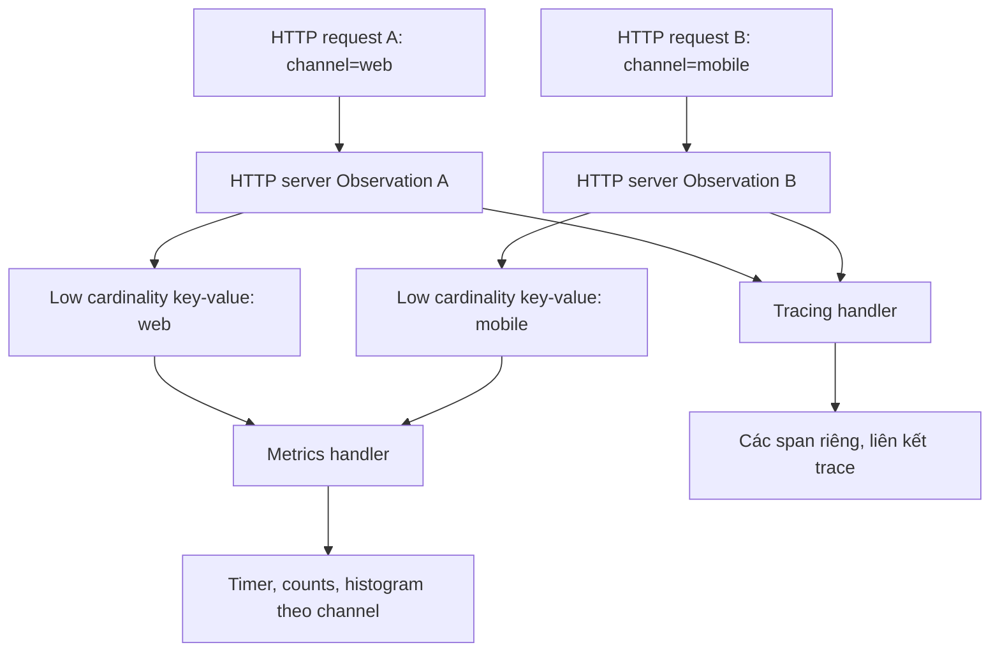
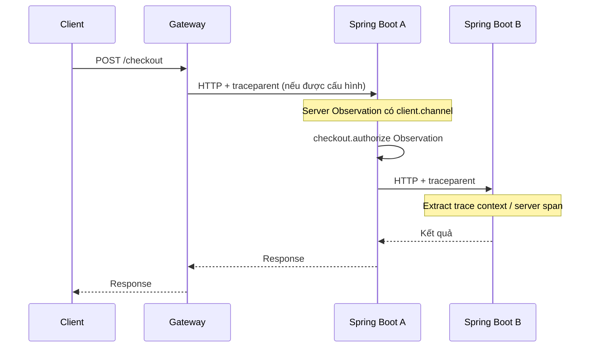

# Thêm key value theo request

Một Spring Boot API có metric `http.server.requests`, nhưng dashboard chỉ cho thấy độ trễ chung của `POST /checkout`. Nhóm vận hành muốn biết liệu yêu cầu từ kênh `web` hay `mobile` thường chậm hơn, đồng thời cần xem trace của một giao dịch lỗi cụ thể. Nếu đưa nguyên `userId`, `orderId` hoặc giá trị header bất kỳ vào metric labels, số time series có thể tăng không kiểm soát. Nếu chỉ thêm một tag tĩnh cho mọi observation, thông tin lại không giúp phân biệt từng nhóm request.

Giải pháp là **gắn key-value vào đúng Observation của từng request**, chuẩn hóa các giá trị cần tổng hợp, rồi để convention và handler quyết định cách biểu diễn thành metrics/traces. Trong chương **Convention và filter** của module **SPRING_BOOT_OBSERVABILITY**, đây là một kỹ năng nền tảng khi xây dựng observability bằng Micrometer Observation, metrics, logs và distributed tracing. Nó cũng liên quan trực tiếp tới context propagation, cardinality, exporter, sampling và khả năng liên kết các tín hiệu trong lúc điều tra lỗi, độ trễ hoặc hành vi ứng dụng trên môi trường thực.

Bài học trả lời các câu hỏi:

1. **Key-value theo request** là gì, khác gì với tag tĩnh của toàn ứng dụng?
2. Nên thêm key-value trực tiếp vào `Observation`, vào `Observation.Context`, qua `ObservationConvention` hay qua `ObservationFilter`?
3. Làm sao truy cập observation HTTP server đang tồn tại trong Spring MVC để bổ sung thông tin của request hiện hành?
4. Thời điểm thêm key-value ảnh hưởng thế nào tới metrics, tracing và việc kết thúc observation?
5. Làm sao giới hạn cardinality, bảo vệ dữ liệu nhạy cảm, truyền trace context và xác minh kết quả?

## 1. “Theo request” nghĩa là gắn đúng occurrence

Trong Micrometer, **Observation** mô tả một lần thực hiện công việc có tên và vòng đời: bắt đầu, có thể mở scope, ghi nhận key-values/lỗi/sự kiện, rồi kết thúc. Hai request cùng đi qua `POST /checkout` có thể có hai observation occurrence khác nhau.

Ví dụ:

| Request | Route chuẩn hóa | Kênh đã phân loại | Kết quả | Trace |
| --- | --- | --- | --- | --- |
| A | `/checkout` | `web` | `success` | Trace A |
| B | `/checkout` | `mobile` | `timeout` | Trace B |
| C | `/checkout` | `web` | `rejected` | Trace C |

Nếu muốn so sánh latency theo kênh, ta có thể gắn **`client.channel=web|mobile|other`** làm một low-cardinality key-value vào observation tương ứng. Nếu muốn truy một lần thanh toán cụ thể, dùng log/trace correlation có chính sách bảo mật phù hợp, **không** thêm `orderId` làm metric label.

Một mô hình đơn giản:



Điều quan trọng là **vị trí ghi dữ liệu**. Một singleton bean chứa trường `currentChannel` và thay đổi mỗi lần có request là thiết kế sai: nhiều request đồng thời có thể ghi đè lẫn nhau. Key-value phải gắn lên observation/context của chính request đó, hoặc được tính từ một context phù hợp khi handler xử lý occurrence.

## 2. Bốn cách đưa key-value vào Observation

Micrometer cung cấp nhiều điểm mở rộng; mỗi cách phục vụ một yêu cầu khác nhau.

| Cách | Phù hợp khi | Điểm cần chú ý |
| --- | --- | --- |
| `observation.lowCardinalityKeyValue(...)` hoặc `highCardinalityKeyValue(...)` | Bạn **sở hữu custom observation**, đã biết dữ liệu của invocation hiện tại | Bao phủ đủ nhánh, gắn trước `stop()`, không để data quá nhiều |
| `Observation.Context.addLowCardinalityKeyValue(...)` | Bạn có reference đến **context của observation đang chạy**, chẳng hạn HTTP server observation | Lấy đúng context của request; không tạo observation trùng ranh giới |
| `ObservationConvention<T>` | Có quy tắc đặt tên, tag và cardinality cần áp dụng đồng nhất cho một **loại context** | Đọc dữ liệu từ context, tránh thay thế nhãn mặc định quan trọng |
| `ObservationFilter` | Muốn bổ sung/chuẩn hóa key-values ở cấp registry, thường gần lúc kết thúc observation | Phải giới hạn loại observation; không dựa vào state request toàn cục |

Ngoài ra, Spring MVC, WebFlux, HTTP clients và các thư viện khác thường có **convention riêng** cho từng instrumentation. Với HTTP server đã được Spring instrument, hãy bổ sung metadata lên observation có sẵn thay vì tự khởi tạo observation thứ hai cho cùng toàn bộ HTTP request.

### 2.1. Hai loại key-value

Micrometer Observation phân biệt:

- **Low-cardinality key-value:** Tên và giá trị thuộc tập nhỏ, kiểm soát được; phù hợp làm dimensions của metrics và có thể dùng trong traces. Ví dụ `client.channel=web|mobile|batch|other`, `payment.outcome=accepted|rejected|error`.
- **High-cardinality key-value:** Giá trị có thể biến thiên lớn giữa các lần gọi; có thể hữu ích cho trace attributes nếu handler hỗ trợ. Thông thường nó không nên trở thành metric label. Nhưng **high-cardinality không đồng nghĩa được phép đưa PII, token hoặc secret vào trace**.

Những key-value này thuộc về **observation metadata**, không phải dữ liệu cần được truyền tự động sang microservice khác. Truyền trace context qua `traceparent` và truyền dữ liệu nghiệp vụ qua API/message contract là hai việc riêng.

## 3. Với custom Observation: gắn dữ liệu ngay trên occurrence

Khi tự instrument một bước nghiệp vụ, cách gọn nhất là thêm key-value trên chính observation.

Ví dụ một service thanh toán đồng bộ sử dụng Spring Boot 3.x, Java 17+ và bean `ObservationRegistry` đã được cấu hình:

```java
import io.micrometer.observation.Observation;
import io.micrometer.observation.ObservationRegistry;
import org.springframework.stereotype.Service;

@Service
public class CheckoutService {
    private final ObservationRegistry registry;
    private final PaymentGateway paymentGateway;

    public CheckoutService(ObservationRegistry registry,
                           PaymentGateway paymentGateway) {
        this.registry = registry;
        this.paymentGateway = paymentGateway;
    }

    public boolean authorize(String channel, String paymentToken) {
        String normalizedChannel = normalizeChannel(channel);

        Observation observation = Observation
                .createNotStarted("checkout.authorize", registry)
                .lowCardinalityKeyValue("client.channel", normalizedChannel)
                .lowCardinalityKeyValue("operation", "authorize")
                .start();

        try (Observation.Scope scope = observation.openScope()) {
            boolean accepted = paymentGateway.authorize(paymentToken);
            observation.lowCardinalityKeyValue(
                    "payment.outcome", accepted ? "accepted" : "rejected");
            return accepted;
        } catch (RuntimeException | Error failure) {
            observation.error(failure);
            observation.lowCardinalityKeyValue("payment.outcome", "error");
            throw failure;
        } finally {
            observation.stop();
        }
    }

    private static String normalizeChannel(String raw) {
        if (raw == null) {
            return "other";
        }
        return switch (raw.toLowerCase(java.util.Locale.ROOT)) {
            case "web" -> "web";
            case "mobile" -> "mobile";
            case "batch" -> "batch";
            default -> "other";
        };
    }
}

interface PaymentGateway {
    boolean authorize(String paymentToken);
}
```

Một số quyết định thiết kế đáng chú ý:

- `checkout.authorize` là **tên thao tác ổn định**, không chứa mã request.
- `client.channel` được chuẩn hóa về một tập nhỏ trước khi gắn vào observation.
- `payment.outcome` được bổ sung **sau khi biết kết quả và trước `stop()`**.
- `paymentToken` chỉ đi vào nghiệp vụ; không được xuất ra metric tag, log hoặc trace attribute.
- `try-with-resources` đóng scope; `finally` bảo đảm stop kể cả khi có exception hoặc `return`.
- Đây là observation của **bước nghiệp vụ**, có thể nằm bên trong observation HTTP server do framework tạo; hai ranh giới có ý nghĩa khác nhau.

Nếu không cần tự quản lý outcome, `observe(...)` giúp đơn giản hóa việc start/scope/stop:

```java
return Observation.createNotStarted("checkout.authorize", registry)
        .lowCardinalityKeyValue("client.channel", normalizedChannel)
        .observe(() -> paymentGateway.authorize(paymentToken));
```

Nhưng kết quả boolean trong biến thể này chưa được ánh xạ thành `payment.outcome`. Hãy chọn cách quản lý vòng đời tùy dữ liệu cần đo, tránh kết hợp `observe(...)` với một lần start/stop thủ công trên cùng observation.

**Một điểm tinh tế:** metrics handler, tracing handler và convention có thể đọc context ở các mốc khác nhau trong vòng đời. Gắn key-value trước `stop()` là cần thiết cho nhiều handler, nhưng không bảo đảm mọi handler đã đọc thuộc tính từ `onStart` sẽ cập nhật lại. Khi phải bảo đảm một tag outcome có mặt ở backend, hãy đối chiếu cách handler cụ thể đọc context.

## 4. Với HTTP server đã được instrument: dùng context của request hiện tại

Ở Spring MVC Servlet, Spring Framework cung cấp `ServerHttpObservationFilter` để quan sát HTTP server request. Khi instrumentation này đang hoạt động, có thể lấy **`ServerRequestObservationContext` của request hiện tại** rồi bổ sung low-cardinality key-value.

Giả sử cần phân loại nguồn yêu cầu thành `web`, `mobile` hoặc `other` từ một header minh họa. Ta tạo `HandlerInterceptor`:

```java
import io.micrometer.common.KeyValue;
import jakarta.servlet.http.HttpServletRequest;
import jakarta.servlet.http.HttpServletResponse;
import org.springframework.http.server.observation.ServerRequestObservationContext;
import org.springframework.stereotype.Component;
import org.springframework.web.filter.ServerHttpObservationFilter;
import org.springframework.web.servlet.HandlerInterceptor;

@Component
public class ClientChannelObservationInterceptor implements HandlerInterceptor {

    @Override
    public boolean preHandle(HttpServletRequest request,
                             HttpServletResponse response,
                             Object handler) {

        String channel = normalize(
                request.getHeader("X-Client-Channel"));

        ServerHttpObservationFilter.findObservationContext(request)
                .ifPresent(context -> context.addLowCardinalityKeyValue(
                        KeyValue.of("client.channel", channel)));

        return true;
    }

    private static String normalize(String raw) {
        if (raw == null) {
            return "other";
        }
        return switch (raw.toLowerCase(java.util.Locale.ROOT)) {
            case "web" -> "web";
            case "mobile" -> "mobile";
            default -> "other";
        };
    }
}
```

Đăng ký interceptor:

```java
import org.springframework.context.annotation.Configuration;
import org.springframework.web.servlet.config.annotation.InterceptorRegistry;
import org.springframework.web.servlet.config.annotation.WebMvcConfigurer;

@Configuration
public class RequestObservationWebConfig implements WebMvcConfigurer {
    private final ClientChannelObservationInterceptor interceptor;

    public RequestObservationWebConfig(
            ClientChannelObservationInterceptor interceptor) {
        this.interceptor = interceptor;
    }

    @Override
    public void addInterceptors(InterceptorRegistry registry) {
        registry.addInterceptor(interceptor);
    }
}
```

Lưu ý về ví dụ:

1. `ServerHttpObservationFilter.findObservationContext(request)` có thể trả về rỗng nếu HTTP observation filter không chạy hoặc request nằm ngoài instrumentation tương ứng. Khi đó interceptor vẫn xử lý bình thường nhưng không thêm tag.
2. Đoạn code dùng **Servlet Spring MVC**, không phải API nguyên dạng cho WebFlux. Trong WebFlux phải sử dụng context/instrumentation reactive tương ứng.
3. Giá trị `X-Client-Channel` ở đây chỉ là dữ liệu minh họa để phân nhóm. Header client có thể bị giả mạo: **không dùng nó cho quyết định phân quyền hoặc phân loại SLA có tính bảo đảm**. Muốn phân nhóm theo gói dịch vụ, lấy tier từ identity/principal đã được xác thực và vẫn normalize.
4. Interceptor chỉ chạy ở những request đi qua Spring MVC handler mapping; lỗi phát sinh trước interceptor (ví dụ ở gateway hoặc filter trước đó) có thể thiếu tag này. Nếu cần tag cho toàn bộ request quan sát được, cân nhắc convention/registry filter hoặc điểm chèn phù hợp hơn.
5. Không được viết `request.getRequestURI()` nguyên dạng làm metric label: đường dẫn thực có thể chứa `orderId` hoặc dữ liệu ngẫu nhiên. HTTP instrumentation thường có route template, chẳng hạn `/orders/{id}`, cho mục đích tổng hợp.

### 4.1. Vì sao không tạo một Observation HTTP mới trong interceptor?

Vì framework thường đã đo request từ ranh giới filter/server. Nếu interceptor tự tạo thêm một observation có cùng tên/ràng buộc và thời gian gần như trùng, có thể phát sinh timer hoặc span lặp. Những biểu đồ đó sẽ khó đọc: hai phép đo có định nghĩa khác nhau nhưng cùng tên, và không rõ phép đo nào bao gồm filter, authentication hay serialization.

Với thông tin chỉ nhằm **bổ sung tag của HTTP server request**, việc lấy existing `ServerRequestObservationContext` phù hợp hơn. Hãy tạo custom observation mới cho **bước nghiệp vụ khác biệt**, ví dụ `checkout.authorize` hoặc `inventory.reserve`.

## 5. Dùng ObservationConvention để thống nhất key-value của HTTP request

Một convention xác định **tên và key-values** của một loại observation dựa trên context. Khi cần chính sách label áp dụng đồng nhất cho phần lớn HTTP request, một convention chuyên biệt có thể sạch hơn việc thêm logic ở nhiều controller/interceptor.

Trong Spring MVC Servlet, kế thừa `DefaultServerRequestObservationConvention` để giữ các key-values mặc định, sau đó bổ sung một chiều hữu hạn:

```java
import io.micrometer.common.KeyValue;
import io.micrometer.common.KeyValues;
import org.springframework.http.server.observation.DefaultServerRequestObservationConvention;
import org.springframework.http.server.observation.ServerRequestObservationContext;

public final class ClientChannelServerRequestConvention
        extends DefaultServerRequestObservationConvention {

    @Override
    public KeyValues getLowCardinalityKeyValues(
            ServerRequestObservationContext context) {

        String raw = context.getCarrier()
                .getHeader("X-Client-Channel");

        return super.getLowCardinalityKeyValues(context)
                .and(KeyValue.of("client.channel", normalize(raw)));
    }

    private static String normalize(String raw) {
        if (raw == null) {
            return "other";
        }
        return switch (raw.toLowerCase(java.util.Locale.ROOT)) {
            case "web" -> "web";
            case "mobile" -> "mobile";
            default -> "other";
        };
    }
}
```

Khai báo bean khi dùng Spring MVC instrumentation tương ứng:

```java
import org.springframework.context.annotation.Bean;
import org.springframework.context.annotation.Configuration;
import org.springframework.http.server.observation.ServerRequestObservationConvention;

@Configuration
public class HttpObservationConventionConfig {

    @Bean
    public ServerRequestObservationConvention serverRequestObservationConvention() {
        return new ClientChannelServerRequestConvention();
    }
}
```

Kế thừa convention mặc định giúp bảo toàn những dimensions hữu ích do framework cung cấp, thường gồm phương thức HTTP, route mẫu, status và outcome theo cấu hình/phiên bản. Nếu viết implementation thay thế từ đầu, bạn phải tự duy trì quy tắc mặc định và có thể vô tình làm mất chúng.

### 5.1. Convention khác với filter ở đâu?

- **Convention:** *Biểu diễn observation này như thế nào?* Nó lấy context đã có để tạo tên, contextual name và key-values theo một quy ước. Convention đặc biệt phù hợp cho instrumentation có context chuyên biệt.
- **ObservationFilter:** *Có bổ sung hoặc điều chỉnh metadata trong context trước khi observation hoàn tất không?* Nó được áp dụng ở cấp registry cho context có thể thuộc nhiều loại và thường phù hợp với một quy tắc bổ sung ngang các observation.

Ví dụ convention HTTP có thể diễn giải header thành `client.channel`. Filter lại phù hợp nếu muốn thêm một dimension chuẩn cho *một nhóm observations* tại thời điểm kết thúc, chẳng hạn `deployment.ring=stable|canary` (đã được cấu hình có kiểm soát), hoặc gắn outcome từ một typed context.

Không nên đồng thời thêm cùng một key với hai giá trị khác nhau ở interceptor, convention và filter. Quy ước ưu tiên sẽ khó hiểu, còn dữ liệu xuất sang backend có thể khác mong đợi. Hãy chỉ định **một nơi làm chủ từng dimension**.

### 5.2. Thời điểm convention đọc dữ liệu

Context HTTP server thường có thêm status, exception hoặc route sau khi xử lý request. Một convention có thể cần dữ liệu chỉ có ở cuối vòng đời. Không giả định mọi key-value đã được tính từ lúc request bắt đầu; cũng không gắn field sau `stop()` rồi kỳ vọng metrics đã ghi sẽ thay đổi.

Nếu cần tag phản ánh nghiệp vụ `payment.outcome` nhưng thông tin này không thuộc HTTP context mặc định, hãy cập nhật context ở điểm xử lý kết quả hoặc tách nó thành custom observation của business step. Tránh bắt convention HTTP phải đọc ngược dữ liệu ở service thông qua biến global.

## 6. Dùng ObservationFilter để bổ sung key-value ở cấp registry

`ObservationFilter` nhận `Observation.Context` và có thể trả về context được bổ sung thông tin. Filter được áp dụng gần giai đoạn kết thúc observation, giúp chuẩn hóa dữ liệu trước khi những handler cần metadata ở thời điểm kết thúc xử lý nó.

Ví dụ dưới đây thêm `http.client.channel` riêng cho context của HTTP server request. Để tránh lặp với ví dụ convention ở phần trước, **hãy dùng filter này như một lựa chọn thay thế**, không đăng ký cùng lúc cả hai để thêm một dimension trùng tên.

```java
import io.micrometer.common.KeyValue;
import io.micrometer.observation.ObservationRegistry;
import org.springframework.boot.actuate.autoconfigure.observation.ObservationRegistryCustomizer;
import org.springframework.context.annotation.Bean;
import org.springframework.context.annotation.Configuration;
import org.springframework.http.server.observation.ServerRequestObservationContext;

@Configuration
public class RequestChannelFilterConfig {

    @Bean
    ObservationRegistryCustomizer<ObservationRegistry> requestChannelCustomizer() {
        return registry -> registry.observationConfig()
                .observationFilter(context -> {
                    if (context instanceof ServerRequestObservationContext http) {
                        String header = http.getCarrier()
                                .getHeader("X-Client-Channel");
                        String channel = switch (
                                header == null ? "" :
                                        header.toLowerCase(java.util.Locale.ROOT)) {
                            case "web" -> "web";
                            case "mobile" -> "mobile";
                            default -> "other";
                        };
                        context.addLowCardinalityKeyValue(
                                KeyValue.of("client.channel", channel));
                    }
                    return context;
                });
    }
}
```

Trong Spring Boot 3.x, `ObservationRegistryCustomizer` là một điểm tích hợp để điều chỉnh registry được auto-configure; đoạn code đăng ký filter ngay trên registry đó. Nếu chủ động tự tạo một registry khác, filter đã đăng ký ở registry của Boot sẽ không tự áp dụng lên registry độc lập.

Các đặc điểm cần hiểu:

1. Filter có thể nhìn nhiều loại `Observation.Context`, nên phải **kiểm tra kiểu** trước khi đọc dữ liệu HTTP.
2. Filter không nhận một `HttpServletRequest` dưới dạng tham số độc lập; ở đây nó lấy carrier từ **ServerRequestObservationContext**.
3. Context đã được bổ sung `KeyValue` nhưng metric hoặc span thực tế còn phụ thuộc handler, convention và thời điểm chúng đọc dữ liệu.
4. Filter không thực hiện cơ chế authentication, propagation hoặc sampling.
5. Filter không nên làm thao tác I/O chậm, truy vấn database hay logic có side effect; callback instrumentation phải nhẹ và có thể hoạt động ổn định trong điều kiện lỗi.
6. Với registry có nhiều observation, tránh thêm một dimension HTTP vào các observation không thuộc HTTP (job nền, database, message consumer).

**Lưu ý về phiên bản và kiểu ứng dụng:** Ví dụ này mô tả Spring Boot 3.x dùng Spring MVC Servlet. Spring Boot 4.x có thay đổi ở một số starter/tích hợp; WebFlux dùng các loại context/filters của reactive stack. Luôn đối chiếu chữ ký API của phiên bản thực tế trước khi áp dụng vào dự án.

## 7. Quy tắc thiết kế: mỗi dimension có một chủ sở hữu

Khi nhiều lớp đều có thể thêm key-value, bạn nên lập bản đồ trách nhiệm. Ví dụ:

| Dimension | Điểm sở hữu gợi ý | Nguồn dữ liệu | Dùng trong |
| --- | --- | --- | --- |
| `http.method` | HTTP framework convention | HTTP request | Metrics, traces |
| `http.route` hoặc `uri` dạng template | HTTP framework convention | Route đã match | Metrics, traces |
| `http.status` hoặc `status` | HTTP instrumentation | Response | Metrics, traces |
| `client.channel` | HTTP convention **hoặc** request interceptor/filter | Input đã chuẩn hóa | Metrics tổng hợp |
| `payment.outcome` | Custom business observation | Kết quả nghiệp vụ | Metrics và traces |
| `service.name` | Tracing/metrics resource configuration | Cấu hình service | Phân biệt ứng dụng |
| `traceId`/`spanId` | Tracing context và log correlation | Span hiện hành | Liên kết logs/traces |
| `orderId` | Domain/audit/log được bảo vệ khi có nhu cầu | Hợp đồng nghiệp vụ | Tra cứu giao dịch, không làm metric tag |

Giữa các phiên bản/backends, tên export của một số dimensions có thể khác. Đừng viết dashboard dựa trên giả định rằng tên tag ở Actuator giống hoàn toàn tên label của Prometheus hoặc attributes trong OpenTelemetry; hãy kiểm tra đầu ra thực tế.

### 7.1. Trùng key và thứ tự ưu tiên

Ví dụ một interceptor thêm `client.channel=mobile`, còn filter sau đó thêm `client.channel=other`. Kết quả không còn rõ ràng. Dù một handler ưu tiên giá trị sau cùng hay áp dụng cơ chế ghép key-values nào đó, chính sách dữ liệu đã mâu thuẫn.

Cách giải quyết là **định nghĩa duy nhất một nơi ghi key**. Nếu phải hỗ trợ dữ liệu từ nhiều nguồn, xác định thứ tự tin cậy ở *một chỗ* (chẳng hạn thông tin đã xác thực trước, header đã allowlist sau, cuối cùng là `other`), rồi chỉ xuất ra một giá trị chuẩn.

Không dùng filter để “vá” mọi tag trùng lặp ở phút cuối; điều đó khiến instrumentation khó dự đoán và khó kiểm thử.

## 8. Chọn low-cardinality và high-cardinality theo mục tiêu đo

Cardinality là số giá trị khác nhau của một chiều, hoặc số tổ hợp labels được tạo thành. Mỗi tổ hợp label có thể trở thành một time series riêng; histogram còn nhân thêm số series theo bucket.

Giả sử một timer có:

- `http.route`: 20 giá trị;
- `http.status`: 5 giá trị;
- `client.channel`: 3 giá trị;
- `instance`: 10 giá trị.

Số tổ hợp tối đa theo các chiều này là:

```text
20 × 5 × 3 × 10 = 3.000 tổ hợp label
```

Nếu bổ sung `customerId` với 100.000 giá trị, số tổ hợp **lý thuyết** có thể tăng lên 300 triệu. Thực tế chỉ có những tổ hợp phát sinh mới tạo series, nhưng chi phí bộ nhớ, exporter và truy vấn có thể tăng cực lớn.

| Dữ liệu từ request | Gắn lên metrics? | Nếu cần điều tra |
| --- | --- | --- |
| Kênh `web|mobile|other` | Có, nếu được chuẩn hóa | So sánh dashboard theo kênh |
| HTTP method | Có, qua instrumentation mặc định | Phân tích request theo method |
| Route mẫu `/orders/{id}` | Có | Tổng hợp endpoint |
| Response status/outcome chuẩn hóa | Có | Phân biệt lỗi HTTP và outcome nghiệp vụ |
| Raw URL `/orders/999888` | Không | Dùng route template; tra request riêng qua correlation |
| `userId`, `orderId`, email | Không | Audit/log/trace correlation theo chính sách dữ liệu |
| `traceId`, `spanId` | Không làm metric labels | Truy vấn logs/traces có correlation |
| Header tự do hoặc User-Agent đầy đủ | Không | Phân loại thành nhóm hữu hạn nếu có mục đích |
| Token/secret hoặc raw request body | Không | Không xuất vào telemetry |

Dù `highCardinalityKeyValue(...)` có thể được tracing handler dùng làm span attribute, **không đưa dữ liệu nhạy cảm tùy tiện**. Trace exporter gửi dữ liệu sang collector/backend, thường được lưu lâu hơn vòng đời request. Hãy tối thiểu hóa, masking và áp dụng chính sách retention/quyền truy cập khi thật sự cần lưu một trường chi tiết.

### 8.1. Không tin vào giá trị nguyên bản từ client

Nếu đọc header `X-Client-Channel`, phải coi nó là input không đáng tin cậy. Để đo từ phía client, bạn có thể cho phép ba giá trị `web`, `mobile`, `other`. Nhưng nếu dùng nhãn để xác định khách hàng VIP hoặc trách nhiệm SLA, hãy lấy phân loại từ **principal/claim đã xác thực** hoặc nguồn cấu hình được kiểm soát.

Một cách viết nên tránh:

```java
context.addLowCardinalityKeyValue(
        KeyValue.of("client.channel",
                request.getHeader("X-Client-Channel")));
```

Đoạn này cho phép gửi hàng triệu giá trị khác nhau vào một metric tag. Cần normalize/allowlist, định nghĩa giá trị fallback và giới hạn chiều dài input nếu cần.

## 9. Key-value theo request và distributed tracing

Gắn `client.channel=mobile` lên HTTP server observation **không tự bảo đảm** thuộc tính này xuất hiện trên các spans của service khác. Nếu một HTTP request từ gateway gọi Spring Boot A, rồi A gọi Spring Boot B, tracing liên kết các spans nhờ context propagation thích hợp.



Để bảo đảm đường trace liên tục:

- Dùng instrumentation của server và HTTP client; trong Spring Boot, ưu tiên HTTP client builder do Boot cấu hình, ví dụ `RestClient.Builder` hoặc `WebClient.Builder`, để nhận các customizer/tracing interceptors.
- Kiểm tra carrier truyền trace context (thường theo W3C Trace Context, gồm `traceparent`), không tự chép một vài string tag thay thế propagator.
- Với executor, asynchronous callbacks, Reactor và message broker, dùng cơ chế context propagation phù hợp và kiểm chứng spans có quan hệ cha–con đúng.
- Phân biệt **key-value phục vụ metric/span** với **baggage** có thể được truyền xuyên tiến trình. Không dùng baggage để gửi toàn bộ request metadata hoặc thông tin nhạy cảm.

Nếu tracing áp dụng sampling, backend có thể không lưu trace của một request cụ thể. Metrics vẫn có thể đo tổng số request dù trace bị lấy mẫu loại. Do đó, đừng lấy số span của `client.channel=mobile` chia tổng span rồi mặc định kết luận tỷ lệ lỗi hoặc traffic đại diện chính xác nếu sampler thiên lệch.

### 9.1. Logs có correlation nhưng không tự thừa hưởng mọi tag

Một log được phát trong tracing scope có thể có `traceId` và `spanId` trong MDC/log pattern, tùy cấu hình. Điều đó không có nghĩa log tự chứa `client.channel` hoặc các key-value của Observation. Muốn log có một trường phục vụ tra cứu, hãy dùng structured logging có chính sách dữ liệu và rõ phạm vi context; tránh copy mọi metric label và trace attribute vào tất cả logs.

Một trace ID là khóa liên kết; nó **không phải metric tag**. Gắn trace ID vào timer sẽ tạo gần một time series cho mỗi request, làm mất lợi ích của tổng hợp metrics.

## 10. Thời điểm thêm key-value theo vòng đời

Có ba thời điểm phổ biến:

| Thời điểm | Có thể biết gì? | Cách đưa vào observation |
| --- | --- | --- |
| Trước hoặc ngay sau `start()` | Method, kênh yêu cầu, operation, dependency | Gắn low-cardinality key-values sớm |
| Trong xử lý request | Phân loại đã xác thực, route khớp, kết quả trung gian | Thêm vào đúng context nếu còn trong lifetime |
| Trước `stop()` | Status cuối, lỗi kỹ thuật, outcome nghiệp vụ | Ghi error/outcome trước khi handler hoàn tất |

Trong custom observation, sử dụng `observe(...)` để quản lý start/scope/stop khi công việc đồng bộ đơn giản; dùng `try/finally` nếu cần thêm outcome. Trong Spring HTTP observation, framework sở hữu lifecycle của server request; bổ sung tag phải diễn ra **trước khi observation kết thúc**.

Không nên:

- Tạo observation và `stop()` trong interceptor trước khi controller thực thi, rồi tưởng đang đo toàn bộ request.
- Thêm tag vào observation đã stop và kỳ vọng backend cập nhật metric cũ.
- Để một singleton mutable giữ `currentRequestTag`.
- Chỉ thêm tag trong nhánh thành công khiến các request lỗi bị mất cùng dimension; tốt hơn là có `unknown` hoặc `other` khi thiếu dữ liệu.
- Dùng một request-scoped context làm giải pháp propagation xuyên thread/process mà không có cơ chế truyền thực tế.

### 10.1. HTTP async và reactive có thêm lưu ý

Một Spring MVC interceptor có thể không bắt được mọi biến thể dispatch bất đồng bộ giống như request đồng bộ. Với WebFlux, context thường được duy trì theo Reactor subscription thay vì các thread-local thuần túy. Nếu tag phải có trên mọi request, hãy kiểm tra ranh giới instrumentation, callback và phiên bản framework; cân nhắc sử dụng **HTTP observation convention phù hợp** thay cho một interceptor chỉ chạy ở một giai đoạn.

Với custom `CompletableFuture`, `observe(() -> future)` có thể kết thúc ngay khi future được tạo; với `Mono`, `observe(() -> mono)` có thể stop trước lúc subscriber chạy. Một key-value thêm lúc callback kết thúc cũng cần observation còn sống. Việc chọn đúng *điểm kết thúc* ảnh hưởng trực tiếp tới độ tin cậy của metrics/traces theo request.

## 11. Thiết lập và quan sát kết quả trong Spring Boot

Ví dụ dependency Maven cho **Spring Boot 3.x** (sử dụng dependency management tương ứng):

```xml
<!-- Actuator và Micrometer Observation infrastructure -->
<dependency>
    <groupId>org.springframework.boot</groupId>
    <artifactId>spring-boot-starter-actuator</artifactId>
</dependency>

<!-- Khi muốn xuất metrics cho Prometheus -->
<dependency>
    <groupId>io.micrometer</groupId>
    <artifactId>micrometer-registry-prometheus</artifactId>
</dependency>

<!-- Khi muốn tracing qua Micrometer và OpenTelemetry -->
<dependency>
    <groupId>io.micrometer</groupId>
    <artifactId>micrometer-tracing-bridge-otel</artifactId>
</dependency>

<!-- Khi xuất traces qua OTLP -->
<dependency>
    <groupId>io.opentelemetry</groupId>
    <artifactId>opentelemetry-exporter-otlp</artifactId>
</dependency>
```

Ứng dụng Spring MVC thực tế cần web starter phù hợp. Một cấu hình minh họa:

```yaml
management:
  endpoints:
    web:
      exposure:
        include: health,metrics,prometheus
  tracing:
    sampling:
      probability: 0.1
  otlp:
    tracing:
      endpoint: http://localhost:4318/v1/traces
```

Lưu ý:

- Prometheus registry tạo endpoint export nếu được expose; **Prometheus server** vẫn phải scrape dữ liệu.
- OTLP tracing exporter cần collector/backend thật sự lắng nghe tại địa chỉ đã cấu hình.
- Sampling `0.1` là tỷ lệ lấy mẫu trace; nó **không đồng nghĩa chỉ ghi 10% metrics**.
- Spring Boot 4.x có thay đổi starter/cấu hình tracing so với 3.x. Hãy dùng reference docs của **đúng phiên bản** thay vì sao chép nguyên property này.
- Không mặc định công khai các endpoint quản trị ra Internet; cần kiểm soát mạng và phân quyền.

Thử gửi các request trong lab:

```bash
curl -sS -H "X-Client-Channel: web" \
  http://localhost:8080/checkout

curl -sS -H "X-Client-Channel: mobile" \
  http://localhost:8080/checkout

curl -sS -H "X-Client-Channel: any-random-value" \
  http://localhost:8080/checkout

curl -fsS http://localhost:8080/actuator/metrics/http.server.requests
curl -fsS http://localhost:8080/actuator/prometheus
```

Giả sử lab có route `GET /checkout` tương ứng. Sau khi request được xử lý và các metrics được export, hãy kiểm tra label `client.channel` có lần lượt là `web`, `mobile`, `other` hay không. Một số backends đổi dấu chấm trong label thành dấu gạch dưới; không mặc định tên ở Prometheus giống hệt tên tag ở Actuator.

Với Prometheus, metric timer của HTTP server thường được export dưới các tên phù hợp naming convention, ví dụ tổng số request và sum duration; hãy kiểm tra **tên thực tế** trong `/actuator/prometheus` trước khi viết PromQL.

Ví dụ truy vấn minh họa khi metric `http_server_requests_seconds_count` có label `client_channel`:

```promql
sum by (client_channel) (
  rate(http_server_requests_seconds_count[5m])
)
```

Nếu không thấy metric/label mong đợi, kiểm tra trước: đã phát sinh request chưa, context có tồn tại không, interceptor/convention/filter có đăng ký không, registry có metrics handler không, endpoint có expose không, exporter/collector và truy vấn backend có đúng tên không.

## 12. Những lỗi thường gặp và cách khoanh vùng

| Hiện tượng | Nguyên nhân có thể | Hướng kiểm tra |
| --- | --- | --- |
| HTTP metrics có dữ liệu nhưng không có `client.channel` | Chưa đăng ký interceptor/convention/filter hoặc context không phải loại kỳ vọng | Kiểm tra điểm tích hợp và request đi qua nó |
| Chỉ request thành công có tag | Thêm tag quá muộn hoặc trong nhánh handler không chạy với lỗi | Thêm tag ở đầu request hoặc tại convention cho mọi trường hợp |
| Tag chứa hàng nghìn giá trị lạ | Gắn raw header, user ID hoặc URL thật | Chuẩn hóa allowlist, dùng route template |
| Tag xuất ra hai tên khác nhau | Interceptor và convention cùng ghi hoặc tên giữa backend khác nhau | Chỉ định một chủ sở hữu; kiểm tra exporter |
| Tất cả request có cùng tag | State singleton bị chia sẻ, hoặc filter chỉ gắn giá trị tĩnh | Dùng context của từng request và nguồn dữ liệu đúng |
| Thêm tag lên HTTP observation nhưng trace con không có tag đó | Key-value không tự lan truyền qua service/span | Dùng tracing propagation; gắn thuộc tính tại đúng span khi cần |
| Log có trace ID nhưng không có span trên backend | Sampling hoặc exporter/backend thiếu dữ liệu | Kiểm tra trace pipeline, không suy ra lỗi tag |
| Controller xử lý thành công nhưng Actuator thiếu timer | Chưa có meter sample, handler/registry khác hoặc meter bị lọc | Kiểm tra ObservationRegistry và endpoint |
| Custom duration rất thấp nhưng HTTP request chậm | Observation chỉ đo tạo future/Mono, không đo completion | Đặt start/stop theo lifetime thực tế |
| Chỉ thấy sai số khi nhiều request đồng thời | Mutable shared context hoặc biến global | Dùng context/observation riêng cho mỗi occurrence |

### 12.1. Checklist chẩn đoán theo lớp

1. **Nguồn dữ liệu:** `X-Client-Channel` có tồn tại không? Giá trị có qua normalize không?
2. **Điểm instrument:** Đã lấy đúng context của HTTP server request hay tạo nhầm observation khác?
3. **Vòng đời:** Tag có được gắn trước `stop()`? Nhánh lỗi và async có đi qua điểm gắn không?
4. **Registry/handler:** Metrics hoặc tracing handler có hoạt động trên context đó không?
5. **Exporter:** Actuator có thấy tag nhưng Prometheus không? Xem name mapping, filter, scrape và pipeline.
6. **Backend:** Query có đúng label/time range không? Sampling có khiến trace không được lưu không?

Đối chiếu các lớp trên giúp tránh “chữa” vấn đề exporter bằng cách thêm nhiều tag hơn, hoặc chữa vấn đề mất trace context bằng cách gắn request ID vào metric labels.

## 13. Bài thực hành: thiết kế tag theo request có kiểm soát

**Bài toán:** API `GET /orders/{id}` nhận từ ba kênh `web`, `mobile` và `batch`. Nhóm vận hành cần so sánh tỷ lệ lỗi và latency theo kênh, nhưng không được có label chứa mã đơn hàng hay dữ liệu người dùng.

Thực hiện:

1. **Xác định nhãn:** Chọn `client.channel=web|mobile|batch|other`. Giữ route template từ HTTP instrumentation.
2. **Thêm vào existing observation:** Dùng `ServerHttpObservationFilter.findObservationContext(request)` trong Spring MVC hoặc dùng một HTTP observation convention phù hợp.
3. **Chuẩn hóa và dự phòng:** Gửi `X-Client-Channel` với giá trị hợp lệ, không hợp lệ và thiếu header; phải nhận được chỉ các giá trị trong allowlist.
4. **Quan sát cả nhánh lỗi:** Tạo request trả `404`, `500` hoặc timeout thử nghiệm và kiểm tra tag vẫn có ở những request thực sự được HTTP observation bao phủ.
5. **Đối chiếu metrics và traces:** Xem `/actuator/metrics/http.server.requests`; nếu có tracing, tìm trace của một request mẫu và hiểu rằng tag có thể xuất hiện trên server span nhưng không tự lan sang downstream spans.
6. **Kiểm tra cardinality:** Gửi 100 request với ID đơn khác nhau; số giá trị của `client.channel` vẫn không đổi. Nếu đang thấy 100 giá trị URL, hãy xem lại metric label.
7. **Kiểm tra đổi phiên bản/exporter:** Xem raw metrics từ exporter và câu lệnh PromQL thực tế; xác minh cách map tên key-value.
8. **Đánh giá hiệu quả:** Khi giả lập dependency chậm, xác định kênh nào bị ảnh hưởng và đối chiếu với trace/log correlation.

### Câu hỏi tự kiểm

**Câu 1.** Cùng là “thêm tag theo request”, tại sao có lúc dùng `ObservationConvention`, lúc dùng `ObservationFilter`?

**Đáp án:** Convention phù hợp để định nghĩa cách diễn giải một **loại context** (như HTTP server request) thành tên/key-values ổn định. Filter phù hợp khi muốn bổ sung hoặc chuẩn hóa context ở cấp registry gần cuối vòng đời. Hai cơ chế khác điểm tích hợp; hãy chọn một nơi sở hữu mỗi dimension để tránh trùng lặp.

**Câu 2.** Có nên lấy nguyên `User-Agent` hoặc `X-Customer-Id` làm metric label để phân tích khách hàng?

**Đáp án:** Không. Giá trị có thể gần như không giới hạn, gây bùng số series và có rủi ro dữ liệu cá nhân. Nếu cần, phân loại thành một số nhóm hữu hạn từ nguồn dữ liệu đáng tin cậy; chi tiết cá nhân nên nằm trong hệ thống audit/correlation được bảo vệ.

**Câu 3.** Một `HandlerInterceptor` không tìm được `ServerRequestObservationContext`. Có phải toàn bộ tracing bị hỏng?

**Đáp án:** Chưa thể kết luận. Có thể HTTP observation filter không chạy cho request đó, cấu hình instrumentation thiếu, request được xử lý trước interceptor hoặc dùng sai stack MVC/WebFlux. Hãy kiểm tra điểm instrument rồi mới kiểm tra tracing exporter.

**Câu 4.** Tag `client.channel` ở HTTP server span có tự xuất hiện ở service B không?

**Đáp án:** Không. Trace context propagation truyền định danh và quan hệ spans, không tự sao chép mọi key-value. Nếu service B cần biết kênh cho nghiệp vụ, dùng API/message contract; nếu muốn thêm telemetry ở B, thiết kế instrumentation và chính sách dữ liệu riêng.

**Câu 5.** Vì sao không gắn `traceId` làm low-cardinality key-value cho timer?

**Đáp án:** Mỗi trace ID gần như duy nhất, làm số time series tăng theo số request. Trace ID nên dùng để tra logs/traces, không dùng để gom metrics.

## 14. Các nguyên tắc thực hành

- **Thêm key-value lên đúng observation occurrence:** dùng API trực tiếp cho custom observation; với HTTP server đã được instrument, ưu tiên context/convention sẵn có.
- **Phân biệt vai trò của extension points:** convention định nghĩa naming/tag policy; filter bổ sung/chuẩn hóa context; handler sinh telemetry theo cấu hình.
- **Giới hạn cardinality ngay tại nguồn:** normalize request data vào một bộ giá trị hữu hạn; không xuất raw IDs, URL, headers hoặc secrets.
- **Giữ chủ sở hữu rõ ràng cho mỗi dimension:** tránh interceptor, convention và filter cùng gắn một key với các giá trị khác nhau.
- **Bổ sung tag trước khi lifetime kết thúc:** chú ý các nhánh lỗi, async, cancellation và thời điểm handler đọc metadata.
- **Liên kết tín hiệu bằng cơ chế đúng:** metrics đo tỷ lệ và phân phối, traces mô tả đường đi, logs chứa sự kiện; propagation, sampling và exporter có thể thay đổi tín hiệu quan sát được.
- **Xác minh end-to-end:** thử request mẫu, kiểm tra raw Actuator/exporter, đối chiếu với trace/logs và backend query trước khi dùng tag cho dashboard hoặc cảnh báo.

### Tài liệu tham khảo

- [Micrometer — Observation API](https://docs.micrometer.io/micrometer/reference/observation.html)
- [Micrometer — Observation components, conventions và filters](https://docs.micrometer.io/micrometer/reference/observation/components.html)
- [Spring Framework — Observability](https://docs.spring.io/spring-framework/reference/integration/observability.html)
- [Spring Framework — HTTP server observations](https://docs.spring.io/spring-framework/reference/integration/observability.html#observability.http-server)
- [Spring Boot 3.5 — Observability](https://docs.spring.io/spring-boot/3.5/reference/actuator/observability.html)
- [Spring Boot 3.5 — Tracing](https://docs.spring.io/spring-boot/3.5/reference/actuator/tracing.html)

