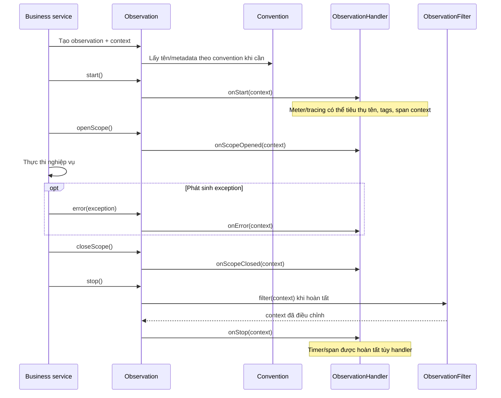
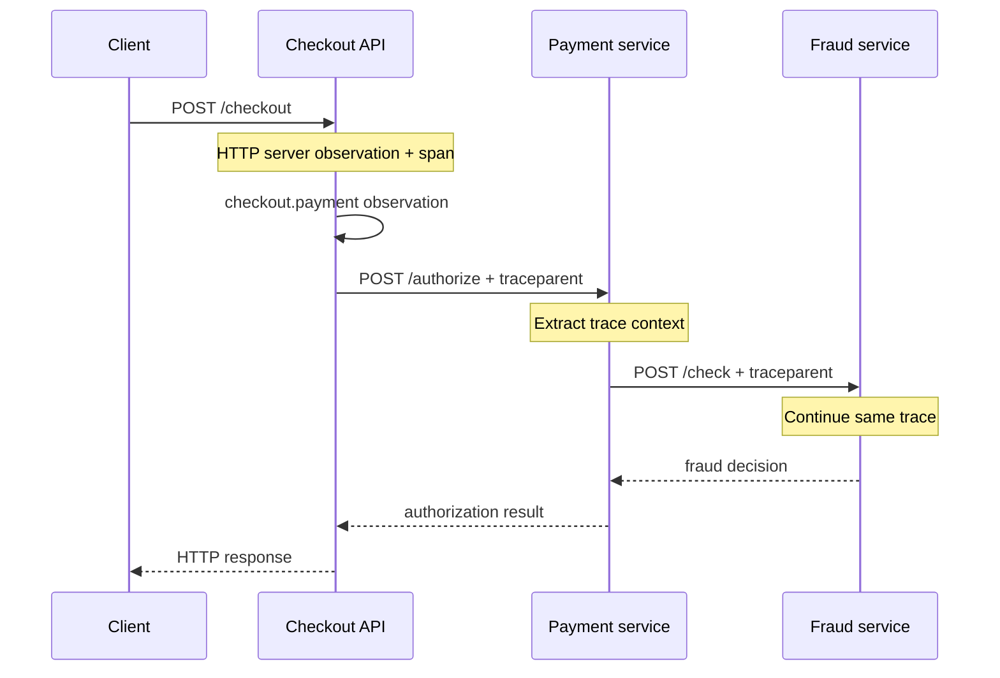

# Không thay convention bằng filter trong Micrometer Observation

> **Chương:** Convention và filter  
> **Module:** `SPRING_BOOT_OBSERVABILITY` — thiết lập observability cho Spring Boot với Micrometer Observation, metrics, logs và distributed tracing; vận dụng propagation, tags/cardinality, exporter, sampling và tương quan các tín hiệu khi phân tích lỗi hoặc độ trễ.  
> **Trọng tâm:** `ObservationConvention` và `ObservationFilter` đều tham gia cấu hình metadata, nhưng giải quyết **hai vấn đề khác nhau**. Hiểu rõ thời điểm chúng hoạt động để đặt tên observation, giới hạn tags, giữ trace context và tránh dashboard sai lệch.

## Mục tiêu học tập

Sau bài này, bạn có thể:

1. Giải thích vì sao convention định nghĩa **hợp đồng đo lường của một loại operation**, còn filter dùng để **điều chỉnh context theo quy tắc chung ở giai đoạn hoàn tất**.
2. Phân biệt `ObservationConvention`, `ObservationFilter`, `ObservationPredicate`, `ObservationHandler`, `MeterFilter` và servlet/web filters.
3. Quyết định thuộc tính nào cần có ngay khi observation bắt đầu; thuộc tính nào có thể bổ sung sau khi công việc kết thúc.
4. Thiết kế convention ổn định cho custom observation: tên, contextual name, low-cardinality và high-cardinality key-values.
5. Đăng ký filter thông qua `ObservationRegistryCustomizer` trong Spring Boot và chỉ dùng filter cho các chỉnh sửa late-stage thích hợp.
6. Kiểm tra metadata tại `onStart` và `onStop`, đọc metrics/traces/logs và chẩn đoán trường hợp filter khiến telemetry sai.

## 1. Tình huống: tại sao thêm tag bằng filter chưa đủ?

Một service checkout có custom observation `checkout.payment` để đo thời gian gọi cổng thanh toán. Team muốn mọi operation có:

- Tên metric ổn định `checkout.payment`.
- Span dễ đọc `process payment`.
- Tag `payment.provider` chỉ nhận `primary` hoặc `backup`.
- Tag `payment.channel` chỉ nhận `WEB`, `MOBILE`, `PARTNER` hoặc `OTHER`.
- Tag môi trường `deployment.environment=prod` được thêm giống nhau cho các observation.

Một cách làm tưởng như tiện lợi là đặt toàn bộ logic vào một `ObservationFilter` toàn cục. Vấn đề: filter **không có cùng thời điểm hay nhiệm vụ với convention**. Khi tracing handler tạo span hoặc chọn parent context lúc observation bắt đầu, filter chưa chắc đã được áp dụng. Thông tin đặt tên hoặc phân loại cần dùng ngay khi bắt đầu có thể đến quá muộn. Nếu filter lại cố thay tên hoặc quyết định business meaning cho mọi operation, quy tắc toàn cục dễ ảnh hưởng những observation không liên quan.

Cách chia trách nhiệm hợp lý:

- **Convention:** xác định operation `checkout.payment` nghĩa là gì, tên kỹ thuật, contextual name, bộ key-values và cách rút thông tin từ context riêng của operation.
- **Filter:** bổ sung hoặc điều chỉnh một thuộc tính chung trên `Observation.Context`, chẳng hạn môi trường triển khai, ở thời điểm các dữ liệu cuối cùng sắp được handler sử dụng để hoàn tất telemetry.
- **Predicate:** quyết định có tạo observation thật hay chuyển thành no-op theo chính sách lọc.
- **Handler:** nhận callback vòng đời và chuyển thông tin observation thành metrics, traces hoặc hành vi khác.

Đó là lý do **không thay convention bằng filter**, dù cả hai đều có thể nhìn thấy hoặc thao tác với key-values.

## 2. So sánh convention và filter

| Tiêu chí | `ObservationConvention` | `ObservationFilter` |
|---|---|---|
| Mục tiêu chính | Định nghĩa tên và key-values cho **một loại observation** | Chỉnh sửa `Observation.Context` của những observation đi qua registry |
| Gắn với loại context | Có, qua kiểu context và `supportsContext(...)` | Thường dùng chung cho nhiều loại context |
| Chọn tên observation | Có `getName()` | Không phải cơ chế đúng để đặt tên operation từ đầu |
| Chọn tên span dễ đọc | Có `getContextualName(context)` | Có thể sửa context muộn, nhưng không bảo đảm đổi tên span đã tạo |
| Low-cardinality metadata | Có `getLowCardinalityKeyValues(context)` | Có thể thêm/chỉnh low-cardinality key-values |
| High-cardinality metadata | Có `getHighCardinalityKeyValues(context)` | Có thể thêm/chỉnh tùy chính sách |
| Thời điểm thích hợp | Được chọn/áp dụng như một phần định nghĩa observation; handlers có thể dùng từ lúc start | Thường được gọi muộn khi observation hoàn tất, trước callback `onStop` |
| Phù hợp để làm gì? | Tên chuẩn, semantic tags, chuẩn hóa theo nghiệp vụ, hợp đồng dashboard | Common tags, enrichment sau xử lý, thay đổi context có quy tắc |
| Nguy cơ khi lạm dụng | Nhiều convention không nhất quán, đặt tên/tag động | Quá muộn cho tracing start; áp dụng quá rộng; ghi đè tags |

Điểm quan trọng là **timing**. Một số handler đọc tên và attributes trong `onStart`, một số handler chỉ đăng ký timer hoặc xử lý tags khi `onStop`, và exporter còn có thể xử lý bất đồng bộ. Vì vậy không nên dựa vào một filter cuối vòng đời để bảo đảm mọi tín hiệu đều thấy cùng metadata tại mọi thời điểm.

### 2.1. Hai loại tên phải được phân biệt

Trong một custom observation:

- **Observation name:** ví dụ `checkout.payment`, thường là tên kỹ thuật ổn định, liên quan tới tên meter hoặc operation.
- **Contextual name:** ví dụ `process payment`, hỗ trợ đặt tên span dễ đọc trong tracing khi handler sử dụng trường đó.

Không đưa order ID, customer ID, SKU hay URL cụ thể vào các tên này. Một tên như `checkout.payment.ORD-900221` khiến việc tổng hợp và tìm kiếm không nhất quán, có thể gây tăng cardinality.

### 2.2. Tránh nghĩ “filter chạy trước mọi thứ”

Trong vòng đời thông dụng của Micrometer Observation, filter được áp dụng vào context trong quá trình kết thúc observation và handler được thông báo ở `onStop`. Điều đó giúp filter làm giàu metadata trước khi metric handler hoàn tất việc ghi timer. Tuy nhiên, handler tracing có thể đã tạo span và quyết định thông tin ban đầu từ `onStart`. Tính đồng nhất giữa metrics và tracing **không được bảo đảm** chỉ bằng việc bổ sung một tag ở filter.

## 3. Vòng đời: đặt convention/filter vào đâu?



Sơ đồ trên mô tả ý định và thứ tự logic của một luồng đồng bộ điển hình. Chi tiết callback/convention có thể thay đổi theo phiên bản Micrometer, loại observation và cách handler được cấu hình. Khi phụ thuộc thời điểm cụ thể, hãy kiểm chứng bằng một handler nhỏ như ở phần thực hành.

**Không nhầm lẫn các bước:**

- `start()` mở ranh giới thời gian quan sát; **không** thay thế `openScope()`.
- `openScope()` đặt current observation và giúp code/logs/downstream instrumentation dùng trace context; không tự sinh metric tag.
- `error(...)` đánh dấu lỗi; không thay thế `stop()`.
- `Scope.close()` khôi phục context trước đó; không đồng nghĩa observation đã hoàn thành.
- `stop()` kết thúc observation; các handlers và exporter quyết định khi nào telemetry xuất hiện ở backend.

Nếu một attribute cần **tham gia quyết định ở start** (tên span, phân loại route, parent/child, thông tin cần cho handler sớm), nó phải được chuẩn bị từ đầu bằng convention, context hoặc thông số khi tạo observation. Filter cuối vòng đời không thể quay ngược thời gian.

## 4. Thiết kế một convention cho nghiệp vụ checkout

Giả sử service thanh toán có đúng bốn kênh: `WEB`, `MOBILE`, `PARTNER` và `OTHER`. Provider thuộc hai nhóm `primary`, `backup`. Tập giá trị này có thể tạo dimensions metric với cardinality giới hạn.

### 4.1. Context chuyên biệt

Một custom context tách thông tin nghiệp vụ khỏi hạ tầng observability:

```java
package com.example.checkout.observability;

import io.micrometer.observation.Observation;

public final class PaymentObservationContext extends Observation.Context {

    private final String channel;
    private final String provider;

    public PaymentObservationContext(String channel, String provider) {
        this.channel = channel;
        this.provider = provider;
    }

    public String channel() {
        return channel;
    }

    public String provider() {
        return provider;
    }
}
```

Context này nhận **giá trị đã chuẩn hóa**, không nhận trực tiếp user input. Nó mang thông tin để convention quy định cách hiện lên trên telemetry.

### 4.2. Chuẩn hóa các giá trị trước khi tạo context

```java
package com.example.checkout.observability;

import java.util.Locale;

public final class PaymentTagPolicy {

    private PaymentTagPolicy() {
    }

    public static String channel(String raw) {
        if (raw == null) {
            return "OTHER";
        }
        return switch (raw.trim().toUpperCase(Locale.ROOT)) {
            case "WEB" -> "WEB";
            case "MOBILE" -> "MOBILE";
            case "PARTNER" -> "PARTNER";
            default -> "OTHER";
        };
    }

    public static String provider(String raw) {
        if ("primary".equalsIgnoreCase(raw)) {
            return "primary";
        }
        if ("backup".equalsIgnoreCase(raw)) {
            return "backup";
        }
        return "other";
    }
}
```

Nếu định nghĩa provider chỉ gồm hai nhóm và có thể xuất hiện giá trị không rõ, bổ sung `other` là fallback hữu ích. **Đừng giữ nguyên tên host** như `payment-api-836ab.example.net` làm tag provider; domain động và instance ID có thể tăng số series không kiểm soát.

### 4.3. Convention định nghĩa tên và bộ key-values

```java
package com.example.checkout.observability;

import io.micrometer.common.KeyValues;
import io.micrometer.observation.Observation;
import io.micrometer.observation.ObservationConvention;

public final class PaymentObservationConvention
        implements ObservationConvention<PaymentObservationContext> {

    @Override
    public boolean supportsContext(Observation.Context context) {
        return context instanceof PaymentObservationContext;
    }

    @Override
    public String getName() {
        return "checkout.payment";
    }

    @Override
    public String getContextualName(PaymentObservationContext context) {
        return "process payment";
    }

    @Override
    public KeyValues getLowCardinalityKeyValues(
            PaymentObservationContext context) {

        return KeyValues.of("payment.channel", context.channel())
                .and("payment.provider", context.provider());
    }
}
```

Các thành phần quan trọng:

- `supportsContext(...)` giới hạn convention cho đúng loại context.
- `getName()` trả tên operation ổn định, không phụ thuộc từng request.
- `getContextualName(...)` đưa tên có ý nghĩa lên trace khi handler sử dụng.
- `getLowCardinalityKeyValues(...)` xác định tập tag theo ngữ nghĩa nghiệp vụ, không dựa vào dữ liệu riêng của mỗi giao dịch.

Convention này **không định nghĩa toàn bộ exporter**; nó chỉ chuẩn hóa cách một observation tự mô tả. Registry và handlers vẫn quyết định metrics/traces được tạo ra.

### 4.4. Áp dụng convention khi tạo custom observation

Với API Micrometer Observation 1.x có overload cho convention và context supplier, cách tạo có dạng:

```java
import io.micrometer.observation.Observation;
import io.micrometer.observation.ObservationRegistry;

// registry do Spring Boot inject vào service
PaymentObservationConvention convention =
        new PaymentObservationConvention();

PaymentObservationContext context =
        new PaymentObservationContext(
                PaymentTagPolicy.channel(rawChannel),
                PaymentTagPolicy.provider(rawProvider));

Observation observation = Observation.createNotStarted(
        convention, () -> context, observationRegistry);
```

Ví dụ thể hiện **convention được chọn tại nơi tạo observation**. Tùy phiên bản Micrometer và integration, overload hoặc cơ chế đăng ký default/custom convention có thể khác nhau; kiểm tra API của phiên bản được Spring Boot BOM quản lý trước khi đưa code vào dự án.

Chỉ khai báo một `@Component PaymentObservationConvention` không tự bảo đảm **mọi custom observation** đều dùng convention này. Với custom instrumentation, phải gắn convention qua API tạo observation, hoặc một cơ chế đăng ký convention đúng với integration đang dùng. Cách chọn convention mặc định của HTTP server, HTTP client hoặc framework khác là riêng cho integration đó.

### 4.5. Tránh dùng filter để định nghĩa tên như convention

Ví dụ một filter toàn cục cố thay tên theo từng request là dấu hiệu thiết kế sai:

```java
// MẪU KHÔNG NÊN ÁP DỤNG
registry.observationConfig().observationFilter(context -> {
    // Filter được gọi muộn, không phù hợp để quyết định tên operation
    // hoặc tên span ngay khi tracing handler bắt đầu.
    context.setName("checkout.payment." + rawOrderId);
    return context;
});
```

Dù một context cho phép cập nhật tên, thao tác trên không bảo đảm span đã tạo trước đó đổi tên tương ứng. Chèn order ID còn làm tên operation biến động và khiến số lượng tổ hợp metric tăng mạnh. Nếu cần naming đúng cho operation, hãy định nghĩa contract tại convention hoặc cấu hình instrumentation phù hợp.

## 5. Gắn metadata kết quả mà không biến filter thành logic nghiệp vụ

Một `outcome` chỉ được biết sau khi gọi payment gateway, ví dụ `approved`, `declined` hoặc `error`. Lựa chọn phổ biến là cập nhật **chính observation** trước `stop()`:

```java
package com.example.checkout;

import com.example.checkout.observability.PaymentObservationContext;
import com.example.checkout.observability.PaymentObservationConvention;
import com.example.checkout.observability.PaymentTagPolicy;
import io.micrometer.observation.Observation;
import io.micrometer.observation.ObservationRegistry;
import org.springframework.stereotype.Service;

@Service
public class PaymentService {

    private final ObservationRegistry observationRegistry;
    private final PaymentGateway gateway;
    private final PaymentObservationConvention convention =
            new PaymentObservationConvention();

    public PaymentService(
            ObservationRegistry observationRegistry,
            PaymentGateway gateway) {
        this.observationRegistry = observationRegistry;
        this.gateway = gateway;
    }

    public String charge(String rawChannel, String rawProvider) {
        PaymentObservationContext context = new PaymentObservationContext(
                PaymentTagPolicy.channel(rawChannel),
                PaymentTagPolicy.provider(rawProvider));

        Observation observation = Observation
                .createNotStarted(
                        convention, () -> context, observationRegistry)
                .start();

        try (Observation.Scope scope = observation.openScope()) {
            String decision = gateway.authorize();

            if ("APPROVED".equals(decision)) {
                observation.lowCardinalityKeyValue(
                        "payment.outcome", "approved");
            } else {
                observation.lowCardinalityKeyValue(
                        "payment.outcome", "declined");
            }

            return decision;
        } catch (RuntimeException exception) {
            observation.lowCardinalityKeyValue(
                    "payment.outcome", "error");
            observation.error(exception);
            throw exception;
        } finally {
            observation.stop();
        }
    }
}

interface PaymentGateway {
    String authorize();
}
```

`PaymentGateway` là interface minh họa; hệ thống thật cần xử lý timeout, retry, idempotency và security theo nghiệp vụ.

Cách làm này có các đặc điểm:

1. Convention xác định **tên và tags có sẵn ngay từ đầu**.
2. Outcome được gắn bởi code hiểu kết quả nghiệp vụ, không yêu cầu filter đoán qua exception message hay HTTP status.
3. `Scope` được mở trong đoạn nghiệp vụ để tracing/log correlation có current context.
4. Nếu có ngoại lệ, `observation.error(exception)` ghi nhận lỗi; `finally` vẫn gọi `stop()`.
5. Meter handler thường lấy tags cuối cùng khi kết thúc; một số tracing handler đã đọc tags lúc `onStart`. Vì vậy cần kiểm tra liệu tag outcome muộn có thực sự xuất hiện trong tracing backend; nếu cần từ đầu, không thể gắn nó trước khi biết kết quả.

**Không suy luận rằng mọi callback xem cùng một ảnh chụp metadata.** Test context/handler là cách xác minh cấu hình cụ thể, không nên chỉ dựa trên việc một tag đã xuất hiện trong Prometheus.

## 6. Filter có vị trí đúng: enrich metadata chung

Một use case hợp lý của `ObservationFilter` là thêm nhãn môi trường ổn định vào context của nhiều loại observation.

### 6.1. Đăng ký filter qua Spring Boot customizer

```java
package com.example.checkout.observability;

import io.micrometer.common.KeyValue;
import io.micrometer.observation.ObservationRegistry;
import org.springframework.beans.factory.annotation.Value;
import org.springframework.boot.actuate.autoconfigure.observation.ObservationRegistryCustomizer;
import org.springframework.context.annotation.Bean;
import org.springframework.context.annotation.Configuration;

@Configuration(proxyBeanMethods = false)
public class ObservationFilterConfiguration {

    @Bean
    ObservationRegistryCustomizer<ObservationRegistry> environmentFilter(
            @Value("${app.observability.environment:local}")
            String rawEnvironment) {

        String environment = normalizeEnvironment(rawEnvironment);

        return registry -> registry.observationConfig()
                .observationFilter(context -> {
                    context.addLowCardinalityKeyValue(
                            KeyValue.of("deployment.environment",
                                    environment));
                    return context;
                });
    }

    private static String normalizeEnvironment(String raw) {
        if ("prod".equalsIgnoreCase(raw)
                || "production".equalsIgnoreCase(raw)) {
            return "prod";
        }
        if ("staging".equalsIgnoreCase(raw)) {
            return "staging";
        }
        return "local";
    }
}
```

Cấu hình tương ứng:

```yaml
app:
  observability:
    environment: prod
```

Điểm chính:

- Customizer thao tác với **ObservationRegistry đang được Spring Boot quản lý**.
- Giá trị môi trường lấy từ **configuration của deployment** và được chuẩn hóa thành tập nhỏ.
- Filter áp dụng late-stage cho contexts đi qua registry, không phụ thuộc kiểu `PaymentObservationContext`.
- Filter không quyết định tên operation, span cha, hay trace context truyền qua HTTP.
- Không đọc environment từ HTTP request hay một user-controlled header rồi gắn chung thành metric tag.

Nếu Spring Boot phiên bản đang dùng đã hỗ trợ property common observation key-values, có thể chọn cách khai báo cấu hình thay cho filter:

```yaml
management:
  observations:
    key-values:
      deployment.environment: ${APP_ENVIRONMENT:local}
```

**Chọn một nguồn cho một thuộc tính.** Không vừa dùng property chung vừa tự gắn filter cùng key mà không thiết kế rõ quy tắc ưu tiên; việc có hai nguồn khiến tags khó theo dõi.

### 6.2. Một filter chạy trên nhiều loại observation

Một filter toàn cục có thể thấy cả HTTP server, client, JDBC-adjacent hoặc custom observation, tùy instrumentation. Vì vậy mọi chỉnh sửa trong filter đều có phạm vi ảnh hưởng lớn. Trước khi thêm tag chung, tự hỏi:

- Có cần tag này cho **mọi** observation không?
- Giá trị của tag có ít lựa chọn hay tăng theo request?
- Tag đã được thêm ở MeterRegistry, Prometheus scrape, Collector hoặc resource attributes chưa?
- Nếu filter sửa context, handler ở `onStart` và `onStop` có nhìn thấy cùng giá trị không?
- Thêm tag có làm dashboard/alert thay đổi tên hoặc số series không?

Filter không nên thực hiện database query, gọi network, I/O tốn thời gian hoặc thao tác bí mật. Callback observability nằm trên đường đo và có thể ảnh hưởng latency, reliability của ứng dụng.

## 7. ObservationPredicate không phải ObservationFilter

Một nhầm lẫn khác là dùng filter để **loại bỏ** observation.

| Cơ chế | Câu hỏi nó trả lời | Khi nên dùng |
|---|---|---|
| `ObservationPredicate` | Có nên quan sát operation này hay chuyển sang no-op? | Bỏ qua một nhóm observation không có giá trị, theo chính sách có chủ đích |
| `ObservationFilter` | Context của observation đã diễn ra cần điều chỉnh gì trước khi hoàn tất? | Common key-values, làm giàu/chuẩn hóa metadata muộn |
| `ObservationConvention` | Loại operation này tên gì, có semantic tags nào? | Naming và schema quan sát theo ngữ nghĩa |
| `ObservationHandler` | Khi observation start/error/stop, telemetry hay hành động nào được thực hiện? | Tạo timer, span, phản ứng theo lifecycle |

Ví dụ predicate minh họa:

```java
@Bean
ObservationRegistryCustomizer<ObservationRegistry> debugNoisePredicate() {
    return registry -> registry.observationConfig()
            .observationPredicate((name, context) ->
                    !name.startsWith("internal.debug."));
}
```

Predicate này loại các observation có prefix `internal.debug.`. **Nó không giảm một nhãn high-cardinality thành low-cardinality**; nhiệm vụ chuẩn hóa metadata thuộc domain contract/convention hoặc nguồn dữ liệu. Không tùy tiện loại HTTP server observations chỉ để giảm lượng trace: hành động đó có thể đồng thời làm mất metrics và các span phục vụ điều tra. Sampling traces, histogram tuning và retention là những công cụ khác với predicate.

### 7.1. MeterFilter cũng là một lớp khác

`MeterFilter` thuộc **Micrometer Metrics/MeterRegistry**; nó có thể chấp nhận, từ chối, map meter IDs hoặc áp dụng giới hạn theo cơ chế meter registry. Nó không trực tiếp định nghĩa observation name/span name và không thể thay toàn bộ `ObservationConvention`.

Đặt quy tắc metric-only trong MeterRegistry có thể cần thiết, nhưng chú ý khi metadata giữa metrics và tracing diverge. Nên xác định nguồn schema telemetry trước rồi áp dụng các tầng bổ sung cho từng backend có chủ đích.

### 7.2. Filter của web/servlet không tương đương

Một `jakarta.servlet.Filter` hoặc `WebFilter` của Spring WebFlux can thiệp request/response HTTP. `ObservationFilter` làm việc với `Observation.Context`. Hai API giải quyết các tầng khác nhau, không thể hoán đổi chỉ vì đều có chữ “filter”.

## 8. Cardinality: thiết kế ở convention, bảo vệ ở nhiều tầng

Một tag tốt gồm **key ổn định**, **tập giá trị có giới hạn**, **ngữ nghĩa rõ** và **chính sách khi gặp giá trị lạ**.

Ví dụ contract:

| Key | Giá trị cho phép | Nơi quản lý | Dùng vào |
|---|---|---|---|
| `payment.channel` | `WEB`, `MOBILE`, `PARTNER`, `OTHER` | Domain mapping + convention | Rate/error/latency theo kênh |
| `payment.provider` | `primary`, `backup`, `other` | Domain mapping + convention | Phân tích phụ thuộc cổng thanh toán |
| `payment.outcome` | `approved`, `declined`, `error` | Business operation | Đối chiếu kết quả nghiệp vụ |
| `deployment.environment` | `local`, `staging`, `prod` | Deployment config/common filter | Phân tách môi trường |
| `order.id` | Gần như duy nhất mỗi đơn | **Không đưa vào low-cardinality tags** | Trace/log correlation khi được phép |
| `http.url` chứa ID và query | Nhiều giá trị tùy request | **Không đưa vào low-cardinality tags** | Ưu tiên URI template đã chuẩn hóa |

Với 4 `payment.channel` × 3 `payment.provider` × 3 `payment.outcome` × 3 `deployment.environment` ta đã có tối đa **108 tổ hợp nhãn** cho một meter tại mỗi tập labels chung. Nhân tiếp với số instance, status labels hoặc histogram buckets khiến số time series tăng thêm. Nếu thêm `order.id` có 100.000 giá trị, ngân sách series có thể bùng nổ.

**Nguyên tắc:**

1. Convention định nghĩa một bộ nhãn từ domain values **đã được chuẩn hóa**.
2. Filter chung chỉ bổ sung những giá trị ổn định và có ý nghĩa ở nhiều operations.
3. Ngay cả high-cardinality trace attributes cũng phải kiểm tra dữ liệu nhạy cảm; không được đưa secret, token hay thông tin thanh toán vào traces/baggage/logs.
4. Những tags không có mục tiêu truy vấn, alert hoặc điều tra rõ ràng không nhất thiết phải tồn tại.

### 8.1. Phản ví dụ: dùng filter để thêm order ID vào mọi metric

```java
// KHÔNG NÊN: code minh họa anti-pattern
registry.observationConfig().observationFilter(context -> {
    context.addLowCardinalityKeyValue(
            KeyValue.of("order.id", lookupOrderIdFromCurrentRequest()));
    return context;
});
```

Đoạn này có thể làm phát nổ cardinality ở **nhiều** observations, trong khi hàm lấy request context còn có thể trả sai giá trị ở async thread hoặc khi không có HTTP request. Cách đúng là đưa thông tin cần thiết vào context của từng observation, rồi cân nhắc dùng high-cardinality trace attribute khi có quyền và nhu cầu thực tế; không thêm ID động vào meter tags.

## 9. Không dùng filter để sửa span context hoặc propagation

Một distributed trace cần trace/span context, parent–child relationship và các headers (thường là W3C `traceparent`/`tracestate`) được inject/extract đúng lúc outbound/inbound HTTP hoạt động. Trong Spring Boot, việc đó đến từ tracing handler và các HTTP clients/servers được instrument, không đến từ việc gắn low-cardinality tags trong filter.

Ví dụ request qua ba dịch vụ:



Nếu `traceparent` không được truyền từ A sang B, việc filter thêm `payment.channel=WEB` ở A/B không tạo lại mối quan hệ trace. Cần kiểm tra:

- HTTP client có được tạo qua builder/instrumentation do Spring Boot cấu hình không?
- Trace context có bị proxy/gateway loại bỏ khỏi headers không?
- Có chạy qua executor, `CompletableFuture`, Reactor hoặc messaging mà chưa bật context propagation không?
- Tracing bridge, sampling, exporter và backend có đang hoạt động không?

Tương tự, log correlation chủ yếu sử dụng `traceId`/`spanId` trong MDC hoặc structured logs khi có current tracing scope. `ObservationFilter` không tự cấu hình logger, không tự xuất logs và không tự đặt parent span.

## 10. Khi nào dùng convention, filter hoặc kết hợp cả hai?

| Nhu cầu | Lựa chọn | Lý do |
|---|---|---|
| Đặt tên custom operation `checkout.payment` | Convention | Là một phần schema operation |
| Contextual name cho span `process payment` | Convention | Cần sẵn trong quá trình tạo/khởi tạo span |
| Gắn `payment.channel` đã chuẩn hóa | Domain mapping + convention | Semantic tags đặc thù operation |
| Gắn `payment.outcome` chỉ biết khi kết thúc | Code nghiệp vụ trước stop, hoặc context/convention được thiết kế phù hợp | Kết quả thuộc operation, không nên filter đoán |
| Gắn môi trường cố định cho mọi operation | Common observation key-values hoặc filter | Là metadata xuyên suốt deployment |
| Bỏ một operation nội bộ không cần theo dõi | Predicate | Quyết định có observe hay không |
| Không tạo quá nhiều time series từ meter cụ thể | Chỉnh tags/convention trước, cân nhắc MeterFilter cho metrics | Xử lý đúng nguồn cardinality, có thể bổ sung cơ chế ở meter layer |
| Ghi timer/span theo lifecycle | ObservationHandler có cấu hình sẵn | Handler tạo telemetry từ callback |
| Propagate trace sang dịch vụ khác | Tracing instrumentation/propagator | Không liên quan trực tiếp đến tag filter |

Cách đặt câu hỏi khi review một pull request thay đổi observability:

1. “Thay đổi này có định nghĩa **ngữ nghĩa của loại operation** không?” Nếu có, ưu tiên convention hoặc context/đoạn instrumentation.
2. “Thay đổi này áp dụng **chung cho nhiều observation** và có thể làm muộn không?” Nếu có, filter hoặc common configuration có thể phù hợp.
3. “Thay đổi này định **bật/tắt observation**?” Dùng predicate.
4. “Thay đổi này **xuất dữ liệu/đo thời gian**?” Xem handlers, registry hoặc exporters.
5. “Tag mới có bao nhiêu giá trị và hiện diện vào lúc nào?” Kiểm tra cardinality và timing, nhất là tracing.

## 11. Kiểm tra sớm/muộn bằng ObservationHandler

Một test đơn giản có thể cho thấy **filter được áp dụng muộn**: handler ghi lại context ở `onStart` và `onStop`, trong khi filter thêm một tag cố định. Test này không cần Prometheus hay OTLP receiver.

```java
import io.micrometer.common.KeyValue;
import io.micrometer.common.KeyValues;
import io.micrometer.observation.Observation;
import io.micrometer.observation.ObservationHandler;
import io.micrometer.observation.ObservationRegistry;
import java.util.concurrent.atomic.AtomicReference;
import org.junit.jupiter.api.Test;

import static org.junit.jupiter.api.Assertions.assertFalse;
import static org.junit.jupiter.api.Assertions.assertTrue;

class ObservationFilterTimingTest {

    @Test
    void filterEnrichesContextBeforeOnStop() {
        ObservationRegistry registry = ObservationRegistry.create();

        AtomicReference<KeyValues> atStart = new AtomicReference<>();
        AtomicReference<KeyValues> atStop = new AtomicReference<>();

        registry.observationConfig().observationHandler(
                new ObservationHandler<Observation.Context>() {
                    @Override
                    public boolean supportsContext(Observation.Context context) {
                        return true;
                    }

                    @Override
                    public void onStart(Observation.Context context) {
                        atStart.set(context.getLowCardinalityKeyValues());
                    }

                    @Override
                    public void onStop(Observation.Context context) {
                        atStop.set(context.getLowCardinalityKeyValues());
                    }
                });

        registry.observationConfig().observationFilter(context -> {
            context.addLowCardinalityKeyValue(
                    KeyValue.of("deployment.environment", "test"));
            return context;
        });

        Observation.createNotStarted("demo.operation", registry)
                .lowCardinalityKeyValue("operation", "demo")
                .observe(() -> "done");

        assertFalse(hasKeyValue(
                atStart.get(), "deployment.environment", "test"));
        assertTrue(hasKeyValue(
                atStop.get(), "deployment.environment", "test"));
    }

    private static boolean hasKeyValue(
            KeyValues keyValues, String key, String value) {
        for (KeyValue item : keyValues) {
            if (key.equals(item.getKey())
                    && value.equals(item.getValue())) {
                return true;
            }
        }
        return false;
    }
}
```

Nếu test cho kết quả khác trên một phiên bản Micrometer cụ thể, hãy kiểm tra lại implementation và thứ tự handlers/filters. Điều quan trọng là **không đưa ra giả định tùy tiện về timing** khi quyết định một tag có được tracing handler đọc ở thời điểm tạo span hay không.

### 11.1. Test convention theo hợp đồng semantic tags

Với `PaymentObservationConvention` ở phần trước, có thể kiểm tra tên và tập key-values trực tiếp, tránh phụ thuộc exporter:

```java
import static org.junit.jupiter.api.Assertions.assertEquals;
import static org.junit.jupiter.api.Assertions.assertTrue;

import io.micrometer.common.KeyValue;
import org.junit.jupiter.api.Test;

class PaymentObservationConventionTest {

    @Test
    void namesAndTagsAreStable() {
        PaymentObservationContext context =
                new PaymentObservationContext("WEB", "primary");
        PaymentObservationConvention convention =
                new PaymentObservationConvention();

        assertEquals("checkout.payment", convention.getName());
        assertEquals("process payment",
                convention.getContextualName(context));

        boolean foundChannel = false;
        for (KeyValue item
                : convention.getLowCardinalityKeyValues(context)) {
            if (item.getKey().equals("payment.channel")
                    && item.getValue().equals("WEB")) {
                foundChannel = true;
            }
        }
        assertTrue(foundChannel);
    }
}
```

Nên bổ sung test `PaymentTagPolicy.channel(...)` cho input khác nhau, gồm chuỗi rỗng, giá trị chữ hoa/thường, giá trị không hợp lệ và `null`. Test này bảo vệ điều quan trọng nhất của low-cardinality metadata: **không xuất hiện giá trị bất ngờ**.

### 11.2. Giới hạn của các test đơn vị

Một test `ObservationHandler` chứng minh logic callback và context, nhưng chưa chứng minh timer có được xuất thành series thật hay span đã đến backend. Test tích hợp cần Spring Boot context, MeterRegistry hoặc exporter tương ứng. Khi đo ở production, còn phải theo dõi hậu quả của việc bổ sung tags đối với scrape size, series count và latency.

## 12. Kiểm chứng trên Spring Boot với Actuator và Prometheus

Ví dụ ứng dụng Spring Boot 3.x dùng Actuator cùng Prometheus registry:

```xml
<dependency>
    <groupId>org.springframework.boot</groupId>
    <artifactId>spring-boot-starter-actuator</artifactId>
</dependency>
<dependency>
    <groupId>io.micrometer</groupId>
    <artifactId>micrometer-registry-prometheus</artifactId>
</dependency>
```

Cấu hình local:

```yaml
spring:
  application:
    name: checkout-service

management:
  endpoints:
    web:
      exposure:
        include: health,metrics,prometheus
  tracing:
    sampling:
      probability: 1.0
```

Tùy thuộc dependencies, property và phiên bản, tracing có thể chưa hoạt động chỉ vì sampling là `1.0`: cần tracing bridge, tracer và exporter/receiver phù hợp. Với metrics, `/actuator/prometheus` chỉ hiện diện khi Prometheus registry có trên classpath và endpoint được expose.

Sau khi gọi endpoint nghiệp vụ thật dẫn tới `PaymentService.charge(...)`:

```bash
curl -s http://localhost:8080/actuator/metrics
curl -s http://localhost:8080/actuator/metrics/checkout.payment
curl -s http://localhost:8080/actuator/prometheus
```

Tùy MeterRegistry, tên meter `checkout.payment` có thể được xuất dạng như:

```text
checkout_payment_seconds_count{payment_channel="WEB",payment_provider="primary",payment_outcome="approved",deployment_environment="local",...} 8
checkout_payment_seconds_sum{payment_channel="WEB",payment_provider="primary",payment_outcome="approved",deployment_environment="local",...} 0.247
```

Đây là **minh họa hình dạng Prometheus series**; tên và cách chuyển đổi key/value thực tế có thể thay đổi theo naming convention, registry, phiên bản và cấu hình. Luôn xem output đang có trước khi xây dashboard.

Ví dụ PromQL theo những tên series minh họa đó:

**Tốc độ xử lý thanh toán theo kênh:**

```promql
sum by (payment_channel) (
  rate(checkout_payment_seconds_count[5m])
)
```

**Tỷ lệ lỗi nghiệp vụ do gateway theo provider (0–1):**

```promql
sum by (payment_provider) (
  rate(checkout_payment_seconds_count{
    payment_outcome="error"
  }[5m])
)
/
clamp_min(
  sum by (payment_provider) (
    rate(checkout_payment_seconds_count[5m])
  ),
  1e-9
)
```

Nếu labels trong hệ thống không có outcome như ví dụ, hãy kiểm tra thời điểm tag được gắn và handler tạo meter. **Không đánh đồng tỷ lệ lỗi business operation với HTTP 5xx**: payment bị declined có thể là kết quả nghiệp vụ dự kiến và API có thể trả 200 hoặc 4xx tùy hợp đồng.

## 13. Dùng metrics → traces → logs để điều tra lỗi

Giả sử dashboard báo error ratio của `checkout.payment` tăng khi `payment.provider=backup`. Quy trình điều tra:

1. Từ metrics, xác định thời gian, provider, channel và mức tăng error rate/latency.
2. Từ tracing backend, lọc theo service/operation/khoảng thời gian; tìm span của payment operation cùng call downstream nếu trace đã được lấy mẫu.
3. Xem attributes: nếu `payment.provider` hoặc contextual name thiếu trong span nhưng có ở metric, kiểm tra convention và thời điểm gắn tag. Filter chạy muộn không đảm bảo tracing start nhận thuộc tính đó.
4. Dùng `traceId` tìm log tương ứng; log có correlation ID nếu tracing + MDC/structured logging đã cấu hình.
5. Đối chiếu downstream status, timeout, retry và saturation; xác nhận trước/sau triển khai bằng metrics thay vì chỉ xem một trace.

**Traces có thể bị sampling loại**, dù meter vẫn tăng. Nếu span không xuất hiện, trước hết xem sampling, bridge, OTLP endpoint, Collector, backend retention và thời gian truy vấn. Một lỗi trong filter/convention chỉ là một trong nhiều khả năng.

### 13.1. Khi tag xuất hiện ở metrics nhưng biến mất ở tracing

Kiểm tra cụ thể:

- Tag đó được thêm **trước `start()`** bằng convention/initial context hay chỉ ở filter/đoạn code cuối?
- Tracing handler có đọc tag tại `onStart` hay `onStop` trong phiên bản đang dùng?
- Trace/span có thực sự được lấy mẫu và gửi tới backend?
- Collector có xóa/rename attributes theo policy không?
- Bạn đang tìm đúng service/operation/span hay đang nhầm parent HTTP span với child custom span?

Thay đổi filter không phải hướng sửa duy nhất. Nếu muốn cả timer và span được phân loại theo một giá trị bất biến, hãy chuẩn bị giá trị đó ngay từ đầu.

## 14. Những anti-pattern thường gặp

### 14.1. Gộp toàn bộ logic nghiệp vụ vào một filter toàn cục

**Biểu hiện:** filter kiểm tra tên observation bằng chuỗi, đọc request, đoán provider, parse exception, đổi tên span và gắn mọi tags.

**Hệ quả:** khó kiểm thử, phụ thuộc timing, dễ chạy sai với observation không có HTTP request hoặc ở thread khác.

**Cách sửa:** đặt naming/tag contract ở context/convention riêng; filter chỉ làm enrichment chung có phạm vi và dữ liệu ổn định.

### 14.2. Dùng filter để che một convention thiếu rõ ràng

**Biểu hiện:** custom observation có tên `operation` chung chung, rồi filter đổi tên thành `checkout.payment` tùy dữ liệu lúc stop.

**Hệ quả:** metric và span có thể không đồng bộ tên; các handler sớm đã thấy tên cũ.

**Cách sửa:** chọn tên ổn định tại bước instrumentation/convention, không đổi semantic identity ở cuối lifecycle.

### 14.3. Dùng giá trị dynamic làm low-cardinality tag

**Biểu hiện:** `order.id`, `customer.email`, `raw.url`, `exception.message` xuất hiện trên metrics.

**Hệ quả:** time series tăng không giới hạn và có thể lộ dữ liệu nhạy cảm.

**Cách sửa:** chuẩn hóa thành enum/category, dùng route template; thông tin từng request chỉ được đưa vào traces/logs có kiểm soát nếu thực sự cần.

### 14.4. Thêm cùng tag tại nhiều tầng

**Biểu hiện:** `deployment.environment` được khai báo trong `management.observations.key-values`, filter và Prometheus relabeling với giá trị khác nhau.

**Hệ quả:** label collision hoặc dashboard thấy nhiều cách phân loại cùng môi trường.

**Cách sửa:** chọn một nguồn sự thật cho mỗi tag và kiểm tra output đã qua exporter.

### 14.5. Cho rằng filter có thể tạo trace context

**Biểu hiện:** trace A→B đứt, team thêm `traceId` làm low-cardinality tag ở filter.

**Hệ quả:** trace vẫn đứt, metric cardinality bùng nổ.

**Cách sửa:** kiểm tra instrumented client, W3C propagation, executor/reactive context và tracing handlers; không dùng metric tags để thay trace headers.

### 14.6. Bỏ qua sự khác nhau giữa dữ liệu tại start và stop

**Biểu hiện:** tag có trong `Observation.Context` ở cuối nhưng không có trên span đã tạo.

**Cách sửa:** đo bằng handler test ở `onStart/onStop`, chuẩn bị metadata cần sớm trong context/convention; xác minh backend thay vì suy luận.

## 15. Checklist review trước khi triển khai

- [ ] Tên operation và contextual name có ý nghĩa, ổn định và được định nghĩa tại đúng nơi.
- [ ] Convention phản ánh domain semantics và chỉ áp dụng cho context phù hợp.
- [ ] Low-cardinality tags có whitelist/enum; không có user ID, order ID, raw URL hay nội dung nhạy cảm.
- [ ] Những metadata cần cho tracing start đã sẵn ngay lúc bắt đầu observation.
- [ ] Filter chỉ bổ sung/chỉnh sửa context phù hợp ở giai đoạn muộn và không thực hiện I/O nặng.
- [ ] Predicate chỉ bỏ operation khi đã đánh giá ảnh hưởng tới cả metrics lẫn traces.
- [ ] Không lặp common tag giữa property, filter, MeterRegistry, Collector và scrape layer.
- [ ] Có test cho normalization, convention name/tags và timing của filter.
- [ ] Đã gọi operation thật và kiểm tra `/actuator/metrics` hoặc Prometheus exposition.
- [ ] Tracing/log correlation được kiểm tra với sampling và exporter phù hợp.
- [ ] Dashboard/alerts đã cập nhật nếu tên metric hoặc labels thay đổi.
- [ ] Có cách theo dõi số series, độ trễ và lỗi exporter sau deploy.

## 16. Bài tập thực hành

**Bài 1 — Chọn đúng cơ chế.** Với bốn yêu cầu: (a) mọi observation thêm `deployment.environment`, (b) span payment đặt tên `process payment`, (c) loại bỏ `internal.debug.*`, (d) tạo timer khi operation dừng — hãy gán lần lượt convention/filter/predicate/handler. Giải thích **vì sao** một filter duy nhất không đảm nhận tốt cả bốn.

**Bài 2 — Thiết kế contract.** Một service có `payment.provider` là tên host như `pay-127.us-east.example.net` và `payment.channel` là header raw user input. Hãy thiết kế chuẩn hóa thành nhóm `primary/backup/other` và `WEB/MOBILE/PARTNER/OTHER`; tính số tổ hợp tối đa trước khi thêm environment/outcome. Giải thích vì sao cắt chuỗi còn 30 ký tự chưa đảm bảo low cardinality.

**Bài 3 — Kiểm tra timing.** Chạy test handler ghi nhận context ở `onStart` và `onStop`, rồi thêm filter bổ sung `deployment.environment`. So sánh các snapshots. Nếu một span không có tag môi trường nhưng timer có, trình bày ít nhất hai cách xử lý phù hợp hơn với yêu cầu “span phải có tag từ đầu”.

**Bài 4 — Điều tra.** Dashboard HTTP vẫn ghi nhận 5xx, nhưng span `checkout.payment` không có `payment.provider`. Xác minh lần lượt: convention đã được gắn khi tạo observation chưa, provider có được chuẩn hóa trước start không, tracing có sampling/OTLP đúng không, có Collector transform attributes không.

**Tiêu chí hoàn thành:** Bạn có thể đọc một đoạn code có convention và filter rồi chỉ rõ đâu là semantic contract, đâu là late-stage enrichment; có thể chứng minh tag nào hiện diện ở start/stop; kiểm soát được cardinality và biết cách dùng metrics–traces–logs để điều tra khi telemetry khác nhau.

---

## Ghi nhớ

**Convention định nghĩa operation; filter làm giàu context của observation ở giai đoạn phù hợp.** Convention là nơi đặt tên, contextual name và semantic tags ổn định cho một loại observation. Filter phù hợp với common enrichment muộn, nhưng không thể bảo đảm cập nhật những quyết định mà tracing hoặc các handler đã đưa ra tại `onStart`. Dùng predicate để chọn có observe hay không, handler để chuyển lifecycle thành telemetry, và instrumented clients/propagators để nối trace giữa các dịch vụ.

Trong Spring Boot, dùng `ObservationRegistry` được cấu hình thống nhất, chuẩn hóa low-cardinality values ở nguồn, tránh gắn dữ liệu riêng từng request lên metrics, kiểm tra cả thời điểm metadata được đọc và output thật ở backend. Cách phân trách nhiệm này giúp metrics, traces và logs có ý nghĩa nhất quán, hữu ích khi điều tra lỗi và latency trong môi trường thực.
