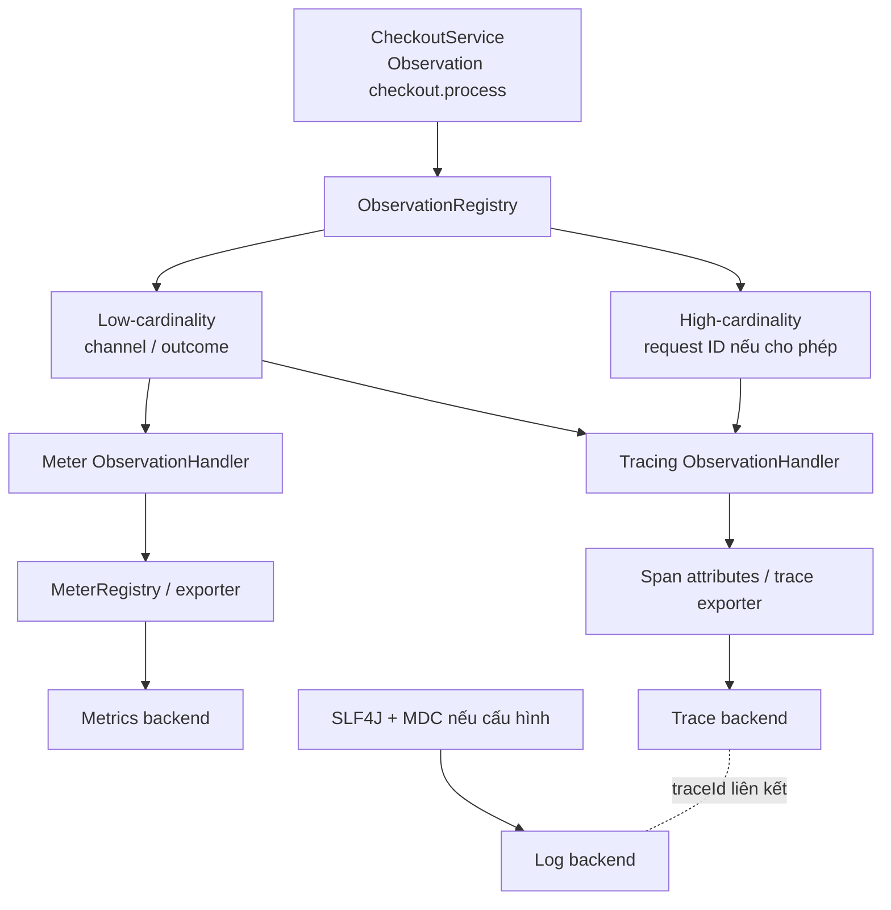

# Low-cardinality key value trong Micrometer Observation

Giả sử một ứng dụng Spring Boot có hàng trăm nghìn yêu cầu đặt hàng mỗi ngày. Nhóm vận hành muốn biết **bao nhiêu yêu cầu thất bại, lỗi tập trung ở kênh bán hàng nào và độ trễ p95 của bước thanh toán có tăng không**. Những câu hỏi này cần các nhãn để chia nhỏ metrics, nhưng nếu mỗi yêu cầu tạo nhãn riêng bằng `orderId` hoặc `traceId`, số lượng chuỗi thời gian có thể tăng rất nhanh và làm hệ thống giám sát tốn kém, chậm hoặc mất ổn định.

**Low-cardinality key value** giải quyết phần quan trọng của bài toán: gắn vào `Observation` các cặp khóa/giá trị có **tập giá trị nhỏ, được kiểm soát và có ý nghĩa phân tích**. Ví dụ: `operation=checkout`, `channel=web`, `outcome=error`. Nhờ đó, metrics có thể tổng hợp theo các chiều ổn định, trong khi log và trace vẫn phục vụ điều tra một giao dịch cụ thể.

Bài **Low-cardinality key value** thuộc chương **Cardinality và metadata** của module **SPRING_BOOT_OBSERVABILITY**. Module tập trung thiết lập observability cho Spring Boot bằng Micrometer Observation, metrics, logs và distributed tracing; học propagation ngữ cảnh, tag/cardinality, exporter, sampling và liên kết các tín hiệu để điều tra lỗi, độ trễ, hành vi ứng dụng trên môi trường thực. Ở đây, trọng tâm là **thiết kế metadata ít giá trị phân biệt** và hiểu chính xác nó được sử dụng như thế nào.

## 1. Mục tiêu học tập

Sau bài này, bạn có thể:

- Giải thích *cardinality* của một tag và vì sao tích các chiều nhãn quyết định số lượng time series tiềm năng.
- Phân biệt `lowCardinalityKeyValue` và `highCardinalityKeyValue` trong Micrometer Observation.
- Chọn các key/value hữu hạn, có quy ước đặt tên và giá trị nhất quán giữa mọi nhánh xử lý.
- Gắn low-cardinality metadata vào một custom observation trong Spring Boot bằng Java.
- Nhận biết các trường hợp nguy hiểm như `userId`, `orderId`, `traceId`, URL đầy đủ và exception message.
- Áp dụng giới hạn tag, kiểm tra metrics thực tế và tương quan với logs/traces mà không biến định danh của từng request thành metric label.

## 2. Cardinality nghĩa là gì?

Trong observability, **cardinality của một tag** là số lượng giá trị phân biệt mà tag đó có thể nhận. Ví dụ:

| Tag | Ví dụ giá trị | Cardinality dự kiến | Nhận xét |
| --- | --- | --- | --- |
| `outcome` | `success`, `rejected`, `error` | 3 | Thấp, dễ kiểm soát |
| `http.method` | `GET`, `POST`, `PUT`, `DELETE` | Nhỏ | Thường phù hợp metrics |
| `region` | `ap-southeast-1`, `eu-west-1` | Vài giá trị | Phụ thuộc số vùng triển khai |
| `channel` | `web`, `mobile`, `partner` | 3 | Thấp nếu được ánh xạ về enum |
| `http.route` | `/orders/{id}`, `/payments/{id}` | Tương đối nhỏ | Dùng **route template**, tránh URL thực |
| `orderId` | `ord-10001`, `ord-10002`, ... | Rất cao | Không dùng làm low-cardinality tag |
| `traceId` | Một ID cho từng trace | Rất cao | Dùng để tương quan log/trace |
| `exception.message` | Chuỗi có tham số động | Có thể rất cao | Có rủi ro rò dữ liệu |

**Low cardinality không có một ngưỡng số học cố định áp dụng cho mọi hệ thống.** Một tag có 100 giá trị có thể chấp nhận được với một meter đơn giản, nhưng không phù hợp nếu kết hợp với nhiều nhãn khác, hàng nghìn pod và histogram có nhiều bucket. Phải đánh giá **tổng số tổ hợp thực tế**, lưu lượng, retention và giới hạn backend.

### Vì sao các nhãn nhân với nhau?

Một time series được phân biệt bằng **tên metric + tập nhãn và giá trị của chúng**. Giả sử một timer có bốn chiều:

| Chiều | Số giá trị |
| --- | ---: |
| `service` | 4 |
| `region` | 6 |
| `channel` | 3 |
| `outcome` | 3 |

Nếu mọi tổ hợp xuất hiện, số bộ nhãn tiềm năng là:

\[
4 \times 6 \times 3 \times 3 = 216
\]

Nếu tiếp tục thêm `orderId` với 50.000 giá trị, số tổ hợp **tiềm năng theo phép nhân** tăng thành:

\[
216 \times 50\,000 = 10\,800\,000
\]

Đây là **ước lượng biên trong giả định mọi tổ hợp đều xảy ra**, không phải cam kết backend sẽ tạo đủ 10,8 triệu series. Số series thực tế phụ thuộc các tổ hợp đã quan sát, nhãn do hạ tầng thêm, tuổi thọ series và cách exporter/backend biểu diễn meter. Với histogram, các series `_bucket`, `_sum`, `_count` còn làm khối lượng dữ liệu tăng thêm.

Nói cách khác: một tag nghe có vẻ vô hại khi đứng riêng có thể trở nên đắt đỏ khi **kết hợp với nhiều tag khác** hoặc được triển khai trên hàng trăm instance.

## 3. Low-cardinality và high-cardinality trong Micrometer Observation

Micrometer Observation phân biệt hai nhóm key-value:

- **Low-cardinality key-values:** tập giá trị nhỏ, ổn định; có thể được các meter observation handler dùng làm **metric tags** và cũng có thể có mặt trong tracing metadata, tùy integration.
- **High-cardinality key-values:** chứa dữ liệu chi tiết cho từng công việc, chẳng hạn mã tham chiếu kỹ thuật có nhiều giá trị; thông thường **không được dùng làm metric tags** bởi meter observation handler tiêu chuẩn, nhưng có thể được tracing handler sử dụng làm span attributes.

Ví dụ API:

```java
Observation observation = Observation
    .createNotStarted("checkout.process", observationRegistry)
    .lowCardinalityKeyValue("operation", "checkout")
    .lowCardinalityKeyValue("channel", "web")
    .highCardinalityKeyValue("request.id", requestId)
    .start();
```

`requestId` ở ví dụ trên chỉ nên được bổ sung **nếu chính sách dữ liệu cho phép**, không chứa thông tin nhạy cảm và đội vận hành thật sự cần thuộc tính đó trong trace. High-cardinality metadata vẫn tốn tài nguyên, có giới hạn kích thước và yêu cầu kiểm soát quyền truy cập. Không nên mặc nhiên gắn mọi ID chỉ vì chúng không trở thành metric tags.

### Bảng so sánh

| Tiêu chí | Low-cardinality | High-cardinality |
| --- | --- | --- |
| Mục đích chính | Nhóm, lọc, tổng hợp số liệu | Chẩn đoán một request hoặc một nghiệp vụ cụ thể |
| Số lượng giá trị | Ít và được chuẩn hóa | Có thể rất nhiều |
| Ví dụ phù hợp | `outcome=error`, `channel=web` | `request.id=...`, mã giao dịch được phép dùng |
| Metrics thông qua meter handler thông dụng | Có thể trở thành tag | Thường không được chuyển thành tag |
| Tracing | Có thể là span attribute | Có thể là span attribute, tùy handler |
| Rủi ro chính | Tích nhãn làm tăng time series | Dữ liệu quá chi tiết, tốn lưu trữ, nguy cơ nhạy cảm |
| Propagation xuyên dịch vụ | Không tự động | Cũng không tự động |

**Quan trọng:** `highCardinalityKeyValue(...)` không tương đương **baggage** hoặc header `traceparent`. Nó không tự động mang một giá trị sang service khác. Propagation qua HTTP, queue hoặc thread phụ thuộc tracing/context propagation và instrumentation tương ứng. Nếu muốn mang metadata qua ranh giới dịch vụ, cần thiết kế cơ chế propagation riêng, có giới hạn và tuân thủ chính sách bảo mật.

## 4. Một low-cardinality key-value tốt có đặc điểm gì?

Hãy kiểm tra bốn khía cạnh trước khi đưa tag vào metric:

1. **Tập giá trị hữu hạn hoặc có giới hạn rõ:** ví dụ `channel` chỉ nhận `web`, `mobile`, `partner`, `unknown`.
2. **Ý nghĩa không đổi:** `outcome=error` ở service A và service B nên được định nghĩa rõ, không có nơi dùng để chỉ từ chối nghiệp vụ còn nơi khác dùng cho exception.
3. **Có tác dụng phân tích:** nhóm vận hành có thể hỏi tỷ lệ lỗi, throughput hoặc latency theo chiều này; không thêm tag chỉ vì dữ liệu đang có sẵn.
4. **Không chứa dữ liệu bí mật, cá nhân hoặc giá trị tùy ý:** tránh token, email, IP người dùng, input chưa chuẩn hóa, exception message, URL chứa path parameter.

Các key thường được đặt theo quy ước `lowercase` và có dấu chấm để phân nhóm, ví dụ `error.category`, `http.route`, `messaging.operation`; một số hệ thống dùng dấu gạch dưới. Điều quan trọng là **nhất quán với semantic conventions và naming convention của stack đang dùng**. Tên key được chuyển đổi khi xuất Prometheus hoặc backend khác có thể không giống nguyên dạng trong Java.

### Chuẩn hóa giá trị đầu vào

Không đưa một chuỗi do client gửi thẳng vào tag:

```java
// Không an toàn nếu header do client tự gửi bất kỳ giá trị nào.
observation.lowCardinalityKeyValue(
    "channel", request.getHeader("X-Channel"));
```

Thay vào đó, ánh xạ về tập giá trị đã cho phép:

```java
static String metricChannel(String raw) {
    if (raw == null) {
        return "unknown";
    }

    return switch (raw.toLowerCase(java.util.Locale.ROOT)) {
        case "web" -> "web";
        case "mobile", "ios", "android" -> "mobile";
        case "partner" -> "partner";
        default -> "unknown";
    };
}
```

Nhờ vậy, dù client gửi `X-Channel: 123456`, `X-Channel: test-1` hay một chuỗi rất dài, metric vẫn chỉ nhận những giá trị trong tập nhỏ. Việc chuẩn hóa **không thay thế xác thực dữ liệu** nếu trường này được dùng cho quyết định nghiệp vụ hoặc phân quyền; đây chỉ là phân loại dành cho observability.

## 5. Ví dụ thực tế: custom observation cho nghiệp vụ checkout

Ứng dụng nhận yêu cầu checkout từ ba kênh: web, mobile và partner. Với mỗi thao tác cần biết kênh nào có nhiều lỗi và thời lượng xử lý. Nếu inventory từ chối vì hết hàng, đây là **kết quả nghiệp vụ được dự kiến**; nếu gateway ném timeout, đây là lỗi kỹ thuật.

Ta sẽ tạo một custom observation với:

- `name=checkout.process`: tên công việc ổn định.
- `operation=checkout`: chỉ rõ loại thao tác.
- `channel=web|mobile|partner`: enum có tập giá trị hữu hạn.
- `outcome=success|rejected|error`: phân loại kết quả cuối.

### 5.1. Định nghĩa dữ liệu và dependency

```java
public enum CheckoutChannel {
    WEB("web"), MOBILE("mobile"), PARTNER("partner");

    private final String metricTag;

    CheckoutChannel(String metricTag) {
        this.metricTag = metricTag;
    }

    public String metricTag() {
        return metricTag;
    }
}

public record CheckoutCommand(
        String orderId,
        CheckoutChannel channel,
        int itemCount) {}

public record CheckoutResult(boolean accepted) {}

public interface CheckoutGateway {
    CheckoutResult reserve(CheckoutCommand command);
}
```

`orderId` là mã của một đơn cụ thể. `channel` được biểu diễn bằng enum nên chỉ có ba giá trị có thể ghi vào metrics. Ví dụ giả định `command` đã được validation và `channel` không null trước khi vào service; trong dự án thật cần kiểm tra điều kiện đó ở boundary.

### 5.2. Gắn low-cardinality key-value theo kết quả

```java
import io.micrometer.observation.Observation;
import io.micrometer.observation.ObservationRegistry;
import org.springframework.stereotype.Service;

@Service
public class CheckoutService {

    private final ObservationRegistry registry;
    private final CheckoutGateway gateway;

    public CheckoutService(ObservationRegistry registry,
                           CheckoutGateway gateway) {
        this.registry = registry;
        this.gateway = gateway;
    }

    public CheckoutResult checkout(CheckoutCommand command) {
        Observation observation = Observation
            .createNotStarted("checkout.process", registry)
            .lowCardinalityKeyValue("operation", "checkout")
            .lowCardinalityKeyValue(
                "channel", command.channel().metricTag())
            .start();

        try (Observation.Scope scope = observation.openScope()) {
            try {
                CheckoutResult result = gateway.reserve(command);

                if (result.accepted()) {
                    observation.lowCardinalityKeyValue(
                        "outcome", "success");
                } else {
                    observation.lowCardinalityKeyValue(
                        "outcome", "rejected");
                }

                return result;
            } catch (RuntimeException ex) {
                observation.lowCardinalityKeyValue(
                    "outcome", "error");
                observation.error(ex);
                throw ex;
            }
        } finally {
            observation.stop();
        }
    }
}
```

Đoạn code trên có ba đường đi:

1. **Thành công:** gateway trả `accepted=true`, observation có `outcome=success`, scope đóng và `stop()` chạy.
2. **Bị từ chối theo hợp đồng:** gateway trả `accepted=false`, observation có `outcome=rejected`. Đây không mặc định là exception hệ thống.
3. **Lỗi kỹ thuật:** gateway ném `RuntimeException`, observation nhận `outcome=error` và `error(ex)`; sau đó exception vẫn lan tới caller, còn `stop()` luôn được gọi.

Mọi nhánh đều đưa một giá trị `outcome` thuộc cùng tập ba giá trị. Nhờ vậy, việc tổng hợp tỷ lệ từng kết quả không phụ thuộc cách caller phản hồi HTTP 200, 409 hay 5xx. HTTP observation do framework tạo có thể có hệ nhãn riêng; custom observation này mô tả **ngữ nghĩa nghiệp vụ checkout**.

**Không thêm `orderId` vào `lowCardinalityKeyValue`.** Nếu muốn tra cứu đơn cụ thể, dùng log có kiểm soát và/hoặc trace attributes khi được phép. Việc này cần xác minh cấu hình tracer, MDC và chính sách dữ liệu trước khi đưa ID sang backend.

### 5.3. Tại sao nên đặt outcome trước khi stop?

Observation handlers có thể sử dụng key-value tại thời điểm khác nhau trong vòng đời. Với timer observation handler thông dụng, những nhãn đã gắn trước khi observation kết thúc có thể được dùng khi hoàn thiện timer metric. Do đó, các nhánh thành công/thất bại nên gắn outcome **trước `stop()`**.

Đừng giả định mọi handler hoặc exporter sẽ đọc key-value ở cùng một thời điểm. Khi thêm tag muộn, hãy kiểm tra metric/span thực tế trong stack đang dùng. Nếu muốn một tag luôn sẵn sàng từ khi bắt đầu, gắn tag đó trước `start()` như `operation` và `channel` trong ví dụ.

## 6. Low-cardinality metadata đi vào metrics và tracing như thế nào?



**Metrics:** meter observation handler thường tạo timer theo observation name và đưa low-cardinality key-value vào tag set. Ở Prometheus, một timer có thể xuất thành các series có hậu tố `_seconds_count`, `_seconds_sum` và `_seconds_bucket` khi bật histogram; tên chính xác phụ thuộc exporter, naming convention và phiên bản. Đối với `outcome`, các giá trị hữu hạn giúp tổng hợp count và latency.

**Traces:** tracing observation handler có thể đưa cả low- và high-cardinality key-value thành attributes trên span. Tuy nhiên, thuộc tính xuất ra, lỗi, tên span và sampling phụ thuộc integration. Tracing sampling làm giảm số trace được lưu; nó **không phải biện pháp trực tiếp giảm cardinality của metrics**, vì metrics và traces thường có pipeline và chính sách xuất riêng.

**Logs:** `Observation.lowCardinalityKeyValue(...)` không tự phát log và không bảo đảm mọi key-value đều xuất hiện trong MDC. Nếu muốn log chứa `channel` hoặc `outcome`, hãy ghi các trường đã kiểm soát theo schema log hoặc dùng logging integration phù hợp. Khi tracing được cấu hình, `traceId` và `spanId` có thể xuất hiện trong log để liên kết; đây là **khóa tương quan** chứ không phải metric label.

### Liên kết một lỗi cụ thể

Hình dung metrics chỉ ra `checkout.process{channel="mobile", outcome="error"}` tăng đột biến. Ta lấy một log lỗi trong khoảng thời gian tương ứng, dùng `traceId` của log để mở trace nếu được sampling và xuất. Trace có thể cho thấy span gateway chiếm 1,8 giây trước khi timeout. Không cần biến từng `traceId` thành một time series để thực hiện điều tra này.

## 7. Quy ước metadata cho production

Một bộ tag tốt cần thống nhất **tên, tập giá trị, cấp độ quan sát và đơn vị đo**. Ví dụ schema đề xuất cho `checkout.process`:

| Key | Kiểu giá trị | Tập cho phép | Ý nghĩa |
| --- | --- | --- | --- |
| `operation` | Chuỗi enum | `checkout` | Loại công việc |
| `channel` | Chuỗi enum | `web`, `mobile`, `partner`, `unknown` | Kênh nguồn |
| `outcome` | Chuỗi enum | `success`, `rejected`, `error` | Kết quả cuối |
| `error.category` | Chuỗi enum nếu dùng | `timeout`, `dependency`, `validation`, `other` | Nhóm lỗi kỹ thuật |
| `service` | Giá trị triển khai có kiểm soát | Tên dịch vụ đã đăng ký | Nguồn phát sinh |

Một số hệ thống có thể không cần `operation` nếu tên observation đã đủ phân biệt. Mỗi tag bổ sung phải trả lời **một câu hỏi vận hành cụ thể**, không chỉ vì dữ liệu có sẵn.

### Thiết kế outcome thống nhất

Một enum do ứng dụng sở hữu giúp tránh biến thể `ok`, `OK`, `passed`, `SUCCESS` cùng diễn đạt một ý. Ví dụ quy ước:

- `success`: công việc hoàn tất đúng yêu cầu.
- `rejected`: từ chối theo hợp đồng nghiệp vụ, không nhất thiết là lỗi hạ tầng.
- `error`: lỗi kỹ thuật hoặc thất bại không được phục hồi trong phạm vi observation.
- `degraded`: chỉ thêm nếu hệ thống thật sự có chế độ fallback làm suy giảm chất lượng và muốn theo dõi riêng.

Định nghĩa này phải gắn với **ranh giới observation**. Một attempt gọi inventory thất bại có thể có `outcome=error`, còn thao tác checkout tổng thể sau retry thành công vẫn có `outcome=success` hoặc `degraded` theo hợp đồng. Nếu trộn số lần attempt với số lần checkout, tỷ lệ lỗi sẽ bị diễn giải sai.

### Tag bị thiếu hoặc không đồng nhất

Nếu nhánh thành công có `outcome=success` nhưng nhánh exception không có `outcome`, backend có thể tạo nhiều tổ hợp label thiếu/đủ khác nhau. Dashboard lọc `outcome=error` sẽ bỏ sót lỗi thật. Hãy bảo đảm những nhánh cần đo **đều đặt giá trị**, hoặc có một quy ước `unknown` rõ ràng trong trường hợp không phân loại được.

Tránh tự đặt `error.category="none"` rồi ghi thêm một key cùng tên bằng API append mà chưa xác nhận semantics của phiên bản Micrometer; nếu cần cập nhật một giá trị, hãy thiết kế logic gắn tag một lần ở thời điểm xác định, hoặc dùng context/convention theo đúng API.

## 8. Giới hạn cardinality và bảo vệ hạ tầng

Thiết kế tag hữu hạn là biện pháp chính. Khi hệ thống có dữ liệu khó kiểm soát hoặc nhiều người phát triển, nên bổ sung **guardrail** tại registry và hạ tầng.

### 8.1. Tính trước ngân sách series

Giả sử một metric `checkout.process` có 4 kênh, 4 outcome, 6 region và 5 instance:

\[
4 \times 4 \times 6 \times 5 = 480
\]

Đây là số tổ hợp nhãn **tối đa theo giả định mỗi tổ hợp xuất hiện** với bốn chiều này. Nếu histogram có 12 buckets cùng `_sum` và `_count`, một tổ hợp nhãn có thể tạo thêm nhiều series; số lượng thực tế phụ thuộc exporter và cấu hình. Hãy nhân thêm các nhãn mặc định từ hạ tầng như `job`, `instance`, `pod` hoặc deployment khi lập ngân sách.

### 8.2. MeterFilter như lớp phòng vệ

Micrometer Metrics cung cấp `MeterFilter` để giới hạn một số tag values theo tên meter. Ví dụ Java sau dùng API của Micrometer Metrics trong Spring Boot:

```java
import io.micrometer.core.instrument.MeterRegistry;
import io.micrometer.core.instrument.config.MeterFilter;
import org.springframework.boot.actuate.autoconfigure.metrics.MeterRegistryCustomizer;
import org.springframework.context.annotation.Bean;
import org.springframework.context.annotation.Configuration;

@Configuration(proxyBeanMethods = false)
public class MetricTagGuardrails {

    @Bean
    MeterRegistryCustomizer<MeterRegistry> checkoutTagLimit() {
        return registry -> registry.config().meterFilter(
            MeterFilter.maximumAllowableTags(
                "checkout.process",
                "channel",
                10,
                MeterFilter.deny()
            )
        );
    }
}
```

Mẫu này giới hạn số **giá trị phân biệt của tag `channel`** được chấp nhận đối với meter có tên bắt đầu bằng `checkout.process`; sau khi đạt ngưỡng, các meter mới có giá trị tag vượt hạn mức có thể bị từ chối theo filter. Đây là **cơ chế an toàn cuối cùng**, không sửa được dữ liệu gắn tag sai: series bị từ chối đồng nghĩa số liệu có thể thiếu. Cần giám sát chính filter, hiểu phạm vi áp dụng theo phiên bản và kiểm tra hậu quả với exporter đang dùng.

Với channel được ánh xạ về enum có ba giá trị như ví dụ, giới hạn 10 chủ yếu để phòng ngừa thay đổi code không mong muốn. Không nên dùng filter như lý do để cho phép `orderId` hoặc `userId` đi vào metric tags rồi hy vọng registry sẽ tự xử lý an toàn.

### 8.3. Phân biệt chặn tại code và lúc export

| Tầng | Kiểm soát | Giới hạn |
| --- | --- | --- |
| Service/controller | Chuẩn hóa input thành enum | Tốt nhất vì ngăn nhãn động ngay từ nguồn |
| Observation convention/filter | Áp dụng schema/tags nhất quán | Cần hiểu thời điểm các handler đọc metadata |
| MeterRegistry/MeterFilter | Giới hạn, từ chối, đổi tên meter/tag | Có thể làm thiếu dữ liệu hoặc tạo kết quả khó hiểu nếu dùng muộn |
| Collector/exporter | Drop/relabel/aggregation tùy backend | Tốn chi phí trước khi bị loại và có thể làm mất tín hiệu |
| Backend metrics | Quota, retention, alert cardinality | Bảo vệ hạ tầng nhưng không khắc phục lỗi thiết kế ứng dụng |

Không có lớp nào thay thế cho việc thiết kế metadata có **tập giá trị giới hạn ngay từ đầu**.

## 9. Quan hệ với ObservationConvention và ObservationFilter

Khi chỉ có một custom observation, gọi trực tiếp `lowCardinalityKeyValue(...)` trong service thường đủ rõ ràng. Khi nhiều lớp và đội cùng tạo một loại observation, schema tag có thể được tập trung bằng:

- **`ObservationConvention`:** chuẩn hóa tên, contextual name và key-values cho một loại observation context; thường phù hợp khi có kiểu context chuyên biệt.
- **`ObservationFilter`:** tùy chỉnh observation context qua cơ chế registry trước khi quá trình hoàn tất; phù hợp bổ sung metadata chung trong phạm vi đã xác định.
- **`ObservationPredicate`:** quyết định có cho phép observation được tạo/ghi nhận theo điều kiện, ví dụ loại bỏ một nhóm health-check không cần đo.
- **`ObservationHandler`:** phản ứng với callback vòng đời; meter/tracing handlers dùng metadata để tạo tín hiệu tương ứng.

Không nên dùng handler `onStart` để gắn động mọi request ID vào low-cardinality tags. Đó là lỗi thiết kế metadata, dù mã nguồn nằm trong service, convention, filter hay handler.

### Metadata của framework và metadata tự thêm

Spring Boot/Spring Framework có thể tạo observation cho HTTP server/client và những thành phần đã instrument. Một số nhãn như method, route, status hoặc URI template thường đã do framework cung cấp với quy ước riêng. Trước khi tự bổ sung một nhãn trùng tên, hãy kiểm tra dữ liệu hiện có và tính tương thích với phiên bản đang dùng.

Ví dụ, **`/orders/{id}`** là route template hữu hạn, còn **`/orders/841239`** là đường dẫn cụ thể có ID động. Nếu tự thay route tag bằng `request.getRequestURI()`, bạn có thể phá vỡ mục tiêu giảm cardinality dù framework ban đầu đã dùng nhãn an toàn.

## 10. Những sai lầm phổ biến

| Sai sót | Hậu quả | Cách sửa |
| --- | --- | --- |
| Gắn `userId` hoặc `orderId` làm low-cardinality key | Số time series tăng theo số người dùng/đơn hàng | Dùng ID trong log/trace context có kiểm soát |
| Gắn full URL làm `http.route` | Mỗi path parameter tạo giá trị mới | Dùng route template |
| Lấy thẳng header do client nhập | Client có thể tạo vô số tag values | Map sang enum/`unknown` |
| Gắn `exception.message` làm tag | Cardinality cao, có thể lộ thông tin | Chuẩn hóa `error.category` hữu hạn |
| Mỗi service có một bộ giá trị `outcome` riêng | Khó tổng hợp và so sánh | Định nghĩa contract outcome thống nhất |
| Nhánh exception quên gắn `outcome=error` | Dashboard bỏ sót lỗi | Phủ đủ nhánh, đặt tag trước `stop()` |
| Gắn `traceId` vào metric label để nối log | Cardinality khổng lồ | Dùng traceId cho log/trace correlation |
| Cho rằng high-cardinality tự được truyền giữa services | Mất metadata sau HTTP/queue boundary | Cấu hình propagation/instrumentation phù hợp |
| Dùng tracing sampling để giảm số metric series | Không giải quyết gốc cardinality metrics | Giảm giá trị tag, xem nhãn bổ sung và registry |
| Bật histogram cho mọi meter có nhiều nhãn | Tăng nhanh số series và dung lượng | Chọn SLO/histogram cho các meter trọng yếu |
| Dùng MeterFilter làm cơ chế chính để sửa tag bẩn | Thiếu số liệu, khó giải thích | Chuẩn hóa tại nguồn, filter chỉ là guardrail |
| Gắn cùng tag qua nhiều cơ chế không kiểm tra | Nhãn trùng hoặc ghi đè ngoài ý muốn | Kiểm tra observation convention, handler và exporter |

## 11. Thực hành và xác minh

Hãy áp dụng vào `CheckoutService` ở phần 5. Tạo một implementation thử nghiệm của `CheckoutGateway` có thể lần lượt trả `accepted=true`, `accepted=false` và ném `RuntimeException`.

### Bảng ca kiểm thử

| Ca | Đầu vào/hành vi | Tag mong đợi | Điều cần quan sát |
| --- | --- | --- | --- |
| A | `channel=WEB`, thành công | `channel=web, outcome=success` | Timer count tăng ở nhóm thành công |
| B | `channel=MOBILE`, bị từ chối | `channel=mobile, outcome=rejected` | Không nhầm từ chối nghiệp vụ với lỗi kỹ thuật |
| C | `channel=PARTNER`, timeout | `channel=partner, outcome=error` | Observation báo lỗi, vẫn stop, exception tiếp tục lan |
| D | Client gửi channel không hợp lệ | `channel=unknown` sau bước normalize nếu chấp nhận | Không tạo metric tag mới theo chuỗi input |
| E | Nhiều order ID khác nhau cùng channel | Cùng `channel=web` | Không xuất `orderId` dưới dạng metric label |
| F | Retry attempt đầu lỗi, lần hai thành công | Phân biệt metric attempt và operation | Không cộng lỗi attempt thành lỗi của request cuối |

### Kiểm tra từng tầng

1. **Tại code:** xem mọi nhánh được gắn outcome trước khi stop; chỉ dùng nhãn hữu hạn và không lộ dữ liệu riêng của từng đơn.
2. **Tại MeterRegistry:** kiểm tra meter `checkout.process` có các tag `channel` và `outcome` theo dự kiến, số lượng meter theo tổ hợp thấp. Nếu cần test độc lập, dùng `SimpleMeterRegistry` cùng cấu hình observation meter handler phù hợp; một registry metrics đơn lẻ không tự sinh timer từ observation nếu không có handler.
3. **Tại exporter:** quan sát tên metric thực tế và những tag do naming convention/collector bổ sung. Đừng đoán tên series chỉ từ tên `Observation` trong Java.
4. **Tại tracing:** xác minh tags được phản ánh hợp lý trên span khi tracing handler/exporter đã cấu hình; nếu thiếu trace, kiểm tra sampling, collector và context propagation.
5. **Tại logs:** khi điều tra một checkout lỗi, tìm log theo thời gian và trace ID, mở trace tương ứng nếu có. Tránh yêu cầu có một metric series riêng cho mỗi ID.
6. **Theo thời gian:** theo dõi số lượng active time series và chi phí khi số instance, region hoặc số outcome tăng. Cardinality là vấn đề vận hành liên tục, không chỉ là điều kiện pass của unit test.

### Thử tự tính ngân sách

Một service có 3 channel, 4 outcome, 8 region, 10 instances và 2 loại operation. Hãy tính số tổ hợp tối đa theo giả định mọi tổ hợp đều xảy ra:

\[
3 \times 4 \times 8 \times 10 \times 2 = 1\,920
\]

Sau đó xét nếu có thêm `tenantId` với 2.000 giá trị:

\[
1\,920 \times 2\,000 = 3\,840\,000
\]

Điều gì xảy ra nếu timer còn xuất histogram buckets? Bạn sẽ giữ những chiều nào cho metrics, và đưa `tenantId` vào đâu để vẫn điều tra được một trường hợp cụ thể? Hãy giải thích lựa chọn dựa trên nhu cầu vận hành, quyền riêng tư và khả năng lưu trữ.

## 12. Câu hỏi tự đánh giá

1. Vì sao `lowCardinalityKeyValue` có tên là “low cardinality” nhưng API không thể bảo đảm giá trị truyền vào thật sự ít biến thể?
2. Khi nào `error.category=timeout` tốt hơn `exception.message=Read timed out for order 123`?
3. Một observation có cả `traceId` và `outcome`: trường nào phù hợp để tạo metric label? Vì sao?
4. Gắn thêm một tag chỉ có 5 giá trị có thể làm tổng số series tăng bao nhiêu lần? Điều gì khiến kết quả thực tế khác với phép nhân lý thuyết?
5. Vì sao trace sampling không giải quyết việc metric có hàng triệu tổ hợp nhãn?
6. Khi service đã trả kết quả từ fallback, bạn nên gắn `outcome=success`, `degraded` hay `error`? Cần xác định ranh giới và hợp đồng nào trước?
7. Khi Spring Boot đã tự instrument HTTP endpoint, tại sao dùng path thật thay cho route template có thể làm hỏng cardinality?
8. `ObservationFilter` và `MeterFilter` khác nhau ở lớp nào của pipeline?

## 13. Ghi nhớ

**Low-cardinality key value** là cặp metadata có tập giá trị **hữu hạn, nhất quán và hữu ích để tổng hợp số liệu**. Trong Micrometer Observation, dùng `lowCardinalityKeyValue` cho các chiều như `operation`, `channel`, `outcome`; tránh đưa `orderId`, `userId`, `traceId`, full URL hay exception message vào nhãn metrics. Mỗi tag bổ sung có thể nhân số lượng tổ hợp series với các tag đang tồn tại.

Thiết kế tốt bắt đầu từ việc chuẩn hóa dữ liệu ở nguồn, định nghĩa outcome rõ ràng theo ranh giới observation, kiểm tra toàn bộ nhãn được xuất và đặt ngân sách cardinality. Metrics cung cấp số liệu tổng hợp; logs và traces cung cấp chi tiết theo request; context propagation, exporter và sampling quyết định mức độ liên kết có thể quan sát. Khi phân vai đúng cho từng tín hiệu, Spring Boot có thể giữ được cả **khả năng điều tra sự cố** và **chi phí giám sát có kiểm soát** trong môi trường thực.
