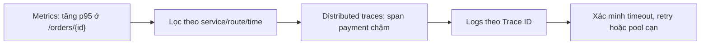

# Cardinality trong metrics của Spring Boot Observability

Trong hệ thống observability, một metric hữu ích khi nó mô tả hành vi ứng dụng qua thời gian và có thể được tổng hợp ổn định. Tuy nhiên, cùng một metric có thể tạo ra hàng chục, hàng nghìn hoặc hàng triệu **time series** khi các tag/label của nó nhận quá nhiều giá trị. Hiện tượng này được gọi là **high cardinality** và là nguyên nhân phổ biến khiến backend metrics tốn bộ nhớ, tăng chi phí lưu trữ, truy vấn chậm hoặc không còn đáp ứng được nhu cầu cảnh báo.

Bài **“Cardinality trong metrics”** thuộc chương **Cardinality và metadata**, trong module **SPRING_BOOT_OBSERVABILITY**. Nội dung tập trung vào Micrometer và Spring Boot: nhận diện tags có cardinality cao, tính tác động lên số series, thiết kế nhãn phù hợp với nghiệp vụ, kiểm soát dữ liệu bằng Observation/MeterRegistry và kiểm chứng trên Prometheus hoặc backend metrics tương đương. Đồng thời, bài làm rõ việc liên kết **metrics, logs và distributed traces** mà không biến mã định danh từng request thành metric labels.

## 1. Metric, tag và time series là gì?

**Metric** là một phép đo có tên và kiểu rõ ràng, ví dụ số lần đặt hàng thành công hoặc thời lượng xử lý HTTP request. Micrometer cung cấp các meter như:

- **Counter:** đại diện cho số lượng sự kiện tích lũy tăng dần, chẳng hạn số đơn hàng được xác nhận.
- **Timer:** ghi số lần thực thi và thời lượng, chẳng hạn thời gian giữ hàng hoặc xử lý HTTP.
- **Gauge:** quan sát giá trị tại thời điểm đọc, chẳng hạn số kết nối đang sử dụng.
- **DistributionSummary:** ghi phân phối của đại lượng đo không nhất thiết là thời gian, chẳng hạn kích thước payload đã được kiểm soát.

Một meter thường đi kèm **tags** (Micrometer) hay **labels** (Prometheus). Ví dụ:

```text
orders.processed{channel="web",outcome="success"}  410
orders.processed{channel="web",outcome="failure"}   12
orders.processed{channel="mobile",outcome="success"} 290
orders.processed{channel="mobile",outcome="failure"}  8
```

Đây là ví dụ khái niệm về các chuỗi số liệu, không phải định dạng xuất chính xác của một Counter trong mọi backend. Với cùng tên metric `orders.processed`, mỗi tổ hợp nhãn khác nhau là một **chuỗi thời gian riêng**.

Trong một backend kiểu Prometheus, time series được phân biệt bởi **tên metric và toàn bộ tập labels**. Hai mẫu có cùng tên và cùng nhãn nhưng khác thời điểm là hai điểm dữ liệu của cùng một series; hai mẫu khác nhau ở giá trị label là hai series khác nhau.

### Cardinality có hai nghĩa dễ nhầm

- **Cardinality của một tag:** số giá trị phân biệt tag đó nhận được. Ví dụ `channel` có `web` và `mobile`, cardinality là 2.
- **Cardinality của một metric:** số tổ hợp nhãn thực sự phát sinh và tạo thành các series khác nhau. Số này phụ thuộc cả từng tag và mối liên hệ giữa chúng.

Không phải mọi tổ hợp có thể có đều xuất hiện. Tuy nhiên, nếu các chiều nhãn tương đối độc lập, tổng số series có thể tăng gần bằng tích số lượng giá trị của từng chiều.

## 2. Công thức ước lượng số lượng time series

Giả sử một HTTP metric có các tag:

| Tag | Số giá trị phân biệt (giả định) | Ví dụ |
| --- | ---: | --- |
| `uri` | 25 | `/orders/{id}`, `/payments` |
| `method` | 4 | GET, POST, PUT, DELETE |
| `status` | 5 | 200, 201, 400, 404, 500 |
| `instance` | 12 | 12 instance đang chạy |

**Giới hạn trên lý thuyết** của số tổ hợp nhãn là:

\[
N_{\text{series}} \leq \prod_{i=1}^{k} |V_i|
\]

với \(V_i\) là tập giá trị của tag thứ \(i\). Trong ví dụ:

\[
25 \times 4 \times 5 \times 12 = 6\,000\text{ tổ hợp}
\]

Con số thực tế có thể nhỏ hơn nhiều vì một số method không tồn tại trên từng route, một số status hiếm gặp và các instance có thể nhận traffic khác nhau.

Nếu thêm `user.id` với 10.000 giá trị, giới hạn trên trở thành:

\[
6\,000 \times 10\,000 = 60\,000\,000\text{ tổ hợp}
\]

Đây là **kịch bản giới hạn trên**, không phải dự báo hệ thống chắc chắn tạo 60 triệu series. Tuy nhiên, nó cho thấy chỉ một nhãn mang ID có thể biến một phép đo tổng hợp thành vô số chuỗi gần như không thể tổng hợp hiệu quả.

### Histogram còn nhân số series

Với histogram kiểu Prometheus classic, mỗi tập nhãn thường có nhiều bucket series, cùng những series liên quan đến count và sum. Ví dụ giả định một histogram có 15 bucket series và 2 series count/sum thì **một** tổ hợp tags có thể phát sinh khoảng 17 series thay vì một. Số thực tế còn tùy cấu hình và loại backend.

\[
6\,000 \text{ tổ hợp} \times 17 \approx 102\,000\text{ series}
\]

Khi cấu hình nhiều buckets hoặc nhiều labels, chi phí có thể tăng nhanh. Vì vậy cần xét **cả cardinality của tags lẫn cách meter xuất số liệu**, không chỉ đếm số tên metric.

### Số mẫu gửi đi cũng tăng

Trong mô hình scrape giả định mỗi 15 giây, một series được lấy tối đa khoảng 4 mẫu/phút khi target hoạt động bình thường. Với 100.000 series ổn định, hệ thống có thể nhận khoảng 400.000 mẫu/phút chỉ từ nhóm series đó. Đó là ước lượng để hình dung quy mô, chưa bao gồm retry, replication, metadata hay đặc điểm lưu trữ của backend.

## 3. Phân biệt low-cardinality và high-cardinality metadata

Trong Micrometer Observation, **low-cardinality key-values** thường được dùng làm tags cho metrics và cũng có thể được dùng làm attributes trong traces. **High-cardinality key-values** có thể cung cấp thông tin chi tiết cho traces qua handler tương ứng; theo cách tích hợp chuẩn, chúng không trở thành metric tags.

| Dữ liệu | Cardinality dự kiến | Phù hợp với metrics? | Lý do |
| --- | --- | --- | --- |
| `http.request.method`: GET/POST/... | Thấp | Có | Phục vụ phân tích theo phương thức HTTP |
| `http.route`: `/orders/{id}` | Có giới hạn nếu số route hữu hạn | Có | Nhóm request theo endpoint |
| `outcome`: success/failure | Thấp | Có | Hữu ích cho tỷ lệ lỗi |
| `payment.method`: card/wallet | Thấp | Có | Phân tích theo loại phương thức thanh toán |
| `warehouse.region`: apac/eu/other | Thấp | Có | Phân tích theo khu vực |
| `user.id`, `order.id` | Rất cao | Không | Gần như một giá trị trên từng người/đơn |
| `request.id`, `trace.id` | Gần như duy nhất | Không | Định danh từng lần xử lý, tạo series riêng |
| Raw URL có mã tài nguyên | Cao | Không | Một URL mới có thể tạo một series mới |
| Dấu thời gian, UUID, session ID | Rất cao | Không | Tăng liên tục theo thời gian |

Không nên suy luận rằng “high-cardinality thì cứ đưa sang traces”. Traces cũng có chi phí storage/indexing và chính sách bảo mật. **Email, token, số thẻ, thông tin đăng nhập, payload nguyên bản và dữ liệu cá nhân nhạy cảm không nên được đưa vào metric labels, span attributes hoặc baggage**.

### Metric label không phải công cụ tra cứu một request cụ thể

Để trả lời “đơn hàng mã X đã xảy ra lỗi ở đâu?”, dùng logs có correlation ID, traces với Trace ID và hệ thống nghiệp vụ có quyền truy cập thích hợp. Metric labels phục vụ câu hỏi “trên tất cả đơn hàng, nhóm nào đang chậm hoặc lỗi nhiều?”. Hai loại câu hỏi cần dữ liệu khác nhau.

## 4. Những nguồn làm cardinality tăng trong Spring Boot

### 4.1. Raw URL thay cho route template

Ví dụ không phù hợp:

```text
uri="/orders/1001"
uri="/orders/1002"
uri="/orders/1003"
...
```

Tập nhãn này tăng theo số lượng đơn hàng. Một nhãn phù hợp hơn:

```text
uri="/orders/{id}"
```

Spring MVC/WebFlux với instrumentation thích hợp thường dùng route template hoặc giá trị thay thế đã chuẩn hóa. Tuy nhiên, cách gắn nhãn thực tế tùy phiên bản, framework, endpoint type và cấu hình; **hãy kiểm tra nhãn đã xuất**, không mặc định mọi router tùy biến đều giữ cardinality thấp.

Các URL có query string, UUID, pagination cursor hoặc tên file tải xuống cũng phải được xem xét nếu ứng dụng tự tạo metric tags.

### 4.2. Gắn mã giao dịch vào Counter

Ví dụ không nên làm:

```java
meterRegistry.counter(
        "orders.created",
        "order.id", orderId
).increment();
```

Nếu mỗi đơn có một `orderId` mới, mỗi lần gọi có thể đăng ký một meter/series mới. Counter tổng hợp không còn mang lại lợi ích đáng kể khi gần như mọi label combination chỉ ghi một lần.

Ví dụ phù hợp hơn:

```java
meterRegistry.counter(
        "orders.created",
        "channel", normalizedChannel,
        "outcome", "success"
).increment();
```

Ở đây `normalizedChannel` phải thuộc một tập nhỏ đã quy định. Không đưa một chuỗi nhận trực tiếp từ client vào tag mà chưa kiểm soát tập giá trị.

### 4.3. Tags của hệ thống hạ tầng

Các nhãn `instance`, `pod`, `container` hoặc `host` phục vụ xác định vị trí phát metrics, nhưng số lượng giá trị có thể thay đổi khi autoscaling, deployment hoặc restart. Chúng không nhất thiết là lỗi thiết kế; cần đánh giá **nhãn nào dùng để điều tra từng instance** và **nhãn nào nên được aggregate/drop ở tầng phù hợp**.

Đặc biệt, nếu mỗi lần triển khai tạo pod mới, backend có thể giữ cả series cũ và mới trong khoảng retention. Cần phân biệt **active series**, series mới phát sinh theo thời gian và toàn bộ series vẫn đang được lưu.

### 4.4. Instrumentation không kiểm soát

Các nguồn thường cần xem xét:

- Metric cho từng query SQL text thay vì loại operation.
- Metric cho từng exception message chứa dữ liệu biến đổi.
- Metric cho từng tenant/customer khi tập tenant lớn.
- Metrics từ queue/topic có tên được tạo động.
- Tên span hoặc meter tạo từ input người dùng.
- Tags do custom `ObservationConvention` hoặc `MeterFilter` thêm tự động.

Dù một nhãn ban đầu có ít giá trị, nó có thể trở thành high-cardinality khi sản phẩm phát triển. Nên quản lý một **danh sách cho phép** và có giới hạn số lượng giá trị từ đầu.

## 5. Thiết kế tags an toàn theo mục tiêu quan sát

Trước khi thêm một tag, trả lời bốn câu hỏi:

1. **Câu hỏi vận hành là gì?** Ví dụ cần so sánh độ trễ giữa `channel=web` và `channel=mobile`.
2. **Có bao nhiêu giá trị có thể xuất hiện?** Ước lượng hiện tại và khi lượng người dùng/đơn hàng tăng gấp mười.
3. **Tag có ổn định theo thời gian không?** ID động, tên pod ngắn hạn hoặc URL đầy đủ thường có churn lớn.
4. **Tag có chứa thông tin nhạy cảm không?** Nếu có, không xuất vào hệ observability công khai cho nhiều người truy cập.

Một bản thiết kế tags có thể ghi như sau:

| Metric/operation | Các tag được phép | Các giá trị hợp lệ | Không đưa vào |
| --- | --- | --- | --- |
| `orders.created` | `channel`, `outcome` | web/mobile; success/failure | orderId, userId |
| `inventory.reserve` | `warehouse.region`, `outcome` | apac/eu/other; reserved/failed | raw warehouse address |
| `payment.authorize` | `payment.method`, `outcome` | card/wallet; approved/declined/error | account number, token |
| `http.server.requests` | `uri`, `method`, `status` và tags do framework cung cấp | Route template, phương thức/status được quy chuẩn | Raw URL, session ID |

### 5.1. Phân loại lỗi, không dùng thông điệp lỗi

Không đưa `exception.getMessage()` vào tag vì thông điệp có thể chứa ID, path, SQL hoặc nội dung tùy request. Thay bằng một tập mã lỗi ổn định:

```text
error.category="validation"
error.category="dependency_timeout"
error.category="business_rejected"
error.category="unexpected"
```

Một exception class name đôi khi có số lượng giá trị tương đối hữu hạn, nhưng vẫn phải kiểm tra instrumentation và số loại exception thực tế. Khi cần chi tiết stack trace, dùng logs/traces với kiểm soát dữ liệu phù hợp.

### 5.2. Dùng “other” hay từ chối giá trị không hợp lệ?

Có hai cách thường gặp:

- Chuẩn hóa các giá trị ngoài danh sách thành `other` hoặc `unknown` để giữ tổng số series nhỏ.
- Từ chối hoặc báo lỗi đầu vào nghiệp vụ nếu giá trị đó là bất hợp lệ theo contract, đồng thời ghi metrics lỗi dưới nhóm có giới hạn.

Không được âm thầm chuyển một phương thức thanh toán không hợp lệ thành `card` chỉ để giảm cardinality. **Chuẩn hóa nhãn là việc tổng hợp quan sát**, không thay đổi quyết định nghiệp vụ.

## 6. Ví dụ Java với Micrometer MeterRegistry

Ví dụ service ghi counter có số nhãn hữu hạn, độc lập với mã đơn hàng:

```java
import io.micrometer.core.instrument.MeterRegistry;
import org.springframework.stereotype.Component;

@Component
public class OrderMetrics {

    private final MeterRegistry meterRegistry;

    public OrderMetrics(MeterRegistry meterRegistry) {
        this.meterRegistry = meterRegistry;
    }

    public void recordProcessed(String channel, boolean success) {
        String channelTag = normalizeChannel(channel);
        String outcomeTag = success ? "success" : "failure";

        meterRegistry.counter(
                "orders.processed",
                "channel", channelTag,
                "outcome", outcomeTag
        ).increment();
    }

    private static String normalizeChannel(String channel) {
        if ("web".equalsIgnoreCase(channel)) {
            return "web";
        }
        if ("mobile".equalsIgnoreCase(channel)) {
            return "mobile";
        }
        return "other";
    }
}
```

Service chỉ sử dụng `MeterRegistry` do Spring Boot quản lý. Giá trị `channelTag` thuộc tối đa ba nhóm, `outcomeTag` thuộc hai nhóm, nên về phần các tags này có **tối đa 6 tổ hợp**. Những common tags hoặc labels do backend thêm có thể làm tổng số series lớn hơn.

Không cần tạo một `SimpleMeterRegistry` mới trong business service: registry đó có thể đứng ngoài Prometheus/OTLP registry mà Spring Boot đang cấu hình.

### 6.1. Timer cho thao tác nghiệp vụ

```java
import io.micrometer.core.instrument.MeterRegistry;
import io.micrometer.core.instrument.Timer;
import org.springframework.stereotype.Service;

@Service
public class InventoryService {

    private final MeterRegistry meterRegistry;

    public InventoryService(MeterRegistry meterRegistry) {
        this.meterRegistry = meterRegistry;
    }

    public void reserve(String region, Runnable operation) {
        String regionTag = normalizeRegion(region);

        Timer timer = meterRegistry.timer(
                "inventory.reserve.duration",
                "warehouse.region", regionTag
        );

        timer.record(operation);
    }

    private static String normalizeRegion(String region) {
        if ("apac".equalsIgnoreCase(region)) {
            return "apac";
        }
        if ("eu".equalsIgnoreCase(region)) {
            return "eu";
        }
        return "other";
    }
}
```

Timer đo thời lượng thực hiện `operation`. Ví dụ này tập trung vào đo metrics; cách ghi `outcome` hoặc exception cần thiết kế riêng nếu muốn phân biệt kết quả. Không thêm UUID, order ID hoặc nội dung request làm nhãn Timer.

## 7. Cardinality trong Micrometer Observation

Khi muốn cùng một operation phục vụ metrics và traces, sử dụng **Observation**:

```java
import io.micrometer.observation.Observation;
import io.micrometer.observation.ObservationRegistry;
import org.springframework.stereotype.Service;

@Service
public class ReservationWorkflow {

    private final ObservationRegistry observationRegistry;

    public ReservationWorkflow(ObservationRegistry observationRegistry) {
        this.observationRegistry = observationRegistry;
    }

    public void execute(String region, Runnable action) {
        String regionGroup = normalizeRegion(region);

        Observation.createNotStarted(
                    "inventory.reserve",
                    observationRegistry
                )
                .lowCardinalityKeyValue("warehouse.region", regionGroup)
                .observe(action);
    }

    private static String normalizeRegion(String value) {
        if ("apac".equalsIgnoreCase(value)) {
            return "apac";
        }
        if ("eu".equalsIgnoreCase(value)) {
            return "eu";
        }
        return "other";
    }
}
```

Khi Spring Boot đã kết nối đúng handlers:

- **Metrics handler** có thể tạo timer theo tên Observation và low-cardinality key-value.
- **Tracing handler** có thể tạo span khi có tracing bridge, scope và sampling phù hợp.
- **Exporter** gửi metrics hoặc spans qua các đường khác nhau đến backend.
- **Logs** có thể được correlation với Trace ID/Span ID khi tracing context và logging pattern được cấu hình.

### 7.1. Low và high cardinality trong Observation

Micrometer Observation tách hai thao tác:

```java
observation.lowCardinalityKeyValue("warehouse.region", "apac");
observation.highCardinalityKeyValue("operation.reference", approvedReference);
```

`approvedReference` trong ví dụ là một giá trị tương quan kỹ thuật **đã được phê duyệt và không nhạy cảm**. Theo các metrics/tracing handlers tiêu chuẩn, low-cardinality key-values có thể xuất sang cả metrics và tracing; high-cardinality key-values dành cho tracing, không tự trở thành metric tags.

Nhưng **high-cardinality không phải giấy phép ghi mọi thông tin**: trace attributes vẫn tiêu tốn lưu trữ và có thể truy vấn bởi nhiều người. Tài liệu nghiệp vụ, thông tin khách hàng hoặc bí mật không được đưa vào chỉ vì chúng không nằm trong metrics.

### 7.2. ObservationConvention giúp thống nhất schema

Khi nhiều nơi cùng ghi `inventory.reserve`, sử dụng `ObservationConvention` và loại `Observation.Context` thích hợp để định nghĩa tên, contextual name, low/high-cardinality key-values một cách nhất quán. Convention giúp các nhóm không tạo tên `warehouse_region`, `region`, `warehouseRegion` khác nhau cho cùng ý nghĩa.

**`ObservationFilter`** bổ sung/chỉnh dữ liệu Observation theo chính sách chung; **`MeterFilter`** can thiệp vào meters khi đăng ký trong MeterRegistry. Chúng có vai trò khác nhau. Không dùng filter để tự động sao chép toàn bộ HTTP headers hoặc payload thành tags.

## 8. Giới hạn cardinality ở MeterRegistry

Thiết kế tags tại nguồn là bước quan trọng nhất. Ngoài ra, Micrometer cung cấp **`MeterFilter`** để kiểm soát những meter được đăng ký.

Ví dụ đặt giới hạn số giá trị khác nhau của `uri` trên nhóm meter HTTP, được dùng như biện pháp phòng vệ:

```java
import io.micrometer.core.instrument.config.MeterFilter;
import org.springframework.context.annotation.Bean;
import org.springframework.context.annotation.Configuration;

@Configuration
class MetricCardinalityGuard {

    @Bean
    MeterFilter limitHttpUriValues() {
        return MeterFilter.maximumAllowableTags(
                "http.server.requests",
                "uri",
                100,
                MeterFilter.deny()
        );
    }
}
```

Trong các phiên bản Micrometer hỗ trợ API này, filter đếm những giá trị tag `uri` được phép đối với meter có prefix phù hợp và có thể từ chối meter mới khi vượt ngưỡng. **Đây là ngưỡng bảo vệ**, không phải cách biến raw URL thành route template.

Cần hiểu rõ hệ quả:

1. Khi chạm ngưỡng, **measurements mới có thể bị bỏ qua** nếu filter từ chối meter.
2. Metrics/alerts có thể không còn phản ánh đầy đủ traffic.
3. Giới hạn áp dụng theo registry/meter filter và tập giá trị cụ thể, không giới hạn tổng mọi chiều nhãn của toàn hệ thống.
4. Cần theo dõi cảnh báo/logs và kiểm tra tác động trước khi áp dụng lên production.
5. Cấu hình đo lường tốt hơn vẫn là dùng route template và bộ giá trị hữu hạn từ đầu.

Không nên dùng một filter từ chối quá rộng, vì nó có thể làm mất metric quan trọng cho cảnh báo hoặc làm che giấu sự cố.

### 8.1. Common tags và các labels ngoài ứng dụng

Spring Boot 3.x hỗ trợ common tags qua cấu hình:

```yaml
spring:
  application:
    name: order-service

management:
  metrics:
    tags:
      application: order-service
      environment: production
```

Common tags nên thể hiện danh tính service, môi trường và các nhóm cấu hình ổn định. Nếu label như `pod` được thêm bởi Kubernetes, scrape config hoặc backend relabeling, cần kiểm tra tác động của nó ở **tầng ingestion**. Những labels có thể không xuất hiện trong danh sách tags trả về ở `/actuator/metrics` nhưng vẫn góp phần vào cardinality trong backend.

## 9. Histogram, percentiles và tác động của labels

Khi muốn phân tích p95/p99 của độ trễ, hệ thống thường bật histogram hoặc cấu hình phân phối tương ứng:

```yaml
management:
  metrics:
    distribution:
      percentiles-histogram:
        http.server.requests: true
      slo:
        http.server.requests: 100ms,300ms,1s
```

Trong Spring Boot 3.x, đây là ví dụ cấu hình distribution cho HTTP server Timer. Histogram có thể hỗ trợ tổng hợp độ trễ giữa nhiều instance tại backend, nhưng nó cũng làm tăng số series theo số bucket và các tổ hợp labels.

Một quy trình ra quyết định:

- Chọn một số operation/route quan trọng cần đánh giá p95/p99.
- Chọn buckets/SLO boundaries có ý nghĩa với trải nghiệm thực tế.
- Đánh giá số series với và không với histogram.
- Bảo đảm tags của operation có số giá trị hữu hạn.
- Kiểm tra truy vấn backend, ví dụ histogram quantile từ buckets có thể tổng hợp.

Không lấy trung bình các p95 được tính riêng cho từng instance rồi coi đó là p95 chung. Một giá trị phân vị địa phương không tự kết hợp tuyến tính thành phân vị toàn hệ thống.

### Khi cardinality làm sai mục tiêu phân tích

Giả sử cần đo p95 độ trễ theo `channel`. Nếu mỗi request có nhãn `request.id`, gần như mỗi series chỉ chứa một ít samples, không còn dữ liệu đủ tốt để tính một phân phối có ý nghĩa ở từng series. Hệ thống tốn nhiều tài nguyên mà vẫn cần phải aggregate lại bằng query. Tốt hơn là giữ `channel` làm nhãn metric ngay từ đầu, còn Trace ID để tìm đường đi của request cụ thể.

## 10. Điều tra cardinality bằng Actuator và Prometheus

Để biết vấn đề nằm ở ứng dụng hay backend, kiểm tra từ trong Spring Boot ra ngoài.

### 10.1. Kiểm tra meters trong ứng dụng

Với Spring Boot 3.x và Actuator đã bật:

```yaml
management:
  endpoints:
    web:
      exposure:
        include: health,info,metrics,prometheus
```

Các lệnh minh họa:

```bash
curl -s http://localhost:8080/actuator/metrics
curl -s http://localhost:8080/actuator/metrics/http.server.requests
curl -s "http://localhost:8080/actuator/metrics/http.server.requests?tag=uri:/orders/%7Bid%7D"
```

Lệnh cuối minh họa cơ chế lọc theo tag `uri=/orders/{id}` khi metric và nhãn đó thực sự tồn tại. Trình HTTP client có thể yêu cầu encode các ký tự đặc biệt khác nhau; có thể kiểm tra trước các giá trị `availableTags` trong JSON.

Actuator `/actuator/metrics` hiển thị meters trong ứng dụng; nó **không tính toàn bộ labels được backend thêm sau scrape** và không thay thế số liệu active series của backend.

### 10.2. Phân tích bằng PromQL

Một vài truy vấn minh họa, áp dụng khi Prometheus đang lưu đúng các series tương ứng:

```promql
# Tổng số series đang thấy theo một nhóm metrics HTTP timer.
count({__name__=~"http_server_requests_seconds_.*"})

# Đếm số series HTTP theo từng giá trị nhãn uri.
count by (uri) (http_server_requests_seconds_count)

# Các uri đang có nhiều series nhất do kết hợp với nhãn khác.
topk(10, count by (uri) (http_server_requests_seconds_count))

# Đếm số giá trị uri riêng biệt đang có trong nhóm series này.
count(count by (uri) (http_server_requests_seconds_count))
```

Tên series phụ thuộc cách xuất Prometheus, phiên bản Micrometer và các histogram settings. **Những truy vấn trên đếm số series/tổ hợp nhãn**, không trực tiếp đo số request. Muốn đo request rate hoặc error rate, phải dùng các truy vấn `rate(...)` và tổng hợp phù hợp.

Có thể sử dụng giao diện status/TSDB hoặc metrics nội bộ của backend để phân tích active series, số series mới phát sinh, churn và những metric names chiếm nhiều tài nguyên. Với hệ thống có nhiều scrape targets, cần xét nhãn `job`, `instance` và các labels do scrape tạo.

### 10.3. Đọc dấu hiệu sự cố

Các biểu hiện cần chú ý gồm:

| Dấu hiệu | Điều cần kiểm tra |
| --- | --- |
| Số active series tăng nhanh khi traffic tăng | Có nhãn mỗi request/user/order mới không? |
| Ingestion tăng sau một release | Có thêm tag, raw URL hoặc histogram mới không? |
| Metric vẫn tồn tại nhưng count thấp bất thường | MeterFilter có đang deny giá trị mới không? |
| Backend query chậm ở một metric | Có quá nhiều label combinations hay buckets không? |
| Số series tăng sau mỗi rollout | Pod/instance labels và churn có tăng không? |
| Dashboard mất dữ liệu cho một route | Tên metric, route tags, scrape/relabeling có đổi không? |
| Trace vẫn có nhưng metric không thấy | Metrics registry, filter, exporter hoặc query có vấn đề không? |

Cần kiểm tra đồng thời **số lượng series, tốc độ sinh series mới và mức độ đầy đủ của measurements**. Một cách khống chế cardinality làm rơi dữ liệu có thể khiến dashboard trông nhẹ hơn nhưng cảnh báo kém chính xác hơn.

## 11. Giảm cardinality có làm mất khả năng điều tra lỗi?

Nếu bỏ `orderId` và `requestId` khỏi metrics, ta vẫn có thể điều tra một request bằng **logs và distributed traces**.

Một quy trình thực tế:

1. **Metrics:** phát hiện `http.server.requests` hoặc `payment.authorize` có tỷ lệ lỗi/p95 tăng theo service, route và outcome.
2. **Traces:** tìm các trace chậm/lỗi trong cùng khoảng thời gian, đọc cây span để xem dependency hoặc bước nghiệp vụ nào chiếm thời lượng.
3. **Logs:** dùng Trace ID/Span ID để lấy chi tiết timeout, retry hoặc ngoại lệ của các service liên quan.
4. **Đối chiếu:** xác minh giả thuyết bằng metrics của connection pool, network, database và nhiều traces khác.



**Không gắn Trace ID vào metric labels.** Nếu backend, registry và instrumentation hỗ trợ **exemplars**, một số điểm đo có thể mang tham chiếu tới trace phục vụ điều tra mà không tạo label dimension thông thường cho từng Trace ID. Cần có hỗ trợ thực tế của exporter/backend và sampling; không phải mọi metric đều có exemplar.

### Sampling của traces khác cardinality metrics

Ví dụ cấu hình Spring Boot 3.x:

```yaml
management:
  tracing:
    sampling:
      probability: 0.10
```

Tracing sampling có thể làm giảm số trace được xuất; nó **không tự làm giảm số label combinations trong MeterRegistry**. Một metrics handler vẫn có thể đo đầy đủ hoạt động trong khi chỉ một phần trace được lưu.

Ngược lại, giảm cardinality của metric bằng cách bỏ `request.id` **không làm mất** Trace ID vốn được truyền qua W3C Trace Context khi tracing instrumentation được cấu hình đúng. Hai cơ chế có mục tiêu khác nhau.

## 12. Kế hoạch kiểm soát cardinality trong production

Một chính sách vận hành nên bao gồm:

1. **Danh sách cho phép tags:** định nghĩa tên, kiểu, nguồn và tập giá trị dự kiến của mỗi dimension theo metric/operation.
2. **Ngưỡng cardinality:** theo dõi active series, churn, series mới theo ngày, chi phí ingestion và quota backend.
3. **Review khi thay đổi instrumentation:** thêm nhãn mới hoặc histogram cần đánh giá tác động, đặc biệt ở HTTP/messaging.
4. **Chuẩn hóa ngay tại nguồn:** route template, enum values, lỗi theo danh mục; tránh chữa bằng relabeling sau khi dữ liệu đã sinh vô hạn trong ứng dụng.
5. **Giới hạn ở nhiều lớp:** MeterFilter trong Micrometer; relabeling/metric filtering ở Collector hoặc backend; dashboard query aggregation. Hiểu rõ lớp nào loại dữ liệu và hệ quả của việc loại bỏ.
6. **Kiểm thử với traffic đại diện:** cả request thành công, lỗi, route ít dùng, số tenant lớn và nhiều instance.
7. **Theo dõi mất dữ liệu:** nếu vượt ngưỡng, cần biết số meter/measurements bị từ chối và ảnh hưởng đến cảnh báo.
8. **Bảo mật metadata:** dùng chính sách phân loại dữ liệu, không đưa PII/secrets vào tags, baggage, spans hoặc logs.

Các nhãn được backend thêm (ví dụ cluster, namespace, pod, scrape target) cần có chủ sở hữu và ngân sách cardinality như nhãn trong ứng dụng. Một tag trông “ổn định” ở mỗi pod vẫn có thể tạo churn nếu pod được tạo lại liên tục.

## 13. Bài thực hành: nhận diện và sửa metric cardinality cao

Dùng một ứng dụng Spring Boot 3.x có Actuator và `micrometer-registry-prometheus` hoặc một backend metrics tương đương. Có thể dùng service `OrderMetrics` ở phần 6.

### Bước 1 — Đặt cấu hình nền

Thêm dependencies vào Maven nếu chưa có:

```xml
<dependencies>
    <dependency>
        <groupId>org.springframework.boot</groupId>
        <artifactId>spring-boot-starter-actuator</artifactId>
    </dependency>
    <dependency>
        <groupId>io.micrometer</groupId>
        <artifactId>micrometer-registry-prometheus</artifactId>
    </dependency>
</dependencies>
```

Expose `metrics,prometheus` ở Actuator trong môi trường lab. Không mở công khai endpoint quản trị trên production.

### Bước 2 — Tạo metric có các nhóm giá trị hữu hạn

Gọi `recordProcessed("web", true)`, `recordProcessed("mobile", false)` và các biến thể. Kiểm tra ở `/actuator/metrics/orders.processed` và `/actuator/prometheus`. Xác nhận các labels `channel` và `outcome` chỉ có số nhóm như thiết kế.

### Bước 3 — Tính ngân sách series

Liệt kê từng dimension cho metric, số giá trị dự kiến và số instance. Tính tích để có giới hạn trên. Nếu bật histogram, nhân thêm số series xuất theo từng label combination. Ghi rõ giả định nào là tối đa và đo thực tế ở backend.

### Bước 4 — Phân tích một mô hình sai

Không cần gửi PII hay tạo hàng triệu meters để thử. Chỉ so sánh thiết kế với/không với tag `order.id` bằng phép tính ở phần 2. Xác định vì sao sử dụng ID động phá vỡ ngân sách metrics.

### Bước 5 — Sửa tại nguồn

Thay nhãn tùy ý bằng route template hoặc nhóm `other`. Với input từ HTTP header hoặc query parameter, kiểm tra allowlist; nếu input không hợp lệ theo business contract, xử lý lỗi nghiệp vụ thay vì đổi ngầm giá trị.

### Bước 6 — Kiểm tra metrics và traces

Nếu có Micrometer Tracing bridge và OTLP exporter, dùng Observation ở phần 7. Với sampling 100% chỉ trong lab, xác nhận một operation có Timer và span tương ứng. Giảm sampling xuống 10%, xác minh số trace hiển thị giảm nhưng metrics tổng hợp vẫn tiếp tục ghi nhận khi metrics handler hoạt động.

### Bước 7 — Thử chính sách bảo vệ

Trong môi trường lab, cấu hình `MeterFilter.maximumAllowableTags(...)` với ngưỡng thấp dành cho một meter thử nghiệm. Tạo đủ giá trị giả để vượt ngưỡng và quan sát việc meter mới có thể bị deny. Khôi phục cấu hình và xác minh lại số liệu. Không dùng cách từ chối meter để che lỗi raw URL trên production.

### Bước 8 — Đánh giá kết quả

| Tiêu chí | Kết quả cần đạt |
| --- | --- |
| Tên metric ổn định | Không có ID, timestamp hoặc URL động trong tên |
| Tags có giới hạn | Các giá trị thuộc allowlist hoặc nhóm `other` |
| Series dự kiến | Có thể tính và giải thích ngân sách series |
| Instrumentation đúng | Counter/Timer tăng sau khi hoạt động diễn ra |
| Exporter hoạt động | Backend thấy measurements, không chỉ Actuator |
| Tracing độc lập | Trace ID dùng để correlation, không dùng làm metric label |
| Sampling được hiểu đúng | Trace sampling không giải quyết metric cardinality |
| Không rò dữ liệu | Không có token, PII, mã thanh toán trong tags/attributes |
| Có cảnh báo sớm | Theo dõi active series và churn để phát hiện thay đổi bất thường |

## 14. Ghi nhớ

**Cardinality là chi phí của sự đa dạng trong labels.** Một tag mới có thể hữu ích cho dashboard, nhưng nếu nó có hàng nghìn hoặc hàng triệu giá trị, số time series tăng nhanh và phép đo tổng hợp mất hiệu quả. Với Spring Boot và Micrometer, hãy:

- Dùng **tên meter ổn định** và **low-cardinality tags** mô tả những nhóm nghiệp vụ có ý nghĩa.
- Dùng **route template** thay cho raw URL, **outcome/category** thay cho exception message, và **nhóm giá trị hữu hạn** thay cho input tự do.
- Ước lượng số **tổ hợp tags × số series sinh ra bởi meter/histogram**, rồi kiểm chứng thực tế bằng Actuator và backend.
- Dùng `MeterFilter` làm lớp bảo vệ khi phù hợp, đồng thời theo dõi hệ quả nếu dữ liệu bị từ chối.
- Tách **metrics dành cho xu hướng tổng hợp** khỏi **logs/traces dành cho điều tra một request cụ thể**.
- Giữ nguyên các biện pháp bảo mật dữ liệu, kể cả khi metadata được ghi vào high-cardinality span attributes hoặc baggage.
- Theo dõi cả **active series** và **series churn** khi hệ thống autoscale hoặc triển khai phiên bản mới.

Khi kiểm soát cardinality tốt, Micrometer metrics vẫn đủ phong phú để phát hiện lỗi, độ trễ và hành vi ứng dụng, đồng thời giữ chi phí giám sát trong phạm vi có thể dự đoán. Distributed traces và logs tiếp tục cung cấp chiều sâu để điều tra từng yêu cầu mà không làm metric labels phát triển vô hạn.
