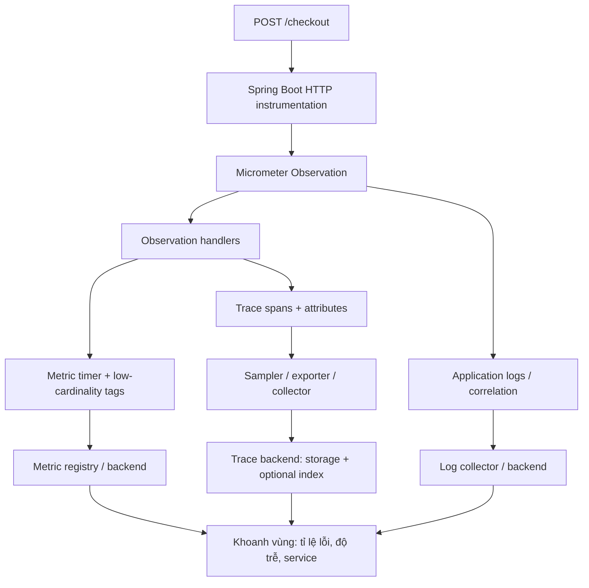

# Cardinality trong traces

Một ứng dụng Spring Boot xử lý hàng nghìn request mỗi giây. Mỗi request có thể tạo một trace với các span cho controller, database, HTTP client và bước nghiệp vụ. Để điều tra một yêu cầu chậm, kỹ sư muốn tìm theo mã giao dịch, phương thức thanh toán hoặc nhà cung cấp. Nhưng nếu đặt mọi mã định danh vào span name, attribute và baggage, dữ liệu tracing có thể trở nên tốn kém, khó truy vấn hoặc làm lộ thông tin nhạy cảm.

Đó là bài toán **cardinality trong traces**: cần đủ metadata để nhận diện một trường hợp cụ thể, đồng thời giữ tên và các chiều phân tích ổn định, tránh phát sinh khối lượng dữ liệu và chỉ mục không kiểm soát.

Bài học thuộc chương **Cardinality và metadata** của module **SPRING_BOOT_OBSERVABILITY**. Trong module này, Spring Boot được instrument bằng Micrometer Observation, metrics, logs và distributed tracing; context propagation, exporter, sampling và liên kết tín hiệu giúp điều tra lỗi, độ trễ và hành vi ứng dụng ở môi trường thực. Chủ đề hiện tại tập trung vào việc thiết kế **metadata của trace/span**, phân biệt nó với cardinality trong metrics và biết đánh đổi giữa khả năng truy vấn, chi phí và an toàn dữ liệu.

## Mục tiêu học tập

Sau bài này, bạn có thể:

1. Giải thích cardinality của một trường metadata và phân biệt **số giá trị phân biệt**, **số span** và **kích thước mỗi span**.
2. Nhận diện cardinality trong span name, span attribute, event, resource attribute và baggage.
3. So sánh hệ quả của high-cardinality trong **metrics labels** và **trace attributes** mà không áp dụng máy móc một quy tắc cho cả hai.
4. Dùng low/high-cardinality key values của Micrometer Observation trong ví dụ Spring Boot.
5. Thiết kế truy vấn theo **tập nhãn ổn định để khoanh vùng**, rồi dùng các thuộc tính chi tiết có kiểm soát để điều tra một trace.
6. Giải thích ảnh hưởng của sampling, exporter, collector, backend indexing và propagation đối với dữ liệu quan sát được.
7. Xây dựng checklist giới hạn chi phí, ngăn lộ dữ liệu nhạy cảm và xác minh tính hữu ích của trace metadata.

## 1. Cardinality là gì trong một hệ thống tracing?

**Cardinality** của một trường là **số giá trị phân biệt** xuất hiện trong trường đó trong tập dữ liệu và khoảng thời gian đang xét.

Giả sử một dịch vụ ghi các span có những trường:

```text
span.name = checkout.payment.authorize

payment.provider = provider-a | provider-b
payment.operation = authorize | capture | refund
http.response.status_code = 200 | 400 | 500 | ...
payment.attempt.id = a74f... | 4e20... | 92bd... | ...
```

Trong tình huống giả định:

- `payment.provider` có vài giá trị đã biết → **cardinality thấp**.
- `payment.operation` có một tập giá trị hữu hạn → **cardinality thấp**.
- `payment.attempt.id` gần như khác nhau ở mỗi lần thử → **cardinality cao**.
- `span.name` được cố định theo loại thao tác → tên dễ nhóm và thống kê.

High-cardinality không đồng nghĩa giá trị dài. Một chuỗi ID dài 12 ký tự có thể có hàng triệu giá trị khác nhau. Ngược lại, một thông báo dài nhưng chỉ có hai giá trị lặp lại sẽ có cardinality thấp, dù vẫn tốn dung lượng.

### Ba khái niệm cần tách biệt

| Khái niệm | Ví dụ | Tác động chủ yếu |
|---|---|---|
| **Cardinality của attribute** | `payment.attempt.id` khác nhau ở mỗi span | Số giá trị phân biệt mà hệ thống lưu, tìm kiếm hoặc lập chỉ mục phải xử lý |
| **Volume của spans/traces** | Mỗi request tạo 12 span, lưu nhiều request hơn | Số bản ghi cần ingest, truyền tải, lưu và xử lý |
| **Kích thước dữ liệu mỗi span** | Thêm stack trace lớn hoặc hàng chục attribute | Dung lượng, băng thông và chi phí xử lý trên mỗi span |

Ba yếu tố có liên quan nhưng **không tương đương**. Thêm một attribute có giá trị duy nhất có thể làm tăng chi phí chỉ mục; tạo 30 span thay vì 5 span có thể làm tăng dữ liệu ngay cả khi mọi attribute đều cardinality thấp; lưu một payload lớn khiến mỗi span nặng dù cardinality thấp.

Không có một ngưỡng tuyệt đối “trên N giá trị là nguy hiểm” áp dụng cho mọi backend. Cần đánh giá theo lưu lượng, cách index, chính sách lưu trữ và mục đích điều tra.

## 2. Vì sao cardinality trong traces khác metrics?

Với **metrics**, mỗi tổ hợp nhãn thường trở thành một chuỗi thời gian riêng. Ví dụ, các nhãn `route`, `status`, `instance`, `payment.provider` có thể tạo ra nhiều series; gắn thêm `traceId` hoặc `orderId` khiến số series tăng gần theo số request. Đây là lý do phổ biến để không dùng ID riêng lẻ làm metric label.

Với **traces**, mỗi span vốn là một bản ghi cụ thể; trace ID và span ID là các định danh có tính duy nhất rất cao **theo thiết kế**. Một trace cần có ID để liên kết các span thuộc cùng luồng. Vì vậy, kết luận “mọi high-cardinality attribute đều sai trong traces” là không đúng.

Sự khác biệt là **chi phí phát sinh ở đâu**:

| Khía cạnh | Metrics | Traces |
|---|---|---|
| Đơn vị lưu trữ điển hình | Time series theo tên metric và tập labels | Các bản ghi span/trace cùng timestamps, relationships và attributes |
| High-cardinality tác động thế nào? | Tạo rất nhiều chuỗi đo, tốn bộ nhớ/index/query | Có thể tăng kích thước span, số giá trị index, độ phức tạp tìm kiếm hoặc chi phí lưu trữ |
| Cần ID của từng request không? | Thông thường không; không dùng `traceId` như metric label | Có, trace/span ID là cơ chế cốt lõi để liên kết các span |
| Có nên lưu ID nghiệp vụ trên mọi bản ghi? | Thường không | Chỉ khi thực sự cần, được phép, có kiểm soát index/retention và không nhạy cảm |
| Tác động của sampling | Metric thông thường có thể tính trên toàn bộ request được instrument | Chỉ một phần trace/span được lưu tùy sampler, pipeline và lỗi export |
| Cách truy vấn hiệu quả | Tổng hợp theo nhãn ổn định | Khoanh vùng theo service/operation/status/time, rồi mở trace cụ thể; tìm bằng ID khi cần |

**Điểm mấu chốt:** traces có thể chấp nhận một số thuộc tính high-cardinality để điều tra request cụ thể, nhưng không có nghĩa nên index tất cả thuộc tính đó hoặc đưa mọi dữ liệu nghiệp vụ vào span.

Một số tracing backend lưu và truy vấn attribute mà không index toàn bộ giá trị; backend khác tạo chỉ mục thứ cấp hoặc tìm kiếm theo cột. Hệ quả chi phí và tốc độ truy vấn phụ thuộc kiến trúc backend. Không được mặc định việc “có attribute trong span” đồng nghĩa “có thể truy vấn attribute nhanh ở mọi nơi”.

## 3. Cardinality xuất hiện tại những vị trí nào trong trace?

### 3.1. Span name: nên mô tả loại thao tác, không phải từng request

Span name là một trong những trường mà người vận hành thường dùng để nhóm các thao tác chậm hoặc lỗi.

**Không nên:**

```text
GET /orders/764093
GET /orders/764094
checkout authorize payment for customer-38817
SQL SELECT * FROM orders WHERE id = 764093
```

Mỗi request có thể tạo một tên mới, khiến danh sách operations khó tổng hợp, tăng số giá trị phân biệt và có nguy cơ đưa dữ liệu nhạy cảm vào tên.

**Nên:**

```text
GET /orders/{id}
checkout.payment.authorize
db.query.orders
payment-provider.request
```

Tên thể hiện loại hoạt động; chi tiết biến đổi nếu cần nên đặt ở attribute phù hợp, được chuẩn hóa và kiểm soát. Với HTTP, ưu tiên route template do framework biết thay vì raw URL chứa mã đơn hàng. Với SQL, tránh đưa toàn bộ câu lệnh có literal hoặc giá trị tham số vào span name.

Một số instrumentation có conventions đặt tên riêng theo phiên bản và backend; ưu tiên giữ ngữ nghĩa ổn định và tuân thủ convention thực tế của stack, không ép mọi thư viện về cùng một định dạng tùy ý.

### 3.2. Span attributes: lựa chọn chiều phân tích và chi tiết

Span có thể mang attributes như:

```text
service.name = checkout-service
http.request.method = POST
http.route = /checkout
payment.provider = provider-a
payment.operation = authorize
payment.attempt.id = 9be6e0c4...
```

Hai nhóm chính:

- **Thuộc tính phân loại:** tên operation, loại partner, route chuẩn hóa, nhóm kết quả. Thường có cardinality thấp, giúp lọc hoặc tổng hợp nhiều trace.
- **Thuộc tính định danh:** request ID, correlation ID của một lần thử, ID giao dịch. Thường có cardinality cao, có thể phục vụ truy tìm một trường hợp cụ thể khi đã có chính sách dữ liệu phù hợp.

Một attribute có cardinality cao **không tự động vô dụng**. Nếu đội hỗ trợ nhận một correlation ID từ phía nhà cung cấp, việc đưa một ID nội bộ không nhạy cảm vào span có thể giúp nối sự cố giữa hai hệ thống. Nhưng cần trả lời rõ: có thể truy vấn ID này không, có thực sự cần lặp ở mọi span không, ai được xem và lưu bao lâu?

Nếu chỉ cần tìm một trace theo `traceId`, thường không cần sao chép `traceId` vào nhiều custom attributes. Trace ID đã là định danh có sẵn của mô hình tracing.

### 3.3. Resource attributes: ngữ cảnh của process/service

Resource attributes mô tả nguồn tạo telemetry, ví dụ `service.name`, `deployment.environment.name`, `service.version` hoặc một định danh instance phù hợp với convention của stack.

- `service.name` thường có cardinality tương đối thấp trong một hệ thống.
- `service.version` thay đổi theo lần triển khai, có ích khi so sánh trước/sau release.
- `service.instance.id` có thể có nhiều giá trị khi scale hoặc tạo pod mới; điều này có thể cần thiết cho vận hành nhưng không nên bị dùng làm chiều truy vấn mặc định trong mọi dashboard.

Đặc tính của resource attribute khác với thuộc tính trên từng span: một service có nhiều span nhưng có thể cùng chia sẻ resource metadata. Dù vậy, số giá trị phân biệt và chính sách index vẫn cần được đánh giá.

Không tạo `service.name` động theo tenant, request hoặc user. Tên service nên phản ánh workload vận hành ổn định.

### 3.4. Events và exceptions: không nhét message động vào tên

Một span có thể chứa event mô tả điều xảy ra trong quá trình xử lý. Ví dụ:

```text
Event name: payment.retry
Attributes:
  retry.attempt = 2
  retry.reason = timeout
```

Tên event ổn định giúp lọc và đọc timeline. Không nên đặt tên event như `payment.retry.for-order-764093`, hay ghi nguyên exception message có chứa token, raw URL, payload hoặc dữ liệu cá nhân vào attribute.

Stack trace có thể hữu ích trong điều tra nhưng làm tăng kích thước span. Với lỗi lặp nhiều lần, cân nhắc giới hạn mức chi tiết và thu thập có mục tiêu; giữ cấu trúc báo lỗi nhất quán giữa log và trace.

### 3.5. Span links và baggage: ngữ nghĩa khác span attributes

**Span link** mô tả liên hệ giữa span và span context khác, hữu ích trong các luồng fan-out, batch hoặc asynchronous messaging. Link có trace/span identifiers như một phần mô hình tracing; cần giữ đúng quan hệ thay vì lạm dụng attribute dạng chuỗi tự ghép.

**Baggage** là thông tin ngữ cảnh có thể được truyền qua các hop cùng trace context khi propagation được cấu hình. Baggage khác span attribute:

- Không phải baggage key nào cũng tự trở thành attribute được ghi và index trong backend.
- Baggage có thể đi qua ranh giới service/network; mỗi byte và mỗi dữ liệu nhạy cảm đều cần thận trọng.
- Một ID có cardinality cao nhưng không cần truyền cho downstream **không nên đặt vào baggage chỉ để tra cứu**.
- Baggage có thể bị giới hạn kích thước, lọc hoặc không được propagation ở một số ranh giới.

**Nguyên tắc:** chỉ đưa vào baggage thông tin downstream thực sự cần để xử lý hoặc liên kết, không dùng baggage làm kho chứa metadata cho hệ thống tracing.

## 4. Hình dung dữ liệu di chuyển qua hệ thống Spring Boot



Quan sát sơ đồ:

1. **Instrumented observation** tạo tên và key values theo convention, context và code nghiệp vụ.
2. **Metrics handlers** thường sử dụng low-cardinality key values để phân nhóm phép đo.
3. **Tracing handlers** có thể dùng cả low-cardinality và high-cardinality key values làm span attributes tùy implementation và cấu hình.
4. **Sampling/exporter/collector** quyết định dữ liệu trace nào tới được backend.
5. **Backend** quyết định attribute nào được lưu/index và có thể tìm kiếm hiệu quả.
6. **Logs** có thể mang `traceId`/`spanId` khi logging correlation đã được tích hợp; log vẫn cần chính sách riêng về dữ liệu nhạy cảm và retention.

Việc thêm high-cardinality key-value vào observation **không bảo đảm** nó xuất hiện trong mọi trace đã lưu. Nếu handler, sampler hoặc exporter khác nhau giữa các môi trường, kết quả cũng có thể khác nhau.

## 5. Micrometer Observation: low và high cardinality là hai ý định sử dụng

Micrometer Observation cho phép phân biệt key values theo mục đích:

- `lowCardinalityKeyValue(...)`: giá trị thường phù hợp để dùng trong metrics và có thể được tracing handlers đưa vào span.
- `highCardinalityKeyValue(...)`: thông tin chi tiết có thể phục vụ trace, nhưng **không nên được đưa vào metric label** như low-cardinality values.

Phân loại này giúp các handler xử lý tín hiệu hợp lý. Nó **không phải cơ chế mã hóa, phân quyền hoặc tự động chặn dữ liệu nhạy cảm**. Nếu ứng dụng thêm token vào high-cardinality key-value thì vẫn có nguy cơ bị xuất sang tracing backend.

### Ví dụ Spring Boot: payment authorization

Giả sử dịch vụ thanh toán có hai provider được phép và một mã chẩn đoán nội bộ, vô danh cho **lần thử giao dịch**. Mã chẩn đoán này chỉ được gắn nếu chính sách dữ liệu cho phép; trong nhiều trường hợp `traceId` đã đủ để điều tra.

```java
import io.micrometer.observation.Observation;
import io.micrometer.observation.ObservationRegistry;
import org.springframework.stereotype.Service;

@Service
class PaymentApplicationService {
    private final ObservationRegistry observationRegistry;
    private final PaymentGateway paymentGateway;

    PaymentApplicationService(ObservationRegistry observationRegistry,
                              PaymentGateway paymentGateway) {
        this.observationRegistry = observationRegistry;
        this.paymentGateway = paymentGateway;
    }

    PaymentResult authorize(PaymentRequest request,
                            String safeDiagnosticAttemptId) {
        // Giá trị provider phải đến từ danh mục hữu hạn đã chuẩn hóa.
        String provider = "provider-a";

        return Observation.createNotStarted(
                        "checkout.payment.authorize", observationRegistry)
                .contextualName("authorize payment")
                .lowCardinalityKeyValue("payment.provider", provider)
                .lowCardinalityKeyValue("payment.operation", "authorize")
                .highCardinalityKeyValue(
                        "payment.attempt.id", safeDiagnosticAttemptId)
                .observe(() -> paymentGateway.authorize(request));
    }
}
```

`PaymentGateway`, `PaymentRequest` và `PaymentResult` ở đây là các kiểu nghiệp vụ giả định. `safeDiagnosticAttemptId` đại diện cho mã correlation **đã qua chính sách cho phép, không chứa thông tin người dùng hay bí mật**; không được thay bằng raw ID do client gửi hoặc nội dung thanh toán.

Mẫu trên minh họa rằng:

- Tên observation và contextual name ổn định giữa các request.
- `payment.provider` và `payment.operation` có số giá trị giới hạn, thuận tiện cho tổng hợp metrics.
- `payment.attempt.id` có cardinality cao, chỉ dành cho nhu cầu điều tra cụ thể; nên hạn chế sử dụng và quyền truy cập.
- `observe(...)` quản lý vòng đời đồng bộ; nó không biến mọi HTTP client, thread hay message queue thành span con nếu thiếu instrumentation/propagation.

**Lưu ý về code production:** cần xác thực và chuẩn hóa provider thật sự, quyết định có cho phép thu thập attempt ID hay không, kiểm tra cách handler xuất attributes, và bảo đảm exporter/collector/backend được cấu hình. Ví dụ không triển khai sẵn toàn bộ telemetry pipeline.

### Không dùng low-cardinality để gắn ID của mỗi request

```java
// Không nên làm:
Observation.createNotStarted(
        "checkout.payment.authorize", observationRegistry)
    .lowCardinalityKeyValue("payment.attempt.id", safeDiagnosticAttemptId);
```

Nếu metric handler sử dụng nhãn này, số time series có thể tăng rất nhanh theo số request. Dùng `highCardinalityKeyValue(...)` giảm nguy cơ ID bị đưa vào metric labels bởi handler có tuân thủ phân loại, nhưng **không làm chi phí tracing và rủi ro riêng tư biến mất**.

### Khi không cần high-cardinality metadata

Một luồng HTTP tiêu chuẩn thường đã có `traceId` và span ID do tracing implementation tạo ra. Nếu chỉ cần nối log lỗi với trace của chính request đó, hãy kiểm tra log correlation bằng trace ID trước khi tự phát minh thêm `request.id`.

Khi cần nối với nhà cung cấp bên ngoài không hỗ trợ cùng tracing context, có thể cân nhắc thêm mã correlation đã được hai bên thống nhất, nhưng chỉ ở một số span liên quan. Không cần lặp cùng ID trên mọi span của trace nếu không có lợi ích truy vấn cụ thể.

## 6. Thiết kế truy vấn trace theo hai lớp metadata

Khi điều tra sự cố, một cách hiệu quả là:

**Lớp 1 — Thu hẹp tập kết quả bằng chiều ổn định.**

```text
time window: 14:00–14:15
service.name: checkout-service
operation/span.name: checkout.payment.authorize
payment.provider: provider-a
status/error: phù hợp với semantic conventions và backend
```

Những trường như service, operation, provider và khoảng thời gian giúp tìm nhóm traces đáng quan tâm, đồng thời tránh yêu cầu index các ID ngẫu nhiên của mọi request.

**Lớp 2 — Mở trace cụ thể để xem chi tiết.**

Khi đã có một trace liên quan:

- Xem thứ tự và độ chồng lấn của spans.
- Kiểm tra child span HTTP client, DB, queue và bước nghiệp vụ.
- Đối chiếu logs bằng `traceId` và khoảng thời gian tương ứng.
- Nếu cần, tìm theo mã correlation đối tác đã được phép lưu và backend hỗ trợ truy vấn.
- Kiểm tra có span thiếu do propagation, instrumentation hoặc sampling/export hay không.

Nếu truy vấn “những request nào chậm” chỉ dựa vào một vài trace được sample, sẽ không thể suy ra chính xác tỷ lệ người dùng chịu ảnh hưởng. Metric hoặc dữ liệu nghiệp vụ mới thích hợp để đo quy mô tác động, miễn định nghĩa và cách đo rõ ràng.

### Exemplar không phải metric label chứa trace ID

Một số stack hỗ trợ **exemplar**: ví dụ mẫu đo được gắn đường liên kết tới một trace tiêu biểu. Đây là cách nối một điểm trên biểu đồ metric với trace để điều tra mà **không** biến tất cả `traceId` thành nhãn time series. Tính năng này tùy thuộc registry, exporter, collector, backend và cấu hình sampling; không phải lúc nào cũng sẵn.

## 7. Tác động của cardinality đến storage, index và tốc độ truy vấn

Dữ liệu trace thường trải qua nhiều giai đoạn: instrumentation → SDK/bridge → exporter → collector → backend. Mỗi giai đoạn có thể áp dụng giới hạn khác nhau về attribute, event, kích thước payload, sampling và retention.

| Điểm xử lý | Vấn đề có thể xảy ra khi metadata quá chi tiết | Hướng kiểm soát |
|---|---|---|
| Ứng dụng | Tạo chuỗi dài, nhiều attribute, tăng CPU/GC hoặc vô tình ghi dữ liệu nhạy cảm | Chỉ instrument trường cần thiết; giới hạn chiều dài/nguồn giá trị |
| Tracing SDK / bridge | Giới hạn số attribute/event, drop hoặc cắt bớt dữ liệu | Kiểm tra cấu hình và tín hiệu báo dữ liệu bị bỏ |
| Exporter / collector | Payload lớn, queue đầy, network/backpressure, drop dữ liệu | Giám sát queue, retry, dropped spans và băng thông |
| Trace backend | Nhiều giá trị phân biệt tạo chỉ mục lớn, truy vấn chậm/tốn kém tùy công nghệ | Chọn thuộc tính cần index, chính sách retention và query phù hợp |
| Dashboard / trace search | Danh sách operations khó tổng hợp vì tên động; truy vấn ID có thể chậm | Tên ổn định, nhóm bằng trường hữu hạn, chỉ dùng ID khi cần |
| Hệ thống phân quyền | ID có thể bị dùng để liên kết ngược tới khách hàng hoặc giao dịch | Loại bỏ dữ liệu không cần thiết, phân quyền và kiểm soát truy cập |

**Không phải mọi tracing backend đều đánh chỉ mục tất cả attributes.** Cần xác định cơ chế thật sự của backend trước khi đưa ra dự báo chi phí. Có hệ thống thiên về truy vấn theo trace ID, có hệ thống hỗ trợ tìm kiếm attribute mạnh nhưng đổi lại dùng thêm tài nguyên index.

### Ước tính tải đúng cách

Khi lên ngân sách, hãy xem xét riêng:

1. **Tỷ lệ request hoặc message** mà ứng dụng xử lý.
2. **Số span trung bình trên mỗi request** và các đường đi ngoại lệ.
3. **Chính sách sampling** và tỷ lệ thực tế sau export/drop.
4. **Số attribute và kích thước giá trị** trong mỗi span.
5. **Chiến lược index**, retention, nén và replication của backend.
6. **Khả năng tìm lỗi hiếm:** số trace được giữ có đủ để điều tra điều kiện bất thường không?

Một thiết kế có ít attributes nhưng tạo rất nhiều span vẫn tốn tiền. Một thiết kế sampling thấp nhưng index các ID động cũng có thể phát sinh chi phí đáng kể trên tập spans được giữ lại.

### Giới hạn số lượng attribute không phải giới hạn cardinality

Một cấu hình cho phép tối đa 32 attributes trên một span chỉ kiểm soát **số trường**, không kiểm soát một trường có bao nhiêu giá trị khác nhau trên hàng triệu spans. Ngược lại, quy tắc chỉ cho phép `payment.provider` thuộc ba giá trị được chuẩn hóa hạn chế cardinality dù có nhiều spans.

Cần áp dụng cả **schema ổn định**, **allowlist giá trị**, **giới hạn độ dài**, **sampling** và **giới hạn tài nguyên của pipeline**.

## 8. Sampling có làm high-cardinality biến mất không?

Không. Sampling làm giảm số spans/traces được ghi lại, nhưng **không thay đổi bản chất** của một thuộc tính có giá trị gần như duy nhất trên mỗi request. Khi được giữ, ID vẫn là ID phân biệt cao.

Một số điểm cần nhớ:

- **Head-based sampling** có thể bỏ một trace trước khi biết nó sẽ lỗi hay chậm. High-cardinality ID ở trace bị bỏ sẽ không giúp tra cứu trên backend.
- **Tail-based sampling** có thể ưu tiên trace lỗi/chậm nếu collector và pipeline hỗ trợ; đổi lại cần buffer và tài nguyên.
- **Parent-based sampling** liên quan tới quyết định ở upstream, có thể làm các service cùng tuân thủ quyết định, nhưng không bảo đảm trace đầy đủ nếu propagation/export không đúng.
- **Không có trace trong backend** không chứng minh request không xảy ra. Kiểm tra metrics, logs, sampling, collector và retention.
- **Tập trace lưu được có thể thiên lệch**: không tính tỷ lệ lỗi hoặc p99 của toàn bộ lưu lượng trực tiếp từ vài trace được chọn theo chính sách đặc biệt.

Ví dụ cấu hình Spring Boot 3.x mang tính minh họa:

```yaml
management:
  tracing:
    sampling:
      probability: 0.10
```

Giá trị `0.10` chỉ là xác suất sampling tracing theo cơ chế được cấu hình trong stack tương ứng; nó không có nghĩa chỉ đo 10% metrics, cũng không tự giới hạn số giá trị phân biệt của attributes trên những spans đã được giữ. Với từng phiên bản Spring Boot và exporter cụ thể, cần xác nhận chính sách sampling hoạt động ở đâu và có bị collector áp dụng thêm chính sách khác hay không.

## 9. Cardinality, bảo mật và quyền riêng tư

Trong traces, metadata có thể di chuyển qua nhiều lớp, dịch vụ hoặc nhà cung cấp telemetry. Khả năng truy vấn càng mạnh thì hậu quả khi đưa sai dữ liệu vào càng lớn.

**Không thu thập vào span name, attribute, event hoặc baggage** những giá trị như:

- Access token, refresh token, API key, session cookie và thông tin xác thực.
- Số thẻ thanh toán, mã bảo mật, thông tin tài khoản ngân hàng.
- Request/response body có dữ liệu cá nhân hoặc bí mật nếu không có cơ chế kiểm soát phù hợp.
- Email, số điện thoại, địa chỉ hoặc định danh có thể nhận diện cá nhân khi không có mục đích và cơ sở xử lý rõ ràng.

Không nên mặc định rằng **hash ID** là ẩn danh hoàn toàn. Một giá trị hash cố định vẫn có thể cho phép liên kết hoạt động của cùng người, thậm chí suy đoán giá trị gốc nếu không gian đầu vào nhỏ.

Để giảm rủi ro:

1. Ưu tiên `traceId` để tương quan trong nội bộ thay vì sao chép ID nghiệp vụ vào mọi span.
2. Chỉ thu thập correlation ID bổ sung khi có câu hỏi điều tra cụ thể và đã được phép xử lý.
3. Không ghi raw URL, headers hay request payload tùy ý; dùng route mẫu và trường đã chuẩn hóa.
4. Hạn chế thuộc tính có ID vào span cần thiết; không truyền qua baggage nếu downstream không dùng.
5. Thiết lập redaction/drop ở ứng dụng và pipeline, cùng giới hạn quyền truy cập, retention và export.
6. Kiểm tra metadata được truyền qua HTTP/messaging có vượt boundary tin cậy hay không.

**Low/high cardinality không phải phân loại “an toàn/không an toàn”.** Một giá trị cardinality thấp vẫn có thể nhạy cảm, ví dụ trạng thái y tế hoặc một thuộc tính người dùng. Quyết định thu thập phải xét nội dung và ngữ cảnh, không chỉ số lượng giá trị.

## 10. Tình huống điều tra: provider thanh toán chậm nhưng không tìm được trace

Giả sử hệ thống gồm `checkout-service`, `payment-service` và provider bên ngoài. Sau một đợt triển khai:

- Metric `POST /checkout` cho thấy độ trễ p95 tăng mạnh.
- Logs xuất hiện nhiều sự kiện `payment_provider_timeout`.
- Một kỹ sư cố tìm trace theo `orderId` nhưng backend trả về rất ít kết quả.
- Dashboard tracing có hàng nghìn span names bắt đầu bằng `checkout-order-...`.

### Phân tích từng lớp

**Bước 1 — Kiểm tra tên và cardinality.** Nếu span name chứa `orderId`, mỗi đơn hàng là một tên riêng. Điều này làm hỏng khả năng nhóm theo operation. Sửa span name về một giá trị ổn định như `checkout.payment.authorize`.

**Bước 2 — Kiểm tra giả định về tìm kiếm.** Không phải backend nào cũng index `orderId`. Nếu `orderId` chỉ được ghi trong log hoặc một attribute không được index, tìm trace bằng ID đó có thể không hiệu quả. Nếu log có `traceId`, thử tìm đúng trace ID trước.

**Bước 3 — Kiểm tra trace sampling.** Nếu chỉ giữ một phần trace, một giao dịch cụ thể có thể không được lưu. Không kết luận yêu cầu không được thực thi chỉ từ kết quả tìm kiếm rỗng.

**Bước 4 — Kiểm tra propagation.** Nếu checkout gọi payment qua HTTP hoặc message queue, xác nhận trace context được inject/extract đúng; nếu không, trace có thể đứt giữa hai service.

**Bước 5 — Đối chiếu logs và metrics.** Dùng metrics để lượng hóa mức ảnh hưởng; dùng log timeout, thời gian, version và provider để khoanh vùng; mở các trace mẫu liên quan để xem client span, DB span, retry và khoảng thời gian không được instrument.

**Bước 6 — Thiết kế lại metadata.** Giữ `payment.provider`, `operation`, `http.route` và version có số giá trị hữu hạn. Nếu ID chẩn đoán đối tác thực sự cần thiết, lưu ở một số span/log phù hợp, theo chính sách cho phép và khả năng index của backend.

**Bước 7 — Xác nhận kết quả.** Sau thay đổi, chạy lại request thành công/chậm/lỗi, đối chiếu dashboard, log có `traceId`, trace timeline và trạng thái exporter/collector. Đánh giá số lượng span names và độ lớn dữ liệu được lưu.

Chỉ đổi span name không xử lý lỗi timeout, nhưng nó giúp truy vấn và so sánh trace trở nên đáng tin để điều tra nguyên nhân thật sự.

## 11. Các anti-pattern cần nhận diện

| Cách làm dễ sai | Hậu quả | Cách cải thiện |
|---|---|---|
| Đặt `orderId`, `userId` hoặc timestamp vào span name | Operation bị phân mảnh thành hàng loạt tên động | Dùng tên ổn định, route template; chi tiết chỉ nằm trong thuộc tính được kiểm soát |
| Gắn `traceId` làm metric tag | Bùng nổ time series | Truy tìm trace bằng ID trong tracing backend; cân nhắc exemplar nếu stack hỗ trợ |
| Đưa raw URL/path/query string vào attributes không giới hạn | Cardinality, dung lượng, nguy cơ lộ tham số nhạy cảm | Dùng route mẫu và allowlist thuộc tính |
| Thêm cùng một ID high-cardinality lên mọi span | Dữ liệu lặp lại, tăng chi phí và rủi ro | Chỉ gắn ở span thực sự liên quan hoặc dùng trace ID sẵn có |
| Index mọi attribute vì “có thể cần sau này” | Chi phí và truy vấn kém hiệu quả tùy backend | Chọn chỉ mục dựa trên câu hỏi vận hành; có retention hợp lý |
| Dùng baggage để truyền metadata tìm kiếm | Metadata có thể đi qua nhiều service và ranh giới tin cậy | Chỉ dùng baggage cho ngữ cảnh downstream cần |
| Giảm sampling thật thấp mà không xem lỗi hiếm | Có thể thiếu trace quan trọng để điều tra | Chọn sampling theo SLO, lưu lượng và nhu cầu; kiểm tra tail sampling khi phù hợp |
| Xem count của trace mẫu là tỷ lệ lỗi thật | Sai lệch do sampling hoặc dữ liệu bị drop | Dùng metrics/SLI hoặc sự kiện nghiệp vụ với định nghĩa rõ |
| Tin rằng high-cardinality tự bị loại khỏi trace | Rủi ro export và lộ dữ liệu | Có policy ở code, handler, collector, backend và review trường |
| Nhầm index cardinality với số attributes trên span | Khắc phục sai điểm nghẽn | Đo cả distinct values, size/span, number of spans và indexing |

## 12. Checklist thiết kế tracing metadata trong Spring Boot

Trước khi phát hành một observation/span mới, hãy trả lời:

- **Operation:** span/observation name có ổn định, phản ánh loại công việc và không chứa ID động không?
- **Phân loại:** những thuộc tính nào cần cho dashboard, lọc trace và xác định dependency? Tập giá trị có hữu hạn không?
- **Chi tiết:** thuộc tính high-cardinality nào thật sự cần để truy tìm một request cụ thể? `traceId` có đủ thay thế không?
- **Độ nhạy cảm:** có chứa PII, bí mật, payload, raw URL hoặc giá trị từ người dùng chưa xác thực không?
- **Micrometer:** low/high-cardinality key values có được gắn đúng mục đích không? Handler có nhận dữ liệu như mong đợi không?
- **Propagation:** trace context qua HTTP, executor, `@Async`, Reactor hoặc message queue có được duy trì đúng không?
- **Sampling:** chính sách hiện tại có cho phép điều tra lỗi hiếm không? Có hiểu mất dữ liệu do sampler khác exporter/drop không?
- **Exporter:** các giới hạn kích thước/attribute, queue và retry có phù hợp lưu lượng không?
- **Backend:** trường nào được index, chi phí mỗi trường, khả năng tìm theo trace ID và retention thế nào?
- **Correlation:** log có `traceId`/`spanId` khi cấu hình hỗ trợ không? Có thể đi từ metric tới trace bằng exemplar nếu stack có không?
- **Kiểm chứng:** có thử request thường, request lỗi, request chậm và request qua nhiều service không?
- **Tài nguyên:** có theo dõi số span, số attribute, kích thước, distinct values, ingestion và dropped data không?

## 13. Tự đánh giá

**Câu 1.** Trace ID có cardinality rất cao. Có phải nên bỏ trace ID khỏi hệ thống tracing?

**Gợi ý:** Không. Trace ID là thành phần thiết yếu để liên kết các span của một trace. Điều cần tránh là dùng trace ID làm metric label hoặc sao chép nó vào metadata không cần thiết.

**Câu 2.** Một span attribute `payment.attempt.id` có giá trị khác nhau ở mỗi request. Có chắc hệ thống tracing sẽ bị “nổ series” như Prometheus không?

**Gợi ý:** Không thể áp dụng trực tiếp cơ chế time series của metrics cho traces. Tác động trong tracing phụ thuộc kích thước bản ghi, indexing, truy vấn và volume; vẫn cần đánh giá chi phí và quyền riêng tư.

**Câu 3.** Đổi span name từ `GET /orders/1234` thành `GET /orders/{id}` mang lại lợi ích gì?

**Gợi ý:** Giảm số tên operation phân biệt, nhóm kết quả theo loại request tốt hơn, tránh để ID động trong tên và giảm gánh nặng tìm kiếm tùy backend.

**Câu 4.** Dùng `highCardinalityKeyValue(...)` có bảo đảm một giá trị không nhạy cảm và tự động được export chỉ sang backend tracing không?

**Gợi ý:** Không. API chỉ phân loại ý định sử dụng. Handler, pipeline và chính sách dữ liệu quyết định việc export; tính nhạy cảm phải kiểm soát độc lập.

**Câu 5.** Vì sao không thể dùng tỷ lệ span lỗi trong trace backend làm tỷ lệ request lỗi của cả dịch vụ?

**Gợi ý:** Traces có thể được sampling theo chính sách khác nhau, một request có nhiều spans, và exporter/collector có thể drop dữ liệu. Cần metric/SLI có đơn vị đếm request hoặc giao dịch rõ ràng.

**Câu 6.** Sau khi cấu hình sampling 10%, cardinality của `payment.attempt.id` đã trở thành thấp chưa?

**Gợi ý:** Chưa. Số spans được lưu giảm nhưng thuộc tính vẫn gần như duy nhất ở mỗi span được lưu. Sampling giảm volume; cardinality mô tả độ đa dạng giá trị.

## Kết luận

**Cardinality trong traces là đặc tính của metadata được gắn vào span và tài nguyên**, không chỉ là số request hoặc số span. Khác với metric labels, một số định danh rất độc nhất như trace ID là cần thiết cho tracing; nhưng span names động và attributes không kiểm soát vẫn gây khó nhóm, tăng chi phí index/lưu trữ và rủi ro dữ liệu nhạy cảm. Trong Spring Boot, hãy dùng Micrometer Observation với tên ổn định, low-cardinality key values cho phân loại, high-cardinality metadata chỉ khi có mục đích điều tra được phép, và xác minh toàn bộ đường đi qua handler, propagation, sampler, exporter, collector tới backend. Sự cân bằng tốt giúp metrics, logs và distributed traces liên kết được với nhau để điều tra lỗi và độ trễ mà không đánh đổi vô hạn về chi phí hay quyền riêng tư.
