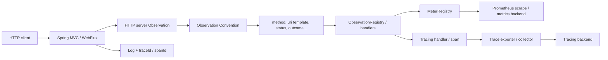

# Tag theo endpoint trong Spring Boot Observability

Giả sử dịch vụ đơn hàng có hai HTTP request:

```http
GET /api/orders/10293
GET /api/orders/10294
```

Hai request truy cập **cùng một endpoint nghiệp vụ**. Khi đo độ trễ, tỷ lệ lỗi và lưu lượng, ta muốn gom chúng thành một nhóm `GET /api/orders/{orderId}`. Nếu dùng đường dẫn thực tế làm tag, mỗi mã đơn tạo thêm một giá trị mới, khiến số chuỗi metric tăng theo số đơn hàng. Sau một thời gian, hệ thống giám sát có thể tốn nhiều bộ nhớ, lưu trữ và khó truy vấn, trong khi biểu đồ lại mất khả năng tổng hợp theo endpoint.

Trong chương **Cardinality và metadata** thuộc module `SPRING_BOOT_OBSERVABILITY`, bài này tập trung vào cách **gắn tag theo endpoint** khi thiết lập observability cho Spring Boot bằng Micrometer Observation. Chúng ta sẽ dùng metrics để đo tình trạng HTTP, liên kết với logs và distributed tracing để điều tra request cụ thể, đồng thời hiểu tác động của cardinality, context propagation, exporter và sampling trong môi trường thực.

## 1. Endpoint tag giải quyết vấn đề gì?

Một metric HTTP cần đủ thông tin để trả lời các câu hỏi:

- Endpoint nào đang nhận nhiều request?
- Tỷ lệ HTTP 5xx tăng ở endpoint nào?
- Độ trễ của `POST /api/orders` có tăng sau khi phát hành phiên bản mới?
- Các phương thức `GET` và `POST` trên cùng nhóm route có hành vi khác nhau không?
- Một lỗi xảy ra riêng ở endpoint nào, và có trace/log tương ứng để tìm nguyên nhân không?

**Tag** (còn gọi là *label* ở Prometheus) là cặp `key=value` được gắn với phép đo. Thay vì có một số tổng cho toàn bộ server, ta dùng một số chiều phân tích hữu hạn để nhóm dữ liệu.

| Tag HTTP thường gặp | Ví dụ | Ý nghĩa |
| --- | --- | --- |
| `method` | `GET`, `POST` | Phương thức HTTP |
| `uri` | `/api/orders/{orderId}` | Route template được chuẩn hóa, không phải URL thô |
| `status` | `200`, `404`, `503` | HTTP status code |
| `outcome` | `SUCCESS`, `CLIENT_ERROR`, `SERVER_ERROR` | Nhóm kết quả HTTP |
| `exception` | `None` hoặc tên loại exception | Phân loại lỗi khi instrumentation có ghi nhận |
| `application` | `order-service` | Phân biệt dịch vụ nếu được cấu hình làm common tag |

Tên tag, tập giá trị và meter cụ thể phụ thuộc vào **phiên bản Spring Boot/Micrometer, Servlet/WebFlux stack và observation convention đang sử dụng**. Các tên trên là ví dụ phổ biến trong cấu hình Spring Boot 3.x, không phải hợp đồng bất biến cho mọi phiên bản.

**Phân biệt ba lớp thông tin:** tag metric để tổng hợp dữ liệu; thuộc tính span để điều tra một trace; trường log để hiểu chi tiết một sự kiện. Cùng một thông tin có thể có giá trị ở trace nhưng không nên trở thành metric tag.

## 2. Cardinality là gì và vì sao endpoint cần chuẩn hóa?

**Cardinality của một tag** là số lượng giá trị khác nhau mà nó nhận. **Cardinality của một tập time series** phụ thuộc số tổ hợp giá trị của nhiều tag, metric name, instance và các chiều khác.

Ví dụ một timer HTTP có:

| Chiều | Số giá trị giả định |
| --- | ---: |
| `uri` (route template) | 20 |
| `method` | 4 |
| `status` | 5 |
| `instance` | 3 |

Số tổ hợp tối đa theo mô hình đơn giản:

\[
20 \times 4 \times 5 \times 3 = 1\,200
\]

Đây chỉ là **giới hạn lý thuyết** khi giả định các chiều độc lập; không phải mọi route có mọi method/status, và backend có thể bổ sung những chiều khác. Tuy vậy, nó giúp hình dung vì sao việc tăng số giá trị của một tag làm số time series tăng nhanh.

Nếu tag `uri` bị thay bằng raw path của 100.000 đơn hàng, thay vì 20 route template, số tổ hợp khả dĩ tăng nhiều bậc độ lớn. Với histogram, mỗi bộ nhãn còn có thể có nhiều bucket series nên tác động càng lớn.

### 2.1. Route template và raw path khác nhau như thế nào?

| Request thực tế | Giá trị `uri` nên dùng | Giá trị nên tránh |
| --- | --- | --- |
| `GET /api/orders/10293` | `/api/orders/{orderId}` | `/api/orders/10293` |
| `GET /api/orders/10294` | `/api/orders/{orderId}` | `/api/orders/10294` |
| `GET /api/customers/9/orders/25` | `/api/customers/{customerId}/orders/{orderId}` | Đường dẫn có hai ID thực |
| `POST /api/orders` | `/api/orders` | Query string hoặc payload người dùng |
| `GET /api/search?q=phone` | `/api/search` | `/api/search?q=phone` |

Lưu ý: `GET /api/orders/10293` là **request path**, còn `/api/orders/{orderId}` là **mẫu route đã match**. Spring MVC/WebFlux thường có thể cung cấp mẫu này qua HTTP instrumentation của framework khi request khớp route. Nếu request không khớp route, đi vào static resource, filter đặc biệt hoặc lỗi xảy ra quá sớm, tên route có thể không xác định và instrumentation dùng giá trị dự phòng thay thế. Không suy diễn rằng mọi 404 sẽ mang một template có sẵn.

### 2.2. Cardinality không đồng nghĩa lượng request

Một triệu request trên cùng một route template với bộ tag cố định vẫn có thể đi vào một số ít series; một nghìn request với một nghìn user ID khác nhau được gắn làm tag có thể tạo rất nhiều series. **Giảm số request không trực tiếp giải quyết vấn đề tag có quá nhiều giá trị.**

Quy tắc thiết kế: dùng **low-cardinality tags** cho những chiều hữu hạn mà bạn thật sự muốn lọc biểu đồ hoặc tính toán cảnh báo. Những giá trị có độ phân biệt cao như user ID, session ID, order ID, request ID, URL thô thường phù hợp hơn với span/log có chính sách lưu trữ và quyền truy cập riêng.

## 3. Luồng dữ liệu khi Spring Boot ghi metric theo endpoint



Đây là **sơ đồ khái niệm**. Trong thực thi, Observation được tạo với registry và các handler đọc context theo những thời điểm thích hợp; convention không nhất thiết là một bước tuần tự chạy trước mọi callback. Điều quan trọng là:

1. Framework biết request đang được xử lý và, khi có instrumentation phù hợp, tạo Observation HTTP.
2. Convention quyết định tên và bộ low-cardinality key-value dựa trên thông tin request/response, bao gồm route template nếu có.
3. Handler metrics ghi thời gian và số lần gọi vào `MeterRegistry`.
4. Handler tracing, nếu có tracer bridge, quản lý span và quan hệ trace.
5. Exporter/backend tiếp nhận telemetry để lưu lịch sử, tìm kiếm, trực quan hóa và cảnh báo.

Trong một ứng dụng Spring Boot 3.x với Actuator, meter HTTP server thường mang tên `http.server.requests`. Một số phiên bản/instrumentation hoặc quy ước khác có thể dùng tên khác; luôn kiểm tra tên thực tế trong ứng dụng trước khi viết truy vấn dashboard.

## 4. Thiết lập ví dụ Spring Boot

Ví dụ minh họa Spring Boot 3.x, Java 17+ và Maven. Giả định project dùng Spring Boot parent/BOM để quản lý các phiên bản dependency tương thích.

```xml
<dependencies>
    <dependency>
        <groupId>org.springframework.boot</groupId>
        <artifactId>spring-boot-starter-web</artifactId>
    </dependency>
    <dependency>
        <groupId>org.springframework.boot</groupId>
        <artifactId>spring-boot-starter-actuator</artifactId>
    </dependency>
    <dependency>
        <groupId>io.micrometer</groupId>
        <artifactId>micrometer-registry-prometheus</artifactId>
    </dependency>
</dependencies>
```

```yaml
spring:
  application:
    name: order-service

management:
  endpoints:
    web:
      exposure:
        include: health,metrics,prometheus
  metrics:
    tags:
      application: order-service
```

Khi ứng dụng chạy trên cổng 8080 với cấu hình management web path thông dụng, có thể kiểm tra các endpoint bằng `/actuator/health`, `/actuator/metrics`, `/actuator/prometheus`.

**Exposure không phải cơ chế xác thực:** chỉ công bố endpoint cần thiết, giới hạn qua mạng nội bộ hoặc cấu hình Spring Security/gateway phù hợp. Endpoint metrics có thể làm lộ tên route, phân loại lỗi và kiến trúc ứng dụng.

### 4.1. REST controller mẫu

```java
import org.springframework.http.ResponseEntity;
import org.springframework.web.bind.annotation.GetMapping;
import org.springframework.web.bind.annotation.PathVariable;
import org.springframework.web.bind.annotation.PostMapping;
import org.springframework.web.bind.annotation.RequestMapping;
import org.springframework.web.bind.annotation.RestController;

@RestController
@RequestMapping("/api/orders")
public class OrderController {

    @GetMapping("/{orderId}")
    public ResponseEntity<String> find(@PathVariable String orderId) {
        return ResponseEntity.ok("order-" + orderId);
    }

    @PostMapping
    public ResponseEntity<Void> create() {
        return ResponseEntity.accepted().build();
    }
}
```

Đây là controller tối giản để quan sát tag; ứng dụng production cần thêm kiểm tra dữ liệu, xác thực, xử lý lỗi và nghiệp vụ thực.

Gửi request với hai mã đơn khác nhau:

```bash
curl -i http://localhost:8080/api/orders/10293
curl -i http://localhost:8080/api/orders/10294
curl -i -X POST http://localhost:8080/api/orders
curl -s http://localhost:8080/actuator/metrics
curl -s http://localhost:8080/actuator/metrics/http.server.requests
```

Với instrumentation HTTP mặc định tương thích, hai lệnh GET được kỳ vọng được tổng hợp theo tag route dạng `uri=/api/orders/{orderId}`, thay vì sinh ra một giá trị `uri` theo mỗi mã đơn.

## 5. Đọc endpoint tags qua Actuator

Endpoint `/actuator/metrics/http.server.requests` thường cung cấp tên meter, các phép đo như count/total time và danh sách tag có thể lọc. Ví dụ cấu trúc phản hồi **minh họa**, không phải dữ liệu bắt buộc của mọi phiên bản:

```json
{
  "name": "http.server.requests",
  "measurements": [
    {"statistic": "COUNT", "value": 3.0},
    {"statistic": "TOTAL_TIME", "value": 0.042}
  ],
  "availableTags": [
    {"tag": "method", "values": ["GET", "POST"]},
    {"tag": "uri", "values": ["/api/orders/{orderId}", "/api/orders"]},
    {"tag": "status", "values": ["200", "202"]}
  ]
}
```

Các giá trị thời gian và tag ở trên là dữ liệu giả định. Trong ứng dụng thực tế, meter có thể có thêm hoặc bớt nhãn và các phép đo khác. Không nên khẳng định request lỗi chưa từng phát sinh sẽ xuất hiện sẵn trong `availableTags`.

### 5.1. Lọc theo một endpoint cụ thể

Actuator metrics hỗ trợ query param `tag=key:value`. Dùng `curl -G --data-urlencode` để tránh phải tự escape dấu ngoặc nhọn của route template:

```bash
curl -G 'http://localhost:8080/actuator/metrics/http.server.requests' \
  --data-urlencode 'tag=uri:/api/orders/{orderId}' \
  --data-urlencode 'tag=method:GET'
```

Cách đọc kết quả:

- `COUNT` cho biết số lần hoàn tất phép đo thuộc nhóm tag đang lọc, trong khoảng đời sống của meter tại instance đó.
- `TOTAL_TIME` là tổng thời gian được tích lũy; đơn vị được mô tả trong phản hồi meter.
- `MAX` hoặc các phép đo khác có thể có theo cấu hình timer.
- Tỷ lệ lỗi và p95 theo thời gian cần dữ liệu được backend thu thập theo chu kỳ và phép tính thích hợp, không chỉ nhìn một lần phản hồi từ Actuator.

Nếu metric chưa thấy, hãy gửi request trước, kiểm tra dependency, trạng thái actuator endpoint, web exposure, tên meter thực tế, instrumentation và có gọi `stop()` cho Observation liên quan hay chưa.

### 5.2. Nên và không nên thêm tag endpoint nào?

| Tag đề xuất | Có thể dùng cho metrics? | Giải thích |
| --- | --- | --- |
| `method` | Có | Tập giá trị HTTP method thường nhỏ |
| `uri` theo route template | Có | Số route do API thiết kế nên có thể kiểm soát |
| `status` | Có | Tập giá trị status code hữu hạn |
| `outcome` | Có | Nhóm kết quả hữu hạn |
| `api.group` = `orders/payments/other` | Có, nếu thực sự cần | Phân nhóm route ổn định, hữu ích cho dashboard |
| `orderId`, `customerId` | Không | Tập giá trị lớn, tăng mạnh cardinality |
| `requestId`, `traceId` | Không | Thường là duy nhất trên mỗi request |
| Query string, raw path | Không | Giá trị đến từ người dùng, khó giới hạn |
| User-Agent nguyên bản, IP nguồn | Thường không | Nhiều giá trị, có rủi ro dữ liệu cá nhân |
| Exception message nguyên văn | Không | Giá trị biến động và có thể chứa thông tin nhạy cảm |

**Tag `uri` nên mô tả endpoint, không dùng để nhận diện từng request.** Muốn tìm lỗi của một request, hãy dùng traceId/requestId trong hệ thống tracing hoặc logging có kiểm soát.

## 6. Thêm tag `api.group` theo endpoint bằng custom convention

Trong Spring MVC/Servlet stack của Spring Framework 6, HTTP server Observation có cơ chế convention riêng. Khi muốn mở rộng các tag mặc định, ta có thể triển khai/đăng ký `ServerRequestObservationConvention` và kế thừa `DefaultServerRequestObservationConvention` để **giữ nguyên các tag chuẩn**, sau đó thêm đúng một chiều phân nhóm hữu hạn.

### 6.1. Tạo convention

```java
import io.micrometer.common.KeyValue;
import io.micrometer.common.KeyValues;
import org.springframework.http.server.observation.DefaultServerRequestObservationConvention;
import org.springframework.http.server.observation.ServerRequestObservationContext;

public final class ApiGroupObservationConvention
        extends DefaultServerRequestObservationConvention {

    @Override
    public KeyValues getLowCardinalityKeyValues(
            ServerRequestObservationContext context) {
        return super.getLowCardinalityKeyValues(context)
            .and(KeyValue.of("api.group", apiGroup(context.getPathPattern())));
    }

    private String apiGroup(String routeTemplate) {
        if (routeTemplate == null) {
            return "unmatched";
        }
        if (routeTemplate.startsWith("/api/orders")) {
            return "orders";
        }
        if (routeTemplate.startsWith("/api/payments")) {
            return "payments";
        }
        return "other";
    }
}
```

Ở ví dụ này, `getPathPattern()` được dùng để lấy route đã khớp từ observation context của Servlet stack. Chúng ta phân nhóm theo **route template**, không đọc và ghi trực tiếp đường dẫn thô như `/api/orders/10293`. Nếu không xác định được route thì trả về `unmatched`, tránh tạo tag vô hạn. Việc phân nhóm cần được rà soát khi API đổi đường dẫn; nên kiểm chứng qua request thật và payload `/actuator/metrics`.

Việc gọi `super.getLowCardinalityKeyValues(context)` giúp giữ lại các nhãn do Spring cung cấp, chẳng hạn method/status/uri/outcome theo phiên bản. Nếu tạo lại bộ nhãn từ đầu và bỏ tag HTTP chuẩn, dashboard hoặc alert đang sử dụng các tag ấy có thể ngừng hoạt động.

### 6.2. Đăng ký convention trong ứng dụng

```java
import org.springframework.context.annotation.Bean;
import org.springframework.context.annotation.Configuration;
import org.springframework.http.server.observation.ServerRequestObservationConvention;

@Configuration
public class HttpObservationConfiguration {

    @Bean
    ServerRequestObservationConvention serverRequestObservationConvention() {
        return new ApiGroupObservationConvention();
    }
}
```

Với Spring Boot 3.x và Spring MVC instrumentation phù hợp, bean convention dành cho Servlet HTTP server Observation có thể được sử dụng để thay đổi cách sinh tag cho HTTP requests. Với WebFlux, các extension point/context và quy tắc tích hợp có thể khác; cần sử dụng convention của đúng stack và phiên bản.

**Đừng giả định một bean `ObservationConvention` tự động đổi mọi Observation.** Mỗi instrumentation có cơ chế chọn convention riêng. Cần kiểm tra integration thật sự dùng bean mới, tránh trùng với những convention mà framework hoặc thư viện khác đã cấu hình.

### 6.3. Kiểm tra kết quả

Gửi request vào hai route:

```bash
curl -s http://localhost:8080/api/orders/10293
curl -s http://localhost:8080/api/orders/10294
curl -G 'http://localhost:8080/actuator/metrics/http.server.requests' \
  --data-urlencode 'tag=api.group:orders' \
  --data-urlencode 'tag=method:GET'
```

Kết quả kỳ vọng là `api.group=orders` có số lần gọi tăng theo request, trong khi `uri` vẫn ở dạng route template. Nếu `api.group` không xuất hiện, hãy kiểm tra việc Spring HTTP instrumentation chọn convention nào, bean có được component scan và registry có handler metrics thích hợp hay không.

### 6.4. Tránh custom tag được quyết định từ dữ liệu người dùng

Không nên dùng:

```java
// Ví dụ SAI: mỗi ID trở thành một metric label mới.
return super.getLowCardinalityKeyValues(context)
    .and(KeyValue.of(
        "raw.path",
        context.getCarrier().getRequestURI()
    ));
```

Ví dụ sai này minh họa vấn đề cardinality: `raw.path` có thể đổi theo từng request. Dữ liệu truy vết riêng từng request cần đưa vào logs/traces theo chính sách thích hợp, thay vì một nhãn metric.

## 7. Truy vấn theo endpoint trong Prometheus

Khi có dependency `micrometer-registry-prometheus` và web exposure cho `prometheus`, ứng dụng có thể cung cấp metrics theo định dạng Prometheus. Nếu Prometheus scrape thành công, timer mang tên `http.server.requests` thường xuất thành các series kiểu:

```text
http_server_requests_seconds_count{method="GET",uri="/api/orders/{orderId}",status="200",...}
http_server_requests_seconds_sum{method="GET",uri="/api/orders/{orderId}",status="200",...}
```

Tên series và nhãn thực tế phải lấy từ endpoint/exporter của ứng dụng; ví dụ trên minh họa cách thường gặp khi Micrometer chuyển timer sang đơn vị giây. Dấu `...` chỉ là chỗ giữ chỗ trong ví dụ, không phải dòng exposition hợp lệ có thể copy nguyên vào Prometheus.

### 7.1. Request rate theo endpoint

```promql
sum by (method, uri) (
  rate(http_server_requests_seconds_count{application="order-service"}[5m])
)
```

Kết quả cho biết tốc độ request trung bình/giây trên cửa sổ 5 phút, phân nhóm theo method và route template. Khi nhiều instance cùng phục vụ một ứng dụng, `sum by (... )` tổng hợp các instance, với điều kiện đã scrape đầy đủ và nhãn phân biệt dịch vụ đúng.

### 7.2. Tỷ lệ HTTP 5xx theo endpoint

```promql
sum by (method, uri) (
  rate(http_server_requests_seconds_count{
    application="order-service",status=~"5.."
  }[5m])
)
/
sum by (method, uri) (
  rate(http_server_requests_seconds_count{
    application="order-service"
  }[5m])
)
```

Nhân kết quả với 100 nếu muốn phần trăm. Với endpoint không có request trong khoảng thời gian truy vấn, mẫu số có thể bằng 0 hoặc không có dữ liệu; dashboard/alert cần xử lý phù hợp và tránh diễn giải nhiễu khi lưu lượng thấp.

Lưu ý `status=~"5.."` đo **HTTP 5xx**, không đo mọi thất bại nghiệp vụ. Ví dụ HTTP 200 vẫn có thể chứa kết quả `payment=rejected`; muốn theo dõi trường hợp này cần custom business Observation hoặc metric riêng với outcome được định nghĩa rõ.

### 7.3. p95 latency theo endpoint

Nếu ứng dụng đã bật **Prometheus histogram buckets** cho timer HTTP, có thể dùng:

```promql
histogram_quantile(
  0.95,
  sum by (le, method, uri) (
    rate(http_server_requests_seconds_bucket{
      application="order-service"
    }[5m])
  )
)
```

Ví dụ cấu hình Spring Boot 3.x thường dùng để yêu cầu histogram cho meter này:

```yaml
management:
  metrics:
    distribution:
      percentiles-histogram:
        http.server.requests: true
```

**Không phải cứ có timer là có bucket histogram.** Cần kiểm tra exporter có xuất series `_bucket` và cấu hình distribution tương thích với Micrometer/Prometheus version. Histogram làm tăng số series theo buckets, nên chỉ bật với các phép đo thật sự cần percentile theo nhiều chiều; tránh kết hợp histogram dày đặc với nhãn cardinality cao.

## 8. Khi endpoint không match route: xử lý 404 và lỗi bất thường

Với `GET /api/orders/10293`, framework có thể xác định `/api/orders/{orderId}`. Nhưng với `GET /api/no-such-route/987654`, request có thể không khớp mapping nào. Khi đó:

- `uri` có thể nhận giá trị dự phòng như `NOT_FOUND` hoặc giá trị khác tùy convention/phiên bản;
- một số lỗi xảy ra trước khi request được gán route có thể được tổng hợp vào nhóm route không xác định;
- response code vẫn có thể là 404, 500 hoặc giá trị khác, tùy tầng phát sinh lỗi;
- không nên dùng raw path làm phương án dự phòng, vì scanner hoặc bot có thể tạo vô số đường dẫn 404 khác nhau và làm nổ cardinality.

Nếu cần hiểu người dùng đang truy cập đường dẫn 404 cụ thể nào, hãy cân nhắc truy vấn **access log có giới hạn dữ liệu và retention**, thay vì thêm URL thô vào timer HTTP. Log cần được xử lý để tránh lưu secret trong query parameter.

## 9. Endpoint tags và các tín hiệu metrics, logs, traces

Ví dụ `POST /api/orders` có thời gian đáp ứng tăng từ 120 ms lên 1,3 s. Các tín hiệu đóng góp như sau:

| Tín hiệu | Dữ liệu phù hợp | Câu hỏi trả lời |
| --- | --- | --- |
| HTTP metrics | `method=POST`, `uri=/api/orders`, `status=500` | Lưu lượng, tỷ lệ lỗi, độ trễ endpoint biến động thế nào? |
| Business metrics | `operation=payment.authorize`, `channel=card` | Bước nghiệp vụ nào chậm hoặc lỗi nhiều? |
| Distributed trace | Trace ID, span HTTP, span gọi payment gateway | Một request chậm nằm ở service/thao tác nào? |
| Logs | `traceId`, `spanId`, error code và thông điệp đã kiểm soát | Điều gì xảy ra tại thời điểm request lỗi? |

### 9.1. Tại sao traceId không là tag metric?

Trace ID là mã dùng để nối các span và log của **một request cụ thể**; thông thường nó khác nhau ở mỗi request. Nếu gắn traceId làm metric tag, số series tăng theo lưu lượng. Cách vận hành phù hợp:

1. Dùng metric tag route template để xác định nhóm endpoint có vấn đề.
2. Từ một thời điểm hoặc một request ví dụ, tìm trace qua tracing backend hoặc log có correlation.
3. Quan sát các span liên quan để xác định downstream call, retry hoặc timeout.
4. Mở log có cùng traceId để xem chi tiết lỗi.

Tracing integration cần Micrometer Tracing bridge, handler, exporter/backend và context propagation phù hợp. Sampling có thể khiến một request không có trace được giữ lại; không có trace trong backend **chưa chứng minh** request không xảy ra. Khi sampling giảm để tiết kiệm chi phí, metrics tổng hợp vẫn có thể theo dõi xu hướng nếu handler metrics được cấu hình độc lập.

### 9.2. Context propagation không do tag đảm nhiệm

Endpoint tags mô tả request ở một service; để nối trace từ `order-service` sang `payment-service`, HTTP client cần inject trace context vào header và phía nhận phải extract context tương thích, thường dựa trên chuẩn W3C `traceparent`.

Trong tác vụ bất đồng bộ, Reactor hoặc executor, cần cơ chế context propagation tương thích; chỉ thêm `uri` hay `api.group` vào Observation không tự truyền trace sang thread hoặc process khác. Khi current context bị mất, có thể vẫn nhìn thấy HTTP metric nhưng trace/log correlation trở nên rời rạc.

## 10. Kiểm soát cardinality bằng quy trình thiết kế và kiểm thử

Trước khi thêm một endpoint tag, trả lời:

1. **Câu hỏi vận hành là gì?** Nếu không có dashboard, cảnh báo hoặc phân tích cụ thể cần chiều đó, chưa chắc nên thêm.
2. **Tập giá trị có giới hạn không?** Ví dụ 4 kênh bán hàng là có thể kiểm soát; ID, raw header và raw URL là không.
3. **Có thể chuẩn hóa từ đầu không?** Route template, enum, nhóm status và loại khách hàng có kiểm soát tốt hơn giá trị raw.
4. **Từ lúc phát hành mới, giá trị có biến động không?** Khi thêm route API mới, số series có thể tăng; cần dự kiến.
5. **Nó có mang thông tin nhạy cảm không?** Không đưa token, email, số điện thoại hoặc dữ liệu nhận dạng vào metric label.
6. **Có cần histogram không?** Bucket histogram làm tăng số series theo label; đánh giá nhu cầu p95/p99.
7. **Các backend có giới hạn/chi phí nào?** Cần kiểm tra lưu lượng scrape, retention, query và ngân sách.

### Checklist kiểm chứng thực tế

| Kiểm tra | Cách xác minh |
| --- | --- |
| Hai ID khác nhau dùng cùng route | Gửi `/api/orders/10293` và `/api/orders/10294`; kiểm tra chỉ một giá trị route template tương ứng |
| Tag tùy chỉnh có tập hữu hạn | Gửi nhiều request, kiểm tra `api.group` chỉ là `orders/payments/other/unmatched` |
| Chưa lộ raw path | Kiểm tra `/actuator/metrics` và `/actuator/prometheus` không có ID làm tag |
| 404 không làm tăng vô hạn | Gửi nhiều URL không khớp mapping; kiểm tra chúng được nhóm thành fallback phù hợp |
| Histogram phục vụ truy vấn | Kiểm tra series `_bucket` chỉ khi đã bật histogram cho meter cần thiết |
| Prometheus đã scrape | Dữ liệu tăng theo thời gian và instance; truy vấn rate có kết quả hợp lý |
| Trace/log correlation hoạt động | Tracing backend có trace phù hợp, log chứa traceId khi đã cấu hình |
| Endpoint management được bảo vệ | Chỉ những đối tượng được phép mới truy cập được endpoint |

## 11. Các lỗi phổ biến và cách điều tra

| Triệu chứng | Nguyên nhân có thể | Cách xử lý |
| --- | --- | --- |
| Có hàng nghìn `uri` khác nhau | Dùng raw URL/path làm tag | Chuyển sang route template, giới hạn fallback |
| `uri=UNKNOWN` hoặc fallback quá nhiều | Request chưa match route hoặc instrumentation không thấy mapping | Kiểm tra routing, stack và thời điểm request được quan sát |
| Không có meter `http.server.requests` | Meter name thay đổi, thiếu actuator/instrumentation hoặc chưa có request | Xem `/actuator/metrics`, dependency và version |
| Không thấy `api.group` | Convention không được lựa chọn, bean chưa đăng ký hoặc stack không phù hợp | Kiểm tra HTTP observation convention, context và cấu hình Spring |
| p95 query không có dữ liệu | Chưa bật histogram hoặc series `_bucket` không được xuất | Kiểm tra distribution config và exporter |
| Tỷ lệ 5xx cao bất thường | Lỗi upstream, xử lý request hoặc chọn lọc query sai | Đối chiếu method/uri/status và trace/log |
| Hệ thống monitoring tốn bộ nhớ | Nhãn có nhiều giá trị, nhiều buckets/instances/metrics | Đếm số series và giảm chiều không cần thiết |
| Metrics có nhưng trace không có | Sampling, exporter, tracing bridge hoặc propagation có vấn đề | Kiểm tra tracing pipeline độc lập với metrics |
| Thay đổi convention làm hỏng dashboard | Đổi tên hoặc bỏ tag cũ | Quản lý schema telemetry, cập nhật truy vấn có kế hoạch |

### Lưu ý khi thay đổi tag trong production

Tag là một phần của **hợp đồng vận hành**. Đổi `uri` thành một tag khác, bỏ `status` hoặc đổi tên giá trị `api.group` có thể làm những truy vấn PromQL, biểu đồ và alert cũ trả về kết quả khác. Cần xem xét tương thích với hệ thống monitoring và cập nhật dashboard cùng lần phát hành khi thay đổi schema.

## 12. Bài thực hành: xây dashboard theo endpoint

Tạo một ứng dụng Spring Boot với controller ở mục 4 và custom convention ở mục 6:

1. Chạy API và gửi request tới ít nhất hai ID khác nhau trên `/api/orders/{orderId}`. Dùng `/actuator/metrics/http.server.requests` kiểm tra giá trị `uri` có phải route template không.
2. Gọi `POST /api/orders` và một route không tồn tại. Quan sát các giá trị `method`, `status`, `outcome`, `uri` tương ứng.
3. Thêm `api.group` ở custom convention. Chứng minh những request đơn hàng khác ID đều có `api.group=orders` và không phát sinh một tag theo ID.
4. Bật Prometheus scrape; viết truy vấn request rate và HTTP 5xx theo `method,uri`.
5. Bật histogram cho đúng meter cần phân tích độ trễ. Viết truy vấn p95 và xác minh có `_bucket` trước khi diễn giải biểu đồ.
6. Bổ sung tracing bridge/exporter nếu muốn điều tra một request cụ thể; đối chiếu trace với log có `traceId`, đồng thời giải thích vì sao traceId không thuộc metric tag.
7. Rà soát tag và quyền truy cập Actuator. Kiểm tra tác động của route mới, 404, retry và sampling tới chất lượng telemetry.

**Tiêu chí hoàn thành:** bạn có thể giải thích tại sao `uri=/api/orders/{orderId}` phù hợp hơn `uri=/api/orders/10293`; xác minh endpoint tags với Actuator, truy vấn request rate/5xx/p95 bằng Prometheus, thêm một tag phân nhóm hữu hạn mà vẫn giữ các tag HTTP chuẩn, và phân biệt vai trò của metrics, logs, traces khi điều tra sự cố.

## Kết luận

**Tag theo endpoint** giúp chuyển nhiều request riêng lẻ thành các chiều phân tích có thể quản lý. Trong Spring Boot, ưu tiên tag HTTP có giá trị hữu hạn như method, status, outcome và đặc biệt là **route template** cho `uri`. Khi cần mở rộng, dùng HTTP Observation convention phù hợp với Servlet/WebFlux stack, giữ các tag chuẩn và chuẩn hóa mọi giá trị mới. Đừng đưa raw URL, ID hoặc traceId vào metric tags; hãy dùng tracing và logs có correlation để điều tra từng request. Kết hợp cardinality được kiểm soát với exporter, histogram, sampling và context propagation đúng cách sẽ giúp quan sát lỗi và độ trễ của ứng dụng mà vẫn giữ hệ thống monitoring ổn định trên production.
