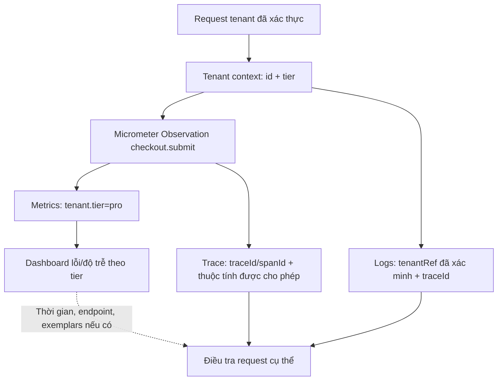
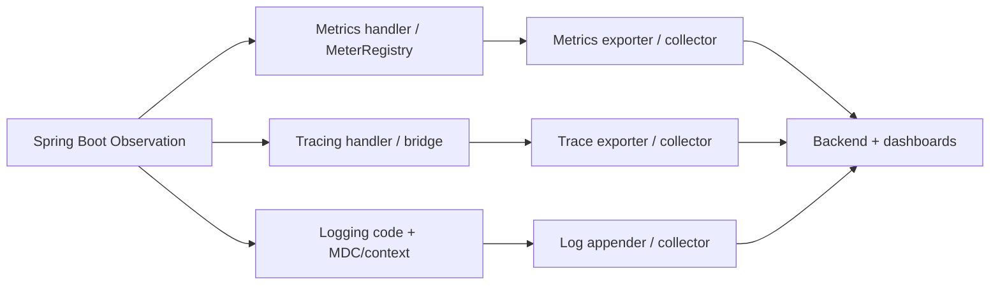

# Tag theo tenant

> **Chương:** Cardinality và metadata  
> **Module:** `SPRING_BOOT_OBSERVABILITY` — thiết lập observability cho Spring Boot bằng Micrometer Observation, metrics, logs và distributed tracing. Bài học tập trung vào cách gắn thông tin tenant để điều tra lỗi, độ trễ và hành vi ứng dụng, đồng thời kiểm soát cardinality, context propagation, exporter và sampling.

## Mục tiêu học tập

Sau bài học, bạn có thể:

- Giải thích **tenant tag** là gì trong một ứng dụng đa khách hàng (multi-tenant), và xác định câu hỏi vận hành mà tag cần trả lời.
- Phân biệt `tenant.id`, `tenant.tier`, `tenant.segment` và các thuộc tính liên quan theo độ nhạy cảm, cardinality và mục đích sử dụng.
- Ước tính số time series do kết hợp các labels; thiết kế một **ngân sách cardinality** cho metrics.
- Gắn tag theo nhóm tenant vào **Micrometer Observation** trong Spring Boot, dùng dữ liệu đã được xác thực và chuẩn hóa.
- Biết khi nào nên tìm kiếm tenant cụ thể bằng **structured logs** hoặc **tracing span attributes**, thay vì đưa tenant ID vào metrics.
- Kiểm tra việc truyền ngữ cảnh, giám sát exporter/sampling và xử lý các sự cố như bùng nổ time series hoặc nhãn sai tenant.

## 1. Vấn đề trong một hệ thống multi-tenant

Giả sử ứng dụng SaaS chạy trên Spring Boot phục vụ hàng chục nghìn doanh nghiệp. Mỗi doanh nghiệp là một **tenant** có dữ liệu, người dùng và quyền truy cập riêng. Hệ thống dùng chung một số HTTP endpoints, connection pools và dịch vụ phụ thuộc.

Một ngày, độ trễ của `POST /orders` tăng. Nhìn biểu đồ tổng thể, p95 latency tăng từ 300 ms lên 1,8 giây. Đội vận hành đặt câu hỏi:

- Chỉ nhóm thuê bao `enterprise` bị ảnh hưởng, hay cả `free` và `pro`?
- Lỗi liên quan đến một khu vực triển khai, một loại gói dịch vụ hay mọi tenant?
- Một khách hàng cụ thể báo lỗi có thể được hỗ trợ theo run/request ID mà không làm tăng chi phí metrics?
- Làm sao phân biệt lỗi do hệ thống chung với vấn đề ở cấu hình hoặc dữ liệu của một tenant?

**Tag theo tenant** giúp thêm **ngữ cảnh phân nhóm** vào tín hiệu quan sát. Tuy nhiên, cách gắn tag phải phù hợp với bản chất từng tín hiệu.

Nếu gắn `tenant.id` riêng của từng khách hàng vào mọi metric, số lượng time series có thể tăng theo lượng tenant và kéo theo rủi ro lưu trữ, truy vấn, chi phí, giới hạn ingest và quyền riêng tư. Đối với metrics, mục tiêu thường là **so sánh các nhóm tenant**; khi cần điều tra **một tenant cụ thể**, dùng các cơ chế có độ chi tiết và kiểm soát truy cập thích hợp.

## 2. “Tag theo tenant” có thể mang những nghĩa khác nhau

Trong hệ thống quan sát, từ *tag*, *label*, *attribute* hoặc *field* đôi khi bị dùng thay thế nhau. Chúng có điểm giống là mang metadata, nhưng chi phí và cách sử dụng khác nhau.

| Tín hiệu | Cách đính kèm metadata | Câu hỏi nên giải quyết | Lưu ý |
| --- | --- | --- | --- |
| **Metrics** | Labels/tags trên chuỗi thời gian | Nhóm `enterprise` có error rate cao hơn `free` không? | Mỗi tổ hợp label có thể tạo time series mới; ưu tiên giá trị hữu hạn. |
| **Distributed tracing** | Attributes trên span, baggage/context khi được cấu hình | Vì sao một request của tenant cụ thể chậm tại dependency? | Có thể có thuộc tính chi tiết hơn, nhưng còn chi phí, sampling và quyền truy cập. |
| **Logs** | Structured fields trong bản ghi sự kiện | Request của tenant X gặp exception nào, vào thời điểm nào? | Cần chính sách thu thập, che dữ liệu nhạy cảm, thời hạn lưu và phân quyền tra cứu. |
| **Context propagation** | Ngữ cảnh được truyền giữa request/task/message | Công việc ở service B có thuộc đúng tenant đã được xác thực ở service A không? | Không được nhầm tracing context với bằng chứng xác thực tenant. |

**Micrometer Observation** là lớp API chung giúp mô tả một thao tác. Một observation có thể có **low-cardinality key values** thích hợp cho metrics và **high-cardinality key values** có thể được tracing handler sử dụng khi cấu hình phù hợp. Không có nghĩa mọi key-value sẽ xuất hiện ở cả metrics, logs lẫn traces.

### 2.1. Chọn key đúng ý nghĩa

| Key minh họa | Giá trị | Cardinality dự kiến | Metric tag? |
| --- | --- | --- | --- |
| `tenant.tier` | `free`, `pro`, `enterprise`, `unknown` | Rất thấp | **Có**, khi thật sự hữu ích. |
| `tenant.segment` | `small`, `mid_market`, `large`, `unknown` | Thấp nếu chuẩn hóa | **Có**, theo nhu cầu phân tích. |
| `tenant.region` | `ap_southeast`, `eu_west`… | Thấp nếu nhóm vùng cố định | **Có**, khi vùng có ý nghĩa vận hành. |
| `tenant.isolation` | `shared`, `dedicated` | Thấp | **Có**, nếu cần so sánh tài nguyên. |
| `tenant.id` | `tenant-9c3e...` | Có thể bằng số tenant và tăng liên tục | **Thường không**. |
| `tenant.name` | Tên doanh nghiệp nhập tự do | Rất cao và có thể nhạy cảm | **Không**. |
| `user.id` | ID người dùng của tenant | Rất cao | **Không**. |
| `customer.email` | Địa chỉ email | Rất cao, dữ liệu cá nhân | **Không**. |

Tên key là ví dụ quy ước, không phải tất cả đều là semantic convention mặc định của Spring Boot hoặc OpenTelemetry. Trong một tổ chức, cần thống nhất tên và ngữ nghĩa, tránh để các dịch vụ dùng lẫn `tenant.plan`, `subscription` và `tier` với những tập giá trị khác nhau.

## 3. Cardinality: vì sao tenant ID là nhãn nguy hiểm?

**Cardinality** của một label là số giá trị khác nhau mà label có thể nhận. Với time-series metrics, một chuỗi thời gian thường gắn với một tổ hợp tên metric và toàn bộ labels.

Ví dụ một metric có:

- 3 giá trị `http.method`;
- 5 giá trị `http.route`;
- 4 giá trị `status.group`;
- 3 giá trị `tenant.tier`.

Số tổ hợp tối đa của bốn nhãn này là:

\[
3 \times 5 \times 4 \times 3 = 180
\]

Đây là **ước tính số tổ hợp nhãn** trong ví dụ, không phải lời khẳng định hệ thống luôn tạo đủ 180 series. Một số tổ hợp sẽ không bao giờ xảy ra. Mặt khác, histogram buckets, số instance, vùng triển khai và các nhãn bổ sung có thể làm số series thực lớn hơn đáng kể.

Nếu thay `tenant.tier` bằng `tenant.id` với 20.000 tenant, riêng phần tổ hợp minh họa sẽ thành:

\[
3 \times 5 \times 4 \times 20\,000 = 1\,200\,000
\]

Con số trên là số tổ hợp tiềm năng cho **một loại metric và tập nhãn giả định**, chưa tính nhiều metric khác hoặc histogram time series. Hệ thống có 20.000 tenant không nhất thiết thực sự sinh đủ các tổ hợp; nhưng rủi ro tăng trưởng là rõ ràng.

### 3.1. Hậu quả của cardinality cao

- **Ứng dụng:** meter registry phải quản lý nhiều meters và label sets hơn, tăng chi phí CPU/bộ nhớ.
- **Collector/backend:** số time series và tần suất mẫu tăng, có thể chạm quota, bị từ chối ingest hoặc tăng chi phí lưu trữ.
- **Truy vấn/dashboard:** truy vấn phân nhóm chậm, biểu đồ khó đọc, cảnh báo dễ sai do dữ liệu không ổn định.
- **Vận hành:** khi tăng lượng khách hàng, chi phí telemetry tăng theo tốc độ khó dự đoán.
- **Bảo mật:** đưa định danh tenant ra một backend metrics dùng chung có thể làm lộ cấu trúc khách hàng hoặc dữ liệu cần phân quyền.

**Nguyên tắc:** metric tags phải phục vụ phép tổng hợp có ý nghĩa và có **tập giá trị được kiểm soát**. Một định danh duy nhất của từng tenant thường phục vụ *truy tìm sự kiện*, chứ không phục vụ *tổng hợp*.

### 3.2. Xác định ngân sách nhãn

Trước khi thêm một tenant label, hãy ghi rõ:

1. Nhãn đó trả lời **câu hỏi vận hành nào**? Nếu không có dashboard, cảnh báo hoặc phép so sánh cụ thể, chưa cần thêm.
2. Giá trị đến từ **enum/tập quy ước hữu hạn** hay đầu vào tùy ý?
3. Có bao nhiêu giá trị hiện tại, và tối đa sau 6–12 tháng?
4. Nhãn được kết hợp với bao nhiêu nhãn khác, đặc biệt `uri`, `instance`, `status`, histogram buckets?
5. MeterRegistry và backend có **giới hạn cardinality/chi phí** nào; ai chịu trách nhiệm theo dõi?
6. Có thể dùng logs, traces hoặc truy vấn từ dữ liệu nghiệp vụ để giải quyết yêu cầu chi tiết không?

Một bảng ngân sách nội bộ có thể như sau:

| Label | Giá trị cho phép | Trách nhiệm kiểm soát |
| --- | --- | --- |
| `tenant.tier` | `free`, `pro`, `enterprise`, `unknown` | Đội billing/domain cung cấp mapping chuẩn. |
| `tenant.region` | Danh sách vùng triển khai được phê duyệt | Đội platform quản lý cấu hình vùng. |
| `tenant.segment` | Một số phân khúc đã thống nhất | Đội sản phẩm và SRE chuẩn hóa. |
| `tenant.id` | Không dùng trên metrics chung | Điều tra bằng logs/traces có phân quyền. |

Không cần bắt buộc gắn tất cả các nhãn kể trên vào mọi metric. Mỗi nhãn tăng số chiều dữ liệu; chỉ giữ những chiều cần cho quyết định vận hành.

## 4. Định danh tenant phải đến từ nguồn tin cậy

Câu hỏi không chỉ là *tag có cardinality thấp không*, mà còn là *tag có đúng tenant không*.

Ví dụ, client gửi header:

```http
X-Tenant-ID: tenant-enterprise-01
```

Nếu dịch vụ tin header này vô điều kiện để gắn metadata, người dùng có thể giả mạo tenant của người khác. Một metric `tenant.tier=enterprise` lúc đó có thể phản ánh giá trị client tự khai báo thay vì quyền đã được xác thực.

**Nguồn đúng** nên là tenant context do tầng xác thực/phân quyền hoặc gateway tin cậy xác lập và đã được đối chiếu với tài khoản/tenant mà request được phép sử dụng.

Quy trình hợp lý:

1. Xác thực principal hoặc workload identity.
2. Xác định tenant mà principal được quyền thao tác, hoặc tenant của job background theo cấu hình tin cậy.
3. Ánh xạ tenant sang **tier/segment/region chuẩn hóa**.
4. Đưa metadata đã chuẩn hóa vào observation khi cần đo.
5. Không dùng trường telemetry để ra quyết định phân quyền hoặc quyết định dữ liệu thuộc tenant nào.

**Tracing context như `traceparent` không thay thế authentication context.** Nó giúp liên kết spans, không chứng minh request có quyền truy cập dữ liệu tenant. Baggage cũng có thể bị nguồn bên ngoài cung cấp; phải kiểm tra theo trust boundary trước khi tin hoặc dùng nó cho nghiệp vụ.

### 4.1. Giải quyết tenant không xác định

Các trường hợp như health check, background worker, request bị từ chối xác thực hoặc job system-level có thể không có tenant hợp lệ. Không để giá trị từ request tự do tạo thành tag mới.

Dùng một nhãn mặc định cố định, ví dụ `unknown` hoặc `system`, với ý nghĩa được định nghĩa rõ. Tùy loại metric, đôi khi nên **không gắn tenant tag** cho công việc hệ thống, thay vì cố ép mọi hoạt động vào một tenant.

Phân biệt:

- `unknown`: hệ thống không xác định được phân nhóm đáng tin cậy;
- `system`: công việc không thuộc một tenant cụ thể, nếu đã định nghĩa nhóm này;
- `free`: tenant có gói miễn phí đã được xác thực.

Gộp thiếu ngữ cảnh thành `free` để giảm số nhãn sẽ khiến số liệu sai lệch.

## 5. Ví dụ Spring Boot: gắn `tenant.tier` vào custom observation

Ví dụ dưới đây minh họa một Spring Boot service đo `checkout.submit`. Tenant tier được lấy từ **provider do ứng dụng triển khai sau khi xác thực**, rồi đổi thành một trong bốn giá trị ổn định.

### 5.1. Định nghĩa tập giá trị được phép

```java
package example.observability;

import java.util.Locale;

public enum TenantTier {
    FREE, PRO, ENTERPRISE, UNKNOWN;

    public String metricValue() {
        return name().toLowerCase(Locale.ROOT);
    }
}
```

Một interface mô tả việc đọc phân hạng tenant đã được xác minh:

```java
package example.observability;

public interface TrustedTenantMetadataProvider {
    // Implementation phải đọc tenant context đã được xác thực/phân quyền.
    // Có thể trả UNKNOWN nếu request/job không có tenant hợp lệ.
    TenantTier currentTenantTier();
}
```

Đây là **hợp đồng minh họa**. Spring Boot không tự cung cấp bean `TrustedTenantMetadataProvider` theo tên này. Trong dự án thực, cần một implementation lấy thông tin từ security context, session đã xác thực hoặc nguồn cấu hình batch job đáng tin cậy. Không trả về tier bằng cách tin trực tiếp header do client gửi.

### 5.2. Tạo observation cho một thao tác nghiệp vụ

```java
package example.observability;

import java.util.function.Supplier;

import io.micrometer.observation.Observation;
import io.micrometer.observation.ObservationRegistry;
import org.springframework.stereotype.Service;

@Service
public class TenantCheckoutObservation {
    private final ObservationRegistry registry;
    private final TrustedTenantMetadataProvider tenantMetadata;

    public TenantCheckoutObservation(
            ObservationRegistry registry,
            TrustedTenantMetadataProvider tenantMetadata) {
        this.registry = registry;
        this.tenantMetadata = tenantMetadata;
    }

    public <T> T observeSubmit(Supplier<T> action) {
        TenantTier resolved = tenantMetadata.currentTenantTier();
        String tier = resolved == null
                ? TenantTier.UNKNOWN.metricValue()
                : resolved.metricValue();

        return Observation.createNotStarted("checkout.submit", registry)
                .contextualName("submit checkout")
                .lowCardinalityKeyValue("tenant.tier", tier)
                .lowCardinalityKeyValue("operation", "submit")
                .observe(action);
    }
}
```

Ví dụ được dùng như sau, trong luồng đã xác thực tenant:

```java
String orderId = tenantCheckoutObservation.observeSubmit(
        () -> checkoutService.placeOrder(command));
```

`checkoutService` và `command` tượng trưng cho thành phần nghiệp vụ của ứng dụng, không phải các biến được Spring Boot tạo sẵn.

Giải thích:

1. `TrustedTenantMetadataProvider` cung cấp tier đáng tin cậy, tách logic xác thực khỏi logic đo lường.
2. `TenantTier` là enum nên tập tag values hữu hạn; nếu chưa xác định được thì dùng `unknown`.
3. `Observation.createNotStarted("checkout.submit", registry)` có tên ổn định giữa các tenant.
4. `lowCardinalityKeyValue("tenant.tier", tier)` cho phép metrics handler dùng tier để tổng hợp nếu được cấu hình.
5. `observe(action)` quản lý vòng đời start/scope/error/stop cho **thao tác đồng bộ**; nếu action ném exception, sự kiện lỗi có thể được observation handler ghi nhận.
6. Khi có tracing handler, observation có thể tạo span hoặc metadata phù hợp và liên kết với request hiện hành qua scope/context propagation.

**Lưu ý:** tên metric thực tế và thuộc tính xuất ra backend phụ thuộc Micrometer handler, convention, registry và exporter. Đoạn code không tự bảo đảm dữ liệu tới Prometheus hoặc một tracing backend.

### 5.3. Vì sao không dùng tenant ID làm low-cardinality tag?

Tránh kiểu code sau:

```java
// Không làm như vậy trên metrics dùng chung:
// tenantId là một giá trị riêng của mỗi tenant, tăng theo số khách hàng.
Observation.createNotStarted("checkout.submit", registry)
        .lowCardinalityKeyValue("tenant.id", tenantId)
        .observe(action);
```

Việc đặt tên phương thức là `lowCardinalityKeyValue` không tự kiểm tra tập giá trị có thực sự ít hay không. **Chính người viết instrumentation chịu trách nhiệm** đảm bảo key có cardinality thấp.

Nếu muốn điều tra một tenant cụ thể, có thể cân nhắc thuộc tính tracing có cardinality cao hoặc field trong logs **sau khi đánh giá quyền truy cập, lưu trữ và dữ liệu nhạy cảm**. Chỉ sử dụng ID đã xác minh; không đưa tenant ID vào mọi span một cách mặc định nếu chưa có nhu cầu và chính sách rõ ràng.

## 6. Metric của framework và metric nghiệp vụ

Ví dụ `checkout.submit` ở trên là **custom observation**. Nhưng phần lớn hệ thống cũng muốn xem HTTP server metrics của Spring Boot theo nhóm tenant.

Các loại tín hiệu khác nhau cần lựa chọn nơi gắn metadata:

| Phạm vi đo | Cách tiếp cận | Lưu ý |
| --- | --- | --- |
| Custom observation của nghiệp vụ | Gắn `tenant.tier` khi tạo observation trong service | Chủ động kiểm soát tên, context và tags. |
| HTTP server observation do Spring Boot tạo | Dùng convention/filter/context tùy phiên bản và tầng instrumentation | Metadata phải được lấy từ nguồn đã xác thực; tránh phụ thuộc việc đọc tenant context quá muộn. |
| Meter được tạo trực tiếp qua `MeterRegistry` | Gắn tag chuẩn hóa lúc đăng ký/tạo meter | Không tự động nhận mọi tag từ Observation API. |
| Logs sự kiện | Đưa tenant context hợp lệ vào structured logging/MDC ở thời điểm ghi log | Không tự xuất hiện chỉ vì một observation có `tenant.tier`. |
| Tracing spans | Thêm thuộc tính theo tracing instrumentation phù hợp | Phải tính tới thời điểm tạo span, sampling, exporter và quyền truy cập. |

**Không phải mọi metric tự động do framework phát ra đều có tenant tag.** Đoạn custom observation bên trên không thay đổi tất cả HTTP server metrics, JVM metrics hay connection pool metrics.

Với HTTP metrics, cân nhắc dùng `ServerRequestObservationConvention` hoặc một cơ chế mở rộng phù hợp với phiên bản Spring Boot/Micrometer đang chạy để thêm nhãn từ ngữ cảnh request đã xác thực. Nếu dùng `ObservationFilter`, cần hiểu nó hoạt động khi observation chuẩn bị dừng, và metadata phải còn nằm trong context tại thời điểm đó. Không giả định đọc `SecurityContextHolder` hoặc `ThreadLocal` từ filter lúc stop luôn đúng, đặc biệt khi xử lý bất đồng bộ.

Một **global common tag** như `deployment.environment=production` có thể áp dụng cho mọi meter. Nhưng `tenant.tier` là thuộc tính **theo từng request/job**, nên không nên gắn nó làm common tag toàn cục cố định của một `MeterRegistry` dùng chung. Đó là nhầm lẫn giữa metadata của ứng dụng và metadata của request.

## 7. Một lớp bảo vệ bằng `MeterFilter`

Ngay cả khi code chuẩn hóa tier, nên có một lớp giám sát và giới hạn nếu hệ thống cho phép nhãn tùy biến. Micrometer Metrics cung cấp `MeterFilter` để kiểm soát meter IDs ở tầng metrics.

Ví dụ Spring Boot bean giới hạn số **giá trị khác nhau** của tag `tenant.tier` cho các meter có tên bắt đầu bằng `checkout.submit`:

```java
package example.observability;

import io.micrometer.core.instrument.config.MeterFilter;
import org.springframework.context.annotation.Bean;
import org.springframework.context.annotation.Configuration;

@Configuration(proxyBeanMethods = false)
public class TenantMetricGuardConfig {

    @Bean
    MeterFilter tenantTierLimit() {
        return MeterFilter.maximumAllowableTags(
                "checkout.submit",
                "tenant.tier",
                4,
                MeterFilter.deny());
    }
}
```

Ý nghĩa:

- `maximumAllowableTags` giới hạn số **giá trị tag** được chấp nhận cho phạm vi tên meter được chỉ định.
- `MeterFilter.deny()` là hành động khi vượt ngưỡng; các meter mới có giá trị không được chấp nhận có thể bị từ chối, dẫn tới **mất dữ liệu của nhóm vượt giới hạn**.
- Đây là **hàng rào bảo vệ khi cấu hình sai**, không phải cách thay thế việc chuẩn hóa dữ liệu đầu vào.
- Prefix tên meter phải khớp với meter thực sự do handler/registry tạo. Cần kiểm tra tên meter trong ứng dụng/registry đang dùng.
- Giới hạn này **không tự giới hạn tổng số series** do tích của các nhãn khác, histogram hoặc nhiều tên meter khác nhau.

Nếu một hệ thống có 4 tier được định nghĩa và bắt đầu thấy giá trị thứ 5, nguyên nhân cần được điều tra: có tier mới chưa cập nhật quy ước, giá trị bị sai format hay đầu vào từ client đã lọt vào tag?

Khi `MeterFilter` từ chối dữ liệu, cần có cách phát hiện thông qua kiểm tra instrumentation, số lượng meters, logs cấu hình hoặc metric pipeline. Đừng coi biểu đồ ổn định sau khi deny là bằng chứng hệ thống đã hết sự cố.

## 8. Dùng logs và traces để điều tra một tenant cụ thể

Một câu hỏi hỗ trợ khách hàng có thể là: “Tại sao tenant `tenant-83d` nhận lỗi thanh toán lúc 10:25?” Đây là truy vấn cho **một thực thể cụ thể**, khác với thống kê lỗi theo tier.

### 8.1. Structured logs theo định danh đã xác minh

Ví dụ bản ghi log được thiết kế để tìm kiếm:

```json
{
  "timestamp": "2026-11-22T03:25:40Z",
  "level": "ERROR",
  "service": "checkout-service",
  "event": "payment.timeout",
  "tenantTier": "pro",
  "tenantRef": "tenant-83d",
  "traceId": "24a3af941a324e03b2f47e90b512a083",
  "spanId": "a9f16d0453a92130",
  "dependency": "payment-provider",
  "durationMs": 3000
}
```

`tenantRef` ở đây là một định danh đã được xác minh và được phép ghi nhận theo chính sách nội bộ. Trong hệ thống có yêu cầu bảo mật cao, có thể cần dùng một mã tra cứu thay thế/pseudonymous identifier và áp dụng quyền truy vấn theo tenant.

Không để thông tin nhạy cảm như token, mật khẩu, email hoặc nội dung hóa đơn đi vào logs chỉ vì cần gắn ngữ cảnh tenant.

### 8.2. Trace ID để nối các bước xử lý

Một trace có thể chứa:

```text
Trace 24a3af941a324e03b2f47e90b512a083
POST /orders                     3.2 s
└── checkout.submit              3.1 s
    └── payment.authorize        3.0 s  ERROR (timeout)
```

Trong mô hình này:

- `traceId` là định danh một distributed trace; `spanId` xác định một thao tác.
- `tenant.tier` giúp hiểu nhóm tenant trong trace khi handler đã chuyển metadata.
- `tenantRef` hoặc một high-cardinality attribute có thể được thêm **có chọn lọc** vào trace để hỗ trợ tìm kiếm, sau khi có chính sách dữ liệu.
- Trace có thể bị **sampling**; không phải mọi request đều có trace trong backend.

Nếu người dùng gửi mã hỗ trợ, ứng dụng có thể tìm logs theo request/correlation ID, lấy `traceId` từ logs và mở trace tương ứng nếu trace đó được thu thập. Có thể dùng metric exemplars ở backend hỗ trợ để đi từ điểm dữ liệu của biểu đồ tới trace. Không nên thêm trace ID vào metric label để mô phỏng tính năng exemplars.

### 8.3. Logs, spans và metrics có mức tổng hợp khác nhau



Sơ đồ cho thấy các mục đích khác nhau: **metrics có số chiều được kiểm soát**, trong khi logs/traces có thể hỗ trợ tương quan chi tiết với phạm vi truy cập chặt chẽ.

## 9. Propagation trong hệ thống multi-tenant

Một request có thể đi từ `api-gateway` tới `order-service`, `payment-service`, rồi gửi message cho `invoice-worker`.

Để quan sát nhất quán:

1. **Đảm bảo identity/tenant context:** bên nhận phải xác minh quyền tenant hoặc tin vào dữ liệu do một thành phần nội bộ có xác thực cung cấp theo hợp đồng bảo mật. Tracing headers tự thân không chứng minh tenant hợp lệ.
2. **Truyền trace context:** dùng tích hợp HTTP client/server hoặc messaging instrumentation hỗ trợ inject/extract các header như W3C `traceparent`, để các spans trong cùng hành trình được liên kết.
3. **Truyền metadata tenant khi cần:** gửi `tenant.tier` hoặc tham chiếu tenant qua cơ chế đã thỏa thuận, tránh đưa dữ liệu nhạy cảm vào baggage mặc định. Bên nhận phải xác định lại tính tin cậy và phạm vi sử dụng.
4. **Bảo toàn context qua async:** khi dùng `@Async`, `Executor`, `CompletableFuture` hoặc Reactor, dùng context propagation tương thích để khôi phục tracing/logging và tenant context tại đúng worker thread.
5. **Giới hạn dữ liệu qua biên:** không tự động forward toàn bộ baggage hoặc custom headers tới đối tác bên ngoài; chỉ truyền metadata mà hợp đồng và chính sách bảo mật cho phép.

Ví dụ, một message được queue và xử lý sau một giờ có thể tạo trace mới; correlation/workflow ID phục vụ nối các giai đoạn nghiệp vụ, còn trace ID mô tả đường đi thực thi trong từng trace. Một tag `tenant.tier=pro` trên metric không đủ để xác định hai messages thuộc cùng tenant cụ thể.

### 9.1. Tránh nhầm context với authorization

Giả sử `tenant.tier=enterprise` có mặt trong baggage do client gửi. Nếu backend dùng nó để cấp quyền tính năng enterprise, đó là lỗi thiết kế. Baggage là **metadata phục vụ ngữ cảnh/quan sát**, không phải chứng thực gói dịch vụ.

Đặc biệt trong hệ thống multi-tenant, đảm bảo dữ liệu telemetry của tenant A không thể bị người dùng thuộc tenant B truy vấn trái phép. Việc log có tenant ID để hỗ trợ điều tra không tự tạo ra giới hạn quyền truy cập vào log backend.

## 10. Exporter, sampling và giới hạn của thông tin theo tenant

Để thu được thông tin có ích, một ứng dụng cần đầy đủ pipeline:



Một số giới hạn quan trọng:

- **Metrics handler và exporter:** observation có tag đúng vẫn chưa bảo đảm bạn thấy metric ở Prometheus hoặc một backend khác. Cần registry, endpoint/exporter, scrape/collector và query đúng tên meter.
- **Tracing sampling:** với xác suất lấy mẫu 10%, một nhóm tenant có ít request có thể gần như không có trace được giữ lại, dù lỗi thực sự xảy ra. Cần chiến lược sampling phù hợp với nhu cầu điều tra và chi phí.
- **Thời điểm gắn tag:** nếu metadata chỉ được thêm vào observation khi gần `stop()`, các handler đã xử lý ở `onStart` hoặc các log ghi trước đó có thể không thấy tag; phải gắn sớm ở nơi cần.
- **Context propagation:** một service mất tenant context có thể ghi `unknown` dù request hợp lệ. Nhóm `unknown` tăng bất thường có thể chỉ ra lỗi propagation hoặc resolution, không nhất thiết do khách hàng có tier mới.
- **Collector/backend:** giới hạn ingest, drop rules hoặc lỗi export có thể tạo khoảng trống dữ liệu. Không thấy tín hiệu không chứng minh thao tác chưa xảy ra.

Trong sản phẩm nhiều tenant, **sampling theo kết quả hoặc theo tenant cụ thể** có thể dẫn tới thiên lệch khi suy luận tỷ lệ lỗi từ traces. Dùng metrics đầy đủ và được định nghĩa rõ để phân tích xu hướng; trace được lấy mẫu phù hợp hơn để minh họa và điều tra đường đi của một số request.

### 10.1. Ví dụ cấu hình khởi đầu Spring Boot

Khi dự án đã có Actuator, Micrometer registry và tracing integration tương thích:

```yaml
spring:
  application:
    name: checkout-service

management:
  endpoints:
    web:
      exposure:
        include: health,info,prometheus
  tracing:
    sampling:
      probability: 0.1
```

`/actuator/prometheus` chỉ khả dụng khi có Prometheus registry tương ứng và endpoint được expose. `sampling.probability` trong cấu hình tương thích điều chỉnh việc lấy mẫu trace, không trực tiếp giảm cardinality của metrics.

Endpoint Actuator phải được bảo vệ theo môi trường. Quyền truy cập metrics, logs và traces cũng phải xét tới việc dữ liệu có thể mang thông tin của nhiều tenant.

## 11. Khi thực sự cần metrics theo từng tenant

Có những yêu cầu hợp lệ, ví dụ hợp đồng SLO riêng cho một nhóm khách hàng doanh nghiệp. Khi đó “không dùng tenant ID làm label” là **mặc định an toàn**, nhưng quyết định cuối cùng cần dựa trên quy mô, mục tiêu, ngân sách và mô hình bảo mật.

Các phương án:

| Phương án | Phù hợp khi | Đánh đổi |
| --- | --- | --- |
| **Metrics theo tier/segment** | Cần so sánh các nhóm lớn | Không truy vấn chi tiết một tenant. |
| **Logs/traces có tenant ID được kiểm soát** | Điều tra incident cho tenant cụ thể | Truy vấn tốn chi phí hơn; sampling và retention giới hạn. |
| **Kết quả tổng hợp theo tenant từ dữ liệu nghiệp vụ** | Cần báo cáo SLA/billing chính xác từng tenant | Cần pipeline dữ liệu và quyền truy cập riêng, không nhất thiết là metrics runtime. |
| **Metric per-tenant có whitelist và quota** | Chỉ vài tenant được giám sát chuyên sâu theo hợp đồng | Phải quản lý danh sách, giới hạn, vòng đời thay đổi tenant và ngân sách cardinality. |
| **Tách pipeline/namespace cho một nhóm tenant** | Có yêu cầu cô lập telemetry hoặc vận hành chuyên biệt | Tăng độ phức tạp triển khai, chi phí và governance. |

Nếu chọn per-tenant metrics, phải có tiêu chí vào/ra whitelist, giới hạn số tenant và tổng số time series, nhãn không tiết lộ tên khách hàng, quyền truy vấn, cơ chế xóa/di chuyển khi tenant thay đổi, và cách xử lý khi vượt quota. Không được thêm `tenant.id` vào mọi metric mặc định rồi hy vọng backend chịu tải.

**Độ chính xác của SLO:** trace được lấy mẫu và logs có thể bị bỏ sót. Với hợp đồng cần số liệu chính xác theo tenant, nên thiết kế nguồn số liệu chuẩn xác và có khả năng kiểm toán, không suy ra tỷ lệ SLA chỉ từ một tập traces được sampling.

## 12. Điều tra sự cố: chỉ nhóm enterprise chậm?

**Tình huống:** sau khi triển khai phiên bản mới, một số khách hàng enterprise báo tạo đơn chậm. Biểu đồ tổng thể chỉ tăng nhẹ.

Quy trình:

1. **Kiểm tra metric theo nhóm:** xem throughput, error rate và latency của `checkout.submit` hoặc HTTP route đã được instrument theo `tenant.tier`. Đối chiếu `free`, `pro`, `enterprise` và `unknown`.
2. **Kiểm tra thay đổi tải:** nhóm enterprise có lưu lượng, kích cỡ đơn, loại xử lý hay sự phân bố theo region khác các nhóm còn lại không? Một p95 cao hơn không tự chứng minh mã xử lý enterprise có lỗi.
3. **Lọc logs có phân quyền:** với tenant báo lỗi, lấy request ID/correlation ID và log event, thời điểm, trace ID, dependency liên quan.
4. **Mở traces được lấy mẫu:** xác định bước nào tốn thời gian như DB, inventory hoặc payment. Nếu không có trace, vẫn có thể tiếp tục dựa vào logs và metrics; sampling có thể loại trace.
5. **Kiểm tra tenant context và propagation:** so sánh tag từ các services, đặc biệt nếu một service chuyển thành `unknown` hoặc tier bị sai sau async/queue boundary.
6. **Đối chiếu nguồn dữ liệu khác:** connection pool, shard, cache hit ratio, retry, version triển khai và cấu hình nhóm enterprise.
7. **Kiểm chứng sau sửa:** theo dõi lại latency, error rate, throughput theo tier; bảo đảm không tạo thêm metric tags cardinality cao trong quá trình chẩn đoán.

**Kết luận có căn cứ:** “Nhóm `enterprise` có latency tăng ở bước thanh toán; các traces được giữ lại cho thấy gọi provider chậm, logs tại các request có liên quan ghi timeout; metrics dependency cũng tăng latency trong cùng khoảng thời gian.” Đây là hướng điều tra được hậu thuẫn bởi nhiều tín hiệu, chưa tự chứng minh nguyên nhân gốc nếu chưa kiểm tra mạng, cấu hình và hành vi dependency.

**Kết luận thiếu căn cứ:** “Không tìm thấy trace của tenant X nên tenant đó không hề gửi request.” Trace có thể bị sampling, thiếu instrumentation hoặc exporter gặp lỗi.

## 13. Các lỗi thường gặp và cách khắc phục

| Hiện tượng | Nguyên nhân có thể | Hướng kiểm tra |
| --- | --- | --- |
| Số time series tăng theo số tenant | Gắn `tenant.id` hoặc giá trị động làm metric label | Đổi sang tier/segment hữu hạn; xem giới hạn MeterRegistry và backend. |
| Nhóm `unknown` tăng bất thường | Tenant resolution hoặc context propagation lỗi | Kiểm tra security context, async/queue boundary và nơi lấy tag. |
| Nhãn `enterprise` xuất hiện cho request không có quyền | Tin header/baggage client cung cấp | Lấy tier từ tenant context được xác thực và cho phép. |
| Không thấy `tenant.tier` trên HTTP metrics | Chỉ gắn tag trong custom observation | Bổ sung instrumentation/convention đúng phạm vi HTTP; kiểm tra tên meter. |
| Log thiếu tenant ID nhưng metric có tier | Logging context chưa được gắn hoặc ghi quá sớm | Thiết lập structured fields/MDC khi log được phát. |
| Trace tìm được nhưng không có thuộc tính tenant | Handler đọc metadata sớm hơn lúc thêm tag, hoặc exporter lọc thuộc tính | Kiểm tra lúc gắn tag, handler, sampling và backend. |
| Giới hạn bằng `MeterFilter` làm thiếu series mới | Bộ lọc `deny` khi vượt số tag values | Điều tra nhãn lạ, cập nhật quy ước hoặc mapping; giám sát việc drop. |
| Dashboard tier không đúng sau khi khách hàng đổi gói | Dữ liệu tag lấy từ cache cũ hoặc tier không nhất quán giữa services | Kiểm tra nguồn sự thật, TTL cache và thời điểm áp dụng phân hạng. |
| Có tenant ID trong telemetry bên ngoài mà không được phép | Thiếu chính sách dữ liệu/trust boundary | Loại bỏ/redact, giới hạn export và kiểm tra quyền truy vấn. |
| p95 theo tenant dao động mạnh với ít request | Số mẫu thấp, chỉ lấy một khoảng thời gian ngắn | Đối chiếu sample count, khoảng quan sát và phân phối trước khi kết luận. |

## 14. Bài thực hành kiểm chứng

### 14.1. Kịch bản

Chuẩn bị một Spring Boot service có `ObservationRegistry` và metrics registry phù hợp. Giả lập requests đã xác thực thuộc bốn nhóm:

```text
free       100 requests
pro        100 requests
enterprise 100 requests
unknown     10 requests  (mô phỏng workload không xác định tier)
```

Thực hiện các bước:

1. Dùng `TenantTier` enum và `TenantCheckoutObservation` như ví dụ ở trên. Xác nhận metrics cho `checkout.submit` có giá trị `tenant.tier` trong tập đã định nghĩa.
2. Gửi nhiều request mới với các **tenant ID khác nhau** nhưng cùng tier. Đảm bảo số giá trị `tenant.tier` không tăng theo số tenant.
3. Tạo một request lỗi. Ghi log có request ID/trace ID trong luồng đã được phép và xem metadata phù hợp được gửi đến backend.
4. Thử đổi một tenant từ `pro` sang `enterprise` trong nguồn dữ liệu tin cậy. Xác nhận tag của các **observation mới** phản ánh tier mới; dữ liệu metrics lịch sử vẫn phản ánh giá trị khi được phát ra.
5. Mô phỏng request không có tenant context hợp lệ. Kiểm tra nó được phân loại `unknown` hoặc bị từ chối theo chính sách ứng dụng; không tin tier do client tự gửi.
6. Nếu có tracing, kiểm tra span, tags và log correlation trên trace được thu thập; giải thích vì sao một số requests có thể không có trace khi sampling được bật.
7. Kiểm tra số lượng time series/tags từ metrics backend và cách `MeterFilter` hoạt động khi giá trị vượt giới hạn; không để kết quả thử nghiệm ảnh hưởng tới dữ liệu production.

**Tiêu chí đạt:** bạn chứng minh được tags metrics có tập giá trị hữu hạn, tenant ID không xuất hiện trong metric labels, nguồn tenant context được xác thực, các traces/logs được liên kết đúng khi có cấu hình và quyền truy cập, đồng thời có khả năng phát hiện khi nhãn `unknown` tăng hoặc telemetry bị thiếu.

### 14.2. Câu hỏi tự kiểm tra

**Câu 1.** Nếu có 30.000 tenant, vì sao `tenant.id` thường không phù hợp làm metric tag?  
**Gợi ý:** Từng tenant sinh giá trị riêng, dẫn đến tăng mạnh số tổ hợp time series khi kết hợp với route, status, instance và histogram.

**Câu 2.** Có thể dùng `tenant.tier` trong metric tags không?  
**Gợi ý:** Có nếu tập tier được chuẩn hóa, hữu hạn, thực sự phục vụ phân tích và tổng cardinality vẫn trong ngân sách.

**Câu 3.** Nếu client gửi header `X-Tenant-Tier: enterprise`, có được dùng ngay để phân loại metrics không?  
**Gợi ý:** Không nên tin trực tiếp. Phải lấy phân hạng từ tenant context đã xác thực và được ủy quyền.

**Câu 4.** `highCardinalityKeyValue("tenant.id", id)` có bảo đảm ghi tenant ID vào log không?  
**Gợi ý:** Không. API Observation không tự tạo log. Việc chuyển sang tracing phụ thuộc handler/bridge; logs phải được ghi theo cơ chế logging riêng.

**Câu 5.** Một MeterFilter chặn giá trị `tenant.tier` thứ năm có giải quyết hoàn toàn nguy cơ nổ metrics không?  
**Gợi ý:** Không. Các nhãn khác, histogram và nhiều meter names vẫn có thể làm tăng số series; còn nguy cơ mất dữ liệu mới vì deny.

**Câu 6.** Không có trace của request tenant enterprise thì có thể kết luận request không xảy ra không?  
**Gợi ý:** Không. Có thể do sampling, exporter, collector, instrumentation hoặc propagation lỗi.

**Câu 7.** Vì sao không nên đặt `tenant.tier` làm global common tag cố định của MeterRegistry trong hệ thống multi-tenant dùng chung?  
**Gợi ý:** Tier thay đổi theo request/job, trong khi common tags mô tả metadata dùng chung của toàn bộ registry/process.

**Câu 8.** Nếu một request đi qua queue và tenant context bị mất, điều gì có thể xảy ra với metric tags?  
**Gợi ý:** Service nhận có thể ghi `unknown` hoặc phân loại sai; cần propagation/khôi phục context, nhưng vẫn phải kiểm tra quyền và nguồn dữ liệu tin cậy.

**Điểm cần nhớ:** Tag theo tenant trong Spring Boot nên bắt đầu bằng **câu hỏi vận hành và ngân sách cardinality**. Dùng `tenant.tier`, `tenant.segment` hoặc nhóm hữu hạn cho metrics khi có ích; dùng logs/traces có phân quyền để truy vết tenant cụ thể. Micrometer Observation giúp gắn ngữ cảnh vào thao tác, nhưng độ chính xác của toàn bộ hệ thống còn phụ thuộc identity/tenant resolution, context propagation, cách handler đọc metadata, exporter, sampling và các giới hạn của backend quan sát.
