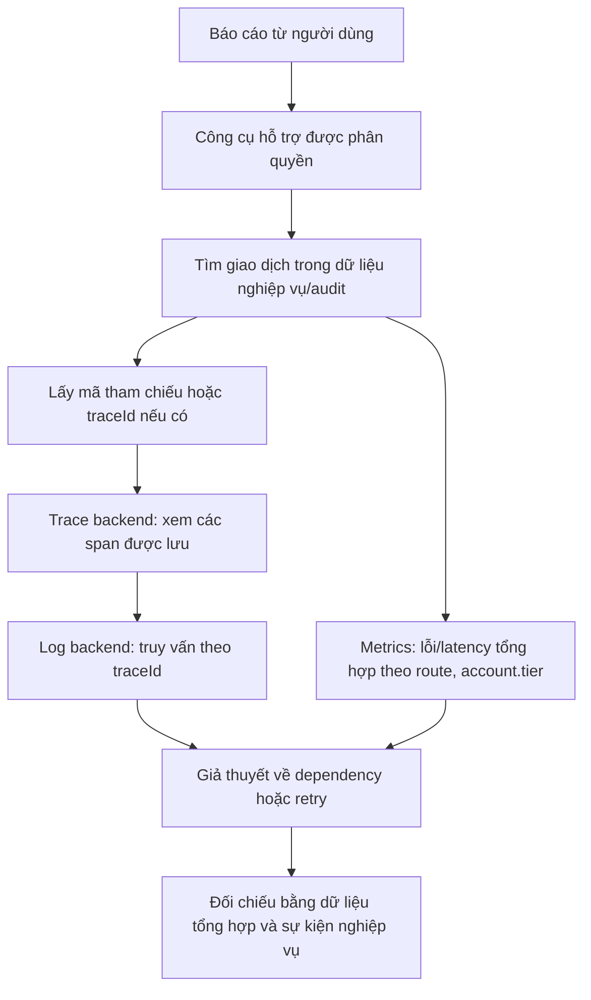

# Tag theo user id trong Spring Boot Observability

Một nhóm phát triển muốn biết **người dùng nào gặp lỗi nhiều nhất** và quyết định thêm `user.id` vào metric của endpoint `POST /checkout`. Ban đầu dashboard có vẻ thuận tiện vì có thể lọc số lần lỗi và độ trễ theo từng tài khoản. Nhưng khi số người dùng tăng từ vài chục lên hàng trăm nghìn, cùng một metric có thể sinh ra rất nhiều chuỗi thời gian. Chi phí lưu trữ và truy vấn tăng, hệ thống cảnh báo có thể hoạt động kém ổn định, còn định danh người dùng bị phân tán sang những hệ thống giám sát không được thiết kế để lưu dữ liệu cá nhân.

Bài **“Tag theo user id”** thuộc chương **Cardinality và metadata** của module **SPRING_BOOT_OBSERVABILITY**. Trong phạm vi thiết lập observability cho Spring Boot bằng Micrometer Observation, metrics, logs và distributed tracing, bài học giải thích tác động của `user.id` đến cardinality, cách phân loại metadata, lựa chọn thay thế để điều tra lỗi/độ trễ, và những giới hạn của exporter, sampling, propagation cũng như bảo vệ thông tin người dùng.

**Quy tắc mặc định:** Không dùng định danh người dùng riêng lẻ làm nhãn metric. Nếu cần điều tra một người dùng cụ thể, chọn nguồn dữ liệu và cơ chế tương quan phù hợp với yêu cầu nghiệp vụ, bảo mật, quyền truy cập và thời hạn lưu.

## 1. “Tag theo user id” nghĩa là gì?

Trong Micrometer, **tag** hay **label** là cặp khóa–giá trị dùng để phân biệt các chuỗi metric.

Ví dụ hai lần gọi một endpoint:

```text
http.server.requests
  method=POST, uri=/checkout, status=200, user.id=usr-0001
http.server.requests
  method=POST, uri=/checkout, status=200, user.id=usr-0002
```

Dù cùng endpoint, HTTP method và status, hai giá trị `user.id` khác nhau khiến hệ thống metrics có thể phải giữ **hai chuỗi thời gian khác nhau**. Nếu tag có 100.000 giá trị khác nhau, số chuỗi liên quan có thể tăng tương ứng, đặc biệt khi còn nhiều nhãn khác.

Phân biệt các khái niệm:

| Khái niệm | Ví dụ | Cardinality | Tác động |
| --- | --- | --- | --- |
| Metric name | `http.server.requests` | Thường cố định | Định danh loại phép đo |
| Low-cardinality tag | `method=POST`, `status=500` | Hữu hạn | Hữu ích cho thống kê và cảnh báo |
| Route đã chuẩn hóa | `uri=/orders/{id}` | Có thể kiểm soát | Nhóm traffic theo endpoint |
| User ID làm metric tag | `user.id=usr-0001` | Cao theo lượng người dùng | Tạo thêm series theo người dùng |
| Trace ID làm metric tag | `traceId=...` | Có thể gần như riêng cho mỗi trace | Tạo series theo từng trace nếu dùng sai |
| Span attribute chi tiết | `subject.ref=ref-8c1e` | Có thể cao | Thuộc một lần thực thi, chỉ thu thập khi có cơ sở và được phép |
| Trường trong bản ghi audit | `actor.id=...` | Có thể cao | Phục vụ kiểm toán với kiểm soát truy cập, retention và mục đích rõ ràng |

Một giá trị **có ích để tra cứu** không đồng nghĩa nó **phù hợp làm metric label**. Metrics thường tối ưu cho việc trả lời câu hỏi tổng hợp, trong khi trace và nhật ký nghiệp vụ mô tả một lần thực thi cụ thể.

## 2. Cardinality tăng nhanh như thế nào?

Một chuỗi thời gian được nhận diện theo tên metric và tổ hợp giá trị nhãn. Số lượng series có thể tăng xấp xỉ theo tích của số giá trị từng chiều, nếu các tổ hợp đó thực sự xuất hiện.

Xét một metric HTTP giả định có:

| Chiều phân nhóm | Số giá trị ví dụ |
| --- | ---: |
| `instance` | 2 |
| `method` | 2 |
| `uri` | 4 |
| Nhóm `status` | 3 |
| `user.id` | 10.000 |

Giới hạn tổ hợp trong ví dụ:

\[
2 \times 2 \times 4 \times 3 \times 10\,000 = 480\,000
\]

Đây là **số tổ hợp có thể có**, không phải khẳng định ứng dụng chắc chắn phát 480.000 series. Các tổ hợp chưa từng có request sẽ không tự xuất hiện. Nhưng phép tính cho thấy vì sao việc thêm chỉ **một tag** có tập giá trị lớn có thể thay đổi quy mô hệ thống.

Nếu thay `user.id` bằng `account.tier` chỉ có `free`, `premium`, `enterprise` và `unknown`, cùng các chiều còn lại cho tối đa:

\[
2 \times 2 \times 4 \times 3 \times 4 = 192
\]

Sự khác biệt giữa hai thiết kế nằm ở **tập giá trị**, không phải độ dài tên tag.

### Vì sao histogram còn khuếch đại chi phí?

Một timer có thể được xuất dưới dạng count/sum và, nếu bật histogram, nhiều bucket phân phối độ trễ. Mỗi tổ hợp nhãn có thể tương ứng với nhiều chuỗi như `_count`, `_sum` và `_bucket{le=...}`. Do đó, thêm user ID vào timer có histogram thường đắt hơn so với nhìn vào một counter đơn giản.

Chi phí không chỉ là dung lượng ổ đĩa. Cardinality cao còn có thể ảnh hưởng:

- Bộ nhớ của ứng dụng/MeterRegistry và hệ thống thu thập.
- Kích thước payload scrape/export, số samples và băng thông.
- Index, độ trễ truy vấn, dashboard và quy tắc cảnh báo.
- Vòng đời chuỗi ngắn khi nhiều user chỉ phát vài request rồi biến mất.
- Giới hạn series, quotas và chi phí theo chính sách backend.

Các con số thực tế phụ thuộc số lượng người dùng hoạt động đồng thời, nhãn khác, retention, loại meter và backend. Đừng chuyển một giới hạn tổ hợp thành số bộ nhớ hoặc chi phí tiền cụ thể khi chưa đo trên hệ thống thật.

## 3. Mẫu code sai: thêm `user.id` vào Timer

Giả sử service biết user ID sau khi xác thực và tạo một Timer riêng cho từng user:

```java
import io.micrometer.core.instrument.MeterRegistry;
import io.micrometer.core.instrument.Timer;
import org.springframework.stereotype.Service;

@Service
public class CheckoutMetricsAntiPattern {
    private final MeterRegistry registry;

    public CheckoutMetricsAntiPattern(MeterRegistry registry) {
        this.registry = registry;
    }

    public void checkout(String userId, Runnable paymentAction) {
        Timer.builder("checkout.duration")
                .tag("user.id", userId) // KHÔNG nên dùng
                .register(registry)
                .record(paymentAction);
    }
}
```

Với nhiều ID, mỗi lời gọi `register(registry)` có thể tìm hoặc tạo một meter mang tổ hợp tag tương ứng. Registry thường không coi mỗi lần request là một meter mới nếu tên và tag trùng nhau, nhưng **mỗi user ID mới có thể tạo một meter/series mới**.

Đổi tên khóa thành `customer`, `subject`, `actorId` hay `principal` không sửa được vấn đề. Việc băm, mã hóa hoặc dùng UUID thay ID ban đầu cũng không tự giảm cardinality: nếu mỗi người vẫn có một giá trị riêng, số giá trị vẫn lớn.

### Sai lầm tương tự với Micrometer Observation

Observation thường phân biệt:

```java
observation.lowCardinalityKeyValue("account.tier", "premium");
observation.highCardinalityKeyValue("subject.ref", "opaque-ref-8c1e");
```

Nếu đặt user ID vào **`lowCardinalityKeyValue("user.id", userId)`**, metrics ObservationHandler có thể đưa nó thành tag cho timer. Đổi sang `highCardinalityKeyValue` giúp thể hiện chủ đích dùng thuộc tính chi tiết cho tracing, nhưng **không tự bảo đảm quyền riêng tư, không bảo đảm trace sẽ được lưu**, và custom handler vẫn có thể xử lý các key theo cách riêng.

Một Observation có nhiều thuộc tính không có nghĩa tất cả thuộc tính đều nên trở thành metric labels. Cần xem tag thực tế xuất ra từ `MeterRegistry` hoặc backend, nhất là khi có custom convention/filter/handler.

## 4. Thiết kế đúng: thống kê theo nhóm người dùng hữu hạn

Nếu mục tiêu là biết **nhóm tài khoản nào gặp lỗi hoặc chậm nhiều hơn**, hãy phân nhóm theo đặc điểm có ý nghĩa nghiệp vụ và số giá trị hữu hạn, chẳng hạn:

| Câu hỏi vận hành | Nhãn phù hợp | Tập giá trị ví dụ |
| --- | --- | --- |
| Khách miễn phí có chậm hơn khách trả phí không? | `account.tier` | `free`, `premium`, `enterprise`, `unknown` |
| Request đã xác thực có lỗi nhiều hơn request ẩn danh không? | `auth.state` | `authenticated`, `anonymous` |
| Một loại thao tác thanh toán có chậm không? | `payment.method` | `card`, `wallet`, `bank_transfer`, `unknown` |
| Một nhóm tuyến xử lý có bị lỗi không? | `http.route` | Route template, ví dụ `/checkout`, `/orders/{id}` |
| Kết quả nghiệp vụ nào tăng bất thường? | `result` | `success`, `rejected`, `timeout`, `error` |

Nhóm hữu hạn chỉ hữu ích nếu **thực sự được giới hạn**. Nếu team có thể tạo một account tier tùy ý theo tên mỗi khách hàng, `account.tier` sẽ dần trở thành high cardinality dù tên khóa nghe có vẻ ổn.

### Ví dụ Spring Boot với Micrometer Observation

Mã sau chỉ ghi nhóm tài khoản đã được chuẩn hóa, không nhận user ID làm nhãn:

```java
import io.micrometer.observation.Observation;
import io.micrometer.observation.ObservationRegistry;
import org.springframework.stereotype.Service;

import java.util.Locale;
import java.util.function.Supplier;

@Service
public class CheckoutObservationService {
    public enum AccountTier {
        FREE, PREMIUM, ENTERPRISE, UNKNOWN
    }

    private final ObservationRegistry observations;

    public CheckoutObservationService(ObservationRegistry observations) {
        this.observations = observations;
    }

    public <T> T runCheckout(AccountTier tier, Supplier<T> work) {
        String safeTier = (tier == null ? AccountTier.UNKNOWN : tier)
                .name().toLowerCase(Locale.ROOT);

        return Observation.createNotStarted(
                        "checkout.process", observations)
                .lowCardinalityKeyValue("account.tier", safeTier)
                .observe(work::get);
    }
}
```

Ví dụ sử dụng:

```java
String result = checkoutObservationService.runCheckout(
        CheckoutObservationService.AccountTier.PREMIUM,
        () -> paymentGateway.authorize()
);
```

`paymentGateway.authorize()` là phương thức nghiệp vụ minh họa. Với metrics handler tương ứng, một timer có thể được tổng hợp theo `account.tier=premium`. Nếu tracing handler được cấu hình, Observation còn có thể tạo span cho công đoạn `checkout.process`. Sự hiện diện của `ObservationRegistry` **không tự bảo đảm** rằng metric hoặc trace đã được exporter đưa đến backend.

**Điểm quan trọng:** Giá trị từ input tùy ý không nên được đưa thẳng vào `account.tier`. Enum có tập giá trị giới hạn giúp tránh người dùng tự tạo thêm series bằng cách gửi chuỗi bất kỳ.

### Nếu cần thống kê người dùng theo khu vực hoặc tổ chức

Hãy chọn nhóm có thể quản lý, chẳng hạn vùng triển khai hoặc khu vực địa lý ở mức tổng hợp nếu chính sách cho phép. **`tenant.id` hoặc `organization.id` vẫn có thể là high cardinality** khi số tenant lớn hoặc tăng không kiểm soát. Đừng coi “không phải user ID” đồng nghĩa “an toàn làm metric tag”.

## 5. Khi thật sự cần điều tra một user cụ thể

Có những yêu cầu hợp lệ như hỗ trợ khách hàng, điều tra giao dịch hoặc kiểm toán: “Tại sao tài khoản X không checkout thành công lúc 10:05?”. Ta cần một đường từ **ngữ cảnh nghiệp vụ** đến **trace/log** có kiểm soát.

Nên tách các mục đích lưu trữ:

| Mục đích | Dữ liệu phù hợp | Vì sao |
| --- | --- | --- |
| Báo động tỷ lệ lỗi và độ trễ toàn dịch vụ | Metrics tổng hợp theo nhãn ít giá trị | Truy vấn nhanh, cardinality ổn định |
| Điều tra request chậm cụ thể | Trace ID và các span/attributes được phép | Thấy luồng thực thi và dependency chậm |
| Xem exception, retry và quyết định fallback | Log có correlation ID, được lọc dữ liệu nhạy cảm | Hiểu diễn biến chi tiết |
| Tìm mọi giao dịch của một tài khoản | Nguồn dữ liệu nghiệp vụ hoặc audit trail được quản trị | Đầy đủ, có quyền truy cập và retention phù hợp |
| Từ giao dịch mở trace liên quan | Bản ghi mapping được phép, hoặc tham chiếu kỹ thuật trong trace/log | Không cần biến user ID thành metric label |

Trong nhiều hệ thống, cách làm hữu ích là:

1. Người hỗ trợ dùng công cụ nghiệp vụ đã được phân quyền để tra giao dịch của user.
2. Công cụ trả lại request reference hoặc trace ID của giao dịch nếu có.
3. Từ trace ID, người vận hành mở distributed trace; từ trace tìm các log tương quan.
4. Dùng metrics tổng hợp để xác nhận vấn đề có ảnh hưởng đến nhóm khách hàng hoặc cả hệ thống hay không.

Cách này giữ việc **tìm từng tài khoản** trong nguồn dữ liệu được thiết kế cho truy vấn theo tài khoản, còn metrics trả lời câu hỏi **quy mô**.

### High-cardinality span attribute: có thể dùng nhưng phải được phê duyệt

Nếu chính sách ứng dụng cho phép lưu một **mã tham chiếu không chứa trực tiếp định danh cá nhân**, có thể cân nhắc gắn nó vào Observation như thuộc tính chi tiết:

```java
Observation observation = Observation.createNotStarted(
                "checkout.process", registry)
        .lowCardinalityKeyValue("account.tier", "premium");

// Chỉ thực hiện khi chính sách thu thập cho phép,
// giá trị đã được xử lý phù hợp và thực sự cần để điều tra.
if (traceCorrelationAllowed && approvedReference != null) {
    observation.highCardinalityKeyValue(
            "checkout.operation_ref", approvedReference);
}

observation.observe(() -> performCheckout());
```

Biến `traceCorrelationAllowed`, `approvedReference` và `performCheckout()` là dữ liệu/logic minh họa phải do ứng dụng cung cấp. Không mặc nhiên coi mã giả danh, mã băm hay opaque ID là vô danh: một giá trị có thể vẫn liên kết được với cá nhân nếu tồn tại bảng ánh xạ.

Một trace được sampling có thể **không được lưu**, nên high-cardinality span attribute không thích hợp làm nguồn duy nhất để đảm bảo tìm **mọi** giao dịch. Nếu nghiệp vụ cần tính đầy đủ hoặc tính pháp lý, hãy dùng nguồn audit/transaction có chính sách riêng.

## 6. Logs, trace IDs và propagation

Đối với Spring Boot dùng Micrometer Tracing, trace context có thể được gắn vào MDC để log chứa `traceId`/`spanId`. Nhờ đó, log của một request có thể được tìm theo trace ID mà không cần thêm `user.id` vào mọi dòng log.

```text
time=10:05:12.241 level=ERROR
service=checkout-service
traceId=4bf92f3577b34da6a3ce929d0e0e4736
spanId=00f067aa0ba902b7
event=payment.timeout
message="Payment gateway did not respond"
```

Đây là log minh họa. Trong hệ thống thật, MDC, định dạng JSON, pipeline lưu log và mapping các trường phụ thuộc cấu hình. Một log có trace ID **không chứng minh** trace tương ứng đã được xuất/lưu ở backend.

### User ID không phải trace context

Header W3C `traceparent` dùng để chuyển thông tin trace, ví dụ:

```http
traceparent: 00-4bf92f3577b34da6a3ce929d0e0e4736-00f067aa0ba902b7-01
```

Nó không chứa user ID theo thiết kế. `highCardinalityKeyValue("user.id", ...)` cũng không tự động biến thành W3C `baggage` hoặc HTTP header; đó là hai cơ chế khác nhau.

**Không thêm user ID vào baggage chỉ để tiện tra cứu** nếu không có nhu cầu đã được đánh giá. Baggage có thể đi qua nhiều dịch vụ và ranh giới tin cậy, làm tăng phạm vi lan truyền dữ liệu. Tương tự, không đưa user ID, email hoặc token vào URL, HTTP header hoặc log theo cách bỏ qua chính sách bảo vệ thông tin.

### Context propagation qua async

Một request có thể chuyển từ servlet thread sang `Executor`, `CompletableFuture` hoặc một message consumer. Nếu propagation tracing bị đứt, log downstream có thể mất trace ID hoặc tạo trace mới. Đó là lỗi truyền ngữ cảnh cần kiểm tra bằng instrumentation và context propagation thích hợp. **Gắn user ID làm metric tag không sửa được lỗi propagation**.

## 7. Sampling không giải quyết bài toán metric cardinality

Một hiểu lầm thường gặp: “Hệ thống sampling 10% traces, vậy metric có user ID sẽ không quá lớn”.

Hai cơ chế độc lập:

| Cơ chế | Tác dụng chính | Có giải quyết user ID trong metric labels không? |
| --- | --- | --- |
| Trace head sampling | Quyết định giữ/không giữ trace từ sớm theo chiến lược sampler | **Không** |
| Trace tail sampling | Chọn giữ trace sau khi xem thông tin nhiều span, nếu pipeline hỗ trợ | **Không** |
| Metric sampling/downsampling trong backend | Giảm dữ liệu hoặc độ phân giải tùy hệ thống | Không tự loại bỏ cardinality đã tạo tại nguồn |
| Meter filter giới hạn tag values | Chặn một số series mới khi vượt ngưỡng | Có thể giảm thiệt hại nhưng gây thiếu dữ liệu |
| Thiết kế nhãn metric ít giá trị | Hạn chế số tổ hợp ngay từ instrumentation | **Có, đây là giải pháp gốc** |

Một request bị loại khỏi trace sampling vẫn có thể cập nhật request counter/timer nếu metrics handler đang hoạt động. Vì vậy metric có `user.id` vẫn có thể tăng số series dù chỉ giữ một phần trace.

Ngược lại, khi cần truy tìm một user cụ thể, không thể mặc nhiên dựa vào trace vì sampling có thể loại request đó. Trong điều tra, metrics cho biết **mức độ ảnh hưởng**, audit/transaction log cho biết **giao dịch nào**, tracing cung cấp **đường đi của các request được ghi nhận**.

## 8. Dùng MeterFilter như lớp phòng vệ bổ sung

Một `MeterFilter` có thể giới hạn số giá trị một tag được phép tạo ra trong một phạm vi meter. Chẳng hạn:

```java
import io.micrometer.core.instrument.config.MeterFilter;
import org.springframework.context.annotation.Bean;
import org.springframework.context.annotation.Configuration;

@Configuration
public class MeterGuardrails {

    @Bean
    MeterFilter limitAccidentalUserLabels() {
        return MeterFilter.maximumAllowableTags(
                "checkout.",  // Prefix tên meter cần bảo vệ
                "user.id",    // Tag có cardinality cần giới hạn
                100,          // Ngưỡng số giá trị
                MeterFilter.deny()
        );
    }
}
```

Đây là **lớp bảo vệ thứ hai**, không phải hướng triển khai chính. Nếu đã đưa user ID vào metric, tối đa 100 ID vẫn là dữ liệu tài khoản không nhất thiết được phép tiết lộ sang backend. Khi vượt ngưỡng, filter có thể từ chối các meter mới và làm dashboard **thiếu số liệu** ở các series bị từ chối.

Cần lưu ý:

- Filter tác động đến `MeterRegistry` nơi nó được cấu hình; phải kiểm tra wiring thực tế khi ứng dụng dùng nhiều registry hoặc exporter.
- Prefix `checkout.` và key `user.id` là ví dụ; những tên khác như `userId` hoặc `principal.id` cần quy tắc riêng.
- Các bộ lọc do Spring Boot tự động đăng ký có thể phụ thuộc phiên bản, thứ tự và cấu hình.
- Nếu giới hạn bị kích hoạt, cần ghi nhận và khắc phục instrumentation gây cardinality cao, thay vì coi việc bị từ chối là bình thường.
- Filter không giải quyết vấn đề thông tin nhạy cảm đã được gửi qua log, trace hoặc những metric series đã tạo trước đó.

**Cách sửa nguyên nhân gốc** là bỏ nhãn `user.id` khỏi điểm instrument, thay bằng một số nhóm được quản lý nếu có nhu cầu phân tích hợp lệ.

## 9. Quan sát cardinality trong hệ thống thực

Khi đã có dashboard và exporter, kiểm tra cardinality bằng dữ liệu thực thay vì chỉ đọc code:

1. **Liệt kê metric names và label keys.** Tìm các khóa định danh như `user.id`, `subject`, `customer`, `email`, `session.id`, `request.id` hoặc giá trị URL động.
2. **Đếm số series hoặc distinct label values** bằng công cụ backend; kiểm tra chỉ số active series, new series, memory và scrape size.
3. **So sánh theo thời điểm triển khai.** Nếu series tăng đột biến sau khi thêm tag, xem lịch sử thay đổi instrumentation hoặc convention.
4. **Tách metric có histogram.** Bucket và nhiều label dimensions có thể làm số series tăng nhanh hơn ước lượng từ một counter.
5. **Kiểm tra endpoint đo đạc.** Với Spring Boot Actuator và registry tương thích, có thể xem meter names và tag keys qua actuator metrics endpoint khi được bật và bảo vệ phù hợp. Không mở public endpoint chỉ để kiểm tra.
6. **Kiểm tra toàn pipeline.** Một exporter có thể đổi tên/tag; backend có thể drop hoặc relabel. Kết quả ở ứng dụng và backend không nhất thiết giống nhau.

Trong Prometheus, có thể tra cứu series và số lượng label values qua API/hệ thống quản trị của Prometheus nếu được cấp quyền. Tránh chạy truy vấn quá rộng tốn tài nguyên trong giờ cao điểm; lựa chọn phạm vi metric và thời gian phù hợp.

### Ví dụ PromQL để điều tra theo nhóm thay vì user ID

Giả sử metrics handler xuất timer `checkout.process` thành series Prometheus tên `checkout_process_seconds_count` và chuyển tag `account.tier` thành label `account_tier`. Có thể xem số thao tác/giây theo tier:

```promql
sum by (account_tier) (
  rate(checkout_process_seconds_count[5m])
)
```

Nếu ứng dụng có HTTP server metrics, tỷ lệ phản hồi 5xx theo route có thể minh họa:

```promql
sum by (uri) (
  rate(http_server_requests_seconds_count{status=~"5.."}[5m])
)
/
sum by (uri) (
  rate(http_server_requests_seconds_count[5m])
)
```

Các tên meter/label trên chỉ mang tính ví dụ; tên thực tế phụ thuộc Spring Boot/Micrometer, registry, phiên bản và exporter. Metric timer cần được đo và phát thực sự; label `account_tier` phải tồn tại. Truy vấn tỷ lệ lỗi phải xử lý trường hợp mẫu số bằng 0 hoặc dữ liệu thiếu trước khi dùng làm alert.

Với histogram đã được bật và exporter hỗ trợ buckets, tính p95 theo **nhãn hữu hạn** có thể dùng `histogram_quantile` trên bucket series. Không thể tính p95 chính xác chỉ từ giá trị trung bình và count.

## 10. Case study: “Một user báo checkout chậm”

Giả sử bộ phận hỗ trợ nhận báo cáo: người dùng A thanh toán lúc 10:05 nhưng ứng dụng treo khoảng 6 giây.

### Thiết kế dễ gây sự cố

Đội vận hành sửa timer HTTP bằng cách gắn `user.id=A` và đưa `user.id` thành một nhãn ở mọi request. Dashboard lọc được user A, nhưng khi số người dùng tăng, cardinality tăng mạnh. Metric backend còn phải lưu định danh tài khoản ở lớp vận hành.

### Thiết kế có kiểm soát



Quy trình xử lý:

1. Người hỗ trợ tra giao dịch cụ thể từ công cụ nghiệp vụ theo quyền đã cấp; không cần thêm user ID vào meter.
2. Nếu giao dịch có trace ID được lưu, mở trace để tìm nhánh chậm: database, payment gateway, cache hoặc retry.
3. Từ trace ID, tìm log cùng request, xem exception hoặc timeout có liên quan.
4. Mở metric HTTP và payment gateway để xác nhận 6 giây là sự cố đơn lẻ hay nhiều yêu cầu cùng bị ảnh hưởng.
5. Nếu trace không có vì sampling, dùng audit record, log giao dịch hợp lệ và metrics để tiếp tục điều tra. Không suy rằng giao dịch không tồn tại.

Cách điều tra này dùng **đúng tín hiệu cho đúng câu hỏi**. Dữ liệu dùng để tra toàn bộ giao dịch cần có chính sách riêng; sampled traces không thể bảo đảm thay thế audit log.

## 11. Bảo vệ dữ liệu: user ID là metadata nhạy cảm theo ngữ cảnh

Một ID kỹ thuật không chứa tên người dùng vẫn có thể là dữ liệu liên quan đến cá nhân khi có bảng ánh xạ, khả năng liên kết hành vi hoặc quyền truy cập đến nguồn gốc. Vì vậy cần đánh giá theo quy định và chính sách dữ liệu của tổ chức.

Các nguyên tắc thực hành:

- **Tối thiểu hóa thu thập:** chỉ ghi thuộc tính cần cho mục đích giám sát hoặc điều tra đã xác định.
- **Phân tách quyền:** không biến hệ thống metrics phổ biến thành kho tra cứu danh tính người dùng.
- **Giới hạn thời hạn lưu:** metric, trace, log và audit có retention khác nhau; không dùng một policy cho tất cả.
- **Kiểm soát exporter:** metadata có thể qua collector hoặc nhà cung cấp bên thứ ba; xét vùng dữ liệu và hợp đồng xử lý.
- **Kiểm soát truy vấn và truy cập:** việc dùng nhãn, span attribute, log field hoặc baggage đều cần bảo vệ tương xứng.
- **Không ghi bí mật:** không đưa token, cookie, password, raw payload hoặc các thông tin xác thực vào metric labels, log hay trace.
- **Xem lại dữ liệu dẫn xuất:** hash/mã giả vẫn có thể truy ngược hoặc liên kết; không tự mặc định an toàn vì nhìn không giống user ID.
- **Đảm bảo đường xóa/retention:** nếu có yêu cầu xóa dữ liệu, hệ thống lưu trace/log/metadata cần hỗ trợ hoặc có chính sách xử lý rõ.

Đổi `user.id` thành `user.hash` **không giải quyết** cardinality; thậm chí còn tạo cảm giác an toàn giả tạo. Nếu mục tiêu duy nhất là đo lỗi theo nhóm, dùng cohort hoặc account tier đủ để tránh vấn đề ngay từ nguồn.

## 12. Những nhầm lẫn thường gặp

| Nhận định | Vấn đề | Cách xử lý đúng |
| --- | --- | --- |
| “Mỗi user có một tag thì dễ alert hơn” | Alert phải quản lý rất nhiều series, khó tổng hợp và tốn chi phí | Alert theo route, status, service và nhóm hữu hạn |
| “Hash user ID sẽ giảm cardinality” | Mỗi user vẫn có một hash khác nhau | Dùng cohort; xử lý tham chiếu riêng trong audit/tracing nếu cần |
| “High cardinality chỉ là nhiều ký tự” | Cardinality là **số giá trị/tổ hợp** | Đếm distinct values và active series |
| “Chỉ tag user ID trên lỗi nên rủi ro nhỏ” | Số user gặp lỗi vẫn có thể lớn, dữ liệu méo và khó truy vấn | Ghi metric lỗi theo nhóm; dùng log/trace phù hợp cho ca riêng |
| “Sampling trace 10% sẽ giảm metric labels” | Sampling trace không giới hạn số meter series | Kiểm soát nhãn tại nguồn và MeterRegistry |
| “Đặt ID vào `highCardinalityKeyValue` thì hoàn toàn an toàn” | Span vẫn có thể chứa dữ liệu cá nhân và được export | Chỉ dùng khi có mục đích, quyền và chính sách thu thập |
| “Tag user.id cần để propagation qua HTTP” | Trace propagation không cần user ID làm meter label | Dùng trace context; chỉ dùng baggage khi có yêu cầu hợp lệ |
| “Giới hạn 100 tags bằng MeterFilter là đã giải quyết” | Các ID đầu tiên vẫn tồn tại, series khác có thể bị drop | Sửa instrumentation; dùng filter làm guardrail |
| “Một trace lỗi chứng minh tất cả user đều lỗi” | Trace là mẫu, có thể chịu ảnh hưởng sampling | Dùng metrics tổng hợp và audit để xác nhận |
| “Không thấy user ID trên dashboard nghĩa là không thu thập” | Có thể đang nằm ở exporter, log, trace hoặc dữ liệu bị lọc hiển thị | Kiểm tra toàn đường đi và chính sách lưu dữ liệu |

## 13. Thực hành: phát hiện và sửa metric có user ID

Thực hiện trong môi trường thử nghiệm với các ID giả, không sử dụng thông tin khách hàng thật.

### Bước 1 — Tạo tình huống lỗi

Dùng `CheckoutMetricsAntiPattern` ở mục 3, chạy khoảng vài trăm lượt checkout với nhiều giá trị user ID giả lập. Quan sát số meter/series cho `checkout.duration` và giá trị `user.id`.

Không cần tạo hàng triệu ID để chứng minh; vài chục hoặc vài trăm giá trị đã đủ thấy xu hướng. Tránh chạy tải lớn gây ảnh hưởng shared backend.

### Bước 2 — Chuyển sang nhóm hữu hạn

Thay instrumentation bằng `CheckoutObservationService` ở mục 4. Chạy số lượng request tương đương, phân phối vào bốn nhóm `AccountTier`. Xác minh số giá trị `account.tier` có giới hạn và không có `user.id` trong danh sách metric tags.

### Bước 3 — Kiểm tra các tín hiệu khác

Nếu ứng dụng đã có Micrometer Tracing:

- Quan sát trace đại diện để biết span của `checkout.process` có tồn tại hay không.
- Kiểm tra log cùng `traceId`, chú ý MDC và propagation nếu công việc chạy async.
- Nếu không thấy trace, kiểm tra sampler, tracing handler, exporter và backend trước khi kết luận code Observation không hoạt động.
- Xác minh log và trace không vô tình chứa ID thật khi không có chính sách cho phép.

### Bước 4 — Thử lớp guardrail

Bật `MeterFilter.maximumAllowableTags(...)` trong môi trường thử nghiệm, kiểm tra hành vi khi số giá trị tag vượt ngưỡng và ghi nhận metric series bị từ chối. Kết luận từ bài thực hành là **filter có thể giới hạn tác hại nhưng làm mất dữ liệu ở những series bị chặn**; giải pháp bền vững là bỏ ID khỏi tags.

### Bước 5 — Tự trả lời

1. Tại sao `user.id` có thể tạo nhiều series dù chỉ thêm một nhãn vào một timer?
2. Nếu băm ID bằng SHA-256, số distinct label values có giảm không?
3. `account.tier` có tự nhiên là low-cardinality trong mọi tổ chức không? Cần điều kiện gì?
4. `Observation.highCardinalityKeyValue("subject.ref", ...)` có tự biến thành Prometheus label hoặc log field không?
5. Khi tracing sampling loại request cụ thể, muốn tìm giao dịch đó nên dựa vào nguồn dữ liệu nào?
6. Vì sao user ID trong baggage có thể tạo rủi ro lan truyền dữ liệu qua nhiều dịch vụ?
7. Khi số active series tăng sau deploy, nên kiểm tra code, registry và exporter theo thứ tự nào?
8. Thế nào là một cảnh báo có giá trị cho người dùng: tỷ lệ lỗi theo route hay một alert riêng cho từng user? Có tình huống nghiệp vụ nào cần cách tiếp cận khác và quản trị đặc biệt?

## Kết luận

**Gắn `user.id` vào metric tag thường là quyết định sai cho observability ở quy mô lớn** vì làm tăng cardinality theo số người dùng và mở rộng phạm vi lưu trữ định danh. Trong Spring Boot, hãy dùng Micrometer Observation và MeterRegistry với các low-cardinality tags có tập giá trị hữu hạn như route, status, phương thức thanh toán hoặc nhóm tài khoản đã chuẩn hóa.

Khi cần điều tra một user cụ thể, kết hợp công cụ nghiệp vụ/audit được phân quyền với trace ID, logs và distributed tracing; chỉ lưu thuộc tính chi tiết nếu có mục đích, quyền và cơ chế bảo vệ phù hợp. Sampling, exporter và propagation quyết định dữ liệu nào thực sự có thể tìm thấy, nhưng **không thay thế** việc thiết kế tag đúng ngay từ nguồn.

