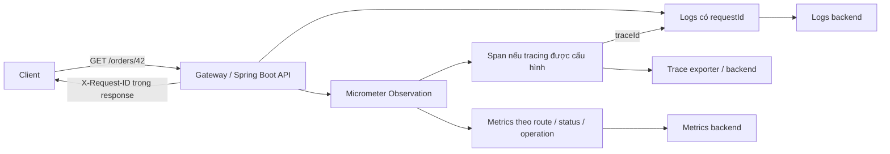

# Tag theo request id

Trong chương **Cardinality và metadata** của mô-đun **SPRING_BOOT_OBSERVABILITY**, việc gắn **request ID** vào telemetry đặt ra một câu hỏi quan trọng: *làm sao truy tìm một request cụ thể mà không khiến hệ thống metrics phải lưu hàng triệu chuỗi thời gian?*

Spring Boot có thể kết hợp **Micrometer Observation, metrics, logs và distributed tracing** để điều tra lỗi, độ trễ và đường đi của request. Request ID là thông tin rất hữu ích cho việc đối chiếu nhật ký và truy vết sự kiện. Tuy nhiên, nó gần như luôn là giá trị **high cardinality**: mỗi request mang một ID mới. Nếu gắn trực tiếp request ID làm nhãn của metrics, chi phí thu thập và lưu trữ có thể tăng theo lưu lượng. Bài học này hướng dẫn chọn đúng chỗ cho request ID trong các tín hiệu observability, cũng như truyền, kiểm soát và sử dụng nó an toàn khi vận hành ứng dụng thực tế.

## 1. Mục tiêu học tập

Sau bài này, bạn có thể:

1. Phân biệt **request ID**, **trace ID**, **span ID** và **metadata** của observation.
2. Giải thích vì sao `request.id` không phù hợp làm **low-cardinality tag** trên metric.
3. Đặt request ID trong **logs/MDC**, và chỉ khi cần mới thêm nó dưới dạng **high-cardinality key-value** của observation để hỗ trợ tracing.
4. Tạo và trả về `X-Request-ID` trong một ứng dụng Spring MVC, đồng thời tránh giữ nhầm MDC giữa các request.
5. Dùng Micrometer Observation để đo thao tác nghiệp vụ mà không làm nổ số lượng time series.
6. Phân biệt request ID do ứng dụng quản lý với context chuẩn W3C dùng cho distributed tracing.
7. Kiểm tra tác động của propagation, sampling, exporter, quyền truy cập logs và chính sách lưu trữ lên khả năng điều tra sự cố.

## 2. Request ID là gì?

**Request ID** là mã định danh dùng để đối chiếu các sự kiện thuộc về một yêu cầu hoặc một hoạt động mà ứng dụng quan tâm. Một gateway có thể sinh ID và trả lại cho client qua `X-Request-ID`. Khi người dùng báo lỗi, họ cung cấp mã này để đội vận hành tra cứu logs.

Ví dụ, một response có thể chứa:

```http
HTTP/1.1 500 Internal Server Error
X-Request-ID: 47bc07fe-6261-4d1d-9570-4f36f4ae0ec5
Content-Type: application/json
```

Dòng log tương ứng có thể là:

```text
2026-11-22T10:12:08Z ERROR order-api requestId=47bc07fe-6261-4d1d-9570-4f36f4ae0ec5 traceId=6a2e78b9b0b44a12b22d1ece653b58a7 spanId=807766d1a369b828 Dependency timeout: inventory-service
```

Ở đây, request ID giúp tìm sự kiện; `traceId` giúp mở distributed trace nếu trace được thu nhận; `spanId` xác định span đang hiện hành khi log được ghi. Chúng có thể xuất hiện cùng nhau nhưng phục vụ mục đích khác nhau.

| Loại ID | Vai trò | Vòng đời thường gặp | Cách dùng phù hợp |
| --- | --- | --- | --- |
| **Request ID** | Mã đối chiếu do gateway/ứng dụng quy ước. | Thường một request từ góc nhìn hệ thống phát hành; có thể được chuyển tiếp. | Header phản hồi, trường log, đôi khi trace attribute. |
| **Trace ID** | Định danh một trace gồm các span có quan hệ. | Có thể trải nhiều dịch vụ và nhiều hop. | Logs correlation, truy vấn tracing backend, exemplar nếu được hỗ trợ. |
| **Span ID** | Định danh một span cụ thể. | Một đơn vị công việc trong trace. | Xác định span tương ứng với log hoặc lỗi. |
| **Low-cardinality tag** | Phân nhóm số liệu tổng hợp theo một tập giá trị hữu hạn. | Lặp lại trên rất nhiều request. | Metrics theo `operation`, route mẫu, status, outcome. |

`X-Request-ID` là quy ước thường dùng, **không thay thế chuẩn W3C Trace Context**. Hai request khác nhau có thể được nối trong cùng một trace tùy luồng hệ thống, và một request ID có thể chỉ có nghĩa trong phạm vi một gateway. Không nên giả định request ID luôn bằng trace ID.

## 3. Vì sao gắn request ID vào metrics là nguy hiểm?

Một time series trong hệ thống như Prometheus được phân biệt bởi **tên metric và toàn bộ tập cặp tên–giá trị nhãn**. Nếu mỗi request có một request ID khác nhau, thêm `request_id` vào metric sẽ tạo thêm một tổ hợp nhãn mới gần như mỗi lần xử lý.

### Ví dụ về cardinality

Giả sử API xử lý trung bình **100 request/giây** trong 24 giờ:

```text
100 request/giây × 60 giây × 60 phút × 24 giờ
= 8.640.000 request/ngày
```

Nếu mỗi request có ID duy nhất, một timer gắn nhãn `request_id` có thể sinh khoảng **8,64 triệu giá trị nhãn khác nhau mỗi ngày**, ngay cả khi tất cả request cùng một route. Các nhãn khác như method, status, instance, hoặc histogram buckets còn làm tăng số series và lượng mẫu được lưu.

Ví dụ thiết kế **không nên dùng**:

```text
http_server_requests_seconds_count{
  method="GET",
  uri="/orders/{id}",
  request_id="47bc07fe-6261-4d1d-9570-4f36f4ae0ec5"
} 1

http_server_requests_seconds_count{
  method="GET",
  uri="/orders/{id}",
  request_id="d781042c-ea3d-4d16-9f77-9d003b3ba840"
} 1
```

Hai request cùng loại nhưng có `request_id` khác nhau sẽ không nằm trong cùng một chuỗi. Số series lớn khiến memory/indexing của backend tăng, scrape và truy vấn tốn tài nguyên, retention khó kiểm soát. Kể cả khi dashboard gộp lại bằng PromQL, hệ thống vẫn phải thu thập nhiều series ban đầu.

Với cùng endpoint, metric tốt hơn là:

```text
http_server_requests_seconds_count{
  method="GET",
  uri="/orders/{id}",
  status="200"
} 8295
```

Metric này mô tả **tập request** thay vì từng request riêng. Với Micrometer, route cần được chuẩn hóa như `/orders/{id}`, không dùng URL chứa ID thực tế như `/orders/478219` làm nhãn `uri`.

**Nguyên tắc:** request ID rất hữu ích để tìm **một sự kiện**, nhưng không phù hợp để **phân nhóm mọi phép đo metrics**.

## 4. Vị trí thích hợp cho request ID

Không phải mọi trường trong observability đều là metric tag. Một hệ thống thường có ba dạng dữ liệu:

| Nơi lưu | Dùng request ID? | Giải thích |
| --- | --- | --- |
| **Low-cardinality key-value của Micrometer Observation** | **Không** | Các handler metrics có thể chuyển thành nhãn time series, gây cardinality rất cao. |
| **High-cardinality key-value của observation** | **Có chọn lọc** | Tracing handler có thể dùng làm span attribute; vẫn tốn tài nguyên lưu/index trace. |
| **Structured logs hoặc MDC** | **Thường phù hợp** | Có thể lọc đúng request, kết hợp service, môi trường, thời gian và loại lỗi. |
| **HTTP response header** | **Có thể** | Client cung cấp mã đối chiếu khi báo sự cố. |
| **Prometheus label hoặc metric name** | **Không** | Không tạo một time series hoặc tên metric cho mỗi request. |
| **W3C `traceparent`** | **Không chèn request ID tự đặt vào đây** | Header chuẩn chứa trace ID, parent span ID và cờ trace; phải được quản lý bởi propagator phù hợp. |

Trong Micrometer Observation, thông tin phân nhóm metrics nên đặt ở `lowCardinalityKeyValue(...)`:

```java
Observation.createNotStarted("order.lookup", registry)
        .lowCardinalityKeyValue("operation", "lookup")
        .lowCardinalityKeyValue("dependency", "order-database");
```

Nếu có yêu cầu điều tra trên tracing backend và đã đánh giá quyền truy cập/dữ liệu, request ID có thể được đặt riêng ở `highCardinalityKeyValue(...)`:

```java
Observation.createNotStarted("order.lookup", registry)
        .lowCardinalityKeyValue("operation", "lookup")
        .highCardinalityKeyValue("request.id", requestId);
```

Với handlers thường dùng, high-cardinality key-value được dành cho thông tin tracing chi tiết thay vì nhãn metrics tổng hợp. Tuy nhiên, **high cardinality không có nghĩa là miễn phí hoặc an toàn**. Tùy backend, request ID vẫn có thể gây tải cho index, chi phí lưu trữ và rủi ro lộ thông tin qua quyền truy vấn trace.

Không đưa request ID vào tên observation:

```java
// Sai: tên thay đổi cho từng request.
Observation.createNotStarted("order.lookup." + requestId, registry);

// Đúng: tên ổn định, giá trị biến đổi được giữ ở nơi thích hợp.
Observation.createNotStarted("order.lookup", registry);
```

Tương tự, đừng đặt request ID thành nhãn chung `management.metrics.tags.*` của toàn ứng dụng hoặc thêm vào mọi timer.

## 5. Luồng liên kết ba tín hiệu

Một quy trình quan sát request thường có dạng:



Trong sơ đồ, log thường được tạo bởi ứng dụng hoặc thư viện logging; Micrometer Observation không tự viết mọi dòng log. Tracing integration có thể cung cấp `traceId`/`spanId` trong MDC để bổ sung vào logs, còn `requestId` thường là metadata ứng dụng tự quản lý.

Khi gặp lỗi, chuỗi thao tác lý tưởng là:

1. **Metrics** cho biết tỉ lệ lỗi hoặc độ trễ theo route, thời gian và service.
2. Người dùng hoặc hệ thống cảnh báo cung cấp **request ID**; đội vận hành dùng nó tìm logs trong khoảng thời gian phù hợp.
3. Từ dòng log, lấy **trace ID** nếu có để mở distributed trace.
4. Xem cây span, thời lượng, retries, dependency và attributes để lập giả thuyết nguyên nhân.
5. Sau khi sửa lỗi, trở lại metrics để xác nhận cải thiện trên một tập request đủ lớn.

Không phải request nào cũng có trace đã lưu, do **sampling** hoặc lỗi exporter/collector. Request ID trong logs vẫn có thể là đường tìm kiếm hữu ích khi trace tương ứng không còn.

## 6. Ví dụ Spring Boot: tạo request ID ở điểm vào

Ví dụ sau dùng **Spring Boot 3.x, Spring MVC và Java 17+**. Ở ranh giới HTTP công khai, ứng dụng tự phát hành một request ID ngẫu nhiên, gắn vào request attribute, trả về header và đặt vào SLF4J MDC cho các log được tạo trên thread hiện tại.

Với Gradle, cần những starter phù hợp:

```groovy
dependencies {
    implementation 'org.springframework.boot:spring-boot-starter-web'
    implementation 'org.springframework.boot:spring-boot-starter-actuator'
}
```

Dùng `OncePerRequestFilter`:

```java
import java.io.IOException;
import java.util.UUID;

import jakarta.servlet.FilterChain;
import jakarta.servlet.ServletException;
import jakarta.servlet.http.HttpServletRequest;
import jakarta.servlet.http.HttpServletResponse;

import org.slf4j.MDC;
import org.springframework.stereotype.Component;
import org.springframework.web.filter.OncePerRequestFilter;

@Component
public class RequestIdFilter extends OncePerRequestFilter {

    public static final String REQUEST_ID_ATTRIBUTE =
            RequestIdFilter.class.getName() + ".requestId";

    @Override
    protected void doFilterInternal(HttpServletRequest request,
                                    HttpServletResponse response,
                                    FilterChain chain)
            throws ServletException, IOException {

        String requestId = UUID.randomUUID().toString();
        String previous = MDC.get("requestId");

        request.setAttribute(REQUEST_ID_ATTRIBUTE, requestId);
        response.setHeader("X-Request-ID", requestId);
        MDC.put("requestId", requestId);

        try {
            chain.doFilter(request, response);
        } finally {
            // Không để metadata request trước tồn tại trên thread tái sử dụng.
            if (previous == null) {
                MDC.remove("requestId");
            } else {
                MDC.put("requestId", previous);
            }
        }
    }
}
```

**Tại sao tạo request ID ngẫu nhiên?** Mã `UUID.randomUUID()` giúp hạn chế trùng lặp và tránh phụ thuộc một giá trị tùy ý từ client. Request ID là **mã đối chiếu**, không phải token xác thực, khóa phân quyền hay thông tin cho phép truy cập dữ liệu người dùng.

**Tại sao phải dọn MDC?** Servlet container tái sử dụng threads giữa các request. Nếu quên khôi phục hoặc xóa MDC trong `finally`, một request sau có thể bị gắn nhầm ID của request trước, khiến logs không đáng tin. `OncePerRequestFilter` trong ví dụ phục vụ xử lý request **đồng bộ**; khi có asynchronous dispatch, thread pool hoặc reactive execution, cần cơ chế context propagation phù hợp. Không kỳ vọng MDC tự lan sang mọi thread.

**Phạm vi ví dụ:** Filter này sinh ID mới ở **điểm vào bên ngoài**. Nếu dịch vụ nằm sau gateway đã phát hành ID và muốn giữ cùng ID xuyên nhiều service, không áp dụng nguyên xi việc luôn sinh UUID mới ở mọi hop. Chỉ chấp nhận và chuyển tiếp request ID từ nguồn **được tin cậy**, có giới hạn độ dài/ký tự; riêng distributed trace tiếp tục dùng các header propagation chuẩn.

### Hiển thị MDC trong logs

Một cấu hình logging minh họa:

```yaml
logging:
  pattern:
    level: "%5p [requestId=%X{requestId:-} traceId=%X{traceId:-} spanId=%X{spanId:-}]"
```

Cấu hình này đặt các trường MDC trong phần level của dòng log console theo pattern ở ví dụ. Nếu môi trường dùng structured JSON logging, hãy định nghĩa ba trường riêng cho index/search thay vì chỉ dựa vào pattern text. Việc tùy chỉnh pattern có thể thay thế định dạng correlation mặc định của phiên bản Spring Boot đang dùng; cần kiểm tra log thực tế sau khi áp dụng.

`requestId` được filter đặt vào MDC. `traceId` và `spanId` chỉ xuất hiện nếu tracing integration cung cấp context thích hợp. Đừng suy ra hệ thống tracing hoạt động đầy đủ chỉ vì log có request ID.

## 7. Gắn request ID vào custom observation đúng cách

Giả sử `OrderController` xử lý route `/orders/{id}`. Filter ở trên đã gắn request ID vào request attribute. Controller chuyển ID đó xuống service; service chỉ đưa nó vào **high-cardinality metadata**, còn metric tags dùng các giá trị ổn định.

Ví dụ controller:

```java
import jakarta.servlet.http.HttpServletRequest;

import org.slf4j.Logger;
import org.slf4j.LoggerFactory;
import org.springframework.web.bind.annotation.GetMapping;
import org.springframework.web.bind.annotation.PathVariable;
import org.springframework.web.bind.annotation.RequestMapping;
import org.springframework.web.bind.annotation.RestController;

@RestController
@RequestMapping("/orders")
public class OrderController {

    private static final Logger log =
            LoggerFactory.getLogger(OrderController.class);

    private final OrderLookupService service;

    public OrderController(OrderLookupService service) {
        this.service = service;
    }

    @GetMapping("/{id}")
    public Order getOrder(@PathVariable Long id, HttpServletRequest request) {
        String requestId = (String) request.getAttribute(
                RequestIdFilter.REQUEST_ID_ATTRIBUTE);

        log.info("Looking up order");
        return service.load(id, requestId);
    }
}
```

Ví dụ service:

```java
import java.util.NoSuchElementException;

import io.micrometer.observation.Observation;
import io.micrometer.observation.ObservationRegistry;
import org.springframework.stereotype.Service;

@Service
public class OrderLookupService {

    private final ObservationRegistry registry;
    private final OrderRepository repository;

    public OrderLookupService(ObservationRegistry registry,
                              OrderRepository repository) {
        this.registry = registry;
        this.repository = repository;
    }

    public Order load(Long orderId, String requestId) {
        Observation observation =
                Observation.createNotStarted("order.lookup", registry)
                        .contextualName("load order")
                        .lowCardinalityKeyValue("operation", "lookup")
                        .lowCardinalityKeyValue("backend", "order-database");

        if (requestId != null) {
            observation.highCardinalityKeyValue("request.id", requestId);
        }

        return observation.observe(() ->
                repository.findById(orderId)
                        .orElseThrow(() ->
                                new NoSuchElementException("Order not found")));
    }
}
```

`Order` và `OrderRepository` là các kiểu của ứng dụng, cần định nghĩa khi sử dụng thật. `observe(...)` quản lý vòng đời observation cho lambda đồng bộ; nó không tự thay đổi cơ chế xử lý ngoại lệ của REST controller. Spring Boot vẫn cần exception handler phù hợp để chuyển `NoSuchElementException` thành HTTP status mong muốn thay vì mặc định coi đó là lỗi server.

**Tín hiệu dự kiến** nếu handlers được cấu hình:

- Metric của `order.lookup` được nhóm theo `operation=lookup` và `backend=order-database`. **Không thêm `request.id` vào low-cardinality metric tags.**
- Nếu tracing handler hoạt động và trace được thu nhận, span của thao tác có thể chứa attribute `request.id`.
- Logs từ controller/service trong scope phù hợp có trường `requestId` do MDC; tracing integration có thể bổ sung `traceId`/`spanId`.
- Response có `X-Request-ID`, giúp client cung cấp mã khi báo lỗi.

Đưa request ID thành high-cardinality key-value trên **mỗi** custom observation cũng có chi phí. Trong hệ thống rất lớn, có thể chỉ cần ID trong logs và dùng trace ID để mở span. Quyết định thêm attribute vào span nên dựa trên nhu cầu tìm kiếm, sampling, chính sách index và retention.

## 8. Request ID khác trace context và baggage

### 8.1 Distributed tracing dùng `traceparent`

Khi một Spring Boot service gọi service khác, các spans được nối vào cùng distributed trace nhờ propagation. Với HTTP, W3C Trace Context sử dụng `traceparent` và có thể có `tracestate`:

```http
GET /stock HTTP/1.1
Host: inventory-service
traceparent: 00-6a2e78b9b0b44a12b22d1ece653b58a7-807766d1a369b828-01
```

Trace ID trong ví dụ có 32 ký tự hex; parent span ID có 16 ký tự hex. Các thư viện client và server được instrument đúng sẽ inject/extract context. Một request ID tự định nghĩa **không thể thay thế** thông tin về parent span, sampling flags hoặc chuẩn propagation này.

Nếu cần cùng request ID trong logs nhiều dịch vụ, có thể chuyển tiếp `X-Request-ID` **một cách tường minh** giữa các dịch vụ tin cậy. Tuy nhiên:

- Định nghĩa rõ ID được sinh tại gateway nào, dịch vụ nào được phép ghi đè.
- Xác thực nguồn và giới hạn độ dài/ký tự nếu nhận ID từ header; không chèn nguyên văn dữ liệu không tin cậy vào logs hoặc nhãn.
- Không coi request ID là dữ liệu mật hay thông tin xác thực.
- Nếu có retries, fan-out hoặc message async, cần định nghĩa request ID biểu diễn request ban đầu hay từng lần thực thi; nhiều span có thể chia sẻ một request ID.
- Tracing vẫn phải dùng `traceparent`; nếu service mất propagation, cùng request ID trong logs **không khôi phục được quan hệ span cha–con**.

### 8.2 Baggage không phải nơi mặc định cho mọi request ID

Micrometer Tracing và các hệ thống tracing có khái niệm *baggage*: cặp key-value có thể được truyền trong trace context khi được cấu hình. Tuy nhiên baggage có thể đi qua nhiều hop, làm tăng kích thước header, lan tới thành phần bên ngoài và đưa dữ liệu vào những nơi không dự định.

Đừng mặc định chuyển mọi request ID thành baggage chỉ để tránh viết code propagation. Nếu hệ thống cần metadata xuyên service, cần chính sách cho phép field, giới hạn kích thước, cách xử lý ranh giới tin cậy và tương thích giữa propagators. Với nhiều use case, **trace ID đã đủ** để nối logs trong nội bộ, còn request ID được giữ chủ yếu ở gateway và logs phục vụ hỗ trợ khách hàng.

### 8.3 Async và Reactor

MDC truyền thống gắn với execution context của thread. Khi code dùng `@Async`, `CompletableFuture`, thread pool hoặc Reactor, một log ghi ở thread khác có thể **thiếu requestId** hoặc thiếu trace context nếu chưa có propagation thích hợp.

```java
// Minh họa lỗi ngữ cảnh, không phải cách triển khai khuyến nghị.
CompletableFuture.runAsync(() -> {
    log.info("Background processing"); // MDC requestId có thể không có.
});
```

Cần sử dụng cơ chế context propagation phù hợp với Spring Boot/Micrometer/Reactor và executor của ứng dụng, đồng thời dọn context đúng phạm vi. Không lưu request ID vào biến static dùng chung hoặc dùng `ThreadLocal` tùy tiện rồi bỏ qua cleanup.

## 9. Metrics nên giữ thông tin gì?

Các nhãn thường hữu ích là những chiều có số lượng giá trị tương đối nhỏ và ý nghĩa vận hành rõ:

| Tag | Ví dụ | Đánh giá |
| --- | --- | --- |
| `method` | `GET`, `POST` | Thường low cardinality. |
| `uri` dạng route template | `/orders/{id}`, `/checkout` | Tốt nếu được chuẩn hóa. |
| `status` hoặc `outcome` | `200`, `500`, `success`, `error` | Thường low cardinality. |
| `dependency` | `inventory-service`, `payment-service` | Dùng được khi danh mục được kiểm soát. |
| `request.id` | UUID mới mỗi request | High cardinality, tránh trên metrics. |
| `user.id`, `order.id` | ID người dùng/đơn hàng | High cardinality và có thể nhạy cảm. |
| URL path thô | `/orders/487213` | Không nên dùng trực tiếp làm `uri` metric tag. |

Ví dụ PromQL xác định lỗi 5xx cho route (giả định Micrometer Prometheus xuất metric với tên và nhãn này):

```promql
sum(
  rate(http_server_requests_seconds_count{
    method="GET",uri="/orders/{id}",status=~"5.."
  }[5m])
)
```

Nếu muốn so sánh với tổng traffic:

```promql
sum(
  rate(http_server_requests_seconds_count{
    method="GET",uri="/orders/{id}"
  }[5m])
)
```

Các query này theo dõi **xu hướng** chứ không trả lời “request ID nào lỗi?”. Câu trả lời ở mức request riêng thuộc về logs và traces. Khi có nhiều service hoặc environment chung một Prometheus, thêm bộ lọc tương ứng theo nhãn thực tế để không gộp sai dữ liệu.

Để biết tên metric và labels thực được xuất, kiểm tra `/actuator/prometheus` trong môi trường được bảo vệ; tên phụ thuộc phiên bản, registry và convention. Tránh giả định chỉ cần thêm label `request_id` là có thể vừa truy vấn đúng request vừa không ảnh hưởng hiệu năng.

## 10. Exporter và sampling ảnh hưởng đến việc tra cứu

Khi sử dụng Micrometer Tracing với một bridge như OpenTelemetry và exporter tương ứng, observation có thể tạo tracing span và xuất tới collector/backend. Một cấu hình thử nghiệm Spring Boot 3.x thường thêm:

```groovy
dependencies {
    implementation 'io.micrometer:micrometer-tracing-bridge-otel'
    implementation 'io.opentelemetry:opentelemetry-exporter-otlp'
    implementation 'io.micrometer:micrometer-registry-prometheus'
}
```

Ví dụ minh họa `application.yml`:

```yaml
spring:
  application:
    name: order-api

management:
  endpoints:
    web:
      exposure:
        include: health,metrics,prometheus
  tracing:
    sampling:
      probability: 1.0
  otlp:
    tracing:
      endpoint: http://otel-collector:4318/v1/traces
```

Cấu hình giả định collector nhận OTLP HTTP ở cổng `4318` và đường `/v1/traces`. `sampling.probability: 1.0` chỉ nên sử dụng trong thử nghiệm hoặc khi chi phí và tải được kiểm soát; production cần chọn chính sách sampling phù hợp. Endpoint Actuator cũng phải được giới hạn quyền truy cập.

Nếu team support có request ID nhưng không tìm thấy trace:

1. Tra logs theo request ID và thời gian để biết request có thực sự tới service không.
2. Tìm `traceId` trong log và kiểm tra bộ lọc service/environment ở backend tracing.
3. Xác minh trace có được sampling hay không; **không có trace được lưu** không đồng nghĩa request không xảy ra.
4. Kiểm tra lỗi exporter, collector, queue/drop và backend.
5. Kiểm tra span có gắn `request.id` không, nếu ứng dụng dự kiến dùng attribute này.
6. Nếu thiếu `traceId` trong log, kiểm tra instrumentation, logging/MDC và propagation qua async.

**Metrics sampling và tracing sampling là hai câu chuyện khác nhau:** metric timer có thể tổng hợp tất cả lần chạy trong khi chỉ một phần traces được xuất. Vì vậy không thiết kế alert, dashboard hay SLO dựa trên việc đếm các request IDs xuất hiện trong trace backend.

## 11. Bảo mật và quản trị request ID

Request ID thường là chuỗi ngẫu nhiên, nhưng vẫn có thể trở thành **khóa liên kết** tới dữ liệu nhạy cảm trong logs. Việc nhận, lưu và hiển thị nó cần quy tắc rõ ràng:

- **Không tin dữ liệu đầu vào tùy ý.** Nếu đọc `X-Request-ID` từ client, cần xác định ranh giới tin cậy, giới hạn độ dài, kiểm tra tập ký tự và phòng log forging/header injection. Ở public edge, tạo ID mới là một chính sách đơn giản.
- **Không dùng request ID như token truy cập.** Biết một request ID không được phép cho người khác xem đơn hàng, thông tin cá nhân hoặc logs tương ứng.
- **Không ghi thêm dữ liệu nhạy cảm vào tag.** Hạn chế request body, email, access token và giá trị định danh khách hàng.
- **Quản lý quyền đọc logs/traces.** Dashboard hỗ trợ chỉ nên cho phép tìm những trường và khoảng thời gian phù hợp.
- **Đặt retention, masking và hạn mức kích thước.** Span attributes và log fields có chi phí lưu trữ/index; request ID không miễn trừ các chính sách này.
- **Xác định phạm vi ID.** Nếu ID được sinh ở mỗi service, cùng một request end-to-end có thể mang nhiều request IDs. Ghi rõ service/gateway tạo ID, rồi liên kết bằng trace ID khi tracing có dữ liệu.

Tính duy nhất của UUID không biến request ID thành định danh pháp lý hay bằng chứng chắc chắn cho một người dùng. Nó chỉ là **dữ kiện tương quan**.

## 12. Quy trình thực hành và kiểm tra

Giả sử vừa triển khai filter ở phần 6 và custom observation ở phần 7.

### Bước 1: Gọi endpoint và ghi nhận header

```bash
curl -i http://localhost:8080/orders/42
```

Với một ứng dụng đang chạy và route tồn tại, response dự kiến có `X-Request-ID`. Nếu request gặp lỗi, header vẫn có thể được gửi vì filter đã gắn trước khi chạy controller, trừ khi một tầng khác ghi đè response hoặc response bị xử lý ngoài phạm vi filter.

### Bước 2: Tìm logs theo request ID

Tìm trường `requestId` bằng giá trị lấy được ở response. Kiểm tra cùng ID xuất hiện ở logs phát sinh trên thread xử lý request, và **không xuất hiện nhầm** trong request kế tiếp.

Nếu log không có `traceId`, kiểm tra tracing bridge và ngữ cảnh đang active. Nếu code chuyển qua thread khác, kiểm tra propagation của MDC.

### Bước 3: Xem metric nhưng không thêm nhãn request ID

```bash
curl -s http://localhost:8080/actuator/metrics
curl -s http://localhost:8080/actuator/metrics/order.lookup
curl -s http://localhost:8080/actuator/prometheus
```

`order.lookup` chỉ xuất hiện tại `/actuator/metrics/order.lookup` nếu handlers thực sự tạo metric đó. Xem labels được xuất: nhóm theo `operation`, `backend` và các tags ổn định; không mong đợi `request.id` là metric label.

### Bước 4: Mở trace nếu có

Dùng `traceId` trong logs để tìm trace tương ứng. Nếu span `order.lookup` được giữ và backend lưu high-cardinality attributes, bạn có thể thấy `request.id` trên span. Kiểm tra quan hệ parent/child, thời lượng và exception; không dùng một trace đơn lẻ để suy ra tỉ lệ lỗi toàn bộ request.

### Bước 5: Kiểm tra trường hợp lỗi và tải nhiều request

Tạo một response lỗi có kiểm soát; xác minh `X-Request-ID` và logs vẫn cho phép đối chiếu. Sau đó gửi một số request lặp lại. Kiểm tra không có thời gian thực thi hoặc series metrics tăng theo **số ID duy nhất**. Với môi trường production, bổ sung theo dõi active series/ingestion và retention ở hệ thống quan sát.

Đây là quy trình xác minh thủ công ở mức bài học; cần thêm kiểm thử tích hợp thích hợp nếu dự án dùng filter chung cho nhiều dịch vụ hoặc nhiều execution model.

## 13. Các lỗi thường gặp

| Triệu chứng | Nguyên nhân có thể | Cách xử lý |
| --- | --- | --- |
| Prometheus tăng mạnh series sau khi thêm request ID | `requestId` được gắn làm low-cardinality tag hoặc nhãn chung. | Gỡ nhãn high cardinality khỏi metrics, dùng logs/traces cho điều tra từng request. |
| Dashboard route có hàng nghìn giá trị `uri` | Instrumentation dùng URL thô chứa ID. | Dùng route template và quy tắc chuẩn hóa URL. |
| Response có request ID nhưng logs không có | Chưa đặt MDC, chưa cập nhật logging pattern hoặc log chạy ngoài scope. | Kiểm tra filter, log config và propagation. |
| Logs của request sau mang ID request trước | Không dọn MDC khi thread được tái sử dụng. | Cleanup trong `finally`, kiểm tra async execution. |
| Không tìm thấy span bằng request ID | Attribute chưa được thêm, trace bị sampling hoặc exporter/backend không lưu. | Tra logs lấy trace ID; kiểm tra instrumentation và tracing pipeline. |
| Hai dịch vụ dùng request ID khác nhau | Mỗi service sinh ID mới thay vì chuyển tiếp từ trusted gateway. | Xác định chính sách phát hành/forwarding; dùng `traceparent` cho trace liên dịch vụ. |
| Span có request ID nhưng dashboard metric không có | Đây thường là thiết kế **đúng**. | Dùng metrics để xem xu hướng, logs/traces để tra request cụ thể. |
| Logs chứa ID nhưng không có trace ID | Chưa cấu hình tracing, thiếu active context hoặc logging correlation. | Kiểm tra bridge, scope, MDC và async propagation. |

## 14. Bài tập tự kiểm tra

### Bài 1: Chọn nơi gắn request ID

Xét đoạn code:

```java
Observation.createNotStarted("checkout.process", registry)
        .lowCardinalityKeyValue("request.id", requestId)
        .observe(() -> checkout());
```

**Câu hỏi:** Vấn đề là gì và nên sửa thế nào?

**Đáp án:** `request.id` có quá nhiều giá trị phân biệt để làm low-cardinality tag. Giữ `checkout.process` và các tags có giá trị hữu hạn như `operation=checkout`, `outcome=success/error`. Đặt request ID trong logs/MDC; nếu cần tra trace theo ID và đã đánh giá chi phí, dùng `highCardinalityKeyValue("request.id", requestId)`.

### Bài 2: Request ID và trace ID

Người dùng cung cấp `X-Request-ID`, nhưng trace backend chỉ tìm theo trace ID. Điều tra thế nào?

**Đáp án:** Lọc logs theo request ID và service/thời gian; từ dòng log lấy trace ID, sau đó mở trace. Nếu không có trace ID hoặc trace đã bị sampling, tiếp tục dùng logs và metrics để điều tra, đồng thời kiểm tra instrumentation/propagation.

### Bài 3: Tính cardinality

Một API nhận 50 request/giây, request ID mỗi lần là duy nhất. Trong một ngày có bao nhiêu giá trị ID khác nhau xấp xỉ?

**Đáp án:**

```text
50 × 60 × 60 × 24 = 4.320.000 giá trị/ngày
```

Nếu đưa chúng vào một nhãn metric, chỉ riêng ID đã có hàng triệu giá trị nhãn mỗi ngày. Đó chưa phải toàn bộ số series thực tế, vì metric có thể có nhiều loại series và nhiều tập tags khác nhau.

### Bài 4: Tại sao log sai ID?

Hai request đến liên tiếp trên cùng một servlet thread; log của request thứ hai hiển thị ID của request thứ nhất. Nguyên nhân nào đáng kiểm tra đầu tiên?

**Đáp án:** MDC chưa được xóa hoặc khôi phục trong `finally`, hoặc việc truyền context qua thread pool sai. Kiểm tra đường đi ngoại lệ và cleanup thay vì giả định client dùng lại ID.

### Bài 5: Trace attribute có nghĩa là metric tag?

Custom observation có `highCardinalityKeyValue("request.id", requestId)`; một span hiển thị request ID nhưng Prometheus không có label `request.id`. Có phải dữ liệu bị thiếu?

**Đáp án:** Không. Đây là sự phân tách mong muốn giữa thuộc tính phục vụ điều tra chi tiết trong tracing và nhãn metrics phục vụ tổng hợp. Cần kiểm tra thêm chính sách tracing, quyền riêng tư và chi phí lưu/index attributes.

## 15. Checklist triển khai

- [ ] Định nghĩa request ID được sinh ở đâu, có được chuyển tiếp không, và phạm vi của nó.
- [ ] Không đưa request ID vào tên metric, low-cardinality tag hoặc label chung của Prometheus.
- [ ] Giữ tên observation và route template ổn định.
- [ ] Gắn request ID trong logs/MDC, có cleanup sau mỗi request.
- [ ] Chỉ thêm request ID vào trace attributes nếu có nhu cầu và đã xem xét chi phí/retention.
- [ ] Dùng `traceparent` và instrumentation phù hợp cho distributed tracing, không dùng request ID để thay thế parent context.
- [ ] Kiểm tra async/reactive context propagation; không dùng biến static để giữ thông tin request.
- [ ] Không tin giá trị ID từ client nếu không có quy tắc validation/trust boundary.
- [ ] Không dùng request ID làm token phân quyền hoặc làm lý do để mở quyền xem logs.
- [ ] Xác minh metrics, logs và trace bằng cùng một request thử nghiệm, đồng thời kiểm tra trường hợp trace bị sample out.

**Ghi nhớ:** **Request ID phục vụ tương quan và tra cứu từng request; metric tags phục vụ tổng hợp theo các nhóm giá trị hữu hạn.** Với Spring Boot và Micrometer Observation, hãy đặt request ID trong logs/MDC, tùy trường hợp trong high-cardinality trace attributes, và giữ nó ra khỏi low-cardinality metrics. Kết hợp cách thiết kế metadata này với propagation, sampling, exporter và quyền truy cập backend giúp đội vận hành điều tra chính xác mà không đánh đổi tính ổn định của hệ thống quan sát.
