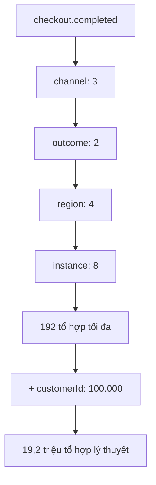

# Rủi ro tạo metric theo giá trị động

## 1. Mục tiêu và bối cảnh

Trong một hệ thống Spring Boot có observability, metrics cho phép trả lời nhanh các câu hỏi như: *bao nhiêu đơn hàng thất bại trong 5 phút*, *độ trễ xử lý checkout có tăng không* và *dịch vụ nào đang quá tải*. Tuy nhiên, thêm dữ liệu vào metric không phải lúc nào cũng giúp quan sát tốt hơn. Nếu tên metric hoặc **tag value** được ghép từ ID, URL, nội dung lỗi hay dữ liệu người dùng không giới hạn, hệ thống có thể tạo ra một lượng **time series** rất lớn.

Bài thuộc chương **Cardinality và metadata** của module **SPRING_BOOT_OBSERVABILITY**. Nội dung tập trung vào rủi ro cụ thể của việc **tạo metric theo giá trị động**, cách tránh khi dùng Micrometer Metrics và Micrometer Observation trong Spring Boot, cùng cách phát hiện, kiểm soát và điều tra sự cố trên backend metrics. Các mối liên hệ với logs, distributed tracing, propagation, exporter và sampling sẽ được giải thích khi chúng ảnh hưởng đến quyết định chọn metadata.

Sau bài này, bạn có thể:

1. Xác định một metric được phân biệt theo tên và tập tag như thế nào.
2. Phân biệt cardinality, số time series hiện hữu và series churn (các chuỗi mới liên tục xuất hiện).
3. Ước lượng số series từ các chiều tag, histogram và số instance.
4. Nhận diện lỗi ghép giá trị động vào tên metric, low-cardinality tag hoặc `MeterRegistry.counter(...)`.
5. Sửa mã Spring Boot bằng tên ổn định, route template và nhóm tag hữu hạn.
6. Dùng `MeterFilter` như giới hạn phòng vệ, hiểu tác dụng phụ khi metric bị từ chối.
7. Chẩn đoán tăng cardinality ở Micrometer/Prometheus và lựa chọn traces/logs cho dữ liệu cấp request.

## 2. Vấn đề: một giá trị động có thể tạo một chuỗi mới

Xem cách đếm đơn hàng thành công:

```java
meterRegistry.counter("checkout.completed",
        "result", "success").increment();
```

Tất cả lần gọi có cùng tên `checkout.completed` và cùng tập tag `result=success` chia sẻ một meter trong registry tương ứng. Với Prometheus, tên counter thường được chuyển thành `checkout_completed_total`.

Nhưng nếu thêm ID đơn hàng:

```java
// SAI: mỗi đơn hàng có thể đăng ký một meter riêng.
meterRegistry.counter("checkout.completed",
        "result", "success",
        "orderId", order.getId().toString()).increment();
```

Lần gọi đầu tiên có `orderId=1001`, lần tiếp theo có `orderId=1002`, v.v. Mỗi bộ nhãn duy nhất tạo thêm một **meter identity** và thường dẫn đến chuỗi dữ liệu mới ở exporter/backend. Nếu có hàng triệu đơn hàng, counter vốn chỉ cần vài series sẽ bị tách theo từng đơn hàng.

Điểm cần nhớ:

> Trong Micrometer Metrics, danh tính meter phụ thuộc vào **tên metric và tập tags** sau các bước cấu hình/mapping. Một tag có giá trị mới thường tương ứng với meter/time series mới, dù người lập trình chỉ gọi cùng một dòng `counter(...)`.

Giá trị động không chỉ là số ngẫu nhiên. Bất kỳ trường nào có thể phát sinh nhiều giá trị riêng theo thời gian đều cần đánh giá: request ID, customer ID, URL chưa chuẩn hóa, câu lỗi, truy vấn SQL, timestamp, mã phiên làm việc hoặc chuỗi nhập từ người dùng.

## 3. Cardinality là gì và vì sao khó kiểm soát?

**Cardinality của tag** là số giá trị khác nhau có thể xuất hiện ở một tag. Cardinality của metric (ở cấp tập series) phụ thuộc số **tổ hợp giá trị tags thực sự xuất hiện**, không chỉ số tag được gắn.

Ví dụ cho một metric checkout:

| Chiều tag | Số giá trị giả định | Ví dụ |
| --- | ---: | --- |
| `channel` | 3 | `web`, `mobile`, `other` |
| `outcome` | 2 | `success`, `failure` |
| `region` | 4 | Bốn vùng triển khai |
| `instance` | 8 | Tám instance cùng chạy |

Nếu mọi tổ hợp đều phát sinh, số series tối đa cho **một counter** là:

\[
3 \times 2 \times 4 \times 8 = 192\ \text{series}
\]

Giả sử thêm `customerId` có 100.000 giá trị độc lập, **giới hạn trên lý thuyết** trở thành:

\[
192 \times 100{,}000 = 19{,}200{,}000\ \text{series}
\]

Không phải hệ thống sẽ lập tức tạo đủ 19,2 triệu series: chỉ các tổ hợp **thực sự được ghi nhận** mới xuất hiện. Nhưng số lượng có thể tăng theo khách hàng, lưu lượng, instance mới và các giá trị chưa từng gặp. Vấn đề trở nên khó đoán khi dữ liệu đầu vào không có giới hạn hữu hạn.

### 3.1. Hình dung sự nhân lên



Đơn vị cần theo dõi ở backend là **số series thực tế** cùng với tốc độ xuất hiện series mới. Một dashboard trông chỉ có một đường `checkout.completed` tổng hợp vẫn có thể đang truy vấn trên hàng triệu series phía sau.

### 3.2. Histogram còn làm chi phí tăng thêm

Một `Timer` được cấu hình xuất histogram classic Prometheus có thể tạo:

- Một chuỗi `_bucket` cho mỗi ngưỡng, kể cả bucket `+Inf`.
- Một chuỗi `_count`.
- Một chuỗi `_sum`.

Ví dụ một histogram có **8 ngưỡng hữu hạn** thì sẽ có **9 bucket** khi tính `+Inf`, cộng `_count` và `_sum`: tối thiểu 11 chuỗi đầu ra cho mỗi tổ hợp nhãn, chưa tính các thống kê hay định dạng xuất khác.

Nếu metric có 5.000 tổ hợp nhãn, riêng histogram kiểu này có thể cần khoảng `5.000 × 11 = 55.000` time series. Bật thêm nhiều bucket hoặc SLO boundary khi tag có giá trị động sẽ làm vấn đề nặng hơn. Không thể lấy `_sum / _count` để suy ra p95; để tính quantile trên histogram classic cần các bucket phù hợp.

### 3.3. Series churn khác với số series đang hoạt động

Giả sử mỗi phút hệ thống phát sinh 10.000 request ID mới, còn mỗi request ID chỉ được dùng một lần. Ngay cả khi không phải tất cả chuỗi tồn tại đồng thời, backend vẫn phải xử lý **liên tục các series mới**: định danh, index, sample, metadata và quá trình lưu trữ/retention.

Do đó có hai chỉ số cần tách biệt:

- **Active series/cardinality:** số chuỗi đang có mẫu trong khoảng dữ liệu gần đây.
- **Series churn:** tốc độ sinh các bộ nhãn mới và ngừng dùng các bộ nhãn cũ.

Trường hợp ID phát sinh liên tục thường gây churn cao, tăng CPU, bộ nhớ, disk, network và thời gian query. Việc xóa một tag từ code mới không khiến dữ liệu lịch sử lập tức biến mất khỏi backend.

## 4. Những nguồn giá trị động nguy hiểm

| Nguồn | Ví dụ nên tránh làm metric tag/name | Vì sao rủi ro | Thay thế thường phù hợp |
| --- | --- | --- | --- |
| ID đơn hàng | `orderId=583214` | Gần như một giá trị trên mỗi giao dịch | `outcome=success|failure` |
| ID người dùng/khách hàng | `userId=76422` | Tăng theo số người dùng, có vấn đề riêng tư | `customerTier=free|pro|enterprise` |
| URL thực | `uri=/orders/583214` | Mỗi ID tạo một nhãn khác | Route template `/orders/{id}` |
| Path/query string | `path=/search?q=abc...` | Có thể lấy trực tiếp từ input | Tên route cố định, `operation=search` |
| Thông điệp exception | `error=timeout for order 583214` | Không ổn định, có thể chứa secrets | `errorType=timeout|validation|other` |
| Stack trace hoặc SQL | `sql=SELECT ... WHERE id=583214` | Rất dài, thay đổi theo tham số | `dbOperation=select`, `dbSystem=postgresql` |
| Session/trace ID | `traceId=4f...` | Hầu như mỗi request là một giá trị mới | Đặt vào trace/log correlation khi được phép |
| Timestamp | `window=2026-11-22T12:01:15Z` | Mỗi thời điểm là một nhãn mới | Dùng timestamp của mẫu metric |
| Request header tùy ý | `client=...input from user...` | Không có giới hạn, dễ bị lạm dụng | Allowlist/nhóm kiểm soát |
| Tên metric ghép ID | `checkout.completed.customer.123` | Mỗi tên mới là một metric family | Tên cố định và tags hữu hạn |

**Lưu ý về `tenantId`:** dù số tenant có thể thấp ở một môi trường thử nghiệm, số này có thể tăng đến hàng chục hoặc hàng trăm nghìn khi sản phẩm phát triển. Hãy coi nó là nhãn có nguy cơ cao trừ khi có ngân sách cardinality rõ ràng và giới hạn được thực thi.

Dữ liệu không nhạy cảm vẫn có thể làm tăng cardinality. Ngược lại, dữ liệu cardinality thấp vẫn có thể không được phép đưa vào metrics nếu chứa thông tin nhạy cảm hoặc định danh cá nhân.

## 5. Lỗi thứ nhất: tên metric thay đổi theo request

### Cách viết gây rủi ro

```java
String metricName = "payment.completed." + payment.getId();
meterRegistry.counter(metricName).increment();
```

Với mỗi ID mới, ứng dụng tạo ra một meter **tên mới**. Ngay cả khi không có tags, số meter vẫn tăng.

### Cách viết tốt hơn

```java
meterRegistry.counter("payment.completed",
        "provider", normalizeProvider(payment.getProvider()),
        "outcome", payment.isApproved() ? "approved" : "declined")
        .increment();
```

Trong đó `normalizeProvider(...)` phải trả về một nhóm giá trị được kiểm soát (ví dụ `bank-a`, `bank-b`, `other`) chứ không trả lại chuỗi bất kỳ từ cổng thanh toán.

Tên `payment.completed` mang ý nghĩa **sự kiện/đại lượng cần theo dõi**. Tags chỉ mô tả các chiều phân tích có giới hạn. Không cần tên khác nhau cho từng ID để biết tổng số thanh toán.

## 6. Lỗi thứ hai: gắn ID động vào `MeterRegistry`

Mẫu phản ví dụ:

```java
// BAD: customerId có thể có hàng triệu giá trị.
meterRegistry.counter("checkout.completed",
        "customerId", request.customerId(),
        "channel", request.channel())
        .increment();
```

Đổi nhãn thành `customer` hoặc `customer_id` không giải quyết gì: rủi ro nằm ở **số giá trị** của tag, không ở tên key.

### 6.1. Ví dụ Spring Boot tốt hơn: chuẩn hóa trước khi đăng ký meter

Ứng dụng Spring Boot 3.5.x dùng `spring-boot-starter-actuator` có thể inject `MeterRegistry`. Service sau phân loại `channel` về tập hữu hạn và chỉ lưu `outcome` của checkout:

```java
package com.example.checkout;

import io.micrometer.core.instrument.MeterRegistry;
import org.springframework.stereotype.Service;

@Service
public class CheckoutMetrics {
    private final MeterRegistry meters;

    public CheckoutMetrics(MeterRegistry meters) {
        this.meters = meters;
    }

    public void recordCompleted(String rawChannel, boolean succeeded) {
        String channel = normalizeChannel(rawChannel);
        String outcome = succeeded ? "success" : "failure";

        meters.counter("checkout.completed",
                "channel", channel,
                "outcome", outcome)
                .increment();
    }

    private static String normalizeChannel(String value) {
        if ("web".equals(value)) {
            return "web";
        }
        if ("mobile".equals(value)) {
            return "mobile";
        }
        return "other";
    }
}
```

Điểm kiểm soát quan trọng là `normalizeChannel`: mọi giá trị lạ sẽ gom về `other`, nên `channel` có tối đa ba giá trị; `outcome` có hai. Với các tag này, counter có tối đa `3 × 2 = 6` tổ hợp **trong một registry**, chưa tính các label do pipeline/backend thêm ở cấp instance, namespace hoặc môi trường.

Có thể gọi:

```java
checkoutMetrics.recordCompleted("web", true);
checkoutMetrics.recordCompleted("web", false);
checkoutMetrics.recordCompleted("mobile", true);
checkoutMetrics.recordCompleted("some-untrusted-input", false);
```

Tất cả dữ liệu sẽ gộp vào các series hữu hạn. Nếu cần biết từng `customerId` cụ thể đã thanh toán chưa, hãy dùng database sự kiện, hệ thống audit hoặc truy vấn nghiệp vụ có kiểm soát; một counter tổng hợp không phải công cụ tìm kiếm theo customer ID.

### 6.2. Chú ý thói quen gọi `register` trong đường xử lý

```java
Counter counter = Counter.builder("checkout.completed")
        .tag("orderId", String.valueOf(order.getId()))
        .register(meterRegistry);
counter.increment();
```

Dù `Counter.builder(...).register(...)` được gọi trong mỗi request, registry thường trả về meter đã đăng ký khi **tên/tags trùng**. Tuy nhiên, khi `orderId` mới liên tục xuất hiện, registry cần đăng ký **meter mới**. Đừng nghĩ việc đặt `register()` bên trong method sẽ khiến meter được tự xóa khi method kết thúc.

Nếu muốn tối ưu CPU, có thể tái sử dụng những meter có bộ tags cố định; nhưng **tái sử dụng đối tượng không sửa được thiết kế tag cardinality sai**. Việc đặt `Counter` làm field trong singleton cũng không giải quyết metric có hàng triệu nhãn.

## 7. Lỗi thứ ba: URI và đường dẫn động

Một thiết kế dễ mắc lỗi:

```java
String rawPath = request.getRequestURI(); // /orders/1001, /orders/1002 ...
meterRegistry.timer("checkout.http.duration",
        "uri", rawPath)
        .record(() -> handleRequest(request));
```

Đoạn trên minh họa cách làm cần tránh, không phải mẫu nên gắn vào controller đang có instrumentation của Spring MVC.

Trong Spring MVC, HTTP server metrics/observation do framework cung cấp thường sử dụng **route template** như `/orders/{id}` thay cho URI đầy đủ chứa ID, với điều kiện framework có thể xác định route. Khi tự thêm metric nghiệp vụ, nên dùng tên thao tác cố định (`checkout.process`) hoặc một nhóm `operation` hữu hạn, thay vì bê nguyên URL vào tag.

Cũng tránh gắn toàn bộ query string vì `?q=...`, `?page=...` hay `?token=...` có thể không giới hạn số giá trị và chứa thông tin nhạy cảm.

| Giá trị đầu vào | Nhãn metric mong muốn |
| --- | --- |
| `/orders/1001` | `uri=/orders/{id}` |
| `/orders/1002` | `uri=/orders/{id}` |
| `/orders/1003?expand=lines` | `uri=/orders/{id}` |
| `/health` | `uri=/health` nếu cần quan sát route |
| Route không nhận diện | Nhóm ổn định như `UNKNOWN`/nhãn do framework quy định, tùy use case |

Không tự cắt một vài ký tự ID để “giảm” cardinality; cách đó vẫn có thể tạo rất nhiều nhóm vô nghĩa và dễ xảy ra collision. Hãy chuẩn hóa **theo cấu trúc route** hoặc tập thao tác nghiệp vụ.

## 8. Observation: low-cardinality và high-cardinality metadata

Micrometer Observation hỗ trợ hai nhóm key-values khác nhau:

| Nhóm metadata | Ví dụ | Tác dụng với metrics/traces |
| --- | --- | --- |
| `lowCardinalityKeyValue` | `channel=web`, `outcome=success` | Có thể thành tags của metrics và attributes của spans qua handler |
| `highCardinalityKeyValue` | ID kỹ thuật của workflow, nếu được phép ghi | Thường dành cho span attributes; không dùng làm metric tags qua các observation handler tiêu chuẩn |
| Dữ liệu nội bộ trong `Observation.Context` | `checkout.phase=validating` | Không tự biến thành tag/attribute; handler phải chủ động xuất |

### Phản ví dụ với Observation

```java
// BAD: low-cardinality key mà giá trị gần như là duy nhất cho mỗi đơn.
Observation.createNotStarted("checkout.process", observationRegistry)
        .lowCardinalityKeyValue("order.id", order.id())
        .observe(() -> process(order));
```

Một observation có thể tạo metric Timer với `order.id` như nhãn; điều này có cùng nguy cơ tạo hàng loạt time series với `MeterRegistry.counter(...)`.

### Phiên bản phù hợp

```java
String channel = "web".equals(order.channel()) ? "web" : "other";

Observation.createNotStarted("checkout.process", observationRegistry)
        .contextualName("process checkout")
        .lowCardinalityKeyValue("channel", channel)
        .observe(() -> process(order));
```

Nếu một hệ thống có nhu cầu tìm trace của từng workflow, có thể gắn một ID **opaque, đã được phép ghi và đã qua kiểm tra dữ liệu** vào high-cardinality metadata:

```java
Observation.createNotStarted("checkout.process", observationRegistry)
        .lowCardinalityKeyValue("channel", channel)
        .highCardinalityKeyValue("workflow.id", safeWorkflowId)
        .observe(() -> process(order));
```

Đây là lựa chọn *tùy chính sách*, không phải khuyến nghị ghi mọi ID. `highCardinalityKeyValue` không đưa giá trị thành metric tag qua handler metrics tiêu chuẩn, nhưng trace backend vẫn phải lưu attribute; có chi phí lưu trữ, tìm kiếm, retention và yêu cầu bảo mật. Sampling có thể làm giảm số trace được gửi, nhưng không sửa một metric đã tạo nhãn động ở tầng metrics.

**Lưu ý propagation:** W3C `traceparent` chủ yếu chuyển trace context để nối span; nó **không tự chuyển** mọi high-cardinality key-value hoặc `Observation.Context` sang service khác. Baggage cần cơ chế cấu hình riêng và không nên dùng để phát tán ID/bí mật không cần thiết.

## 9. Metric, trace và log không có cùng ngân sách metadata

Một sự kiện thanh toán có thể cần hai mức độ quan sát:

- **Quan sát tổng hợp:** số lượng giao dịch theo `provider`, `channel`, `outcome`; latency p95 theo dịch vụ hoặc route.
- **Điều tra cá thể:** một workflow cụ thể chậm hay lỗi, exception nào, request ID nào, span nào.

Các công cụ giải quyết từng mục tiêu khác nhau:

| Tín hiệu | Dữ liệu phù hợp | Hạn chế chính |
| --- | --- | --- |
| Metrics | Tổng hợp theo vài chiều hữu hạn | Bùng nổ series nếu tag quá đa dạng |
| Traces | Chuỗi span cho request được sample và các attributes có kiểm soát | Chi phí span/attribute, sampling, privacy, retention |
| Logs | Chi tiết event/exception có correlation ID | Lưu lượng, chi phí ingest, tìm kiếm, khả năng lộ dữ liệu |
| Database/audit/analytics | Sự kiện cấp người dùng/đơn hàng cần tra cứu chính xác | Thiết kế lưu trữ, truy vấn và quyền truy cập riêng |

Trong Spring Boot, metrics có thể đi qua Micrometer Registry tới Prometheus hoặc OTLP. Tracing đi qua Micrometer Tracing/bridge và exporter; logs thường do SLF4J/Logback cùng một pipeline khác chuyển đi. Không nên cố biến metrics thành nhật ký từng request.

Sampling traces **không có tác dụng giảm số series** mà code tự tạo trong `MeterRegistry`; chỉ chính sách chọn metrics/tags và meter filters mới kiểm soát cardinality tại tầng metrics.

## 10. Phòng vệ bổ sung: giới hạn số giá trị bằng `MeterFilter`

Giải pháp bền vững nhất là **chuẩn hóa nhãn từ nguồn**. Khi hệ thống lớn có nhiều thư viện tạo meters, có thể bổ sung giới hạn phòng vệ để tránh một tag có quá nhiều giá trị:

```java
package com.example.checkout.config;

import io.micrometer.core.instrument.config.MeterFilter;
import org.springframework.context.annotation.Bean;
import org.springframework.context.annotation.Configuration;

@Configuration(proxyBeanMethods = false)
public class MetricCardinalityGuardrails {

    @Bean
    MeterFilter limitCheckoutChannels() {
        return MeterFilter.maximumAllowableTags(
                "checkout.completed",   // Prefix tên meter cần kiểm soát
                "channel",              // Tag key
                3,                      // Số giá trị khác nhau được phép
                MeterFilter.deny());    // Từ chối meter vượt ngưỡng
    }
}
```

Spring Boot Actuator tự áp dụng các `MeterFilter` bean vào `MeterRegistry` do nó quản lý. Một `MeterRegistry` được tạo thủ công ngoài Spring Boot không tự nhận cấu hình này.

Cách hoạt động ở mức thiết kế:

1. `maximumAllowableTags` theo dõi số giá trị tag khác nhau cho các meter có tên khớp prefix.
2. Khi giá trị mới vượt giới hạn, `onMaxReached` được dùng để quyết định xử lý; `MeterFilter.deny()` sẽ từ chối meter vượt ngưỡng.
3. Meter bị từ chối không ghi dữ liệu theo bộ tags ấy. Vì thế **tổng đếm có thể thiếu** nếu bạn chỉ dựa vào filter thay vì sửa mã phát sinh tag.

Giới hạn này **không** tự giới hạn các tag khác như `orderId`, tên metric thay đổi hoặc sự cố ở một exporter ngoài quy trình Micrometer Registry. Nó không tự gom giá trị thứ tư vào `other`; muốn aggregation đúng phải chuẩn hóa trước khi tạo meter.

### Khi giới hạn không giải quyết được nguyên nhân

Nếu upstream code tạo 100.000 giá trị `channel`, giới hạn ba giá trị có thể chặn đa số meter mới và bảo vệ bộ nhớ. Nhưng dashboard lúc đó **không còn phản ánh đủ request**. Cần sửa producer để biến giá trị lạ thành `other`, rà soát hệ thống cảnh báo và kiểm tra lại tính chính xác của tổng đếm.

`MeterFilter` còn hỗ trợ các thao tác deny/rename/map nhất định, nhưng chúng có thể ảnh hưởng tới tên/định danh meter sau ánh xạ; nên có kiểm thử với registry thật và quy tắc rõ ràng. Với naming/tags của Observation, `ObservationConvention` hoặc `ObservationFilter` bổ sung metadata ở tầng khác và không thay thế hoàn toàn `MeterFilter`.

## 11. Kiểm tra cardinality qua Spring Boot Actuator và Prometheus

### 11.1. Chuẩn bị môi trường đo

Với Spring Boot 3.5.x, một ví dụ Maven khi dùng Spring Boot BOM:

```xml
<dependencies>
    <dependency>
        <groupId>org.springframework.boot</groupId>
        <artifactId>spring-boot-starter-actuator</artifactId>
    </dependency>
    <dependency>
        <groupId>io.micrometer</groupId>
        <artifactId>micrometer-registry-prometheus</artifactId>
    </dependency>
</dependencies>
```

Một cấu hình kiểm tra cục bộ:

```yaml
management:
  endpoints:
    web:
      exposure:
        include: health,metrics,prometheus
```

Nếu ứng dụng cũng dùng Spring MVC hoặc WebFlux, Spring Boot thường cung cấp thêm HTTP server metrics/observations. Endpoint `/actuator/prometheus` cần registry Prometheus và được expose. Trên production phải giới hạn quyền truy cập các endpoint vận hành.

Các bước kiểm tra:

1. Gọi `CheckoutMetrics.recordCompleted` với nhiều ID đơn hàng khác nhau nhưng chỉ ba nhóm `channel`, hai nhóm `outcome`.
2. Truy cập `GET /actuator/metrics/checkout.completed` sau khi code đã chạy để xem các tag đang tồn tại trong registry.
3. Xem `GET /actuator/prometheus`, tìm metric tương ứng như `checkout_completed_total` (tên chính xác phụ thuộc registry/naming conventions).
4. Xác nhận số tổ hợp tag vẫn hữu hạn khi số đơn hàng tăng; không xuất hiện nhãn `orderId`, `customerId`, `traceId` hoặc URL thực.
5. Nếu kiểm thử filter ở mục 10, kiểm tra rõ các trường hợp vượt ngưỡng có bị từ chối và tổng đếm có còn chính xác không.

### 11.2. Các truy vấn PromQL minh họa

**Số series hiện đang được trả về cho counter checkout:**

```promql
count(checkout_completed_total)
```

Nếu metric có ba giá trị `channel` và hai giá trị `outcome`, về lý thuyết có tối đa sáu chuỗi trên mỗi instance/nhóm labels thêm vào. Khi Prometheus thu thập nhiều instance với nhãn `instance` khác nhau, số series thực tế có thể cao hơn sáu.

**Số chuỗi theo từng nhóm kết quả:**

```promql
count by (outcome) (checkout_completed_total)
```

Truy vấn này đếm **series**, không phải đếm giao dịch thành công/thất bại. Để tính tốc độ giao dịch, cần `rate` trên counter:

```promql
sum by (outcome) (rate(checkout_completed_total[5m]))
```

**Số series đang có trong head block của Prometheus (khi metric nội bộ này được expose):**

```promql
prometheus_tsdb_head_series
```

Đây là chỉ báo cấp Prometheus server, không riêng một metric; có thể kết hợp theo instance Prometheus trên dashboard vận hành. Để phân tích series churn, có thể dùng thêm các chỉ số nội bộ về số series được tạo, nếu phiên bản triển khai có expose chúng. Nên đối chiếu cả số series tổng, tốc độ ingest, CPU/RAM và dung lượng lưu trữ.

**Cảnh báo:** Prometheus query engine có thể rất tốn tài nguyên khi truy vấn một metric đã có hàng triệu series. Hãy giới hạn phạm vi label/time range và theo dõi chi phí query trên hệ thống thực; không quét rộng toàn bộ TSDB trong lúc đang quá tải.

### 11.3. Dấu hiệu thực tế của một sự cố cardinality

- Số active series tăng mạnh sau một lần deploy dù request rate không tăng tương ứng.
- Registry hoặc exporter dùng nhiều RAM/CPU hơn; scrape chậm, quá thời gian hoặc payload metrics phình to.
- Backend metric lưu trữ nhiều dữ liệu hơn, query và dashboard chậm, cảnh báo thiếu dữ liệu.
- Tên metric mới xuất hiện liên tục hoặc label `orderId`, `url`, `session` có rất nhiều giá trị.
- Chỉ số series churn tăng khi traffic đi qua các endpoint có ID động.

Không kết luận chỉ từ một dấu hiệu: tăng số instance, mở thêm histogram bucket, đổi naming convention hoặc thêm instrumentation cũng có thể làm số series tăng. Cần so sánh metric family, label set và thời điểm thay đổi để tìm nguyên nhân.

## 12. Xử lý một sự cố cardinality cao

Ví dụ: sau triển khai version mới, số series từ checkout tăng bất thường và Prometheus bắt đầu scrape timeout.

1. **Khoanh vùng:** xác định metric family tăng nhanh, kiểm tra tên/tag mẫu. Nếu thấy `orderId` hoặc raw `uri`, ghi nhận đây là nguồn cardinality đáng nghi.
2. **Đánh giá ảnh hưởng:** kiểm tra active series, series creation rate, scrape duration, RAM, CPU và tình trạng backend.
3. **Hạn chế tác động:** có thể tạm thời disable metric nguy hiểm tại nguồn hoặc sử dụng `MeterFilter` phù hợp; ghi nhận rằng việc chặn meter có thể làm thiếu số liệu.
4. **Sửa gốc:** loại ID khỏi tên/tags; dùng route template và nhóm giá trị hữu hạn; nếu cần dữ liệu cấp request, chọn trace/log/audit theo chính sách.
5. **Kiểm chứng:** tăng nhiều request/ID khác nhau trong môi trường kiểm thử; xác nhận số meter theo nhóm tags không tăng theo số ID.
6. **Theo dõi sau triển khai:** số active series có thể giảm dần hoặc cần xử lý theo retention của backend; dữ liệu cũ không biến mất ngay khi ứng dụng hết xuất nhãn động.

Việc thay một metric family không tương thích có thể ảnh hưởng dashboard, alert và recording rules. Hãy cập nhật truy vấn sau khi thay schema metrics và kiểm tra rằng các chỉ số quan trọng như error rate vẫn phản ánh đủ traffic.

## 13. Thiết kế ngân sách cardinality trước khi thêm tags

Trước khi thêm tag vào metric mới, lập bảng dự kiến:

| Tag | Giá trị hợp lệ | Số giá trị dự kiến | Ai kiểm soát? |
| --- | --- | ---: | --- |
| `channel` | `web`, `mobile`, `other` | 3 | Mã nguồn normalize |
| `outcome` | `success`, `failure` | 2 | Mã nghiệp vụ |
| `provider` | Danh sách đối tác hữu hạn, `other` | 5 | Cấu hình/allowlist |
| `region` | Tập vùng triển khai được quản lý | 4 | Hạ tầng |
| `customerId` | Mọi khách hàng | Không giới hạn hữu hạn nhỏ | **Không đưa vào metric tag** |

Ước lượng giới hạn trên với 3 × 2 × 5 × 4 = **120 tổ hợp** trước các nhãn như instance. Với Timer histogram 11 chuỗi/combination như ví dụ phần 3, đã có khả năng cần khoảng 1.320 series trên mỗi instance khi mọi tổ hợp được dùng. Đây là một **dự toán thô** để xem tag nào thực sự cần cho dashboard, không phải công thức dự đoán chính xác TSDB trong mọi exporter.

Các thực hành nên duy trì:

- Viết tài liệu cho metric name, ý nghĩa, đơn vị, tập tag hợp lệ và chủ sở hữu.
- Dùng enum/allowlist/route template và giá trị fallback như `other`; không tin input thô.
- Giữ ổn định cách đặt tên/tag qua deploy; tránh dùng build hash, timestamp hoặc request ID làm label theo request.
- Cân nhắc kỹ số histogram buckets, số instance, số vùng và tất cả label hạ tầng.
- Thêm giới hạn `MeterFilter` cho các metric quan trọng khi phù hợp, đồng thời theo dõi việc từ chối.
- Kiểm tra cardinality với dữ liệu đa dạng trong kiểm thử, không chỉ một request thành công.
- Chọn traces/logs/audit cho thông tin cấp request; gắn `traceId` để điều tra khi đã cấu hình propagation và export đúng.
- Rà soát dữ liệu nhạy cảm trong cả metrics, span attributes, baggage và log fields.

## 14. Câu hỏi và bài tập tự luyện

1. Vì sao hai lời gọi `meterRegistry.counter("checkout.completed", "outcome", "success")` cùng dùng một meter, còn thêm `orderId` khác nhau lại có thể tạo nhiều meter?
2. Một metric có `method` 4 giá trị, `status` 5 giá trị, `route` 40 giá trị và `instance` 6 giá trị. Hãy tính giới hạn trên số tổ hợp. Điều gì xảy ra nếu thêm `sessionId` có 50.000 giá trị?
3. Tại sao histogram có thể làm số time series cao hơn counter dù hai metric có cùng bộ tags?
4. Sửa đoạn code `counter("user.purchase." + userId)` để tổng hợp số giao dịch theo `channel` và `outcome`.
5. Một route `/orders/{id}` tạo 100.000 request khác ID. Tại sao gắn raw request URI làm metric tag có thể dẫn đến cardinality cao hơn tag route template?
6. `MeterFilter.maximumAllowableTags(..., MeterFilter.deny())` có thể bảo vệ tài nguyên theo cách nào? Vì sao tổng đếm có thể thiếu?
7. Vì sao sampling 10% traces không chữa được một counter đang sử dụng `customerId` như tag?
8. Hai dashboard cùng hiển thị một đường checkout tổng, nhưng một backend có 6 series và backend kia có 200.000 series. Hãy giải thích sự khác nhau ở chi phí lưu và truy vấn.
9. Nếu cần điều tra một checkout cụ thể, bạn sẽ lưu `workflowId` ở đâu và đặt những giới hạn riêng tư/retention nào?
10. Sau khi bỏ dynamic tag, active series không giảm ngay. Có thể có những nguyên nhân nào liên quan đến retention và dữ liệu lịch sử?

## Tài liệu tham khảo

- [Micrometer Reference — Meter Filters](https://docs.micrometer.io/micrometer/reference/concepts/meter-filters.html)
- [Micrometer Reference — Naming Meters](https://docs.micrometer.io/micrometer/reference/concepts/naming.html)
- [Micrometer Reference — Counters](https://docs.micrometer.io/micrometer/reference/concepts/counters.html)
- [Micrometer Reference — Timers](https://docs.micrometer.io/micrometer/reference/concepts/timers.html)
- [Micrometer Reference — Observation Components](https://docs.micrometer.io/micrometer/reference/observation/components.html)
- [Spring Boot 3.5 — Metrics](https://docs.spring.io/spring-boot/3.5/reference/actuator/metrics.html)
- [Spring Boot 3.5 — Observability](https://docs.spring.io/spring-boot/3.5/reference/actuator/observability.html)
- [Prometheus Documentation — Data Model](https://prometheus.io/docs/concepts/data_model/)
- [Prometheus Documentation — Histograms and Summaries](https://prometheus.io/docs/practices/histograms/)
