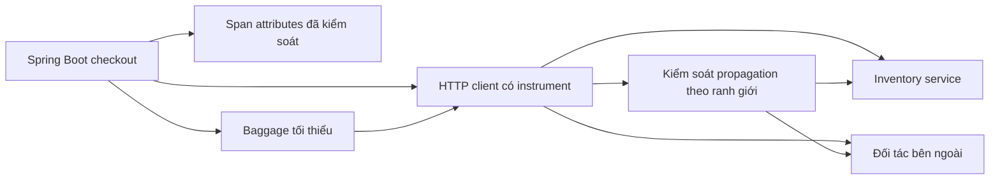
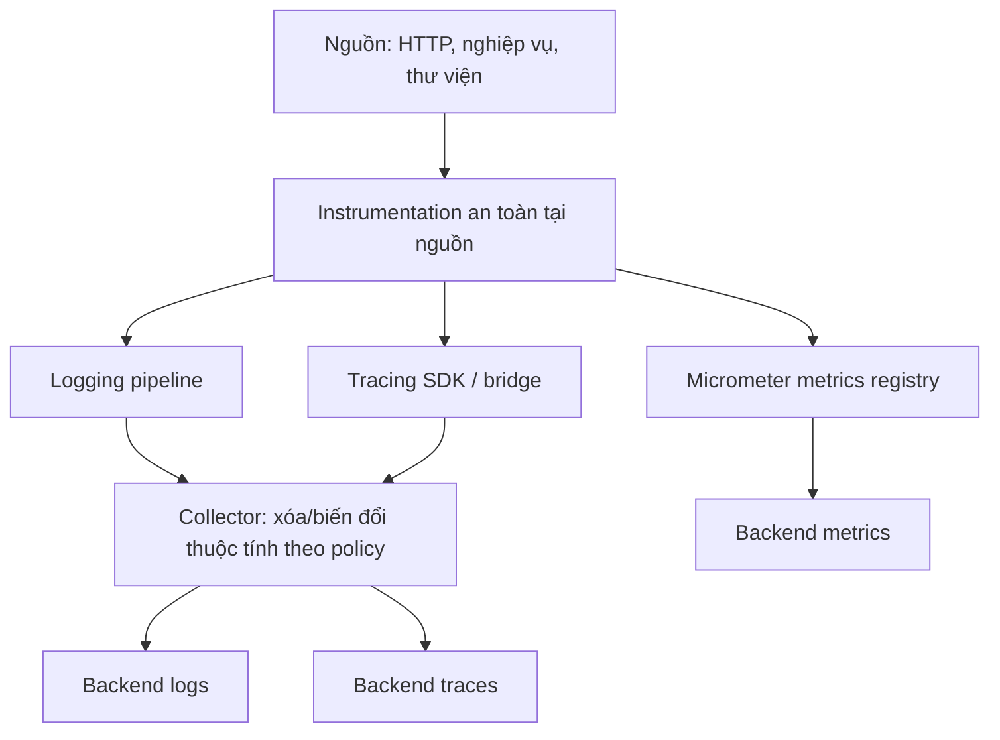

# Chính sách lọc dữ liệu nhạy cảm trong Spring Boot Observability

Một hệ thống observability tốt giúp trả lời: *API nào đang chậm? Bao nhiêu request thất bại? Một request đã đi qua những dịch vụ nào và lỗi xảy ra ở đâu?* Tuy nhiên, các đường thu thập metrics, logs và distributed traces cũng có thể vô tình đưa email, mã khách hàng, access token hoặc nội dung đơn hàng vào công cụ giám sát. Một nhãn metric tưởng như vô hại có thể tạo hàng triệu time series; một dòng log chứa token có thể trở thành sự cố bảo mật.

Bài **Chính sách lọc dữ liệu nhạy cảm**, thuộc chương **Cardinality và metadata** của module **SPRING_BOOT_OBSERVABILITY**, trình bày cách phân loại, giảm thiểu, lọc và xác minh dữ liệu trước khi xuất telemetry. Phạm vi gồm Micrometer Observation, metrics, logs, distributed tracing, context propagation, tags/cardinality, exporter, sampling và cách liên kết các tín hiệu để điều tra lỗi, độ trễ và hành vi ứng dụng Spring Boot trên môi trường thực.

**Mục tiêu:** sau bài này, bạn có thể xác định dữ liệu nào không được đưa vào telemetry, thiết kế bộ thuộc tính an toàn, đặt điểm kiểm soát ở đúng tầng và kiểm chứng rằng dữ liệu nhạy cảm không thoát ra khỏi những đường thu thập thường gặp.

## 1. Vì sao cần chính sách lọc dữ liệu?

Telemetry đi qua nhiều thành phần hơn người viết mã thường nhìn thấy: ứng dụng, logging library, tracing SDK, exporter, collector, storage backend, dashboard, công cụ tìm kiếm và cơ chế chia sẻ sự cố. Dữ liệu được đưa vào một tín hiệu có thể được sao chép, lập chỉ mục và giữ lâu hơn vòng đời request.

Ví dụ không an toàn:

```text
http.route=/orders/482719
request.email=someone@example.test
http.request.header.authorization=Bearer <token>
exception.message=Payment rejected for card 4111...1111
```

Những giá trị này chỉ là **dữ liệu giả định**. Chúng minh họa bốn vấn đề riêng: URL chứa định danh, thuộc tính nhận dạng cá nhân, credential và thông điệp lỗi có thể chứa thông tin thanh toán. Ngay cả khi không xuất ra dashboard, dữ liệu có thể đã đi qua bộ nhớ, buffer hoặc collector.

Chính sách bảo vệ phải giải quyết đồng thời:

- **Bảo mật và quyền riêng tư:** tránh phát tán secrets, thông tin cá nhân và nội dung nghiệp vụ nhạy cảm.
- **Cardinality và chi phí:** tránh sinh time series gần như duy nhất cho từng request.
- **Độ tin cậy điều tra:** giữ đủ thuộc tính an toàn để truy vấn, phân nhóm và liên kết metrics, logs, traces.
- **Quản trị dữ liệu:** xác định ai được xem, lưu bao lâu, dữ liệu đi tới đâu và làm gì khi phát hiện rò rỉ.

**Nguyên tắc ưu tiên:** không thu thập dữ liệu nhạy cảm ngay từ đầu; chuẩn hóa hoặc bỏ ở nguồn; áp dụng kiểm soát bổ sung trên đường xuất và lưu trữ. Việc xóa dữ liệu ở collector là lớp phòng thủ bổ sung, không thay thế thiết kế instrumentation an toàn trong ứng dụng.

## 2. Phân loại dữ liệu trước khi thiết kế telemetry

Một policy rõ ràng bắt đầu bằng **phân loại dữ liệu**, thay vì cố viết một regex để che mọi thứ. Ma trận minh họa:

| Nhóm dữ liệu | Ví dụ | Chính sách mặc định |
| --- | --- | --- |
| **Bí mật xác thực** | Mật khẩu, API key, OAuth access/refresh token, cookie phiên, Authorization header | **Không thu thập** vào metrics, logs, traces hoặc baggage |
| **Dữ liệu cá nhân** | Email, số điện thoại, địa chỉ, tên đầy đủ, định danh người dùng | Tránh thu thập; chỉ dùng trong luồng có mục đích và bảo vệ được phê duyệt |
| **Dữ liệu giao dịch nhạy cảm** | Số thẻ, nội dung thanh toán, payload đơn hàng, dữ liệu sức khỏe | Không đưa nguyên văn vào telemetry; dùng mã lỗi/nhóm kết quả an toàn |
| **Định danh nhiều giá trị** | orderId, customerId, requestId, URL chứa ID | Không dùng làm nhãn metrics; nếu cần correlation thì kiểm soát truy cập và thời hạn lưu |
| **Thuộc tính phân nhóm hữu hạn** | route mẫu, HTTP method, status class, outcome, region, channel | Có thể dùng sau khi xác minh tập giá trị và nội dung |
| **Mã tương quan kỹ thuật** | traceId, spanId, correlationId độc lập | Dùng để liên kết tín hiệu theo chính sách; không mặc nhiên xem là dữ liệu công khai |

Một ID ngẫu nhiên không nhất thiết là secret nhưng có thể liên kết hoạt động của cùng người dùng khi kết hợp dữ liệu khác. Không được suy rằng **“không phải PII trực tiếp” = “luôn an toàn”**.

Phân loại phải xét cả **giá trị**, không chỉ tên key. Ví dụ `http.route` chỉ an toàn khi chứa route template như `/orders/{id}`; chuỗi `/orders/482719` dù nằm trong key tên `http.route` vẫn có thể lộ định danh. Tương tự, `outcome` không an toàn nếu giá trị là một thông điệp lỗi tự do có email/token.

## 3. Xây hợp đồng dữ liệu cho từng tín hiệu

Chính sách tốt nêu rõ key nào được phép, nguồn tạo giá trị, phép chuẩn hóa, nơi được lưu và giới hạn số lượng giá trị.

| Tín hiệu | Nên giữ | Nên loại bỏ hoặc thay thế | Vì sao |
| --- | --- | --- | --- |
| **Metrics** | `http.method=POST`, `http.route=/orders/{id}`, `outcome=error` | `userId`, email, raw URL, request/trace ID, thông báo lỗi tùy ý | Labels cần cardinality thấp để tổng hợp |
| **Logs** | Timestamp, service, event code, error category, traceId nếu được phép | Header xác thực, body, query string nhạy cảm, exception message chưa kiểm tra | Logs dễ bị tìm kiếm/sao chép và giữ lâu |
| **Traces** | Tên span, thời lượng, status, HTTP route mẫu, thuộc tính đã cho phép | Secret, raw payload, user profile, URL có query nhạy cảm | Span attributes/events thường đi qua exporter và backend |
| **Baggage/propagation** | Giá trị kỹ thuật được phê duyệt, tối thiểu cần cho downstream | Token, email, customer profile, dữ liệu nội bộ không cần thiết | Baggage có thể đi qua ranh giới dịch vụ và bên thứ ba |
| **Resource metadata** | Tên service, environment, vùng triển khai đã chuẩn hóa | Credential, tên máy/tài khoản chứa định danh nhạy cảm | Metadata được gắn vào nhiều tín hiệu và có phạm vi rộng |

Không được hiểu bảng này là cho phép tự động thu thập tất cả thuộc tính trong cột “Nên giữ”. Mỗi tổ chức cần phê duyệt danh sách key/value theo nghiệp vụ, chính sách dữ liệu và phạm vi truy cập của hệ thống.

Ví dụ hợp đồng tối thiểu cho `checkout.submit`:

```yaml
operation: checkout.submit
allowed_metric_labels:
  channel: [web, mobile, partner, other]
  outcome: [accepted, rejected, error]
  payment_provider: [provider_a, provider_b, other]
allowed_trace_attributes:
  - channel
  - outcome
  - error.category
allowed_log_fields:
  - service
  - event
  - error_category
  - trace_id
forbidden_everywhere:
  - authorization
  - cookie
  - access_token
  - password
  - card_number
  - email
```

Đây là **mẫu chính sách minh họa**, không phải định dạng cấu hình được Spring Boot hoặc Micrometer đọc tự động. Trên thực tế, đội kỹ thuật phải hiện thực hợp đồng này ở instrumentation, logging, tracing SDK, collector và các bài test.

## 4. Cardinality liên quan gì đến dữ liệu nhạy cảm?

**Cardinality của metric** là số tổ hợp giá trị nhãn khác nhau có thể tạo các time series riêng biệt. Một metric có nhãn `channel` với 4 giá trị, `outcome` với 3 giá trị và `region` với 5 giá trị có tối đa:

\[
4 \times 3 \times 5 = 60 \text{ tổ hợp nhãn}
\]

Nếu thêm `orderId` với 100.000 giá trị khác nhau, số tổ hợp tiềm năng có thể tăng lên **6 triệu**, trước khi tính instance, service, pod hoặc nhãn khác. Các tổ hợp thực tế phụ thuộc lưu lượng và cách phân bổ dữ liệu; phép nhân trên là ví dụ về **nguy cơ bùng nổ**, không phải con số chắc chắn sẽ được tạo.

Trong Micrometer Observation:

- **Low-cardinality key-values** được thiết kế cho các nhóm giá trị hữu hạn và thường được dùng làm nhãn metrics.
- **High-cardinality key-values** có thể hữu ích khi điều tra từng trace, nhưng **không phải giấy phép ghi thông tin cá nhân hoặc secrets**.
- **Tên metric, span và event** cũng cần ổn định; không nhúng ID vào chính tên.

Hai quy tắc khác nhau phải được kiểm tra độc lập: **cardinality thấp** và **không nhạy cảm**. Ví dụ `auth_token_type=bearer` có cardinality thấp nhưng thường không cần thiết; một giá trị `outcome` chứa dữ liệu người dùng thì vẫn không an toàn dù key nằm trong allowlist.

## 5. Chặn dữ liệu tại nguồn bằng Micrometer Observation

Nơi kiểm soát quan trọng nhất là **điểm tạo observation**. Chỉ gắn các thuộc tính có ý nghĩa vận hành, với giá trị đã được rút gọn thành tập hữu hạn.

Ví dụ Java cho Spring Boot:

```java
import io.micrometer.observation.Observation;
import io.micrometer.observation.ObservationRegistry;
import org.springframework.stereotype.Service;

@Service
public class CheckoutTelemetry {
    private final ObservationRegistry registry;

    public CheckoutTelemetry(ObservationRegistry registry) {
        this.registry = registry;
    }

    public void observeCheckout(String sourceChannel, Runnable action) {
        String channel = SafeTelemetryTags.channel(sourceChannel);

        Observation observation = Observation.createNotStarted(
                "checkout.submit", registry)
            .lowCardinalityKeyValue("channel", channel)
            .start();

        try (Observation.Scope ignored = observation.openScope()) {
            action.run();
            observation.lowCardinalityKeyValue("outcome", "accepted");
        } catch (RuntimeException ex) {
            observation.lowCardinalityKeyValue("outcome", "error");
            // Xem chính sách exception trước khi ghi chi tiết lỗi.
            throw ex;
        } finally {
            observation.stop();
        }
    }
}

final class SafeTelemetryTags {
    private SafeTelemetryTags() {}

    static String channel(String input) {
        if ("web".equals(input)) return "web";
        if ("mobile".equals(input)) return "mobile";
        if ("partner".equals(input)) return "partner";
        return "other";
    }
}
```

Đoạn code là một ví dụ instrumentation: `action` đại diện cho xử lý nghiệp vụ thực tế. Biến `sourceChannel` có thể đến từ đầu vào chưa tin cậy, nhưng chỉ bốn giá trị trong hàm `SafeTelemetryTags.channel` có thể xuất hiện trong telemetry. Không ghi email, access token, mã khách hàng, request body hoặc raw URL vào observation.

Ở ví dụ này, nhánh exception gắn `outcome=error` rồi ném lại lỗi. **Chính sách ghi exception** phải được xử lý riêng: `observation.error(ex)` có thể đưa thông tin từ exception vào handler/trace; một exception message chứa payload hoặc credential sẽ gây rò rỉ. Với đường dữ liệu nhạy cảm, hãy dùng loại lỗi/exception đã được kiểm soát hoặc cơ chế khử nhạy cảm phù hợp trước khi gọi API ghi lỗi. Việc chỉ gắn `outcome=error` không thay thế hoàn toàn semantic error của tracing.

Nếu hệ thống cần phân biệt `declined` hợp lệ với lỗi kỹ thuật, dùng một enum hoặc mã kết quả hữu hạn. Đừng suy kết quả bằng cách copy nguyên thông điệp từ cổng thanh toán vào tag.

### Tên operation và route template

Nên dùng `checkout.submit` thay vì `checkout.submit.order-482719`; dùng `/orders/{id}` thay vì `/orders/482719?email=...`. Đối với HTTP server/client instrumentation tự động, cần xem framework ghi **route template** hay **raw URL**, có ghi query string hoặc các header nhạy cảm không. Thư viện thay đổi theo phiên bản; hãy kiểm tra dữ liệu thật ở registry/tracing exporter.

## 6. ObservationConvention, ObservationFilter và MeterFilter: đặt kiểm soát đúng chỗ

Ba cơ chế trong Micrometer giải quyết những việc khác nhau:

| Cơ chế | Vị trí tác động | Vai trò trong chính sách |
| --- | --- | --- |
| `ObservationConvention` | Định nghĩa tên và key-values của một loại observation | Thiết lập hợp đồng tên/tag ngay từ instrumentation |
| `ObservationFilter` | Ánh xạ `Observation.Context`, thường ở giai đoạn `stop` | Bổ sung hoặc chuẩn hóa thuộc tính mà handler dùng về sau |
| `MeterFilter` | Đăng ký/cấu hình meter trong `MeterRegistry` | Chặn meter có tag không hợp lệ hoặc giới hạn cấu hình metric |

**Không dùng `ObservationFilter` làm lá chắn bảo mật duy nhất.** Filter thường áp dụng gần thời điểm observation kết thúc, trong khi handler tracing có thể đã tạo span lúc `start` và application logs có thể đã được ghi giữa vòng đời. Bổ sung hoặc sửa một tag lúc `stop` không xóa được những bản ghi đã đi ra trước đó. Ngoài ra, một số thông tin có thể xuất từ instrumentation khác mà không qua filter của registry này.

Một tuyến phòng thủ thứ hai ở lớp metrics có thể từ chối các meter chứa **tên tag bị cấm**:

```java
import io.micrometer.core.instrument.Tag;
import io.micrometer.core.instrument.config.MeterFilter;
import java.util.Set;
import org.springframework.context.annotation.Bean;
import org.springframework.context.annotation.Configuration;

@Configuration(proxyBeanMethods = false)
public class MetricsPrivacyConfiguration {
    private static final Set<String> FORBIDDEN_TAG_KEYS = Set.of(
        "user.id", "customer.id", "email", "authorization",
        "access_token", "request.id");

    @Bean
    MeterFilter denySensitiveMetricTags() {
        return MeterFilter.deny(id ->
            id.getTags().stream()
                .map(Tag::getKey)
                .anyMatch(FORBIDDEN_TAG_KEYS::contains));
    }
}
```

Ví dụ từ chối **toàn bộ meter** nếu nó mang một key nằm trong denylist. Nó không sửa giá trị tag, không phát hiện alias mới như `userEmail` và không bảo vệ logs/traces. Hơn nữa, dữ liệu nhạy cảm có thể đã được tạo trong ứng dụng trước khi đăng ký meter. Vì vậy đây là **hàng rào phụ**, cần đi cùng quy tắc allowlist và kiểm tra giá trị **tại nguồn**.

Nếu phải khử nhạy cảm **giá trị**, cần chuẩn hóa thành các nhóm an toàn trước khi gọi `lowCardinalityKeyValue(...)`. Không nên áp dụng một phép regex tùy tiện rồi coi kết quả là an toàn tuyệt đối.

## 7. Logging: tránh thu thập secrets trong thông điệp, MDC và exception

Logs có thể lộ dữ liệu ở ba vị trí: message, structured fields/MDC và stack trace/exception message. Ví dụ cần tránh:

```java
// Không an toàn: đầu vào và token xuất hiện nguyên văn trong log.
log.info("Checkout request {}", requestBody);
log.warn("Payment authorization failed token={}", accessToken);
log.error("Downstream request failed: {}", exception.getMessage());
```

Thay vào đó, ghi **sự kiện có mã ổn định**, mức độ phù hợp và ngữ cảnh đã kiểm soát:

```java
enum PaymentFailureCategory {
    TIMEOUT, DECLINED, UNAVAILABLE, UNKNOWN
}

void logPaymentFailure(PaymentFailureCategory category) {
    log.warn("payment.authorization.failed category={}", category.name());
}
```

Ví dụ thứ hai giả định có một logger `log` được cấu hình. Giá trị `category` được sinh từ enum nội bộ; nó không phải chuỗi lỗi tự do từ client hoặc đối tác. Muốn ghi stack trace chi tiết để điều tra, phải biết trước exception và message/cause của nó có chứa dữ liệu nhạy cảm không, đồng thời áp dụng kiểm soát truy cập và retention.

Những điểm cần xem trong Spring Boot:

- **HTTP access logs:** proxy, gateway, container và app có thể ghi request URI/query string. Việc làm sạch application logger không tự sửa access log của thành phần khác.
- **Structured logging:** chỉ đưa các trường được phê duyệt vào JSON; masking theo key là lớp bổ sung, không chặn được bí mật bị ghép vào free-text message.
- **MDC:** `traceId`/`spanId` có ích cho correlation; không đưa email, JWT hoặc customer profile vào MDC. MDC cũng cần được quản lý khi chuyển thread.
- **Exception:** message có thể đến từ database, HTTP client hoặc bên thứ ba. Không coi việc log nguyên Throwable là mặc nhiên an toàn.
- **Debug logging:** bật logging mức TRACE/DEBUG, request/response body hoặc header ở production có thể tạo một đường rò mới; cần cấu hình theo môi trường và có thời hạn.

Tắt một log trong ứng dụng không có nghĩa thư viện HTTP, agent, load balancer hoặc collector không ghi cùng dữ liệu ở nơi khác. Chính sách phải bao phủ tất cả các điểm phát log.

## 8. Distributed tracing: span attributes, events, baggage và propagation

Traces cung cấp đường đi và thời lượng request; chúng không cần chứa nội dung payload để hữu ích. Những span attributes an toàn thường là `http.request.method`, route mẫu, status code, tên operation, tên hệ thống downstream và `error.category` đã chuẩn hóa. Các thuộc tính về Authorization, Cookie, dữ liệu thẻ, query chứa PII hoặc body phải bị loại từ instrumentation.

**Span events** cũng có thể bị lộ dữ liệu nếu message hoặc attributes được tạo từ input chưa tin cậy. Đừng ghi `span.addEvent("failed for user alice@example.test")`; dùng một event name ổn định như `payment.authorization.failed` và category an toàn.

**Baggage** khác với span attribute: baggage có thể được truyền tiếp qua HTTP/messaging nếu propagator hỗ trợ. Vì vậy tuyệt đối tránh đưa token, email, địa chỉ, số thẻ hoặc dữ liệu người dùng vào baggage. Một service gọi API bên thứ ba có thể truyền một số header propagation; cần kiểm tra **ranh giới tin cậy** và giới hạn những gì được inject.



Header W3C `traceparent` mang định danh/ngữ cảnh tracing kỹ thuật; đừng nhúng dữ liệu nghiệp vụ vào các header trace. Baggage và custom propagation headers có quy tắc riêng. Việc trace có quan hệ cha–con đúng không phụ thuộc vào tên tag; nó cần instrumentation và propagation qua thread, executor, HTTP client/server hoặc message broker.

**Sampling không phải cơ chế bảo vệ dữ liệu nhạy cảm.** Lấy mẫu 10% traces vẫn có thể giữ đúng request chứa token. Dù một trace không được export, dữ liệu nhạy cảm có thể đã đi vào log, metric hoặc buffer. Phải lọc trước khi lấy mẫu và trước khi xuất khi có thể.

## 9. Exporter và OpenTelemetry Collector: lớp phòng thủ bổ sung

Một hệ thống thường có nhiều đường telemetry:



Collector có thể thêm một lớp kiểm soát trước khi dữ liệu được gửi đến backend. Ví dụ OpenTelemetry Collector hỗ trợ **attributes processor** để xóa các span/log attributes được chỉ định. Đoạn cấu hình sau là **một phần minh họa** cho traces pipeline:

```yaml
processors:
  attributes/privacy:
    actions:
      - key: enduser.id
        action: delete
      - key: user.email
        action: delete
      - key: http.request.header.authorization
        action: delete

service:
  pipelines:
    traces:
      receivers: [otlp]
      processors: [attributes/privacy, batch]
      exporters: [otlp]
```

Cấu hình trên **chưa tự chạy độc lập**: `receivers`, `exporters`, `batch` và endpoint cần khai báo tương thích ở các phần khác của Collector. Tên semantic attributes và khả năng processor tùy phiên bản/distribution. `attributes` processor thao tác trên thuộc tính của spans/logs được hỗ trợ; nó **không tự loại dữ liệu trong log body**, resource attributes hay tất cả datapoint labels của metrics. Các loại dữ liệu khác cần cơ chế processor/view/sanitizer phù hợp, ví dụ resource processor hoặc transform processor có cấu hình được kiểm chứng.

Để chính sách có hiệu quả:

1. Đặt processor ở **mọi pipeline liên quan**, trước exporter đưa dữ liệu ra ngoài phạm vi tin cậy.
2. Kiểm tra route khác có bỏ qua collector hay không; một exporter trực tiếp có thể khiến dữ liệu không đi qua bước xóa.
3. Giảm quyền truy cập collector, cấu hình TLS/xác thực và giới hạn quyền truy vấn backend.
4. Theo dõi lỗi processor, queue/buffer, dropped data và trạng thái export để không mất khả năng quan sát.
5. Đánh giá retention, sao lưu, chia sẻ dashboard và quyền truy cập dữ liệu ở backend.

Collector chỉ có thể xử lý nội dung mà nó nhận được. Nếu secret đã vào log ở chỗ khác hoặc được phát tới hai backend độc lập, xóa ở một collector không xóa bản sao còn lại.

## 10. Bản thiết kế policy qua nhiều lớp

Chính sách lọc dữ liệu nhạy cảm nên được thực thi ở nhiều lớp, với nhiệm vụ cụ thể:

| Lớp | Việc cần làm | Ví dụ kiểm chứng |
| --- | --- | --- |
| **Thiết kế API/nghiệp vụ** | Không truyền secret vào tên operation, event hoặc tag | Review instrumentation của checkout |
| **Instrumentation/Observation** | Chỉ dùng allowlist và giá trị đã chuẩn hóa | `outcome=error`, không có email/ID ở low-cardinality |
| **Metrics registry** | Giới hạn tag set, loại meter sai chính sách | MeterFilter chặn key bị cấm |
| **Logging** | Structured fields được duyệt; kiểm soát message, MDC và exception | Tìm sentinel secret trong log test |
| **Tracing SDK** | Tắt capture body/header nhạy cảm; giới hạn span attributes/events/baggage | Span dump không có Authorization/query |
| **Exporter/Collector** | Xóa attributes còn sót, bảo vệ đường truyền | Test pipeline với dữ liệu giả định |
| **Backend và vận hành** | Phân quyền, retention, kiểm toán, xử lý sự cố | Quyền xem dữ liệu và lịch sử truy cập |

Policy cần có **chủ sở hữu**, phiên bản và quá trình thay đổi. Mỗi khi thêm instrumentation, exporter, thư viện HTTP, logging encoder hoặc một nhãn mới, phải đánh giá lại dữ liệu có thể thoát ra và nơi dữ liệu được lưu.

Một allowlist thực tế phải quy định **cặp key và cách tạo giá trị**. Ví dụ `error.category` chỉ cho các mã `timeout, unavailable, rejected, unknown`; không nhận nguyên `exception.getMessage()` rồi lưu dưới key đã được phê duyệt.

## 11. Kiểm thử chính sách bằng dữ liệu giả định

Không nên chỉ đọc code rồi kết luận dữ liệu đã an toàn. Hãy tạo một tập dữ liệu test **có dấu hiệu nhận biết nhưng không phải secret thật**, sau đó kiểm tra đầu ra từng pipeline.

Ví dụ unit test cho bộ chuẩn hóa:

```java
import org.junit.jupiter.api.Test;
import static org.junit.jupiter.api.Assertions.assertEquals;

class SafeTelemetryTagsTest {
    @Test
    void acceptsOnlyKnownChannelValues() {
        assertEquals("web", SafeTelemetryTags.channel("web"));
        assertEquals("partner", SafeTelemetryTags.channel("partner"));
        assertEquals("other", SafeTelemetryTags.channel(
            "someone@example.test"));
        assertEquals("other", SafeTelemetryTags.channel(
            "Bearer FAKE-TEST-TOKEN"));
    }
}
```

Đây là test cho helper ở mục 5, chưa kiểm tra toàn bộ tracing hoặc exporter. Với Micrometer, có thể mở rộng:

- Dùng `TestObservationRegistry` để assert các low/high-cardinality key-values trên observation đã hoàn thành.
- Dùng `SimpleMeterRegistry` kết nối với metrics observation handler để assert không xuất hiện nhãn `email`, `user.id`, `request.id`; đồng thời kiểm tra các nhãn hợp lệ.
- Dùng logging test appender/capture để kiểm tra message, structured fields và exception theo chính sách.
- Dùng in-memory span exporter của tracing SDK đang sử dụng để xem **toàn bộ attributes/events** và việc propagation giữ đúng trace mà không mang dữ liệu cấm.
- Dùng một Collector/backend test để xác minh processors, đường xuất và semantic attributes thực tế; không dựa vào giả định rằng một processor áp dụng cho mọi tín hiệu.

### Kiểm tra với sentinel

Ví dụ giá trị test như `SENSITIVE-TEST-EMAIL@example.test` hoặc `FAKE-TOKEN-DO-NOT-USE` có thể được đưa vào request giả định. Sau đó tìm trên **metrics export, logs đã encode, spans đã export và dữ liệu sau collector**. Nếu thấy sentinel, phải xác định nó phát ra từ layer nào và chỉnh ngay tại nguồn hoặc điểm pipeline thích hợp.

Không sử dụng credential đang hoạt động hoặc dữ liệu khách hàng thật làm sentinel. Các bài test cần thiết kế để không đưa chính dữ liệu thử nghiệm vào môi trường monitoring dùng chung ngoài phạm vi kiểm thử.

**Kiểm tra phủ định thôi chưa đủ:** nếu sanitizer loại hết dữ liệu, hệ thống có thể mất khả năng điều tra. Vì vậy cần kiểm tra song song rằng các thuộc tính được phép như `http.route`, `outcome`, `error.category` và trace correlation vẫn tồn tại và có ý nghĩa.

## 12. Liên kết tín hiệu an toàn khi điều tra sự cố

Một chính sách tốt vẫn cho phép điều tra lỗi thực tế. Giả sử sau triển khai, API checkout có p95 tăng từ 250 ms lên 1,6 giây và tỷ lệ 5xx tăng. Ta có thể giữ:

| Tín hiệu | Dữ liệu minh họa an toàn | Câu hỏi trả lời |
| --- | --- | --- |
| Metrics | `http.route=/checkout`, `outcome=error`, p95, error rate | Phạm vi và mức độ ảnh hưởng |
| Trace | `checkout.submit`, span gọi payment 1,3 giây, `error.category=timeout` | Bước nào chậm? |
| Log | `event=payment.authorization.failed`, `error_category=timeout`, `traceId` | Sự kiện và loại lỗi của request tương ứng |

Không cần email, số thẻ, body thanh toán hay bearer token để biết payment downstream bị timeout. `traceId` và `spanId` có thể giúp tìm các tín hiệu liên quan khi tracing correlation hoạt động, nhưng **trace ID không bảo đảm trace đã được giữ**: sampling, exporter, collector hoặc retention có thể làm nó không tồn tại trong backend.

Quy trình điều tra minh họa:

1. Từ metrics, khoanh vùng route, cửa sổ thời gian, tỷ lệ lỗi và phân vị độ trễ.
2. Mở trace được sample của request chậm; xác định span liên quan, lỗi và các thuộc tính an toàn.
3. Tra logs theo trace ID và thời gian; đọc event code và error category, tránh dùng dữ liệu cá nhân để tìm kiếm.
4. Đối chiếu nhiều request và metrics downstream trước khi kết luận nguyên nhân.
5. Sau khắc phục, đo lại p95/error rate và xác nhận telemetry vẫn tuân thủ policy.

Trong trường hợp cần tra một giao dịch cụ thể theo orderId, có thể dùng **hệ thống dữ liệu nghiệp vụ được phân quyền** để tìm mốc thời gian và correlation ID đã được cấp phép. Việc dùng ID trong một quy trình điều tra có kiểm soát khác với phát ID đó vào mọi time series hoặc span.

## 13. Khi phát hiện dữ liệu nhạy cảm đã vào telemetry

Phát hiện một token trong log hoặc trace cần được xử lý như **sự cố dữ liệu**, không chỉ là lỗi đặt tag. Trình tự hợp lý:

1. **Ngăn nguồn phát tiếp:** tắt instrumentation/header capture hoặc sửa code tạo dữ liệu; nếu cần, dùng collector policy khẩn cấp để giảm phát tán.
2. **Xác định phạm vi:** loại dữ liệu, thời gian bắt đầu, dịch vụ, exporter, collector, backend và bản sao có thể đã nhận.
3. **Thu hồi/luân chuyển secrets:** nếu lộ credential hoặc token đang hoạt động, thực hiện quy trình revoke/rotate theo quyền hạn và chính sách tổ chức.
4. **Hạn chế truy cập và xử lý dữ liệu đã lưu:** phối hợp chủ sở hữu backend để xóa/giới hạn retention và xem xét bản sao sao lưu theo khả năng của nền tảng.
5. **Đánh giá ảnh hưởng và báo cáo:** tuân thủ quy trình nội bộ, yêu cầu pháp lý và hợp đồng liên quan; không đưa dữ liệu nhạy cảm vào chính ticket hoặc báo cáo sự cố.
6. **Bổ sung test và guardrail:** tạo sentinel/negative tests, kiểm tra pipeline và ngăn regression khi nâng SDK hoặc thêm exporter.

Chỉ sửa regex ở collector không đủ nếu secret vẫn đang được ghi trong ứng dụng, log của proxy hoặc một exporter khác. Tương tự, xóa dữ liệu trong giao diện dashboard không bảo đảm nó đã biến mất khỏi storage, index hoặc bản sao.

## 14. Những lỗi thường gặp

| Sai lầm | Hậu quả | Cách xử lý |
| --- | --- | --- |
| Thêm `customerId` vào low-cardinality tag | Bùng nổ time series, rủi ro riêng tư | Dùng tập giá trị hữu hạn và truy vấn nghiệp vụ có kiểm soát |
| Chỉ lọc ở ObservationFilter khi stop | Log/span đã ghi trước đó vẫn có thể lộ | Loại dữ liệu ở nguồn và kiểm tra toàn bộ instrumentation |
| Chỉ đổi tên key nhạy cảm | Giá trị nhạy cảm vẫn tồn tại | Giảm thiểu, bỏ hoặc chuẩn hóa giá trị |
| Chụp toàn bộ HTTP header/body để debug | Token/cookie/payload vào logs hoặc traces | Tắt capture mặc định hoặc chỉ allowlist trường an toàn |
| Đưa email vào baggage | Có thể truyền qua service/đối tác | Chỉ propagate dữ liệu kỹ thuật tối thiểu |
| Coi sampling là cơ chế bảo mật | Request có secret vẫn có thể được sample | Sanitization độc lập với sampling |
| Dùng `exception.getMessage()` làm `error.category` | Có thể lộ payload và tăng cardinality | Map sang enum/mã lỗi hữu hạn |
| Chỉ xóa span attributes ở collector | Log body, resource/metric data hoặc exporter khác còn dữ liệu | Kiểm soát từng pipeline và điểm phát |
| Unit test chạy xanh nhưng backend rò dữ liệu | Test chưa bao quát exporter/collector | Thêm integration test và quét sentinel |
| Giữ dữ liệu telemetry vô thời hạn | Tăng tác động khi có rò rỉ | Retention, phân quyền, audit và quy trình xóa |

## 15. Bài tập tự kiểm tra

**Tình huống A.** Một developer muốn thêm `userId` để tìm những request bị chậm theo từng người dùng. Có nên dùng low-cardinality tag trên `http.server.requests`?

*Gợi ý:* Không. `userId` có nhiều giá trị, có thể nhạy cảm và gây bùng nổ time series. Xem yêu cầu điều tra và dùng correlation/dữ liệu nghiệp vụ có kiểm soát thay vì gắn userId vào metrics.

**Tình huống B.** Hệ thống có `ObservationFilter` loại tag `email` ở `stop()` nhưng một log trong giữa request vẫn chứa email. Có mâu thuẫn không?

*Gợi ý:* Không. Filter không sửa các log đã phát từ trước. Chính sách phải áp dụng ngay ở logger/instrumentation và các lớp khác.

**Tình huống C.** Log không chứa Authorization header, nhưng OTLP trace có `http.request.header.authorization`. Cần kiểm tra đâu?

*Gợi ý:* Kiểm tra tracing instrumentation/header capture, SDK, tracing handler, exporter và collector. Chặn từ nguồn; attributes processor có thể là lớp bảo vệ bổ sung.

**Tình huống D.** Một người thay toàn bộ userId bằng SHA-256 rồi đưa hash vào nhãn metrics. Cách này có chắc giải quyết được cardinality và quyền riêng tư không?

*Gợi ý:* Không. Hash duy nhất vẫn tạo nhiều giá trị; dữ liệu có thể liên kết được, và định danh đầu vào có tập nhỏ có thể bị suy đoán. Hash không thay thế đánh giá mục đích và độ nhạy cảm.

**Tình huống E.** Trace được sample 1%, nhưng metrics luôn thu thập. Vì sao vẫn phải lọc cả hai tín hiệu?

*Gợi ý:* Sampling chỉ ảnh hưởng đường tracing tương ứng; metrics có thể vẫn có nhãn nhạy cảm, và trace được chọn vẫn có thể lộ secret. Filter phải áp dụng trên từng nguồn và pipeline.

**Tình huống F.** Team muốn kiểm tra sanitizer hoạt động nhưng không được đưa credential thật vào test. Có thể làm gì?

*Gợi ý:* Dùng sentinel giả, assert chúng vắng mặt ở metrics/logs/traces sau khi export; đồng thời xác nhận nhãn an toàn và trace correlation vẫn đủ để điều tra.

## 16. Những điều cần nhớ

- **Chính sách lọc dữ liệu nhạy cảm** là hợp đồng về *dữ liệu được phép thu thập, chuẩn hóa, xuất, lưu và xem*, không chỉ một biểu thức thay thế chuỗi.
- **Lọc tại nguồn trước tiên:** không tạo metric labels, log fields, span attributes/events hoặc baggage chứa secrets, dữ liệu cá nhân và payload không cần thiết.
- **Cardinality và quyền riêng tư là hai bài kiểm tra độc lập.** Low-cardinality tags cần tập giá trị hữu hạn và an toàn; high-cardinality không đồng nghĩa được phép lưu dữ liệu nhạy cảm.
- **ObservationConvention, ObservationFilter và MeterFilter** tác động tại các thời điểm/lớp khác nhau; filter lúc stop không thể xóa thông tin đã phát từ trước.
- **Sampling, exporter và Collector** là các thành phần vận hành, không tự bảo đảm dữ liệu an toàn. Cần kiểm thử từng pipeline, giới hạn quyền truy cập/retention và có quy trình ứng phó rò rỉ.
- Một hệ thống vẫn có thể điều tra lỗi và độ trễ bằng **metrics tổng hợp + traces được kiểm soát + logs theo event code và trace correlation**, mà không cần thu thập secrets hoặc định danh người dùng trên diện rộng.
