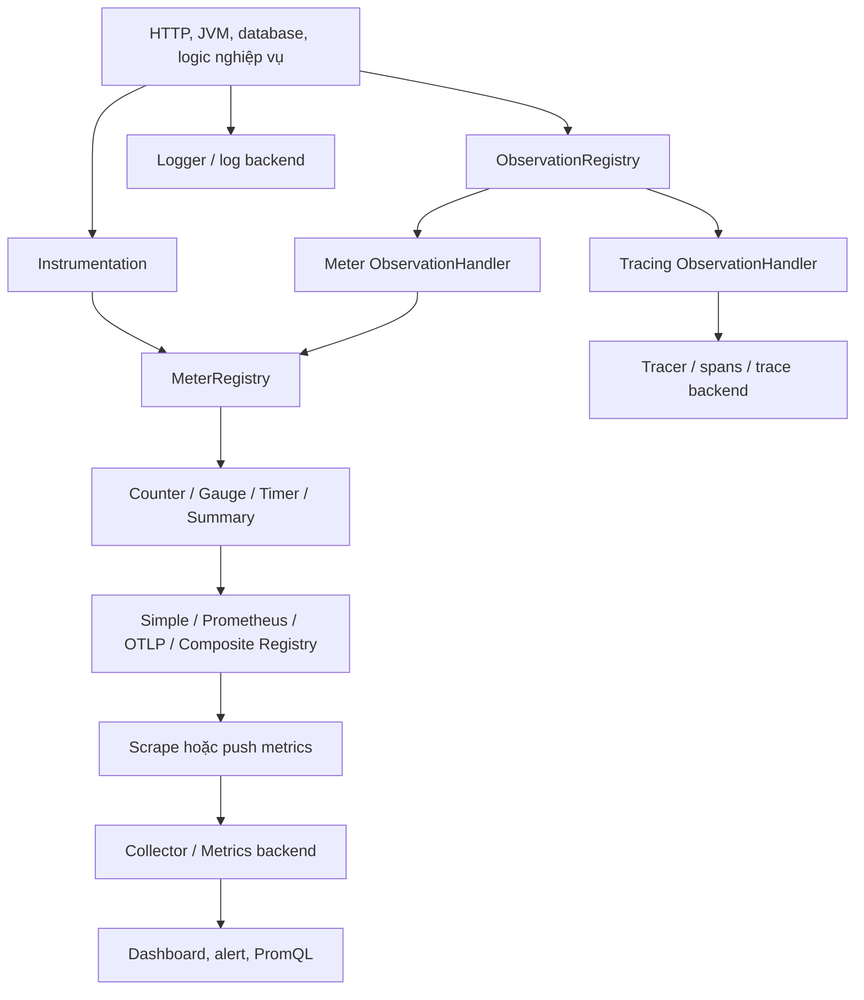
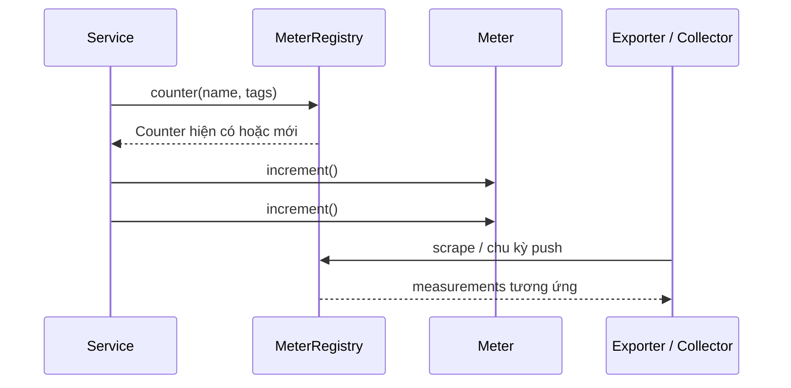

# MeterRegistry

Khi một API Spring Boot bắt đầu chậm, nhóm vận hành muốn biết độ trễ tăng bao nhiêu, những endpoint nào bị ảnh hưởng và hiện tượng kéo dài từ lúc nào. Để trả lời, ứng dụng cần ghi các giá trị số như số request, thời gian xử lý, số lần thất bại và độ sâu hàng đợi. **`MeterRegistry` của Micrometer là thành phần quản lý những phép đo số này**.

Bài **MeterRegistry** thuộc chương **Metrics nền tảng** của module **SPRING_BOOT_OBSERVABILITY**. Module hướng tới thiết lập observability cho Spring Boot bằng Micrometer Observation, metrics, logs và distributed tracing; tìm hiểu propagation ngữ cảnh, tag/cardinality, exporter, sampling và liên kết các tín hiệu để điều tra lỗi, độ trễ và hành vi ứng dụng trong môi trường thực.

> **Ý tưởng chính:** `MeterRegistry` chứa và quản lý những `Meter` trong tiến trình. Mã ứng dụng ghi measurements vào meter; registry implementation xác định cách lưu giữ hoặc xuất dữ liệu sang backend. Registry không phải database time-series tập trung, không tự ghi mọi logs và cũng không thay thế tracing.

## 1. Mục tiêu học tập

Sau bài này, bạn có thể:

1. Giải thích `MeterRegistry`, `Meter`, `Meter.Id`, tên metric, tags và measurements.
2. Phân biệt `Counter`, `Gauge`, `Timer`, `DistributionSummary` và `LongTaskTimer`.
3. Sử dụng `SimpleMeterRegistry`, hiểu `CompositeMeterRegistry` và các backend registries.
4. Inject `MeterRegistry` vào Spring Boot, đăng ký custom metrics, xem kết quả qua Actuator.
5. Cấu hình Prometheus exporter, common tags, `MeterFilter` và histogram đúng cách.
6. Giải thích mối quan hệ giữa `MeterRegistry` với Micrometer Observation và tracing.
7. Phát hiện lỗi do cardinality, meter name, counter reset, gauge lifecycle và sai lệch trong scrape/export.
8. Dùng metrics cùng logs/traces để điều tra vấn đề thực tế.

## 2. MeterRegistry nằm ở đâu trong Spring Boot?



Có hai luồng instrumentation phổ biến:

- **Ghi metric trực tiếp:** ứng dụng lấy `Counter`, `Timer` hoặc `Gauge` từ `MeterRegistry` và gọi `increment()`, `record(...)`, hoặc để gauge đọc trạng thái hiện tại.
- **Dùng Observation:** ứng dụng hay Spring Framework tạo `Observation`; khi registry có metrics handler, observation được chuyển thành dữ liệu meter; nếu có tracing handler, cùng hoạt động đó còn có thể tạo span.

Cùng một API có thể tạo metrics HTTP tự động, một custom metric nghiệp vụ về kết quả thanh toán và một trace cho những request được sample. **`MeterRegistry` chỉ quản lý phần metrics.** Trace và log do những thành phần khác xử lý, dù chúng có thể liên kết với metrics theo thời gian, service, route và exemplars khi hệ thống hỗ trợ.

### 2.1 Ranh giới trách nhiệm

| Thành phần | Chức năng | Không phải |
|---|---|---|
| `MeterRegistry` | Đăng ký, tra cứu và quản lý meters, tích hợp exporter theo implementation. | Bộ lưu trữ toàn bộ lịch sử request. |
| `Meter` | Một phép đo số có tên, loại và tags. | Trace span của một request cụ thể. |
| `Meter.Id` | Metadata của meter gồm name, tags, type, unit, description. | ID giao dịch nghiệp vụ. |
| `MeterFilter` | Chấp nhận, từ chối hoặc sửa metadata/config metrics. | Cơ chế sửa logs và span attributes. |
| Registry implementation | Chuyển measurements sang representation/backend tương ứng. | Bảo đảm collector luôn online. |
| Metrics backend | Lưu time series, cho phép query, dashboard, alert. | Tự sửa lại semantics của metric được instrument sai. |

## 3. Meter và Meter.Id được nhận diện thế nào?

Ví dụ một nghiệp vụ có hai outcome:

```text
name = checkout.authorization.result
tags = {outcome=approved, channel=web}

name = checkout.authorization.result
tags = {outcome=declined, channel=web}
```

Đây là hai **meter IDs/series logic khác nhau** do giá trị `outcome` khác nhau, dù name giống nhau. Registry thường tìm hoặc đăng ký meter theo tổ hợp name và tags (với ràng buộc type/metadata tương thích). Việc gọi `registry.counter(...)` nhiều lần với cùng name và tags sẽ thường nhận lại cùng Counter.

| Trường | Ví dụ | Ý nghĩa |
|---|---|---|
| Name | `checkout.authorization.result` | Tên ổn định của loại đo. |
| Type | `COUNTER` / `GAUGE` / `TIMER` | Ngữ nghĩa của measurement. |
| Tags | `channel=web`, `outcome=approved` | Các chiều phân nhóm có số giá trị được kiểm soát. |
| Base unit | `bytes` với kích thước payload | Đơn vị hỗ trợ naming/export. |
| Description | `Number of checkout authorizations` | Mô tả cho người vận hành. |

Một `Meter.Id` không đại diện cho một lần gọi API. Hàng nghìn requests có thể đóng góp vào một Counter hoặc Timer. Khi cần điều tra request đơn lẻ, phải sử dụng log/tracing theo `traceId`.

### 3.1 Tên ở Micrometer khác tên ở Prometheus

Tên Micrometer nên theo kiểu chữ thường, phân tách bằng dấu chấm:

```text
checkout.authorization.result
checkout.authorization.duration
checkout.queue.depth
http.server.requests
jvm.memory.used
```

Khi xuất sang Prometheus, naming convention có thể quy đổi:

```text
Trong code                         Trên Prometheus, ví dụ
checkout.authorization.result     checkout_authorization_result_total
checkout.authorization.duration   checkout_authorization_duration_seconds_count
                                  checkout_authorization_duration_seconds_sum
checkout.queue.depth              checkout_queue_depth
```

Hậu tố phụ thuộc loại meter, base unit và exporter. Vì vậy `/actuator/metrics/checkout.authorization.duration` dùng **tên Micrometer**, còn PromQL tìm **tên series thực sự được xuất**. Không tự đặt observation name là `...seconds_count`.

## 4. Các loại Meter: chọn theo câu hỏi

| Meter | Câu hỏi cần trả lời | Ví dụ |
|---|---|---|
| **Counter** | Đã xảy ra bao nhiêu lần? | Số lần bị từ chối, retry, gửi dead-letter. |
| **Gauge** | Ngay lúc này là bao nhiêu? | Queue depth, connection đang sử dụng. |
| **Timer** | Một lần xử lý mất bao lâu? | Độ trễ HTTP client, thanh toán, truy vấn. |
| **DistributionSummary** | Giá trị không phải thời gian phân bố ra sao? | Kích thước payload, số item trong batch. |
| **LongTaskTimer** | Bao nhiêu công việc dài đang chạy, đã chạy bao lâu? | Import, backup, rebuild index. |
| **FunctionCounter / FunctionTimer** | Lấy số liệu từ các hàm đọc bộ đếm đã có. | Thống kê do thư viện ngoài cung cấp. |

### 4.1 Counter: tổng số sự kiện tăng dần

```java
import io.micrometer.core.instrument.Counter;

Counter declined = Counter.builder("checkout.authorization.result")
        .description("Checkout authorization results")
        .tag("outcome", "declined")
        .register(registry);

declined.increment();
declined.increment(2.0);
```

`Counter` chỉ tăng, và `increment(amount)` yêu cầu giá trị dương. Khi ứng dụng restart, giá trị của counter trong tiến trình mới có thể trở về 0. Vì vậy, trên Prometheus thường phân tích **rate hoặc increase** theo khoảng thời gian để phát hiện xu hướng, thay vì coi giá trị tích lũy là một tổng toàn hệ thống vĩnh viễn.

**Không tạo Counter trùng ngữ nghĩa của Timer:** `Timer` đã báo count cho những lần nó ghi thời lượng. Chỉ cần Counter riêng nếu nó đo một business event khác, chẳng hạn số payment bị từ chối hoặc số job được đưa vào dead-letter.

### 4.2 Gauge: đọc trạng thái hiện hành

```java
import java.util.concurrent.atomic.AtomicInteger;
import io.micrometer.core.instrument.Gauge;

AtomicInteger queueDepth = new AtomicInteger();

Gauge.builder("checkout.queue.depth", queueDepth, AtomicInteger::get)
        .description("Current number of queued jobs")
        .register(registry);

queueDepth.set(12);
```

Gauge phản ánh **giá trị khi registry đọc**, không lưu mọi lần gọi `set()`. Nếu queue tăng lên 1000 rồi giảm về 12 giữa hai lần scrape, backend có thể chỉ thấy 12. Muốn thống kê số lần queue vượt ngưỡng, cần instrument sự kiện/counter hoặc cơ chế lấy mẫu thích hợp.

**Bẫy vòng đời:** Micrometer thường giữ **weak reference** đến đối tượng mà Gauge quan sát. Ứng dụng phải giữ **strong reference** tới `queueDepth` (thường bằng field của Spring bean). Nếu đối tượng bị garbage collected, gauge có thể trở thành `NaN` hoặc mất dữ liệu. Không tạo đối tượng/gauge mới theo từng request rồi kỳ vọng tất cả sẽ được đo đúng.

### 4.3 Timer: đếm và đo thời lượng

```java
import java.time.Duration;
import io.micrometer.core.instrument.Timer;

Timer authorizationDuration =
        Timer.builder("checkout.authorization.duration")
                .description("Time spent authorizing checkout")
                .register(registry);

authorizationDuration.record(Duration.ofMillis(125));
authorizationDuration.record(Duration.ofMillis(240));
System.out.println(authorizationDuration.count()); // 2
```

Timer cơ bản có `count` và `totalTime`; max, histogram và percentiles tùy cấu hình/backend. Với đoạn code cần đo thời gian động, `Timer.Sample` hỗ trợ:

```java
Timer.Sample sample = Timer.start(registry);
try {
    authorizePayment();
} finally {
    sample.stop(authorizationDuration);
}
```

Đặt `stop(...)` ở `finally` để thời lượng vẫn được ghi khi đoạn mã ném exception. Timer không phù hợp với duration âm. Đối với công việc kéo dài nhiều phút và cần nhìn thấy **tác vụ đang chạy**, cân nhắc `LongTaskTimer`.

### 4.4 DistributionSummary: phân phối giá trị không phải thời gian

```java
import io.micrometer.core.instrument.DistributionSummary;

DistributionSummary payload =
        DistributionSummary.builder("checkout.request.payload")
                .baseUnit("bytes")
                .description("Checkout request payload size")
                .register(registry);

payload.record(1_024);
payload.record(2_048);
```

`DistributionSummary` phù hợp cho bytes hoặc số item/batch, còn duration dùng `Timer` vì nó hiểu đơn vị thời gian và cách xuất phù hợp. Summary có thể cung cấp count, total amount và những thống kê phân phối khác theo khả năng của registry.

### 4.5 LongTaskTimer và các meter khác

`LongTaskTimer` dùng cho **công việc dài còn hoạt động**: một report generator mất 20 phút, job nhập dữ liệu, đồng bộ nhiều bản ghi. Nó đo số tác vụ active và thời lượng các tác vụ đang chạy (tùy backend); Timer thường ghi measurement sau khi invocation kết thúc.

`FunctionCounter` và `FunctionTimer` phù hợp khi một thư viện đã có sẵn các bộ đếm/tổng thời gian đơn điệu. Không dùng một hàm trả giá trị thay đổi lên xuống để giả làm Counter: semantics sẽ sai, nhất là khi backend tính rate.

## 5. MeterRegistry đăng ký và tìm meter ra sao?



Ví dụ:

```java
Counter a = registry.counter("inventory.rejection",
                             "reason", "out_of_stock");
Counter b = registry.counter("inventory.rejection",
                             "reason", "out_of_stock");
a.increment();
b.increment();

// Cả hai ghi vào cùng series logic trong registry.
double count = registry.get("inventory.rejection")
        .tag("reason", "out_of_stock")
        .counter()
        .count();
```

`registry.get(...)` thường báo lỗi nếu meter tương ứng không tồn tại; `registry.find(...)` trả `null` khi tìm không thấy. Trong hot path, giữ tham chiếu meter bằng field giúp tránh lookup liên tục.

**Không đăng ký cùng name/tags nhưng khác loại meter không tương thích** rồi kỳ vọng chúng tự hợp nhất. Thiết kế một tên cho một phép đo có ý nghĩa, đơn vị và kiểu nhất quán.

### 5.1 Đăng ký không phải gửi dữ liệu ngay lập tức

`Counter.builder(...).register(registry)` tạo hoặc lấy meter, nhưng không bảo đảm backend đã nhận dữ liệu. Tùy loại registry, metrics có thể được scrape hoặc push theo chu kỳ; export có thể lỗi mạng, bị auth từ chối hoặc không có target. Để điều tra “metric mất”, phải phân biệt **đo đạc**, **export**, **tiếp nhận** và **truy vấn**.

## 6. Những kiểu MeterRegistry thường dùng

### 6.1 SimpleMeterRegistry

`SimpleMeterRegistry` giữ số liệu trong memory và **không tự gửi ra backend**:

```java
import io.micrometer.core.instrument.simple.SimpleMeterRegistry;

try (SimpleMeterRegistry simple = new SimpleMeterRegistry()) {
    simple.counter("demo.orders").increment();
    System.out.println(simple.get("demo.orders").counter().count());
}
```

Nó thích hợp để học, thử nghiệm và unit tests. Với Spring Boot, simple registry thường là phương án fallback khi không có registry implementation khác; có backend khác thì fallback có thể bị tắt.

### 6.2 CompositeMeterRegistry

`CompositeMeterRegistry` cho phép một API ghi đến nhiều registry con:

```java
import io.micrometer.core.instrument.Counter;
import io.micrometer.core.instrument.composite.CompositeMeterRegistry;
import io.micrometer.core.instrument.simple.SimpleMeterRegistry;

try (CompositeMeterRegistry composite = new CompositeMeterRegistry();
     SimpleMeterRegistry simple = new SimpleMeterRegistry()) {

    Counter events = composite.counter("demo.events");
    events.increment();  // Chưa có registry con: phép đo không được lưu.

    composite.add(simple);
    events.increment();  // Lúc này simple bắt đầu nhận.

    System.out.println(simple.get("demo.events").counter().count()); // 1
}
```

Nếu chưa có registry con, một composite thường **không lưu bù** các increment xảy ra trước đó. Spring Boot tự cấu hình composite registry và thêm backend registries có trên classpath.

### 6.3 Prometheus registry và dạng push

| Implementation | Cơ chế điển hình | Cách hiểu |
|---|---|---|
| `PrometheusMeterRegistry` | **Scrape/pull** | Prometheus gọi endpoint định kỳ để thu số liệu của instance. |
| Registry OTLP | **Export/push** sang receiver/collector | Phù hợp với pipeline OpenTelemetry metrics. |
| StatsD/Datadog hoặc các registry SaaS | Push/agent theo giao thức và chu kỳ đặc thù | Cấu hình theo hệ thống tiếp nhận. |
| `SimpleMeterRegistry` | Memory, không export | Chỉ thấy số liệu local. |
| `CompositeMeterRegistry` | Phối hợp registry con | Một code path có thể xuất nhiều nơi. |

Một số backend dùng số liệu cumulative, số khác hiển thị step/rate. Không giả định mọi backend có cùng cách biểu diễn Timer, Count hay Max. Đặc biệt, **Prometheus không tự vào ứng dụng để “nghe sự kiện” liên tục**; nó chủ động lấy số liệu theo scrape interval.

## 7. Spring Boot auto-configure MeterRegistry

Spring Boot Actuator cung cấp dependency management và auto-configuration cho Micrometer. Khi đưa registry dành cho backend lên runtime classpath, Boot thường tạo bean tương ứng và có thể đưa vào composite registry. Nhiều instrumentations tích hợp sẵn: JVM, process/system, HTTP server/client, pool, logging hoặc thư viện bên ngoài tùy dependency.

### 7.1 Thêm dependencies

Với dự án đã cấu hình Spring Boot Gradle plugin và web starter phù hợp phiên bản:

```groovy
dependencies {
    implementation 'org.springframework.boot:spring-boot-starter-actuator'
    runtimeOnly 'io.micrometer:micrometer-registry-prometheus'
}
```

Những dependency trên cho phép quan sát metrics và Prometheus exposition; chúng **chưa tạo tracing backend hoặc log collector**. Để có distributed tracing cần thêm tracing integration, exporter và backend theo phiên bản Spring Boot.

### 7.2 Cấu hình local

```yaml
spring:
  application:
    name: checkout-service

management:
  endpoints:
    web:
      exposure:
        include: "health,info,metrics,prometheus"
  metrics:
    tags:
      application: checkout-service
      region: local
```

`/actuator/metrics` cho phép xem các meter names và measurements tại ứng dụng. `/actuator/prometheus` xuất định dạng scrape khi đã có Prometheus registry. Những endpoint này không mặc định được expose qua HTTP trong mọi cấu hình; ở production phải giới hạn truy cập quản trị bằng mạng và cơ chế xác thực/phân quyền phù hợp.

Ví dụ một phần cấu hình Prometheus ngoài ứng dụng:

```yaml
scrape_configs:
  - job_name: "checkout-service"
    metrics_path: "/actuator/prometheus"
    scrape_interval: 15s
    static_configs:
      - targets: ["checkout-service:8080"]
```

`checkout-service:8080` là địa chỉ minh họa. Trong thực tế cần service discovery, bảo mật và địa chỉ mà Prometheus truy cập được.

### 7.3 Global registry khác Spring-managed registry

Micrometer có `Metrics.globalRegistry` tĩnh. Spring Boot có thể thêm các registry auto-configured vào global registry, trừ khi tắt bằng:

```yaml
management:
  metrics:
    use-global-registry: false
```

Trong Spring Boot, ưu tiên **inject bean `MeterRegistry`** để dùng đúng cấu hình của application context và có thể test độc lập:

```java
@Service
public class CheckoutService {
    private final MeterRegistry registry;

    public CheckoutService(MeterRegistry registry) {
        this.registry = registry;
    }
}
```

Dùng `Metrics.counter(...)` tĩnh làm code phụ thuộc trạng thái global, dễ khó kiểm soát giữa nhiều test contexts hoặc ứng dụng có cấu hình đặc thù.

## 8. Ví dụ Spring Boot: metrics cho nghiệp vụ checkout

Thiết kế các phép đo:

- `checkout.authorization.result`: bao nhiêu lần được chấp nhận, bị từ chối, thất bại.
- `checkout.authorization.duration`: latency mỗi lần gọi.
- `checkout.queue.depth`: số job đang đợi.
- `checkout.request.payload`: kích thước payload.

```java
import java.util.concurrent.Callable;
import java.util.concurrent.atomic.AtomicInteger;

import io.micrometer.core.instrument.Counter;
import io.micrometer.core.instrument.DistributionSummary;
import io.micrometer.core.instrument.Gauge;
import io.micrometer.core.instrument.MeterRegistry;
import io.micrometer.core.instrument.Timer;
import org.springframework.stereotype.Service;

@Service
public class CheckoutMetrics {
    private final MeterRegistry registry;
    private final Counter approved;
    private final Counter declined;
    private final Counter failed;
    private final Timer latency;
    private final DistributionSummary payloadBytes;
    private final AtomicInteger pendingJobs = new AtomicInteger();

    public CheckoutMetrics(MeterRegistry registry) {
        this.registry = registry;

        approved = Counter.builder("checkout.authorization.result")
                .tag("outcome", "approved")
                .description("Authorization results")
                .register(registry);
        declined = Counter.builder("checkout.authorization.result")
                .tag("outcome", "declined")
                .description("Authorization results")
                .register(registry);
        failed = Counter.builder("checkout.authorization.result")
                .tag("outcome", "error")
                .description("Authorization results")
                .register(registry);

        latency = Timer.builder("checkout.authorization.duration")
                .description("Authorization duration")
                .register(registry);

        payloadBytes = DistributionSummary
                .builder("checkout.request.payload")
                .baseUnit("bytes")
                .description("Checkout payload size")
                .register(registry);

        Gauge.builder("checkout.queue.depth", pendingJobs, AtomicInteger::get)
                .description("Pending checkout jobs")
                .register(registry);
    }

    public boolean recordAuthorization(Callable<Boolean> operation)
            throws Exception {
        Timer.Sample sample = Timer.start(registry);
        try {
            boolean accepted = operation.call();
            if (accepted) {
                approved.increment();
            } else {
                declined.increment();
            }
            return accepted;
        } catch (Exception failure) {
            failed.increment();
            throw failure;
        } finally {
            sample.stop(latency);
        }
    }

    public void updateQueueDepth(int count) {
        pendingJobs.set(Math.max(0, count));
    }

    public void recordPayloadSize(int bytes) {
        if (bytes >= 0) {
            payloadBytes.record(bytes);
        }
    }
}
```

**Giải thích thiết kế:**

1. Ba Counters dùng **cùng tên** và ba giá trị tag `outcome` hữu hạn. Không gắn order ID hay user ID.
2. `Timer.Sample` đo thời gian của cả ba kết quả và `stop()` trong `finally`, hạn chế bỏ sót measurement do exception.
3. Gauge có `AtomicInteger` là field được giữ mạnh trong bean. Trong production, nên liên kết nó với **queue thực sự**, thay vì một số được cập nhật thủ công có thể lệch.
4. Summary đo byte, không dùng Timer.
5. Ví dụ bắt `Exception` để đếm lỗi theo định nghĩa ứng dụng. Một `Error` nghiêm trọng vẫn đi qua `finally` để ghi latency nhưng không được phân loại như business error; không nên bắt mọi `Throwable` chỉ để biến thành counter.
6. Code cần được gọi bởi service/controller/job thật, ví dụ `checkoutMetrics.recordAuthorization(() -> gateway.authorize())`. Chỉ đăng ký meters không tự phát sinh business events.

### 8.1 Không instrument trùng với HTTP timer có sẵn

HTTP server đã có thể được Spring Framework instrument bằng `http.server.requests`. Custom `checkout.authorization.duration` đo **bước nghiệp vụ cụ thể** sẽ hữu ích nếu ranh giới khác HTTP request. Nếu tự tạo Timer cùng tên/semantics với HTTP observation mà framework đã tạo, có thể đếm hai lần hoặc gây xung đột tags.

## 9. Xem kết quả bằng Actuator

Sau khi gọi các phương thức trong ví dụ:

```bash
curl http://localhost:8080/actuator/metrics
curl http://localhost:8080/actuator/metrics/checkout.authorization.result
curl "http://localhost:8080/actuator/metrics/checkout.authorization.result?tag=outcome:declined"
curl http://localhost:8080/actuator/metrics/checkout.authorization.duration
curl http://localhost:8080/actuator/prometheus
```

Một phản hồi JSON **minh họa** của endpoint metrics:

```json
{
  "name": "checkout.authorization.result",
  "description": "Authorization results",
  "measurements": [
    { "statistic": "COUNT", "value": 7.0 }
  ],
  "availableTags": [
    {
      "tag": "outcome",
      "values": ["approved", "declined", "error"]
    }
  ]
}
```

Nếu truy vấn không thêm tag filter, Actuator có thể tổng hợp measurement của những meter ID cùng tên. Khi cần biết count theo `outcome=declined`, lọc tag hoặc dùng query backend.

**Lưu ý:** `/actuator/metrics` dùng JSON chẩn đoán, **không** phải Prometheus exposition format. Prometheus scrape `/actuator/prometheus`.

## 10. Histogram, percentile và p95

Timer cơ bản có count và tổng thời gian; ta có thể tính trung bình nhưng **không suy được p95** từ count + sum. Để hỏi “95% request nhanh hơn bao nhiêu?” cần histogram hoặc một cơ chế đo phân phối phù hợp.

Bật histogram cho một timer cụ thể:

```yaml
management:
  metrics:
    distribution:
      percentiles-histogram:
        checkout.authorization.duration: true
```

Với Prometheus classic histogram và exporter hỗ trợ, có thể xuất `checkout_authorization_duration_seconds_bucket`. Phép truy vấn:

```promql
# Lưu lượng thao tác được đo mỗi giây
sum(rate(checkout_authorization_duration_seconds_count[5m]))

# Thời lượng trung bình (giây)
sum(rate(checkout_authorization_duration_seconds_sum[5m]))
/
sum(rate(checkout_authorization_duration_seconds_count[5m]))

# p95 khi có histogram buckets
histogram_quantile(
  0.95,
  sum by (le) (
    rate(checkout_authorization_duration_seconds_bucket[5m])
  )
)
```

Nếu không có bucket series, biểu thức p95 kiểu này không thể hoạt động. Histogram tiêu thụ thêm memory/series; chỉ bật cho những đo đạc cần percentile/SLO, với bucket range phù hợp.

**Không lấy trung bình p95 của từng instance** để suy ra p95 của toàn bộ requests. Quantile không tổng hợp tuyến tính. Nếu các instances có buckets tương thích, hãy tổng hợp counts theo bucket trước rồi tính `histogram_quantile` ở backend.

Percentiles được tính **phía ứng dụng** bằng `management.metrics.distribution.percentiles` cũng có thể hữu ích, nhưng thường không thể tổng hợp chính xác giữa các instances như histogram buckets. Đảm bảo lượng mẫu đủ lớn trước khi kết luận từ p95.

## 11. Cardinality và chi phí time series

Một meter name kết hợp với nhiều tổ hợp tags có thể tạo rất nhiều time series. Giả sử:

```text
metric = checkout.authorization.result
outcome: 3 giá trị
channel: 4 giá trị
region: 5 giá trị

Tối đa theo tổ hợp lý thuyết: 3 × 4 × 5 = 60 series.
```

Thêm `orderId` với 100.000 giá trị có thể nâng số tổ hợp tiềm năng thành **6.000.000**. Điều này làm tăng memory của registry, số mẫu backend và chi phí truy vấn.

| Tag | Khuyến nghị | Lý do |
|---|---|---|
| `outcome=approved/declined/error` | Nên dùng | Tập hữu hạn; quan trọng với nghiệp vụ. |
| `method=GET/POST` | Nên dùng | Tập nhỏ. |
| `uri=/orders/{id}` | Nên dùng | Route template ổn định. |
| `region=ap-southeast-1` | Tùy nhu cầu | Tập hữu hạn nếu được chuẩn hóa. |
| `orderId`, `userId`, `traceId` | Không dùng làm metric tags | Gần như mỗi request có giá trị khác nhau. |
| `email`, token, URL chứa ID thực | Không dùng | Rủi ro cardinality và lộ dữ liệu. |

High-cardinality attributes đôi khi hữu ích trong tracing, nhưng vẫn phải áp dụng chính sách dữ liệu và retention. Việc một giá trị có thể đưa vào trace không đồng nghĩa nên thu thập mọi thông tin nhạy cảm.

### 11.1 Chặn cardinality bất thường bằng MeterFilter

Spring Boot có thể tự áp dụng các `MeterFilter` beans cho Spring-managed registry:

```java
import io.micrometer.core.instrument.config.MeterFilter;
import org.springframework.context.annotation.Bean;
import org.springframework.context.annotation.Configuration;

@Configuration(proxyBeanMethods = false)
class MeterGuardConfiguration {

    @Bean
    MeterFilter limitOutcomeCardinality() {
        return MeterFilter.maximumAllowableTags(
                "checkout.authorization.result",
                "outcome",
                4,
                MeterFilter.deny());
    }
}
```

Khi số giá trị tag vượt giới hạn, một số meter mới có thể bị từ chối. Guard bảo vệ registry nhưng đồng thời **làm mất dữ liệu** của những series bị chặn; vì vậy đây là lớp bảo vệ bổ sung, còn giải pháp chính là chuẩn hóa dữ liệu ngay ở instrumentation.

### 11.2 Common tags

Có thể dùng YAML:

```yaml
management:
  metrics:
    tags:
      application: checkout-service
      environment: production
```

để gắn tags có giá trị hữu hạn theo service/môi trường. Không dùng request ID hoặc user ID làm common tags. Chú ý backend còn có thể gắn thêm nhãn pod, instance, cluster: cardinality tổng thể phải tính cả các nhãn bên ngoài ứng dụng.

## 12. Tùy biến registry bằng MeterRegistryCustomizer

Spring Boot hỗ trợ `MeterRegistryCustomizer` để chỉnh registry trước khi meters được đăng ký. Ví dụ **Spring Boot 4.x**:

```java
import io.micrometer.core.instrument.MeterRegistry;
import org.springframework.boot.micrometer.metrics.autoconfigure.MeterRegistryCustomizer;
import org.springframework.context.annotation.Bean;
import org.springframework.context.annotation.Configuration;

@Configuration(proxyBeanMethods = false)
class MetricsConfiguration {

    @Bean
    MeterRegistryCustomizer<MeterRegistry> commonTags() {
        return registry -> registry.config()
                .commonTags("team", "commerce", "region", "local");
    }
}
```

Trong **Spring Boot 3.x**, `MeterRegistryCustomizer` thường thuộc package `org.springframework.boot.actuate.autoconfigure.metrics`. Khi triển khai cần đối chiếu đúng API của phiên bản ứng dụng. Nếu chỉ cần tags tĩnh, dùng `management.metrics.tags.*` thường đơn giản hơn.

**Thứ tự quan trọng:** common tags và filters cần được cấu hình trước khi những meters liên quan được đăng ký. Đổi cách mapping/filter **sau** khi registry đã chứa meter không mặc nhiên cập nhật toàn bộ ID cũ.

### 12.1 MeterBinder dùng khi nào?

`MeterBinder` giúp đóng gói một nhóm metrics được tái sử dụng, chẳng hạn queue metrics cho nhiều worker services. Spring Boot tự ràng buộc `MeterBinder` beans vào registry của ứng dụng khi auto-configuration hỗ trợ. Với một counter đơn giản, việc inject registry trực tiếp thường dễ hiểu hơn.

### 12.2 MeterFilter khác ObservationFilter

`MeterFilter` làm việc ở tầng **metrics ID/config** của `MeterRegistry`. `ObservationFilter` xử lý **Observation.Context** ở vòng đời Observation. Sửa meter name/tags bằng MeterFilter không tự thay đổi span name hoặc log correlation; khi cần dữ liệu nhất quán qua metrics/traces, hãy thiết kế instrumentation và ObservationConvention tương ứng.

## 13. MeterRegistry và ObservationRegistry

Micrometer Observation cung cấp cách đo một hoạt động mà không ràng buộc code nghiệp vụ trực tiếp vào backend.

```java
import io.micrometer.observation.Observation;
import io.micrometer.observation.ObservationRegistry;

String report = Observation
        .createNotStarted("report.generate", observationRegistry)
        .contextualName("generate report")
        .lowCardinalityKeyValue("type", "daily")
        .observe(() -> "report-ready");
```

Khi Spring Boot cấu hình `DefaultMeterObservationHandler`, một observation được hoàn tất có thể sinh Timer trong `MeterRegistry`. Nếu ứng dụng cũng có tracing handler, cùng hoạt động có thể sinh span; logs vẫn do logger phát ra và có thể liên kết `traceId` khi context propagation đúng.

| Yêu cầu | Lựa chọn thích hợp |
|---|---|
| Đếm sự kiện nghiệp vụ độc lập | Counter trực tiếp. |
| Theo dõi trạng thái hiện tại | Gauge trực tiếp. |
| Đo bytes/batch size | DistributionSummary trực tiếp. |
| Đo hoạt động cần cả metrics và traces | Observation với handlers phù hợp. |
| Đo HTTP server/client | Tận dụng auto-instrumentation Spring. |
| Điều tra một request cụ thể | Logs/traces, kết hợp metrics theo time window. |

**Tránh instrument cùng một ranh giới hai lần.** Nếu Observation đã tạo Timer `report.generate`, tự tạo thêm Timer cùng tên và cùng khoảng đo có thể khiến số lượng bị nhân đôi hoặc metadata không nhất quán.

### 13.1 Sampling trace không làm metrics chỉ còn 10%

Nếu tracing sampling probability là 10%, phần lớn trace có thể không được xuất, nhưng metrics của những invocation được instrument vẫn có thể ghi đầy đủ. Đừng đánh giá error rate toàn hệ thống chỉ từ những trace tìm được. Ngược lại, registry metrics không cho biết đường đi của một request riêng lẻ; dùng trace spans có propagation.

## 14. Kiểm tra chất lượng số liệu ở production

### 14.1 Counter reset

Counter monotonic **trong vòng đời tiến trình**, rồi có thể reset sau restart. Trừ trực tiếp giá trị của hai thời điểm mà không xét reset có thể sai. Với Prometheus, `rate(...)` hoặc `increase(...)` giúp phân tích tốc độ/mức tăng qua cửa sổ thời gian, có xét các trường hợp reset.

### 14.2 Gauge bỏ lỡ đỉnh ngắn

Một queue tăng lên 10.000 rồi giảm về 0 giữa hai lần scrape có thể chỉ xuất hiện bằng 0 ở dashboard. Nếu cần biết số lần tràn queue, hãy có counter reject/overflow và chỉ số duration/age phù hợp.

### 14.3 Không có dữ liệu không có nghĩa bằng 0

Một metric có thể vắng mặt vì instrumentation chưa chạy, meter bị filter, exporter tắt, collector không nhận, scrape lỗi, query sai tên hoặc label không khớp. “Dashboard trống” chưa đủ để kết luận traffic bằng 0. Kiểm tra từ `MeterRegistry` và Actuator, rồi qua exporter, collector/backend.

### 14.4 Độ trễ ingestion và chi phí

Một số registry push metrics theo step interval, trong khi Prometheus scrape theo chu kỳ. Dữ liệu có thể xuất hiện trễ so với log hoặc trace. Chi phí phụ thuộc số meter IDs, số tag combinations, buckets, instance count, frequency và retention. Theo dõi cả scrape/exporter/collector, tránh khiến hệ thống mất khả năng quan sát chính pipeline telemetry.

## 15. Một tình huống điều tra từ metrics tới traces

**Tình huống:** Sau khi deploy, checkout latency tăng nhưng HTTP 5xx gần như không đổi.

1. Xem `http.server.requests` và `checkout.authorization.duration` theo time window; xác nhận p95 tăng thật và có đủ traffic.
2. Phân nhóm theo URI template, service, instance/version hoặc region nếu có labels hợp lệ.
3. Kiểm tra `checkout.authorization.result{outcome="declined"}`: nghiệp vụ có bị từ chối nhiều hơn không?
4. So sánh CPU, GC, DB pool, queue depth để tìm tín hiệu bão hòa.
5. Tìm traces chậm đã được sampling giữ lại; xác định span provider/DB nào chiếm thời gian.
6. Đối chiếu logs theo trace ID để tìm retry, timeout, lỗi pool hoặc thay đổi cấu hình.
7. Sau khi sửa, kiểm tra lại p95, request rate, outcome ratio, saturation và trải nghiệm người dùng.

`MeterRegistry` giúp **định lượng phạm vi**; trace giúp hiểu đường đi, log cung cấp sự kiện cụ thể. Không kết luận nguyên nhân chỉ từ việc hai đồ thị tăng cùng lúc.

## 16. Những lỗi MeterRegistry thường gặp

| Hiện tượng | Khả năng cần kiểm tra | Cách xử lý |
|---|---|---|
| `/actuator/metrics` 404 | Thiếu Actuator, endpoint exposure hoặc bị security chặn. | Xem dependency, management base path và quyền truy cập. |
| Có `metrics` nhưng thiếu `prometheus` | Chưa có Prometheus registry hoặc chưa expose. | Thêm dependency và cấu hình endpoint. |
| Local metrics có nhưng Prometheus không thấy | Scrape target, network, auth, interval, tên metric. | Xem `/actuator/prometheus` và trạng thái target. |
| Gauge `NaN`/biến mất | Đối tượng gauge bị garbage collected. | Giữ strong reference tới nguồn. |
| Timer thiếu p95 | Chưa có histogram/percentile. | Cấu hình histogram chọn lọc; kiểm tra lượng mẫu. |
| Dashboard mất số liệu sau refactor | Metric name/tags thay đổi. | So sánh output exporter, lập migration query/alert. |
| Quá nhiều series | User ID, order ID, URL thực trong tags. | Chuẩn hóa tags, dùng URI template, MeterFilter guard. |
| Count giảm sau restart | Counter reset. | Dùng rate/increase và kiểm tra theo instance. |
| Metrics gấp đôi | Double instrumentation Timer/Observation. | Xác định một ranh giới đo và một owner. |
| Có metrics mà không có trace | Sampling/exporter/tracing thiếu hoặc hỏng. | Kiểm tra trace pipeline riêng. |
| Registry là Simple | Chỉ giữ dữ liệu trong memory. | Bổ sung registry/exporter backend thích hợp. |

## 17. Bài tập và câu hỏi tự kiểm tra

**Bài 1.** Chọn meter cho: (a) số giao dịch từ chối; (b) số connection đang dùng; (c) độ trễ call provider; (d) bytes payload; (e) job import dài còn chạy. Giải thích sự khác biệt giữa Counter, Gauge, Timer, DistributionSummary và LongTaskTimer.

**Bài 2.** Một metric `checkout.result` có 3 `outcome`, 4 `payment.method`, 5 `region` và 100.000 `orderId`. Số tổ hợp lý thuyết tối đa là bao nhiêu? Bạn sửa tag thế nào để không mất khả năng điều tra request cụ thể?

**Bài 3.** Đoạn code sau có vấn đề gì?

```java
void updateGauge(MeterRegistry registry, int depth) {
    AtomicInteger current = new AtomicInteger(depth);
    Gauge.builder("my.queue.depth", current, AtomicInteger::get)
            .register(registry);
}
```

Tại sao đăng ký lặp lại theo mỗi lần cập nhật không làm Gauge phản ánh trạng thái đáng tin cậy? Hãy sửa bằng một object tồn tại đủ lâu hoặc bằng queue thật.

**Bài 4.** Bạn thấy `/actuator/metrics` có `http.server.requests` nhưng `/actuator/prometheus` 404. Hãy nêu ít nhất ba nguyên nhân cần kiểm tra trước khi nói registry đã hỏng.

**Bài 5.** Vì sao `_sum` và `_count` chưa đủ để tính p95 chính xác? Tại sao không lấy trung bình p95 của nhiều instance? Khi nào cần histogram?

**Bài 6.** Một `CompositeMeterRegistry` chưa có registry con; bạn increment 5 lần rồi thêm SimpleMeterRegistry và increment 2 lần. Mức đếm của simple registry thường bằng bao nhiêu? Vì sao?

**Bài 7.** Nếu tracing sample 10% nhưng HTTP metrics vẫn có 100% số request đã đo, điều đó có mâu thuẫn không? Vì sao `traceId` không nên trở thành tag của meter HTTP?

**Gợi ý:** Bài 1 lần lượt Counter, Gauge, Timer, DistributionSummary, LongTaskTimer. Bài 2: 3 × 4 × 5 × 100.000 = 6.000.000 tổ hợp; loại `orderId` khỏi metrics, tra cứu theo logs/traces khi được phép. Bài 3: đối tượng có thể mất tham chiếu và registry không tự thay gauge cùng ID. Bài 4: dependency Prometheus, exposure, management port/path và security. Bài 5: cần distribution/histogram buckets tương thích. Bài 6: thường bằng **2** vì composite không lưu bù. Bài 7: metrics và traces có cơ chế sampling/export riêng.

## 18. Tài liệu tham khảo chính thức

- [Micrometer — Registry](https://docs.micrometer.io/micrometer/reference/concepts/registry.html): Simple, Composite và global registry.
- [Micrometer — Counters](https://docs.micrometer.io/micrometer/reference/concepts/counters.html): counter, rate và quan hệ với timer.
- [Micrometer — Gauges](https://docs.micrometer.io/micrometer/reference/concepts/gauges.html): giá trị hiện thời và weak reference.
- [Micrometer — Timers](https://docs.micrometer.io/micrometer/reference/concepts/timers.html): thời lượng, count, sample và phân phối.
- [Micrometer — Distribution Summaries](https://docs.micrometer.io/micrometer/reference/concepts/distribution-summaries.html): đo các giá trị không phải thời gian.
- [Micrometer — Histograms and Percentiles](https://docs.micrometer.io/micrometer/reference/concepts/histogram-quantiles.html): histogram và percentile aggregation.
- [Micrometer — Meter Filters](https://docs.micrometer.io/micrometer/reference/concepts/meter-filters.html): accept/deny, mapping tags và giới hạn cardinality.
- [Micrometer — Observation](https://docs.micrometer.io/micrometer/reference/observation/introduction.html): metrics tạo từ vòng đời Observation.
- [Spring Boot — Metrics](https://docs.spring.io/spring-boot/reference/actuator/metrics.html): auto-configuration, MeterRegistry, Actuator và exporters.
- [Spring Boot — Actuator Endpoints](https://docs.spring.io/spring-boot/reference/actuator/endpoints.html): endpoint exposure và bảo mật.
- [Prometheus — Query Functions](https://prometheus.io/docs/prometheus/latest/querying/functions/): rate, increase và histogram_quantile.

**Ghi nhớ:** `MeterRegistry` là cầu nối giữa measurements được ghi trong ứng dụng Spring Boot và hệ thống metrics. Hãy chọn đúng loại meter, tên và tags ổn định, giữ cardinality hữu hạn, xác minh exporter/backend hoạt động và đọc số liệu theo semantics của chúng. Metrics cho phép định lượng và khoanh vùng sự cố; khi cần biết một lần thực thi cụ thể đã xảy ra điều gì, kết hợp với logs và distributed tracing.
