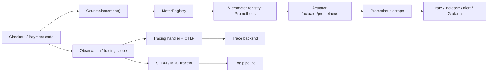

# Counter trong Micrometer Metrics và Spring Boot

> **Chương:** Metrics nền tảng  
> **Module:** `SPRING_BOOT_OBSERVABILITY` — thiết lập observability cho Spring Boot bằng Micrometer Observation, metrics, logs và distributed tracing; học propagation ngữ cảnh, tag/cardinality, exporter, sampling và liên kết tín hiệu để điều tra lỗi, độ trễ và hành vi ứng dụng trên môi trường thực.  
> **Trọng tâm bài học:** Sử dụng **Counter** để đếm một loại sự kiện hoặc tổng lượng chỉ tăng; đăng ký meter qua `MeterRegistry`, gắn nhãn có giới hạn, phân tích tốc độ thay đổi qua Prometheus và kết hợp với Observation/traces/logs để xác minh sự cố.

## 1. Mục tiêu học tập

Sau bài học, bạn có thể:

1. Giải thích chính xác Counter đo đại lượng gì, vì sao giá trị của Counter thường **chỉ tăng trong vòng đời tiến trình** và vì sao phải tính tốc độ thay đổi thay vì nhìn một giá trị tích lũy đơn lẻ.
2. Phân biệt Counter với Gauge, Timer, DistributionSummary và LongTaskTimer; tránh đếm trùng sự kiện đã có meter chuẩn.
3. Khai báo và inject `MeterRegistry` vào Spring Boot, tạo `Counter` bằng builder hoặc API tiện lợi, tăng bằng `increment()` / `increment(double)`.
4. Định nghĩa **ranh giới một sự kiện được đếm đúng một lần**, kể cả khi có exception, retry, fallback hoặc nhiều request đồng thời.
5. Thiết kế low-cardinality tags như `channel`, `outcome`, `provider` và bảo vệ backend khỏi nổ số time series.
6. Đọc Counter qua Actuator/Prometheus, sử dụng `rate()`, `increase()` và biểu thức error ratio, hiểu reset khi process restart.
7. Kiểm thử Counter bằng `SimpleMeterRegistry` và kết nối kết quả đếm với logs/traces mà không gắn trace ID vào metric labels.

## 2. Counter trả lời câu hỏi nào?

**Counter** là một meter dùng để cộng dồn số lượng đã xảy ra. Trong Micrometer, một Counter thông thường có thể tăng theo một lượng **không âm**; ứng dụng không dùng nó để giảm hoặc đặt lại về giá trị tùy ý.

Các câu hỏi phù hợp:

- “Đã có bao nhiêu lần gửi thông báo tới provider trong thời gian tiến trình hoạt động?”
- “Có bao nhiêu lần thanh toán **bị từ chối theo nghiệp vụ** so với **lỗi kỹ thuật**?”
- “Mỗi giây có bao nhiêu sự kiện `checkout.payment` với `outcome=error`?”
- “Tổng số message được consumer xử lý thành công đang tăng nhanh hay chậm?”

Ví dụ:

```text
checkout.payment.attempts{outcome="approved"}  120
checkout.payment.attempts{outcome="declined"}    8
checkout.payment.attempts{outcome="error"}       3
```

Các số trên là ví dụ **giá trị tích lũy trong một process**. Chỉ nhìn `error=3` chưa đủ để kết luận hệ thống đang lỗi nghiêm trọng: ba lỗi có thể xảy ra trong một phút hoặc kéo dài suốt một tháng. Muốn xác định vấn đề hiện tại, cần xem tốc độ tăng qua một khoảng thời gian.

### 2.1. Đặc điểm cốt lõi

| Đặc điểm | Ý nghĩa với Counter |
|---|---|
| Giá trị cộng dồn | Mỗi lần ghi sự kiện làm tổng tăng |
| Không dùng để biểu diễn mức hiện tại có thể giảm | Số request đang xử lý hoặc số item tồn trong queue nên dùng Gauge |
| Đơn vị | Có thể là lần, message, byte hoặc lượng tích lũy; cần định nghĩa rõ |
| Thời gian | Counter không tự lưu phân phối thời gian giữa các sự kiện |
| Reset | Giá trị thường về 0 khi khởi động process/registry mới hoặc series được tạo mới |
| Nhãn | Mỗi tập tag khác nhau tạo một meter/time series riêng ở backend |
| Quan sát xu hướng | Với Prometheus, thường dùng `rate()` / `increase()` để phân tích tốc độ tăng |

Micrometer Counter có API `count()` để đọc giá trị hiện tại của meter trong tiến trình. Với một số loại registry có cơ chế publish theo bước, cách biểu diễn/đẩy số liệu còn phụ thuộc implementation. Vì vậy **không nên thiết kế logic nghiệp vụ dựa vào việc đọc giá trị counter rồi tính toán trạng thái**.

### 2.2. Ví dụ về tốc độ

Giả sử một series counter tăng từ 1.000 lên 1.300 trong 5 phút và **không có reset**:

- Độ tăng quan sát: 300 sự kiện.
- Tốc độ trung bình: \(300 / (5 \times 60) = 1\) sự kiện/giây.

Prometheus có thể ước lượng tốc độ từ nhiều mẫu scrape bằng `rate(metric[5m])`. Kết quả tính từ mẫu thực có thể khác phép chia hai điểm do thời điểm scrape, phép hồi quy và cách xử lý reset. Công cụ biểu đồ thông thường nên dùng tốc độ, không dùng tổng tích lũy của nhiều process với giả định tổng đó luôn tăng qua các lần restart.

## 3. Counter khác những loại meter nào?

| Meter | Dùng khi | Ví dụ | Lưu ý |
|---|---|---|---|
| **Counter** | Sự kiện hoặc tổng lượng chỉ tăng | `payment.attempts`, `email.sent` | Đếm rõ ràng một lần cho mỗi sự kiện |
| **Gauge** | Giá trị hiện tại có thể tăng/giảm | Số job đang chạy, số connection đang sử dụng | Không dùng Counter để đếm “đang còn” |
| **Timer** | Đo **thời gian** và số lần thực thi một operation | `checkout.payment.duration` | Timer đã có count và tổng duration |
| **DistributionSummary** | Đo phân phối các giá trị không phải thời gian | Kích thước message, giá trị payload byte | Có count, tổng giá trị và có thể có histogram |
| **LongTaskTimer** | Theo dõi những công việc dài đang chạy | Job import dữ liệu mất hàng phút | Thích hợp theo dõi tác vụ chưa kết thúc |

**Quy tắc quan trọng của Micrometer:** Đừng thêm một Counter chỉ để “đếm số lần method chạy” nếu đã có Timer/DistributionSummary ghi nhận **chính sự kiện đó** và đã cung cấp count. Một Counter riêng vẫn hợp lý khi nó biểu diễn ngữ nghĩa khác, ví dụ số lần thanh toán **được duyệt**, **bị từ chối** hoặc số lần **retry**.

Counter không đo được p95/p99 latency. Muốn phân tích độ trễ dùng Timer có histogram phù hợp; muốn xác định thời điểm xảy ra một lỗi cụ thể, dùng traces/logs có correlation. Ba tín hiệu bổ sung cho nhau.

### 3.1. Phân biệt request tổng quát và sự kiện nghiệp vụ

Spring Boot Actuator thường đã cung cấp HTTP server timer `http.server.requests`. Timer đó có count và tags cho status, method, URI template. Nếu chỉ muốn biết lưu lượng HTTP request, dùng meter chuẩn là đủ.

Một Counter nghiệp vụ có thể có ý nghĩa khác:

- `checkout.payment.attempts`: mỗi **lần gọi payment gateway**.
- `checkout.payment.declined`: mỗi quyết định từ chối hợp lệ theo nghiệp vụ.
- `checkout.payment.retries`: mỗi lần gọi **retry** sau attempt đầu tiên.
- `checkout.order.created`: số đơn hàng được ghi nhận thành công.

Các tập sự kiện khác nhau có thể có số đếm khác nhau: một HTTP request có thể kích hoạt nhiều gateway attempts do retry; một order có thể không được tạo dù HTTP server trả 200 kèm kết quả “declined”.

## 4. Counter nằm ở đâu trong đường đi observability?



Đối với Counter được tăng trực tiếp qua `MeterRegistry`:

1. Code nghiệp vụ xác định đúng sự kiện cần đếm.
2. Counter tương ứng được đăng ký theo **tên metric và tập tags**.
3. Mỗi sự kiện làm `increment()` một lần.
4. Registry chuyển giá trị tích lũy theo định dạng backend; Prometheus pull các mẫu qua endpoint.
5. Dashboard/alert truy vấn tốc độ tăng và nhóm dữ liệu theo tags.

Counter là một **Micrometer Metrics meter**. `ObservationRegistry` thuộc lớp Micrometer Observation, có thể tự sinh metrics qua observation handlers. Hai registry có nhiệm vụ khác nhau: bạn có thể inject cả `MeterRegistry` để ghi Counter nghiệp vụ và `ObservationRegistry` để quan sát duration/span của một bước xử lý.

**Không có cơ chế mặc định bảo đảm mỗi Counter tương ứng một trace span.** Việc tương quan lỗi cụ thể cần observation/tracing instrumentation, logs có trace ID và các thuộc tính ngữ nghĩa ổn định.

## 5. Thiết lập Counter trong Spring Boot

Ví dụ dưới đây hướng đến **Spring Boot 3.x, Java 17+**, Maven sử dụng Spring Boot parent/BOM để quản lý phiên bản tương thích.

### 5.1. Dependencies

```xml
<dependencies>
    <dependency>
        <groupId>org.springframework.boot</groupId>
        <artifactId>spring-boot-starter-actuator</artifactId>
    </dependency>

    <dependency>
        <groupId>io.micrometer</groupId>
        <artifactId>micrometer-registry-prometheus</artifactId>
    </dependency>
</dependencies>
```

Gradle dùng artifact tương ứng:

```groovy
implementation 'org.springframework.boot:spring-boot-starter-actuator'
runtimeOnly 'io.micrometer:micrometer-registry-prometheus'
```

Để triển khai **Counter trong code**, chỉ cần Micrometer core và một `MeterRegistry` phù hợp. Spring Boot Actuator/auto-configuration giúp cung cấp registry trong application context; Prometheus registry là lựa chọn cụ thể khi muốn scrape metrics. Bạn không cần OTLP tracing exporter để Counter tồn tại.

### 5.2. Cấu hình thử nghiệm local

Ví dụ `application.yml`:

```yaml
spring:
  application:
    name: checkout-service

management:
  endpoints:
    web:
      exposure:
        include: health,info,metrics,prometheus
  metrics:
    tags:
      application: ${spring.application.name}
      environment: ${APP_ENVIRONMENT:local}
```

`management.metrics.tags.*` là những **common tags** cho meter, không phải các business tags riêng của từng payment attempt. `environment` được lấy từ cấu hình deployment với tập giá trị có kiểm soát (`local`, `staging`, `prod`). Không dùng request ID hoặc user ID làm common tag.

Khi ứng dụng khởi động trên `localhost:8080`, có thể kiểm tra:

```bash
curl -i http://localhost:8080/actuator/health
curl -s http://localhost:8080/actuator/metrics
curl -s http://localhost:8080/actuator/prometheus
```

Nếu chưa tạo và tăng Counter, meter nghiệp vụ có thể chưa có dữ liệu. `/actuator/prometheus` chỉ xuất hiện nếu Prometheus registry và endpoint được bật. Trong production, giới hạn management endpoint tại mạng/port dành cho scrape và áp dụng quyền truy cập phù hợp; expose không tương đương với bảo vệ endpoint.

## 6. API Counter trong Micrometer

### 6.1. Tạo Counter bằng builder

```java
import io.micrometer.core.instrument.Counter;
import io.micrometer.core.instrument.MeterRegistry;

public final class ExamplePaymentCounter {

    private final Counter approvedPayments;

    public ExamplePaymentCounter(MeterRegistry registry) {
        this.approvedPayments = Counter
                .builder("checkout.payment.attempts")
                .description("Total number of payment gateway attempts")
                .tag("outcome", "approved")
                .register(registry);
    }

    public void paymentApproved() {
        approvedPayments.increment();
    }
}
```

Ý nghĩa:

- `"checkout.payment.attempts"` là tên metric kỹ thuật, ổn định qua các lần deploy.
- `description(...)` giúp người đọc hiểu Counter đếm **attempts**, không phải số order.
- `tag("outcome", "approved")` tạo dimension để chia nhóm kết quả. Tập giá trị phải có giới hạn.
- `register(registry)` đăng ký hoặc lấy meter tương ứng theo cùng tên và tags trong registry.
- `increment()` tăng giá trị thêm 1.

`MeterRegistry` thường được Spring Boot tạo dưới dạng bean. Inject bằng constructor, không gọi `new SimpleMeterRegistry()` trong service production: một registry tự tạo riêng có thể không được exporter/Actuator scrape.

### 6.2. API tiện lợi

Khi chỉ có một counter cố định, bạn cũng có thể dùng:

```java
Counter counter = registry.counter(
        "checkout.payment.attempts",
        "outcome", "approved");

counter.increment();
counter.increment(2.0);
double localTotal = counter.count();
```

`increment(2.0)` thêm lượng 2.0; phù hợp nếu một lần cập nhật đại diện **chính xác hai đơn vị của cùng một đại lượng**. Với counter đếm số sự kiện theo từng call, `increment()` thường rõ nghĩa hơn.

Counter được thiết kế cho lượng tăng **không âm**. Không dùng `increment(-1)` để “xóa” một attempt; nếu có nghiệp vụ hoàn tác, hãy định nghĩa một sự kiện khác như `payment.refunded`. Đặc biệt, không trừ kết quả thất bại khỏi tổng đã xử lý để làm cho một Counter giảm đi.

### 6.3. Counter không phải bộ đếm làm nguồn sự thật nghiệp vụ

Đừng dùng `counter.count()` để quyết định:

- số dư ví tiền,
- số order trong database,
- hạn mức thanh toán,
- số hàng tồn kho,
- chính sách retry cần bảo đảm tính đúng tuyệt đối.

Metrics có thể được reset khi process restart, series có thể bị bỏ do retention và exporter có thể thất bại. Trạng thái nghiệp vụ phải được lưu trong hệ thống giao dịch phù hợp; Counter phục vụ **quan sát**.

## 7. Ví dụ thực tế: đếm payment attempts theo channel và outcome

Ta muốn đếm mỗi lần gọi tới payment gateway và phân biệt ba outcome:

- `approved`: gateway xác nhận thanh toán được duyệt;
- `declined`: gateway từ chối hợp lệ theo nghiệp vụ, không nhất thiết là lỗi hạ tầng;
- `error`: có exception kỹ thuật trong lần gọi gateway.

Kênh gọi được giới hạn: `web`, `mobile`, `partner`, `other`.

### 7.1. Định nghĩa tập giá trị

```java
package com.example.checkout.metrics;

public enum PaymentChannel {
    WEB, MOBILE, PARTNER, OTHER
}
```

```java
package com.example.checkout.metrics;

public enum PaymentOutcome {
    APPROVED, DECLINED, ERROR
}
```

Nếu HTTP request truyền channel dạng chuỗi, hãy **chuẩn hóa thành enum trước khi ghi metric**. Ví dụ:

```java
import java.util.Locale;

static PaymentChannel parseChannel(String raw) {
    if (raw == null) {
        return PaymentChannel.OTHER;
    }
    return switch (raw.trim().toUpperCase(Locale.ROOT)) {
        case "WEB" -> PaymentChannel.WEB;
        case "MOBILE" -> PaymentChannel.MOBILE;
        case "PARTNER" -> PaymentChannel.PARTNER;
        default -> PaymentChannel.OTHER;
    };
}
```

Thao tác normalize phải chạy với mọi input; chỉ `trim` hoặc cắt tối đa 50 ký tự **chưa giới hạn** số giá trị phân biệt.

### 7.2. Tạo Counter một lần cho từng tổ hợp tags

Một `@Component` giữ sẵn 4 × 3 = **12 Counter**. Giá trị được đăng ký lúc tạo bean, tránh tạo tên và nhãn tùy ý từ request.

```java
package com.example.checkout.metrics;

import io.micrometer.core.instrument.Counter;
import io.micrometer.core.instrument.MeterRegistry;
import java.util.EnumMap;
import java.util.Locale;
import java.util.Map;
import java.util.Objects;
import org.springframework.stereotype.Component;

@Component
public final class PaymentAttemptCounters {

    private final Map<PaymentChannel, Map<PaymentOutcome, Counter>>
            byChannelAndOutcome;

    public PaymentAttemptCounters(MeterRegistry registry) {
        Map<PaymentChannel, Map<PaymentOutcome, Counter>> all =
                new EnumMap<>(PaymentChannel.class);

        for (PaymentChannel channel : PaymentChannel.values()) {
            Map<PaymentOutcome, Counter> outcomes =
                    new EnumMap<>(PaymentOutcome.class);

            for (PaymentOutcome outcome : PaymentOutcome.values()) {
                Counter counter = Counter
                        .builder("checkout.payment.attempts")
                        .description("Total payment gateway attempts")
                        .tag("channel",
                                channel.name().toLowerCase(Locale.ROOT))
                        .tag("outcome",
                                outcome.name().toLowerCase(Locale.ROOT))
                        .register(registry);

                outcomes.put(outcome, counter);
            }

            all.put(channel, Map.copyOf(outcomes));
        }

        this.byChannelAndOutcome = Map.copyOf(all);
    }

    public void record(PaymentChannel channel, PaymentOutcome outcome) {
        PaymentChannel validChannel = Objects.requireNonNull(channel);
        PaymentOutcome validOutcome = Objects.requireNonNull(outcome);

        byChannelAndOutcome.get(validChannel)
                .get(validOutcome)
                .increment();
    }
}
```

Điểm thiết kế:

1. Mọi meter có **cùng tên metric** và cùng cấu trúc tags.
2. `channel` và `outcome` chỉ đến từ enum, không bao giờ là request ID hoặc chuỗi người dùng nhập trực tiếp.
3. `Counter` được giữ trong map, có thể dùng an toàn giữa các request đồng thời nhờ triển khai đo lường của Micrometer.
4. `record(...)` gọi `increment()` đúng một lần cho mỗi sự kiện mà code chủ động định nghĩa.
5. Bằng cách khởi tạo mọi tổ hợp, local có thể thấy cả series chưa có event; chúng có giá trị 0 tùy registry/export. Điều này thuận tiện khi viết dashboard nhưng tiêu tốn số series cho các tổ hợp không bao giờ dùng. Hệ thống lớn có thể đăng ký lazily **với tập giá trị đã giới hạn**, tùy nhu cầu.

**Lưu ý:** Khóa nhận dạng meter là tên cộng tập tags (và các đặc tính registration liên quan). Hai nơi đăng ký cùng meter ID qua cùng registry thường nhận lại meter đã tồn tại; không nên dựa vào đăng ký lặp để tạo nhiều bộ đếm độc lập. Hãy đặt tên rõ ràng cho từng ý nghĩa.

### 7.3. Đếm tại đúng ranh giới nghiệp vụ

Ví dụ một service đã validate request và sau đó gọi gateway:

```java
package com.example.checkout.service;

import com.example.checkout.metrics.PaymentAttemptCounters;
import com.example.checkout.metrics.PaymentChannel;
import com.example.checkout.metrics.PaymentOutcome;
import org.springframework.stereotype.Service;

@Service
public class PaymentService {

    private final PaymentGateway gateway;
    private final PaymentAttemptCounters counters;

    public PaymentService(PaymentGateway gateway,
                          PaymentAttemptCounters counters) {
        this.gateway = gateway;
        this.counters = counters;
    }

    public PaymentDecision authorize(PaymentRequest request) {
        validate(request); // Ngoài ranh giới của gateway attempt.

        PaymentOutcome outcome = PaymentOutcome.ERROR;

        try {
            PaymentDecision decision = gateway.authorize(request);
            outcome = decision.approved()
                    ? PaymentOutcome.APPROVED
                    : PaymentOutcome.DECLINED;
            return decision;
        } finally {
            counters.record(request.channel(), outcome);
        }
    }

    private void validate(PaymentRequest request) {
        if (request == null || request.channel() == null) {
            throw new IllegalArgumentException("Invalid payment request");
        }
    }
}
```

`PaymentGateway`, `PaymentRequest` và `PaymentDecision` là các kiểu miền nghiệp vụ minh họa. `PaymentRequest.channel()` trả `PaymentChannel` đã được chuẩn hóa; `PaymentDecision.approved()` trả boolean. Một ứng dụng hoàn chỉnh cần định nghĩa các kiểu này và chính sách xử lý lỗi phù hợp.

**Tại sao `finally`?** Khi gateway ném exception kỹ thuật, `outcome` còn là `ERROR` và event vẫn được đếm. Khi gateway trả kết quả, ta đặt `APPROVED` hoặc `DECLINED` trước khi ghi Counter.

**Tại sao validate bên ngoài?** Vì Counter có nghĩa là “lần gọi gateway”. Request bị từ chối từ bước validate **trước khi chạm gateway** không được tính là attempt. Nếu muốn đếm request validation failure, hãy thiết kế một Counter khác với ngữ nghĩa rõ ràng.

Nếu gateway có logic **retry nội bộ**, hãy xác định ranh giới:

- Muốn đếm **số lần method authorize được gọi**, đặt Counter ở service như ví dụ.
- Muốn đếm **từng HTTP attempt** khi retry, đặt Counter gần lớp gửi request thực tế.
- Muốn đếm **một logical payment request**, chỉ tăng ở request boundary một lần kể cả khi retry nhiều lần.

Đừng cùng lúc dùng hai counters giống tên và tags ở cả tầng request lẫn tầng retry rồi trộn giá trị; như vậy dashboard sẽ khó giải thích.

### 7.4. Nếu cần phân biệt retry

Không đưa `attemptId` hay một ID duy nhất vào tag. Dùng tập giá trị nhỏ như:

```text
attempt.phase = initial | retry
```

Khi muốn đếm số retry, có thể có Counter `checkout.payment.retries` ghi đúng ở **mỗi lần retry**. Chỉ đặt thêm dimension nếu có dashboard hoặc cảnh báo thực sự sử dụng nó.

## 8. Tags và cardinality: kiểm soát từ nguồn

Một Counter theo tên và tags được nhận diện thành các time series khác nhau:

```text
checkout.payment.attempts{channel="web",outcome="approved"}
checkout.payment.attempts{channel="web",outcome="declined"}
checkout.payment.attempts{channel="mobile",outcome="error"}
```

Những lựa chọn phù hợp và không phù hợp:

| Tag | Ví dụ | Nên đưa vào Counter? | Lý do |
|---|---|---|---|
| `channel` | `web`, `mobile`, `partner`, `other` | Có | Tập nhỏ, giúp so sánh lưu lượng |
| `outcome` | `approved`, `declined`, `error` | Có | Mỗi giá trị có ý nghĩa nghiệp vụ |
| `provider` | `primary`, `backup`, `other` | Có thể | Cần whitelist và mục tiêu phân tích |
| `environment` | `local`, `staging`, `prod` | Có | Nhận từ cấu hình deployment |
| `order.id` | `ORD-202611-...` | Không | Giá trị gần như duy nhất |
| `user.id` | ID người dùng | Không | Cardinality rất cao, rủi ro riêng tư |
| `raw.url` | `/orders/123456?token=...` | Không | ID động, query có thể chứa secrets |
| `exception.message` | Chuỗi lỗi đầy đủ | Không | Rất nhiều giá trị, có thể chứa dữ liệu nhạy cảm |
| `trace.id` | 32 chữ số hex | Không | Dùng trong traces/logs, không làm metric label |

**Ước lượng:** 4 channel × 3 outcome × 3 provider × 2 environment × 8 instance = tối đa **576 tổ hợp nhãn** cho một metric, chưa tính nhãn của exporter hoặc histogram ở meter khác. Nếu thêm một `customerId` có 100.000 giá trị, số tổ hợp có thể tăng theo số khách hàng.

Chính sách hiệu quả gồm:

1. Định nghĩa key và ý nghĩa của mỗi tag.
2. Dùng enum, whitelist hoặc bucket hóa có kiểm soát giá trị.
3. Có fallback `other`/`unknown`.
4. Xem số distinct values và series count sau mỗi thay đổi.
5. Không dùng bất cứ identifier riêng của mỗi request làm nhãn metric.

### 8.1. Anti-pattern: tạo meter cho mỗi user

**Sai:**

```java
registry.counter(
        "checkout.payment.attempts",
        "user.id", userId
).increment();
```

Mỗi `userId` khác nhau có thể tạo thêm meter được giữ trong registry, gây tăng bộ nhớ JVM và time series trên backend. Đổi sang tập giá trị giới hạn như `channel`, `outcome`. Nếu cần tra cứu một request cụ thể, dùng trace ID/span ID trong tracing và logs theo chính sách dữ liệu.

### 8.2. MeterFilter có thể làm lớp bảo vệ bổ sung

Spring Boot có thể nhận `MeterFilter` bean để áp dụng chính sách trên MeterRegistry. Ví dụ giới hạn số giá trị `outcome` cho meter payment:

```java
import io.micrometer.core.instrument.config.MeterFilter;
import org.springframework.context.annotation.Bean;
import org.springframework.context.annotation.Configuration;

@Configuration(proxyBeanMethods = false)
class PaymentMetricsGuardConfiguration {

    @Bean
    MeterFilter boundPaymentOutcomes() {
        return MeterFilter.maximumAllowableTags(
                "checkout.payment.attempts",
                "outcome",
                3,
                MeterFilter.deny());
    }
}
```

Cơ chế này hỗ trợ hạn chế series do nhãn không mong muốn; nếu xuất hiện nhãn thứ tư ngoài ba nhãn dự kiến, meter mới có thể bị từ chối. **Không xem đây là cách chuẩn hóa dữ liệu**: đo lường bị từ chối sẽ làm dashboard thiếu sự kiện. Hãy kiểm soát input bằng enum/whitelist từ đầu và kiểm tra cảnh báo hoặc số series bị từ chối.

## 9. Counter từ góc nhìn Prometheus

Micrometer thường chuyển tên dấu chấm thành dấu gạch dưới và thêm quy ước suffix của Prometheus Counter. Ví dụ `checkout.payment.attempts` có thể được expose như:

```text
# HELP checkout_payment_attempts_total Total payment gateway attempts
# TYPE checkout_payment_attempts_total counter
checkout_payment_attempts_total{application="checkout-service",channel="web",environment="prod",outcome="approved"} 810
checkout_payment_attempts_total{application="checkout-service",channel="web",environment="prod",outcome="declined"} 34
checkout_payment_attempts_total{application="checkout-service",channel="web",environment="prod",outcome="error"} 11
```

Đây là **ví dụ định dạng**, không phải output thật. Tên, suffix, label names, số series và thứ tự labels phụ thuộc version registry, naming convention và cấu hình. Hãy đọc `/actuator/prometheus` trên ứng dụng để xác định metric name trước khi viết PromQL.

### 9.1. Tại sao không lấy counter hiện tại làm tốc độ?

Một Counter tăng đều có thể tạo đồ thị đường dốc liên tục suốt vòng đời process. Khi process restart, giá trị quay về 0 khiến đồ thị có một đoạn giảm mạnh. Giá trị tổng ở một thời điểm không diễn tả rõ lượng event **trong phút vừa qua**.

Prometheus lưu mẫu theo thời gian và có hàm chuyên biệt:

- `rate(counter[5m])`: ước lượng tốc độ tăng trung bình **mỗi giây** trong khoảng 5 phút.
- `increase(counter[5m])`: ước lượng mức tăng của Counter trong khoảng 5 phút.
- `irate(counter[5m])`: ước lượng tốc độ từ hai mẫu gần cuối, phản ứng nhanh nhưng rất nhiễu; chỉ dùng khi hiểu mục tiêu biểu đồ.
- `resets(counter[1h])`: ước lượng số lần counter reset trong khoảng một giờ; hữu ích để phân biệt process restart khỏi thay đổi lưu lượng.

`rate` và `increase` có xử lý reset theo dữ liệu đã scrape. `increase` có thể trả giá trị không nguyên do ước lượng và ngoại suy thời gian lấy mẫu; không dùng nó như một bộ đếm giao dịch chính xác tuyệt đối.

### 9.2. PromQL cho payment Counter

Giả sử series thực tế là `checkout_payment_attempts_total`.

**Tổng attempt/giây trên mọi instance:**

```promql
sum(
  rate(checkout_payment_attempts_total[5m])
)
```

**Attempt/giây theo outcome:**

```promql
sum by (outcome) (
  rate(checkout_payment_attempts_total[5m])
)
```

**Attempt/giây theo channel và outcome:**

```promql
sum by (channel, outcome) (
  rate(checkout_payment_attempts_total[5m])
)
```

**Số attempt tăng ước lượng trong 15 phút:**

```promql
sum(
  increase(checkout_payment_attempts_total[15m])
)
```

**Tỷ lệ lỗi kỹ thuật trong 5 phút (giá trị 0–1):**

```promql
sum(
  rate(checkout_payment_attempts_total{
    outcome="error"
  }[5m])
)
/
clamp_min(
  sum(rate(checkout_payment_attempts_total[5m])),
  1e-9
)
```

Ở đây `outcome=declined` là kết quả từ chối nghiệp vụ, không được nhập vào nhóm `error` nếu team chỉ muốn theo dõi lỗi kỹ thuật. Với cảnh báo về tỷ lệ bị từ chối của ngân hàng, hãy tính riêng `declined / total` và đặt tên SLI phù hợp.

**Tỷ lệ lỗi kỹ thuật theo channel:**

```promql
sum by (channel) (
  rate(checkout_payment_attempts_total{
    outcome="error"
  }[5m])
)
/
clamp_min(
  sum by (channel) (
    rate(checkout_payment_attempts_total[5m])
  ),
  1e-9
)
```

Nếu lưu lượng bằng 0, biểu thức dùng `clamp_min` thường cho số 0, nhưng **0 không đồng nghĩa đã chứng minh hệ thống khỏe**. Dashboard nên hiển thị cả throughput và trạng thái scrape; alert nên có điều kiện lượng mẫu tối thiểu để giảm cảnh báo sai.

### 9.3. Rate phải được tính trước khi cộng các instance

Với Prometheus và nhiều instance có thể restart độc lập, mô hình đúng thông thường là:

```promql
sum(rate(checkout_payment_attempts_total[5m]))
```

Đừng cộng raw counters của các instance thành một vector/record chung rồi tính tốc độ trên tổng đó mà không xử lý reset: khi một instance restart, tổng có thể giảm và gây sai lệch. `rate` ở từng series trước `sum` cho phép Prometheus xử lý reset của từng instance.

### 9.4. Cửa sổ thời gian bao nhiêu là hợp lý?

| Cửa sổ | Phù hợp | Rủi ro |
|---|---|---|
| `[1m]` | Traffic cao, cần phát hiện nhanh | Nhiễu với ít event hoặc scrape interval dài |
| `[5m]` | Dashboard vận hành chung | Có độ trễ phát hiện nhỏ hơn cửa sổ |
| `[15m]` | Traffic trung bình/thấp | Che bớt đột biến ngắn |
| `[1h]` | Xu hướng/SLI ít dữ liệu | Chậm phản ứng với sự cố mới |

Với scrape interval 15 giây, cửa sổ 5 phút thường có đủ mẫu nếu target ổn định. Với low traffic, cân nhắc `increase` trên cửa sổ dài hơn và hiển thị tổng số event để người xem hiểu mức độ tin cậy.

## 10. Restart, nhiều replicas và dữ liệu bị thiếu

Trong production, ứng dụng thường chạy nhiều replicas sau load balancer. Mỗi process giữ Counter riêng:

```text
checkout-7f4c (instance A): approved = 1000
checkout-8a12 (instance B): approved =  820
checkout-93db (instance C): approved =  650
```

Những tổng này mang ý nghĩa **từ lần process tương ứng bắt đầu**. Sau khi deploy rolling update, instance A có thể restart và Counter của nó quay về 0; instance B/C tiếp tục tăng. Đây là hành vi bình thường.

Khi vẽ throughput toàn cụm, dùng `sum(rate(...[5m]))` hoặc `sum(increase(...[5m]))` theo nhu cầu. Đừng dùng tổng raw counter qua thời điểm đổi replicas để suy ra chính xác số giao dịch từ đầu ngày.

### 10.1. Khi scrape target biến mất

Nếu Prometheus không scrape được trong một khoảng thời gian, Counter vẫn tăng trong process nhưng backend thiếu các điểm quan sát. `rate`/`increase` sau khi target trở lại sẽ phụ thuộc mẫu còn lại và có thể thiếu thông tin về reset xảy ra trong khoảng mất kết nối. Trường hợp process chết vĩnh viễn trước khi lần scrape tiếp theo diễn ra, một phần event chưa scrape có thể không bao giờ được thấy trong backend.

**Vì vậy metrics không thay thế audit log hoặc dữ liệu giao dịch cần đúng tuyệt đối.** Khi điều tra sự cố, kiểm tra cả `up`, scrape duration, exporter errors và khoảng trống dữ liệu.

### 10.2. Step registries và kiểu xuất telemetry khác

Không phải MeterRegistry nào cũng xuất Counter bằng mô hình Prometheus pull. Với một số backend push/step, registry có thể chuyển đổi thành rate/delta theo khoảng xuất. Khi chuyển exporter, cần kiểm tra đơn vị, ý nghĩa tăng tích lũy hay delta và cách backend query dữ liệu.

Tránh sao chép một dashboard Prometheus sang backend khác rồi giả định tên metric, suffix và phương pháp tổng hợp sẽ giữ nguyên.

## 11. Counter và Micrometer Observation khác nhau thế nào?

Vì module này dạy cả `Micrometer Observation` và metrics, cần nắm quan hệ giữa chúng.

Một `Observation` có vòng đời:

```text
createNotStarted -> start -> openScope -> work -> closeScope -> stop
```

Khi cấu hình meter observation handler, một observation thường đóng góp một **timer** có count/duration theo conventions và key-values. Trong khi đó, Counter tự tạo bằng `MeterRegistry` chỉ tăng khi code gọi `increment()`.

Hai ví dụ đo **hai ý nghĩa khác nhau**:

```java
Observation.createNotStarted(
        "checkout.payment.duration", observationRegistry)
    .observe(() -> {
        paymentAttemptCounters.record(
                PaymentChannel.WEB, PaymentOutcome.APPROVED);
        return "APPROVED";
    });
```

Đoạn này minh họa cơ chế: observation đo operation; business Counter đếm một sự kiện được chọn. **Trong code nghiệp vụ thực tế**, phải gọi Counter sau khi đã biết outcome đúng và không cố định `APPROVED` như ví dụ ngắn này.

Nếu chỉ muốn đếm số lần operation đã hoàn tất, timer `checkout.payment.duration` có count; có thể không cần thêm Counter trùng semantics. Nhưng nếu muốn phân biệt số lần **refund được chấp nhận**, **fraud rule bị kích hoạt** hoặc **event được gửi vào queue**, Counter riêng hợp lý.

### 11.1. Liên kết từ metrics tới traces và logs

Trong một cuộc điều tra production:

1. Prometheus cho thấy `checkout_payment_attempts_total{outcome="error"}` tăng nhanh ở kênh `partner`.
2. Dùng service, thời gian và channel để tìm các trace của payment operation nếu tracing đã được instrument và lấy mẫu.
3. Xem span đi qua HTTP client tới gateway, latency và status/error attributes.
4. Lấy `traceId` của một trace bất thường, truy vấn logs liên quan để biết nguyên nhân cụ thể.
5. Sau khi sửa lỗi, dùng Counter rate/error ratio để chứng minh tần suất lỗi đã giảm.

Không gắn `traceId` lên Counter tags; trace ID có cardinality gần như mỗi request một giá trị. Logs chỉ có trace ID khi tracing context, scope và logging correlation được cấu hình; Counter tự nó không tạo MDC hoặc context propagation.

### 11.2. Sampling chỉ làm giảm số trace được lưu, không phải Counter rate

Nếu head sampling là 10%, trace backend chỉ nhận một phần spans theo chính sách sampling, nhưng Counter trực tiếp trên `MeterRegistry` vẫn có thể đếm tất cả attempts được code ghi nhận. Vì vậy không lấy số trace đã lưu để chia rồi ước lượng chắc chắn số payment attempts; dùng Counter cho thống kê lượng event, trace cho phân tích từng luồng.

Một số backend có **exemplars** để liên kết một mẫu metric với trace cụ thể, nhưng tính năng này phụ thuộc registry, tracing context và exporter/frontend. Không mặc định mọi Counter đều có exemplar hoặc trace link khi chỉ thêm Actuator.

## 12. Ghi Counter đúng một lần: lỗi khó thấy trong production

### 12.1. Increment ở cả try và finally

**Sai:**

```java
try {
    gateway.authorize(request);
    attempts.increment(); // Một lần ở nhánh thành công.
} finally {
    attempts.increment(); // Thành công bị đếm hai lần.
}
```

**Đúng:** xác định một vị trí ghi event, thường là một `finally` sau khi đã biết outcome hoặc một sự kiện domain chính thức đã được xác nhận.

### 12.2. Đếm API request và retry cùng một tên

**Sai về ngữ nghĩa:** cùng một Counter tên `payment.requests` được tăng ở controller khi request vào và tăng thêm trong mỗi attempt của retry loop.

**Đúng:** chọn tên tách biệt, ví dụ `payment.logical.requests` và `payment.gateway.attempts`. Dashboard khi đó có thể phân tích số lần retry trung bình trên một request và biết rõ loại sự kiện đang đếm.

### 12.3. Đếm request bị validation reject như gateway attempt

Nếu đặt increment ở đầu controller, một request bị 400 trước khi gọi gateway vẫn làm tăng bộ đếm attempts. Đặt counter tại **ranh giới thực tế của sự kiện** mà tên metric hứa hẹn; nếu muốn đếm cả rejected request, định nghĩa một meter khác hoặc dùng HTTP request metrics có sẵn.

### 12.4. Increment âm để làm giảm tổng

**Sai:**

```java
counter.increment(-1); // Không phù hợp hợp đồng của Counter.
```

Đừng sử dụng Counter làm biến quản lý số job hiện còn hoặc số item chưa xử lý. Dùng Gauge hoặc trạng thái nghiệp vụ phù hợp; Counter phù hợp với tổng số job bắt đầu và tổng số job kết thúc riêng nếu cần rate.

### 12.5. Đọc raw count rồi kết luận lưu lượng giảm

Một counter mới restart có `count=12` trong khi instance cũ có `count=50000`. Điều này không chứng minh traffic giảm. Hãy xem `rate`, deployment changes, `up`, instance count và scrape gaps.

### 12.6. Gắn giá trị biến động vào meter tags

`outcome=error: Card declined for user 123` có cardinality rất lớn và có thể chứa dữ liệu nhạy cảm. Dùng `outcome=declined` cùng một `error.category` đã whitelist nếu cần. Exception message chi tiết chỉ đưa vào logs/traces theo chính sách bảo mật phù hợp.

## 13. Kiểm thử Counter bằng SimpleMeterRegistry

Một unit test thuần Micrometer không cần Spring context, Prometheus hay Collector.

```java
package com.example.checkout.metrics;

import io.micrometer.core.instrument.Counter;
import io.micrometer.core.instrument.simple.SimpleMeterRegistry;
import org.junit.jupiter.api.Test;

import static org.junit.jupiter.api.Assertions.assertEquals;

class PaymentAttemptCountersTest {

    @Test
    void countsExactlyOnceForEachBoundedOutcome() {
        SimpleMeterRegistry registry = new SimpleMeterRegistry();

        try {
            PaymentAttemptCounters counters =
                    new PaymentAttemptCounters(registry);

            counters.record(PaymentChannel.WEB, PaymentOutcome.APPROVED);
            counters.record(PaymentChannel.WEB, PaymentOutcome.APPROVED);
            counters.record(PaymentChannel.WEB, PaymentOutcome.ERROR);

            Counter approved = registry
                    .get("checkout.payment.attempts")
                    .tag("channel", "web")
                    .tag("outcome", "approved")
                    .counter();

            Counter failed = registry
                    .get("checkout.payment.attempts")
                    .tag("channel", "web")
                    .tag("outcome", "error")
                    .counter();

            assertEquals(2.0, approved.count(), 0.000001);
            assertEquals(1.0, failed.count(), 0.000001);
        } finally {
            registry.close();
        }
    }
}
```

Bài test này xác minh **logic đếm và tags**, không chứng minh Prometheus đã scrape hay tracing backend đã nhận spans. Để bảo đảm có đúng một lần đếm khi gateway ném exception, bổ sung test cho `PaymentService` với một fake gateway thất bại và xác nhận `outcome=error` tăng đúng một lần.

### 13.1. Test sự kiện lỗi, retry và validation

Một bộ test có ý nghĩa nên bao phủ:

| Tình huống | Kỳ vọng |
|---|---|
| Gateway trả approved | Counter `outcome=approved` tăng đúng 1 |
| Gateway trả declined | `outcome=declined` tăng đúng 1; không tăng error |
| Gateway ném exception | `outcome=error` tăng đúng 1; exception vẫn truyền ra |
| Validation thất bại trước gateway | Counter gateway attempt **không tăng** |
| Gateway retry hai lần sau initial attempt | Gateway attempt tăng theo 3 lần gọi thực tế nếu Counter đặt trong retry layer |
| Channel input không hợp lệ | Giá trị được map thành `other`; không tạo tag tự do |
| Nhiều request đồng thời | Tổng đếm bằng số sự kiện được ghi nhận, không bị mất do race ở code ghi counter |

Một test quá đơn giản chỉ xác nhận `counter.increment()` làm `count=1` không chứng minh metric phản ánh đúng nghiệp vụ. Ưu tiên kiểm chứng **sự kiện nào được tính** và thời điểm được tính.

## 14. Đọc Counter trong Spring Boot Actuator

Sau khi chạy ứng dụng có `PaymentAttemptCounters`, gọi endpoint nghiệp vụ thật để phát sinh event. Sau đó:

```bash
curl -s http://localhost:8080/actuator/metrics
curl -s http://localhost:8080/actuator/metrics/checkout.payment.attempts
curl -s http://localhost:8080/actuator/prometheus
```

Dữ liệu `/actuator/metrics/checkout.payment.attempts` thường cung cấp measurement dạng `COUNT` và danh sách tags đã thấy trong registry. Dạng JSON thay đổi tùy phiên bản, nhưng có thể mô tả như sau:

```json
{
  "name": "checkout.payment.attempts",
  "measurements": [
    { "statistic": "COUNT", "value": 3.0 }
  ],
  "availableTags": [
    { "tag": "channel", "values": ["web", "mobile", "partner", "other"] },
    { "tag": "outcome", "values": ["approved", "declined", "error"] }
  ]
}
```

Đây chỉ là ví dụ cấu trúc; khi query **không gắn tag filter**, Actuator có thể tổng hợp giá trị qua các meter cùng tên/tags khác nhau. Đừng dùng một giá trị `COUNT` aggregate rồi hiểu là count của duy nhất `outcome=error`.

Có thể lọc theo tags qua query parameters:

```bash
curl -G http://localhost:8080/actuator/metrics/checkout.payment.attempts --data-urlencode 'tag=channel:web' --data-urlencode 'tag=outcome:error'
```

Lưu ý môi trường PowerShell có alias `curl` khác với executable curl: trong PowerShell truyền thống nên dùng `curl.exe` hoặc `Invoke-WebRequest`/`Invoke-RestMethod`. Các lệnh trên minh họa cú pháp curl chạy trong shell phổ biến.

Nếu muốn kiểm tra toàn hệ thống production, ngoài endpoint trên app còn cần kiểm tra Prometheus target **UP**, labels sau scrape/relabel, remote-write và retention.

## 15. Alerting: chọn tín hiệu vừa đủ thông tin

Counter hữu ích để đặt alert cho tốc độ lỗi, nhưng **không nên cảnh báo trên mỗi raw count tăng**: một hệ thống bận rộn sẽ luôn có event tăng.

Ví dụ ý tưởng điều kiện cảnh báo: “Tỷ lệ lỗi gateway trên 5% trong 10 phút, **và** lưu lượng ít nhất 1 request/giây”:

```promql
(
  sum(rate(checkout_payment_attempts_total{
    outcome="error"
  }[10m]))
  /
  clamp_min(
    sum(rate(checkout_payment_attempts_total[10m])),
    1e-9
  )
) > 0.05
and
(
  sum(rate(checkout_payment_attempts_total[10m])) > 1
)
```

Đây là ví dụ **để học cấu trúc truy vấn**, chưa phải ngưỡng sản xuất được phê duyệt. Ngưỡng thật cần dựa trên SLO, traffic, tỷ lệ lỗi nền, thời gian xử lý sự cố, dữ liệu lịch sử và trạng thái backend. Một lỗi ở service lưu lượng rất thấp cần cách alert khác với 10.000 requests/giây.

Điều cần theo dõi song song:

- **Request/attempt rate:** còn traffic hay traffic đã mất?
- **Error ratio:** tỷ lệ lỗi kỹ thuật và bị từ chối nghiệp vụ có khác nhau không?
- **Latency:** lấy từ Timer/histogram; Counter không cung cấp latency.
- **Saturation:** connection pool, thread, queue, CPU, DB.
- **Pipeline health:** Prometheus scrape `up`, lỗi exporter, missing data.

Nếu error count tăng nhưng latency không đổi, có thể là lỗi dữ liệu hoặc điều kiện từ chối. Nếu error ratio tăng đồng thời p95 tăng, hãy xem traces và logs của outbound gateway hoặc database.

## 16. Counter trong local và production

| Khía cạnh | Local | Production |
|---|---|---|
| Data source | `SimpleMeterRegistry` trong test hoặc Prometheus registry local | Scrape tập trung/remote-write hoặc backend metrics được vận hành |
| Số lượng series | Ít traffic, dễ soi từng tag | Phải có ngân sách cardinality và retention |
| Mục đích | Xác nhận count và tag contract | Traffic/error rate, SLI/SLO, alerts, xu hướng |
| Restart | Thấy counter về 0 khi chạy lại app | Nhiều replicas restart lệch nhau; dùng `rate` trước `sum` |
| Security | Endpoint có thể mở trên máy dev | Management endpoint được bảo vệ bằng network, auth/TLS phù hợp |
| Tương quan | Trace sampling có thể 100% trong thử nghiệm | Sampling có kiểm soát, logs có correlation và exporter đáng tin |
| Rủi ro | Dễ nhầm Counter với “biến số trong code” | Dễ double count retry, nổ series, scrape thiếu, dashboard hiểu sai |

Khi deployment có rolling restart, Prometheus có thể quan sát sự thay đổi danh sách target. Dashboard nên group theo `application`/`environment`/`channel`/`outcome` ở cấp phù hợp thay vì hardcode một pod ID.

## 17. Các lỗi thường gặp và cách điều tra

| Triệu chứng | Điều nên kiểm tra |
|---|---|
| Inject `MeterRegistry` thất bại | Đã có Micrometer/Actuator auto-configuration? Có cấu hình loại bỏ registry hoặc test context quá hẹp không? |
| `/actuator/prometheus` là 404 | Đã thêm `micrometer-registry-prometheus` và expose endpoint? Management port/base path khác chưa? |
| Không thấy Counter | Code path có gọi `record`? Meter có được đăng ký trong registry đúng? Predicate/meter filters có deny không? |
| `COUNT` tăng hai lần so với dự kiến | Có increment ở controller và service? Ở try và finally? Retry/batch tạo nhiều attempts? |
| Counter không tăng sau deploy | New instance không nhận traffic, một code path khác được gọi, tag bị đổi hoặc meter bị deny |
| Counter giảm về 0 | Process restart hoặc series được thay thế; xem `up` và deployment events |
| Rate bằng 0 khi request hiếm | Khoảng truy vấn quá ngắn, scrape thiếu mẫu, event hiếm hoặc label filter sai |
| Tag `channel` có hàng nghìn giá trị | Raw input được đưa vào tags; thiếu enum/whitelist |
| Có metric nhưng không có trace | Sampling/bridge/exporter/Collector hoặc propagation; Counter không tự tạo trace |
| Counter có giá trị nhưng backend không có series | Scrape target DOWN, metric name thay đổi, relabel/remote-write, retention hoặc exporter lỗi |
| Dashboard “đếm mất” declined | Query chỉ lọc `outcome=error`; outcome mapping không thống nhất |

Một quy trình kiểm tra hiệu quả:

1. **Nghiệp vụ:** xác nhận một sự kiện thực có được xử lý, và chỉ một vị trí ghi Counter.
2. **Trong process:** kiểm tra `MeterRegistry`, `Counter.count()` ở test hoặc `/actuator/metrics`.
3. **Export:** xem `/actuator/prometheus`, tên metric và labels thực tế.
4. **Thu gom:** kiểm tra `up` và scrape errors của Prometheus.
5. **Truy vấn:** xác nhận các label filters, cửa sổ `rate` và có tính reset trước khi aggregate.
6. **Điều tra lỗi:** dùng tracing/logs để tìm nguyên nhân theo request/time window.

## 18. Các câu hỏi thường gây nhầm lẫn

**Có nên tăng Counter khi một request bắt đầu hay kết thúc?**

Tùy sự kiện mà metric đại diện. Nếu tên metric là `requests.started`, tăng khi request thực sự bắt đầu. Nếu là `payments.approved`, chỉ tăng sau khi biết payment được duyệt. Tránh đặt tên không phản ánh điểm tăng.

**Có thể tăng Counter nhiều hơn 1 không?**

Có, bằng `increment(double)` với lượng không âm. Hãy bảo đảm số lượng đại diện chính xác cho một đại lượng cộng dồn. Nếu muốn biết phân phối kích thước từng message, một `DistributionSummary` thường hữu ích hơn Counter chỉ lưu tổng byte.

**Counter có thể giảm không?**

Không theo hợp đồng thông thường; giảm là dấu hiệu reset/restart hoặc đã dùng sai loại meter. Giá trị “số job đang chạy” cần Gauge hoặc LongTaskTimer phù hợp.

**Đếm error qua HTTP 5xx có giống payment error không?**

Không. Gateway timeout có thể bị xử lý bằng fallback và HTTP trả 200; payment bị từ chối cũng có thể là kết quả nghiệp vụ dự kiến. Metric nên có định nghĩa outcome rõ ràng, không suy diễn lỗi nghiệp vụ chỉ từ HTTP status.

**`@Counted` có tự hoạt động khi đặt lên mọi method Spring không?**

Không nên mặc định như vậy. `@Counted` của Micrometer cần cơ chế instrumentation/aspect thích hợp, chẳng hạn `CountedAspect` khi dùng AOP trong cấu hình tương ứng. Hơn nữa, nếu đã có Timer/Observation tự đếm method, thêm `@Counted` có thể tạo số liệu trùng. Đối với metric sự kiện đặc thù, Counter tường minh thường dễ kiểm soát hơn.

**Tôi có nên đưa order ID vào Counter để tìm request lỗi?**

Không. Dùng tags có cardinality thấp để xác định nhóm lỗi, sau đó dùng trace/span ID và logs có correlation nếu hệ thống đã instrument và cho phép truy xuất dữ liệu đó.

## 19. Bài tập tổng hợp

**Tình huống:** một checkout API gọi payment gateway. Trong 10 phút, hệ thống có 4.000 lần gọi gateway: 3.700 approved, 220 declined và 80 lỗi kỹ thuật. Một số payment có retry; production chạy 5 instances.

### Yêu cầu

1. Định nghĩa Counter `checkout.payment.attempts` với tags `channel` và `outcome`, xác định rõ một **attempt** nghĩa là gì.
2. Tạo các enum và component `PaymentAttemptCounters`, dùng một Counter cho mỗi tổ hợp tag có giới hạn.
3. Thêm logic ghi đúng một event khi gateway kết thúc, bao gồm cả exception. Không đếm request bị validation reject trước khi gateway được gọi.
4. Dùng `SimpleMeterRegistry` kiểm tra 2 approved, 1 error và kết quả `count()`.
5. Xác định error ratio: \(80 / 4.000 = 0{,}02\), tương đương **2%**. Tỷ lệ declined là \(220 / 4.000 = 5{,}5\%\); không cộng vào error ratio kỹ thuật nếu mục tiêu alert là gateway failure.
6. Viết PromQL để đo attempts/giây theo `channel`, ước lượng số errors trong 15 phút và tính error ratio trong 5 phút.
7. Giả lập một instance restart: giải thích vì sao raw count giảm nhưng `rate` tổng hợp có thể vẫn diễn đạt được thông lượng nếu scrape có đủ mẫu.
8. Tạo một trace lỗi thử nghiệm (nếu tracing đã được bật), lấy trace ID tìm log tương ứng; không thêm trace ID thành tag của Counter.
9. Kiểm tra cardinality trước/sau khi thêm `provider`, có chiến lược fallback `other` và mô tả cách quản lý series khi tăng số replicas.

### Bài tập mở rộng: đánh giá số đếm

Nếu một logical payment được retry 2 lần sau attempt đầu tiên, bảng dưới sẽ có ý nghĩa:

| Metric | Ý nghĩa | Giá trị cho ví dụ |
|---|---|---|
| `payment.logical.requests` | Số request logic đã nhận | 1 |
| `payment.gateway.attempts` | Số lần thực sự gọi gateway | 3 |
| `payment.gateway.retries` | Số attempt sau lần đầu | 2 |
| `payment.approved` | Số payment cuối cùng được duyệt | 0 hoặc 1 tùy kết quả |

**Câu hỏi:** Trong tình huống nào bạn có thể dùng count của HTTP server Timer thay `payment.logical.requests`? Tại sao cả hai không phải lúc nào cũng bằng nhau?

### Tiêu chí hoàn thành

Bạn đạt mục tiêu khi giải thích được **đang đếm sự kiện gì**, chỉ ra vị trí increment đúng, viết được Counter có tập tags hữu hạn, biết cách dùng `rate`/`increase`, xử lý reset và không nhầm Counter với Gauge/Timer. Khi có lỗi trên production, bạn biết dùng Counter xác định tần suất và nhóm ảnh hưởng, sau đó liên kết sang traces/logs để xác định nguyên nhân.

---

## Ghi nhớ

**Counter là số lượng tích lũy của một đại lượng chỉ tăng; ý nghĩa nằm ở sự kiện được đếm và tốc độ tăng theo thời gian.** Trong Spring Boot, inject `MeterRegistry`, tạo `Counter` với tên và low-cardinality tags ổn định, gọi `increment()` tại đúng một ranh giới nghiệp vụ. Timer/DistributionSummary đã có count riêng, vì vậy không cần Counter trùng nghĩa.

Với Prometheus, dùng `rate` hoặc `increase` để xử lý Counter theo cửa sổ thời gian, đặc biệt khi nhiều replicas và process có thể restart. Không đưa ID riêng từng request vào metric labels. Metrics cho biết nhóm sự kiện nào đang tăng; Micrometer Observation, distributed tracing và logs có trace correlation giúp tìm nguyên nhân cụ thể mà Counter một mình không diễn tả được.
