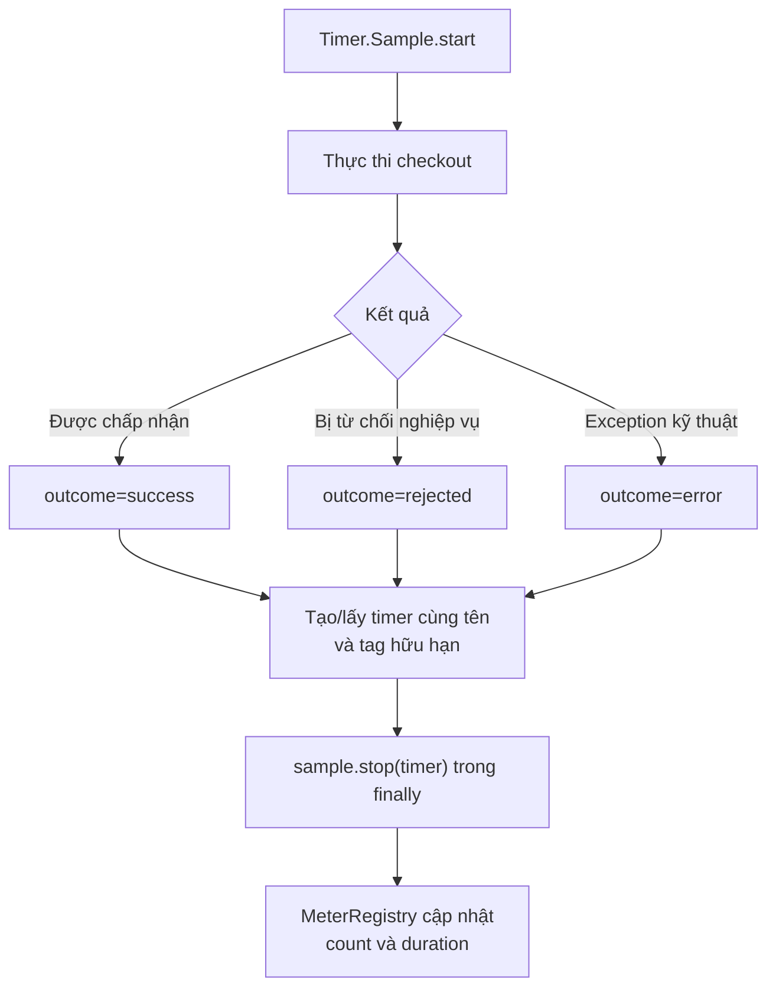
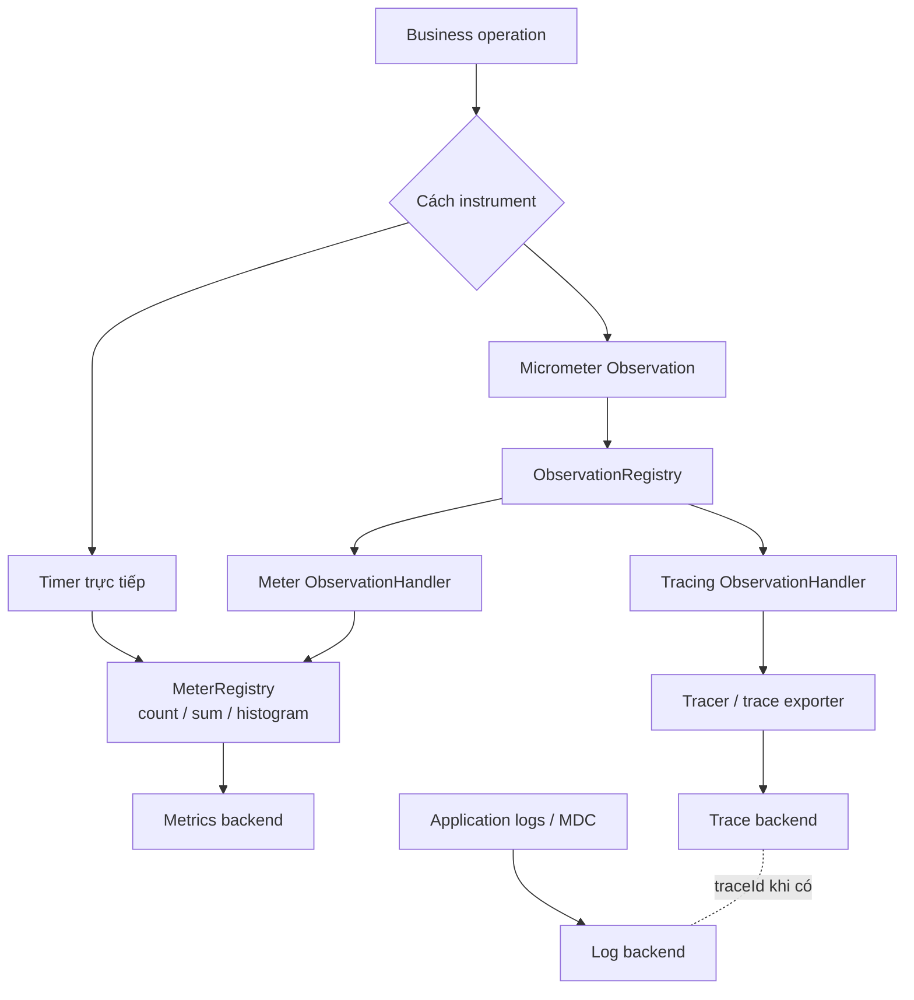
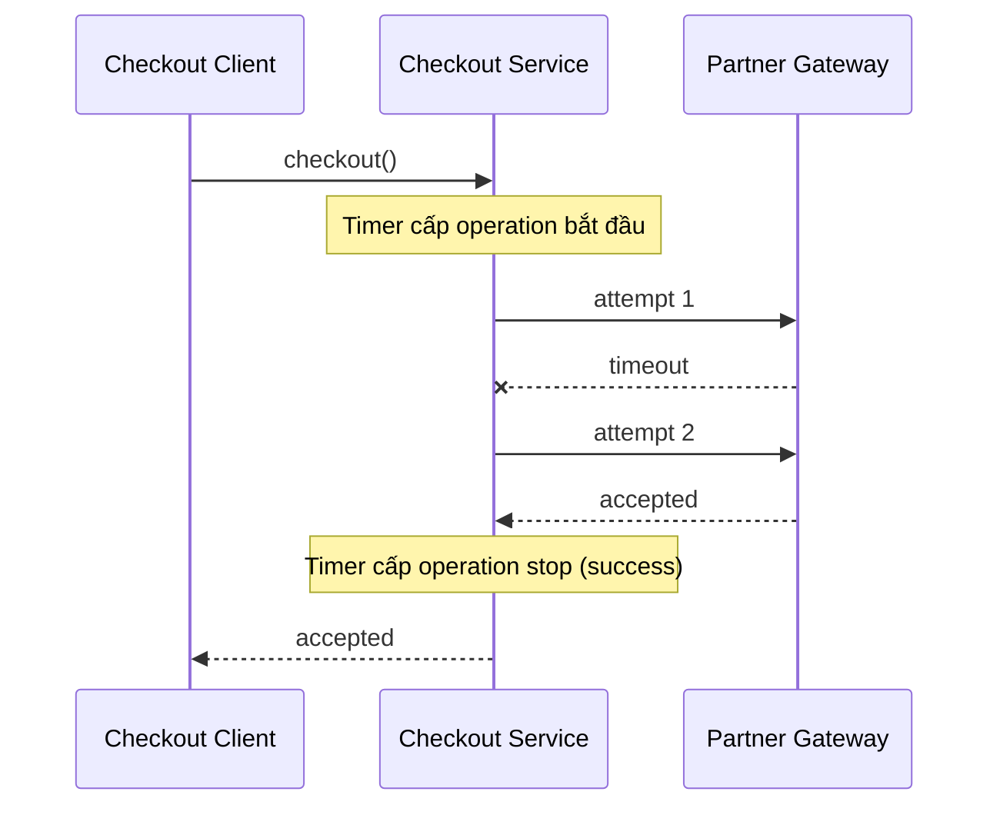

# Timer trong Micrometer Metrics và Spring Boot

Khi một API checkout bắt đầu chậm, nhìn vào tỷ lệ lỗi HTTP chưa đủ để trả lời: **độ trễ tăng ở bước nào, bao nhiêu lượt xử lý bị ảnh hưởng và p95 có vượt ngưỡng cam kết không?** Trong Micrometer, **`Timer`** là công cụ nền tảng để đo **số lần** và **thời lượng** của những công việc có điểm bắt đầu, kết thúc rõ ràng: xử lý request, gọi dịch vụ ngoài, truy vấn dữ liệu, xác thực giao dịch hoặc thực thi một bước tích hợp.

Bài **Timer** thuộc chương **Metrics nền tảng** của module **SPRING_BOOT_OBSERVABILITY**. Mục tiêu của module là thiết lập observability cho Spring Boot bằng Micrometer Observation, metrics, logs và distributed tracing; tìm hiểu propagation ngữ cảnh, tag/cardinality, exporter, sampling và liên kết tín hiệu để điều tra lỗi, độ trễ và hành vi ứng dụng trên môi trường thực. Bài này đi sâu vào phép đo thời lượng với Micrometer Timer, cách công bố và đọc metrics, cùng vai trò của nó trong quy trình điều tra sự cố.

## 1. Mục tiêu học tập

Sau khi hoàn thành bài này, bạn có thể:

- Phân biệt `Timer` với `Counter`, `Gauge` và `LongTaskTimer`.
- Giải thích ý nghĩa của `count`, `totalTime` và `max`; tính throughput, thời lượng trung bình và percentiles đúng cách.
- Dùng `Timer.record(...)`, `Timer.Sample` và `MeterRegistry` để đo công việc đồng bộ, kể cả khi có exception.
- Thiết kế tập tag `operation`, `outcome`, `channel` có cardinality thấp và ghi nhận thời lượng theo đúng ranh giới nghiệp vụ.
- Cấu hình histogram hoặc percentile có chủ đích, đọc dữ liệu Prometheus và tránh suy luận sai về p95/p99.
- Hiểu khi nào nên dùng Micrometer Observation để kết hợp metrics với distributed tracing và logs, cùng những hạn chế của sampling/exporter.
- Phát hiện các lỗi vận hành như timer không có dữ liệu, nhãn bùng nổ, đo thiếu thời gian xử lý async hoặc trùng với instrumentation tự động.

## 2. Timer là gì và đo những thông tin nào?

`Timer` là một loại *meter* trong thư viện **Micrometer Metrics**, chuyên ghi nhận các **duration**. Mỗi khi công việc hoàn thành, timer được cập nhật bằng thời gian đã trôi qua. Không nên hiểu nó là “một đồng hồ đang chạy liên tục trên dashboard”; timer tích lũy dữ liệu qua nhiều lần ghi nhận.

| Đại lượng | API Micrometer | Ý nghĩa |
| --- | --- | --- |
| `count` | `timer.count()` | Số lần ghi nhận duration hợp lệ của timer |
| `totalTime` | `timer.totalTime(TimeUnit.MILLISECONDS)` | Tổng thời lượng của các lần ghi nhận, đổi theo đơn vị yêu cầu |
| `max` | `timer.max(TimeUnit.MILLISECONDS)` | Giá trị lớn nhất trong cửa sổ thống kê mà triển khai timer theo dõi; không mặc định là cực đại từ khi ứng dụng khởi động |
| Histogram / percentiles | Phụ thuộc `DistributionStatisticConfig` và exporter | Phân phối độ trễ để đánh giá p50, p95, p99 hoặc SLO |

Ví dụ một timer ghi nhận 4 thao tác với độ trễ **50 ms, 80 ms, 120 ms, 150 ms**:

- `count = 4`.
- `totalTime = 400 ms`.
- **Mean duration = 400 / 4 = 100 ms**.
- Max của các mẫu này là `150 ms`, nếu chúng còn nằm trong cửa sổ thống kê tương ứng.

**Average** và **percentile** là hai khái niệm khác nhau. Thời lượng trung bình có thể thấp ngay cả khi một nhóm nhỏ request rất chậm. p95 mô tả ngưỡng mà khoảng 95% quan sát nằm ở hoặc dưới ngưỡng đó theo cách dữ liệu phân phối được ghi nhận và tổng hợp; nó không thể được suy ra chính xác chỉ từ `count` và `totalTime`.

### Vì sao max có thể giảm hoặc trở về 0?

Trong những implementation Micrometer thông dụng, giá trị `max` là **time-window maximum**. Giá trị có thể hết hạn theo khoảng thời gian được cấu hình, phụ thuộc `expiry`, số buffer và nhịp cập nhật. Nếu không có mẫu mới trong các cửa sổ tương ứng, max có thể trở về 0. Vì vậy, `max` không phải bộ lưu kỷ lục vĩnh viễn, và một spike ngắn có thể bị bỏ lỡ nếu hệ thống chỉ đọc max không đúng thời điểm.

Để theo dõi độ trễ dài hạn, hãy lưu metric vào backend có khả năng tổng hợp theo thời gian, cấu hình histogram khi cần và đọc cả count, rate, percentile bên cạnh max.

## 3. Timer khác Counter, Gauge và LongTaskTimer thế nào?

| Meter | Câu hỏi phù hợp | Ví dụ | Điểm khác với Timer |
| --- | --- | --- | --- |
| **`Counter`** | Sự kiện xảy ra bao nhiêu lần? | Số retry, số message bị từ chối | Chỉ đếm, không đo thời lượng |
| **`Gauge`** | Giá trị hiện tại là bao nhiêu? | Số kết nối đang sử dụng, queue depth | Đọc trạng thái tức thời, không tích lũy duration |
| **`Timer`** | Công việc hoàn thành bao nhiêu lần và mất bao lâu? | Latency của thanh toán hoặc lời gọi HTTP | Ghi duration của các lần hoàn thành |
| **`LongTaskTimer`** | Hiện có bao nhiêu tác vụ dài đang chạy và chạy bao lâu? | Batch import kéo dài nhiều phút | Theo dõi **tác vụ còn đang hoạt động**, thay vì chỉ chờ tác vụ kết thúc mới ghi duration |

Nếu chỉ cần biết số lần xử lý một công việc đã hoàn thành, `Timer.count()` đã mang thông tin đếm. Không nhất thiết tạo thêm một `Counter` cùng mục đích, vì dashboard có thể vô tình cộng đôi hoặc tạo hai nguồn sự thật khác nhau.

Với tác vụ batch dài hàng giờ, timer thông thường chủ yếu ghi nhận khi task kết thúc. Nếu cần quan sát **số task vẫn đang chạy ngay lúc này**, `LongTaskTimer` phù hợp hơn. Một hệ thống có thể dùng cả hai nếu cần cả thời lượng hoàn tất và trạng thái đang chạy, nhưng phải đặt tên và phạm vi đo rõ ràng.

## 4. Đơn vị thời gian và cách ghi nhận dữ liệu

Trong Micrometer, thời lượng được biểu diễn bằng đơn vị thời gian như `TimeUnit.NANOSECONDS`, `MILLISECONDS`, `SECONDS` hoặc `Duration`. Thư viện và backend có thể dùng đơn vị nội bộ hoặc đơn vị cơ sở khác nhau. Chẳng hạn, khi xuất sang Prometheus, duration thường được chuẩn hóa thành **giây**, với tên series thường có hậu tố `_seconds`.

### 4.1. Ghi một Duration

```java
import io.micrometer.core.instrument.MeterRegistry;
import io.micrometer.core.instrument.Timer;
import java.time.Duration;

Timer timer = Timer.builder("integration.partner.duration")
    .description("Time spent calling the partner service")
    .tag("partner", "shipping")
    .register(meterRegistry);

timer.record(Duration.ofMillis(180));
```

`meterRegistry` ở đây là một biến kiểu `MeterRegistry` đã có trong service hoặc configuration. Đoạn trên ghi **một mẫu 180 ms** vào timer. Trong ứng dụng thực, duration nên đến từ công việc đã thực thi, không phải số đoán hoặc số cố định.

### 4.2. Ghi duration bằng số và TimeUnit

```java
timer.record(250, java.util.concurrent.TimeUnit.MILLISECONDS);
```

Đảm bảo số và đơn vị khớp nhau. Lỗi `record(250, TimeUnit.SECONDS)` khi giá trị thực chỉ có 250 ms sẽ làm biểu đồ latency sai lệch hàng nghìn lần.

Micrometer Timer không ghi nhận giá trị duration âm. Duration bằng 0 có thể được ghi nhận nhưng không cung cấp thông tin hữu ích cho latency; hãy kiểm tra timer có bắt đầu và kết thúc ở đúng ranh giới công việc hay không.

### 4.3. Đo trực tiếp một khối công việc với record

```java
Timer timer = Timer.builder("integration.transform.duration")
    .tag("stage", "normalize")
    .register(meterRegistry);

timer.record(() -> {
    normalizePayload();
});
```

`record(Runnable)` đo thời gian của lambda, ghi lại duration sau khi công việc kết thúc. Với công việc chạy đồng bộ, cách này giảm nguy cơ quên ghi thời lượng khi lambda ném một exception. Phương thức `normalizePayload()` là hàm nghiệp vụ giả định của ứng dụng.

Đối với trường hợp cần nhãn phụ thuộc **kết quả sau khi xử lý**, `Timer.Sample` thường thuận tiện hơn: bắt đầu trước khi gọi nghiệp vụ và chọn timer với tag phù hợp **lúc kết thúc**.

## 5. Timer.Sample: chọn tag sau khi biết kết quả

`Timer.Sample` lưu mốc bắt đầu đo bằng `Clock` của `MeterRegistry`. Khi kết thúc, gọi `sample.stop(timer)` để ghi duration vào timer đã chọn. Nhờ vậy có thể ghi **outcome=success**, **outcome=rejected** hoặc **outcome=error** cho cùng một nghiệp vụ mà không phải tạo một ID/tag mới cho từng request.



### 5.1. Ví dụ Spring Boot hoàn chỉnh

Ứng dụng có một cổng thanh toán nhận yêu cầu checkout và trả về kết quả được chấp nhận hay từ chối theo nghiệp vụ. Nếu gateway bị timeout, nó ném exception. Ta muốn đo **thời lượng hoàn tất một lần checkout**, bao gồm cả trường hợp lỗi.

```java
public enum CheckoutChannel {
    WEB("web"),
    MOBILE("mobile"),
    PARTNER("partner");

    private final String metricValue;

    CheckoutChannel(String metricValue) {
        this.metricValue = metricValue;
    }

    public String metricValue() {
        return metricValue;
    }
}

public record CheckoutCommand(
        String orderId,
        CheckoutChannel channel,
        int itemCount) { }

public record CheckoutResult(boolean accepted) { }

public interface CheckoutGateway {
    CheckoutResult authorize(CheckoutCommand command);
}
```

Các kiểu trên là dữ liệu và dependency minh họa, sử dụng Java 17 trở lên. Ví dụ giả định `CheckoutCommand` đã qua validation nên `channel` không null. Đối với input ngoài thực tế, cần chuẩn hóa giá trị channel thành enum và từ chối hoặc phân loại dữ liệu không hợp lệ trước khi ghi metrics.

```java
import io.micrometer.core.instrument.MeterRegistry;
import io.micrometer.core.instrument.Timer;
import org.springframework.stereotype.Service;

@Service
public class CheckoutService {

    private final MeterRegistry meterRegistry;
    private final CheckoutGateway gateway;

    public CheckoutService(MeterRegistry meterRegistry,
                           CheckoutGateway gateway) {
        this.meterRegistry = meterRegistry;
        this.gateway = gateway;
    }

    public CheckoutResult checkout(CheckoutCommand command) {
        // Channel đã được validation: chỉ có ba giá trị hữu hạn.
        String channel = command.channel().metricValue();
        Timer.Sample sample = Timer.start(meterRegistry);
        String outcome = "error";

        try {
            CheckoutResult result = gateway.authorize(command);
            outcome = result.accepted() ? "success" : "rejected";
            return result;
        } finally {
            Timer timer = Timer.builder("business.checkout.duration")
                .description("Checkout authorization duration")
                .tag("operation", "authorize")
                .tag("channel", channel)
                .tag("outcome", outcome)
                .register(meterRegistry);

            sample.stop(timer);
        }
    }
}
```

**Điểm cần hiểu trong đoạn mã:**

1. `Timer.start(meterRegistry)` tạo một sample trước khi gateway chạy; sample tự nó chưa cập nhật một timer cụ thể.
2. `outcome` mặc định là `error` để nhánh exception vẫn có nhãn lỗi khi đi vào `finally`.
3. Kết quả trả về bình thường được phân loại thành `success` hoặc `rejected`. Một giao dịch bị từ chối theo hợp đồng không nhất thiết là lỗi kỹ thuật.
4. `finally` luôn chạy sau `return` hoặc exception, nên `sample.stop(timer)` ghi thời lượng của mọi lần thực thi mà mã đã đi đến sample.
5. `Timer.builder(...).register(meterRegistry)` với **cùng tên và cùng tập tag** sẽ sử dụng meter tương ứng đã được đăng ký trong registry; không tạo series mới theo từng yêu cầu nếu giá trị tag được giữ hữu hạn.
6. `orderId` không xuất hiện trong tag. Nếu cần truy vết một checkout cụ thể, sử dụng log hoặc trace context theo chính sách bảo mật.

Giải pháp này ghi metric thời lượng nhưng **không tự ghi nhận exception trong tracing span**. Nếu cần liên kết metrics và tracing qua một thao tác chung, cân nhắc dùng **Micrometer Observation** với `ObservationRegistry` đã cấu hình; không cần đồng thời bọc cùng một ranh giới bằng hai cơ chế Timer thủ công và Observation timer.

### 5.2. Khi nào cần bắt exception riêng?

Ví dụ trên không cần `catch` vì `finally` vẫn đo được duration khi gateway ném lỗi. Nếu muốn phân biệt loại lỗi bằng tập giá trị nhỏ, có thể bắt **những exception cụ thể** và phân loại, sau đó ném tiếp:

```java
try {
    CheckoutResult result = gateway.authorize(command);
    outcome = result.accepted() ? "success" : "rejected";
    return result;
} catch (PartnerTimeoutException ex) {
    outcome = "timeout";
    throw ex;
} catch (RuntimeException ex) {
    outcome = "error";
    throw ex;
} finally {
    sample.stop(Timer.builder("business.checkout.duration")
        .tag("channel", channel)
        .tag("outcome", outcome)
        .register(meterRegistry));
}
```

Đây là **biến thể thay thế** khối `try/finally` trong service; `PartnerTimeoutException` là exception giả định do ứng dụng định nghĩa. Không lắp thêm biến thể này sau khối `try/finally` đã có. Nếu dùng nhãn `outcome=timeout`, hãy quy định rõ nó nằm cùng taxonomy với `success`, `rejected`, `error`; thông thường giữ `outcome=error` và thêm `error.category=timeout` sẽ dễ tổng hợp lỗi chung hơn.

Exception message hoặc URL chứa tham số động **không** nên trở thành giá trị của `outcome` hay `error.category`. Với lỗi ném trước khi sample được khởi tạo (ví dụ do validation channel), timer trên sẽ không đo; hãy quyết định đây là ranh giới cần đo hay nên dùng metric validation riêng.

## 6. Đưa Timer lên Spring Boot Actuator và Prometheus

Trong Spring Boot 3.x, có thể dùng **Actuator** để quản lý metrics và một registry exporter như Prometheus. Ví dụ Gradle Kotlin DSL:

```kotlin
dependencies {
    implementation("org.springframework.boot:spring-boot-starter-actuator")
    runtimeOnly("io.micrometer:micrometer-registry-prometheus")
}
```

Spring Boot BOM nên quản lý phiên bản các thư viện tương thích. Với web application, cấu hình ví dụ:

```yaml
management:
  endpoints:
    web:
      exposure:
        include: health,info,metrics,prometheus
```

Khi dependency, auto-configuration và quyền truy cập endpoint cho phép, ứng dụng có thể cung cấp:

- `/actuator/metrics`: thông tin meter đã biết và tên meter; có thể dùng `/actuator/metrics/business.checkout.duration` để kiểm tra meter theo tên Micrometer, kèm những tag/measurement có sẵn.
- `/actuator/prometheus`: định dạng scrape để Prometheus thu thập theo lịch.

**Mở endpoint metrics/prometheus cần chính sách truy cập phù hợp** với môi trường triển khai. Không nên công khai mọi metric hoặc thuộc tính nhạy cảm ra Internet. Actuator chỉ tạo điểm đọc dữ liệu; cần cấu hình Prometheus scrape và backend hiển thị để có biểu đồ, alert và lưu trữ dài hạn.

Nếu không thấy tên `business.checkout.duration`, hãy chắc chắn service thực sự được gọi và `sample.stop(timer)` đã chạy. Một số meter chỉ xuất hiện sau khi có dữ liệu; tên series Prometheus có thể được chuẩn hóa khác tên builder do naming convention và quy tắc đơn vị.

### 6.1. Ví dụ series xuất ra Prometheus

Đây là **minh họa**, tên nhãn và hậu tố thực tế phụ thuộc exporter/phiên bản:

```text
business_checkout_duration_seconds_count{channel="web",operation="authorize",outcome="success"} 42
business_checkout_duration_seconds_sum{channel="web",operation="authorize",outcome="success"} 5.46
business_checkout_duration_seconds_max{channel="web",operation="authorize",outcome="success"} 0.82
```

Trong ví dụ, 42 lượt checkout web được chấp nhận có tổng thời gian 5,46 giây, tương ứng mean duration khoảng 0,13 giây, nếu dữ liệu `count` và `sum` thuộc cùng một phạm vi nhãn và thời gian tích lũy. `max` biểu diễn thông tin cực đại theo cách Micrometer và exporter cấu hình, không phải giá trị vĩnh viễn.

## 7. Histogram, percentile và SLO

Một timer có count và tổng thời lượng giúp biết throughput, mean latency, nhưng **không đủ để tính p95 đáng tin cậy**. Muốn xem phân phối độ trễ, cần cấu hình thống kê phân phối.

### 7.1. Histogram cho backend tổng hợp

```java
Timer timer = Timer.builder("integration.partner.duration")
    .description("Partner request duration")
    .tag("partner", "shipping")
    .publishPercentileHistogram()
    .register(meterRegistry);
```

`publishPercentileHistogram()` bật histogram percentile theo khả năng của registry/backend. Trong Prometheus dạng histogram truyền thống, series có thể gồm các bucket `_seconds_bucket{le="..."}`, `_seconds_sum` và `_seconds_count`. Backend có thể tổng hợp histogram từ nhiều instance để ước lượng quantile trên tập dữ liệu gộp.

Histogram tiêu thụ thêm series và bộ nhớ theo số bucket × số tổ hợp nhãn. Chỉ bật cho những timer quan trọng, chọn dải thời lượng thực tế và cân nhắc cấu hình distribution statistics để kiểm soát chi phí.

### 7.2. SLO buckets

Nếu nhóm vận hành cam kết 95% lời gọi partner dưới 500 ms, có thể định nghĩa các ranh giới thời lượng đáng quan tâm:

```java
Timer timer = Timer.builder("integration.partner.duration")
    .tag("partner", "shipping")
    .serviceLevelObjectives(
        java.time.Duration.ofMillis(100),
        java.time.Duration.ofMillis(500),
        java.time.Duration.ofSeconds(1)
    )
    .register(meterRegistry);
```

Các giá trị bucket giúp phân tích tỷ lệ request nằm dưới ngưỡng xác định, nếu exporter tương thích. Chúng là **các ranh giới bucket**, không tự thiết lập hay cưỡng chế một Service Level Objective. SLO thực tế còn cần định nghĩa cửa sổ thời gian, tập request hợp lệ, loại trừ/đếm lỗi và chính sách alert.

### 7.3. Client-side percentiles

```java
Timer timer = Timer.builder("integration.partner.duration")
    .tag("partner", "shipping")
    .publishPercentiles(0.50, 0.95, 0.99)
    .register(meterRegistry);
```

Phương thức `publishPercentiles(...)` cấu hình xuất percentile được tính tại phía client cho registry hỗ trợ. **Không nên lấy trung bình p95 của nhiều instance** để suy ra p95 toàn hệ thống: percentile không cộng/tổng hợp tuyến tính. Histogram với các bucket cộng gộp được thường phù hợp hơn khi muốn tính p95 của nhiều instance trong backend.

Các ví dụ ở `7.1`, `7.2` và `7.3` là **những lựa chọn cấu hình**, không phải ba timer khác nhau nên đăng ký cùng tên và tags để thử cả ba. Một meter đã được đăng ký theo ID có thể được tái sử dụng; muốn thay distribution config cần thiết kế cấu hình nhất quán ngay khi tạo meter.

## 8. Đọc và suy luận từ PromQL

Giả sử timer được xuất với tên `business_checkout_duration_seconds` và nhãn `outcome`. Những truy vấn dưới đây minh họa **Prometheus histogram truyền thống/counter series**; tên series cần được xác nhận trên endpoint scrape thực tế.

### 8.1. Throughput: lượt checkout mỗi giây

```promql
sum(rate(business_checkout_duration_seconds_count[5m]))
```

`rate(...[5m])` đo tốc độ tăng của counter dựa trên cửa sổ 5 phút; `sum` tổng hợp các bộ nhãn. Nếu có nhiều instances, nhãn bị gộp để tránh đếm từng instance riêng trong biểu đồ tổng.

### 8.2. Mean latency trong cửa sổ 5 phút

```promql
sum(rate(business_checkout_duration_seconds_sum[5m]))
/
sum(rate(business_checkout_duration_seconds_count[5m]))
```

Tử số là tổng số giây tăng mỗi giây, mẫu số là số lần hoàn thành tăng mỗi giây, nên thương số là **giây trên mỗi lần**. Nếu count bằng 0 trong cửa sổ, phép chia có thể không cho số hữu ích; dashboard nên xử lý no-traffic phù hợp.

### 8.3. Error rate theo kết quả nghiệp vụ

```promql
sum(rate(business_checkout_duration_seconds_count{outcome="error"}[5m]))
/
sum(rate(business_checkout_duration_seconds_count[5m]))
```

Đây là tỷ lệ `outcome=error` theo **số lần checkout đã hoàn thành**. Nếu `rejected` là kết quả nghiệp vụ dự kiến, truy vấn này cố ý không tính rejected vào lỗi kỹ thuật. Nếu mục tiêu là tỷ lệ **không chấp nhận checkout**, cần cộng `error` và `rejected` theo định nghĩa nghiệp vụ.

### 8.4. p95 nếu đã xuất histogram buckets

```promql
histogram_quantile(
  0.95,
  sum by (le) (
    rate(business_checkout_duration_seconds_bucket[5m])
  )
)
```

Hàm `histogram_quantile` ước lượng p95 từ tốc độ tăng của các bucket. Kết quả phụ thuộc phân bố mẫu và vị trí bucket; nó là **ước lượng**, không phải phép khôi phục chính xác mọi request. Truy vấn này chỉ hoạt động khi histogram buckets được xuất; một Timer mặc định không bảo đảm có `_bucket`.

Muốn xem p95 theo channel, giữ nhãn đó khi gộp:

```promql
histogram_quantile(
  0.95,
  sum by (le, channel) (
    rate(business_checkout_duration_seconds_bucket[5m])
  )
)
```

Nếu sử dụng Prometheus native histograms hoặc backend khác, cú pháp và cấu trúc metric có thể khác; cần đối chiếu với dạng dữ liệu thực tế.

## 9. Tag/cardinality: bảo vệ chất lượng Timer

Timer được phân biệt bởi **tên meter và bộ tags**. Một timer có ba channel và ba outcome có thể tạo tối đa 9 tổ hợp tag ở cấp ứng dụng nếu mọi tổ hợp đều xuất hiện. Nếu thêm 10 region, số tổ hợp tiềm năng thành 90 trước khi tính nhãn từ instance, pod hay các nhãn backend khác.

Nếu gắn thêm `orderId` cho 100.000 đơn hàng, số tổ hợp lý thuyết có thể tăng rất lớn; thực tế phụ thuộc tập mẫu đã xuất hiện. Histogram còn nhân thêm series bucket trên mỗi tổ hợp nhãn. Vì vậy, **không** nên gắn `orderId`, `traceId`, `userId`, URL thực hoặc exception message vào Timer tags.

| Tag | Ví dụ an toàn | Ví dụ nguy hiểm |
| --- | --- | --- |
| `operation` | `authorize`, `reserve` | Giá trị tùy ý do client nhập |
| `outcome` | `success`, `rejected`, `error` | Toàn bộ exception message |
| `channel` | `web`, `mobile`, `partner`, `unknown` | Header chưa chuẩn hóa |
| `http.route` | `/orders/{id}` | `/orders/891402` |
| `error.category` | `timeout`, `dependency`, `validation` | URL đích đầy đủ, transaction ID |

Không có ngưỡng “low cardinality” đúng cho mọi hệ thống. Hãy tính ngân sách series theo tích các chiều tag, kiểm tra cả histogram buckets và các nhãn backend tự thêm, rồi đặt giới hạn phù hợp với tải và hệ thống lưu trữ.

**Lưu ý về dữ liệu nhạy cảm:** Ngay cả tag có cardinality thấp vẫn có thể lộ thông tin nếu chứa dữ liệu không nên xuất. Không đưa secrets, token, email hoặc giá trị cá nhân vào metrics. Các ID cần điều tra theo từng giao dịch nên nằm trong logs hoặc trace attributes **khi được phép**, với masking, quyền truy cập và retention phù hợp.

## 10. Timer, Micrometer Observation và distributed tracing

Micrometer Metrics `Timer` đo thời gian của các công việc. **Micrometer Observation** cung cấp API cấp cao hơn để mô tả cùng một công việc và thông báo vòng đời cho các `ObservationHandler`. Nếu registry đã có meter observation handler, observation có thể sinh Timer; nếu có tracing handler, nó có thể sinh span.



### Khi nào dùng Timer trực tiếp?

- Chỉ cần đo một duration rõ ràng, ví dụ thời gian chạy thuật toán hay một thao tác nội bộ đơn giản.
- Muốn kiểm soát chi tiết tên meter và distribution configuration.
- Không cần tự động tạo span từ chính ranh giới đó.

### Khi nào dùng Observation?

- Muốn dùng một API chung để các handler metrics và tracing cùng theo dõi một công việc.
- Cần truyền scope/context tới hoạt động con hoặc liên kết log qua tracing integration.
- Đang instrument một ranh giới nghiệp vụ có lỗi, sự kiện và metadata cần quan sát ở nhiều tín hiệu.

Nếu Spring Boot, Spring MVC, HTTP client hoặc messaging đã tự động tạo metrics/observations tại ranh giới cần đo, hãy kiểm tra telemetry đang có trước khi thêm Timer thủ công cùng ý nghĩa. Hai Timer bao quanh cùng một thao tác với tên khác nhau không nhất thiết gây lỗi ứng dụng, nhưng có thể khiến biểu đồ đếm trùng và tốn thêm tài nguyên.

### Timer không tự tạo trace hay log

`Timer.Sample` đo thời lượng; nó không thiết lập `traceId`, không tạo parent-child span và không tự ghi log. Nếu service có tracing và logger được cấu hình, có thể dùng trace ID trong **log** để đi từ một nhóm request chậm trên biểu đồ metrics sang trace cụ thể được lấy mẫu. Không đưa trace ID vào Timer tag chỉ để nối các tín hiệu.

**Sampling** trong tracing có thể làm trace của một request không được gửi tới backend; metrics vẫn có thể phản ánh toàn bộ số lần đo độc lập với sampling đó. Exporter/collector cũng có thể gặp sự cố. Điều tra thực tế cần dùng metrics làm bức tranh tổng quan, logs làm bằng chứng sự kiện và traces để khoanh vùng đường đi khi dữ liệu có sẵn.

## 11. Đo đúng ranh giới: đồng bộ, retry và bất đồng bộ

### 11.1. Retry khiến số lần đo thay đổi

Giả sử một request đặt hàng gọi đối tác:



Nếu đo ở **cấp operation**, một request được ghi một lần, với thời lượng bao gồm các attempts và khoảng chờ retry nếu nằm trong khối code. Nếu đo **cấp attempt**, request này được ghi hai lần, attempt đầu thất bại, attempt sau thành công. Cả hai phép đo đều hữu ích nhưng phải đặt **tên khác nhau**, ví dụ `business.checkout.duration` và `partner.attempt.duration`.

Không cộng số lần thất bại ở cấp attempt để suy ra tỷ lệ thất bại cuối cùng của người dùng. Một lần retry rồi thành công vẫn có thể làm độ trễ checkout tăng và được Timer operation ghi lại dù outcome cuối là `success`.

### 11.2. Công việc async: đừng đo thời gian tạo Future

Đoạn sau chỉ đo thời gian **trả về đối tượng Future**, không nhất thiết đo xử lý thật:

```java
timer.record(() -> {
    asyncGateway.submit(command); // Trả CompletableFuture rất nhanh.
});
```

Muốn đo cho đến khi xử lý thực sự hoàn tất, hãy bắt đầu sample trước khi gọi và stop ở callback hoàn thành, bao gồm cả trường hợp exception:

```java
Timer.Sample sample = Timer.start(meterRegistry);

java.util.concurrent.CompletableFuture<CheckoutResult> future =
    asyncGateway.submit(command);

return future.whenComplete((result, failure) -> {
    String outcome = (failure == null) ? "success" : "error";
    Timer duration = Timer.builder("checkout.async.duration")
        .tag("outcome", outcome)
        .register(meterRegistry);
    sample.stop(duration);
});
```

Đây là mẫu minh họa trong một phương thức trả `CompletableFuture<CheckoutResult>`; `asyncGateway` là dependency ứng dụng. Trong code production, cần xử lý cả trường hợp **`submit(command)` ném exception trước khi trả Future** để sample vẫn được stop, và quy định riêng cho cancellation hoặc kết quả nghiệp vụ bị từ chối. Callback có thể chạy trên thread khác: nếu muốn cả tracing/log context, cần thiết lập context propagation phù hợp với executor và runtime.

Với Reactor `Mono`/`Flux`, việc tạo publisher không tương đương thực thi; timer phải bắt đầu và kết thúc theo lifecycle **subscription/completion/error/cancel**, có xét số lần subscribe và retry. Ưu tiên integration/instrumentation tương thích Reactor để tránh scope hoặc sample bị chia sẻ sai giữa các subscriber.

### 11.3. Đo thời gian queueing và thời gian xử lý riêng

Một message đi qua queue có thể chờ 5 giây nhưng handler chỉ chạy 20 ms. Nếu Timer chỉ bao quanh handler, dashboard sẽ hiển thị handler nhanh và không giải thích được độ trễ đầu cuối. Muốn điều tra, cần thêm queue depth/consumer lag hoặc đo một mốc end-to-end phù hợp, không đánh đồng Timer của handler với toàn bộ thời gian message tồn tại trong hệ thống.

## 12. Lỗi thiết kế thường gặp và cách sửa

| Vấn đề | Hậu quả | Giải pháp |
| --- | --- | --- |
| Dùng Counter riêng để đếm đúng những thao tác Timer đã đếm | Hai nguồn đếm dễ lệch nhau | Dùng `Timer.count` nếu cùng ý nghĩa |
| Ghi duration sai đơn vị | p95/mean sai hàng nghìn lần | Dùng `Duration` hoặc `TimeUnit` rõ ràng |
| Ghi Timer chỉ sau dòng có thể ném exception | Thiếu duration ở đường lỗi | Dùng `record`, `finally` hoặc `Timer.Sample` |
| Coi `max` là cực đại từ khi khởi động | Hiểu sai spike và cửa sổ đo | Xem time-window và backend time series |
| Tính p95 từ count + sum | Kết luận không có căn cứ | Bật histogram/percentiles theo nhu cầu |
| Trung bình p95 giữa nhiều instance | p95 tổng hợp bị sai | Tổng hợp histogram buckets nếu backend hỗ trợ |
| Gắn `userId`, `orderId` vào Timer tags | Cardinality tăng không kiểm soát | Chỉ dùng danh mục giá trị hữu hạn |
| Một Timer vừa đo request vừa đếm retries | Thông số lẫn ranh giới | Đặt meter riêng cho operation và attempt |
| Gọi `stop` khi vừa tạo Future/Mono | Latency đo thời gian lập lịch | Stop ở lúc completion/error/cancellation |
| Bật histogram cho tất cả Timer | Nhiều bucket/series và chi phí lớn | Chọn timer quan trọng và dải SLO phù hợp |
| Timer thủ công trùng observation/framework metric | Số liệu lặp, dashboard khó đọc | Kiểm tra instrumentation sẵn có |
| Giả định Timer tạo log/trace | Không tìm được trace ID hoặc span | Dùng Observation/tracing instrumentation nếu cần |

## 13. Thực hành kiểm chứng

**Bài toán:** Một `CheckoutGateway` có ba chế độ: trả accepted, trả rejected, hoặc ném timeout. Bạn cần đo số lần và thời lượng theo channel/outcome, xem mean, rồi bật histogram cho một meter trọng yếu.

### Các ca cần chạy

| Ca | Hành vi mô phỏng | Mong đợi |
| --- | --- | --- |
| A — Thành công | `WEB`, gateway trả `accepted=true` | `outcome=success`, count tăng một |
| B — Từ chối nghiệp vụ | `MOBILE`, gateway trả `accepted=false` | `outcome=rejected`, vẫn ghi thời lượng |
| C — Timeout | `PARTNER`, gateway ném exception | `outcome=error`, exception lan lên, duration vẫn được ghi |
| D — Nhiều order ID | 100 yêu cầu từ `WEB` | Không tạo tag mới theo mỗi order ID |
| E — Retry hai attempts | Attempt đầu timeout, lần hai thành công | Timer operation đếm một lần; Timer attempt (nếu có) đếm hai |
| F — Async | Future hoàn thành sau 500 ms | Timer đo đến completion, không chỉ thời gian tạo Future |

### Checklist đọc kết quả

1. **Kiểm tra tại ứng dụng:** `MeterRegistry` đã được inject đúng chưa, `sample.stop(timer)` đã chạy trong cả ba nhánh và tên/tags có như dự kiến không?
2. **Kiểm tra Actuator:** `/actuator/metrics/business.checkout.duration` có dữ liệu sau khi chạy các ca chưa? Lọc theo tag `channel` hoặc `outcome` nếu endpoint/phiên bản hỗ trợ.
3. **Kiểm tra exporter:** `/actuator/prometheus` có `count` và `sum` với cùng bộ nhãn không? Xem tên thực tế thay vì đoán quy tắc chuyển tên.
4. **Kiểm tra PromQL:** tính throughput và mean từ `rate(count)`, `rate(sum)`; đối chiếu với số lượt và thời gian mô phỏng.
5. **Kiểm tra p95:** chỉ chạy `histogram_quantile` khi đã xuất buckets và có đủ dữ liệu cho khoảng đo; đừng nhầm `max` hoặc mean với p95.
6. **Kiểm tra cardinality:** đảm bảo tag chỉ chứa enum/channel/outcome hữu hạn, kể cả khi order ID hay exception message thay đổi liên tục.
7. **Kiểm tra trace/log correlation:** nếu dùng Micrometer Observation/tracing, xem trace và log của một thao tác chậm; nếu không có trace hãy kiểm tra sampling/exporter và context propagation.

### Bài tập tính toán

Một Timer có các mẫu thời lượng (ms): **40, 60, 80, 120, 200**. Hãy tự tính:

- `count` = 5, `totalTime` = 500 ms, **mean** = 100 ms.
- Tại sao một request 200 ms không thể được nhận biết chỉ bằng mean 100 ms?
- Nếu có 4 channel, 3 outcome, 5 region và 6 instance, tối đa bao nhiêu tổ hợp nhãn theo giả định mọi tổ hợp xuất hiện? Kết quả là `4 × 3 × 5 × 6 = 360`, chưa tính histogram buckets.
- Khi thêm `orderId` với 20.000 giá trị, biểu đồ timer và chi phí sẽ có rủi ro gì?

### Câu hỏi tự đánh giá

1. Timer đếm được số lần; khi nào vẫn cần tạo một Counter riêng?
2. Phân biệt `Timer.Sample` với `Timer.record(Runnable)` trong tình huống chọn tag sau khi biết outcome.
3. Tại sao `timer.max(...)` có thể về 0 sau một thời gian không có traffic?
4. Vì sao không được cộng hoặc lấy trung bình p95 của các instance để ra p95 toàn hệ thống?
5. Khi nào `LongTaskTimer` phù hợp hơn Timer thông thường?
6. Một thao tác retry hai lần nhưng thành công cuối cùng sẽ được đo thế nào ở cấp operation và attempt?
7. Khi không tìm thấy trace dù Timer tăng count, liệu có thể kết luận metric sai không? Cần kiểm tra gì?

## 14. Ghi nhớ

**Timer** là meter cơ bản để đo thời lượng công việc đã hoàn tất trong Micrometer. Nó cung cấp số lần đo (`count`), tổng thời lượng (`totalTime`), cực đại trong cửa sổ phù hợp (`max`) và phân phối độ trễ khi được cấu hình histogram/percentiles. `Timer.Sample` giúp đo công việc trước khi biết outcome và ghi nhận vào đúng timer lúc hoàn thành, kể cả khi ném exception.

Trong Spring Boot, hãy đặt timer tại **ranh giới nghiệp vụ rõ ràng**, dùng đơn vị nhất quán, tags có cardinality thấp và hiểu sự khác biệt giữa operation, retry attempt và thời gian thực thi async. Khi cần kết hợp metrics với distributed tracing, logs và propagation ngữ cảnh, Micrometer Observation cung cấp vòng đời chung để các handler tạo tín hiệu phù hợp. Metrics phát hiện bất thường về throughput và latency; traces tìm đường đi chậm; logs cung cấp chi tiết điều tra. Sử dụng đúng từng tín hiệu giúp hệ thống quan sát được lỗi và độ trễ mà vẫn kiểm soát chi phí vận hành.
