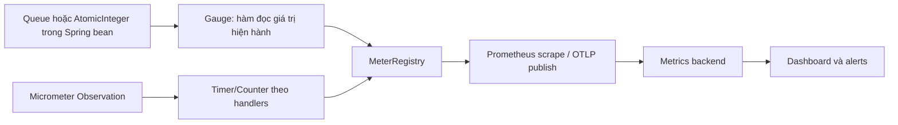
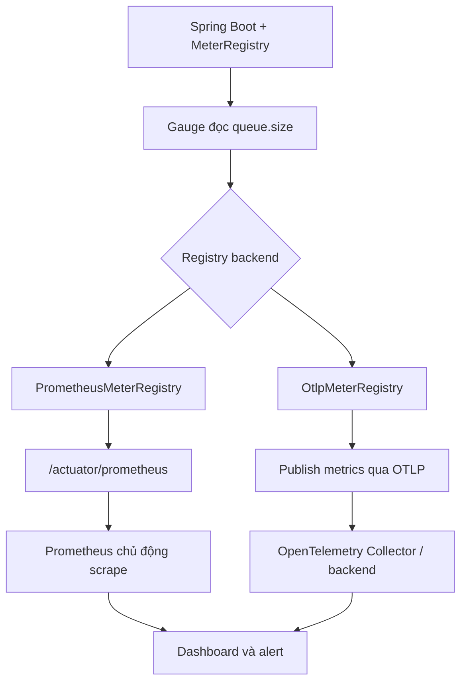
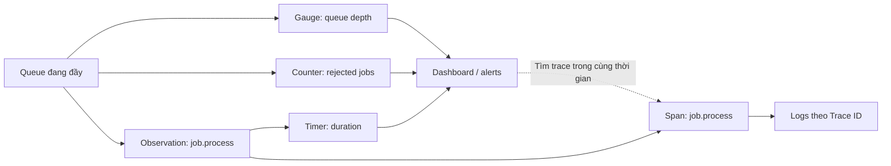

# Gauge trong Micrometer và Spring Boot Observability

**Gauge** là loại metric biểu diễn **giá trị hiện tại của một trạng thái** tại thời điểm hệ thống đo đạc: số request đang xử lý, số tác vụ đang chờ trong hàng đợi, dung lượng còn trống của pool, lượng bộ nhớ đang sử dụng hoặc tỷ lệ lấp đầy của một tài nguyên. Trong module **SPRING_BOOT_OBSERVABILITY**, Gauge là một phần của nền tảng metrics dùng cùng Micrometer Observation, logs và distributed tracing để phát hiện lỗi, độ trễ và hành vi bất thường của ứng dụng Spring Boot.

Điểm cốt lõi cần nắm: **Gauge được đọc khi backend hoặc registry thu thập số liệu**. Nó không lưu lịch sử mọi lần thay đổi của đối tượng được quan sát. Một Gauge đăng ký đúng và có nhãn ổn định giúp người vận hành theo dõi mức sử dụng tài nguyên, tìm dấu hiệu quá tải và kết hợp với Counter, Timer, traces, logs để điều tra nguyên nhân.

## 1. Gauge trả lời câu hỏi gì?

Hãy hình dung một Spring Boot service xử lý đơn hàng qua một hàng đợi có sức chứa 100 tác vụ. Trong một phút:

- Lúc 10:00:00, hàng đợi có 12 tác vụ.
- Lúc 10:00:10, hàng đợi tăng lên 85 tác vụ.
- Lúc 10:00:15, sau khi worker xử lý một phần, hàng đợi còn 30 tác vụ.
- Lúc 10:00:30, hàng đợi giảm xuống 8 tác vụ.

Gauge `orders.queue.depth` giúp trả lời: **Tại thời điểm đo, có bao nhiêu tác vụ đang chờ?** Nó phù hợp với câu hỏi về mức bão hòa, áp lực và khả năng đáp ứng của hàng đợi.

Những câu hỏi khác cần loại meter khác:

- *Đã nhận tổng cộng bao nhiêu đơn hàng?* Dùng **Counter**.
- *Mỗi lần xử lý đơn hàng mất bao lâu, p95 là bao nhiêu?* Dùng **Timer**.
- *Kích thước mỗi payload có phân phối ra sao?* Có thể dùng **DistributionSummary**.
- *Một tác vụ đang chạy kéo dài bao lâu, có bao nhiêu tác vụ dài đang diễn ra?* Có thể dùng **LongTaskTimer**.
- *Request chậm cụ thể đi qua những dịch vụ nào?* Dùng **distributed trace**.

### So sánh nhanh

| Loại meter | Ý nghĩa | Dạng biến động | Ví dụ |
| --- | --- | --- | --- |
| **Gauge** | Trạng thái tại thời điểm đọc | Có thể tăng, giảm hoặc giữ nguyên | Số connection đang dùng |
| **Counter** | Tổng số sự kiện tích lũy | Tăng trong vòng đời process; có thể reset sau restart | Tổng đơn hàng được nhận |
| **Timer** | Số lần và thời lượng các thao tác | Số đếm/tổng thời gian tích lũy; có thể có histogram | Thời gian xử lý HTTP |
| **DistributionSummary** | Phân phối một đại lượng | Ghi nhận nhiều phép đo theo thời gian | Kích thước các request |
| **LongTaskTimer** | Các tác vụ còn đang chạy và thời lượng của chúng | Số active tasks tăng/giảm; thời lượng thay đổi | Batch import kéo dài |

Không cố dùng một loại meter để trả lời tất cả câu hỏi. Ví dụ **Gauge về số request hiện hành không thay thế Counter về tổng lưu lượng**.

## 2. Gauge là phép đo trạng thái, không phải nhật ký sự kiện

Một Gauge có thể được hiểu là một hàm phụ thuộc vào thời gian:

\[
g(t) = \text{trạng thái của đối tượng tại thời điểm } t
\]

Với hàng đợi, hàm có thể là kích thước hiện hành của queue. Khác với Counter, Gauge **không tự cộng dồn** các sự kiện xảy ra giữa hai lần đọc.

```text
Giá trị thực của queue:
  0       5       20      5       40      10
  |-------|-------|-------|-------|-------|-------> thời gian
       spike A          spike B

Các lần scrape:
  ^               ^               ^
  t0              t15s            t30s

Backend chỉ lưu các mẫu tại những lần scrape,
không tự biết mọi cực đại nằm giữa hai mẫu.
```

Nếu 100 tác vụ đến rồi rời queue rất nhanh giữa hai lần scrape, các phép đo có thể đều ghi queue depth bằng 0. Điều đó **không chứng minh queue chưa từng bị dồn**. Đây là bản chất snapshot của Gauge, không nhất thiết là lỗi Micrometer.

Hệ quả quan trọng:

1. Gauge thích hợp cho trạng thái tồn tại đủ lâu hoặc có ý nghĩa tại thời điểm lấy mẫu.
2. Không dùng Gauge để ghi số lượng event tăng/giảm rất nhanh rồi kỳ vọng backend khôi phục mọi event.
3. Nếu cần **tổng số** request, job bị từ chối hoặc retry, hãy ghi Counter riêng.
4. Nếu cần **thời gian xử lý**, dùng Timer; nếu cần độ dài của task đang chạy, cân nhắc LongTaskTimer.
5. Nếu muốn biết cực đại thực sự của queue trong một khoảng thời gian, cần instrumentation chuyên dụng để ghi nhận cực đại, tần suất lấy mẫu phù hợp hoặc cơ chế tổng hợp khác. `max_over_time` trên các samples không thể khôi phục spike chưa được lấy mẫu.

### Gauge có thể giảm

Một counter giảm dần là tín hiệu sai về lựa chọn meter trong nhiều trường hợp. Với Gauge, việc giảm là bình thường:

```text
queue depth:       12 -> 87 -> 45 -> 5
active requests:    2 -> 14 ->  8 -> 1
free connections:  20 ->  4 -> 12 -> 20
```

Ý nghĩa tốt hay xấu phụ thuộc vào loại trạng thái. Queue depth cao có thể là quá tải, còn free connections cao thường là tích cực. Muốn đặt alert, cần hiểu chiều biến động và quan hệ với throughput, error rate, latency.

## 3. Gauge hoạt động như thế nào trong Micrometer?

Micrometer thường đăng ký Gauge dưới dạng **tham chiếu tới đối tượng và hàm đọc giá trị**. Khi registry được scrape hoặc publish, nó thực thi hàm đọc để lấy trạng thái ở thời điểm tương ứng.



Trong Spring Boot, các thành phần chính gồm:

| Thành phần | Trách nhiệm |
| --- | --- |
| Đối tượng trạng thái | Giữ giá trị hiện tại, ví dụ `BlockingQueue`, `AtomicInteger` |
| Gauge | Định nghĩa tên, tags, mô tả và hàm đọc giá trị |
| `MeterRegistry` | Đăng ký meter và cung cấp dữ liệu cho backend |
| Registry backend | Prometheus, OTLP hoặc một loại registry khác |
| `ObservationRegistry` | Điều phối hoạt động và handler; không phải nơi lưu Gauge |
| Metrics backend | Lưu các mẫu giá trị theo thời gian, phục vụ query và cảnh báo |

**Một Gauge thường chỉ cần đăng ký một lần cho mỗi tên và bộ tags.** Sau đó thay đổi đối tượng nguồn; hàm đọc sẽ trả về giá trị mới. Không đăng ký lại Gauge ở mỗi HTTP request hoặc mỗi lần trạng thái thay đổi.

## 4. Ví dụ đầu tiên: Gauge cho số request đang xử lý

Dùng `AtomicInteger` làm trạng thái có thể tăng và giảm an toàn giữa các thread. Service dưới đây đo số tác vụ đồng bộ đang thực thi.

```java
import io.micrometer.core.instrument.Gauge;
import io.micrometer.core.instrument.MeterRegistry;
import java.util.concurrent.atomic.AtomicInteger;
import org.springframework.stereotype.Service;

@Service
public class CheckoutLoadService {

    private final AtomicInteger activeRequests = new AtomicInteger();

    public CheckoutLoadService(MeterRegistry registry) {
        Gauge.builder(
                "checkout.requests.in.flight",
                activeRequests,
                AtomicInteger::get
        )
        .description("Number of checkout operations currently running")
        .baseUnit("requests")
        .tag("operation", "checkout")
        .register(registry);
    }

    public void execute(Runnable work) {
        activeRequests.incrementAndGet();
        try {
            work.run();
        } finally {
            activeRequests.decrementAndGet();
        }
    }
}
```

Cách sử dụng:

```java
// Giả sử service đã được Spring inject.
checkoutLoadService.execute(() -> {
    // Gọi các bước nghiệp vụ xử lý checkout đồng bộ.
    performCheckout();
});
```

*`performCheckout()` chỉ đại diện cho công việc nghiệp vụ, không phải một hàm được định nghĩa sẵn trong Micrometer.*

Điều cần quan sát:

- Constructor tạo Gauge **một lần** khi Spring tạo singleton bean.
- `AtomicInteger` là đối tượng giữ giá trị; chính nó được Gauge đọc.
- `incrementAndGet()` và `decrementAndGet()` bao quanh đúng ranh giới công việc.
- `finally` bảo đảm giá trị giảm khi `work.run()` ném lỗi.
- `operation=checkout` là tag có số giá trị ổn định.
- `baseUnit("requests")` diễn đạt đơn vị; registry có thể thay đổi cách hiển thị tên metric theo quy ước backend.

**Giới hạn phạm vi:** ví dụ phù hợp với công việc **đồng bộ** mà `Runnable.run()` chỉ kết thúc sau khi thao tác thật sự hoàn tất. Nếu `work.run()` chỉ khởi động một `CompletableFuture` rồi trả về ngay, Gauge sẽ giảm quá sớm. Với bất đồng bộ, cần giảm active count khi future/publisher thực sự hoàn thành hoặc bị hủy, chẳng hạn ở callback completion hoặc Reactor `doFinally` phù hợp.

### Tại sao không đăng ký Gauge trên một số nguyên cố định?

Sai về ý tưởng:

```java
int inFlight = 0;
// Không có đối tượng trạng thái ổn định để đọc biến cục bộ này
// từ một Gauge đã đăng ký.
```

Một `int` không có tham chiếu thay đổi độc lập mà Gauge có thể giữ và theo dõi. Dùng `AtomicInteger`, một object chứa trạng thái hoặc hàm truy vấn một thành phần quản lý trạng thái lâu sống.

### Vì sao cần tránh thay đổi Gauge thông qua giá trị được đọc?

Không coi Gauge như Counter với lệnh `increment()` ở cấp MeterRegistry. Thông thường, business code **thay đổi trạng thái nguồn**; Gauge chỉ quan sát trạng thái đó:

```java
activeRequests.incrementAndGet(); // Biến đổi trạng thái nguồn
// Gauge lấy activeRequests.get() khi backend đọc.
```

Nếu mục tiêu là theo dõi số lần gọi `execute` thành công/thất bại, hãy ghi Counter hoặc Timer riêng.

## 5. Ví dụ thực tế: Gauge đo kích thước hàng đợi

Một ứng dụng nhận job và đưa vào queue có sức chứa cố định. Ta muốn đo:

- Số job đang chờ xử lý.
- Số chỗ còn trống trong queue.
- Tỷ lệ sử dụng queue để đặt alert về backpressure.

Ví dụ cấu hình Spring Boot:

```java
import io.micrometer.core.instrument.Gauge;
import io.micrometer.core.instrument.MeterRegistry;
import java.util.concurrent.ArrayBlockingQueue;
import java.util.concurrent.BlockingQueue;
import org.springframework.context.annotation.Bean;
import org.springframework.context.annotation.Configuration;

@Configuration
public class OrderQueueMetricsConfiguration {

    @Bean
    BlockingQueue<String> orderQueue(MeterRegistry registry) {
        BlockingQueue<String> queue = new ArrayBlockingQueue<>(100);

        Gauge.builder(
                "orders.queue.depth",
                queue,
                BlockingQueue::size
        )
        .description("Number of jobs waiting in the order queue")
        .baseUnit("tasks")
        .tag("queue", "orders")
        .register(registry);

        Gauge.builder(
                "orders.queue.remaining.capacity",
                queue,
                BlockingQueue::remainingCapacity
        )
        .description("Available slots in the order queue")
        .baseUnit("tasks")
        .tag("queue", "orders")
        .register(registry);

        return queue;
    }
}
```

Queue là **Spring bean** được quản lý trong suốt vòng đời ứng dụng, giúp đối tượng nguồn tồn tại đủ lâu. Việc đo `size()` và `remainingCapacity()` tạo hai góc nhìn bổ trợ nhau.

Với `ArrayBlockingQueue` cố định 100 phần tử:

\[
\text{utilization} = \frac{\text{queue depth}}{\text{queue capacity}}
\]

Nếu depth là 80, mức sử dụng là 80%. Có thể biểu diễn dung lượng tối đa bằng một Gauge được thiết kế rõ ràng, một cấu hình được dashboard biết trước hoặc tính từ depth + remaining capacity, tùy hệ thống.

**Không suy ra rằng mọi triển khai queue có phép `size()` rẻ hoặc chính xác tuyệt đối dưới concurrency.** Một số loại queue có phép đếm cần duyệt, có thể tốn CPU; một snapshot lấy giữa lúc nhiều thread thay đổi sẽ phản ánh một thời điểm gần đúng. Hãy chọn cấu trúc và hàm đọc phù hợp, tránh để việc scrape gây quá tải chính ứng dụng.

### Đo các trạng thái nào trong queue?

| Meter | Loại | Ý nghĩa |
| --- | --- | --- |
| `orders.queue.depth` | Gauge | Số job chờ hiện hành |
| `orders.queue.remaining.capacity` | Gauge | Số slot còn trống |
| `orders.jobs.accepted` | Counter | Tổng job được queue nhận |
| `orders.jobs.rejected` | Counter | Tổng job bị từ chối |
| `orders.job.process.duration` | Timer | Thời gian hoàn thành một job |
| `orders.jobs.active` | Gauge hoặc LongTaskTimer tùy nhu cầu | Số job đang được worker thực thi |

Queue depth tăng không tự chứng minh nguyên nhân. Cần đối chiếu accepted rate, rejected count, thời gian xử lý job, thread pool saturation, lỗi downstream và traces của job chậm.

## 6. Vòng đời đối tượng và weak reference

Đây là một bẫy kỹ thuật quan trọng khi sử dụng Gauge với Micrometer: **Gauge thường giữ weak reference đến đối tượng nguồn**. Cách này tránh để hệ metrics vô tình kéo dài vòng đời một đối tượng mà ứng dụng không còn sử dụng.

Nếu đối tượng nguồn không còn strong reference ở nơi khác, Java garbage collector có thể thu hồi nó. Khi đó Gauge không còn đọc được giá trị như mong đợi; với các registry/implementation phù hợp, kết quả có thể trở thành `NaN` hoặc metric không còn hữu ích.

### Ví dụ dễ gặp lỗi

```java
void registerGauge(MeterRegistry registry) {
    AtomicInteger temporaryValue = new AtomicInteger(5);

    Gauge.builder(
            "orders.temporary.depth",
            temporaryValue,
            AtomicInteger::get
    ).register(registry);
}

// Sau khi method trả về, nếu không còn strong reference nào
// giữ temporaryValue, đối tượng có thể bị GC.
```

Nếu chỉ lưu tham chiếu `Gauge` mà bỏ đối tượng `AtomicInteger`, cũng **không mặc nhiên giữ được trạng thái cần quan sát**. Gauge thông thường không sở hữu dữ liệu nguồn.

### Cách làm an toàn

**Cách ưu tiên:** giữ đối tượng nguồn trong một Spring singleton hoặc một thành phần có vòng đời thực sự cần quan sát:

```java
private final AtomicInteger activeWorkers = new AtomicInteger();

// Đăng ký Gauge đọc activeWorkers trong constructor.
// Field giữ strong reference tới dữ liệu nguồn.
```

Khi thật sự cần, builder trong các phiên bản Micrometer hỗ trợ tùy chọn giữ strong reference:

```java
Gauge.builder("workers.active", sourceObject, source -> source.current())
        .strongReference(true)
        .register(registry);
```

Đoạn trên là **mẫu API minh họa**: `sourceObject` phải là object phù hợp và `current()` trả về giá trị số. Chỉ dùng `strongReference(true)` khi hiểu rõ vòng đời và tác động bộ nhớ; một Gauge giữ object lớn hoặc có tham chiếu tới cả object graph có thể gây retention không mong muốn.

### Triệu chứng và cách kiểm tra

| Triệu chứng | Câu hỏi cần kiểm tra |
| --- | --- |
| Gauge trả `NaN` | Object nguồn có bị GC vì thiếu strong reference không? |
| Gauge giữ giá trị cũ | Hàm đọc có trỏ đến đúng object đang được cập nhật không? |
| Gauge luôn bằng 0 | Có thực sự thay đổi object nguồn không? Khoảng scrape có bỏ qua spike không? |
| Gauge biến mất sau deploy/restart | Registry/backend có drop series hoặc có điều kiện tạo bean khác trước không? |

**Không giải quyết giá trị `NaN` bằng cách liên tục đăng ký Gauge mới cùng tên/tags.** Cần sửa vòng đời và object được quan sát.

## 7. Một tên và bộ tags nên tương ứng một meter

Micrometer định danh meter bằng **tên và bộ tags**, cùng những ràng buộc về loại meter. Khi đăng ký Gauge lần nữa với cùng định danh, ứng dụng **không nên giả định registry sẽ thay thế hàm đọc hoặc object nguồn**.

Ví dụ lỗi thiết kế:

```java
void updateQueueGauge(MeterRegistry registry, int count) {
    AtomicInteger newState = new AtomicInteger(count);
    Gauge.builder("orders.queue.depth", newState, AtomicInteger::get)
            .tag("queue", "orders")
            .register(registry);
}

// Gọi nhiều lần với cùng name + tags không đảm bảo
// Gauge hiện hành đổi sang newState ở mỗi lời gọi.
```

Cách đúng:

1. Tạo một object trạng thái có vòng đời phù hợp.
2. Đăng ký Gauge một lần.
3. Thay đổi object đó khi nghiệp vụ thay đổi.
4. Để registry tự đọc giá trị hiện tại khi được thu thập.

### Tránh tạo tags cho mỗi request

Không ghi:

```java
Gauge.builder(
        "orders.queue.depth",
        queue,
        BlockingQueue::size
).tag("request.id", requestId).register(registry);
```

Nếu `requestId` thay đổi theo từng request, mỗi bộ tags mới có thể tạo ra một meter/time series mới. Đó là lỗi **high cardinality**, ngay cả khi tên metric vẫn ổn định. Dữ liệu theo request cụ thể nên truy vết qua **logs và traces**, không dùng metric labels.

## 8. Gauge trong Spring Boot Actuator và các registry

Để dùng các ví dụ Java trên trong **Spring Boot 3.x**, thêm Actuator. Nếu cần xuất qua Prometheus, thêm registry Prometheus:

```xml
<dependencies>
    <dependency>
        <groupId>org.springframework.boot</groupId>
        <artifactId>spring-boot-starter-actuator</artifactId>
    </dependency>
    <dependency>
        <groupId>io.micrometer</groupId>
        <artifactId>micrometer-registry-prometheus</artifactId>
    </dependency>
</dependencies>
```

Spring Boot BOM/parent nên quản lý version tương thích. Không cần tự tạo `SimpleMeterRegistry` trong business service khi Spring Boot đã quản lý registry bean.

Cấu hình cho môi trường thực hành:

```yaml
spring:
  application:
    name: order-service

management:
  endpoints:
    web:
      exposure:
        include: health,info,metrics,prometheus
  metrics:
    tags:
      application: order-service
```

Một số lệnh kiểm tra:

```bash
curl -s http://localhost:8080/actuator/metrics
curl -s http://localhost:8080/actuator/metrics/orders.queue.depth
curl -s http://localhost:8080/actuator/prometheus
```

Với Micrometer Gauge được đăng ký và đang có object nguồn, `/actuator/metrics/orders.queue.depth` có thể cho thấy measurement có `statistic=VALUE`. Trên Prometheus, metric name có thể được chuẩn hóa dấu chấm, suffix và đơn vị. Ví dụ `orders.queue.depth` với `baseUnit("tasks")` có thể hiển thị tên được gắn đơn vị; **hãy đọc output thực tế thay vì tự suy tên PromQL**.

### Prometheus và OTLP khác nhau ở cách xuất



**Prometheus** thường dùng mô hình scrape (pull). **OTLP metrics** có thể push theo chu kỳ thông qua `micrometer-registry-otlp` với các properties phù hợp phiên bản, ví dụ ở Spring Boot 3.x:

```yaml
management:
  otlp:
    metrics:
      export:
        url: http://collector:4318/v1/metrics
        step: 30s
```

Đây là endpoint minh họa OTLP/HTTP. Nếu chạy trong container, `collector` cần là hostname/service có thể resolve; `localhost` chỉ chính container hiện tại. Cổng 4318 thường dùng OTLP/HTTP, 4317 thường dùng OTLP/gRPC, nhưng cấu hình receiver có thể khác. Metrics exporter và tracing exporter có pipeline khác nhau.

### Không thấy Gauge trên dashboard?

Kiểm tra lần lượt:

1. Spring có tạo bean chứa Gauge và `MeterRegistry` phù hợp không?
2. Gauge đã đăng ký đúng name/tags chưa?
3. Object nguồn còn sống và hàm đọc có trả về số hợp lệ không?
4. Actuator `/metrics` có thấy meter không?
5. Endpoint Prometheus hoặc OTLP exporter có đang gửi dữ liệu không?
6. Scrape target/Collector/backend có nhận không?
7. Dashboard query có dùng đúng tên series và labels đã xuất không?

Việc có Gauge trong `/actuator/metrics` chỉ xác nhận tình trạng bên trong ứng dụng, chưa bảo đảm backend ngoài đã nhận mẫu.

## 9. Đơn vị, tags và cardinality

Gán đơn vị giúp metrics dễ hiểu hơn. Ví dụ:

- Queue depth: tác vụ, item hoặc message.
- In-flight operations: request hoặc task.
- Memory: byte.
- Utilization: tỷ lệ trong khoảng 0–1 hoặc phần trăm 0–100; phải mô tả rõ convention để tránh nhầm.
- Connection pool: connection.

Micrometer `Gauge.builder(...)` hỗ trợ mô tả và `baseUnit(...)` cho những giá trị phù hợp. Tên metric và đơn vị không nên thay đổi tùy request.

### Chọn tags

| Tag | Phù hợp? | Giải thích |
| --- | --- | --- |
| `queue=orders/payments` | Có, nếu số queue hữu hạn | Phân biệt những hàng đợi cần vận hành |
| `region=apac/eu` | Có | So sánh mức sử dụng theo vùng |
| `pool=main/reporting` | Có | Quan sát các pool có danh sách cố định |
| `application=order-service` | Có | Xác định service |
| `order.id` | Không | Gần như một giá trị cho mỗi đơn hàng |
| `user.id` | Không | Tăng số time series và có thể nhạy cảm |
| `request.id` / `trace.id` | Không | Định danh riêng từng request |
| Raw URL, session token | Không | Giá trị động hoặc bí mật |

Số tổ hợp tags có thể tăng gần bằng tích số giá trị của từng chiều:

\[
N_{\text{series}} \leq \prod_{i=1}^{k} |V_i|
\]

Ví dụ 3 queue, 2 region và 20 instance có thể tạo tối đa 120 tổ hợp nhãn cho **một** metric theo các chiều này, trước khi xét nhãn do backend thêm. Đây là giới hạn trên lý thuyết; các tổ hợp không xuất hiện sẽ không tạo series. Một ID động có thể làm tăng số series vượt ngoài ngân sách vận hành.

### Có nên gắn Gauge theo từng tenant?

Cần quyết định dựa trên số tenant và mục đích. Nếu có vài tenant cố định phục vụ vận hành riêng, đôi khi có thể chấp nhận nhãn tenant đã được cho phép. Nếu có hàng nghìn hoặc hàng triệu tenant, nhãn này có thể gây cardinality rất cao. Nên ưu tiên metrics tổng hợp, nhóm tenant theo tier hoặc region, hoặc sử dụng hệ thống dữ liệu nghiệp vụ có quyền truy cập rõ ràng để tra cứu từng tenant.

## 10. Gauge và tính đúng đắn trong lập trình đa luồng

Gauge thường đọc trạng thái được nhiều thread cập nhật. Có ba vấn đề cần cân nhắc:

**Tính nhìn thấy của dữ liệu.** Với một biến số được cập nhật bởi nhiều thread, cần lựa chọn cấu trúc thread-safe như `AtomicInteger`/`AtomicLong`, một concurrent collection hoặc synchronized access phù hợp. Không dựa vào một biến `int` thông thường được ghi từ thread khác mà không có synchronization.

**Tính nhất quán của snapshot.** Nếu dashboard muốn so sánh queue depth với capacity, hai phép đọc có thể diễn ra ở hai thời điểm sát nhau; trong lúc đó queue vẫn thay đổi. Các phép đo là snapshot gần đúng, không nhất thiết tạo một trạng thái nguyên tử của toàn hệ thống.

**Chi phí đọc.** Hàm đọc Gauge không nên thực hiện SQL query nặng, HTTP call ra ngoài hoặc lock lâu. Với backend scrape định kỳ và nhiều series, hàm đọc đắt tiền có thể biến monitoring thành nguồn gây độ trễ cho chính ứng dụng. Nếu trạng thái nằm ở hệ thống ngoài, cân nhắc collector/binder phù hợp hoặc duy trì một giá trị đã được cập nhật an toàn theo chu kỳ riêng.

### Tránh “Gauge theo kiểu bận rộn”

Không cần cập nhật Gauge 10.000 lần một giây nếu giá trị chỉ có ý nghĩa khi đọc sau mỗi 15 giây. Cơ chế chuẩn là giữ trạng thái thật; không đặt một vòng lặp chỉ để gọi lại `Gauge.builder(...).register(registry)`.

### Nếu công việc bất đồng bộ

Giả sử worker trả về `CompletableFuture`:

```java
import java.util.concurrent.CompletableFuture;
import java.util.concurrent.atomic.AtomicInteger;

public <T> CompletableFuture<T> track(
        CompletableFuture<T> future,
        AtomicInteger active) {

    active.incrementAndGet();
    return future.whenComplete((result, error) ->
            active.decrementAndGet());
}
```

Đây là ví dụ **minh họa về vòng đời đo**, giả định `track` được gọi ngay khi bắt đầu tính “đang xử lý” và phần code trả về future phù hợp. Trong thiết kế thực tế, cần xác định chính xác điểm bắt đầu, điểm kết thúc, trường hợp future đã hoàn tất, cancellation và việc có thực thi callback hay không để tránh đếm thiếu hoặc đếm trùng. Với Reactor, dùng cơ chế lifecycle phù hợp như `doFinally`, nhưng tránh đăng ký nhiều lần do nhiều subscriptions nếu không chủ đích.

## 11. Phân tích và cảnh báo từ Gauge

Giả sử `orders.queue.depth` thường dưới 10 nhưng đôi khi lên 90 trên queue có sức chứa 100. Một dashboard có thể hiển thị:

- Queue depth theo thời gian.
- Remaining capacity.
- Số job được nhận theo thời gian (Counter rate).
- Số job bị từ chối theo thời gian.
- Thời lượng xử lý job (Timer).
- Số active workers hoặc active requests.

Nếu backend dùng Prometheus, các truy vấn cần điều chỉnh theo tên metric đã được xuất. Ví dụ **giả định** một metric có tên `orders_queue_depth_tasks`:

```promql
orders_queue_depth_tasks{queue="orders"}

max_over_time(orders_queue_depth_tasks{queue="orders"}[10m])

avg_over_time(orders_queue_depth_tasks{queue="orders"}[10m])
```

`max_over_time` và `avg_over_time` hoạt động trên **các samples đã được scrape**; chúng không khôi phục biến động giữa các lần scrape.

Nếu queue có sức chứa tối đa 100, một cảnh báo dạng “queue depth duy trì trên 80 trong 5 phút” thường có ý nghĩa hơn cảnh báo khi một sample đơn lẻ vượt 80. Nhưng ngưỡng và thời gian giữ điều kiện phải dựa trên SLO, capacity và traffic thực tế.

### Một ví dụ chẩn đoán

| Tín hiệu | Quan sát | Giả thuyết tiếp theo |
| --- | --- | --- |
| Gauge queue depth | Tăng từ 15 lên 92 và không giảm | Consumer xử lý chậm hoặc mất worker |
| Counter jobs accepted | Tăng nhanh | Lưu lượng đầu vào vượt năng lực xử lý |
| Counter jobs rejected | Bắt đầu tăng | Queue đã gần/đã đầy |
| Timer job processing p95 | Tăng từ 300 ms lên 3 s | Downstream chậm, lỗi, retry hoặc lock |
| Traces của job chậm | Span gọi payment provider chiếm phần lớn thời gian | Điều tra provider/network và timeout |
| Logs cùng Trace ID | Nhiều timeout và retry | Củng cố giả thuyết, cần đối chiếu hạ tầng |

**Gauge giúp định vị triệu chứng bão hòa; nó không tự chứng minh nguyên nhân gốc.** Phải kết hợp Counter, Timer, logs, trace và trạng thái dependency để hiểu điều gì khiến queue tích tụ.

## 12. Kết nối Gauge với Micrometer Observation, logs và traces

Gauge và Observation cùng nằm trong hệ observability Spring Boot, nhưng đảm nhiệm các vai trò khác nhau:

- **Gauge** đọc trạng thái hiện tại của một đối tượng.
- **Observation** bao quanh một hoạt động có bắt đầu/kết thúc, qua handler có thể tạo metrics (thường Timer) và tracing span.
- **Logs** ghi sự kiện và thông tin lỗi, có thể gắn Trace ID/Span ID khi logging correlation đã cấu hình.
- **Distributed tracing** cho thấy đường đi của một request/job cụ thể qua các span, phụ thuộc context propagation và sampling.



**Không gắn Trace ID làm label cho Gauge.** Nếu mỗi job tạo một Gauge riêng theo Trace ID, metrics backend sẽ tích lũy các time series có cardinality rất cao mà không giúp đo trạng thái tổng thể.

Khi cần xem một request chậm, có thể tìm trace bằng service, operation, khoảng thời gian và các thuộc tính an toàn, sau đó truy vấn logs theo Trace ID. Một số backend hỗ trợ **exemplars** để liên kết metric sample với trace, nhưng điều đó phụ thuộc instrumentation, registry, backend và sampling; không được giả định Gauge nào cũng có exemplar.

### Context propagation và sampling

W3C Trace Context (ví dụ header `traceparent`) truyền tracing context qua các dịch vụ. Gauge không tham gia propagation. Với công việc async hoặc queue consumer, cần instrumentation để liên kết trace xuyên thread/message; chỉ gắn cùng tên meter không làm các span có cùng Trace ID.

Sampling giảm số trace được xuất, **không trực tiếp làm giảm số lần Gauge được đọc** hoặc xóa dữ liệu đã đăng ký trong MeterRegistry. Có thể có Gauge queue depth bình thường trong khi một request cụ thể không có trace vì bị sampling loại bỏ. Chẩn đoán phải phân biệt rõ lỗi metric export với trace sampling/export.

## 13. Những lỗi Gauge thường gặp

| Triệu chứng | Nguyên nhân có thể | Cách kiểm tra và sửa |
| --- | --- | --- |
| Gauge không xuất hiện | Chưa đăng ký, bean chưa khởi tạo, endpoint/exporter thiếu | Kiểm tra Spring bean, `/actuator/metrics` và registry |
| Gauge trả `NaN` | Object nguồn đã bị GC do weak reference | Giữ strong reference có vòng đời rõ ràng |
| Gauge luôn bằng 0 | Trạng thái không đổi khi scrape hoặc spike quá ngắn | Kiểm tra state nguồn và scrape interval; dùng Counter/Timer nếu cần |
| Gauge giữ giá trị cũ | Đang cập nhật object khác object đã đăng ký | Giữ và cập nhật đúng object |
| Đăng ký mới không thay thế object cũ | Trùng tên và tags với meter đã có | Đăng ký một lần, cập nhật object nguồn |
| Giá trị âm không mong đợi | `increment/decrement` không cân bằng hoặc callback chạy hai lần | Kiểm tra `try/finally`, async lifecycle và concurrency |
| Đo `queue.size()` làm chậm scrape | Hàm đọc quá tốn chi phí hoặc giữ lock | Chọn cấu trúc/measurement rẻ, tránh I/O |
| Cần tổng số job nhưng dùng Gauge | Gauge bỏ qua các biến động giữa lần đọc | Dùng Counter cho tổng event |
| Prometheus có metric nhưng dashboard trống | Tên suffix/labels/query không khớp | Kiểm tra exposition và PromQL |
| Actuator có Gauge, backend không có | Scrape target, OTLP URL hoặc Collector lỗi | Kiểm tra đường export và trạng thái backend |
| Nhiều series bất thường | Tag có ID động hoặc số lượng queue/tenant tăng nhanh | Dùng danh sách nhãn và giá trị hữu hạn |
| Gauge tăng nhưng trace không thấy | Tracing sampling hoặc exporter độc lập | Kiểm tra tracing pipeline, không thay Gauge |

Một phần lỗi chỉ xảy ra trong production vì traffic, GC, concurrency hoặc scrape interval khác môi trường phát triển. Vì vậy cần thử dữ liệu thay đổi, exception và nhiều request đồng thời trước khi dùng Gauge làm cơ sở cho alert.

## 14. Bài thực hành: theo dõi backlog của Spring Boot service

Mục tiêu là tự tạo Gauge có vòng đời đúng, đọc được metric trên Actuator/Prometheus và liên kết với tín hiệu khác.

### Chuẩn bị

Dùng Spring Boot 3.x cùng `spring-boot-starter-actuator` và `micrometer-registry-prometheus` như phần 8. Tạo bean `BlockingQueue<String>` dung lượng 100 theo phần 5 và một endpoint/worker thử nghiệm thao tác queue.

### Các bước

1. **Khởi động ứng dụng.** Xác nhận endpoint `/actuator/metrics` và `/actuator/prometheus` có thể truy cập trong môi trường lab.
2. **Đăng ký Gauge một lần.** Kiểm tra tên `orders.queue.depth` và `orders.queue.remaining.capacity` xuất hiện trên `/actuator/metrics`.
3. **Thay đổi queue có kiểm soát.** Thêm 10–20 item thử nghiệm vào queue rồi kiểm tra `depth` tăng, `remaining.capacity` giảm. Đọc nhiều lần để thấy dữ liệu phản ánh trạng thái hiện tại.
4. **Thử đồng thời.** Chạy producer và consumer, theo dõi biến động trong vài chu kỳ scrape. Giải thích vì sao một spike có thể không hiển thị.
5. **Ghi Counter và Timer.** Thêm counter accepted/rejected và timer cho thao tác xử lý job. Đối chiếu lượng job vào/ra với backlog hiện tại.
6. **Thử lỗi nghiệp vụ.** Ném exception trong đoạn xử lý được đo. Đảm bảo in-flight Gauge có `finally` để giảm giá trị chính xác.
7. **Thử weak reference có kiểm soát.** Trong một demo riêng, đăng ký Gauge với object tạm; quan sát hành vi sau khi GC *có thể* thu hồi. Kết quả phụ thuộc JVM nên không dùng `System.gc()` làm kiểm chứng chắc chắn.
8. **Kiểm tra backend.** Đọc metric name và tags trong exposition thật, xây biểu đồ depth/remaining capacity theo thời gian.
9. **Thử một cảnh báo.** Chọn ngưỡng queue depth có ý nghĩa và yêu cầu giữ điều kiện nhiều phút; kiểm tra tình huống backlog giảm.
10. **Liên kết với traces/logs.** Nếu có tracing bridge và exporter, instrument `job.process` bằng Observation, kiểm tra span chậm và log correlation khi queue tích tụ. Không dùng Trace ID làm metric label.

### Tiêu chí hoàn thành

| Điều cần xác minh | Dấu hiệu đạt |
| --- | --- |
| Gauge được đăng ký | Tên meter xuất hiện trong Actuator |
| State chính xác | Depth tăng khi enqueue, giảm khi dequeue |
| Vòng đời nguồn đúng | Không mất dữ liệu do object bị thu hồi ngoài ý muốn |
| Không tạo meter lặp | Chỉ một bộ name/tags cho trạng thái queue |
| Tags an toàn | Tập giá trị queue/application được kiểm soát |
| Exporter hoạt động | Backend metrics nhận được các samples |
| Hiểu giới hạn snapshot | Giải thích được spike bị bỏ lỡ giữa các lần scrape |
| Tín hiệu bổ trợ | Counter/Timer cho lưu lượng và độ trễ, traces/logs cho request cụ thể |
| Cảnh báo hữu ích | Ngưỡng phản ánh bão hòa và có thời gian giữ điều kiện hợp lý |

## 15. Những nguyên tắc cần nhớ

1. **Gauge mô tả trạng thái hiện hành**, có thể tăng hoặc giảm; nó không đếm toàn bộ sự kiện đã xảy ra.
2. **Đăng ký một lần, đọc qua hàm**, và thay đổi object nguồn bằng code nghiệp vụ.
3. **Giữ object nguồn đủ lâu** vì Gauge thường dùng weak reference; tránh tạo object tạm rồi đánh mất strong reference.
4. **Tôn trọng khoảng lấy mẫu**: backend không biết mọi biến động giữa hai lần scrape hoặc publish.
5. **Đặt tên, đơn vị và tags ổn định**, tránh ID động, URL có mã tài nguyên hoặc dữ liệu nhạy cảm.
6. **Dùng đúng meter cho câu hỏi cần trả lời**: Gauge cho current state; Counter cho tổng event; Timer cho thời lượng; LongTaskTimer cho công việc đang chạy kéo dài.
7. **Giữ hàm đọc Gauge rẻ và an toàn với concurrency**, vì monitoring không được gây thêm tải lớn.
8. **Kiểm tra toàn bộ đường dữ liệu**: object → Gauge → MeterRegistry → exporter/scrape → backend → dashboard.
9. **Liên kết Gauge với metrics, logs và distributed traces** để phân biệt dấu hiệu bão hòa với nguyên nhân gây lỗi hoặc độ trễ.

Một Gauge được thiết kế đúng giúp nhóm vận hành biết **ứng dụng đang ở trạng thái nào ngay lúc quan sát**. Khi ghép với lưu lượng, độ trễ và trace của những request cụ thể, Gauge trở thành tín hiệu quan trọng để phát hiện queue backlog, pool saturation và các vấn đề hiệu năng trong ứng dụng Spring Boot thực tế.
