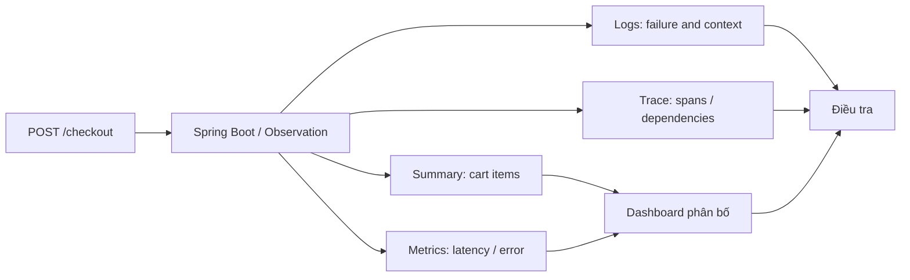

# DistributionSummary trong Micrometer Metrics

Một API Spring Boot tiếp nhận các giỏ hàng có kích thước khác nhau. Đội vận hành muốn biết: **mỗi yêu cầu có bao nhiêu sản phẩm**, bao nhiêu phần trăm giỏ hàng vượt 10 sản phẩm và phân bố kích thước giỏ hàng có thay đổi sau bản phát hành mới hay không. Một bộ đếm tổng số sản phẩm chưa đủ: nó không cho biết mỗi lần checkout nhận bao nhiêu sản phẩm. Một gauge chỉ phản ánh một giá trị tại thời điểm quan sát, cũng không mô tả phân bố các giỏ hàng đã xử lý.

**`DistributionSummary`** của Micrometer là loại meter dùng để **ghi nhận phân bố của những giá trị đo không âm theo từng sự kiện**, chẳng hạn số mục trong giỏ hàng, kích thước payload tính bằng byte, số bản ghi trong batch hoặc số phần tử được xử lý trong một thao tác. Nó theo dõi số mẫu và tổng giá trị; tùy cấu hình/registry, còn có max, histogram buckets và các ước lượng percentile.

Bài này thuộc chương **Metrics nền tảng** của module **SPRING_BOOT_OBSERVABILITY**. Module hướng đến thiết lập observability cho Spring Boot bằng Micrometer Observation, metrics, logs và distributed tracing, cùng cách sử dụng context propagation, tag/cardinality, exporter, sampling và liên kết tín hiệu để điều tra lỗi, độ trễ và hành vi ứng dụng. Hiểu `DistributionSummary` giúp bạn chọn phép đo đúng và biết giới hạn của dữ liệu metrics trước khi kết hợp với log và trace.

## Mục tiêu học tập

Sau bài này, bạn có thể:

1. Giải thích `DistributionSummary` ghi dữ liệu gì và khác `Counter`, `Gauge`, `Timer` ở đâu.
2. Sử dụng `DistributionSummary.builder(...)`, `register(...)` và `record(...)` trong ứng dụng Spring Boot.
3. Đọc ý nghĩa của **count**, **total amount**, **mean**, **max**, histogram và percentile mà không suy luận quá mức từ một điểm dữ liệu.
4. Cấu hình đơn vị đo, các ngưỡng `serviceLevelObjectives(...)` và percentile histogram phù hợp với nhu cầu.
5. Giới hạn cardinality của tags, kiểm soát chi phí time series và hiểu giới hạn của exporter/backend.
6. Kết hợp DistributionSummary với logs, traces và ngữ cảnh ứng dụng để điều tra các trường hợp bất thường.
7. Tránh các lỗi phổ biến như record nhiều lần cho cùng sự kiện, sử dụng đơn vị không nhất quán hoặc gộp percentiles sai.

## 1. DistributionSummary là gì?

`DistributionSummary` là một meter trong thư viện **Micrometer Metrics**. Mỗi lần gọi `record(amount)`, ứng dụng báo rằng **một quan sát mới với giá trị `amount` đã xảy ra**. Chẳng hạn:

```text
Số sản phẩm trong các giỏ hàng được checkout:
request A -> 2
request B -> 5
request C -> 3
request D -> 10
request E -> 5
```

Nếu cả năm giá trị đều được record, DistributionSummary có:

- **Count:** 5 mẫu.
- **Total amount:** 2 + 5 + 3 + 10 + 5 = 25 sản phẩm.
- **Mean:** 25 / 5 = 5 sản phẩm/mẫu.
- **Max:** giá trị lớn nhất được quan sát trong cửa sổ thống kê phù hợp, có thể là 10 ngay sau khi ghi các mẫu trên.

Các phép đo này giúp trả lời hai nhóm câu hỏi:

- **Khối lượng:** trong khoảng thời gian vừa qua đã có bao nhiêu mẫu và tổng giá trị được ghi là bao nhiêu?
- **Phân bố:** các mẫu chủ yếu nhỏ hay lớn, có bao nhiêu mẫu vượt một ngưỡng, p95/p99 ước lượng ra sao nếu histogram/percentile được cấu hình?

DistributionSummary đặc biệt phù hợp cho **kích thước và số lượng trên từng sự kiện**. Nó không đo thời gian thực thi một phương thức theo ngữ nghĩa duration; loại đó thuộc về `Timer`.

### Định nghĩa chính xác “một mẫu”

Một câu hỏi thiết kế quan trọng hơn tên metric là: **mỗi lần gọi `record()` đại diện cho điều gì?**

Ví dụ về số mục giỏ hàng:

- Ghi **một lần cho mỗi request checkout hợp lệ**, ngay sau khi xác thực request: metric thể hiện phân bố kích thước giỏ hàng được tiếp nhận.
- Ghi **một lần sau khi thanh toán thành công**: metric thể hiện phân bố kích thước giỏ hàng của giao dịch thành công.
- Ghi **một lần cho mỗi lần retry**: metric thể hiện phân bố theo lần thử, có thể đếm trùng một giỏ hàng qua nhiều request.

Ba chính sách trên đều có thể có ích nhưng trả lời **câu hỏi khác nhau**. Phải định nghĩa rõ đơn vị mẫu, vị trí instrument và khi nào loại trừ request lỗi. Nếu không, phép so sánh trước/sau triển khai dễ sai.

## 2. DistributionSummary lưu những đại lượng nào?

| Đại lượng | Ý nghĩa | Lưu ý khi phân tích |
|---|---|---|
| `count()` | Số lần ghi nhận mẫu hợp lệ theo triển khai | Không tự bằng số HTTP request nếu một request ghi nhiều mẫu |
| `totalAmount()` | Tổng các giá trị đã ghi | Không thay thế số lượng mẫu; đơn vị phải nhất quán |
| `mean()` hoặc tổng / số mẫu | Giá trị trung bình trên mỗi mẫu | Bị ảnh hưởng bởi outlier; không cho biết đuôi phân bố |
| `max()` | Giá trị lớn nhất trong cửa sổ thống kê mà meter duy trì | Có thể là **time-window max**, không nhất thiết là max kể từ lúc ứng dụng khởi động |
| **Histogram buckets** | Số mẫu thuộc các ngưỡng khi được cấu hình và backend hỗ trợ | Dùng để ước lượng phân bố, tính tỷ lệ vượt ngưỡng |
| **Percentiles** | p50, p95, p99 theo phương pháp/cấu hình meter | Không nên cộng hoặc lấy trung bình các percentiles giữa instance |

Trong một số registry, `count` và `totalAmount` là các đại lượng tăng dần; các query theo thời gian phải xử lý việc ứng dụng restart hoặc meter reset. Max và percentile thường được tính trong một **time window** có thể hết hạn nếu không có thêm mẫu. Khi không có dữ liệu mới, một giá trị max có thể trở về 0 hoặc không còn được hiển thị như kỳ vọng, tùy cấu hình/registry. Không dùng `max()` làm “kỷ lục lớn nhất từ trước đến nay” nếu chưa bảo đảm chính sách lưu trữ.

Giả sử 100 request có kích thước payload trung bình 8 KB. Tổng dung lượng từ mẫu sẽ xấp xỉ 800 KB, nhưng chỉ từ trung bình không biết có bao nhiêu payload 100 KB. Muốn phân tích tail, cần histogram hoặc percentile, hoặc tra cứu trace/log chi tiết theo yêu cầu.

### Số 0 và giá trị âm

Kích thước payload, số phần tử và byte count có ngữ nghĩa **không âm**. `record(0)` có thể mang nghĩa một sự kiện có kích thước bằng 0 nếu định nghĩa metric cho phép. Giá trị âm không có ý nghĩa với DistributionSummary; **không dùng nó để diễn tả giảm số lượng hoặc phần hoàn tiền**. Nên kiểm tra dữ liệu trước khi ghi và chọn loại meter khác cho phép đo có dấu nếu nghiệp vụ thực sự yêu cầu.

Giá trị `NaN`, vô cực hoặc số âm không nên được truyền từ input chưa kiểm soát. Đường thực thi của meter/registry có thể bỏ qua những giá trị không hợp lệ; vì vậy ứng dụng cần thực hiện validation rõ ràng thay vì phụ thuộc vào việc chúng được xử lý thế nào ở một triển khai cụ thể.

## 3. So sánh DistributionSummary, Counter, Gauge và Timer

| Meter | Dùng khi muốn biết | Ví dụ Spring Boot | Vì sao khác DistributionSummary? |
|---|---|---|---|
| **Counter** | Một sự kiện hoặc tổng lượng tăng lên bao nhiêu lần | Số lần thanh toán bị từ chối | Không cần phân bố giá trị trên từng sự kiện |
| **Gauge** | Giá trị tức thời hiện tại | Số message đang nằm trong queue | Không tổng hợp phân bố các sự kiện đã xảy ra |
| **Timer** | Thời gian thực thi và phân bố duration | Thời lượng gọi payment provider | Có ngữ nghĩa thời gian và công cụ đo duration riêng |
| **DistributionSummary** | Phân bố một đại lượng không âm trên mỗi lần record | Payload bytes, số items/giỏ, batch size | Giá trị là số lượng/kích thước, không phải thời lượng |

Các trường hợp cần phân biệt:

- **“Tổng số request checkout”** → `Counter` hoặc dùng count từ HTTP `Timer`/metric có sẵn nếu chính sách đo phù hợp.
- **“Số request đang xử lý”** → `Gauge` hoặc long-task instrumentation phù hợp với ngữ nghĩa.
- **“p95 của thời gian checkout”** → `Timer`.
- **“p95 của số items trên mỗi giỏ hàng”** → `DistributionSummary`.
- **“Có bao nhiêu payload lớn hơn 1 MiB?”** → `DistributionSummary` với histogram buckets/SLO boundaries được cấu hình phù hợp, hoặc một counter chuyên biệt khi cần đếm một điều kiện nghiệp vụ cụ thể.

Không nên sử dụng DistributionSummary đo thời lượng chỉ vì cũng có thể gọi `record(milliseconds)`. `Timer` cung cấp ngữ nghĩa duration và xử lý đơn vị thời gian theo registry; sử dụng nhầm loại meter làm dashboard và phép quy đổi dễ sai.

## 4. Ghi nhận DistributionSummary trong Spring Boot

Một ứng dụng Spring Boot 3.x có **Actuator** và một `MeterRegistry` thích hợp có thể dùng Micrometer Metrics để đăng ký summary. Với Gradle, các dependency cơ bản minh họa là:

```groovy
dependencies {
    implementation 'org.springframework.boot:spring-boot-starter-actuator'
    runtimeOnly 'io.micrometer:micrometer-registry-prometheus'
}
```

`spring-boot-starter-actuator` cung cấp khả năng tích hợp và các endpoint vận hành; Prometheus registry được thêm khi muốn có endpoint scrape metrics theo định dạng phù hợp. Tính khả dụng, dependency và hành vi của exporter cần kiểm tra theo phiên bản Spring Boot/Micrometer đang chạy.

### 4.1. Đăng ký meter một lần và tái sử dụng

Tạo một thành phần metrics dành cho giỏ hàng:

```java
import io.micrometer.core.instrument.DistributionSummary;
import io.micrometer.core.instrument.MeterRegistry;
import org.springframework.stereotype.Component;

@Component
public class CheckoutCartMetrics {
    private final DistributionSummary lineItems;

    public CheckoutCartMetrics(MeterRegistry meterRegistry) {
        this.lineItems = DistributionSummary.builder("checkout.cart.line.count")
                .description("Number of line items per accepted checkout")
                .baseUnit("items")
                .tag("operation", "checkout")
                .serviceLevelObjectives(1, 3, 5, 10, 20)
                .register(meterRegistry);
    }

    public void recordAcceptedCart(int numberOfItems) {
        if (numberOfItems < 0) {
            throw new IllegalArgumentException(
                    "numberOfItems must not be negative");
        }
        lineItems.record(numberOfItems);
    }
}
```

Một service có thể gọi:

```java
import org.springframework.stereotype.Service;

@Service
class CheckoutService {
    private final CheckoutCartMetrics cartMetrics;

    CheckoutService(CheckoutCartMetrics cartMetrics) {
        this.cartMetrics = cartMetrics;
    }

    void acceptCart(Cart cart) {
        // Cart là kiểu nghiệp vụ giả định; validateCart có thể ném lỗi.
        validateCart(cart);

        // Ghi đúng một mẫu cho một giỏ đã được chấp nhận.
        cartMetrics.recordAcceptedCart(cart.lineItems().size());

        // Tiếp tục xử lý checkout...
    }

    private void validateCart(Cart cart) {
        // Minh họa: kiểm tra dữ liệu và chính sách chấp nhận giỏ.
    }
}
```

`Cart` và `lineItems()` là ví dụ về model nghiệp vụ, không phải lớp có sẵn trong Spring Boot. Đoạn `validateCart(...)` chỉ là vị trí minh họa; ứng dụng thật cần logic validation. Ở đây `count` phản ánh **số giỏ được chấp nhận và đã được ghi mẫu**, không tự động là số đơn hàng đã thanh toán thành công.

**Vì sao tạo meter trong constructor?** Registry thường nhận diện meter theo tên và tập tag. Tái sử dụng một instance summary giúp tránh tạo hoặc tra cứu meter lặp lại trong đường xử lý request; quan trọng hơn, tên/tag được giữ cố định để dữ liệu có thể tổng hợp. Không tạo tên/tag động theo từng order hoặc người dùng.

### 4.2. Khi nào dùng `DistributionSummary.builder(...)`?

Builder cho phép cấu hình:

- `description(...)`: mô tả đơn vị mẫu và ý nghĩa của phép đo.
- `baseUnit(...)`: đơn vị cơ sở, ví dụ `bytes` hoặc `items`, để backend và người đọc không hiểu nhầm.
- `tag(...)` hoặc `tags(...)`: phân nhóm theo một số chiều hữu hạn và ổn định.
- `serviceLevelObjectives(...)`: các ngưỡng cần thống kê, phù hợp với nhu cầu cảnh báo/phân tích.
- `publishPercentileHistogram()`: yêu cầu xuất histogram phù hợp nếu registry hỗ trợ.
- `publishPercentiles(...)`: yêu cầu ước lượng một số percentile ở client, với giới hạn về gộp dữ liệu.
- `minimumExpectedValue(...)`, `maximumExpectedValue(...)`: hỗ trợ xác định miền giá trị mong đợi cho cấu hình histogram tương ứng.
- `register(meterRegistry)`: đăng ký meter vào registry.

Cần chọn tính năng phân bố **có chủ đích** vì histogram/percentiles có chi phí bộ nhớ và time series. Một summary chỉ dùng count/sum có thể nhẹ hơn một summary bật nhiều buckets, percentiles và tag.

## 5. Đơn vị đo, scale và tên metric

### 5.1. Ghi giá trị theo một đơn vị duy nhất

`DistributionSummary` không tự biết liệu `record(2048)` là 2048 **bytes**, 2048 **KB** hay 2048 **items**. Nếu hai đường code ghi khác đơn vị vào cùng một meter, tổng và histogram trở nên vô nghĩa.

Với payload:

```java
DistributionSummary payloadBytes = DistributionSummary.builder(
                "checkout.request.payload.size")
        .description("Checkout request payload size")
        .baseUnit("bytes")
        .register(meterRegistry);

payloadBytes.record(requestBodyBytes.length);
```

`requestBodyBytes` là mảng byte đã có trong ví dụ; không cần đọc toàn bộ request body chỉ để ghi metric nếu framework đã cung cấp kích thước tin cậy hơn. Cũng không được log nội dung body nhạy cảm. Nếu hệ thống cần so sánh payload sizes giữa nhiều service, phải thống nhất cách tính kích thước: body chưa nén hay đã nén, có tính headers hay không, đo trước hay sau khi giải nén.

Nếu cần thể hiện MiB trên dashboard, **nên giữ đơn vị gốc là bytes** và quy đổi ở tầng truy vấn/hiển thị. 1 MiB = 1.048.576 bytes; 1 MB thập phân = 1.000.000 bytes. Việc dùng lẫn hai đơn vị dẫn tới ngưỡng kiểm soát kích thước không nhất quán.

### 5.2. `baseUnit(...)` không phải phép đổi giá trị tự động

`baseUnit("bytes")` là metadata về đơn vị, không tự chia một giá trị thành KB, không tự nhân một giá trị MiB thành bytes. Ứng dụng phải truyền `record(...)` bằng chính đơn vị đã khai báo.

Exporter có thể bổ sung, chuẩn hóa hoặc hậu tố tên metric theo naming convention và base unit. Vì vậy hãy **xem tên thực tế ở endpoint/backend** trước khi viết PromQL. Không mặc định chuỗi `checkout.request.payload.size` luôn xuất hiện nguyên dạng trong Prometheus.

### 5.3. Scaling và histogram cho miền giá trị rộng

Dữ liệu kích thước đôi khi trải rộng từ vài bytes đến nhiều MB. Histogram thường dùng các bucket theo ngưỡng; nếu miền giá trị quá rộng hoặc không được giới hạn, cấu hình có thể tốn nhiều buckets hoặc tạo kết quả ước lượng thiếu chính xác ở phần đuôi.

Micrometer cung cấp cấu hình như `minimumExpectedValue(...)`, `maximumExpectedValue(...)`, và với một số bài toán dùng phép đo phân bố còn có cơ chế **scale** giá trị. Dù áp dụng kỹ thuật nào, cần bảo đảm:

1. Mọi sample được ghi và ngưỡng SLO dùng cùng đơn vị sau khi scale.
2. Dashboard biết rõ đơn vị thực sự của meter.
3. Dải giá trị và bucket boundaries phản ánh dữ liệu thực tế, không bị chọn tùy tiện.
4. Chi phí bucket/time series phù hợp với mức lưu lượng và số tổ hợp tag.

Không sử dụng scale để che giấu việc các producer gửi dữ liệu theo đơn vị không nhất quán.

## 6. Histogram buckets và `serviceLevelObjectives(...)`

Một DistributionSummary cơ bản cho biết count và total amount. Muốn trả lời “bao nhiêu phần trăm giỏ có hơn 10 items”, ta cần **thông tin phân bố theo ngưỡng**.

Giả sử ghi:

```text
1, 2, 2, 4, 5, 8, 12, 21 items
```

Với các ngưỡng 1, 5, 10, 20, ta có số mẫu **không vượt ngưỡng**:

| Bucket boundary | Số mẫu có giá trị ≤ ngưỡng | Ý nghĩa |
|---|---:|---|
| ≤ 1 | 1 | Có 1 giỏ tối đa 1 item |
| ≤ 5 | 5 | Có 5 giỏ tối đa 5 items |
| ≤ 10 | 6 | Có 6 giỏ tối đa 10 items |
| ≤ 20 | 7 | Có 7 giỏ tối đa 20 items |
| +Inf | 8 | Tổng số mẫu |

Các histogram bucket kiểu Prometheus có tính **cộng dồn**: bucket ≤ 10 bao gồm cả các mẫu ở bucket ≤ 5. Vì vậy không được cộng các bucket này với nhau để tính số request.

Từ ví dụ, có 8 mẫu, trong đó 6 mẫu ≤ 10; số giỏ **lớn hơn 10** là 8 − 6 = 2, chiếm 25%.

Trong builder:

```java
DistributionSummary cartSizes = DistributionSummary
        .builder("checkout.cart.line.count")
        .baseUnit("items")
        .serviceLevelObjectives(1, 5, 10, 20)
        .register(meterRegistry);
```

Các ranh giới `serviceLevelObjectives(...)` cho phép registry hỗ trợ histogram xuất thống kê theo những ngưỡng này. Không có nghĩa tự tạo alert hoặc bảo đảm “đạt SLO” của dịch vụ. Nó chỉ xác định các **mức cần đo**; cảnh báo và mục tiêu nghiệp vụ phải được xây riêng.

### Histogram mặc định và percentile histogram

Có hai ý tưởng liên quan nhưng khác nhau:

- **SLO boundaries:** chỉ rõ các ngưỡng doanh nghiệp quan tâm, ví dụ 10 hoặc 20 items. Dùng khi cần tỷ lệ vượt một ngưỡng đã biết.
- **Percentile histogram:** xuất các bucket phục vụ ước lượng percentile ở backend khi được hỗ trợ. Dùng khi cần phân bố tổng thể, p95/p99 của nhiều instance hoặc nhiều khoảng thời gian.

`publishPercentileHistogram()` không nên bật đại trà trên mọi meter. Số buckets, miền giá trị và số tổ hợp tag có thể tăng chi phí dữ liệu đáng kể. Các ngưỡng `serviceLevelObjectives(...)` cũng có thể tạo thêm bucket series; cần kiểm tra dữ liệu thực tế từ exporter.

## 7. Percentiles: đọc được gì và không được suy luận gì?

Giả sử summary được cấu hình:

```java
DistributionSummary sizes = DistributionSummary.builder(
                "checkout.cart.line.count")
        .baseUnit("items")
        .publishPercentiles(0.50, 0.95, 0.99)
        .register(meterRegistry);
```

Percentile p95 gần đúng với giá trị mà 95% mẫu nằm không vượt quá ngưỡng đó trong phân bố và cửa sổ được meter thống kê. Tuy nhiên, cần phân biệt:

- **Client-side percentiles (`publishPercentiles`):** được ước lượng trong instance rồi xuất. Thông thường **không thể lấy trung bình hoặc tổng p95 giữa các instance** để có p95 toàn hệ thống.
- **Histogram buckets (`publishPercentileHistogram` hoặc SLO buckets phù hợp):** nếu các buckets được xuất với ranh giới và đơn vị tương thích, backend có thể cộng bucket counts giữa các instance rồi ước lượng percentile trên tập dữ liệu gộp.
- **Ước lượng percentile:** p95 từ histogram là giá trị ước lượng phụ thuộc bucket resolution; không phải nhất thiết là giá trị mẫu thực đã từng xuất hiện.
- **Window thống kê:** các giá trị percentile ở client có thể dựa trên time window và reset/expire theo cấu hình; chúng không đồng nghĩa với thống kê từ đầu đời ứng dụng.

Ví dụ, instance A có 10 request với p95 = 9 items, instance B có 10.000 request với p95 = 2 items. Trung bình (9 + 2) / 2 = 5,5 items **không phải** p95 của toàn bộ 10.010 request.

Nếu mục tiêu là SLO kiểu “ít nhất 99% giỏ hàng có không quá 20 items”, đo bucket ≤ 20 trên tổng count thường trực tiếp và dễ diễn giải hơn việc cố suy luận từ một giá trị p99 đơn lẻ.

## 8. Đọc dữ liệu qua Actuator và Prometheus

Trong Spring Boot, có thể bật endpoint Prometheus phục vụ scrape khi phụ thuộc registry và các cấu hình tương ứng đã được thiết lập:

```yaml
management:
  endpoints:
    web:
      exposure:
        include: health,info,prometheus
```

Endpoint thường ở `/actuator/prometheus` với đường dẫn Actuator mặc định. Cần giới hạn quyền truy cập theo môi trường vận hành; không mở công khai dữ liệu metrics hoặc endpoint quản trị mà thiếu kiểm soát.

Các định dạng được xuất phụ thuộc **loại registry, tên và đơn vị meter, phiên bản Micrometer/Prometheus client**. Một DistributionSummary có thể phát ra count, sum, max hoặc histogram buckets, nhưng tên hậu tố cụ thể cần kiểm tra ngay ở endpoint.

### Ví dụ PromQL minh họa

Giả sử exporter của dự án phát ra các series sau cho metric phân bố giỏ hàng:

```text
checkout_cart_line_count_items_count
checkout_cart_line_count_items_sum
checkout_cart_line_count_items_bucket{le="5"}
checkout_cart_line_count_items_bucket{le="10"}
...
```

Đây là **tên ví dụ** dựa trên naming convention; hãy đối chiếu với endpoint thực tế trước khi dùng. Nếu registry chỉ xuất count/sum mà không có buckets, những truy vấn dựa trên `_bucket` sẽ chưa dùng được.

Tốc độ xuất hiện mẫu (số giỏ/giây), nếu counter count được xuất đúng dạng:

```promql
sum(rate(checkout_cart_line_count_items_count[5m]))
```

Giá trị trung bình mỗi giỏ trong 5 phút:

```promql
sum(rate(checkout_cart_line_count_items_sum[5m]))
/
sum(rate(checkout_cart_line_count_items_count[5m]))
```

Tỷ lệ giỏ **lớn hơn 10 items**, nếu có histogram bucket `le="10"`:

```promql
1 -
(
  sum(rate(checkout_cart_line_count_items_bucket{le="10"}[5m]))
  /
  sum(rate(checkout_cart_line_count_items_count[5m]))
)
```

Để ước lượng p95 theo histogram trên tất cả instance, khi histogram buckets tương thích và có đủ dữ liệu:

```promql
histogram_quantile(
  0.95,
  sum by (le) (
    rate(checkout_cart_line_count_items_bucket[5m])
  )
)
```

Các truy vấn trên cần điều kiện: mẫu có cùng định nghĩa, cùng đơn vị và ranh giới bucket phù hợp; các series được scrape đầy đủ; `rate` có đủ mẫu trong cửa sổ và xử lý đúng counter reset. Nếu muốn p95 **theo provider**, cần thêm `by (le, provider)` ở phần tổng hợp; nếu provider không được khai báo là tag hoặc giá trị không ổn định thì truy vấn đó không thể suy ra dữ liệu đã mất.

**Không tính p95 bằng trung bình các p95 riêng lẻ** và không dùng `sum(count)` thô trong một khoảng dài có restart. Dùng các hàm xử lý counter thích hợp, kiểm tra biểu đồ trước khi đưa vào cảnh báo.

## 9. Tags, cardinality và chi phí vận hành

Micrometer đăng ký meter theo **name và tập tags**. Với DistributionSummary, mỗi tổ hợp tag có thể phát sinh một meter logic riêng; nếu bật histogram, mỗi meter đó còn xuất thêm một số bucket series.

| Tag | Đánh giá | Lý do |
|---|---|---|
| `operation=checkout` | Phù hợp | Một số ít loại thao tác |
| `channel=web|mobile|batch` | Thường phù hợp | Phân nhóm nhỏ, rõ ý nghĩa |
| `cart.type=retail|wholesale` | Có thể phù hợp | Kiểm tra tập giá trị và ích lợi truy vấn |
| `service=checkout-service` | Phù hợp nếu thống nhất cấu hình | Nên cân nhắc resource/application metadata đã có |
| `orderId=...` | Không phù hợp | Gần như khác nhau ở mỗi giao dịch |
| `userId=...` | Không phù hợp | Cardinality rất lớn, có nguy cơ dữ liệu nhạy cảm |
| `traceId=...` | Không phù hợp | Trace ID mang tính duy nhất, gây bùng nổ time series |
| `rawUrl=/orders/123` | Không phù hợp | URL động có ID/query, không thể nhóm ổn định |

Ví dụ: một summary với 3 channels, 4 operations, 5 service instances và 12 buckets có thể sinh tối đa 3 × 4 × 5 × 12 = **720 bucket series**, chưa tính count/sum, các tag khác và các loại meter. Nếu thêm `orderId` khác nhau cho mỗi giỏ, số tổ hợp có thể tăng đến mức backend khó vận hành.

Điều này giải thích vì sao không nên tự tạo DistributionSummary mới trong mỗi request với tag động. Nếu thực sự cần xem một order cụ thể đã có bao nhiêu items, có thể ghi **structured log** hoặc **span attribute** có kiểm soát cho request đó; metrics dùng để nhìn phân bố toàn bộ.

### Không dùng histogram để thay thế dữ liệu nghiệp vụ

Một histogram cho biết số giỏ có kích thước trong một khoảng, nhưng không cung cấp danh sách mã đơn của từng giỏ. Nếu cần điều tra một giao dịch cụ thể, dùng trace ID, log correlation hoặc dữ liệu giao dịch theo quy trình bảo mật phù hợp.

## 10. Phối hợp DistributionSummary với Observation, logs và traces

`DistributionSummary` thuộc **Micrometer Metrics**, còn `Observation` là API bao quanh vòng đời thao tác để handler ghi metrics/tracing theo cấu hình. Chúng có thể tồn tại cùng nhau nhưng **không phải cùng một loại**:

- `Observation.createNotStarted(...).observe(...)` có thể kích hoạt timer/span và sự kiện lifecycle thông qua handlers.
- `DistributionSummary.record(amount)` ghi một **giá trị** cho một phép đo phân bố riêng.
- Chỉ tạo observation cho một thao tác không tự sinh ra summary đo payload size hoặc cart item count. Muốn số đo đó, cần instrument cụ thể hoặc dùng instrumentation cung cấp sẵn.
- Chỉ record summary cũng không tự tạo trace/span/log cho request tương ứng.

Trong một request:



Nếu dashboard cho thấy p99 số items/giỏ tăng bất thường, có thể tiến hành:

1. Khoanh vùng thời gian và nhóm traffic bằng summary/histogram.
2. Xem metric HTTP latency, error rate và kết quả nghiệp vụ để biết thay đổi kích thước giỏ có đi cùng vấn đề khác không.
3. Chọn một số trace chậm của khoảng thời gian đó (nếu được lưu theo sampling) để xem các span gọi inventory, promotion, payment.
4. Đối chiếu logs của cùng `traceId` để kiểm tra timeout, lỗi validation hoặc retry.
5. Kiểm chứng giả thuyết bằng dữ liệu nghiệp vụ hoặc thử nghiệm; việc hai biểu đồ cùng tăng **không chứng minh** quan hệ nhân quả.

### Sampling tracing không tương đương sampling metrics

Sampling có thể khiến chỉ một phần request có trace được lưu. Tuy vậy, DistributionSummary được instrument ở đường request vẫn có thể ghi mỗi mẫu phù hợp vào metrics theo registry và pipeline riêng. Do đó **tập trace đã lưu không đại diện hoàn toàn cho số mẫu summary** nếu có sampling, dropped spans hoặc exporter lỗi.

Nếu không tìm thấy trace tương ứng với một đỉnh metric, hãy kiểm tra sampling, context propagation, exporter, collector và retention. Không nên gắn `traceId` vào tag của summary để “nối” hai hệ thống. Một số backend hỗ trợ **exemplar** để liên kết mẫu đo với trace mà không tăng cardinality của metric labels; tính năng đó tùy stack và cấu hình.

## 11. Một tình huống điều tra thực tế

Giả sử sau bản phát hành Spring Boot mới, `POST /checkout` có độ trễ tăng, nhưng CPU bình thường. Có các tín hiệu giả định:

- Summary `checkout.cart.line.count` cho thấy tổng số giỏ không tăng nhiều, nhưng tỷ lệ giỏ trên 20 items tăng từ 1% lên 8%.
- HTTP server timer cho thấy p95 latency tăng từ 320 ms lên 1,6 giây.
- Logs có nhiều lần báo inventory reservation timeout.
- Một số trace chậm cho thấy thao tác `inventory.reserve` chiếm phần lớn thời gian request.

### Đường điều tra

**Bước 1 — Xác minh ý nghĩa summary.** Giỏ được record trước hay sau validation? Một giỏ retry có bị record nhiều lần không? Số items là line items hay tổng quantity của các line items? Nếu định nghĩa khác trước bản phát hành, thay đổi phân bố có thể do instrumentation chứ không phải người dùng.

**Bước 2 — Xác minh histogram và đơn vị.** Kiểm tra có bucket > 20 phù hợp, các ngưỡng đều theo đơn vị items và các instance cùng cấu hình. Không suy ra thay đổi từ một p95 được tính riêng trên vài instances.

**Bước 3 — Kiểm tra thêm HTTP metrics.** Traffic, error rate, latency theo version và route. Giỏ hàng lớn và độ trễ tăng cùng lúc mới là một quan sát tương quan, chưa phải kết luận.

**Bước 4 — Đọc trace chậm.** Kiểm tra inventory, DB và payment; so sánh trace của giỏ nhỏ và giỏ lớn nếu tìm được mẫu phù hợp. Chú ý sample có thể bị thiên lệch theo chính sách tracing.

**Bước 5 — Đọc log cùng trace ID.** Xem thông điệp timeout, số lần retry, connection pool và trạng thái inventory. Nếu log thiếu trace ID hoặc trace bị đứt qua service, kiểm tra context propagation.

**Bước 6 — Kiểm chứng và đo hồi phục.** Thử mô phỏng giỏ lớn trong môi trường phù hợp, kiểm tra query hoặc batch behavior của inventory, rồi đo lại latency, error rate và bucket của summary sau khi sửa.

**Kết luận hợp lệ:** dữ liệu cho thấy phân bố giỏ có thay đổi đồng thời với độ trễ tăng và có dấu hiệu nghẽn inventory. **Kết luận chưa hợp lệ:** “DistributionSummary chứng minh inventory chậm vì có nhiều giỏ lớn.” Phải có thêm bằng chứng và kiểm chứng.

## 12. Các lỗi thường gặp

| Anti-pattern | Hậu quả | Cách xử lý |
|---|---|---|
| Record một mẫu mỗi lần retry dù muốn đo mỗi checkout | Count và tổng giá trị bị lặp | Định nghĩa đơn vị mẫu, instrument tại vị trí đúng |
| Dùng DistributionSummary ghi milliseconds cho duration | Sai ngữ nghĩa đơn vị, khó so sánh timing | Dùng `Timer` |
| Ghi bytes ở một service, KiB ở service khác cùng metric | Sum/mean/histogram sai | Chọn một đơn vị cơ sở và quy đổi rõ ràng |
| Gắn `userId` hoặc `orderId` làm tags | Bùng nổ time series, rủi ro dữ liệu | Dùng tag phân loại hữu hạn; chi tiết trong log/trace có kiểm soát |
| Lấy trung bình p95 giữa instances | Sai phân bố toàn hệ thống | Gộp buckets tương thích rồi ước lượng, hoặc dùng thống kê gộp đúng |
| Bật `publishPercentileHistogram()` cho mọi summary | Chi phí bucket/time series lớn | Chỉ bật cho phép đo có nhu cầu thật |
| Cộng các histogram buckets kiểu cumulative | Đếm trùng mẫu | Dùng bucket theo đúng ngữ nghĩa “≤ ngưỡng” |
| Coi `max()` là max kể từ khởi động | Hiểu sai time-window max và trạng thái sau khi idle | Kiểm tra cấu hình window/registry; dùng dữ liệu phù hợp |
| Coi `baseUnit(...)` là bộ chuyển đổi | Sai thứ nguyên, ngưỡng SLO sai | Chuẩn hóa số đầu vào trước `record()` |
| Dùng summary để tìm một order cụ thể | Histogram không giữ ID giao dịch | Dùng trace/log hoặc dữ liệu nghiệp vụ |
| Không thấy `_bucket` rồi kết luận summary lỗi | Histogram chưa bật, exporter không hỗ trợ hoặc tên khác | Kiểm tra registry, cấu hình histogram và tên export thực tế |
| Không có trace đi cùng metric → request không tồn tại | Có thể do sampling/propagation/export | Đối chiếu logs, HTTP metrics và telemetry pipeline |

## 13. Checklist trước khi đưa DistributionSummary vào production

Hãy trả lời các câu hỏi sau:

1. **Đại lượng:** đang đo size, count per event hay duration? Nếu là duration, vì sao không dùng `Timer`?
2. **Đơn vị mẫu:** một sample tương ứng request hợp lệ, giao dịch thành công hay một lần thử? Có retry/duplicate không?
3. **Đơn vị giá trị:** bytes, items, records hay một đơn vị khác? Có đồng nhất giữa các producer không?
4. **Giá trị hợp lệ:** có cần ghi zero không? Giá trị âm/NaN/vô cực được xử lý ở lớp validation nào?
5. **Tags:** tên và giá trị có ổn định, cardinality thấp và không chứa ID/PII không?
6. **Histogram:** muốn biết tỷ lệ vượt ngưỡng nào? Có cần SLO buckets hay percentile histogram? Có giới hạn miền giá trị không?
7. **Percentiles:** có đang so sánh/gộp giữa instance đúng cách không?
8. **Registry/exporter:** MeterRegistry của Spring Boot có thực sự nhận meter? Endpoint/backend có series mong đợi không?
9. **Chi phí:** bao nhiêu meters, buckets và time series được sinh ra theo service/instance/version?
10. **Dashboard/SLO:** count, sum, rate, mean và buckets có được truy vấn theo cửa sổ thời gian và xử lý reset đúng không?
11. **Correlation:** khi phát hiện phân bố bất thường, có thể tìm trace/log tương ứng để biết hành vi thực tế không?
12. **Thay đổi schema:** nếu đổi tên/tag/đơn vị, dashboard, alert và lịch sử dữ liệu có kế hoạch chuyển đổi không?

## 14. Tự đánh giá

**Câu 1.** API có 1.000 request checkout, nhưng DistributionSummary count = 1.150. Có chắc Micrometer đếm sai không?

**Gợi ý:** Chưa. Một request có thể bị record nhiều lần do retry hoặc code instrument trùng. Cũng có thể summary đo lần thử chứ không đo request. Kiểm tra chính sách “một mẫu” và khoảng thời gian truy vấn.

**Câu 2.** Metric `cart.items` có count = 5 và total amount = 25. Giá trị trung bình là bao nhiêu?

**Gợi ý:** 25 / 5 = 5 items/mẫu. Không thể suy ra p95 hoặc max chính xác chỉ từ count và tổng.

**Câu 3.** Muốn đo p95 thời gian gọi payment provider, dùng DistributionSummary ghi milliseconds được không?

**Gợi ý:** Nên dùng `Timer` vì đây là duration. Timer hiểu đơn vị thời gian, hỗ trợ đo thời lượng và phân bố của thao tác.

**Câu 4.** Với các mẫu 1, 2, 2, 4, 5, 8, 12, 21; bucket ≤ 10 có 6 mẫu. Tỷ lệ mẫu > 10 là bao nhiêu?

**Gợi ý:** (8 − 6) / 8 = 25%. Không cộng các buckets cumulative.

**Câu 5.** Hai instance có p95 lần lượt 2 và 20 items. Lấy trung bình thành 11 items có đúng là p95 toàn dịch vụ?

**Gợi ý:** Không. Percentiles không thể được gộp bằng trung bình đơn giản; cần histogram buckets tương thích hoặc phân bố gốc có trọng số đúng.

**Câu 6.** Thêm tag `orderId` vào summary có giúp truy tìm giỏ hàng cụ thể mà không ảnh hưởng vận hành không?

**Gợi ý:** Không. Đây là ID có cardinality cao, gây ra rất nhiều time series. Chọn log, trace hoặc dữ liệu giao dịch với chính sách phù hợp.

**Câu 7.** Đã gọi `publishPercentileHistogram()` nhưng không có `_bucket` tại Prometheus. Những điểm nào cần kiểm tra?

**Gợi ý:** MeterRegistry sử dụng, exporter, tên metric thực tế, cấu hình histogram, lúc meter được đăng ký, yêu cầu đã phát sinh mẫu và tình trạng scrape.

## Kết luận

`DistributionSummary` là phép đo phân bố cho **giá trị không âm trên từng sự kiện**, phù hợp với số sản phẩm/giỏ, kích thước payload và batch size. Hiểu **mỗi mẫu đại diện cho gì**, giữ **đơn vị và tags ổn định**, rồi chỉ bật histogram/percentiles khi có nhu cầu là nền tảng để dữ liệu đáng tin và chi phí có thể kiểm soát. Trong Spring Boot, summary bổ sung cho metrics HTTP và Micrometer Observation; nó không tự tạo log, span hay xác định nguyên nhân gốc. Khi gặp phân bố bất thường, hãy liên kết dashboard với structured logs, trace context, sampling và dữ liệu nghiệp vụ để kiểm chứng nguyên nhân thay vì suy luận chỉ từ một con số.
