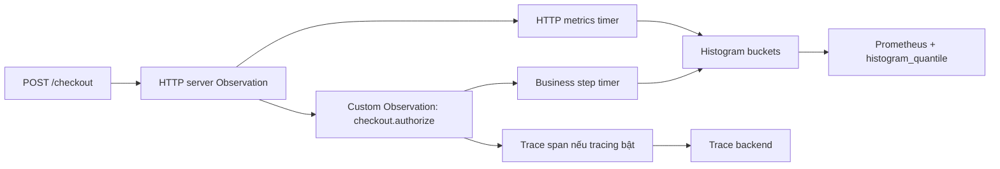

# Percentile

Một API Spring Boot có độ trễ trung bình **236,5 ms**. Dashboard báo con số này khá ổn định, nhưng một số khách hàng vẫn thường xuyên chờ hơn một giây khi thanh toán. Nếu chỉ xem average, nhóm vận hành khó biết trải nghiệm chậm tập trung ở đâu. **Percentile** cho phép nhìn vào *phân phối* thời gian phản hồi: bao nhiêu phần trăm request được xử lý trong một ngưỡng, phần “đuôi” chậm đến mức nào và thay đổi ra sao theo thời gian.

Trong chương **Metrics nền tảng** của module **SPRING_BOOT_OBSERVABILITY**, percentile là công cụ thiết yếu khi xây dựng metrics bằng Micrometer và Spring Boot Actuator, kết hợp logs và distributed tracing để điều tra lỗi, độ trễ và hành vi ứng dụng. Nắm vững percentile cũng giúp bạn chọn histogram buckets, thiết kế SLI/SLO, tránh tag có cardinality cao, cấu hình exporter và hiểu vì sao trace lấy mẫu không thể thay thế số liệu đo phân phối của toàn bộ traffic.

Sau bài học, bạn có thể:

1. Giải thích p50, p90, p95, p99 và phân biệt percentile với average, maximum, error rate.
2. Hiểu percentile phụ thuộc tập request, khoảng thời gian và thuật toán tính.
3. Phân biệt percentile tính ở từng instance với percentile ước lượng từ histogram có thể tổng hợp.
4. Cấu hình Micrometer Timer và Spring Boot Actuator để tạo histogram cho độ trễ HTTP và thao tác nghiệp vụ.
5. Viết và đọc truy vấn PromQL `histogram_quantile()`, đồng thời tránh lỗi trung bình các p95.
6. Chọn percentile và ngưỡng latency phù hợp với mục tiêu trải nghiệm người dùng; biết khi nào cần đối chiếu log/trace.
7. Nhận diện các vấn đề bucket, traffic thấp, cardinality, sampling và pipeline export khiến percentile bị hiểu sai.

## 1. Percentile là gì?

**Percentile thứ p** của một tập quan sát là một mốc trên phân phối giá trị, dùng để mô tả khoảng **p% số quan sát có giá trị không vượt quá mốc đó** theo cách tính quantile đang sử dụng. Với độ trễ request:

- **p50**: xấp xỉ một nửa request có thời gian phản hồi không vượt quá giá trị này; thường được gọi là median.
- **p90**: khoảng 90% request không vượt quá giá trị này; chú ý 10% phần đuôi chậm.
- **p95**: khoảng 95% request không vượt quá giá trị này; chú ý 5% phần đuôi.
- **p99**: khoảng 99% request không vượt quá giá trị này; tập trung vào 1% phần đuôi chậm.

Ví dụ, **p95 = 750 ms** trong cửa sổ 5 phút có nghĩa là khoảng 95% các request trong tập được đo hoàn tất trong không quá 750 ms. Nó **không** có nghĩa 95% request đều mất đúng 750 ms, cũng không có nghĩa 5% request chậm hơn một ngưỡng SLA bất kỳ nếu chưa định nghĩa SLA đó.

> Percentile phải luôn đi cùng ngữ cảnh: **của metric nào, ở tầng đo nào, cho những route/status nào, trong khoảng thời gian nào và từ những instance nào?** Một con số p95 tách khỏi các thông tin này rất dễ bị diễn giải sai.

### 1.1. Ví dụ 20 request được sắp tăng dần

Giả sử thời gian phản hồi của 20 request, đơn vị **ms**, đã được sắp xếp:

```text
 50   60   70   80   90
100  100  110  120  130
150  160  180  200  220
260  300  400  750 1200
```

Một cách minh họa đơn giản là **nearest-rank**: chọn phần tử ở vị trí `ceil(p × N)` khi đánh số từ 1 đến N. Với N = 20:

| Chỉ số | Vị trí (nearest-rank) | Giá trị |
| --- | ---: | ---: |
| p50 | `ceil(0.50 × 20) = 10` | 130 ms |
| p90 | `ceil(0.90 × 20) = 18` | 400 ms |
| p95 | `ceil(0.95 × 20) = 19` | 750 ms |
| p99 | `ceil(0.99 × 20) = 20` | 1.200 ms |
| Average | Tổng giá trị / 20 | 236,5 ms |
| Maximum | Giá trị lớn nhất | 1.200 ms |

**Lưu ý:** nearest-rank chỉ là công thức dễ học. Các thư viện thống kê có nhiều quy ước nội suy quantile; Micrometer, histogram và Prometheus có cách biểu diễn/tính toán riêng. Chẳng hạn median của 20 số theo quy ước trung bình của hai phần tử giữa là (130 + 150)/2 = **140 ms**, khác nearest-rank p50 là 130 ms. Khi so sánh công cụ, phải hiểu thuật toán và sai số cho phép; đừng mặc định mọi p50/p95 đều trùng tuyệt đối.

Điểm đáng chú ý của ví dụ: **average = 236,5 ms**, nhưng p95 = 750 ms và request chậm nhất mất 1.200 ms. Average đã che một phần đáng kể trải nghiệm ở “đuôi” của phân phối.

### 1.2. Các chỉ số này trả lời những câu hỏi khác nhau

| Chỉ số | Câu hỏi phù hợp | Không thể tự kết luận |
| --- | --- | --- |
| Average | Tổng thời gian xử lý trung bình trên các request được đo là bao nhiêu? | Không cho biết rõ tail latency |
| p50 | Request điển hình nhanh/chậm thế nào? | Không cho biết người dùng ở phần đuôi |
| p95/p99 | Một phần nhỏ request chậm tới mức nào? | Không tự xác định nguyên nhân của độ trễ |
| Maximum | Request chậm nhất trong tập là bao nhiêu? | Một outlier có đại diện cho xu hướng không |
| Request count/rate | Có bao nhiêu request/giây? Mẫu có đủ lớn không? | Tốc độ không tự nói lên chất lượng latency |
| Error rate | Bao nhiêu request thất bại theo định nghĩa SLI? | Không thay thế phân phối độ trễ |

Một hệ thống có p99 tốt nhưng tỷ lệ lỗi cao vẫn không đạt yêu cầu. Ngược lại, HTTP `200` nhưng mất 10 giây có thể là trải nghiệm thất bại với người dùng. Vì vậy, trong điều tra thực tế, percentile thường đi cùng **traffic, errors và saturation**.

## 2. Percentile phụ thuộc vào tập mẫu và cửa sổ thời gian

Không có một giá trị p95 “vĩnh viễn” của service. Nó thay đổi theo những request được tính và thời gian quan sát.

### 2.1. Chọn đúng tập request

Ví dụ một endpoint `POST /checkout` có hai nhóm:

- 9.000 request thành công, xử lý nhanh.
- 1.000 request timeout sau nhiều giây.

Nếu dashboard chỉ tính timer của nhánh thành công thì p95 có thể thấp dù 10% người dùng gặp timeout. Nếu tính cả tất cả status nhưng chỉ đo từ ứng dụng, nó vẫn có thể bỏ sót các request bị gateway từ chối trước khi vào Spring Boot.

Hãy xác định rõ:

- Điểm đo: trình duyệt, gateway, HTTP server hay bước nghiệp vụ.
- Tập route: một route chuẩn hóa hay toàn bộ API.
- Status/outcome: bao gồm `2xx`, `4xx`, `5xx`, timeout và cancellation đến mức nào.
- Những instance/service version/môi trường nào được tính.
- Khoảng thời gian: 1 phút, 5 phút, 1 giờ hay một cửa sổ SLO dài hơn.

**Không gộp tất cả route chỉ vì có cùng metric name** nếu câu hỏi thực sự là độ trễ của checkout. Một route health rất nhanh có thể khiến percentile tổng trông đẹp hơn trong khi checkout đang chậm.

### 2.2. Cửa sổ ngắn và dài cho hai góc nhìn

| Cửa sổ | Ưu điểm | Giới hạn |
| --- | --- | --- |
| 1 phút | Nhạy với thay đổi nhanh | Ít mẫu, dễ dao động mạnh |
| 5 phút | Hữu ích khi điều tra một sự cố đang diễn ra | Vẫn cần kiểm tra traffic và bucket |
| 30 phút / 1 giờ | Ổn định hơn, thấy xu hướng dài hơn | Có thể làm mờ spike ngắn |
| 7 ngày / 30 ngày | Hữu ích với đánh giá mục tiêu dài hạn khi dữ liệu phù hợp | Không dùng để suy luận chính xác thời điểm của một sự cố nhỏ |

Khoảng thời gian và phương pháp tổng hợp cũng khác nhau: percentile tính trên *toàn bộ mẫu trong cửa sổ* thường không bằng trung bình các percentile của những cửa sổ nhỏ. Một p95 của từng phút **không thể cộng hoặc lấy trung bình** để có p95 của một giờ.

### 2.3. Có bao nhiêu request thì p99 mới đáng tin?

Với 20 request, nearest-rank p99 rơi vào request lớn nhất. Với 100 request, 1% là khoảng một request; những thay đổi nhỏ có thể làm p99 nhảy rất mạnh. Dữ liệu ở các route ít traffic thường cần cửa sổ dài hơn hoặc ngưỡng tĩnh có ý nghĩa kinh doanh.

Nếu metric bucket không có đủ quan sát trong cửa sổ, một phép ước lượng p99 có thể dao động, không có giá trị hoặc phản ánh rất ít request. **Luôn xem request count cùng với percentile.**

## 3. Percentile tính trực tiếp và percentile từ histogram

Micrometer hỗ trợ các cách mô tả phân phối, nhưng có một khác biệt đặc biệt quan trọng trong hệ thống chạy nhiều instance.

### 3.1. Client-side percentile

Một số registry và cấu hình có thể xuất **percentile đã được tính tại từng meter/instance**. Ví dụ mỗi instance tự công bố p95 trong cửa sổ của nó.

Ưu điểm:

- Có sẵn p50/p95/p99 cho từng instance.
- Thuận tiện khi chẩn đoán một tiến trình cụ thể.

Hạn chế:

- Percentile là một hàm **không cộng gộp tuyến tính**.
- Không thể lấy trung bình p95 của các pod để có p95 của toàn cluster.
- Tần suất request và phân phối mỗi instance có thể rất khác nhau.

Giả sử:

| Instance | Request trong cửa sổ | p95 riêng |
| --- | ---: | ---: |
| A | 100 | 100 ms |
| B | 9.900 | 800 ms |

Trung bình hai p95 = (100 + 800) / 2 = **450 ms**. Con số đó **không phải** p95 thật của 10.000 request. Kể cả “trung bình có trọng số theo số request” của hai p95 vẫn không cho ra percentile chính xác vì ta đã mất thông tin về hình dạng phân phối.

### 3.2. Histogram và bucket counts

**Histogram** chia các giá trị quan sát thành các khoảng thời gian có ranh giới (buckets). Với histogram kiểu cổ điển (classic histogram) của Prometheus, bộ đếm bucket mang label `le` (*less than or equal*, không vượt quá ngưỡng) và có tính **tích lũy**.

Ví dụ các bucket đã chuẩn hóa trên một khoảng đo:

| `le` (giây) | Số request có duration ≤ ngưỡng |
| --- | ---: |
| 0.1 | 120 |
| 0.3 | 620 |
| 0.5 | 840 |
| 1.0 | 970 |
| `+Inf` | 1.000 |

Ở đây, có **840/1.000 = 84%** request được ghi nhận không vượt quá **500 ms**, và **970/1.000 = 97%** không vượt quá 1 giây.

Histogram bucket counts có thể **cộng các series** tương ứng từ nhiều instance nếu metric và bucket boundaries giống nhau. Sau khi cộng, backend ước lượng percentile từ đường phân phối tích lũy bằng `histogram_quantile()`.

**Đánh đổi:** percentile từ histogram thường là **ước lượng**. Nếu p95 nằm trong bucket 500 ms đến 1 giây, backend không biết vị trí chính xác của từng request trong khoảng đó; phương pháp nội suy cho một kết quả xấp xỉ. Thêm ranh giới bucket phù hợp cải thiện độ phân giải ở những ngưỡng quan trọng nhưng tăng số series và chi phí quan sát.

### 3.3. So sánh

| Tính chất | Client-side percentile | Histogram buckets |
| --- | --- | --- |
| Kết quả thường thấy | p50/p95/p99 của từng meter | Bucket counts; quantile được truy vấn ở backend |
| Gộp nhiều instance | **Không** thể gộp các percentile trực tiếp | Có thể gộp bucket counts tương thích trước khi tính quantile |
| Mức chính xác | Phụ thuộc thuật toán/cửa sổ của client | Phụ thuộc bucket boundaries và nội suy |
| Chi phí | Phụ thuộc implementation và số quantiles | Nhiều time series hơn khi thêm buckets/tags |
| Dùng cho Prometheus toàn cluster | Không lấy average các quantiles | Thường chọn `histogram_quantile()` trên bucket rates đã cộng |

Trong Micrometer, `publishPercentiles(...)` và `publishPercentileHistogram()` là hai cấu hình khác nhau. Đừng coi percentile công bố theo từng pod là một đại lượng có thể `sum` hoặc `avg` như request count.

## 4. Prometheus tính p95 từ histogram như thế nào?

Với Micrometer Timer tên `http.server.requests`, khi cấu hình Prometheus histogram phù hợp, các series kiểu classic histogram thường có tên theo đơn vị giây, chẳng hạn:

```text
http_server_requests_seconds_bucket{method="POST",uri="/checkout",le="0.3",...}
http_server_requests_seconds_count{method="POST",uri="/checkout",...}
http_server_requests_seconds_sum{method="POST",uri="/checkout",...}
```

Tên chính xác phụ thuộc registry, phiên bản, convention và cấu hình export; hãy kiểm tra nội dung thật từ `/actuator/prometheus`.

### 4.1. p95 của tất cả instance cho một route

```promql
histogram_quantile(
  0.95,
  sum by (le) (
    rate(
      http_server_requests_seconds_bucket{
        method="POST",
        uri="/checkout"
      }[5m]
    )
  )
)
```

Giải thích theo thứ tự:

1. Bộ lọc chọn request `POST /checkout`.
2. `rate(...[5m])` tính tốc độ tăng của từng bucket counter trong 5 phút, có xử lý các reset counter trong giới hạn dữ liệu.
3. `sum by (le)` cộng các bucket tương ứng giữa các instance/pod, loại các chiều triển khai không cần phân tách.
4. `histogram_quantile(0.95, ...)` ước lượng p95 trên phân phối histogram đã gộp.

Kết quả được biểu diễn theo **giây**, không phải mili giây. Ví dụ `0.75` là khoảng **750 ms**.

Nếu muốn so sánh từng route:

```promql
histogram_quantile(
  0.95,
  sum by (le, uri) (
    rate(http_server_requests_seconds_bucket[5m])
  )
)
```

Truy vấn trên tính riêng từng `uri` sau khi gộp các instance. Trong thực tế, thêm các filters cần thiết như `job`, `service`, `environment`, `method` để không gộp dữ liệu của nhiều ứng dụng hoặc môi trường có cùng tên metric.

**Bẫy lớn:** không thay `sum by (le)` bằng `avg` của những con số p95 có sẵn. Thao tác đúng là **gộp bucket counts trước**, rồi mới áp dụng hàm quantile. Bucket boundaries và đơn vị đo phải tương thích; khi nhiều version xuất bucket khác nhau, việc gộp có thể cho kết quả gây hiểu nhầm.

### 4.2. p99 của một endpoint và p50 của cùng endpoint

```promql
histogram_quantile(
  0.99,
  sum by (le) (
    rate(http_server_requests_seconds_bucket{uri="/checkout"}[10m])
  )
)
```

```promql
histogram_quantile(
  0.50,
  sum by (le) (
    rate(http_server_requests_seconds_bucket{uri="/checkout"}[10m])
  )
)
```

Đặt p50 và p99 cùng nhau giúp phát hiện liệu **toàn bộ phân phối chậm hơn** hay chỉ **đuôi chậm bị kéo dài**. Nếu p50 ổn định nhưng p99 tăng mạnh, giả thuyết điều tra có thể liên quan tới lock, retry, queue, một dependency chậm ở một phần request hoặc GC pause. Các percentile **không tự chứng minh** một nguyên nhân cụ thể.

### 4.3. Đừng bỏ qua lượng request

```promql
sum(
  rate(
    http_server_requests_seconds_count{
      method="POST",
      uri="/checkout"
    }[5m]
  )
)
```

Truy vấn này cho request/giây trung bình trong cửa sổ. Một p99 đột biến khi gần như không có request khác về ý nghĩa với p99 đột biến trong lúc hệ thống nhận hàng nghìn request/giây.

## 5. Percentile không thay thế ngưỡng SLO

Một mục tiêu phổ biến: “**Ít nhất 99% request checkout hoàn tất trong 500 ms**.” Đây là một yêu cầu **tỷ lệ request đáp ứng ngưỡng**, không chỉ là “p99 dưới 500 ms”.

Với classic histogram có bucket `le="0.5"` (đơn vị giây), bạn có thể tính tỷ lệ request hoàn tất trong ≤ 500 ms bằng:

```promql
sum(
  rate(
    http_server_requests_seconds_bucket{
      uri="/checkout",
      le="0.5"
    }[5m]
  )
)
/
sum(
  rate(
    http_server_requests_seconds_count{
      uri="/checkout"
    }[5m]
  )
)
```

Kết quả `0.98` biểu thị khoảng 98% request **trong tập được đo** nằm trong ngưỡng. Nếu muốn hiện phần trăm, nhân 100 ở dashboard. **Điều kiện:** histogram thực sự có bucket ranh giới 0,5 giây và tử/mẫu cùng tập nhãn, status, môi trường và phạm vi request.

Có liên hệ giữa SLO và percentile: nếu ít nhất 99% request ở ≤ 500 ms thì percentile 99 theo định nghĩa tương thích cũng không vượt quá khoảng 500 ms. Nhưng **đọc trực tiếp tỷ lệ trong bucket đúng ngưỡng** thường minh bạch hơn cho SLI; việc ước lượng p99 bằng nội suy có thể biến động theo cách chọn buckets.

Ngoài ra:

- Một bucket HTTP ở ứng dụng không nhìn thấy các request đã bị gateway từ chối trước khi tới ứng dụng.
- Nếu khách hàng cần xác nhận thanh toán thành công, HTTP `200` của endpoint không nhất thiết đồng nghĩa transaction thành công.
- Có thể cần SLI riêng cho **availability**, **business success** và **latency**, với mẫu số được định nghĩa rõ.

**Thận trọng với request lỗi và timeout:** Nếu timeout tại gateway kết thúc mà timer HTTP server ở Spring Boot không ghi nhận cùng một ranh giới, SLO “trải nghiệm người dùng” nên dựa vào phép đo bên ngoài hoặc kết hợp dữ liệu phù hợp, thay vì coi percentile server là toàn bộ trải nghiệm.

## 6. Cấu hình percentiles/histogram trong Spring Boot

### 6.1. Dependency nền tảng

Ví dụ dùng **Spring Boot 3.x**, Maven với dependency management của Spring Boot và một ứng dụng web (đã có `spring-boot-starter-web` hoặc starter tương ứng).

```xml
<!-- Actuator và Micrometer Metrics/Observation infrastructure -->
<dependency>
    <groupId>org.springframework.boot</groupId>
    <artifactId>spring-boot-starter-actuator</artifactId>
</dependency>

<!-- Prometheus exporter/scrape endpoint -->
<dependency>
    <groupId>io.micrometer</groupId>
    <artifactId>micrometer-registry-prometheus</artifactId>
</dependency>
```

Prometheus registry cho phép xuất metrics ở endpoint khi được cấu hình. Bạn vẫn cần Prometheus server hoặc backend tương thích để scrape/nhận dữ liệu và xây dashboard.

### 6.2. Histogram cho `http.server.requests`

Một cấu hình minh họa trong `application.yml`:

```yaml
management:
  endpoints:
    web:
      exposure:
        include: health,metrics,prometheus

  metrics:
    distribution:
      percentiles-histogram:
        http.server.requests: true

      minimum-expected-value:
        http.server.requests: 1ms

      maximum-expected-value:
        http.server.requests: 10s

      slo:
        http.server.requests: 300ms,500ms,1s
```

Ý nghĩa:

- `percentiles-histogram: true` yêu cầu Micrometer xuất histogram hỗ trợ ước lượng quantile ở backend tương thích.
- `minimum-expected-value` và `maximum-expected-value` giúp giới hạn phạm vi histogram được tạo, tránh tạo dải buckets không cần thiết. **Chúng không phải ngưỡng tự động loại bỏ request**; cần kiểm chứng cách registry xử lý giá trị nằm ngoài khoảng mong đợi.
- `slo` thêm các ranh giới thời gian có ý nghĩa, ví dụ 300 ms, 500 ms và 1 giây. Ranh giới **500 ms** hữu ích để tính tỷ lệ request đạt latency objective.
- Việc bật histogram làm tăng lượng series xuất ra, đặc biệt khi có nhiều tổ hợp tags/instances.

Tên `http.server.requests` là **meter name bên trong Micrometer**. Trong Prometheus, tên và đơn vị có thể được chuyển thành `http_server_requests_seconds_*`. Cùng một cấu hình cũng không bảo đảm backend đang dùng hỗ trợ đúng kiểu histogram/quantile mà bạn mong đợi; hãy xác minh dữ liệu thật.

Nếu muốn xem quantile trực tiếp từ meter từng instance, Micrometer còn có cấu hình `percentiles`, chẳng hạn:

```yaml
management:
  metrics:
    distribution:
      percentiles:
        http.server.requests: 0.5,0.95,0.99
```

Đây là **một lựa chọn khác**, phục vụ client-side quantiles; không nên lấy trung bình p95 này trên các pod. Với Prometheus và mục tiêu percentile toàn service, thường ưu tiên bucket histogram và `histogram_quantile()` sau khi gộp.

**Lưu ý cấu hình:** khi dùng đồng thời `percentiles` và `percentiles-histogram`, có thể phát sinh thêm series và chi phí. Chỉ bật những dạng thực sự cần cho dashboard/SLO.

**Lưu ý phiên bản:** Spring Boot 4.x thay đổi một số starter và property liên quan đến tracing/metrics. Cần đối chiếu Spring Boot Actuator reference của phiên bản đang triển khai. Cách diễn giải percentile và nguyên tắc gộp histogram không phụ thuộc riêng vào Spring Boot 3.x.

### 6.3. Xem metric tại Actuator

Sau khi khởi động ứng dụng và tạo một vài request:

```bash
curl -fsS http://localhost:8080/actuator/metrics/http.server.requests
curl -fsS http://localhost:8080/actuator/prometheus
```

Địa chỉ ở đây giả định Actuator chạy trên cổng 8080 và endpoint được expose cho môi trường lab.

- `/actuator/metrics/http.server.requests` giúp xác nhận meter có mặt và xem available tags/measurements; đây không phải endpoint xuất toàn bộ các bucket Prometheus theo cùng dạng.
- `/actuator/prometheus` cho biết series được registry export thật, bao gồm các bucket khi cấu hình phù hợp.
- Không thấy timer trước khi có request được instrument là chuyện có thể xảy ra.
- Với production, giới hạn quyền truy cập Actuator, dùng mạng quản trị và xác thực/phân quyền phù hợp; không tùy tiện công khai toàn bộ metrics ra Internet.

## 7. Histogram cho bước nghiệp vụ dùng Micrometer Timer

Metric HTTP server hữu ích nhưng chỉ mô tả toàn request. Nếu checkout gồm xác thực, kiểm tra tồn kho và gọi thanh toán, bạn có thể muốn percentile cho **bước thanh toán**.

Micrometer `Timer` đo duration, có thể xuất count, total time, histogram và percentile theo cấu hình.

Ví dụ dùng `Timer.Sample` để chọn outcome khi biết kết quả:

```java
import io.micrometer.core.instrument.MeterRegistry;
import io.micrometer.core.instrument.Timer;
import org.springframework.stereotype.Service;

import java.time.Duration;

@Service
public class PaymentTimingService {
    private final MeterRegistry meterRegistry;
    private final PaymentGateway gateway;

    public PaymentTimingService(MeterRegistry meterRegistry,
                                PaymentGateway gateway) {
        this.meterRegistry = meterRegistry;
        this.gateway = gateway;
    }

    public boolean authorize(String provider, String token) {
        String providerTag = switch (provider == null ? "" : provider) {
            case "primary" -> "primary";
            case "backup" -> "backup";
            default -> "other";
        };

        Timer.Sample sample = Timer.start(meterRegistry);
        String outcome = "error";

        try {
            boolean approved = gateway.authorize(token);
            outcome = approved ? "approved" : "declined";
            return approved;
        } finally {
            Timer timer = Timer.builder("checkout.payment.duration")
                    .description("Duration of payment authorization")
                    .tag("provider", providerTag)
                    .tag("outcome", outcome)
                    .publishPercentileHistogram()
                    .minimumExpectedValue(Duration.ofMillis(1))
                    .maximumExpectedValue(Duration.ofSeconds(10))
                    .serviceLevelObjectives(
                            Duration.ofMillis(300),
                            Duration.ofMillis(500),
                            Duration.ofSeconds(1))
                    .register(meterRegistry);
            sample.stop(timer);
        }
    }
}

interface PaymentGateway {
    boolean authorize(String paymentToken);
}
```

Ở đây:

1. `Timer.Sample` bắt đầu đo trước khi gọi gateway.
2. `provider` được chuẩn hóa vào một tập hữu hạn; không dùng tên host động hoặc merchant ID.
3. `outcome` nhận một trong `approved`, `declined`, `error`, không dùng raw exception message.
4. `finally` ghi nhận duration kể cả khi thao tác ném exception.
5. Histogram được cấu hình cho timer nghiệp vụ; qua Prometheus registry có thể xuất buckets dùng trong `histogram_quantile()`.

**Điểm cần phân biệt:** Code này sử dụng Micrometer `Timer` trực tiếp. Trong ứng dụng có custom **Micrometer Observation** cùng ranh giới, metrics handler cũng có thể tạo timer. Đừng tự tạo thêm một timer với cùng mục đích nếu Observation đã đo đủ, vì sẽ có hai phép đo trùng hoặc bị hiểu nhầm. Có thể thay bằng `Observation.createNotStarted(...).observe(...)` hoặc manual observation có `stop()` trong `finally`, sau đó cấu hình histogram cho tên meter tương ứng.

Ví dụ giữ `token` chỉ trong business call. Không thêm payment token, user ID, order ID hoặc chi tiết PII vào tags, trace attributes hay logs.

## 8. Kết hợp với Micrometer Observation

**Observation** là cách instrument một lần thực thi với lifecycle và context; **Timer** là công cụ thống kê duration. Trong Spring Boot, một observation có thể đi qua metrics handler để cập nhật timer và qua tracing handler để tạo span (nếu các tích hợp được cấu hình).



Ví dụ một custom observation:

```java
import io.micrometer.observation.Observation;
import io.micrometer.observation.ObservationRegistry;
import org.springframework.stereotype.Service;

@Service
public class CheckoutObservationService {
    private final ObservationRegistry registry;
    private final PaymentGateway gateway;

    public CheckoutObservationService(ObservationRegistry registry,
                                      PaymentGateway gateway) {
        this.registry = registry;
        this.gateway = gateway;
    }

    public boolean authorize(String token) {
        return Observation.createNotStarted("checkout.authorize", registry)
                .lowCardinalityKeyValue("operation", "authorize")
                .lowCardinalityKeyValue("dependency", "payment")
                .observe(() -> gateway.authorize(token));
    }
}
```

Trong ứng dụng có metrics handler, có thể cấu hình histogram cho meter `checkout.authorize` như với `http.server.requests`, theo property của phiên bản đang dùng. Với tracing handler, observation tương ứng có thể tạo span để xem phần thời gian gọi payment trong một request cụ thể.

**Chú ý lifecycle:** một observation không được `stop()` đúng chỗ có thể khiến timer/trace sai. `observe(...)` thích hợp cho thao tác đồng bộ; với `CompletableFuture` hoặc Reactor `Mono`, không dùng `observe(() -> futureOrMono)` rồi nghĩ rằng đã đo tới khi công việc bất đồng bộ hoàn tất. Cần gắn thời điểm kết thúc vào completion/cancellation của công việc theo ranh giới đã định.

### 8.1. Percentile và tracing trả lời hai câu hỏi khác nhau

- **Percentile từ metrics**: Bao nhiêu request chậm? Xu hướng p95/p99 thay đổi ra sao trên hàng nghìn request?
- **Trace**: Một request mẫu đã đi qua những bước nào, bước nào mất nhiều thời gian?
- **Logs**: Có exception, retry, timeout, fallback hoặc lỗi nghiệp vụ gì trong cùng ngữ cảnh?

Ví dụ p99 `checkout.authorize` tăng từ 400 ms lên 1,8 giây. Trace mẫu cho thấy span payment client chiếm 1,5 giây. Cần đối chiếu metrics connection pool, retry count, error logs và dependency latency trước khi kết luận nguyên nhân gốc.

**Sampling của traces không đồng nhất với histogram sampling.** Nếu tracing chỉ lưu 10% trace, không thể lấy phân phối duration của *những trace còn lại* thay cho metric histogram của toàn bộ request một cách mặc nhiên, nhất là khi sampler ưu tiên trace lỗi/chậm. Histogram từ metrics có thể tiếp tục đo toàn bộ instrumentation dù trace đã bị sampling loại.

## 9. Thiết kế buckets theo ngưỡng kinh doanh

Bucket càng nhiều thì percentile có thể mịn hơn tại các khoảng được phủ, nhưng số time series, bộ nhớ và chi phí export/truy vấn tăng.

Giả sử doanh nghiệp quan tâm ba ngưỡng:

- **300 ms**: kỳ vọng thao tác nhanh.
- **500 ms**: ngưỡng độ trễ cho trải nghiệm checkout.
- **1 giây**: ngưỡng bị coi là chậm rõ rệt.

Đảm bảo histogram có buckets đúng các điểm này sẽ giúp bạn tính **tỷ lệ đáp ứng ngưỡng** trực tiếp; quan trọng hơn việc theo đuổi p99 với độ chính xác giả tạo.

Ví dụ:

| Bucket `le` | Tổng request ≤ ngưỡng | Tỷ lệ tích lũy |
| --- | ---: | ---: |
| 0.3 s | 6.000 | 60% |
| 0.5 s | 8.500 | 85% |
| 1.0 s | 9.700 | 97% |
| +Inf | 10.000 | 100% |

Từ dữ liệu này có thể khẳng định **85%** request hoàn tất trong 500 ms. p95 nằm giữa các ranh giới 0,5 và 1 giây nhưng **không xác định chính xác thời gian của request thứ 9.500** nếu chỉ biết bốn buckets này. `histogram_quantile()` dùng nội suy để ước lượng vị trí của p95 trong bucket.

### 9.1. Sai số do bucket thưa

Nếu histogram chỉ có các ranh giới 100 ms, 1 giây và 10 giây, một p95 thực sự là 600 ms có thể bị ước lượng khá xa tùy phân phối trong bucket. Một kết quả `histogram_quantile()` có nhiều chữ số thập phân **không đồng nghĩa phép đo chính xác từng mili giây**.

Vì thế:

1. Chọn buckets quanh vùng SLO và nơi bạn cần quyết định vận hành.
2. Giữ bucket schema nhất quán giữa các instance nếu muốn tổng hợp.
3. Giới hạn các tag tạo thêm chiều time series.
4. Theo dõi mức tiêu thụ tài nguyên của metrics pipeline.
5. Kiểm chứng số bucket thực sự xuất ra trong Prometheus; cấu hình nominal không bảo đảm mọi registry/backend dùng cùng cách export.

### 9.2. Không phải cứ bật histogram là nên dùng p99 cho mọi cảnh báo

Một dịch vụ có 2 request/phút và một dịch vụ có 20.000 request/phút cần chiến lược theo dõi khác nhau. Với lượng request nhỏ, percentile 5 phút có thể không ổn định. Các ngưỡng lỗi rõ ràng, số request vượt SLO, histogram dài hơn hoặc phép thử tổng hợp có thể hữu ích hơn.

## 10. Cardinality: mỗi tag có thể nhân chi phí histogram

Giả sử timer có 12 route, 5 status, 3 channel và 10 instance:

```text
12 × 5 × 3 × 10 = 1.800 tập label
```

Nếu mỗi tập label có 40 bucket series, số bucket series lý thuyết có thể lên tới **72.000**, chưa kể `_sum` và `_count`. Thêm một `userId` với hàng trăm nghìn giá trị sẽ làm hệ thống metrics khó vận hành.

Tag nên có tập giá trị nhỏ, ổn định:

| Tag | Phù hợp? | Lý do |
| --- | --- | --- |
| `uri=/orders/{id}` | Có | Route được chuẩn hóa |
| `method=GET|POST` | Có | Tập giá trị hữu hạn |
| `status=200|400|500` | Thường có | Tập giá trị kiểm soát được |
| `outcome=success|error|rejected` | Có | Thuận tiện phân tích nghiệp vụ |
| `region=ap-southeast-1` | Tùy số lượng region | Hữu ích nếu ranh giới đo rõ ràng |
| `orderId=...` | Không | Gần như duy nhất cho mỗi request |
| `traceId=...` | Không | Mỗi trace tạo nhãn mới, phá tính tổng hợp |
| `userId`, email, token | Không | Cardinality cao và rủi ro quyền riêng tư |
| Raw URL hoặc raw header | Không | Số giá trị có thể không giới hạn |

Khi dùng `Observation.lowCardinalityKeyValue(...)`, các key-values này có thể trở thành dimensions của metric. `highCardinalityKeyValue(...)` thích hợp hơn cho ngữ cảnh trace khi handler hỗ trợ, **nhưng vẫn phải giới hạn dữ liệu nhạy cảm**. Một giá trị được gửi vào trace exporter có thể được lưu lâu dài trong backend; tuyệt đối không coi traces là nơi chứa token hoặc payload bí mật.

## 11. Quy trình điều tra khi p95/p99 tăng

**Tình huống giả định:** Sau khi triển khai phiên bản mới, p50 của `POST /checkout` vẫn khoảng 120 ms, nhưng p99 tăng từ 450 ms lên 2 giây. Số request và CPU hầu như không đổi.

Thực hiện có hệ thống:

| Bước | Cần kiểm tra | Cách diễn giải |
| --- | --- | --- |
| 1. Xác minh phép đo | Metric, tags, cửa sổ, histogram buckets, phiên bản, timestamp | Tránh so hai tập request khác nhau |
| 2. Xác nhận mức ảnh hưởng | Traffic, số request vượt 500 ms và 1 giây, error/timeout rate ở gateway | Đánh giá tác động thật tới người dùng |
| 3. Phân đoạn theo nhóm hữu hạn | Route, method, outcome, instance, region hoặc version | Tìm nhóm có tail latency xấu |
| 4. Mở trace mẫu | Một vài trace chậm còn được lưu; xem span timeline và downstream | Khoanh vùng thời gian bị tiêu tốn |
| 5. Đối chiếu logs và saturation | Retry, connection pool pending, lock, GC, DB query, dependency timeout | Kiểm chứng nguyên nhân có thể |
| 6. So sánh trước/sau thay đổi | Deployment, cấu hình pool, timeout, giới hạn tài nguyên | Tìm yếu tố đồng thời với điểm đảo chiều |
| 7. Xác nhận sau khắc phục | p95/p99, tỷ lệ vượt SLO, error rate và synthetic/client metrics | Chắc rằng trải nghiệm khách hàng đã hồi phục |

Ví dụ p99 chỉ tăng ở `outcome=error` có thể do retry/timeout, nhưng cũng có thể vì status/error bị phân loại sai. Nếu p99 chỉ tăng ở một pod, kiểm tra tình trạng node, CPU throttling, GC, warm-up hoặc tải phân phối không đều. Nếu gateway có nhiều `504` mà HTTP server histogram không đổi, request có thể bị từ chối ở tuyến trước hoặc mẫu số giữa hai tầng khác nhau.

### 11.1. Dùng truy vấn đúng để so sánh instance

Có thể xem từng instance riêng, khi cần định vị pod bất thường:

```promql
histogram_quantile(
  0.99,
  sum by (le, instance) (
    rate(
      http_server_requests_seconds_bucket{
        uri="/checkout"
      }[5m]
    )
  )
)
```

Còn p99 toàn service cần **gộp buckets qua instance** rồi tính quantile:

```promql
histogram_quantile(
  0.99,
  sum by (le) (
    rate(
      http_server_requests_seconds_bucket{
        uri="/checkout"
      }[5m]
    )
  )
)
```

Hai kết quả phục vụ hai câu hỏi khác nhau. Không lấy average các giá trị p99 của biểu đồ thứ nhất để thay cho biểu đồ thứ hai.

### 11.2. Quan hệ với exporter và sampling

- Metrics có thể bị thiếu do scrape thất bại, exporter lỗi, drop series hoặc thay đổi label. Một đường p99 “biến mất” có thể là lỗi pipeline, không phải service hết traffic.
- Histogram cũng có giới hạn về window/query range và sai số nội suy. Đừng kết luận một thay đổi 1 ms trong p99 là cải thiện thực nếu bucket quá thưa.
- Trace sampling có thể làm thiếu trace của request lỗi hiếm gặp. Dùng histogram/metrics để biết tần suất, còn traces/logs để giải thích request mẫu.
- Đồng bộ đồng hồ giữa các tầng, so sánh độ trễ client/gateway/server đúng ranh giới.

## 12. Bài thực hành: p95 của checkout có thực sự cải thiện?

Tạo một ứng dụng Spring Boot lab có endpoint `GET /checkout` hoặc `POST /checkout`, Actuator và Prometheus registry. Lần lượt thực hiện:

1. **Đo baseline:** Gọi endpoint nhiều lần với độ trễ khoảng 100–200 ms; xem `http.server.requests` trong Actuator và raw histogram buckets tại `/actuator/prometheus`.
2. **Thêm tail latency:** Trong môi trường lab, làm một phần nhỏ request chờ 1–2 giây. So sánh average, p50, p95 và p99 trên cùng cửa sổ.
3. **Đổi số lượng mẫu:** Lặp lại thử nghiệm với 20 request và vài nghìn request. Quan sát độ dao động của p99; ghi lại count bên cạnh percentile.
4. **Chạy hai instance:** Phân phối traffic không đều giữa hai instance; so p95 từng instance với p95 tính bằng `histogram_quantile()` trên buckets đã gộp. Giải thích vì sao average hai p95 không đúng.
5. **Thử latency SLO:** Cấu hình bucket 500 ms, tính tỷ lệ request ≤ 500 ms từ `_bucket{le="0.5"}` và `_count`. Đối chiếu với p95/p99 để hiểu khác biệt giữa quantile và ngưỡng SLO.
6. **Kiểm tra tag:** Dùng `uri` dạng template, `method`, `status` và outcome hữu hạn; không gắn order ID hay trace ID vào metric.
7. **Liên kết traces:** Bật tracing/OTLP trong lab, xem trace một request chậm và thử giải thích nó bằng các spans/downstream logs. Không mặc định tập traces được sample đại diện cho toàn bộ duration histogram.
8. **Thử lỗi telemetry:** Ngừng scrape trong lab; quan sát dashboard thiếu dữ liệu. Phân biệt pipeline metrics lỗi với latency ứng dụng thực sự thay đổi.

### Tự kiểm tra kiến thức

**Câu 1.** p95 của `/checkout` là 800 ms. Điều đó nói gì?

Khoảng 95% request thuộc tập đã đo trong cửa sổ tương ứng có duration không vượt quá xấp xỉ 800 ms theo thuật toán ước lượng. Nó chưa cho biết số lượng request, nguyên nhân hoặc trải nghiệm ở các request bị gateway từ chối trước ứng dụng.

**Câu 2.** Pod A có p95 = 200 ms, Pod B có p95 = 900 ms. p95 toàn cluster có bằng 550 ms không?

**Không.** Không thể lấy trung bình percentile từng pod. Nếu dùng classic histogram có bucket tương thích, cần cộng bucket counts/rates qua pod rồi mới tính `histogram_quantile()`.

**Câu 3.** Tại sao p99 của route ít traffic có thể dao động mạnh?

Vì một hoặc vài quan sát chậm có thể chiếm tỷ trọng lớn trong phần đuôi. Thêm vào đó histogram interpolation và cửa sổ có ít mẫu có thể làm ước lượng không ổn định.

**Câu 4.** “99% request dưới 500 ms” có nhất thiết nên được kiểm tra chỉ bằng p99 không?

Không cần. Tỷ lệ request trong bucket ≤ 500 ms thể hiện trực tiếp mục tiêu. Cần bảo đảm bucket 500 ms tồn tại và mẫu số định nghĩa đúng phạm vi người dùng.

**Câu 5.** Nếu trace sampling = 0.1 thì percentile từ histogram metrics có chỉ đo 10% request không?

Không mặc nhiên. Tracing sampling và metrics instrumentation/export là các cơ chế khác nhau. Cần xác minh chúng được cấu hình ra sao, không suy từ thông số sampling tracing ra số mẫu metrics.

**Câu 6.** Vì sao `orderId` không nên là tag của latency histogram?

Vì số order ID có thể tăng theo từng request, tạo rất nhiều time series và có rủi ro dữ liệu. Dùng route/outcome/tag hữu hạn cho thống kê, trace/log correlation có kiểm soát để điều tra giao dịch cụ thể.

## 13. Ghi nhớ khi sử dụng percentile trong production

- **Percentile mô tả phân phối, không chỉ trung bình.** p50 cho trải nghiệm trung tâm; p95/p99 bộc lộ tail latency nhưng không nói trực tiếp nguyên nhân gốc.
- **Đọc kèm phạm vi và traffic.** Chọn route, status, tầng đo, cửa sổ thời gian và số request phù hợp trước khi so sánh.
- **Không lấy trung bình p95/p99 giữa các instance.** Với Prometheus classic histogram, gộp bucket counts/rates tương thích rồi mới dùng `histogram_quantile()`.
- **Hiểu độ chính xác của histogram.** Bucket rộng cho ước lượng thô; nên chọn ranh giới quan trọng với SLO và cân nhắc chi phí series.
- **SLO latency thường cần tỷ lệ vượt/đạt ngưỡng.** Tính trực tiếp từ bucket đúng ngưỡng khi có thể và dùng mẫu số mô tả đúng trải nghiệm khách hàng.
- **Giữ tag có cardinality hữu hạn.** Tránh ID từng request, trace ID, raw URL, token hoặc thông tin nhạy cảm.
- **Liên kết metrics, logs và traces.** Metrics cho thấy độ rộng và xu hướng sự cố; traces và logs giúp kiểm chứng các giả thuyết tại từng request.
- **Theo dõi pipeline thu thập.** Sampling traces, metrics exporter, scrape và collector có thể tạo khoảng trống quan sát độc lập với tình trạng ứng dụng.

### Tài liệu tham khảo

- [Micrometer — Timers](https://docs.micrometer.io/micrometer/reference/concepts/timers.html)
- [Micrometer — Histograms and Percentiles](https://docs.micrometer.io/micrometer/reference/concepts/histogram-quantiles.html)
- [Spring Boot 3.5 — Metrics](https://docs.spring.io/spring-boot/3.5/reference/actuator/metrics.html)
- [Spring Boot 3.5 — Observability](https://docs.spring.io/spring-boot/3.5/reference/actuator/observability.html)
- [Prometheus — Histogram and Summary Best Practices](https://prometheus.io/docs/practices/histograms/)
- [Prometheus — Querying Functions: histogram_quantile](https://prometheus.io/docs/prometheus/latest/querying/functions/#histogram_quantile)

