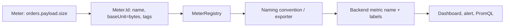

# Base unit trong Micrometer Metrics

Một dashboard hiển thị kích thước payload trung bình của API đặt hàng là **512**. Con số này chưa đủ để đánh giá: 512 *byte*, 512 *KiB* hay 512 *MB*? Nếu service A ghi kích thước bằng byte, còn service B ghi bằng kilobyte nhưng cả hai xuất cùng tên metric, biểu đồ tổng hợp có thể sai hàng nghìn lần. Tương tự, một độ trễ 250 có thể là 250 mili giây hoặc 250 giây.

Trong Micrometer, **base unit** là metadata mô tả đơn vị đo cơ sở của một meter. Thiết kế đúng đơn vị giúp người đọc hiểu phép đo, giúp hệ thống xuất metrics đặt tên phù hợp với backend và giúp các nhóm phát triển thống nhất cách ghi số liệu. Nhưng khai báo base unit **không phải phép chuyển đổi số học tự động**: dữ liệu đưa vào meter vẫn phải có đơn vị đúng ngay từ code.

Bài này thuộc chương **Metrics nền tảng** của module `SPRING_BOOT_OBSERVABILITY`. Module hướng đến thiết lập observability cho Spring Boot bằng Micrometer Observation, metrics, logs và distributed tracing, đồng thời nắm context propagation, tag/cardinality, exporter, sampling và cách liên kết tín hiệu để điều tra lỗi, độ trễ, hành vi ứng dụng ở môi trường thực. Trọng tâm ở đây là **Base unit**: ý nghĩa, cách khai báo, cách đối chiếu khi xuất metric và cách tránh lỗi đơn vị khi kết hợp các tín hiệu.

## 1. Base unit là gì?

**Base unit** (đơn vị cơ sở) là tên đơn vị dùng để diễn giải các giá trị mà meter ghi nhận. Một số ví dụ:

| Phép đo | Giá trị ví dụ | Base unit hợp lý | Cách diễn giải |
| --- | ---: | --- | --- |
| Kích thước payload | 4.096 | `bytes` | 4.096 byte |
| Tổng số đơn xử lý xong | 120 | `orders` | 120 đơn |
| Số message đang chờ | 18 | `messages` | 18 message |
| Dung lượng bộ nhớ đã sử dụng | 268.435.456 | `bytes` | 256 MiB |
| Tỷ lệ sử dụng tài nguyên | 0,82 | Không có hoặc đơn vị tỷ lệ theo convention | 82% nếu số liệu được định nghĩa theo thang 0–1 |
| Thời gian xử lý | 0,25 | Thời gian do `Timer` quản lý | Có thể tương ứng 250 ms hoặc 0,25 s tùy đơn vị trả về |

Các chuỗi `bytes`, `orders` và `messages` ở đây là **tên đơn vị dùng trong hợp đồng telemetry**. `orders` là đơn vị nghiệp vụ chứ không phải đơn vị chuẩn SI. Một tên đơn vị phải có ý nghĩa và được dùng nhất quán trong toàn bộ ứng dụng.

Cần phân biệt ba khái niệm:

1. **Giá trị đo (measurement):** số được ghi vào counter, gauge, timer hoặc summary.
2. **Base unit:** metadata cho biết con số đó đại diện cho loại đơn vị nào.
3. **Tag/key-value:** chiều phân loại để lọc, nhóm, so sánh metric, chẳng hạn `region=ap-southeast`, `channel=web`.

Ví dụ: metric `orders.payload.size` có base unit `bytes` và tag `channel=web`. Thông tin “byte” trả lời câu hỏi *đo bằng gì*, còn “web” trả lời câu hỏi *thuộc nhóm nào*. Không dùng `unit=bytes` như một giải pháp thay thế phổ quát cho metadata base unit; việc quản lý đơn vị ở tầng metric giúp hạn chế tạo nhiều cách biểu diễn cùng một phép đo.

## 2. Base unit là metadata, không phải bộ chuyển đổi

Giả sử một gói tin có kích thước 2 KiB, tức **2 × 1.024 = 2.048 byte**. Hai cách ghi khác nhau:

```java
// Đúng: summary khai báo đơn vị bytes và ghi số byte.
DistributionSummary payloadBytes = DistributionSummary.builder("order.payload.size")
    .baseUnit("bytes")
    .register(meterRegistry);
payloadBytes.record(2048);

// Sai về ngữ nghĩa: 2 là KiB, nhưng meter vẫn được khai báo bytes.
payloadBytes.record(2);
```

Micrometer không thể biết số `2` ở lệnh thứ hai vốn được lấy theo KiB để tự đổi thành 2.048 byte. Vì vậy, cả hai lệnh ghi đều được chấp nhận về mặt kiểu dữ liệu, nhưng lệnh thứ hai **làm sai số liệu**.

Nếu đầu vào là kilobyte hoặc kibibyte, hãy chuyển về đơn vị thống nhất **trước khi gọi `record(...)`**:

```java
long bytesFromKiB = 2L * 1024;
payloadBytes.record(bytesFromKiB);
```

Trong tài liệu và giao diện, nên phân biệt:

- **kB:** kilobyte theo hệ thập phân, 1 kB = 1.000 byte.
- **KiB:** kibibyte theo hệ nhị phân, 1 KiB = 1.024 byte.
- **MB:** megabyte theo hệ thập phân, 1 MB = 1.000.000 byte.
- **MiB:** mebibyte theo hệ nhị phân, 1 MiB = 1.048.576 byte.

Nếu metric lưu byte, dashboard có thể đổi sang KiB hoặc MiB **khi hiển thị**. Không cần tạo thêm một metric riêng cho cùng kích thước chỉ vì một dashboard muốn dùng MiB.

## 3. Base unit trong các loại meter Micrometer

Không phải mọi meter ghi nhận dữ liệu theo cùng một cách, nên cần chọn loại meter trước khi khai báo đơn vị.

| Meter | Loại dữ liệu | Khai báo/diễn giải đơn vị | Ví dụ |
| --- | --- | --- | --- |
| `Counter` | Tổng số tăng dần của một sự kiện hoặc lượng tích lũy | `Counter.builder(...).baseUnit("orders")` | Số đơn xác nhận thành công |
| `Gauge` | Giá trị tại thời điểm thu thập | `Gauge.builder(...).baseUnit("bytes")` | Bộ nhớ cache hiện sử dụng |
| `DistributionSummary` | Phân bố số đo và số lần ghi nhận | `DistributionSummary.builder(...).baseUnit("bytes")` | Phân bố kích thước payload |
| `Timer` | Thời gian và tần suất hoàn tất thao tác | Ghi với `Duration` hoặc `TimeUnit`; backend quyết định biểu diễn đơn vị thời gian | Độ trễ API hoặc thao tác nghiệp vụ |
| `LongTaskTimer` | Các công việc chạy lâu và còn hoạt động | Cơ chế đo thời gian của meter; xem đơn vị xuất của backend | Số tác vụ dài đang chạy, thời gian hoạt động |

Đối với **Counter, Gauge và DistributionSummary**, builder có cơ chế khai báo `baseUnit(...)`. `Timer` có API riêng để ghi thời gian, chẳng hạn `record(Duration)` hoặc `record(long, TimeUnit)`; với Timer, nên để Micrometer chuyển đổi theo quy ước thời gian của registry đích thay vì tự biến thời gian thành số không có ngữ nghĩa.

### 3.1. Counter: đơn vị của lượng tích lũy

```java
Counter completedOrders = Counter.builder("orders.completed")
    .description("Number of successfully completed orders")
    .baseUnit("orders")
    .register(meterRegistry);

completedOrders.increment();  // Hoàn tất thêm một đơn.
completedOrders.increment(3); // Hoàn tất thêm ba đơn.
```

Giá trị counter tăng từ 0 lên 4 theo đơn vị **đơn hàng**. Counter phù hợp với tổng số hoàn thành, số lỗi hoặc số sự kiện chỉ tăng. Không dùng Counter cho số đơn *đang xử lý*, vì số này có thể giảm; Gauge mới phản ánh đúng trạng thái đó.

Đối với một counter ghi *số lần xảy ra sự kiện* mà không có đơn vị chuyên biệt, có thể không khai báo base unit. Chọn `orders` khi cần làm rõ một lần tăng tương ứng với một đơn hàng.

### 3.2. Gauge: đơn vị của giá trị tức thời

```java
AtomicLong cachedBytes = new AtomicLong();

Gauge.builder("cache.memory.used", cachedBytes, AtomicLong::get)
    .description("Current cache size")
    .baseUnit("bytes")
    .register(meterRegistry);

cachedBytes.set(32L * 1024 * 1024); // 32 MiB, được ghi nhận bằng byte.
```

Một Gauge sẽ được đọc khi hệ thống thu thập metric. Với API trên, đối tượng `cachedBytes` cần được giữ tham chiếu sống trong suốt vòng đời ứng dụng; nhiều Gauge của Micrometer mặc định giữ tham chiếu yếu tới đối tượng được quan sát. Trong một Spring bean thực tế, hãy đặt biến này làm field thay vì biến cục bộ hết phạm vi sau khi khởi tạo.

### 3.3. DistributionSummary: đơn vị của giá trị mẫu

```java
DistributionSummary payloadSize = DistributionSummary.builder("orders.payload.size")
    .description("Payload size of submitted orders")
    .baseUnit("bytes")
    .register(meterRegistry);

payloadSize.record(1024);
payloadSize.record(4096);
```

Summary thường ghi nhận số lượng mẫu, tổng các giá trị và tùy cấu hình có thể có phân bố/histogram. Tên `orders.payload.size` và base unit `bytes` cho người đọc biết tổng và các ngưỡng phân bố đang nói về byte, không phải số lượng request.

### 3.4. Timer: thời gian phải được ghi với đơn vị rõ ràng

```java
Timer processing = Timer.builder("orders.processing")
    .description("Duration of synchronous order processing")
    .register(meterRegistry);

processing.record(Duration.ofMillis(250));
processing.record(500, TimeUnit.MILLISECONDS);
processing.record(() -> doSynchronousWork());
```

`Duration.ofMillis(250)` và `record(500, TimeUnit.MILLISECONDS)` giữ đúng thông tin đơn vị đầu vào. **Đừng tự gọi `record(250)` như một số không kèm đơn vị** rồi giả định Micrometer sẽ hiểu là mili giây. API Timer yêu cầu `Duration`, `TimeUnit` hoặc một đoạn mã để đo thời gian.

Khi xuất qua Prometheus, các duration thường được biểu diễn bằng **giây**, ví dụ tên series có phần `_seconds`. Một registry khác có thể chọn đơn vị thời gian cơ sở khác. Luôn kiểm tra đơn vị của exporter hoặc phản hồi Actuator thay vì tự giả định giá trị `250` có nghĩa là 250 ms.

## 4. Ví dụ Spring Boot: bốn phép đo, ba loại đơn vị

Ví dụ sau xây dựng một service đo số đơn đã hoàn tất, số đơn đang xử lý, kích thước payload và thời gian xử lý. Dùng Spring Boot 3.x, Java 17+ và Maven với các phiên bản Micrometer do Spring Boot parent/BOM quản lý.

### 4.1. Dependency cần thiết

```xml
<dependencies>
    <dependency>
        <groupId>org.springframework.boot</groupId>
        <artifactId>spring-boot-starter-actuator</artifactId>
    </dependency>
    <dependency>
        <groupId>io.micrometer</groupId>
        <artifactId>micrometer-registry-prometheus</artifactId>
    </dependency>
</dependencies>
```

Actuator tích hợp nhiều meter sẵn có và cơ chế công bố metrics. Registry Prometheus chỉ cần nếu ứng dụng muốn cung cấp định dạng Prometheus để hệ thống giám sát scrape.

### 4.2. Service instrument nghiệp vụ

```java
import io.micrometer.core.instrument.Counter;
import io.micrometer.core.instrument.DistributionSummary;
import io.micrometer.core.instrument.Gauge;
import io.micrometer.core.instrument.MeterRegistry;
import io.micrometer.core.instrument.Timer;
import java.util.concurrent.atomic.AtomicInteger;
import org.springframework.stereotype.Service;

@Service
public class OrderMetricService {
    private final AtomicInteger inflightOrders = new AtomicInteger();
    private final Counter completedOrders;
    private final DistributionSummary payloadBytes;
    private final Timer processingTime;

    public OrderMetricService(MeterRegistry registry) {
        this.completedOrders = Counter.builder("orders.completed")
            .description("Orders completed successfully")
            .baseUnit("orders")
            .register(registry);

        Gauge.builder("orders.inflight", inflightOrders, AtomicInteger::get)
            .description("Current orders being processed")
            .baseUnit("orders")
            .register(registry);

        this.payloadBytes = DistributionSummary.builder("orders.payload.size")
            .description("Size of incoming order payload")
            .baseUnit("bytes")
            .register(registry);

        this.processingTime = Timer.builder("orders.processing")
            .description("Synchronous order processing duration")
            .register(registry);
    }

    public void handle(byte[] payload, Runnable businessOperation) {
        inflightOrders.incrementAndGet();
        try {
            // byte[]#length đã có đơn vị là byte.
            payloadBytes.record(payload.length);

            // Timer đo khoảng thời gian của thao tác đồng bộ.
            processingTime.record(businessOperation);

            // Chỉ đếm hoàn tất khi businessOperation trả về thành công.
            completedOrders.increment();
        } finally {
            inflightOrders.decrementAndGet();
        }
    }
}
```

Trong ví dụ:

| Meter name | Meter type | Đơn vị | Đường ghi dữ liệu |
| --- | --- | --- | --- |
| `orders.completed` | Counter | `orders` | `increment()` khi hoàn tất |
| `orders.inflight` | Gauge | `orders` | Đọc `AtomicInteger` hiện tại |
| `orders.payload.size` | DistributionSummary | `bytes` | `record(payload.length)` |
| `orders.processing` | Timer | Thời gian | `record(businessOperation)` |

`handle(...)` giả định `payload` không null và `businessOperation` chạy **đồng bộ**. Nếu công việc bất đồng bộ trả về `CompletableFuture`, `Timer.record(Runnable)` chỉ đo đến khi lambda return, không tự đo toàn bộ thời gian future hoàn tất. Cần kết thúc đo tại callback/completion thực tế khi làm việc với async.

**Một chi tiết cần quan sát:** khi `businessOperation` ném exception, bộ đếm đơn hoàn tất không tăng, nhưng thời gian chạy vẫn được Timer ghi nhận và Gauge vẫn giảm ở `finally`. Nếu muốn đếm lỗi, tạo một Counter riêng hoặc dùng một bộ tag `outcome` hữu hạn trên custom Observation/meter phù hợp.

## 5. Đơn vị của Timer và phép đổi đơn vị thời gian

Thời gian là trường hợp đặc biệt: `Timer` nhận một phép đo với `TimeUnit` hoặc `Duration`; Micrometer và registry đích xử lý cách lưu/hiển thị đơn vị thời gian tương thích với backend.

Ví dụ một thao tác kéo dài 1,5 giây:

```java
timer.record(1500, TimeUnit.MILLISECONDS);
timer.record(Duration.ofMillis(1500));
timer.record(1_500_000_000L, TimeUnit.NANOSECONDS);
```

Ba lần gọi trên ghi ba **mẫu thời gian bằng nhau về độ dài** (mỗi mẫu 1,5 giây). Chúng không có nghĩa ba mẫu là cùng một thao tác, mà minh họa cách Timer nhận các đơn vị đầu vào khác nhau một cách tường minh.

Với Prometheus, tổng thời gian của Timer thường được xuất dưới dạng `_seconds_sum`, số lần ghi nhận dưới dạng `_seconds_count`, và nếu có histogram thì có thể có `_seconds_bucket`. Đơn vị **giây** là đặc điểm thường gặp của cách xuất Timer sang Prometheus; đừng tự đổi metric timer thành một `DistributionSummary` có tên `latency.millis` nếu mục tiêu thực sự là đo duration, vì sẽ mất một phần semantic và tiện ích chuyên biệt của Timer.

### 5.1. Phân biệt duration và throughput

- Duration: “Một lần xác nhận đơn mất bao nhiêu giây?” → `Timer`.
- Throughput: “Trung bình mỗi giây hoàn tất bao nhiêu đơn?” → lấy tốc độ thay đổi theo thời gian của Counter, chẳng hạn PromQL `rate(...[5m])`.
- Concurrent work: “Đang xử lý bao nhiêu đơn ngay lúc này?” → `Gauge`.
- Batch size: “Mỗi request có payload bao nhiêu byte?” → `DistributionSummary`.

Đừng gắn base unit `orders/second` lên một Counter chỉ tăng theo số đơn, bởi **orders/second là đơn vị của một phép tính tốc độ tại backend**, không phải đơn vị của tổng tích lũy. Tương tự, `bytes/second` thường là kết quả phép tính rate từ Counter byte.

## 6. Base unit có thay đổi tên metric được xuất không?

Trong Micrometer, tên logic như `orders.payload.size` khác tên cuối cùng mà một backend hiển thị. Các registry dùng naming convention để chuyển dấu chấm, áp dụng quy tắc hậu tố đơn vị hoặc hậu tố dành cho loại meter. **Một số registry sử dụng metadata base unit khi xây dựng tên xuất**, nhưng chi tiết phụ thuộc backend và phiên bản thư viện.



Ví dụ, một summary có tên logic `orders.payload.size` và base unit `bytes` có thể xuất ở Prometheus với tên cơ sở dạng `orders_payload_size_bytes` cùng các hậu tố `_count` và `_sum`. Đây là **minh họa theo quy ước thường gặp**, không phải lời hứa tên metric giống hệt ở mọi phiên bản.

Điều quan trọng là:

1. Base unit không thay đổi tự động số đo đã được record.
2. Backend có thể phản ánh đơn vị qua tên, metadata hoặc cách hiển thị.
3. Đổi base unit sau khi dashboard đã dùng metric có thể khiến tên series xuất thay đổi và làm truy vấn cũ không còn khớp.
4. Không ghi sẵn hậu tố đơn vị vào tên logic một cách tùy tiện nếu registry dự kiến bổ sung hậu tố đó, bởi có thể thành tên trùng lặp như `..._bytes_bytes`.

Khi nhiều phiên bản ứng dụng cùng gửi metric có cùng tên nhưng dùng đơn vị khác nhau, backend khó tự phân biệt lỗi semantic. Tên và base unit là một phần của **hợp đồng telemetry** cần quản lý theo phiên bản triển khai.

## 7. Quan sát base unit bằng Actuator

Với Spring Boot 3.x, có thể cấu hình web exposure:

```yaml
spring:
  application:
    name: order-service

management:
  endpoints:
    web:
      exposure:
        include: health,metrics,prometheus
  metrics:
    tags:
      application: order-service
```

Để có dữ liệu mẫu, hãy gọi `OrderMetricService.handle(... )` ít nhất một lần trong một controller hoặc service đã có (ví dụ `handle(new byte[2048], () -> processOrder())`). Sau đó:

```bash
curl -s http://localhost:8080/actuator/metrics
curl -s http://localhost:8080/actuator/metrics/orders.payload.size
curl -s http://localhost:8080/actuator/metrics/orders.completed
curl -s http://localhost:8080/actuator/metrics/orders.processing
curl -s http://localhost:8080/actuator/prometheus
```

Endpoint `/actuator/metrics/{name}` thường trả về tên meter, mô tả, `baseUnit` (nếu có), các phép đo và tag có thể lọc. Ví dụ cấu trúc JSON **minh họa**, không phải phản hồi đã chạy thực tế:

```json
{
  "name": "orders.payload.size",
  "description": "Size of incoming order payload",
  "baseUnit": "bytes",
  "measurements": [
    {"statistic": "COUNT", "value": 2.0},
    {"statistic": "TOTAL", "value": 6144.0}
  ],
  "availableTags": []
}
```

Trong ví dụ, đã ghi hai payload 2.048 byte và 4.096 byte nên `COUNT=2`, `TOTAL=6144`. Giá trị `TOTAL` được diễn giải bằng byte nhờ metadata `baseUnit=bytes`; cấu trúc và các statistic thực tế có thể khác theo version và cách cấu hình meter.

### 7.1. Kiểm tra metadata trực tiếp qua API Java

Khi có reference tới meter, có thể xem unit qua `Meter.Id`:

```java
DistributionSummary summary = meterRegistry
    .find("orders.payload.size")
    .summary();

if (summary != null) {
    System.out.println(summary.getId().getBaseUnit()); // "bytes"
}
```

Lưu ý: một meter chưa được đăng ký, hoặc meter name khác với tên bạn truy vấn, có thể trả về `null`. Base unit là metadata của meter ID, không phải một giá trị quan sát riêng để cộng hoặc lấy trung bình.

## 8. Đọc các phép đo trên Prometheus mà không nhầm đơn vị

Sau khi Prometheus scrape ứng dụng, hãy dùng **tên series thực tế** từ `/actuator/prometheus` hoặc Prometheus UI. Các tên dưới đây chỉ là ví dụ nếu exporter sử dụng quy ước hậu tố tương ứng.

### 8.1. Kích thước payload trung bình, đơn vị byte

Giả sử summary được xuất thành `orders_payload_size_bytes_sum` và `orders_payload_size_bytes_count`:

```promql
sum(rate(orders_payload_size_bytes_sum{application="order-service"}[5m]))
/
sum(rate(orders_payload_size_bytes_count{application="order-service"}[5m]))
```

Tử số có đơn vị **byte/giây**, mẫu số có đơn vị **mẫu/giây**. Kết quả có đơn vị **byte/mẫu**, tức kích thước trung bình trong cửa sổ 5 phút. Nếu muốn hiển thị MiB, chia kết quả cho `1024 * 1024`; không đổi base unit ở ứng dụng để phục vụ việc này.

Phải xử lý trường hợp mẫu số bằng 0 hoặc không có dữ liệu. Đừng kết luận kích thước trung bình là 0 nếu thực tế không có request nào trong khoảng thời gian đó.

### 8.2. Tốc độ hoàn tất đơn, đơn vị đơn/giây

Nếu counter được xuất dưới tên giả định `orders_completed_orders_total`:

```promql
sum(rate(orders_completed_orders_total{application="order-service"}[5m]))
```

Counter lưu **số đơn tích lũy**; `rate(...[5m])` chuyển thành tốc độ **đơn/giây**. Khi cần báo cáo đơn/phút, nhân kết quả với 60 ở lớp truy vấn hoặc hiển thị. Không gọi `increment(60)` chỉ để giả lập đơn vị “đơn/phút”.

### 8.3. Độ trễ trung bình, đơn vị giây

Giả sử Timer được xuất thành `orders_processing_seconds_sum` và `orders_processing_seconds_count`:

```promql
sum(rate(orders_processing_seconds_sum{application="order-service"}[5m]))
/
sum(rate(orders_processing_seconds_count{application="order-service"}[5m]))
```

Tử số có đơn vị **giây/giây** (tổng thời lượng tăng mỗi giây), mẫu số là **request/giây** nên kết quả trở thành **giây/request**. Nhân 1.000 ở lớp hiển thị để chuyển giá trị trung bình này sang mili giây.

Nếu cần p95/p99 thay vì trung bình, bạn phải cấu hình histogram/tính phân bố tương thích với registry và sử dụng truy vấn phù hợp; **không phải cứ có Timer là có sẵn percentile histogram đầy đủ**.

## 9. Base unit với Observation và tracing

Micrometer Observation cho phép code nghiệp vụ mô tả một hoạt động, sau đó các `ObservationHandler` tương thích có thể tạo Timer hoặc span từ cùng vòng đời:

```java
Observation.createNotStarted("payment.authorize", observationRegistry)
    .lowCardinalityKeyValue("payment.channel", "card")
    .observe(() -> authorizeSynchronously());
```

Trong ứng dụng được instrument đúng:

- **Metrics handler** có thể tạo Timer cho `payment.authorize`; thời lượng được ghi theo đơn vị thời gian do Timer/registry xử lý.
- **Tracing handler** có thể tạo span cho thao tác và ghi start/end timestamps, attributes, status hoặc exception theo cấu hình.
- **Logs** có thể mang `traceId` và `spanId` khi có tracing bridge cùng log correlation phù hợp.

Các hệ thống ấy sử dụng những quy ước dữ liệu khác nhau: **base unit của meter không tự đổi đơn vị timestamp/duration của span**, cũng không đổi định dạng thời gian trong log. Khi đối chiếu dashboard metrics với trace UI, hãy kiểm tra đơn vị mà mỗi màn hình hiển thị.

Ví dụ dashboard báo `payment.authorize p95 = 0.8 s` và trace UI hiện span có duration `800 ms`. Hai số này cùng một thang thời gian, nhưng không thể kết luận đó là cùng một request chỉ dựa trên số liệu. Metrics là dữ liệu tổng hợp theo thời gian; trace là chi tiết của một request được lấy mẫu và lưu giữ.

Context propagation quyết định traceId có tiếp tục qua HTTP, message hoặc thread khác hay không. Sampling ảnh hưởng trace được giữ lại; exporter/collector ảnh hưởng dữ liệu đến backend. **Không thấy trace không có nghĩa Timer đã ghi sai đơn vị**. Hãy chẩn đoán riêng đường metric và đường trace.

## 10. Base unit và tag cardinality cần được quản lý cùng nhau

Một meter được nhận diện bởi tên, loại và bộ nhãn theo cơ chế của registry; metadata như description và base unit là một phần của định nghĩa cần nhất quán. Nếu cùng tên và cùng bộ tag lại được đăng ký với các mô tả đơn vị khác nhau, bạn có nguy cơ gặp xung đột định nghĩa hoặc số liệu gây hiểu nhầm. Không cố phân biệt hai đơn vị bằng cách dùng cùng meter name rồi gắn tag `unit=bytes` ở chỗ này và `unit=KiB` ở chỗ khác.

Ví dụ một summary có:

```text
metric: orders.payload.size
base unit: bytes
tags:
  channel: web | mobile | partner
  outcome: accepted | rejected
```

Nếu có 3 channel và 2 outcome, ta có tối đa **6 tổ hợp tag** (chưa tính instance và tag hạ tầng). Nếu thêm `orderId` với hàng trăm nghìn giá trị, số series có thể tăng mạnh. Việc đặt đúng base unit **không giải quyết cardinality**; đây là hai khía cạnh thiết kế tách biệt nhưng cùng ảnh hưởng khả năng vận hành.

Quy tắc:

1. Dùng tên và base unit nhất quán cho cùng một phép đo.
2. Dùng low-cardinality tags cho chiều tổng hợp có tập giá trị giới hạn như `channel`, `outcome`, `region`.
3. Không dùng raw URL, user ID, order ID, trace ID hoặc exception message làm metric tag.
4. Nếu cần định danh một request cụ thể, dùng trace/log correlation với chính sách bảo vệ dữ liệu.
5. Đánh giá số series tăng thêm khi bật histogram và thêm tag.

## 11. Những nhầm lẫn về đơn vị thường gặp

| Cách làm dễ sai | Hậu quả | Cách làm đúng |
| --- | --- | --- |
| Ghi `2048` và `2` vào cùng summary `bytes` với hai nguồn có unit khác nhau | Giá trị tổng và trung bình sai | Chuẩn hóa mọi nguồn về byte trước khi `record` |
| Gọi `baseUnit("bytes")` và cho rằng Micrometer tự đổi KiB sang byte | Sai lệch âm thầm | Chuyển đổi số trước khi ghi dữ liệu |
| Đổi tên logic thành `payload.size.bytes` rồi cũng khai báo base unit `bytes` | Một số registry có thể thêm hậu tố trùng | Chọn tên logic ổn định và kiểm tra tên xuất |
| Đưa tốc độ `orders/second` vào Counter khi thực chất chỉ lưu số đơn | Nhầm lẫn đơn vị tích lũy và rate | Counter lưu đơn; PromQL tính đơn/giây |
| Dùng Gauge cho tổng số request hoàn tất | Giá trị có thể giảm/mất lịch sử giữa các lần scrape | Counter cho sự kiện tăng dần |
| Dùng Counter cho số kết nối đang mở | Không thể giảm khi kết nối đóng | Gauge cho trạng thái tức thời |
| Tự gộp latency bằng một summary ghi số mili giây không có quy ước | Dễ nhầm thời gian và mất tiện ích Timer | Dùng `Timer` với `Duration` hoặc `TimeUnit` |
| Giả định mọi backend dùng giây cho mọi metric | Truy vấn hoặc dashboard hiển thị sai | Kiểm tra registry/exporter và base unit thực tế |
| Đổi base unit mà không đổi dashboard/alert | Mất tính liên tục của series hoặc sai ngữ nghĩa | Quản lý đơn vị như một phần của telemetry schema |
| Gắn `unit` theo từng request để biểu diễn dữ liệu nguồn | Dễ lẫn nhiều hệ đơn vị trong cùng phép đo | Chuẩn hóa ở code, sử dụng một base unit |

## 12. Quy trình điều tra lỗi số liệu do sai đơn vị

Giả sử sau triển khai, biểu đồ kích thước payload tăng 1.024 lần, nhưng độ trễ API và lưu lượng request gần như không đổi. Đừng mặc định payload đã tăng thật. Điều tra theo trình tự:

| Bước | Kiểm tra | Câu hỏi |
| --- | --- | --- |
| 1 | Meter logic trong code | Tên metric, loại meter và `baseUnit` có đổi không? |
| 2 | Dữ liệu trước `record(... )` | Giá trị nguồn đang là byte, KiB, kB hay một đơn vị khác? |
| 3 | Actuator `/metrics/{name}` | Giá trị và `baseUnit` có hợp lý ngay trong ứng dụng không? |
| 4 | Prometheus exposition | Exporter đổi tên hoặc chuyển đơn vị nào không? |
| 5 | PromQL/dashboard | Có phép nhân/chia 1.000 hoặc 1.024 bị thêm hai lần không? |
| 6 | Tín hiệu khác | Trace/log của request thực tế cho thấy payload lớn lên thật hay chỉ số hiển thị sai? |
| 7 | Khắc phục và xác minh | Sau sửa, metric mới có đúng đơn vị và các alert được cập nhật chưa? |

Một tình huống điển hình: phía đọc file trả số KiB, trong khi phía nhận HTTP đo `byte[].length` theo byte. Hai service cùng dùng metric name `file.payload.size`, cùng metadata `bytes`, nhưng service đọc file ghi thẳng số KiB. Khi tổng hợp, dữ liệu giữa các service không thể so sánh trực tiếp. Cách sửa nằm ở **điểm ghi số đo** của service đọc file, bằng chuyển KiB sang byte; sau đó đánh giá lại thời gian tồn tại của dữ liệu sai trong backend.

Trường hợp khác: backend trace hiển thị 250 ms nhưng biểu đồ latency hiển thị 250 s. Hãy kiểm tra biểu thức dashboard trước: rất có thể một thành phần đang coi dữ liệu giây là mili giây hoặc ngược lại, chứ không phải ứng dụng chạy chậm đột ngột.

## 13. Thực hành: kiểm tra base unit từ code đến backend

Tạo ứng dụng Spring Boot dùng ví dụ `OrderMetricService` và thực hiện:

1. **Đăng ký meter:** tạo Counter `orders.completed` với `baseUnit("orders")`, Gauge `orders.inflight` với `orders`, DistributionSummary `orders.payload.size` với `bytes`, Timer `orders.processing`.
2. **Ghi dữ liệu kiểm soát:** gọi `handle(new byte[2048], runnable)` với một thao tác đồng bộ. Tạo thêm payload 4.096 byte và kiểm tra `COUNT=2`, tổng payload 6.144 byte nếu không có dữ liệu khác.
3. **Readback Actuator:** truy cập `/actuator/metrics/orders.payload.size`, kiểm tra trường `baseUnit` và các statistic hiện có. Truy vấn meter name thực của những phép đo khác.
4. **Đối chiếu exporter:** xem `/actuator/prometheus`, xác định tên series của summary, counter và timer. Ghi lại sự khác biệt giữa tên logic với tên được xuất.
5. **Tính đơn vị:** dùng PromQL lấy kích thước payload trung bình theo cửa sổ thời gian; đổi kết quả từ byte sang KiB ở biểu đồ. Dùng rate của Counter để có đơn/giây và rate của Timer để tính độ trễ trung bình theo giây.
6. **Tạo lỗi có kiểm soát:** thử ghi một mẫu “2 KiB” như số `2` vào summary bytes trong môi trường thử nghiệm; so sánh trước/sau để giải thích sai lệch, rồi sửa bằng phép chuyển đổi về 2.048 byte.
7. **Liên kết tín hiệu:** nếu đã tích hợp tracing, so sánh thời gian span hiển thị ở trace UI với đơn vị Timer của dashboard; kiểm tra đường đi traceId và phân biệt lỗi số liệu với sampling/exporter.
8. **Rà soát vận hành:** kiểm tra exposure và quyền truy cập Actuator, tag cardinality, histogram, retention, dashboard, alert trước khi áp dụng vào production.

### Câu hỏi tự kiểm tra

1. Khai báo `baseUnit("bytes")` có tự đổi số được ghi từ KiB sang byte không? Vì sao?
2. Vì sao `Timer.record(250, TimeUnit.MILLISECONDS)` an toàn hơn đưa số 250 vào một metric không thể hiện đơn vị thời gian?
3. Counter tích lũy số đơn và query trả về số đơn/giây có cùng base unit hay không?
4. Khi exporter đổi tên logic `orders.payload.size` thành một tên có hậu tố đơn vị, nên xác minh ở đâu?
5. Tại sao hai service cùng tên metric và tags nhưng ghi hai đơn vị khác nhau là lỗi nghiêm trọng?
6. Nếu metric hiển thị bất thường còn trace không có mặt, cần phân biệt kiểm tra đơn vị với kiểm tra sampling, exporter và propagation như thế nào?

## 14. Checklist thiết kế metric trước production

- Mỗi phép đo có tên rõ ràng, loại meter phù hợp và một đơn vị cơ sở nhất quán.
- Code ghi giá trị bằng đúng đơn vị đã khai báo; nơi chuyển đổi được thể hiện rõ.
- Timer được ghi bằng `Duration` hoặc `TimeUnit`, không dựa vào giả định số thô.
- Đơn vị được kiểm tra qua `Meter.Id`, Actuator và exposition của exporter đích.
- Naming convention và hậu tố đơn vị không tạo tên trùng hoặc phá các truy vấn hiện có.
- Tag phục vụ phân tích có cardinality giới hạn; thông tin theo request đi vào trace/log khi phù hợp.
- Histogram, percentile và phép tính rate được diễn giải đúng đơn vị của series.
- Dashboard, alert và tài liệu vận hành cùng thống nhất một schema đơn vị.
- Endpoint metrics được bảo vệ; exporter và collector hoạt động với cấu hình network phù hợp.
- Khi điều tra sự cố, kết hợp metrics tổng hợp với trace/log chi tiết, đồng thời kiểm tra sampling và context propagation độc lập với unit metadata.

## Kết luận

**Base unit** là metadata diễn giải các giá trị metric, giúp lập trình viên và hệ thống observability hiểu một con số đang đo cái gì. Trong Spring Boot, hãy chọn Counter/Gauge/DistributionSummary/Timer theo đúng ngữ nghĩa, khai báo base unit khi thích hợp và chuẩn hóa giá trị ngay từ nơi ghi. Dùng Actuator để kiểm tra metadata, dùng exposition của exporter để xác nhận tên và đơn vị thực tế, rồi tính rate, trung bình hoặc percentile đúng cách trên backend. Khi đơn vị nhất quán cùng với naming, cardinality, propagation, sampling và log/trace correlation, các metrics trở thành bằng chứng đáng tin để điều tra độ trễ, lỗi và hành vi ứng dụng trong production.
