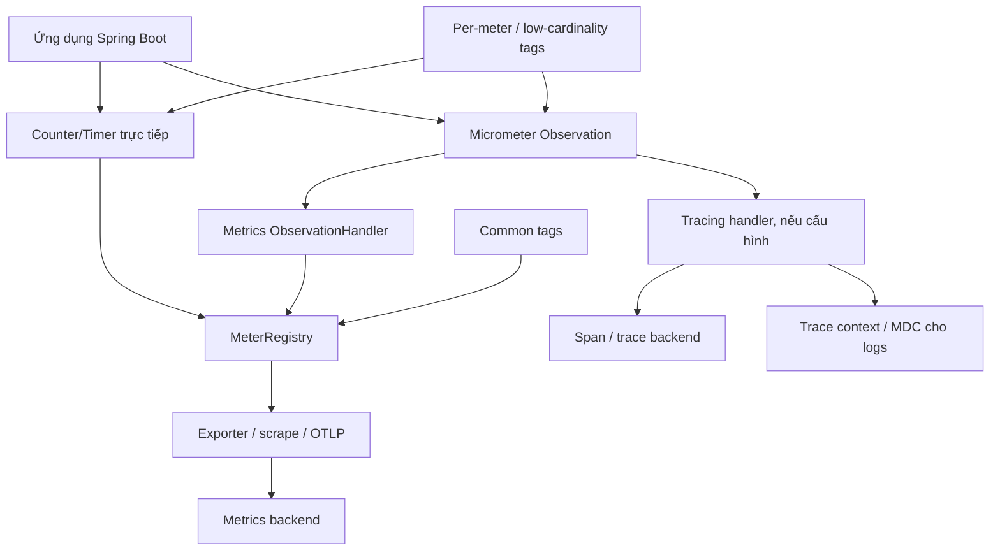
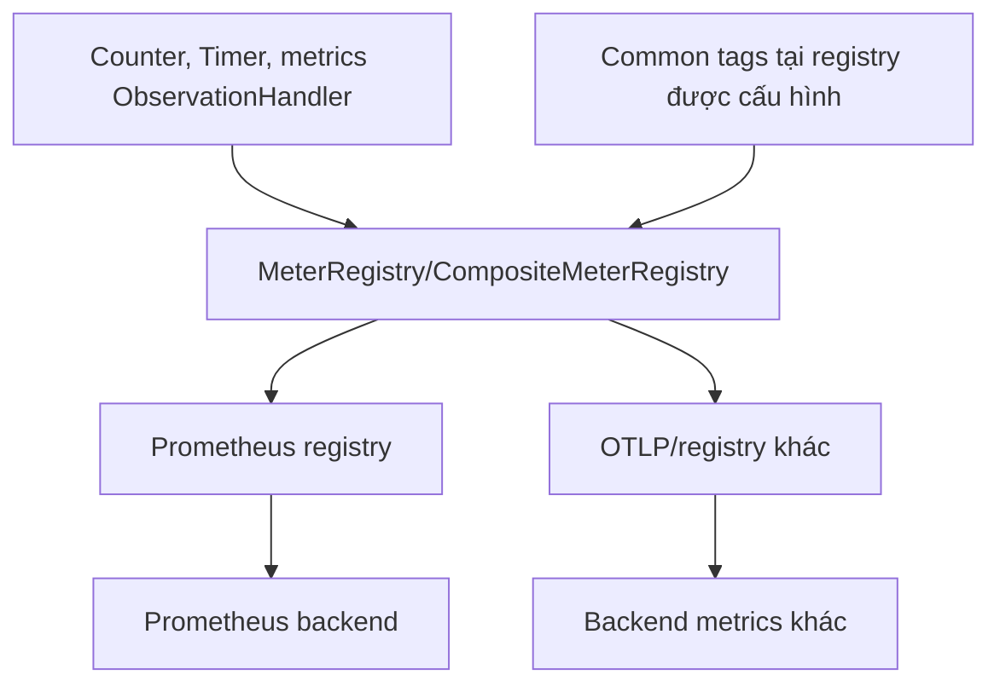
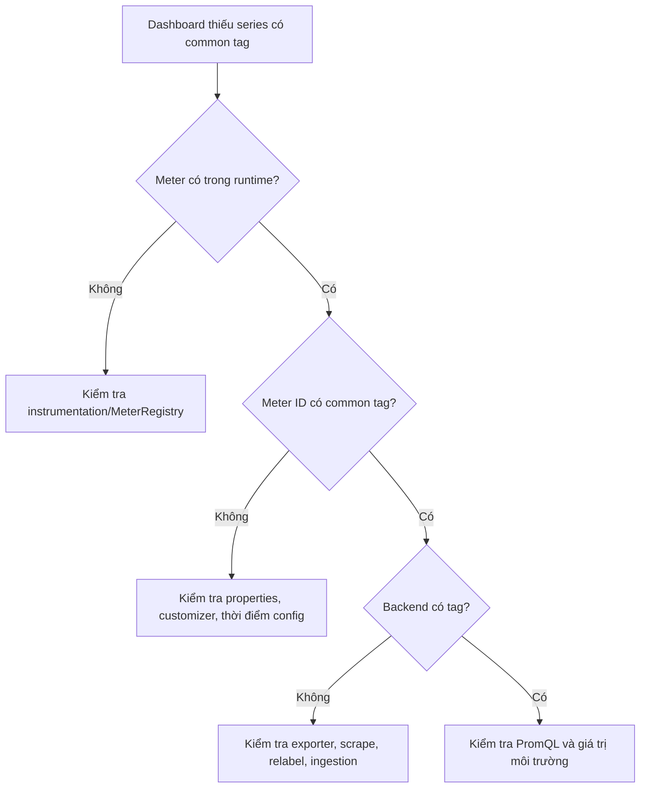

# Tag và common tag trong Spring Boot Metrics

Một nhóm vận hành cần trả lời: “Trong 5 phút qua, dịch vụ nào tăng lỗi HTTP 5xx, ở môi trường nào, và endpoint nào chậm nhất?” Một giá trị metric chỉ cho biết **bao nhiêu**; các **tag** (còn gọi là *label*) giúp phân biệt **ở đâu, loại nào và trong ngữ cảnh nào**. Tuy nhiên, nếu gắn mã người dùng hoặc mã yêu cầu vào tag, số chuỗi thời gian có thể tăng theo lưu lượng và làm quá tải hệ thống metrics.

Bài **“Tag và common tag”** nằm trong chương **Metrics nền tảng** của module **SPRING_BOOT_OBSERVABILITY**. Mục tiêu là dùng tags của Micrometer Metrics và common tags trong Spring Boot một cách nhất quán; hiểu cardinality, MeterRegistry, Observation, exporter, và cách liên hệ metrics với logs, distributed tracing khi điều tra lỗi, độ trễ và hành vi ứng dụng trong môi trường thực.

## 1. Metric tag là gì?

Một meter của Micrometer mô tả phép đo số bằng tên, loại meter, đơn vị, mô tả và các tags. Mỗi tag có **key** và **value**:

```text
Meter: checkout.attempts
Type: Counter
Tags:
  result=success
  payment.method=card
  application=checkout-service
  environment=prod
Value: 128
```

Các tag ở đây có ý nghĩa:

| Tag | Ý nghĩa | Loại phân nhóm |
| --- | --- | --- |
| `result=success` | Kết quả nghiệp vụ của thao tác | Theo từng thao tác |
| `payment.method=card` | Nhóm phương thức thanh toán | Theo từng thao tác |
| `application=checkout-service` | Ứng dụng phát dữ liệu | Chung cho ứng dụng |
| `environment=prod` | Môi trường triển khai | Chung cho môi trường |
| `region=ap-southeast-1` | Vùng triển khai | Chung nếu giá trị ổn định |

**Tên metric cùng tổ hợp tag values xác định một phép đo riêng** trong nhiều backend time-series. Ví dụ cùng `checkout.attempts` nhưng `result=success` và `result=timeout` sẽ tạo hai chuỗi riêng biệt nếu cả hai tổ hợp thực sự xuất hiện.

Một tag nên có tên rõ nghĩa và **tập giá trị hữu hạn, được quản lý**. Tags dùng để tổng hợp, lọc, so sánh; chúng không phải chỗ để lưu toàn bộ request payload, stack trace hoặc định danh người dùng cụ thể.

### Tên trong Java có thể khác tên ở backend

Micrometer thường đặt tên meter dạng dấu chấm như `checkout.attempts`. Prometheus hoặc exporter khác có thể chuẩn hóa tên và thêm hậu tố theo kiểu meter, ví dụ `checkout_attempts_total` cho một Counter trong cách xuất thông dụng. Vì vậy ví dụ PromQL chỉ có hiệu lực khi tên series và nhãn thực tế khớp với exporter và phiên bản đang dùng.

## 2. Per-meter tag và common tag khác nhau thế nào?

**Per-meter tag** được gắn riêng khi code đăng ký hoặc cập nhật một meter:

```java
Counter.builder("checkout.attempts")
        .tag("result", "success")
        .tag("payment.method", "card")
        .register(registry)
        .increment();
```

**Common tag** được cấu hình trên `MeterRegistry` để bổ sung tag chung cho các meter đi qua registry đó:

```java
registry.config().commonTags(
        "application", "checkout-service",
        "environment", "prod"
);
```

Kết quả khái niệm:

```text
Per-meter:
  checkout.attempts{result="success",payment.method="card"}

Sau khi áp dụng common tags:
  checkout.attempts{
    result="success",
    payment.method="card",
    application="checkout-service",
    environment="prod"
  }
```

| Tiêu chí | Per-meter tag | Common tag |
| --- | --- | --- |
| Phạm vi | Meter hoặc một thao tác nghiệp vụ | Các meter được đăng ký qua registry đã cấu hình |
| Nguồn | `Meter.Builder.tag(...)` hoặc Observation metrics handler | `MeterRegistry.Config.commonTags(...)`, Spring Boot properties/customizer |
| Ví dụ | `result`, `http.route`, `payment.method` | `application`, `environment`, `region` |
| Thay đổi theo request | Có thể, trong tập giá trị đã giới hạn | Thường không; ổn định theo ứng dụng hoặc tiến trình |
| Khi sai | Một nhóm meter tạo nhiều series | Có thể ảnh hưởng phần lớn metrics của ứng dụng |
| Vai trò | Phân loại sự kiện/đường xử lý | Nhận diện nguồn và ngữ cảnh triển khai |

“Common” không có nghĩa tác động đến tất cả metrics trong mọi registry hoặc mọi backend. Nó áp dụng tại **MeterRegistry** được cấu hình. Nếu code dùng registry khác, exporter khác hoặc cấu hình thủ công, phải xác minh lại.

## 3. Luồng dữ liệu từ instrumentation đến metric backend



Có hai đường đo lường thường gặp trong Spring Boot:

1. **Micrometer Metrics trực tiếp:** code dùng `Counter`, `Timer`, `Gauge`, `DistributionSummary` và `MeterRegistry`.
2. **Micrometer Observation:** code tạo `Observation`, thêm **low-cardinality key values**, rồi một metrics `ObservationHandler` có thể tạo meter tương ứng.

Cả hai đường có thể nhận common tags khi meter được đăng ký qua registry có cấu hình đó. Tracing và logging sử dụng thành phần khác: **common tags không tự tạo span, trace ID, log MDC hoặc context propagation**.

## 4. Viết metrics với tags của từng meter

Giả sử `payment-service` cần đếm số lần thử authorize theo kết quả và nhóm phương thức. Mã này tránh đưa giá trị đầu vào tùy ý thành tag:

```java
import io.micrometer.core.instrument.Counter;
import io.micrometer.core.instrument.MeterRegistry;
import org.springframework.stereotype.Service;

@Service
public class PaymentAttemptMetrics {
    private final MeterRegistry registry;

    public PaymentAttemptMetrics(MeterRegistry registry) {
        this.registry = registry;
    }

    public void record(String outcome, String method) {
        Counter.builder("payment.attempts")
                .description("Number of payment authorization attempts")
                .tag("outcome", safeOutcome(outcome))
                .tag("payment.method", safeMethod(method))
                .register(registry)
                .increment();
    }

    private String safeOutcome(String value) {
        if ("success".equals(value)) return "success";
        if ("rejected".equals(value)) return "rejected";
        if ("timeout".equals(value)) return "timeout";
        return "error";
    }

    private String safeMethod(String value) {
        if ("card".equals(value)) return "card";
        if ("wallet".equals(value)) return "wallet";
        if ("bank_transfer".equals(value)) return "bank_transfer";
        return "other";
    }
}
```

Lưu ý:

- Tên meter `payment.attempts` ổn định qua các lần gọi.
- Các giá trị `outcome` và `payment.method` được giới hạn bởi hàm chuẩn hóa.
- Khi cùng tên/tags xuất hiện trở lại, registry thường tái sử dụng meter đã đăng ký; nó không tạo một meter mới cho mỗi lần `increment()` với cùng bộ tags.
- Cách đo đếm nghiệp vụ vẫn cần được thiết kế rõ: một lần retry là một attempt khác, không nhất thiết là một request khác.
- Nếu registry có common tags, `application` và `environment` được bổ sung vào meter này.

### Đo độ trễ bằng Timer

```java
import io.micrometer.core.instrument.MeterRegistry;
import io.micrometer.core.instrument.Timer;
import java.util.concurrent.TimeUnit;

public final class GatewayLatency {
    private final MeterRegistry registry;

    public GatewayLatency(MeterRegistry registry) {
        this.registry = registry;
    }

    public void record(long durationMillis, String kind) {
        String safeKind = "primary".equals(kind)
                ? "primary" : "fallback";

        Timer.builder("payment.gateway.duration")
                .tag("gateway.kind", safeKind)
                .description("Payment gateway operation duration")
                .register(registry)
                .record(durationMillis, TimeUnit.MILLISECONDS);
    }
}
```

Timer ghi số lần quan sát và tổng thời lượng; histogram/percentiles cần cấu hình phù hợp. Nếu mỗi tag combination sinh nhiều histogram bucket series, chi phí cardinality có thể lớn hơn nhiều so với một counter.

## 5. Cấu hình common tags qua Spring Boot

Với Spring Boot Actuator và Micrometer đã tích hợp, cách thông dụng là đặt `management.metrics.tags` trong `application.yml`:

```yaml
spring:
  application:
    name: checkout-service

management:
  metrics:
    tags:
      application: checkout-service
      environment: prod
      region: ap-southeast-1
```

Đây là ví dụ cấu hình production giả định. Ở hệ thống thật, nên đưa giá trị môi trường/vùng qua cơ chế cấu hình deploy đáng tin cậy, để không vô tình gắn `environment=prod` cho môi trường phát triển.

Với các meter do Spring Boot quản lý, cấu hình trên có thể làm xuất hiện:

```text
jvm.memory.used{
  application=checkout-service,
  environment=prod,
  region=ap-southeast-1,
  ...
}

payment.attempts{
  application=checkout-service,
  environment=prod,
  region=ap-southeast-1,
  outcome=success,
  payment.method=card
}
```

Đây là biểu diễn khái niệm trước/không phụ thuộc cách exporter đổi tên. Trong ứng dụng thật, tags của JVM, HTTP hoặc pool kết nối sẽ có các khóa bổ sung.

Bạn có thể dùng biến môi trường hoặc hệ thống quản lý cấu hình để cung cấp các properties tương ứng. Hãy kiểm tra giá trị đã được Spring Boot nạp, nhất là với profile và ConfigMap.

### Vì sao dùng common tags thay vì viết lặp?

Nếu không có common tags, mỗi code path có thể quên `application` hoặc ghi `app`, `service` và `serviceName` không nhất quán. Common tags đưa quy ước nhận diện nguồn đến một chỗ duy nhất. Khi dashboard cần so sánh ba service, cùng khóa `application` giúp truy vấn đơn giản và đáng tin cậy hơn.

**Common tags phải ổn định trong vòng đời registry.** Không nên thay chúng theo request hoặc theo người dùng, bởi registry dùng chung cho nhiều thread và một meter được nhận diện bằng ID/tags khi đăng ký.

## 6. Cấu hình bằng Java với MeterRegistryCustomizer

Trong Spring Boot có thể cung cấp một `MeterRegistryCustomizer<MeterRegistry>`:

```java
import io.micrometer.core.instrument.MeterRegistry;
import org.springframework.boot.actuate.autoconfigure.metrics.MeterRegistryCustomizer;
import org.springframework.context.annotation.Bean;
import org.springframework.context.annotation.Configuration;
import org.springframework.core.env.Environment;

@Configuration
public class MetricsConfiguration {

    @Bean
    MeterRegistryCustomizer<MeterRegistry> metricCommonTags(
            Environment environment) {

        String appName = environment.getProperty(
                "spring.application.name", "unknown");
        String deployEnv = environment.getProperty(
                "deployment.environment", "local");

        return registry -> registry.config().commonTags(
                "application", appName,
                "environment", deployEnv
        );
    }
}
```

`MeterRegistryCustomizer` cho phép tùy biến registry được Spring Boot auto-configure. Trong ví dụ, `deployment.environment` là property do ứng dụng tự định nghĩa, không phải một property bắt buộc của Spring Boot.

**Dùng YAML hoặc customizer làm nguồn cấu hình chính cho cùng tag.** Nếu cả hai cùng khai báo `application`/`environment`, có thể tạo quy tắc trùng/mâu thuẫn. Đừng mặc định một cơ chế “ghi đè” sẽ luôn thắng; hãy xác minh Meter ID và nhãn thực tế sau khi chạy.

### Java thuần: commonTags trên SimpleMeterRegistry

```java
import io.micrometer.core.instrument.Counter;
import io.micrometer.core.instrument.simple.SimpleMeterRegistry;

SimpleMeterRegistry registry = new SimpleMeterRegistry();

registry.config().commonTags(
        "application", "checkout-service",
        "environment", "test"
);

Counter.builder("checkout.attempts")
        .tag("result", "success")
        .register(registry)
        .increment();

double count = registry.find("checkout.attempts")
        .tags("application", "checkout-service",
              "environment", "test",
              "result", "success")
        .counter()
        .count(); // 1.0

registry.close();
```

`SimpleMeterRegistry` chỉ giữ phép đo trong bộ nhớ; nó không tự gửi dữ liệu sang Prometheus hoặc OTLP backend. Đoạn ví dụ dùng để chứng minh API và tổ hợp tags.

**Cấu hình common tags trước khi meter được đăng ký.** Meter đã có ID/tags không phải đối tượng được viết lại hàng loạt chỉ vì thêm cấu hình registry muộn. Với Spring Boot, properties và các hook tùy biến registry giúp giảm nguy cơ cấu hình quá muộn.

## 7. Common tags và MeterFilter

Micrometer còn hỗ trợ `MeterFilter` để thay đổi/chặn meter ID. Một cách thêm common tags khác là `MeterFilter.commonTags(...)`:

```java
import io.micrometer.common.Tags;
import io.micrometer.core.instrument.config.MeterFilter;

registry.config().meterFilter(
        MeterFilter.commonTags(
                Tags.of("application", "checkout-service",
                        "environment", "test")
        )
);
```

Đây là **cách thay thế**, không phải một lớp tag thứ ba cần lặp lại trên cùng registry. Nếu vừa gọi `registry.config().commonTags(...)` vừa thêm `MeterFilter.commonTags(...)` với cùng key, cần xem xét kết quả để tránh xung đột/nhầm lẫn.

Các `MeterFilter` khác còn có thể từ chối meter theo tên hoặc giới hạn cardinality. Thứ tự filter có thể ảnh hưởng ID sau khi ánh xạ; nếu dùng nhiều filter, kiểm tra Meter IDs thực tế thay vì suy từ thứ tự trong file cấu hình.

**MeterFilter chỉ tác động đến đường metrics.** Nó không thay đổi tracing sampling, context propagation hoặc cấu hình logger.

## 8. Phân biệt common tag với Observation key-values

Micrometer Observation có hai nhóm key–values chính:

```java
Observation.createNotStarted("checkout.process", observations)
        .lowCardinalityKeyValue("payment.method", "card")
        .highCardinalityKeyValue("checkout.operation_ref", safeRef)
        .observe(() -> processPayment());
```

Trong ví dụ này, `observations` là `ObservationRegistry`; `safeRef` và `processPayment()` là dữ liệu/logic được ứng dụng cung cấp. `safeRef` chỉ nên là mã tham chiếu đã được cho phép ghi vào telemetry.

| Cơ chế | Gắn vào đâu? | Dùng làm gì? |
| --- | --- | --- |
| `Meter.Builder.tag(...)` | Meter cụ thể | Phân nhóm metric |
| `MeterRegistry.config().commonTags(...)` | Registry | Thêm metadata chung cho meters |
| `Observation.lowCardinalityKeyValue(...)` | Observation context | Metrics handler có thể chuyển thành metric tags; tracing handler có thể dùng cho span |
| `Observation.highCardinalityKeyValue(...)` | Observation context | Chi tiết cho trace/span nếu handler/exporter cho phép |
| `ObservationFilter`/`ObservationConvention` | Observation lifecycle/context | Thay đổi hoặc chuẩn hóa tên, thuộc tính Observation |
| Trace context / W3C baggage | Ngữ cảnh phân tán | Tương quan trace hoặc truyền dữ liệu ngữ cảnh có kiểm soát |

**Tag `application=checkout-service` của MeterRegistry không tự biến thành span attribute.** Trace backend thường nhận diện dịch vụ qua tracer/SDK resource attributes, chẳng hạn `service.name`. Hai pipeline có thể dùng quy ước tương đương nhưng phải được cấu hình phù hợp; không nên mặc định sẽ tự ánh xạ lẫn nhau.

Ngược lại, `traceId`/`spanId` có ích cho log correlation, nhưng vì số giá trị lớn nên không được đưa thành metric tags. Thêm `traceId` vào MeterRegistry không giúp thực hiện distributed tracing.

## 9. Cardinality: chi phí tăng theo số tổ hợp tag

Giả sử một metric có những chiều:

| Chiều | Số giá trị giả định |
| --- | ---: |
| `application` | 3 |
| `environment` | 2 |
| `region` | 2 |
| `route` | 10 |
| `method` | 3 |
| `status_group` | 5 |

Số tổ hợp **có thể có**:

\[
3 \times 2 \times 2 \times 10 \times 3 \times 5 = 900
\]

Đó là giới hạn kết hợp khi các chiều độc lập; chỉ các tổ hợp thực sự phát sinh mới tạo series. Nhưng nếu thêm `user.id` có 50.000 giá trị:

\[
900 \times 50\,000 = 45\,000\,000
\]

Một giá trị tag mới có thể nhân số tổ hợp lên rất mạnh. Với histogram, mỗi tổ hợp có thể tạo thêm nhiều bucket series. Chi phí xuất hiện ở bộ nhớ MeterRegistry, kích thước scrape/payload, bộ nhớ của hệ thống thu thập, index, lưu trữ và truy vấn backend.

### Tag nào nên được ưu tiên?

| Tag | Common tag? | Lý do |
| --- | --- | --- |
| `application` | Thường có | Ổn định theo ứng dụng |
| `environment` | Thường có | Tập giá trị giới hạn như `dev`, `staging`, `prod` |
| `region` | Khi cần | Tập vùng được quản lý |
| `team` | Cân nhắc | Chỉ phù hợp khi taxonomy ổn định |
| `build.version` | Cân nhắc kỹ | Mỗi deploy có thể tạo giá trị mới, tăng series theo thời gian |
| `pod`/`instance` | Cân nhắc kỹ | Giá trị đổi khi scale/restart; backend có thể đã gắn target labels |
| `http.route` | Per-meter | Gắn ở HTTP instrumentation, nên dùng route template |
| `payment.method` | Per-meter | Gắn theo thao tác, giá trị hữu hạn |
| `user.id`, `order.id` | **Không** | Cardinality cao; có thể chứa hoặc liên kết dữ liệu cá nhân |
| `traceId`/`spanId` | **Không** | Khóa tương quan theo trace/span, không dùng phân nhóm metrics |

Ngay cả một tag “có vẻ kỹ thuật” như `build.version` hoặc `pod.name` cũng cần đánh giá chi phí: số giá trị active có thể ít nhưng số giá trị tích lũy theo thời gian và retention lớn.

### Tag key thống nhất quan trọng hơn viết hoa/viết tắt tiện tay

Một dashboard không dễ gộp `app=checkout`, `service=payment` và `application=inventory`. Chọn một key nhất quán như `application`, một bộ giá trị ổn định, và sử dụng đồng nhất trong các dịch vụ. Tương tự, `prod`, `production` và `prd` có thể bị coi là các nhóm khác nhau.

Đừng đưa thông tin nhạy cảm như token, email, địa chỉ cá nhân hoặc nội dung exception vào tags. Băm user ID không tự giảm cardinality; nếu mỗi user vẫn có một hash riêng, số giá trị vẫn rất lớn.

## 10. PromQL với common tags

Giả sử dữ liệu HTTP server của Spring Boot được xuất sang Prometheus dưới dạng các series `http_server_requests_seconds_count`, có nhãn `application`, `environment`, `uri` và `status`.

Request rate theo application trong production:

```promql
sum by (application) (
  rate(http_server_requests_seconds_count{
    environment="prod"
  }[5m])
)
```

Request 5xx rate theo application và URI template:

```promql
sum by (application, uri) (
  rate(http_server_requests_seconds_count{
    environment="prod",
    status=~"5.."
  }[5m])
)
```

Tỷ lệ 5xx:

```promql
sum by (application, uri) (
  rate(http_server_requests_seconds_count{
    environment="prod",
    status=~"5.."
  }[5m])
)
/
sum by (application, uri) (
  rate(http_server_requests_seconds_count{
    environment="prod"
  }[5m])
)
```

Đây là **truy vấn minh họa**, không phải bảo đảm về tên series/tags ở mọi phiên bản Spring Boot, cấu hình meter hoặc exporter. Kiểm tra dữ liệu thực tế rồi điều chỉnh. Cần xử lý mẫu số bằng 0 và các chuỗi thiếu dữ liệu trước khi dùng tỷ lệ lỗi làm cảnh báo.

`rate(...)` chuyển counter tích lũy thành tốc độ trên cửa sổ thời gian; không coi `_count` tích lũy là request rate tức thời.

### P95 và histogram

Nếu timer HTTP có histogram buckets, có thể tính p95 theo application:

```promql
histogram_quantile(
  0.95,
  sum by (application, le) (
    rate(http_server_requests_seconds_bucket{
      environment="prod"
    }[5m])
  )
)
```

Bucket series phải được phát thực sự. `_sum / _count` là trung bình, **không** phải p95. Khi cần phân tích theo URI hoặc status, hãy giữ thêm những nhãn phù hợp trong `sum by (...)`. Không tính trung bình đơn giản của các p95 từ nhiều instance rồi coi đó là p95 toàn hệ thống.

## 11. Khi ứng dụng có nhiều MeterRegistry

Một Spring Boot service có thể gửi metrics đến nhiều đích, ví dụ một registry Prometheus và một registry OTLP, thông qua cấu hình Spring Boot hoặc `CompositeMeterRegistry`.



Đảm bảo common tags được cấu hình trên **đúng đường đăng ký meter**. Một registry do thư viện tự tạo bên ngoài Spring Boot có thể không nhận customizer/properties của Boot. Một registry con có thể xuất dữ liệu khác registry con còn lại do khác filter, exporter hoặc quy tắc backend.

Khi xuất cùng metric đến hai đích, phải phân biệt yêu cầu **nhân bản sang hai backend** với việc **gửi trùng hai lần vào cùng backend**. Cấu hình trùng có thể làm kết quả truy vấn sai hoặc tăng chi phí.

### Trùng key giữa common và per-meter tags

Nếu common tag khai báo `environment=prod` nhưng một meter thêm `environment=staging`, dữ liệu tự mâu thuẫn. Cách xử lý của Micrometer/filter/exporter phụ thuộc implementation và cấu hình. Hãy thiết kế một nguồn đáng tin cậy cho mỗi tag chung, không dựa vào quy tắc ghi đè ngầm định.

## 12. Liên hệ metrics, logs và traces khi điều tra

Một sự cố chậm thanh toán có thể tạo ba loại dữ liệu:

```text
Metric:
  application=checkout-service
  environment=prod
  uri=/checkout
  status=502

Trace:
  service.name=checkout-service
  traceId=4bf92f3577b34da6a3ce929d0e0e4736
  span=POST /checkout

Log:
  service=checkout-service
  traceId=4bf92f3577b34da6a3ce929d0e0e4736
  level=ERROR
  message="Gateway timeout"
```

Quy trình phân tích:

1. **Metric:** lọc theo common tags `application`/`environment`, tìm thời gian tăng 5xx hoặc p95.
2. **Trace:** chọn một trace lỗi/chậm phù hợp nếu tracing được instrument và sampler giữ trace; tìm span gây độ trễ.
3. **Log:** từ trace ID truy vấn log có MDC tương quan, xem exception/retry/fallback.
4. **Quay lại metric:** kiểm tra tỷ lệ lỗi/duration tổng hợp để biết hiện tượng có ảnh hưởng rộng hay chỉ ở một request.

Common tags chỉ định vị **nguồn metric**. Chúng không tự tạo span, tự gắn `traceId` vào log, hay tự propagate context qua HTTP/messaging. Log correlation và distributed tracing cần tracer, instrumentation, sampler, exporter, MDC và propagation phù hợp.

Một số backend hỗ trợ *exemplar* để mở trace từ metric; đây là khả năng tùy cấu hình, không phải hệ quả mặc định của common tags. Không tìm thấy trace cũng có thể do sampling hoặc pipeline, không chứng minh request không xảy ra.

## 13. Chẩn đoán khi common tags không xuất hiện

Tình huống: dashboard lọc `application=checkout-service` không có dữ liệu, nhưng service vẫn có metric `http.server.requests`.

Kiểm tra theo thứ tự:

1. **Registry trong runtime:** meter cần tìm đã được đăng ký vào MeterRegistry nào? Có bị tạo trong một registry thủ công khác không?
2. **Cấu hình Boot:** `management.metrics.tags.application` có được nạp ở profile đang chạy? Giá trị môi trường có đúng không?
3. **Thời điểm cấu hình:** common tags đã được thêm trước khi meter được đăng ký chưa?
4. **Meter ID thực tế:** tên meter và tag keys/values cuối cùng trong ứng dụng có đúng không?
5. **Exporter/scrape:** backend có nhận đúng meter không? Có filter, relabel hoặc processor nào làm đổi/xóa tag?
6. **Truy vấn:** dashboard đang lọc `application` hay một key khác? Có vô tình chỉ truy vấn `environment=prod` khi service ghi `environment=local`?
7. **Các tín hiệu khác:** nếu mục đích là điều tra request, kiểm tra tracing và logs riêng; common tag có mặt trong metric không đủ chứng minh span/log cũng có metadata tương ứng.



Với Spring Boot Actuator, endpoint metrics có thể hỗ trợ tra tên meter/tags nếu được bật và bảo vệ; không mở công khai endpoint quản trị để chẩn đoán. Kiểm tra tại nguồn và tại backend là hai phép kiểm riêng, giúp định vị mất dữ liệu xảy ra ở đâu.

## 14. Bài thực hành với SimpleMeterRegistry

Có thể kiểm tra sự khác nhau giữa common tags và per-meter tags mà không cần triển khai exporter.

```java
import io.micrometer.core.instrument.Counter;
import io.micrometer.core.instrument.Meter;
import io.micrometer.core.instrument.simple.SimpleMeterRegistry;

SimpleMeterRegistry registry = new SimpleMeterRegistry();

registry.config().commonTags(
        "application", "checkout-service",
        "environment", "test"
);

Counter success = Counter.builder("checkout.attempts")
        .tag("result", "success")
        .register(registry);

Counter timeout = Counter.builder("checkout.attempts")
        .tag("result", "timeout")
        .register(registry);

success.increment();
success.increment();
timeout.increment();

for (Meter meter : registry.getMeters()) {
    System.out.println(meter.getId().getName()
            + " -> " + meter.getId().getTags());
}

registry.close();
```

Kỳ vọng có **hai meter** tên `checkout.attempts` với `result` khác nhau; cả hai đều có `application=checkout-service` và `environment=test`. Counter success có count bằng `2` và timeout bằng `1`.

Thử tiếp:

1. Thêm `payment.method=card` vào một meter rồi xem Meter ID có thay đổi không.
2. Thay common tag `application` bằng giá trị khác **trước khi đăng ký meters** và xem kết quả.
3. Thử thêm `user.id` với khoảng 20–50 giá trị giả lập trong môi trường test; quan sát số meter tăng và rút kinh nghiệm rồi loại bỏ tag đó.
4. Tạo registry thứ hai không có common tags; xác minh meter trong registry mới **không tự kế thừa** cấu hình registry thứ nhất.
5. Trong Spring Boot, cấu hình YAML rồi kiểm tra một meter custom và một meter JVM/HTTP trong runtime và backend.

Không cần tạo hàng triệu user IDs để chứng minh tác động cardinality; tránh phát quá nhiều series vào backend dùng chung.

## 15. Những lỗi thường gặp

| Sai lầm | Hậu quả | Cách sửa |
| --- | --- | --- |
| Dùng `user.id`, `order.id` hoặc `traceId` làm common tag | Tăng cardinality, lan truyền dữ liệu nhạy cảm | Dùng metadata ổn định của ứng dụng/triển khai |
| Dùng ID động làm per-meter tag | Mỗi ID có thể tạo series riêng | Chuẩn hóa nhóm; dùng nguồn trace/audit có kiểm soát khi cần |
| Cấu hình common tags sau khi meter đã tạo | Một số meter không nhận tags như mong đợi | Cấu hình tại startup |
| Khai báo cùng tag trong YAML và customizer | Dữ liệu mâu thuẫn/trùng | Chọn nguồn cấu hình rõ ràng |
| Dùng `app`, `service`, `application` lẫn lộn | Dashboard khó tổng hợp | Thống nhất taxonomy |
| Thêm `pod`/`instance` khi backend đã có | Metadata trùng và tăng series | Kiểm tra target labels/resource attributes |
| Mong `commonTags` thêm span attribute/log MDC | Không liên kết được traces/logs | Cấu hình tracing và logging riêng |
| Dùng registry tự tạo khác registry của Boot | Meters thiếu common tags/handler/export | Inject registry được quản lý hoặc cấu hình riêng rõ ràng |
| Giả định tên Java chính là tên Prometheus | PromQL không có dữ liệu | Kiểm tra tên/nhãn sau exporter |
| Lấy `_count` tích lũy làm tốc độ | Đọc sai tải ứng dụng | Dùng `rate(...)`/`increase(...)` |
| Tính p95 bằng `_sum / _count` | Nhầm trung bình với phân vị | Dùng histogram/summary phù hợp |
| Đổi tên tag nhưng không cập nhật alert | Mất cảnh báo dù ứng dụng vẫn phục vụ | Quản lý thay đổi dashboard/PromQL/SLO |

## 16. Câu hỏi tự kiểm tra

1. Sự khác nhau về phạm vi giữa `Counter.builder(...).tag(...)` và `registry.config().commonTags(...)` là gì?
2. Vì sao `application` thường phù hợp làm common tag nhưng `payment.method` thường thuộc từng meter?
3. Vì sao `user.id` không phù hợp với cả common tags lẫn per-meter metric tags?
4. Common tags có tự hiện trong log, span và W3C `traceparent` không?
5. Nếu một ứng dụng tạo hai `MeterRegistry` riêng, thiết lập common tags cho registry A có tự áp dụng cho B không?
6. Thêm `environment` sau khi meters đã được đăng ký có bảo đảm cập nhật Meter IDs trước đó không?
7. Khi có `application` và `environment`, làm sao truy vấn tỷ lệ lỗi theo từng ứng dụng với PromQL?
8. Để tính p95 latency, cần gì ngoài count và sum?
9. Nếu backend hiển thị `service` thay vì `application`, cần kiểm tra những tầng nào?
10. Tại sao tag `build.version` có thể gây tăng cardinality theo thời gian?
11. Dùng `MeterFilter.commonTags` đồng thời với `management.metrics.tags` cùng khóa có rủi ro gì?
12. Khi metric thiếu dữ liệu nhưng trace/log vẫn hiện, cần kiểm tra pipeline nào trước?

## Kết luận

**Per-meter tags** phân loại từng phép đo; **common tags** thêm metadata ổn định cho các meter của một `MeterRegistry`. Trong Spring Boot, cấu hình thường nằm ở `management.metrics.tags` hoặc `MeterRegistryCustomizer` và nên được áp dụng trước khi meter đăng ký. Các tag như `application`, `environment` hoặc `region` giúp nhóm metrics theo nguồn, còn `result`, route template hay phương thức thanh toán phù hợp làm tag của từng meter khi số giá trị hữu hạn.

Thiết kế tags đúng giúp kiểm soát cardinality và tạo dashboard đáng tin cậy. Khi điều tra sự cố, metrics cho biết xu hướng và quy mô, traces cung cấp đường đi của những request được thu thập, logs cung cấp chi tiết; exporter, sampling, propagation và correlation cần được cấu hình phù hợp để nối các tín hiệu này.

