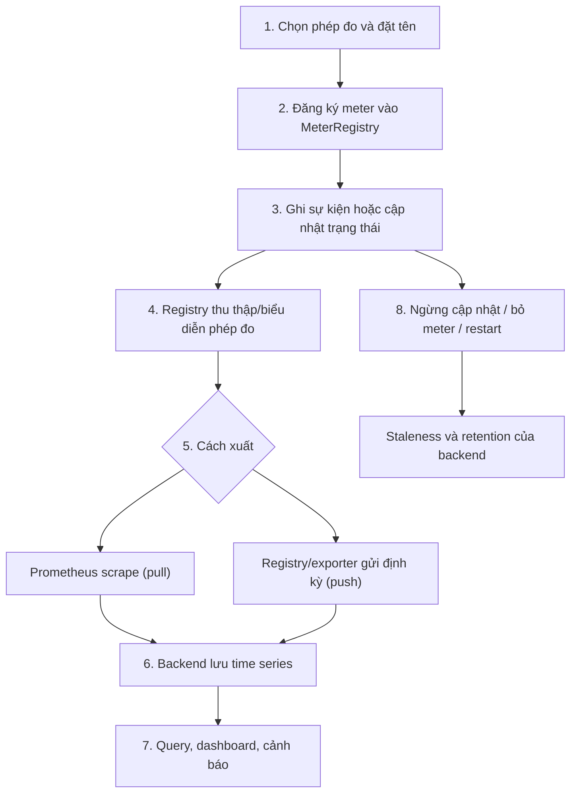
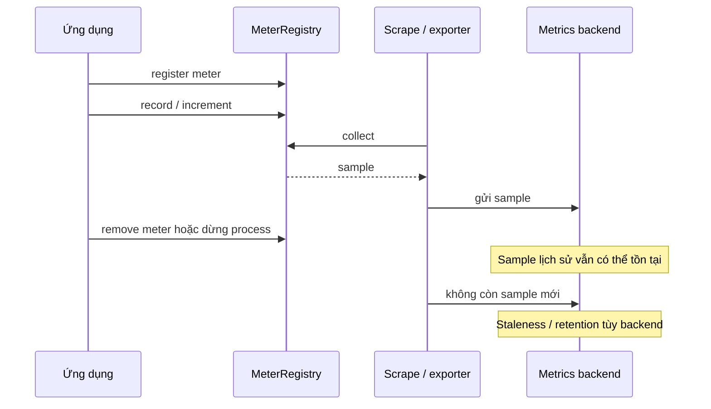
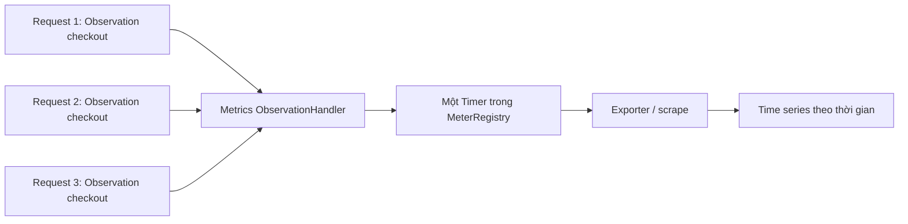

# Metric lifecycle: vòng đời metric trong Spring Boot và Micrometer

Khi một API Spring Boot bắt đầu trả lời chậm, dashboard có thể hiển thị số request tăng, tỷ lệ lỗi HTTP 5xx và p95 latency. Nhưng những số liệu đó đến từ đâu? Lúc nào một metric xuất hiện, khi nào nó được cập nhật, tại sao một counter giảm về 0 sau khi ứng dụng khởi động lại, và vì sao một time series vẫn còn hiển thị sau khi code đã ngừng ghi?

Các câu hỏi này thuộc **metric lifecycle**: toàn bộ hành trình từ **thiết kế phép đo → đăng ký meter → ghi nhận giá trị → xuất dữ liệu → xử lý và truy vấn ở backend → kết thúc hoặc mất hiệu lực**. Trong module **SPRING_BOOT_OBSERVABILITY**, bài học thuộc chương **Metrics nền tảng** và đặt Micrometer Metrics trong hệ thống Spring Boot có **Micrometer Observation, metrics, logs và distributed tracing**. Hiểu đúng vòng đời giúp đo độ trễ, phát hiện lỗi, kiểm soát cardinality và liên kết các tín hiệu khi điều tra hành vi ứng dụng thực tế.

> **Phân biệt ngay từ đầu:** *Meter* là đối tượng instrumentation được đăng ký trong `MeterRegistry` của ứng dụng. *Time series* là chuỗi giá trị theo thời gian mà hệ thống lưu trữ/giám sát tạo ra từ tên metric và tập nhãn. Vòng đời của meter trong JVM và vòng đời time series trong backend **có liên hệ nhưng không trùng nhau**.

## 1. Bức tranh toàn bộ vòng đời

Với một dịch vụ checkout, vòng đời metric thường diễn ra như sau:



Đây là **một mô hình khái quát**, không phải mọi registry đều vận hành giống nhau. Một số registry giữ bộ đếm tích lũy, số khác chốt dữ liệu theo khoảng thời gian (*step*). Có backend thu thập bằng cách chủ động scrape endpoint, có backend nhận dữ liệu được gửi định kỳ. Một số meter có thể được đăng ký nhưng chưa phát sinh phép đo, hoặc backend chưa nhìn thấy vì lần scrape/export đầu tiên chưa xảy ra.

Các mốc cần phân biệt:

| Mốc | Diễn biến | Điều thường có thể kiểm tra |
| --- | --- | --- |
| **Thiết kế** | Quyết định metric name, type, unit, tags và mục tiêu sử dụng | Hợp đồng instrumentation, mô tả và cardinality |
| **Registration** | Registry nhận meter và xác định danh tính của nó | `registry.find(...)` thấy meter |
| **Recording** | Code gọi `increment()`, `record(...)` hoặc thay đổi giá trị được gauge đọc | Count, total time, value trong registry |
| **Collection/Export** | Registry/endpoint biểu diễn dữ liệu; exporter/collector chuyển đi | `/actuator/prometheus` hoặc telemetry pipeline |
| **Query** | Backend gom nhóm, tính rate, phân vị, cảnh báo | Dashboard PromQL hay công cụ của backend |
| **Retirement** | Không còn cập nhật, remove meter hoặc tiến trình kết thúc | Series biến mất sau cơ chế staleness/retention tùy hệ thống |

**Không có một lệnh chung “tạo metric ở backend” khi Java gọi `Counter.builder(...).register(...)`.** Đăng ký meter trong JVM mới là một phần của vòng đời; backend cần nhận dữ liệu phù hợp qua một lần export/scrape thành công.

## 2. MeterRegistry và danh tính của meter

`MeterRegistry` là nơi Micrometer giữ và quản lý các meter. Trong Spring Boot có Actuator, registry thường được Spring cấu hình và inject qua constructor.

Một meter được mô tả bằng **Meter.Id**, gồm những thành phần như tên, tags, base unit, description và type. Trong thực tế, **tên và tổ hợp tags** đóng vai trò cốt lõi để tìm và phân biệt meter trong một registry. Cùng một tên với hai tập tag khác nhau có thể tạo hai time series độc lập khi được xuất ra backend.

Ví dụ:

```text
checkout.payment.operations{outcome="accepted"}
checkout.payment.operations{outcome="declined"}
checkout.payment.operations{outcome="error"}
```

Ba chuỗi cùng đo **số lần xử lý payment** nhưng được phân nhóm theo outcome. Tên ở đây là **tên logic của Micrometer**; khi xuất sang Prometheus, registry có thể đổi dấu chấm thành gạch dưới và thêm hậu tố theo đơn vị/loại meter.

Ví dụ đăng ký counter:

```java
import io.micrometer.core.instrument.Counter;
import io.micrometer.core.instrument.MeterRegistry;

Counter accepted = Counter.builder("checkout.payment.operations")
    .description("Number of payment authorization attempts by outcome")
    .baseUnit("requests")
    .tag("outcome", "accepted")
    .register(meterRegistry);
```

`meterRegistry` ở ví dụ là đối tượng `MeterRegistry` đã được cung cấp. Khi đăng ký cùng identity đã tồn tại, registry thông thường **tái sử dụng meter** tương ứng, thay vì tạo một đối tượng mới vô hạn mỗi lần. Tuy vậy, đừng dựa vào việc đăng ký lại để thay đổi description, base unit hay type của meter đã có. Mâu thuẫn về metadata hoặc cách biến đổi tên/tags có thể gây cảnh báo, meter bị từ chối hoặc hành vi không mong đợi tùy registry.

### Tags là một phần hợp đồng metric

Khi cần thêm một outcome khác, ta thường dùng **một meter riêng với tag khác**. Không thể coi việc sửa một trường `outcome` trên một counter đang tồn tại là thay đổi nhãn “của lần tăng tiếp theo”. Identity của meter và tập tags được xác định tại thời điểm đăng ký.

**Không đăng ký metric theo request ID:** code kiểu `registry.counter("checkout.operations", "orderId", orderId).increment()` có thể tạo một meter mới cho mỗi đơn, kéo theo lượng time series tăng nhanh. Nên đặt tập tag hữu hạn rồi tái sử dụng meter, hoặc tổ chức cache có giới hạn khi giá trị tag được phép thay đổi trong một tập đã kiểm soát.

## 3. Các loại meter ghi nhận dữ liệu khác nhau

Không phải mọi loại meter đều “tăng counter”:

| Loại meter | Khi ghi nhận | Giá trị đặc trưng | Tình huống |
| --- | --- | --- | --- |
| **Counter** | Gọi `increment()` hoặc `increment(amount)` với amount không âm | Số lần tích lũy trong tiến trình; backend thường lấy rate | Số lần checkout được chấp nhận |
| **Timer** | Gọi `record(Duration)`, `record(Runnable)` hoặc `Timer.Sample.stop(timer)` | Count, total time và phân bố nếu được cấu hình | Thời gian xác thực thanh toán |
| **DistributionSummary** | Gọi `record(amount)` | Count, total amount, histogram/phân vị nếu bật | Kích thước payload hoặc số dòng xử lý |
| **Gauge** | Registry đọc một giá trị hiện tại từ đối tượng/hàm | Giá trị tại thời điểm thu thập, có thể tăng/giảm | Số job đang đợi trong queue |
| **LongTaskTimer** | Theo dõi tác vụ đang diễn ra trong thời gian dài | Số tác vụ đang chạy và thời lượng hiện tại | Batch import đang xử lý |

`Counter` thường không có phương thức giảm; khi muốn đo số kết nối **đang mở**, dùng gauge hoặc loại meter thể hiện trạng thái. Ngược lại, khi muốn biết **tổng số request đã xảy ra**, dùng counter thay vì gauge.

`Timer` tự có **count** của các lần ghi duration, nên không nhất thiết cần tạo thêm một counter cho cùng một việc chỉ để đo tần suất. Chỉ thêm counter riêng khi định nghĩa nghiệp vụ hoặc cách phân nhóm khác và tránh đếm chồng.

Điểm quan trọng với `Gauge`: việc đăng ký không có nghĩa sẽ có lời gọi `gauge.increment()`. Registry **đọc trạng thái hiện hành** từ đối tượng được quan sát tại thời điểm thu thập. Một gauge có thể trả về 0, giá trị thực, `NaN` hoặc không còn đo được nếu đối tượng bị thu gom rác hoặc không hợp lệ, tùy cách đăng ký.

## 4. Ví dụ Spring Boot: từ registration đến recording

Ví dụ sau minh họa một service ghi số lần xử lý và thời lượng thanh toán. Tập nhãn `outcome` hữu hạn; các meter được đăng ký **một lần trong constructor** rồi dùng lại cho mỗi request.

```java
import io.micrometer.core.instrument.Counter;
import io.micrometer.core.instrument.MeterRegistry;
import io.micrometer.core.instrument.Timer;
import org.springframework.stereotype.Service;

interface PaymentGateway {
    PaymentResult authorize(String orderReference);
}

enum PaymentResult {
    ACCEPTED, DECLINED
}

@Service
public final class PaymentMetricsService {
    private final PaymentGateway gateway;
    private final MeterRegistry registry;

    private final Counter acceptedCount;
    private final Counter declinedCount;
    private final Counter errorCount;
    private final Timer acceptedDuration;
    private final Timer declinedDuration;
    private final Timer errorDuration;

    public PaymentMetricsService(PaymentGateway gateway,
                                 MeterRegistry registry) {
        this.gateway = gateway;
        this.registry = registry;
        this.acceptedCount = counter("accepted");
        this.declinedCount = counter("declined");
        this.errorCount = counter("error");
        this.acceptedDuration = timer("accepted");
        this.declinedDuration = timer("declined");
        this.errorDuration = timer("error");
    }

    private Counter counter(String outcome) {
        return Counter.builder("checkout.payment.operations")
            .tag("outcome", outcome)
            .description("Payment authorization attempts")
            .register(registry);
    }

    private Timer timer(String outcome) {
        return Timer.builder("checkout.payment.duration")
            .tag("outcome", outcome)
            .description("Payment authorization duration")
            .publishPercentileHistogram()
            .register(registry);
    }

    public PaymentResult authorize(String orderReference) {
        Timer.Sample sample = Timer.start(registry);
        try {
            PaymentResult result = gateway.authorize(orderReference);
            if (result == PaymentResult.ACCEPTED) {
                acceptedCount.increment();
                sample.stop(acceptedDuration);
            } else {
                declinedCount.increment();
                sample.stop(declinedDuration);
            }
            return result;
        } catch (RuntimeException ex) {
            errorCount.increment();
            sample.stop(errorDuration);
            throw ex;
        }
    }
}
```

Đây là ví dụ tối giản: `PaymentGateway` cần có implementation và việc mapping exception/result phải theo quy tắc nghiệp vụ thực tế. `orderReference` chỉ được truyền tới gateway; **không được gắn vào metric tag**.

Chú ý vòng đời:

1. **Application startup:** Spring tạo service, constructor đăng ký 3 counter và 3 timer. Registry nắm các meter này.
2. **Mỗi lần gọi `authorize(...)`:** `Timer.Sample` chụp mốc thời gian bắt đầu. Khi biết outcome, code tăng đúng counter và ghi một duration vào timer tương ứng.
3. **Registry:** mỗi meter cập nhật trạng thái đo riêng. Timer lưu count/tổng thời gian và dữ liệu histogram theo cấu hình.
4. **Export:** một lần scrape hoặc chu kỳ push tiếp theo lấy dữ liệu từ registry.
5. **Backend:** biểu diễn chuỗi theo tên metric và tags, có thể được truy vấn rate, ratio và phân vị.

Ở đây `publishPercentileHistogram()` minh họa yêu cầu phân tích latency histogram, nhưng làm tăng chi phí lưu trữ/bucket. Trong production cần chọn bucket/SLO, tài nguyên và backend phù hợp. Không nhất thiết bật histogram cho mọi Timer.

### Khi metric không cần tạo cùng một counter khác

Timer đã theo dõi `count()`; vì vậy nếu dashboard chỉ cần “số lần payment authorize”, `checkout.payment.duration` có thể là nguồn đếm tương ứng. Counter riêng trong ví dụ là phép đo nghiệp vụ có tên rõ, hữu ích khi muốn tách ý nghĩa thành công/từ chối/lỗi. Thiết kế thực tế cần tránh **hai định nghĩa khác nhau cho cùng một tỷ lệ**, ví dụ counter đếm retry còn timer đếm request logic.

## 5. Recording: cập nhật số liệu không đồng nghĩa xuất dữ liệu

Lời gọi `acceptedCount.increment()` hoặc `sample.stop(acceptedDuration)` cập nhật **trạng thái trong registry**. Nó không bắt buộc chờ một HTTP request gửi đến Prometheus/collector trước khi hàm nghiệp vụ trả về.

Với Counter, tính toán tốc độ theo thời gian cần chú ý:

- Giá trị tích lũy trong tiến trình có thể **đặt lại khi process restart** hoặc khi meter bị thay thế.
- Hệ thống query thường tính `rate` hoặc `increase` theo một cửa sổ thời gian, có khả năng xử lý những lần counter reset phù hợp.
- Một Counter có giá trị `1000` không tự cho biết lưu lượng **hiện tại**; cần so sánh sự tăng theo thời gian.
- Đừng lấy chênh lệch giữa hai mẫu mà quên kiểm tra restart/reset hoặc mất mẫu.

Với Timer, `count` tăng khi ghi duration; `totalTime` tăng theo tổng duration; nếu bật histogram, các bucket được cập nhật tương ứng. **Giá trị p95 không mặc định có sẵn cho mọi Timer**. Muốn truy vấn p95 trên nhiều instance, cần histogram phù hợp và một backend hỗ trợ tính phân vị từ các bucket được gộp.

Với Gauge, registry có thể đọc giá trị ở lúc export; không phải mọi thay đổi trong khoảng giữa hai lần scrape đều được giữ. Ví dụ queue dao động 0 → 100 → 0 giữa hai lần scrape 15 giây có thể không lộ ra điểm đỉnh. Nếu đỉnh/biến động quan trọng, cân nhắc thêm counter hoặc phép đo phân bố thay vì chỉ dùng gauge.

## 6. Hai kiểu thu thập: pull và push

**Pull** nghĩa là hệ thống bên ngoài chủ động gọi endpoint của ứng dụng để lấy số liệu. Ví dụ Prometheus scrape nội dung text từ `/actuator/prometheus` nếu ứng dụng Spring Boot được cấu hình phù hợp.

**Push** nghĩa là registry/exporter tạo và gửi các phép đo tới điểm nhận theo chu kỳ hoặc chính sách cụ thể, chẳng hạn OTLP metrics hoặc backend metrics khác.

| Thuộc tính | Pull: Prometheus scrape | Push: registry/exporter định kỳ |
| --- | --- | --- |
| Ai bắt đầu trao đổi? | Prometheus hoặc hệ thống scrape | Ứng dụng/exporter |
| Cách vận hành chính | Đặt scrape interval, target discovery, quyền truy cập endpoint | Đặt endpoint, interval, batching, queue/retry và credentials |
| Dữ liệu khi exporter gặp lỗi | Scrape không thành công; backend không có sample mới | Có thể queue, retry hoặc drop tùy exporter |
| Counter ở đầu ra | Thường là giá trị tích lũy có thể tính rate | Có thể là giá trị theo step hoặc cumulative, tùy registry/backend |
| Khi ứng dụng chết | Target bị đánh dấu down; series cũ xử lý theo staleness | Không còn gửi dữ liệu, backend xử lý theo chính sách hết hiệu lực |

**Step registry và cumulative registry** không được đánh đồng. Một số registry tổng hợp dữ liệu trong khoảng thời gian cố định `step` rồi xuất giá trị tương ứng; những registry khác xuất số tích lũy từ khi tiến trình chạy. Đơn vị, temporality và cách backend tính rate phải khớp với loại tín hiệu thực tế. Không lấy công thức PromQL dành cho counter tích lũy áp nguyên vào mọi hệ thống push.

Một độ trễ nhỏ giữa `increment()` và lúc dashboard thay đổi là bình thường: có thể cần chờ scrape interval, export interval, hàng đợi collector và thời gian truy vấn/refresh của dashboard.

## 7. Spring Boot cấu hình registry và endpoint quan sát

Trong Spring Boot 3.x dùng Micrometer/Actuator, một đường triển khai phổ biến để quan sát Prometheus là bổ sung Actuator và registry Prometheus:

```groovy
dependencies {
    implementation 'org.springframework.boot:spring-boot-starter-actuator'
    runtimeOnly 'io.micrometer:micrometer-registry-prometheus'
}
```

Ví dụ cấu hình phát metrics:

```yaml
management:
  endpoints:
    web:
      exposure:
        include: health,info,metrics,prometheus
  metrics:
    tags:
      application: checkout-service
    distribution:
      percentiles-histogram:
        http.server.requests: true
```

Đây là cấu hình **minh họa cho hệ sinh thái Spring Boot 3.x**; dependency, tên property, hành vi autoconfiguration và histogram cần đối chiếu với phiên bản Spring Boot/Micrometer thực tế. Endpoint `/actuator/prometheus` chỉ có khi registry được cài đặt, endpoint có sẵn và được expose; `/actuator/metrics` là endpoint tra cứu dạng quản trị khác, không đồng nghĩa với định dạng scrape Prometheus.

Khi triển khai production, chỉ expose endpoint cần thiết và bảo vệ bằng cấu hình mạng/xác thực thích hợp. Không mở các endpoint quản trị tùy tiện ra Internet.

Ngoài các metric do code tự tạo, Spring Boot có thể đăng ký các meter từ hệ thống HTTP server, JVM, thread pool, cache hoặc database pool tùy instrumentation và dependencies. Những meter này cũng có vòng đời đăng ký/ghi dữ liệu/xuất tương tự, nhưng do framework hoặc binder thực hiện.

## 8. Registry, meter identity và MeterFilter

Ở thời điểm meter được đăng ký, registry có thể áp dụng các quy tắc cấu hình như **common tags** và **`MeterFilter`**. `MeterFilter` có thể chấp nhận/từ chối meter, ánh xạ tên/tag hoặc áp dụng giới hạn tùy backend và registry.

Ví dụ guardrail tránh đăng ký meter có nhãn `orderId`:

```java
import io.micrometer.core.instrument.config.MeterFilter;
import org.springframework.context.annotation.Bean;
import org.springframework.context.annotation.Configuration;

@Configuration(proxyBeanMethods = false)
class MetricRegistryPolicy {
    @Bean
    MeterFilter denyOrderIdLabel() {
        return MeterFilter.deny(id ->
            id.getTags().stream()
                .anyMatch(tag -> "orderId".equals(tag.getKey())));
    }
}
```

Đây là ví dụ **từ chối cả meter** khi có tag key bị cấm, không phải phép xóa mỗi key đó và giữ các key còn lại. Nó cũng không tự phát hiện biến thể như `order.id` hoặc giá trị nhạy cảm được chèn vào một key hợp lệ. Cách bền vững là thiết kế tag an toàn tại nguồn, kết hợp guardrails và test hợp đồng.

Những điểm cần nhớ:

- Tên, tags, unit và type nên ổn định **trước khi đăng ký**. Không dựa vào filter thêm muộn để đổi metadata của meter đã có.
- Hai phép đo khác định nghĩa không nên dùng cùng tên nhưng khác type hoặc đơn vị; có thể gây xung đột và tạo dữ liệu khó giải thích.
- Common tags phải có **cardinality hữu hạn**. Thêm `userId` qua một `MeterFilter` toàn cục là thiết kế nguy hiểm.
- Thứ tự đăng ký và cấu hình quan trọng: khi meter đã tồn tại, thay đổi filter sau đó có thể không có hiệu lực như kỳ vọng. Cấu hình registry khi ứng dụng khởi động.

## 9. Gauge: vòng đời đặc biệt của giá trị được quan sát

Gauge là nguồn của nhiều lỗi “đăng ký xong nhưng không có dữ liệu” vì nó khác Counter/Timer.

Ví dụ đăng ký gauge theo dõi số công việc trong queue:

```java
import io.micrometer.core.instrument.Gauge;
import io.micrometer.core.instrument.MeterRegistry;
import java.util.concurrent.BlockingQueue;

public final class JobQueueMetrics {
    private final BlockingQueue<String> jobs;

    public JobQueueMetrics(BlockingQueue<String> jobs,
                           MeterRegistry registry) {
        this.jobs = jobs;  // Giữ tham chiếu mạnh tới đối tượng được đo.
        Gauge.builder("jobs.queue.depth", jobs, BlockingQueue::size)
            .description("Number of jobs waiting to be processed")
            .register(registry);
    }
}
```

Trong cách đăng ký gauge phổ biến của Micrometer, registry giữ **tham chiếu yếu** tới đối tượng được đo để tránh rò rỉ bộ nhớ. Nếu không có tham chiếu mạnh ở nơi khác, đối tượng có thể bị garbage collector thu hồi; gauge có thể trả về `NaN` hoặc không còn giá trị hữu ích.

`JobQueueMetrics.jobs` giữ đối tượng trong ví dụ, nhưng trong ứng dụng thật vòng đời của bean và queue phải đủ dài. Không tạo một đối tượng tạm chỉ để dùng làm gauge rồi bỏ tham chiếu. Cũng không cố “đặt giá trị mới cho gauge” bằng cách đăng ký lại cùng tên/tags với một đối tượng khác; cần cập nhật trạng thái của **đối tượng đang được quan sát**.

Nếu muốn đo số lần enqueue/dequeue, thêm counter cho các sự kiện đó. Gauge độ sâu hiện tại không thay thế counter lượng công việc đã xử lý.

## 10. Cardinality: khi registration trở thành vấn đề tài nguyên

Trong backend time series, mỗi tổ hợp tên metric và nhãn có thể trở thành một chuỗi độc lập. Giả sử `checkout.payment.operations` có:

- `outcome`: 3 giá trị;
- `channel`: 4 giá trị;
- `region`: 5 giá trị.

Số tổ hợp tối đa riêng ba nhãn này là **3 × 4 × 5 = 60**. Nếu thêm `orderId` với 100.000 giá trị, tiềm năng tăng lên **6 triệu** tổ hợp, trước khi xét `instance` và những nhãn backend khác. Đây là con số minh họa giới hạn tổ hợp, không khẳng định mọi tổ hợp chắc chắn xuất hiện.

Một meter có identity mới thường phải chiếm bộ nhớ trong registry và có thể tạo series mới ở backend. Khi số combination tăng theo request, cả ứng dụng lẫn hệ thống monitoring đều có thể chịu ảnh hưởng. Vì vậy:

1. Dùng tên operation, route template và nhãn có **tập giá trị được kiểm soát**.
2. Không gắn request ID, order ID, email, access token, URL thô có định danh hoặc exception message vào metric labels.
3. Dùng `http.route=/orders/{id}` thay cho `http.route=/orders/482719`.
4. Chỉ thêm dimension khi phục vụ một câu hỏi đo lường hoặc cảnh báo cụ thể.
5. Theo dõi số meter/time series và cảnh báo khi cardinality tăng bất thường.

**Cardinality thấp không bảo đảm an toàn dữ liệu:** một giá trị duy nhất có thể vẫn là secret. Ngược lại, dùng hash của userId thay giá trị gốc không giải quyết được việc một ID gần như duy nhất sinh một series riêng. Policy metadata phải kiểm soát cả **ý nghĩa, độ nhạy cảm và số lượng giá trị**.

## 11. Khi meter dừng, restart hoặc được loại bỏ

Có ba tình huống khác nhau:

**Ngừng ghi nhưng ứng dụng vẫn chạy.** Counter có thể giữ nguyên giá trị; Timer giữ count/total trước đó; Gauge có thể thay đổi theo đối tượng được đo. Backend có thể tiếp tục thấy sample của counter với cùng giá trị ở mỗi lần scrape. Một chuỗi không tăng không nhất thiết là ứng dụng bị lỗi.

**Application restart hoặc meter được tạo lại.** Counter tích lũy thường bắt đầu từ giá trị mới trong tiến trình mới, có thể về 0. Query `rate`/`increase` phải xử lý counter reset. Đừng tính “doanh thu trọn đời” bằng cách lấy giá trị Micrometer counter trong bộ nhớ JVM vì restart mất số liệu này.

**Meter được gỡ khỏi registry.** Micrometer hỗ trợ thao tác như `registry.remove(meter)` khi cần quản lý meter động. Điều này ngăn registry tiếp tục công bố meter theo cách thông thường, nhưng **không đồng nghĩa xóa ngay lịch sử time series trong backend**. Backend có cơ chế staleness, retention và xóa riêng.



Không nên dựa vào việc `remove(...)` để bù cho thiết kế tag chứa hàng triệu ID. Meter động có thể vẫn tạo cardinality lớn và dữ liệu tồn tại ở backend cho đến khi hết thời gian lưu trữ. Hạn chế số series ngay từ thiết kế tên và nhãn.

Với Prometheus, một series không còn được scrape sẽ được xử lý theo cơ chế **staleness**; dữ liệu quá khứ vẫn có thể được truy vấn trong khoảng retention của hệ thống. Backend khác có thể sử dụng logic hết hạn khác. Không có nghĩa mọi series biến mất ngay ở lần scrape đầu tiên khi một meter bị xóa.

## 12. Đọc dữ liệu đúng cách: count, rate và latency

Giả sử một registry Prometheus xuất metric logic `checkout.payment.duration` dưới dạng các chuỗi thời gian có tên gần như:

```text
checkout_payment_duration_seconds_count{outcome="accepted"} 12000
checkout_payment_duration_seconds_sum{outcome="accepted"} 840
checkout_payment_duration_seconds_bucket{outcome="accepted",le="0.5"} ...
```

**Đây là mẫu minh họa**, không phải dữ liệu thực tế. Tên chính xác có thể khác theo version, histogram config, base unit và quy tắc naming của registry. Ví dụ PromQL sau chỉ áp dụng khi những chuỗi tương ứng thực sự tồn tại.

Tốc độ các thao tác được ghi nhận trong 5 phút:

```promql
sum by (outcome) (
  rate(checkout_payment_duration_seconds_count[5m])
)
```

Thời lượng **trung bình** của các thao tác đã đo (giây), tính từ `sum/count`:

```promql
sum(rate(checkout_payment_duration_seconds_sum[5m]))
/
sum(rate(checkout_payment_duration_seconds_count[5m]))
```

Phân vị p95 **từ histogram classic buckets**, nếu đã bật histogram và dữ liệu được xuất:

```promql
histogram_quantile(
  0.95,
  sum by (le) (
    rate(checkout_payment_duration_seconds_bucket[5m])
  )
)
```

Các truy vấn cần được điều chỉnh theo tag/service/instance thực tế. Chia cho 0 có thể tạo kết quả không có ý nghĩa khi không có mẫu; những cửa sổ ít request cho ra phân vị dễ biến động. Không lấy **trung bình của các p95 instance** để đại diện cho p95 của toàn hệ thống. Khi cần gộp nhiều instance, histogram bucket cộng gộp đúng cách mới giúp tính phân vị xấp xỉ có ý nghĩa.

**Một lỗi thường gặp:** nhìn thấy `_count` tăng chậm rồi kết luận lỗi vì kỳ vọng giá trị bằng số request thực tế. Cần kiểm tra meter này đang đo đúng operation nào, có bị sampling phía instrumentation hay không, tag filter đang áp dụng, và liệu timer chỉ ghi cho một vài nhánh xử lý.

## 13. Metric lifecycle và Observation lifecycle liên hệ ra sao?

**Micrometer Observation** mô tả vòng đời của một hoạt động, thường có `start → scope → stop`. **MeterRegistry** giữ meter và giá trị được ghi qua nhiều hoạt động. Hai vòng đời không giống nhau:

- **Observation:** bắt đầu khi một operation bắt đầu và kết thúc khi operation hoàn thành.
- **Meter:** có thể sống trong registry suốt vòng đời ứng dụng và được cập nhật từ rất nhiều observation khác nhau.
- **Time series:** xuất hiện/lưu trữ ở backend theo quy tắc xuất dữ liệu, tags, staleness và retention riêng.



Khi registry được cấu hình với một metrics handler như `DefaultMeterObservationHandler`, mỗi observation hoàn tất có thể ghi một duration vào Timer tương ứng (phụ thuộc convention, tên và tags). **Một observation không nhất thiết tạo một meter mới**; hàng nghìn observation có thể cùng cập nhật một Timer đã đăng ký.

Nếu có tracing handler, observation còn có thể tạo span để điều tra một request cụ thể. Sampling có thể làm **không lưu span** của request đó, trong khi metric vẫn ghi nhận các lần thực thi qua pipeline metrics riêng. Logs được ghi bởi logger, không tự phát sinh chỉ từ việc đăng ký meter.

Vì thế trong điều tra sự cố, ta thường dùng **metrics để đo quy mô**, **traces để nhìn đường đi**, **logs để đọc sự kiện và lỗi**. Nếu có log/trace correlation theo `traceId`, người vận hành có thể tìm đúng request; metric labels thông thường **không chứa traceId** vì cardinality quá cao. Một số backend hỗ trợ exemplars để nối điểm đo với trace nhưng phải cấu hình và kiểm tra end-to-end.

## 14. Metadata, thời điểm và quyền truy cập

Metric name và tags không chỉ phục vụ query: chúng là một phần của hợp đồng dữ liệu giữa code, registry, exporter và dashboard.

Một policy tối thiểu nên định nghĩa:

| Thành phần | Quy tắc đề xuất | Lý do |
| --- | --- | --- |
| **Name** | `checkout.payment.duration`, ổn định và theo domain | Tránh tạo nhiều tên cho cùng phép đo |
| **Type** | Timer cho duration; Counter cho số lần; Gauge cho mức hiện tại | Backend diễn giải đúng dữ liệu |
| **Unit** | Rõ ràng trong metadata, kiểm tra đơn vị sau export | Tránh nhầm giây và mili giây |
| **Tags** | `outcome=accepted/declined/error` | Nhãn hữu hạn, dễ group |
| **Description** | Diễn giải phép đo, tránh nội dung thay đổi theo request | Bảo trì instrumentation |
| **Sampling/export** | Ghi rõ registry và cách thu thập | Xác định vì sao backend chưa có dữ liệu |
| **Access/retention** | Quy định ai xem được và giữ bao lâu | Quản trị dữ liệu, bảo mật và chi phí |

Nếu log chứa token hoặc trace có email, việc metrics không chứa chúng không có nghĩa hệ thống an toàn. Metadata phải được kiểm soát cho **cả ba tín hiệu** và qua mọi exporter. Baggage tracing có thể được truyền qua ranh giới HTTP/messaging; không đưa secrets hay thông tin người dùng vào baggage.

## 15. Test metric lifecycle bằng SimpleMeterRegistry

`SimpleMeterRegistry` cho phép xác minh registration và recording hoàn toàn trong bộ nhớ mà không cần Prometheus hoặc collector:

```java
import io.micrometer.core.instrument.Counter;
import io.micrometer.core.instrument.Timer;
import io.micrometer.core.instrument.simple.SimpleMeterRegistry;
import java.time.Duration;
import java.util.concurrent.TimeUnit;
import org.junit.jupiter.api.Test;
import static org.junit.jupiter.api.Assertions.*;

class MetricLifecycleTest {
    @Test
    void registersAndRecordsMeasurements() {
        try (SimpleMeterRegistry registry = new SimpleMeterRegistry()) {
            Counter counter = registry.counter(
                "checkout.payment.operations", "outcome", "accepted");
            Timer timer = registry.timer(
                "checkout.payment.duration", "outcome", "accepted");

            counter.increment();
            counter.increment();
            timer.record(Duration.ofMillis(120));
            timer.record(Duration.ofMillis(80));

            assertEquals(2.0, counter.count());
            assertEquals(2L, timer.count());
            assertEquals(200.0,
                timer.totalTime(TimeUnit.MILLISECONDS), 0.001);
            assertNotNull(registry.find("checkout.payment.duration")
                .tag("outcome", "accepted").timer());
        }
    }
}
```

Test chứng minh:

1. Meter được đăng ký với tên và tags mong đợi.
2. `Counter.increment()` cập nhật count; `Timer.record(...)` cập nhật count và tổng duration.
3. Registry tìm thấy meter theo identity.
4. Kết quả không phụ thuộc scrape interval, exporter, mạng hay timing thực tế.

**Giới hạn:** test không chứng minh tên chuỗi Prometheus sau chuyển đổi, histogram được xuất, collector nhận dữ liệu hoặc dashboard tính p95 đúng. Những mục tiêu đó cần integration test với registry/exporter tương ứng.

Để kiểm tra sự nối giữa Observation và Metrics, có thể dùng `ObservationRegistry.create()`, đăng ký `DefaultMeterObservationHandler` kết nối `SimpleMeterRegistry`, chạy một observation bằng `observe(...)`, rồi assert Timer đã tăng count. Cách test này kiểm tra thêm handler lifecycle nhưng vẫn không yêu cầu backend thực.

Trong Spring Test context, chú ý registry và bean có thể được cache giữa các test. Tạo registry mới cho từng unit test hoặc cô lập trạng thái để không làm kết quả phụ thuộc thứ tự chạy.

## 16. Debug khi metric “không xuất hiện”

Không thấy metric trên dashboard có thể do nhiều giai đoạn khác nhau. Xác định tầng đầu tiên thiếu dữ liệu sẽ rút ngắn thời gian chẩn đoán:

| Hiện tượng | Khả năng xảy ra | Cách kiểm tra |
| --- | --- | --- |
| `registry.find(name)` không thấy meter | Chưa đăng ký, tên khác, `MeterFilter` từ chối | Kiểm tra code registration và registry đang được inject |
| Registry có meter nhưng giá trị luôn 0 | Không gọi record/increment, đo sai nhánh | Kiểm tra đường thực thi và outcome |
| Gauge là `NaN` hoặc trống | Đối tượng bị GC hoặc hàm đo không hợp lệ | Giữ tham chiếu mạnh và kiểm tra lifecycle của đối tượng |
| Ứng dụng có meter nhưng `/actuator/prometheus` không có | Thiếu registry, endpoint chưa expose hoặc meter bị lọc | Kiểm tra dependencies, Actuator và endpoint thực tế |
| Endpoint có sample nhưng Prometheus không thấy | Scrape target/network/auth/relabeling lỗi | Kiểm tra target health, scrape errors, labels |
| Có metric nhưng rate gần 0 sau restart | Counter reset, ít traffic hoặc cửa sổ query sai | Xem count, timestamp, restart và `rate(...)` |
| p95 không có hoặc sai | Chưa bật histogram, bucket thiếu/khác đơn vị | Kiểm tra `_bucket` và cấu hình distribution |
| Time series tăng bất thường | Tag động, URL thô, ID trong labels | Kiểm tra cardinality và meter registration |
| Meter bị remove nhưng dashboard còn lịch sử | Backend vẫn giữ sample theo retention | Phân biệt meter nội bộ với time series lịch sử |
| Trace không có dù metric vẫn tăng | Tracing bridge/sampler/exporter khác pipeline | Kiểm tra tracing riêng, không dùng metric để suy ra span |

Một thói quen hữu ích là quan sát từ **gần nguồn nhất**: xem meter trong registry, sau đó endpoint/exporter, collector, backend và cuối cùng dashboard/query. Nếu chỉ nhìn dashboard, có thể nhầm sự cố xuất dữ liệu với sự cố ứng dụng.

## 17. Ví dụ điều tra: p95 tăng sau khi scale deployment

**Bối cảnh giả định:** `checkout-service` được mở rộng từ 2 lên 5 instance. Dashboard hiển thị tổng throughput tăng, p95 latency của `checkout.payment.duration` tăng từ 200 ms lên 1,2 giây, trong khi vài counter trên từng instance bất ngờ nhỏ hơn trước.

Ta có thể dùng hiểu biết về metric lifecycle để phân tích:

1. **Kiểm tra registration:** tất cả instance có cùng tên `checkout.payment.duration`, cùng tags và đơn vị không? Những instance mới có đang export metrics?
2. **Kiểm tra recording:** mỗi payment operation có ghi Timer đúng một lần không? Retry có tạo các lần ghi thêm hay không?
3. **Kiểm tra counter reset:** instance vừa khởi động mới có counter tích lũy bắt đầu từ 0. Không cộng các snapshot bất kỳ rồi kết luận tổng request đã giảm.
4. **Kiểm tra export:** target scrape hoặc OTLP exporter của 5 instance có hoạt động đầy đủ? Có drop sample hoặc độ trễ thu thập không?
5. **Kiểm tra cách tính p95:** histogram bucket có đầy đủ và được cộng gộp theo `le` không? Không lấy trung bình p95 của 5 instance.
6. **Đối chiếu logs/traces:** mở trace chậm đã được sample; xem thời gian gọi payment/inventory, log timeout hoặc retry với trace ID tương ứng.
7. **Xác minh sau xử lý:** quan sát lại rate, error ratio, p95 và số series để đảm bảo không mất dữ liệu hoặc tăng cardinality.

Một instance mới làm counter quay về 0 là hành vi bình thường của dữ liệu tích lũy theo tiến trình; nhưng p95 tăng có thể là vấn đề thật của dependency hoặc tải hệ thống. Hai hiện tượng cần được phân tích độc lập rồi đối chiếu bằng dữ liệu.

## 18. Bài tập tự kiểm tra

**Tình huống A.** Một developer gọi `registry.counter("checkout.count", "orderId", orderId).increment()` với 500.000 đơn hàng. Điều gì sai?

*Gợi ý:* `orderId` có cardinality rất cao, mỗi giá trị có thể tạo meter/time series khác. Thay bằng nhãn hữu hạn; tra đơn hàng qua hệ thống nghiệp vụ hoặc log/trace được kiểm soát.

**Tình huống B.** Ứng dụng vừa restart, `checkout.count` từ 100.000 trở về 0. Metric bị lỗi không?

*Gợi ý:* Không nhất thiết. Counter tích lũy thường bắt đầu lại theo tiến trình. Query rate/increase phải xử lý reset; tổng nghiệp vụ trọn đời cần nguồn dữ liệu bền vững khác.

**Tình huống C.** Một gauge cho biết queue luôn 0, dù thực tế đôi khi có hàng nghìn job trong vài mili giây. Vì sao?

*Gợi ý:* Gauge đọc giá trị **tại thời điểm thu thập**, có thể bỏ lỡ đỉnh ngắn; thêm counter enqueue/dequeue hoặc measurement khác khi cần quan sát biến động.

**Tình huống D.** `SimpleMeterRegistry` cho biết Timer count bằng 10 nhưng Prometheus không thấy metric. Bước tiếp theo?

*Gợi ý:* Kiểm tra registry/exporter Prometheus, Actuator endpoint, scrape target, auth/network và tên metric đã chuyển đổi. Unit test chỉ xác nhận recording trong registry.

**Tình huống E.** Sau khi gọi `registry.remove(meter)`, dashboard còn đường biểu diễn cũ. Có mâu thuẫn không?

*Gợi ý:* Không. Registry nội bộ và backend time series có lifecycle khác nhau; backend có thể giữ lịch sử đến khi hết retention và xử lý staleness theo quy tắc riêng.

**Tình huống F.** Muốn đo p95 toàn bộ 10 instance, có nên lấy trung bình p95 từng instance?

*Gợi ý:* Không. Dùng histogram được cấu hình tương thích, gộp bucket của các instance rồi tính phân vị xấp xỉ, kiểm tra window, units và đủ dữ liệu.

**Tình huống G.** Một trace bị loại bởi sampling, còn Timer count vẫn tăng. Có nghĩa hệ thống sai không?

*Gợi ý:* Không. Tracing sampling và metric recording thường là các pipeline độc lập. Dùng metrics để phân tích tổng thể; traces và logs có correlation khi dữ liệu còn được lưu.

## 19. Ghi nhớ

- **Metric lifecycle** gồm thiết kế, đăng ký, ghi phép đo, thu thập/xuất, lưu trữ/truy vấn và xử lý khi meter dừng hoặc biến mất.
- **Meter trong `MeterRegistry`** và **time series trong backend** có vòng đời khác nhau. `register(...)` không bảo đảm metric đã hiện ở dashboard; `remove(...)` không tự xóa lịch sử backend.
- **Counter** tích lũy và có thể reset sau restart; **Timer** ghi count và duration; **Gauge** đọc trạng thái hiện tại và cần chú ý tham chiếu yếu; histogram cần cấu hình và query phù hợp.
- **Tên, tags, type và unit** phải ổn định. Tags nhiều giá trị có thể làm tăng số meter/time series và chi phí nhanh chóng.
- **Micrometer Observation** mô tả một hoạt động, còn metrics handler có thể ghi nhiều observation vào cùng Timer; tracing và logs cần pipeline riêng.
- Khi xảy ra sự cố, kiểm tra lần lượt **instrumentation → registry → scrape/exporter → collector/backend → dashboard**, đồng thời đối chiếu metrics, logs và distributed traces để giải thích lỗi và độ trễ.
