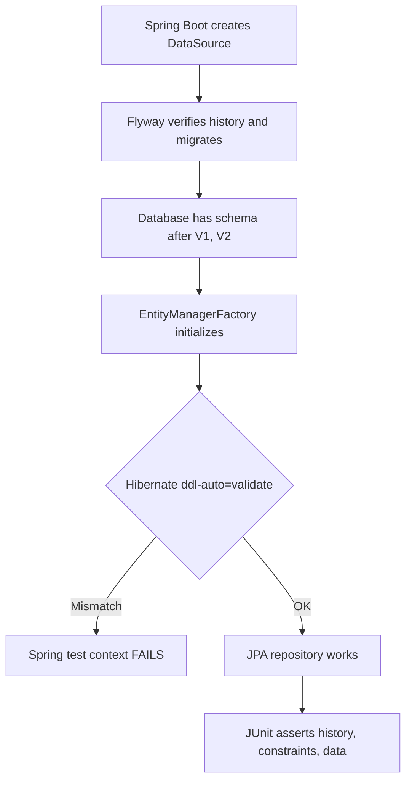

# Spring Data JPA — Verifying Migrations and Schema Instead of Relying on Auto-DDL

## 1. The Real-World Problem

A `Spring Data JPA` test can pass simply because Hibernate generated the tables when the test started. Yet production has a schema built across multiple deployments, data that must be preserved, unique constraints, check constraints, indexes, foreign keys, and concurrent applications. In that world, `spring.jpa.hibernate.ddl-auto=create-drop` **does not prove** database upgrade scripts work.

This lesson walks through verifying **migrations + schema + data** with Spring Boot 3.5, Java 17, Hibernate, Flyway, and JUnit. We will prove that:

1. `V1` and `V2` scripts are applied by Flyway onto a fresh database.
2. Hibernate can use that schema in `validate` mode **without issuing DDL**.
3. Tables, columns, nullability, and indexes actually exist in the database.
4. `UNIQUE`, `NOT NULL`, and `CHECK` constraints are enforced by the database itself.
5. A record created while the schema was at `V1` preserves its data after upgrading to `V2`.
6. Re-running migrations neither duplicates rows nor records a bogus version.
7. Flyway rejects an already-applied `V1` whose checksum was modified.
8. Valid conclusions from H2 are separated from cases requiring real PostgreSQL/Testcontainers.

### Why Does This Matter?

| A Test Might PASS Because… | Yet Reality Can Still Be Broken… |
| --- | --- |
| Hibernate created tables from entities via `create-drop` | File `V2__add_status.sql` has invalid syntax that fails to run |
| Repository `save()` returned an entity | Data was not flushed and DB constraints were never checked |
| `contextLoads` succeeded | An index, check constraint, or foreign key is missing |
| H2 accepted the SQL statement | PostgreSQL rejects that DDL syntax/index/transaction block |
| An empty database migrated cleanly | Legacy rows cause `NOT NULL`/`UNIQUE` in V2 to fail |
| Flyway history still shows `success=true` | A DBA manually altered a table or dropped an index outside Flyway |
| `ddl-auto=validate` reported no errors | Triggers, constraints, privileges, and plans differ from requirements |
| Tests ran only against the latest schema | Old app instances break during a rolling deploy |

**Principle:** to test migrations, **Flyway/Liquibase must own DDL**, while Hibernate only validates; tests must also verify structure, constraints, and upgrades containing real data.

## 2. Hibernate ddl-auto: Choosing the Right Level

Common values for `spring.jpa.hibernate.ddl-auto`:

| Value | Behavior | Suitable for Migration Tests? |
| --- | --- | --- |
| `none` | Hibernate neither creates nor validates the schema | Possible, but misses early entity–table mismatches |
| `validate` | Hibernate checks the schema against supported entity metadata, **without modifying the DB** | **Recommended** |
| `update` | Hibernate may add/alter schema from mappings | **No**; can mask broken migrations |
| `create` | Creates a fresh schema from mappings | **No**; skips the upgrade path |
| `create-drop` | Creates then drops the schema over the context lifecycle | **No**; causes false-green tests |

For quick JPA demos, `create-drop` is sometimes acceptable. When the goal is **verifying migrations**, using it tests the wrong thing.

Recommended configuration in this lesson's project:

```properties
spring.jpa.hibernate.ddl-auto=validate
spring.flyway.enabled=true
spring.sql.init.mode=never
```

`spring.sql.init.mode=never` prevents `schema.sql` or `data.sql` from creating/altering tables outside Flyway. Never let Hibernate auto-DDL, Boot SQL initializers, and Flyway manage **the same schema** simultaneously.

### What Hibernate validate Does and Does Not Do

`validate` detects missing major tables/columns or incompatible types per mapping and dialect. It **is not a comprehensive schema diff tool**; do not conclude UNIQUE/CHECK/FK/indexes are right merely because the context starts. Check JDBC metadata and attempt DML that the DB ought to reject.

## 3. Flyway in Spring Boot

Flyway manages schemas using immutable versioned scripts:

```text
src/main/resources/db/migration/
    V1__create_books.sql
    V2__add_status_and_index.sql
```

- `V` prefix: versioned migration, normally applied once per version.
- `__`: strictly two underscores separating version from description.
- `classpath:db/migration`: default location; configurable via `spring.flyway.locations`.
- `flyway_schema_history`: table tracking version/script/checksum/success and execution order.
- `migrate()`: applies pending migrations per configuration.
- `validate()`: compares applied migrations against current resources to detect checksum edits, renames, missing versions…
- `info()`: inspects current/pending/applied status.
- `repair()`: adjusts history under controlled administrative recovery, **not** an automated fix for failing CI.
- `clean()`: drops Flyway-managed schema objects—**never run on shared/production DBs**.

With Spring Boot 3.5, adding `org.flywaydb:flyway-core` suffices for Boot to integrate Flyway with H2. For modern PostgreSQL, add `flyway-database-postgresql` and a compatible PostgreSQL JDBC driver.

### Initialization Order Matters



Spring Boot coordinates initialization dependencies so Flyway runs migrations before JPA touches the schema. If a migration fails, the context fails instead of Hibernate creating a table to paper over missing DDL.

### Flyway validate Is Not a Complete Schema Validator

If `V1__create_books.sql` was applied and the file is later edited, `validate()` catches the checksum mismatch. However, if someone logs into the DB and manually drops a CHECK constraint without editing the migration file, checksums **still match**. Therefore tests must also inspect schema metadata and execute constraint-violating inserts.

## 4. Choosing the Right Test Layer

| Goal | Tool | Evidence |
| --- | --- | --- |
| Migrations run on an empty DB | Flyway + disposable DB | V1→V2 applied, history shows success |
| Applied scripts have not been altered | `Flyway.validate()` | Checksum and version consistency |
| JPA entities match the new schema | `@SpringBootTest` + Hibernate `validate` | Context boots, repository operates |
| Columns, indexes, nullability exist | `DatabaseMetaData` or database catalog | Physical structure |
| Unique/check/not-null enforced | JDBC INSERT with invalid input | DB throws constraint violation |
| Upgrade preserves existing data | Run Flyway to V1 → insert → upgrade to V2 | Legacy rows remain intact |
| Re-running migrations is safe | Call `migrate()` again on up-to-date DB | Does not re-run V1/V2 or duplicate rows |
| PostgreSQL-specific syntax/types | Testcontainers PostgreSQL | Real vendor verification |
| Performance and locks | PostgreSQL + large data + `EXPLAIN ANALYZE` | Realistic query/DDL cost |

Do not rely on an empty `contextLoads() {}` to prove all of the above. It proves only that this test's context booted; what the schema tool actually produced still needs explicit verification.

## 5. Designing V1 → V2 and the Legacy Data Problem

The sample project has a `books` table. In V1, `books` contains `id`, `isbn`, `title`, `published_year`. In V2:

- Add `status VARCHAR(16) NOT NULL DEFAULT 'AVAILABLE'`.
- Add check constraint `status IN ('AVAILABLE', 'ARCHIVED')`.
- Add index `ix_books_status` for status queries.

Having a default matters: if the table already has V1 rows, adding a `NOT NULL` column without a default or backfill can fail. Here, the database assigns `AVAILABLE` to legacy rows.

### Common Failure Scenario

```sql
-- Likely to fail on a table that ALREADY HAS ROWS.
ALTER TABLE books ADD COLUMN status VARCHAR(16) NOT NULL;
```

For large production tables, never assume a single `ALTER TABLE ... DEFAULT ... NOT NULL` is always cheap. Evaluate locking, table rewrites, table size, and **expand → backfill → contract** on your exact engine/version.

### Constraints Must Live in the Database

| Constraint | Purpose | Why Test via JDBC? |
| --- | --- | --- |
| `UNIQUE(isbn)` | Prevent duplicate ISBNs | Cannot be replaced by Java `existsByIsbn` (race condition) |
| `NOT NULL` | Required field | Independent of writer: JPA, JDBC, ETL |
| `CHECK(published_year BETWEEN 1450 AND 2100)` | Block invalid years | Hibernate `validate` does not prove CHECK |
| `CHECK(status IN (...))` | Block out-of-set statuses | Java String does not enforce DB checks |
| `ix_books_status` | Support status queries | Metadata shows index exists; planner usage tested separately |

## 6. Complete Maven/Java 17 Project

The project focuses on migrations/JPA and thus **uses no HTTP controllers, Docker, or external databases**. There are 7 core test methods; the Testcontainers section afterward is an optional extension.

### 6.1. File Tree

```text
migration-verification-demo/
├── pom.xml
└── src/
    ├── main/
    │   ├── java/example/migrationdemo/
    │   │   ├── MigrationDemoApplication.java
    │   │   ├── Book.java
    │   │   └── BookRepository.java
    │   └── resources/
    │       ├── application.properties
    │       └── db/migration/
    │           ├── V1__create_books.sql
    │           └── V2__add_status_and_index.sql
    └── test/
        ├── java/example/migrationdemo/
        │   ├── SchemaMigrationIntegrationTest.java
        │   └── MigrationUpgradeAndIntegrityTest.java
        └── resources/
            ├── application-test.properties
            └── db/tampered/
                └── V1__create_books.sql
```

The `db/tampered` folder serves strictly for the **negative checksum test** with an explicitly specified location. It is not inside the production migrations folder.

### 6.2. pom.xml

```xml
<?xml version="1.0" encoding="UTF-8"?>
<project xmlns="http://maven.apache.org/POM/4.0.0"
         xmlns:xsi="http://www.w3.org/2001/XMLSchema-instance"
         xsi:schemaLocation="http://maven.apache.org/POM/4.0.0
           https://maven.apache.org/xsd/maven-4.0.0.xsd">
    <modelVersion>4.0.0</modelVersion>

    <parent>
        <groupId>org.springframework.boot</groupId>
        <artifactId>spring-boot-starter-parent</artifactId>
        <version>3.5.0</version>
        <relativePath/>
    </parent>

    <groupId>example</groupId>
    <artifactId>migration-verification-demo</artifactId>
    <version>1.0-SNAPSHOT</version>

    <properties>
        <java.version>17</java.version>
    </properties>

    <dependencies>
        <dependency>
            <groupId>org.springframework.boot</groupId>
            <artifactId>spring-boot-starter-data-jpa</artifactId>
        </dependency>
        <dependency>
            <groupId>org.flywaydb</groupId>
            <artifactId>flyway-core</artifactId>
        </dependency>
        <dependency>
            <groupId>com.h2database</groupId>
            <artifactId>h2</artifactId>
            <scope>runtime</scope>
        </dependency>
        <dependency>
            <groupId>org.springframework.boot</groupId>
            <artifactId>spring-boot-starter-test</artifactId>
            <scope>test</scope>
        </dependency>
    </dependencies>
</project>
```

Spring Boot parent manages Flyway/H2/Hibernate/JUnit versions. Avoid manually pinning a Hibernate or Flyway major version incompatible with the Spring Boot BOM. `h2` at `runtime` scope provides the JDBC driver at runtime/test without needing an external database process.

### 6.3. application.properties

`src/main/resources/application.properties`:

```properties
spring.flyway.enabled=true
spring.flyway.locations=classpath:db/migration

spring.jpa.hibernate.ddl-auto=validate
spring.jpa.open-in-view=false

spring.sql.init.mode=never
spring.main.banner-mode=off
```

`validate` generates no DDL. If a required migration file is removed against a clean database, the test must fail at context startup rather than letting Hibernate synthesize a replacement schema.

### 6.4. application-test.properties

`src/test/resources/application-test.properties`:

```properties
spring.datasource.generate-unique-name=true
spring.jpa.hibernate.ddl-auto=validate
spring.sql.init.mode=never
```

When tests use `@ActiveProfiles("test")`, Boot creates an in-memory H2 datasource with a unique name per context. Never hard-code JDBC URLs pointing to production or a database shared across CI jobs.

### 6.5. V1__create_books.sql

`src/main/resources/db/migration/V1__create_books.sql`:

```sql
CREATE TABLE books (
    id BIGINT GENERATED BY DEFAULT AS IDENTITY PRIMARY KEY,
    isbn VARCHAR(20) NOT NULL,
    title VARCHAR(200) NOT NULL,
    published_year INTEGER NOT NULL,

    CONSTRAINT uq_books_isbn UNIQUE (isbn),
    CONSTRAINT ck_books_year
        CHECK (published_year BETWEEN 1450 AND 2100)
);
```

V1 **omits `status`**. This is intentional so we can test upgrading with legacy data. `GENERATED BY DEFAULT AS IDENTITY` is supported by modern H2 and PostgreSQL; other databases have their own identity/sequence syntax.

### 6.6. V2__add_status_and_index.sql

`src/main/resources/db/migration/V2__add_status_and_index.sql`:

```sql
ALTER TABLE books
    ADD COLUMN status VARCHAR(16)
        DEFAULT 'AVAILABLE' NOT NULL;

ALTER TABLE books
    ADD CONSTRAINT ck_books_status
        CHECK (status IN ('AVAILABLE', 'ARCHIVED'));

CREATE INDEX ix_books_status ON books (status);
```

In a V1 database containing existing rows, the migration populates `status` with `AVAILABLE` to satisfy `NOT NULL`. The SQL also adds the status check constraint and index.

For large production tables, do not copy an instant `ALTER` strategy blindly without measuring lock/scan/DDL runtime; see the rollout section.

### 6.7. MigrationDemoApplication.java

`src/main/java/example/migrationdemo/MigrationDemoApplication.java`:

```java
package example.migrationdemo;

import org.springframework.boot.SpringApplication;
import org.springframework.boot.autoconfigure.SpringBootApplication;

@SpringBootApplication
public class MigrationDemoApplication {
    public static void main(String[] args) {
        SpringApplication.run(MigrationDemoApplication.class, args);
    }
}
```

### 6.8. Book.java

`src/main/java/example/migrationdemo/Book.java`:

```java
package example.migrationdemo;

import jakarta.persistence.Column;
import jakarta.persistence.Entity;
import jakarta.persistence.GeneratedValue;
import jakarta.persistence.GenerationType;
import jakarta.persistence.Id;
import jakarta.persistence.Table;

@Entity
@Table(name = "books")
public class Book {

    @Id
    @GeneratedValue(strategy = GenerationType.IDENTITY)
    private Long id;

    @Column(name = "isbn", nullable = false, length = 20)
    private String isbn;

    @Column(name = "title", nullable = false, length = 200)
    private String title;

    @Column(name = "published_year", nullable = false)
    private Integer publishedYear;

    @Column(name = "status", nullable = false, length = 16)
    private String status;

    protected Book() {
    }

    public Book(String isbn, String title,
                int publishedYear, String status) {
        this.isbn = isbn;
        this.title = title;
        this.publishedYear = publishedYear;
        this.status = status;
    }

    public Long getId() {
        return id;
    }

    public String getIsbn() {
        return isbn;
    }

    public String getTitle() {
        return title;
    }

    public Integer getPublishedYear() {
        return publishedYear;
    }

    public String getStatus() {
        return status;
    }
}
```

The entity matches the **post-V2 schema**. `status` is a `String` so the lesson does not depend on native enum mappings across Hibernate dialects. DB `ck_books_status` still blocks values outside the allowed set. In real projects using Java enums, choose `@Enumerated(EnumType.STRING)` or an appropriate converter, and verify type/enum handling on the real DB.

Never treat `@Column(nullable=false)` as adding `NOT NULL` to the DB in tests: with `ddl-auto=validate`, Hibernate does not alter the schema.

### 6.9. BookRepository.java

`src/main/java/example/migrationdemo/BookRepository.java`:

```java
package example.migrationdemo;

import java.util.Optional;
import org.springframework.data.jpa.repository.JpaRepository;

public interface BookRepository extends JpaRepository<Book, Long> {
    Optional<Book> findByIsbn(String isbn);
}
```

The repository runs only after Flyway creates the schema and Hibernate validates it. In tests, `saveAndFlush` forces Hibernate to execute SQL rather than keeping the entity solely in the persistence context.

## 7. SchemaMigrationIntegrationTest.java — Real Schema Instead of Auto-Create

`src/test/java/example/migrationdemo/SchemaMigrationIntegrationTest.java`:

```java
package example.migrationdemo;

import static org.junit.jupiter.api.Assertions.assertDoesNotThrow;
import static org.junit.jupiter.api.Assertions.assertEquals;
import static org.junit.jupiter.api.Assertions.assertNotNull;
import static org.junit.jupiter.api.Assertions.assertThrows;
import static org.junit.jupiter.api.Assertions.assertTrue;

import java.sql.Connection;
import java.sql.DatabaseMetaData;
import java.sql.ResultSet;
import java.sql.SQLException;
import java.util.List;
import javax.sql.DataSource;
import jakarta.persistence.EntityManagerFactory;

import org.flywaydb.core.Flyway;
import org.junit.jupiter.api.Test;
import org.springframework.beans.factory.annotation.Autowired;
import org.springframework.boot.test.context.SpringBootTest;
import org.springframework.dao.DataIntegrityViolationException;
import org.springframework.jdbc.core.JdbcTemplate;
import org.springframework.test.context.ActiveProfiles;
import org.springframework.transaction.annotation.Transactional;

@SpringBootTest
@ActiveProfiles("test")
class SchemaMigrationIntegrationTest {

    @Autowired
    DataSource dataSource;

    @Autowired
    JdbcTemplate jdbc;

    @Autowired
    Flyway flyway;

    @Autowired
    EntityManagerFactory entityManagerFactory;

    @Autowired
    BookRepository repository;

    @Test
    void flywayHistoryContainsBothSuccessfulVersions() {
        List<String> versions = jdbc.queryForList(
                """
                SELECT version
                FROM flyway_schema_history
                WHERE success = TRUE AND version IS NOT NULL
                ORDER BY installed_rank
                """,
                String.class);

        assertEquals(List.of("1", "2"), versions);
        assertDoesNotThrow(() -> flyway.validate());
        assertNotNull(entityManagerFactory);
    }

    @Test
    void expectedColumnPropertiesAndIndexExist()
            throws SQLException {
        try (Connection connection = dataSource.getConnection()) {
            DatabaseMetaData metadata = connection.getMetaData();

            // H2 stores unquoted identifier names in UPPERCASE.
            try (ResultSet columns = metadata.getColumns(
                    null, null, "BOOKS", "STATUS")) {
                assertTrue(columns.next(),
                        "V2 must add BOOKS.STATUS");
                assertEquals(16, columns.getInt("COLUMN_SIZE"));
                assertEquals(
                        DatabaseMetaData.columnNoNulls,
                        columns.getInt("NULLABLE"));
            }

            boolean found = false;
            try (ResultSet indexes = metadata.getIndexInfo(
                    null, null, "BOOKS", false, false)) {
                while (indexes.next()) {
                    if ("IX_BOOKS_STATUS".equalsIgnoreCase(
                            indexes.getString("INDEX_NAME"))) {
                        found = true;
                    }
                }
            }

            assertTrue(found, "V2 must create ix_books_status");
        }
    }

    @Test
    @Transactional
    void repositoryCanPersistWithMigratedColumns() {
        Book saved = repository.saveAndFlush(
                new Book(
                        "ISBN-REPO-001",
                        "Database Migration",
                        2025,
                        "AVAILABLE"));

        assertNotNull(saved.getId());

        Book read = repository.findByIsbn("ISBN-REPO-001")
                .orElseThrow();

        assertEquals("Database Migration", read.getTitle());
        assertEquals(2025, read.getPublishedYear());
        assertEquals("AVAILABLE", read.getStatus());

        // Test transaction rolls back after method.
    }

    @Test
    void databaseRejectsDuplicateIsbn() {
        String isbn = "ISBN-UNIQUE-001";

        try {
            jdbc.update(
                    """
                    INSERT INTO books
                        (isbn, title, published_year, status)
                    VALUES (?, ?, ?, ?)
                    """,
                    isbn, "First", 2020, "AVAILABLE");

            assertThrows(DataIntegrityViolationException.class,
                    () -> jdbc.update(
                            """
                            INSERT INTO books
                                (isbn, title, published_year, status)
                            VALUES (?, ?, ?, ?)
                            """,
                            isbn, "Second", 2021, "AVAILABLE"));
        } finally {
            jdbc.update("DELETE FROM books WHERE isbn = ?", isbn);
        }
    }

    @Test
    void databaseRejectsInvalidYearAndStatus() {
        assertThrows(DataIntegrityViolationException.class,
                () -> jdbc.update(
                        """
                        INSERT INTO books
                            (isbn, title, published_year, status)
                        VALUES (?, ?, ?, ?)
                        """,
                        "ISBN-BAD-YEAR",
                        "Too Early",
                        1200,
                        "AVAILABLE"));

        assertThrows(DataIntegrityViolationException.class,
                () -> jdbc.update(
                        """
                        INSERT INTO books
                            (isbn, title, published_year, status)
                        VALUES (?, ?, ?, ?)
                        """,
                        "ISBN-BAD-STATUS",
                        "Unsupported",
                        2025,
                        "UNKNOWN"));

        assertThrows(DataIntegrityViolationException.class,
                () -> jdbc.update(
                        """
                        INSERT INTO books
                            (isbn, title, published_year, status)
                        VALUES (?, ?, ?, ?)
                        """,
                        null,
                        "Missing ISBN",
                        2025,
                        "AVAILABLE"));
    }
}
```

**There are 5 `@Test` methods**, namely:

| Test | Evidence | What It Does Not Prove Alone |
| --- | --- | --- |
| `flywayHistoryContainsBothSuccessfulVersions` | History has V1/V2 success; checksum validates | Physical schema was never altered manually |
| `expectedColumnPropertiesAndIndexExist` | STATUS has right size/nullability and index exists | DB query planner definitely uses the index |
| `repositoryCanPersistWithMigratedColumns` | Entity mapping and JPA queries work | Upgrading from V1 preserved data |
| `databaseRejectsDuplicateIsbn` | DB enforces real UNIQUE | All race conditions are handled |
| `databaseRejectsInvalidYearAndStatus` | DB enforces real CHECK and NOT NULL | Every domain invariant lives in the database |

### Why Is `saveAndFlush` Mandatory?

`repository.save(...)` may only add the entity to the persistence context depending on ID strategy/transaction, and assertions on the Java object do not prove SQL executed. `saveAndFlush(...)` forces the ORM to flush changes to the DB. Tests must verify data via queries or observe real constraint exceptions.

### Transactions and Cleanup

The repository test method has `@Transactional`, so the Spring test transaction normally rolls back afterward. The direct `JdbcTemplate` tests have no outer test transaction, so `finally` deletes the row for that test's ISBN. Never call `DELETE FROM books` or `repository.deleteAll()` in teardown if other tests sharing the context could be running.

With PostgreSQL, a unique/check violation inside an explicit transaction puts the transaction into an aborted state; you must roll back before running subsequent SQL. The H2 example uses JDBC autocommit outside a test transaction so assertions remain independent.

### Metadata Casing

`DatabaseMetaData.getColumns(..., "BOOKS", "STATUS")` fits H2 for unquoted identifiers. PostgreSQL normally stores unquoted identifiers in lowercase; never copy uppercase assumptions blindly to PostgreSQL and assume columns are missing.

## 8. MigrationUpgradeAndIntegrityTest.java — Upgrading from V1 with Existing Data

A passing fresh install does not prove migrations work on a database containing legacy rows. The second test uses the Flyway Java API with a **brand-new H2 database**, applies V1 only, inserts a legacy row, and then applies V2.

`src/test/java/example/migrationdemo/MigrationUpgradeAndIntegrityTest.java`:

```java
package example.migrationdemo;

import static org.junit.jupiter.api.Assertions.assertEquals;
import static org.junit.jupiter.api.Assertions.assertThrows;
import static org.junit.jupiter.api.Assertions.assertTrue;

import java.sql.Connection;
import java.sql.DriverManager;
import java.sql.PreparedStatement;
import java.sql.ResultSet;
import java.sql.Statement;
import java.util.UUID;

import org.flywaydb.core.Flyway;
import org.flywaydb.core.api.exception.FlywayValidateException;
import org.junit.jupiter.api.Test;

class MigrationUpgradeAndIntegrityTest {

    private static String newH2Url(String prefix) {
        return "jdbc:h2:mem:" + prefix
                + UUID.randomUUID().toString().replace("-", "")
                + ";DB_CLOSE_DELAY=-1";
    }

    private static Flyway configured(
            String url, String location) {
        return Flyway.configure()
                .dataSource(url, "sa", "")
                .locations(location)
                .load();
    }

    @Test
    void upgradingFromV1PreservesRowsAndBackfillsStatus()
            throws Exception {
        String url = newH2Url("upgrade_");

        Flyway versionOne = Flyway.configure()
                .dataSource(url, "sa", "")
                .locations("classpath:db/migration")
                .target("1")
                .load();

        versionOne.migrate();

        // Legacy row created before the status column existed.
        try (Connection connection =
                     DriverManager.getConnection(url, "sa", "");
             PreparedStatement insert =
                     connection.prepareStatement(
                         """
                         INSERT INTO books
                             (isbn, title, published_year)
                         VALUES (?, ?, ?)
                         """)) {
            insert.setString(1, "ISBN-LEGACY-001");
            insert.setString(2, "Legacy Book");
            insert.setInt(3, 2001);
            assertEquals(1, insert.executeUpdate());
        }

        // Upgrade from V1 to all current migrations (V2).
        Flyway latest = configured(url, "classpath:db/migration");
        latest.migrate();
        latest.validate();

        try (Connection connection =
                     DriverManager.getConnection(url, "sa", "");
             PreparedStatement query =
                     connection.prepareStatement(
                         """
                         SELECT title, published_year, status
                         FROM books WHERE isbn = ?
                         """)) {
            query.setString(1, "ISBN-LEGACY-001");
            try (ResultSet rows = query.executeQuery()) {
                assertTrue(rows.next());
                assertEquals("Legacy Book", rows.getString("title"));
                assertEquals(2001, rows.getInt("published_year"));
                assertEquals("AVAILABLE", rows.getString("status"));
            }
        }

        // Idempotency: migrating again does not duplicate data.
        latest.migrate();

        try (Connection connection =
                     DriverManager.getConnection(url, "sa", "");
             Statement statement = connection.createStatement()) {

            try (ResultSet history = statement.executeQuery(
                    """
                    SELECT COUNT(*) AS total
                    FROM flyway_schema_history
                    WHERE success = TRUE AND version IS NOT NULL
                    """)) {
                assertTrue(history.next());
                assertEquals(2, history.getInt("total"));
            }

            try (ResultSet rows = statement.executeQuery(
                    """
                    SELECT COUNT(*) AS total FROM books
                    WHERE isbn = 'ISBN-LEGACY-001'
                    """)) {
                assertTrue(rows.next());
                assertEquals(1, rows.getInt("total"));
            }
        }
    }

    @Test
    void changingPreviouslyAppliedV1FailsFlywayValidation() {
        String url = newH2Url("checksum_");

        Flyway originalV1 = Flyway.configure()
                .dataSource(url, "sa", "")
                .locations("classpath:db/migration")
                .target("1")
                .load();

        originalV1.migrate();

        // Location is in test resources only, never use for production.
        Flyway tampered = configured(
                url, "classpath:db/tampered");

        assertThrows(FlywayValidateException.class,
                () -> tampered.validate());
    }
}
```

**There are 2 `@Test` methods** in this class.

### Why Use target("1")?

`target("1")` limits migration execution to V1 on a **fresh database**, rather than rolling back a DB already at V2. To test upgrading from an older state, you must **reconstruct that older state first** and then apply newer migrations.

`DB_CLOSE_DELAY=-1` keeps the in-memory H2 database alive across connections opened by Flyway and JDBC. UUID-suffixed DB names prevent tests from interfering with one another. This setup creates only disposable JVM test databases; never use it as a production JDBC URL.

### Idempotency Differs from Rollback

After V2, calling `latest.migrate()` again should not re-execute either versioned migration. The test counts 2 successful versions and 1 legacy row. This **does not prove migration rollback** or undo feasibility: rollback/roll-forward requires dedicated design depending on DDL and data changes.

## 9. Test Catching a Modified Migration Checksum

Failure-test fixture at `src/test/resources/db/tampered/V1__create_books.sql`:

```sql
-- Test-only fixture: same version but intentionally different SQL.
-- DO NOT use this file as a production migration.
CREATE TABLE books (
    id BIGINT PRIMARY KEY
);
```

`changingPreviouslyAppliedV1FailsFlywayValidation` does the following:

1. Applies the **real V1** from `classpath:db/migration` onto a fresh DB, recording its checksum in history.
2. Creates another Flyway instance reading the **tampered V1** from `classpath:db/tampered`.
3. Calls `tampered.validate()` and requires `FlywayValidateException`.
4. Never calls `tampered.migrate()` or `repair()`.

A `@Test` **PASSES when `assertThrows` catches the expected exception**. Rejecting an altered applied script is the desired behavior.

### What If a DBA Alters the Schema Manually?

Flyway `validate` compares migration resources against history, without necessarily inspecting every physical DB object. If the V1 script is untouched yet an index was dropped manually, checksums still match. That is why alongside checksum tests we test `DatabaseMetaData.getIndexInfo`, constraints, and DML behavior.

## 10. Running the Examples

From the `migration-verification-demo` directory with JDK 17+ and Maven:

```bash
mvn test
```

Or run individually:

```bash
mvn test -Dtest=SchemaMigrationIntegrationTest
mvn test -Dtest=MigrationUpgradeAndIntegrityTest
```

| Class | Method Count | Goal |
| --- | ---: | --- |
| `SchemaMigrationIntegrationTest` | 5 | Fresh migrations/history, mapping, metadata, constraints |
| `MigrationUpgradeAndIntegrityTest` | 2 | V1→V2 data upgrade, detecting checksum drift |
| **Total** | **7** | No Docker, external network, or HTTP server needed |

**Expected:** 7 tests pass, 0 failed, 0 skipped in a compatible environment. This is an expected outcome based on the sample code, **not already-executed run output**. Do not hardcode startup times, DB names, or log lines since Spring/Flyway/H2 formatting varies. Inspect `target/surefire-reports` to verify the exact test count executed.

### Interpreting Results

| Result | Meaning |
| --- | --- |
| V1/V2 success in history | Flyway executed scripts on the test DB |
| `Flyway.validate()` PASS | Resources match test DB history |
| JPA context with `ddl-auto=validate` PASS | Mapping/physical schema compatible per Hibernate validator |
| `STATUS` column and index visible in metadata | V2 altered structure accurately |
| JDBC duplicate ISBN/invalid status rejected | DB constraints actively protect data |
| Legacy row survives with status `AVAILABLE` | V2 preserved/backfilled legacy data |
| Tampered checksum rejected | Applied migrations cannot be silently edited |

Never report “migration tests PASS” just because `mvn test` exited 0 while tests were filtered out, disabled, or undiscovered by Surefire/JUnit.

## 11. What H2 Fits and What It Does Not Fit

In-memory H2 runs very fast, making basic SQL checks convenient and keeping PR pipelines light. However, H2 differs from PostgreSQL/MySQL on:

- SQL dialects, identity/sequences, `JSONB`, native enums, arrays.
- Expression/partial indexes, collations, and default expressions.
- Foreign key/transaction semantics, isolation levels, and locks.
- Transactional DDL behavior and concurrency.
- Time zones, timestamp precision, casting, and function implementations.
- Query planner, performance, and optimizer statistics.
- Vendor-specific migrations, stored procedures, and extensions.

H2's `MODE=PostgreSQL` does not turn it into real PostgreSQL. If production runs PostgreSQL, use Testcontainers PostgreSQL for high-risk migrations.

### When a Production-Like Database Is Mandatory

| Change | Is an H2 Smoke Test Enough? | Need PostgreSQL/Testcontainers? |
| --- | --- | --- |
| Adding a simple VARCHAR column | H2 is helpful | Should still have a real-DB integration gate for major releases |
| Creating a partial index | No | **Yes** |
| Adding a JSONB/GIN index | No | **Yes** |
| Adding an FK on a large table | Does not prove lock/performance safety | **Yes** |
| Backfilling millions of records | No | **Yes**, representative staging dataset |
| Using `CREATE INDEX CONCURRENTLY` | No | **Yes**, requires proper transaction handling |
| Changing SQL types or enums | Dialect risk | **Yes** |
| Changing DDL/runtime DB user privileges | No | **Yes**, test in environment/staging |

## 12. PostgreSQL Testcontainers Extension

When Docker or a compatible container runtime and dedicated CI job exist, add Spring Boot 3.5 dependencies:

```xml
<!-- PostgreSQL driver and Flyway database-specific support. -->
<dependency>
    <groupId>org.postgresql</groupId>
    <artifactId>postgresql</artifactId>
    <scope>runtime</scope>
</dependency>
<dependency>
    <groupId>org.flywaydb</groupId>
    <artifactId>flyway-database-postgresql</artifactId>
</dependency>

<!-- Add only in container test module/job. -->
<dependency>
    <groupId>org.springframework.boot</groupId>
    <artifactId>spring-boot-testcontainers</artifactId>
    <scope>test</scope>
</dependency>
<dependency>
    <groupId>org.testcontainers</groupId>
    <artifactId>postgresql</artifactId>
    <scope>test</scope>
</dependency>
```

Example configuration (optional file, **outside the core H2 project**):

```java
package example.migrationdemo;

import org.springframework.boot.test.context.TestConfiguration;
import org.springframework.boot.testcontainers.service.connection.ServiceConnection;
import org.springframework.context.annotation.Bean;
import org.testcontainers.containers.PostgreSQLContainer;

@TestConfiguration(proxyBeanMethods = false)
public class PostgresContainerConfiguration {

    @Bean
    @ServiceConnection
    PostgreSQLContainer<?> postgresContainer() {
        return new PostgreSQLContainer<>("postgres:16-alpine");
    }
}
```

Test against the new DB server:

```java
package example.migrationdemo;

import static org.junit.jupiter.api.Assertions.assertTrue;

import org.junit.jupiter.api.Test;
import org.springframework.beans.factory.annotation.Autowired;
import org.springframework.boot.test.context.SpringBootTest;
import org.springframework.context.annotation.Import;
import org.springframework.jdbc.core.JdbcTemplate;
import org.springframework.test.context.ActiveProfiles;

@SpringBootTest
@ActiveProfiles("test")
@Import(PostgresContainerConfiguration.class)
class PostgresMigrationTest {

    @Autowired
    JdbcTemplate jdbc;

    @Test
    void flywayCreatedSchemaOnRealPostgres() {
        Integer count = jdbc.queryForObject(
                """
                SELECT COUNT(*) FROM flyway_schema_history
                WHERE success = TRUE AND version IS NOT NULL
                """,
                Integer.class);

        assertTrue(count != null && count >= 2);
    }
}
```

**This is an optional 8th test**, excluded from the 7 core H2 tests. Add it to the project/module only where Docker jobs can run; putting it directly in `src/test` makes `mvn test` require a container runtime.

`@ServiceConnection` supplies the container's JDBC connection details so Boot auto-configures the datasource; Flyway and JPA share that datasource. Spring Boot manages the `@Bean` container lifecycle alongside the application context, supporting test context caching. Avoid spinning up a fresh container per method unnecessarily, or letting a container stop while a cached context still points to it.

To genuinely verify the **PostgreSQL schema**, extend tests to read `information_schema`/`pg_catalog`, insert constraint-violating rows, exercise indexes, and test upgrading legacy data. Querying only history as shown above is a smoke test, not full production-fidelity coverage.

### Important Note on Indexes

`CREATE INDEX CONCURRENTLY` in PostgreSQL cannot run inside a normal transaction block. When using Flyway with such DDL, review Flyway's transaction-mode configuration for your version and isolate migrations when needed. Never guess based on H2 behavior or default migration settings.

## 13. `@DataJpaTest` and the Risk of Silent Replacement by H2

`@DataJpaTest` is a great slice for repository tests, yet when an embedded database is on the classpath, test auto-configuration can replace the datasource with H2. If you intend to test PostgreSQL migrations while the datasource silently switches to H2, tests pass on the wrong engine.

With Spring Boot 3.5, to preserve the Testcontainers datasource:

```java
@DataJpaTest
@AutoConfigureTestDatabase(
    replace = AutoConfigureTestDatabase.Replace.NONE)
class PostgresRepositoryTest {
    // Combine container configuration and assertions.
}
```

This snippet requires container/test imports and config; it is **not standalone runnable**. In Boot 3.5, `@DataJpaTest` lives in `org.springframework.boot.test.autoconfigure.orm.jpa.DataJpaTest` and `@AutoConfigureTestDatabase` in `org.springframework.boot.test.autoconfigure.jdbc`. Boot 4 modularizes test packages, so do not blindly reuse 3.5 imports.

Never combine `@DataJpaTest` and `@SpringBootTest` on the same class “for extra coverage”: they configure conflicting bootstraps. Pick one test annotation matching your goal and configure the datasource explicitly.

## 14. `@Transactional` and Test Data

Spring TestContext normally rolls back DML inside `@Transactional` test methods, yet:

- Flyway migrations run during context initialization, **before** any test method transaction.
- `@Transactional` does not roll back V1/V2 after the test.
- Database engines differ in transactional DDL support.
- `RANDOM_PORT` HTTP servers run separate transactions; client-side test rollback does not undo server commits.
- External side effects on brokers, filesystems, or external services do not roll back with DB transactions.

Therefore:

1. Use dedicated **disposable databases/schemas** for migration/upgrade tests.
2. For repository behavior, `@Transactional` rollback works well.
3. For autocommit JDBC fixture inserts, clean up only rows owned by that test (e.g., unique ISBNs).
4. If a test exception leaves a PostgreSQL transaction aborted, roll back before reusing that connection.
5. Never call `Flyway.clean()` against a datasource that could ever point to production/shared DBs.
6. Never put unconditional `DELETE FROM books` teardowns in CI if tests may run in parallel.

## 15. Testing Hibernate validate Failure When Schema Mismatches

An advanced test can boot a Spring context **with V1 only** while the entity already declares `status` (requiring V2). With Hibernate `ddl-auto=validate`, the context must FAIL because the `status` column is missing.

To test this scenario on a disposable database:

1. Create a fresh H2/PG database and migrate only up to V1.
2. **Disable auto-migrating V2** in the context under test; if Boot runs V2 automatically, no mismatch remains.
3. Boot the JPA context with the `Book` entity expecting `STATUS` and `ddl-auto=validate`.
4. Assert startup fails with root cause `SchemaManagementException` or the equivalent Hibernate/Spring exception.
5. Destroy the isolated context/DB without sharing instances with other tests.

This is an **advanced exercise**, omitted from the 7 runnable tests because deliberately failing `ApplicationContext` startup requires an isolated bootstrapper (such as a context runner) so setup errors do not break the suite. Never use such failures as an excuse to enable `ddl-auto=update` in pipelines.

## 16. Moving Legacy Projects from Auto-Create to Flyway

If a project previously used Hibernate `create/update` against an existing DB:

1. Audit the real schema, constraints, and indexes across every environment.
2. Author a standardized initial migration for fresh installs matching that schema.
3. Choose a valid baseline version for **verified legacy databases**.
4. Execute baselining per runbook, rather than blindly enabling `spring.flyway.baseline-on-migrate=true` everywhere.
5. Add new migrations starting at the next version, with upgrade tests using representative data.
6. Switch Hibernate to `ddl-auto=validate` and disable competing `schema.sql`/`data.sql`.
7. Verify fresh installs, legacy upgrades, checksum integrity, and business data in CI.
8. Across multiple environments, inspect history/versions before each deploy.

`baselineOnMigrate` is useful in a planned migration strategy, yet enabling it carelessly can treat an unknown DB as valid and skip essential DDL. Never use `repair()` to silence checksum drift without investigating history and change processes.

## 17. Expand → Backfill → Contract for Safe Rollouts

When app versions N and N+1 run simultaneously against the same schema, immediately renaming or dropping a column breaks version N. For example, changing `full_name` to `display_name`:

- **Expand:** add `display_name` while keeping `full_name`.
- **Dual-read/dual-write:** during transition, app N+1 reads the old column if the new one is empty and syncs writes per policy.
- **Backfill:** copy legacy data into the new column in checkpointed batches.
- **Verify:** check row counts, nulls/duplicates/outliers, and monitor in staging.
- **Switch:** deploy a version reading only the new field once backfill completes.
- **Contract:** in a later migration, apply final constraints and drop the old column once zero N instances remain.

Test N and N+1 compatibility against the transitional schema whenever zero-downtime deployment is required. Never equate “fresh V2 migrate PASSES” with “safe rolling deploy”.

### Rollback and Roll-Forward

Many DDL/destructive operations cannot be reversed once data is dropped. In production:

- Maintain backups/snapshots and practice restore drills.
- Prefer backward-compatible migrations and roll-forward recovery via Vn+1.
- Defer `DROP COLUMN`/`DROP TABLE` until old code is completely retired.
- Test lock timeouts, batch backfills, retries, and idempotency at the data-access layer.
- Never assume Flyway provides automatic safe undo migrations for arbitrary changes.

## 18. Liquibase: An Alternative to Flyway

Spring Boot also supports Liquibase with changelogs (YAML/XML/SQL), `DATABASECHANGELOG`, and checksums. When teams pick Liquibase, testing principles remain equivalent:

- A clean database applies the full changelog cleanly.
- Hibernate uses `ddl-auto=validate`.
- Verify physical schema, constraints, indexes, and JPA behavior.
- Upgrade from a legacy DB with existing data and verify backfill.
- Verify history/checksums and approved change processes.
- Run against the target DB engine when vendor-specific SQL is used.
- Test rollback only when changesets explicitly design safe rollbacks.

**Never let both Flyway and Liquibase manage the same schema** without explicit schema/permission boundaries. Nor should you mix `schema.sql` and Hibernate auto-creation, accidentally creating three competing sources of truth.

## 19. Recommended CI/CD Gates

| Stage | Checks | When It FAILS |
| --- | --- | --- |
| PR static review | `Vn` filenames, no edits to applied versions, SQL review | Duplicate version, unreviewed destructive DDL |
| Fast H2 integration | Fresh migrate, Hibernate `validate`, constraint tests | Missing/broken migrations, wrong DB constraints |
| Upgrade tests | V1 data → V2 schema | Data loss, wrong backfill, upgrade failure |
| Flyway integrity | `validate()`/checksum test | Applied file was modified |
| PostgreSQL Testcontainers | Vendor SQL, type/index/lock behavior | SQL/DDL fails on real DB |
| Staging rehearsal | Large anonymized data, migration duration | Lock time/latency exceeds budget |
| Production rollout | Backups, version history, permissions, metrics | DB version drift, migration failure |
| Post-deploy | Health, error rates, query plans, data consistency | Contract/observability regression |

Critical releases must actually execute tests, not merely report “skipped” because CI lacked Docker. Separate H2 jobs and PostgreSQL jobs with explicit required checks rather than letting assumptions turn pipelines falsely green.

## 20. Troubleshooting

| Symptom | Cause | Resolution |
| --- | --- | --- |
| Repository tests PASS even after deleting SQL migrations | Hibernate is set to `create-drop`/`update` | Switch to `validate`, verify history |
| `Schema-validation: missing table` | Flyway didn't run, wrong folder, wrong datasource | Check `spring.flyway.locations` and startup logs |
| `Schema-validation: missing column` | Entity ahead of migrations | Add next `Vn` migration; never patch with `update` |
| Wrong column type | SQL vs. JPA type/dialect mismatch | Check vendor types, mappings, dialects |
| Non-empty schema without history | DB wasn't managed by Flyway before | Design deliberate baseline; do not auto-baseline blindly |
| Flyway checksum mismatch | Previously deployed `Vn` was edited | Restore `Vn`, add a new migration |
| Migration applied but file missing | Resource deleted/renamed or wrong classpath | Restore file matching release history |
| Flyway doesn't recognize PostgreSQL | Missing `flyway-database-postgresql` | Add module and JDBC driver |
| H2 PASSES, PostgreSQL FAILS | Dialect/transaction/enum/index differences | Use Testcontainers for the target engine |
| CHECK missing despite `@Column` | Hibernate `validate` doesn't verify all constraints | Assert invalid inserts fail |
| UNIQUE not enforced | Migration omitted the constraint | JDBC duplicate-insert test |
| Migration fails on legacy rows | Unaccounted backfill/NOT NULL/UNIQUE/CAST | Upgrade tests with legacy rows |
| Test hits aborted transaction after failed insert | PostgreSQL transaction needs rollback | Roll back or use isolated transactions |
| Tests in suite leak rows into each other | Shared H2 URL/test data | Unique DBs, clean up by owned ISBN |
| Schema validator PASSES yet index was dropped | Validator doesn't verify all indexes | `DatabaseMetaData` + performance tests |
| `schema.sql` hides Flyway bugs | Multiple schema initializers active | Choose a single schema owner |
| `repair()` run to “fix” mismatches | History edited without audit | Investigate and restore SQL or add new version |
| Long production migration locks | DDL/index/backfill on large table | Rehearse on representative dataset |
| Boot 4 dependency errors | Reorganized test/Flyway starters | Use modules matching Boot major version |
| Build SUCCEEDS without running migration tests | Surefire filters, naming, disabled tests | Verify executed test count in reports |

Good debugging sequence: inspect the **root `Caused by`**, confirm which datasource is active, check Flyway history and pending migrations, verify `ddl-auto`, and test SQL directly on the target engine. Never turn off Flyway or revert to `create-drop` just to make a pipeline green.

## 21. Final Checklist

- [ ] Is Flyway/Liquibase the sole schema owner?
- [ ] Is Hibernate set to `ddl-auto=validate` instead of `create`/`create-drop`/`update` in migration tests?
- [ ] Does the test profile avoid production and explicitly set `spring.sql.init.mode=never`?
- [ ] Does a fresh database apply all versioned migrations cleanly?
- [ ] Does `flyway_schema_history` record expected versions and success?
- [ ] Does `Flyway.validate()` run in CI to catch checksum drift?
- [ ] Do JPA entities/repositories run against the migration-created schema?
- [ ] Are column types, lengths, nullability, and indexes verified via metadata?
- [ ] Are UNIQUE, NOT NULL, CHECK/FK verified via invalid DML?
- [ ] Are there upgrade tests from older schemas **containing existing data**?
- [ ] Is legacy data preserved with accurate status/defaults/backfills?
- [ ] Is re-running migrations idempotent without duplicating rows or versions?
- [ ] Are deployed `Vn` files treated as immutable without careless `repair()` calls?
- [ ] Are test DB isolation, transactions, and cleanup controlled?
- [ ] Avoided promoting H2 as proof of PostgreSQL production fidelity?
- [ ] Do PostgreSQL Testcontainers tests run when vendor-specific DDL exists?
- [ ] Is there an expand/backfill/contract plan for rolling deploys?
- [ ] Are destructive migrations protected with backups/restores/rehearsals?
- [ ] Does CI enforce required test counts rather than counting skipped as success?
- [ ] On Boot major upgrades, checked updated Flyway modules and test imports?

## 22. Official Documentation

1. [Spring Boot 3.5 — Database Initialization](https://docs.spring.io/spring-boot/3.5/how-to/data-initialization.html): `ddl-auto`, Flyway, initialization ordering, and single-schema-manager guidance.
2. [Spring Boot 3.5 — Testing Spring Boot Applications](https://docs.spring.io/spring-boot/3.5/reference/testing/spring-boot-applications.html): `@SpringBootTest`, test context, `@DataJpaTest`.
3. [Spring Boot 3.5 — Testcontainers](https://docs.spring.io/spring-boot/3.5/reference/testing/testcontainers.html): `@ServiceConnection` and container lifecycles.
4. [Flyway — Java API](https://documentation.red-gate.com/flyway/reference/usage/api-java): `Flyway.configure`, migrate, validate.
5. [Flyway — Target Setting](https://documentation.red-gate.com/fd/flyway-target-setting-277579044.html): target versions to build V1 before upgrading to V2.
6. [Flyway — Validate](https://documentation.red-gate.com/flyway/reference/commands/validate): checksums and version history.
7. [Hibernate ORM 6.6 User Guide](https://docs.hibernate.org/orm/6.6/userguide/html_single/): entity mappings/schema validation.
8. [H2 Database Migration to 2.0](https://h2database.github.io/html/migration-to-v2.html): identity SQL and metadata in H2.
9. [PostgreSQL CREATE TABLE](https://www.postgresql.org/docs/current/sql-createtable.html): constraints, generated identity.
10. [Testcontainers PostgreSQL](https://java.testcontainers.org/modules/databases/postgres/): PostgreSQL container integration.
11. [Spring Boot Reference — Database Initialization](https://docs.spring.io/spring-boot/how-to/data-initialization.html): updates for Spring Boot 4.

### Spring Boot 4 Note

The full runnable project above targets **Boot 3.5.0/Java 17** with `org.flywaydb:flyway-core`. Spring Boot 4 reorganizes starters and test modules (such as `spring-boot-starter-flyway` for embedded databases) and moves `@DataJpaTest`'s package. When upgrading majors, verify the Boot BOM, vendor modules, and test auto-configuration against official docs rather than only bumping the POM version while keeping old imports.

**Remember:** a “repository saves cleanly” test is only one small piece. Trustworthy proof combines **Flyway creating/upgrading the schema → Hibernate only validating → checking history/checksums → verifying real constraints/indexes → ensuring V1 rows survive V2 → testing on the production DB vendor when needed**.